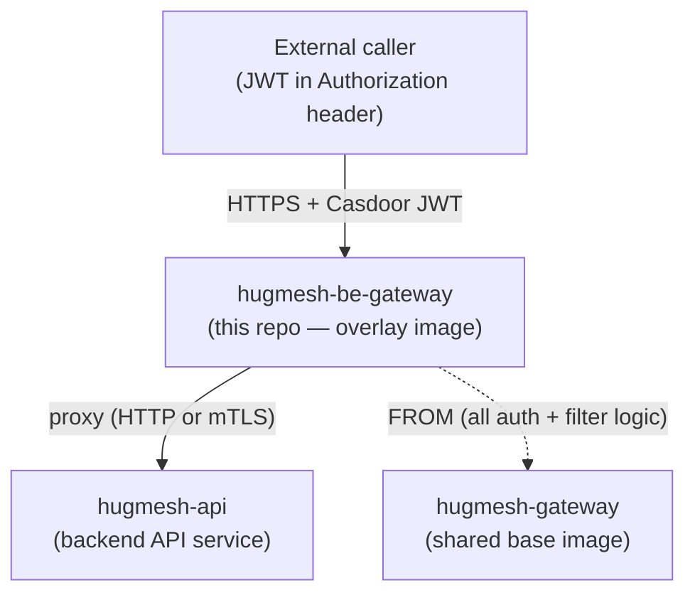
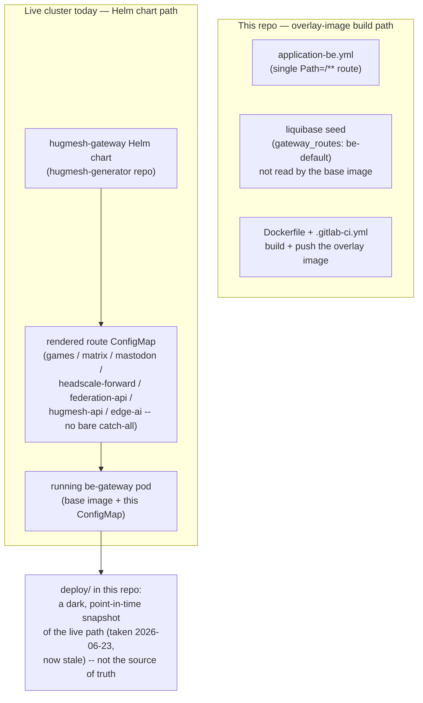
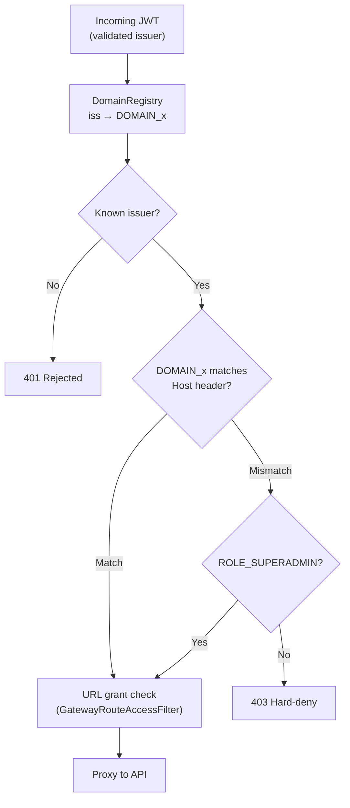

The **backend front door** of a HugMesh brand. It is a per-brand deployment of the
shared [hugmesh-gateway](https://github.com/hugmesh/hugmesh-gateway)
Spring Cloud Gateway, placed in the **backend tier** in front of the
backend API and the social homeservers (Matrix / Mastodon).

This repo is **not its own service codebase**. It holds no gateway code: a
`Dockerfile`, one config file and a Liquibase changelog that nothing reads. It
re-uses the audited `hugmesh-gateway` image and changes three things:

1. its **identity** — `SPRING_APPLICATION_NAME=hugmesh-be-gateway`;
2. its **route set** — a single catch-all `Path=/**` route to the backend API;
3. its **downstream URI** — the in-cluster API service URL.

The base image supplies the rest unchanged: the OAuth2 resource server, the
JWT-to-authority conversion, domain scoping, per-gateway route-access
enforcement, revocation and downstream mTLS. Every device runs the same audited
gateway code.



```bash
# GATEWAY_IMAGE must point at the sibling hugmesh-gateway image.
# CI resolves this automatically from the same namespace (see .gitlab-ci.yml);
# for local builds, supply whatever tag you have pulled locally.
docker build --build-arg GATEWAY_IMAGE=hugmesh-systems/hugmesh-gateway:dev \
  -t hugmesh-systems/be-gateway:dev .
```

---

## Status

- **Last synced:** 2026-10-07
- **The overlay config loads (PR #17, 2026-07-17).** `application-be.yml` is a
  profile document (`application-{profile}.yml`).
  `SPRING_CONFIG_ADDITIONAL_LOCATION` adds a config *search directory*; it does
  **not** activate a profile. The `Dockerfile` now sets
  `ENV SPRING_PROFILES_ACTIVE=be`, so the file is read. Before the fix the overlay
  route never loaded. The image fell back to the base image's packaged
  `application.yml` (an `api-default` `/api/**` route) and served the wrong
  routes, with no error. The dark `deploy/deployment.yaml` copy got the matching
  `SPRING_PROFILES_ACTIVE=routes` line in the same PR. That path stays latent
  until the Forgejo cutover.
- **Rebrand to HugMesh (PR #18, 2026-07-22).** Renamed: the image name,
  `SPRING_APPLICATION_NAME`, k8s resource names and labels, the `hugmesh-backend`
  namespace literal, and the domain-derived defaults (`id.hugmesh.net`
  issuer, `api./scale./games.hugmesh.net` ingress hosts). The Cassandra keyspace
  literal in `deploy/deployment.yaml` kept its old spelling at first, pending a
  real keyspace migration. It now reads `hugmesh_gateway`. Cassandra cannot rename
  a keyspace in place, so an existing mesh must reseed, or copy its data
  keyspace-to-keyspace, before it deploys this. `deploy/` ships dark, so the
  rename has no live effect yet.
- **Baseline:** Spring Boot 4.0.7, Spring Cloud 2025.1.2, Java 25, inherited
  through the `hugmesh-gateway` image. That image keeps
  `spring-boot-starter-parent` and skips the `hugmesh-parent`
  metapom, which is BFF-focused and would drag in Liquibase,
  testcontainers-postgres and r2dbc-postgres scaffolding that the gateway's
  Cassandra-based suite does not use. It pins `hugmesh-commons` as a
  **direct dependency at 2.1.0** for its security and tenancy types.
  (`hugmesh-parent`'s own version is 2.8.0; that is not a commons version.) This
  overlay has no Java. It takes the baseline on the next build of the
  pinned `GATEWAY_IMAGE`.
- **SCG 5.0 route namespace — fixed on `main`.** Spring Cloud Gateway 5.0
  (Boot 4) moved route config from `spring.cloud.gateway.routes` to
  `spring.cloud.gateway.server.webflux.routes`. The old prefix binds
  **nothing**, silently. `application-be.yml` declares the `be-default`
  `Path=/**` route under the new prefix, so the catch-all to the backend API is
  honoured again.
- **Auth posture — Casdoor-JWT resource server plus `bff_` session introspection.**
  The be-gateway validates the **internal Casdoor JWT** and runs the inherited
  authority, domain and route-access stack. It **exposes no login**. Browsers hold
  only an opaque `bff_`-prefixed session. The live be-gateway release sets
  `APP_BFF_SESSION_ENABLED=true` and `BFF_BASE_URL` (admin-bff), so the inherited
  `BffSessionAuthFilter` introspects a `bff_` token against admin-bff
  (`/bff/internal/session/introspect`) and builds the security context from the
  answer. The other bridge, the `bff_`→custody-JWT swap (`BffJwtExchangeWebFilter`),
  is off by default (`HUGMESH_GATEWAY_BFF_EXCHANGE_ENABLED=false`). The be-gateway
  release does not turn it on; the fe-gateway release does. Nothing in this repo
  changes for either bridge.
- **Authorization data source.** Route-access rows stay admin-managed in Postgres
  (`gateway_route_access`, source of truth), CRUDed by `hugmesh-admin-bff-api`.
  This repo seeds no route-access rows. It carries a Liquibase seed of the
  `be-default` row for a `gateway_routes` table, but the base gateway has no
  Liquibase runner and no code that reads that table (see the file table below).
- **Forgejo service-catalog deploy descriptor — ships dark on `main`.** A
  `hugmesh-deploy.yaml` descriptor and a `deploy/` kustomize dir (the gateway Helm
  chart rendered to static manifests) are on `main` for the Phase-6
  Forgejo catalog ApplicationSet. They **change nothing running**. The live ArgoCD
  source is still the `hugmesh-gateway` Helm chart in `hugmesh-generator`, and
  the GitHub-rooted control plane ignores these files until the Forgejo cutover.
- **Two route tables exist. Do not mix them up.** This repo's overlay
  (`application-be.yml` plus the Liquibase `gateway_routes` seed)
  is one `Path=/**` catch-all to the API. That is all this repo emits.
  `deploy/configmap.yaml` (PR #9) is a byte-identical snapshot, taken 2026-06-23,
  of the **live** Helm-rendered route ConfigMap on the be-gateway pod.
  It shows that the cluster's table comes from `hugmesh-generator`'s
  `apps/20-gateway-be.yaml` Helm values, and is richer: 11
  explicit routes (games, matrix, mastodon, headscale-forward, federation-api,
  hugmesh-api) with **no bare `Path=/**` entry**. `deploy/deployment.yaml` shows
  the live pod running the **base** `hugmesh-systems/gateway:dev` image, not an
  image built from this repo's `Dockerfile`. The snapshot is stale. The chart's
  current be-gateway values (`apps/20-gateway-be.yaml` on `hugmesh-generator`
  `origin/main`, 2026-10-07) carry **14** routes: the same 11 plus
  `edge-ai-analysis`, `edge-ai-tts` and `edge-ai` on `ai.hugmesh.net`. Still no
  bare `Path=/**`. Treat `deploy/` as directional, not current. See **Known Gaps**.
- **CI:** GitLab (in-cluster) builds and pushes the overlay image
  (`.gitlab-ci.yml`). GitHub Actions has one workflow,
  `.github/workflows/release.yml`, which builds the same image off the pinned
  base `ghcr.io/hugmesh/hugmesh-gateway:0.3.0-beta.1` (`PINNED_GATEWAY_IMAGE`)
  and pushes it to `ghcr.io/hugmesh/hugmesh-be-gateway`. See **Versioning and
  releases** below.
- **Version:** `0.1.0-beta.1` (the `VERSION` file). `0.1` means an overlay with
  no code or tests of its own; no version of this image has been published yet.



---

## Where it sits

| | |
|---|---|
| **Tier** | backend (data-plane front door) |
| **Namespace** | `hugmesh-backend` |
| **Identity** | `hugmesh-be-gateway` (the `gateway` column for its route-access rows) |
| **Downstream** | `hugmesh-api.hugmesh-backend.svc.cluster.local:8080` (override `DOWNSTREAM_URI`) |
| **Auth** | validates the **internal Casdoor JWT** as an OAuth2 resource server, or introspects a `bff_` session; **no external login is exposed** |
| **Base image** | `hugmesh-gateway` (one image, differentiated by `SPRING_APPLICATION_NAME`) |

A brand usually runs several gateway instances off this one image:
`hugmesh-be-gateway` (backend), `hugmesh-fe-gateway` (front door),
`hugmesh-pki-gateway` (identity), `hugmesh-superadmin-gateway` (tailnet-only), and
so on. Each differs only by its `SPRING_APPLICATION_NAME`, route set and
route-access rows. This repo is the backend instance.

### What's in this repo

| File | Purpose |
|------|---------|
| `Dockerfile` | `FROM ${GATEWAY_IMAGE}` then bakes the be identity + config + Liquibase changelog onto the shared image |
| `application-be.yml` | overlay config: `application.name`, the Casdoor `issuer-uri`, and the single `be-default` `Path=/**` route to the API, declared under `spring.cloud.gateway.server.webflux.routes` (SCG 5.0 / Boot 4 namespace; loaded via `SPRING_CONFIG_ADDITIONAL_LOCATION`) |
| `liquibase/changelog/db.changelog-master.xml` | Liquibase **master changelog**; it `<include>`s `001-gateway-routes.xml` (`relativeToChangelogFile="true"`). The `Dockerfile` copies it to `/app/liquibase/changelog`, but `hugmesh-gateway` has no Liquibase dependency (`pom.xml`) and nothing in it runs this changelog |
| `liquibase/changelog/001-gateway-routes.xml` | inserts the `be-default` route (`Path=/**` → API) into a `gateway_routes` table. The base gateway reads no such table: its route registry is the Cassandra `url_registry` table (`UrlRegistryRouteDefinitionLocator`), and `SecurityConfig.java` says "nothing in this gateway loads that table" |
| `.gitlab-ci.yml` | builds + pushes this overlay image, basing the build off the sibling `hugmesh-gateway` image in the same in-cluster GitLab registry namespace |
| `VERSION` | the image version (`0.1.0-beta.1`). A `v<VERSION>` git tag publishes it |
| `.github/workflows/release.yml` | GHCR release: the same build, pushed to `ghcr.io/hugmesh/hugmesh-be-gateway` on a push to `main` (`:main`), on a `v<VERSION>` tag (`:<VERSION>`, `:beta`, plus a GitHub pre-release), or by a manual run on either ref |
| `hugmesh-deploy.yaml` | per-repo deploy descriptor for the Phase-6 Forgejo **service-catalog** ApplicationSet (name/namespace/image/port). **Ships dark:** the live ArgoCD source today is the `hugmesh-gateway` Helm chart in `hugmesh-generator`, so this descriptor + `deploy/` change nothing running until the Forgejo cutover |
| `deploy/` | the gateway Helm chart **rendered to static kustomize manifests** (`serviceaccount`/`configmap`/`service`/`deployment`/`ingress` + `kustomization.yaml`). A dark copy of the live render as of 2026-06-23, kept for the Forgejo-source cutover and now out of date (see **Known Gaps**). The current GitHub-rooted ArgoCD does not read it |

CI is **GitLab** (in-cluster). The one GitHub Actions workflow is the GHCR release above.

### Versioning and releases

The version lives in `VERSION` and follows `MAJOR.MINOR.PATCH-beta.N`
(today `0.1.0-beta.1`). `.github/workflows/release.yml` decides what to publish
from the ref it runs on:

| Ref | Image tags pushed | GitHub release |
|-----|-------------------|----------------|
| push to `main`, or a manual run on `main` | `:main`, `:sha-<12 hex>` | none |
| tag `v<VERSION>`, or a manual run on that tag | `:<VERSION>`, `:beta` (beta versions only), `:sha-<12 hex>` | pre-release, never marked latest |
| any other ref | nothing: the version job refuses it | none |

- The build is `FROM` the exact base in `PINNED_GATEWAY_IMAGE`
  (`ghcr.io/hugmesh/hugmesh-gateway:0.3.0-beta.1`), never `:beta` or `:latest`.
  A release run refuses any other base. That base must be published first, from
  the `hugmesh-gateway` repo's own `v0.3.0-beta.1` tag.
- A tag must equal `v` plus the `VERSION` file, `-SNAPSHOT` is refused, and an
  already published `:<VERSION>` is never overwritten: raise the beta number and
  tag again.
- A beta never gets `:latest`.
- Each image carries `org.opencontainers.image.source`, `.version`, `.revision`
  and `.base.name` labels.
- The jobs run on the runners named by the repo variable `RUNS_ON_PUBLISH` (a JSON
  array, for example `["self-hosted","Linux","X64"]`) only for `main` and `v*`
  tags. When the variable is unset they run on GitHub-hosted `ubuntu-latest`.
  The workflow has no pull-request trigger.

To cut a release: raise `VERSION` (and `PINNED_GATEWAY_IMAGE` if the base moved)
in a PR, merge it, then tag the merge commit on `main`:

```bash
git tag -a v0.1.0-beta.1 -m "hugmesh-be-gateway 0.1.0-beta.1" <commit on main>
git push origin v0.1.0-beta.1
```

To re-run a release for an existing tag:
`gh workflow run release.yml --repo hugmesh/hugmesh-be-gateway --ref v0.1.0-beta.1`.

---

## Inherited capabilities (from `hugmesh-gateway`)

> **Reference summary only. This is not local behavior.** Everything in this
> section is owned by, and **authoritative in**,
> [`hugmesh-gateway`](https://github.com/hugmesh/hugmesh-gateway).
> This overlay contributes only `application-be.yml` plus the
> `gateway_routes` seed (see [What's in this repo](#whats-in-this-repo)). Treat
> the text below as a digest. If it drifts from the base gateway, the base repo
> wins.
>
> The `GATEWAY_IMAGE` build-arg pins the base image by tag (CI passes
> `.../hugmesh-gateway:$CI_COMMIT_REF_SLUG`; see `.gitlab-ci.yml`), so each
> build's inherited code is traceable. To change base-gateway behavior,
> edit that repo, not this one.

Because the overlay uses the shared image, the be-gateway inherits the whole
authorization stack. These parts matter for the backend front door.

### Casdoor resource server + role authorities

Every request needs a valid internal Casdoor JWT (issuer `CASDOOR_ISSUER_URI`,
default `https://id.hugmesh.net`). The shared `CasdoorAuthorities` converter
maps JWT claims to Spring Security authorities:

- Every authenticated principal gets a `ROLE_USER` floor authority.
- The `roles` claim becomes `ROLE_<UPPER>` (it accepts Casdoor's string-or-object
  role form).
- The `permissions` claim is mapped verbatim, **except** that any entry starting
  with a reserved prefix (`ROLE_`, `DOMAIN_` or `MFA_SATISFIED`) is dropped. This
  stops authority injection through a crafted token.
- The legacy `isAdmin: true` claim becomes `ROLE_ADMIN`.
- Exactly one `DOMAIN_<x>` authority comes from the cryptographically validated
  `iss` field, never from a claim the user can set. It binds the principal to a brand.

The role hierarchy bean (`SecurityConfig.roleHierarchy()`) puts `SUPERADMIN` above
`ADMIN`, `MOD` and `USER`. `MOD` and `ADMIN` are siblings; neither is subordinate
to the other. `IMAGE_BUILDER` is a separate role outside that hierarchy.

The browser-facing native-login model is owned upstream. Each service's own
login-ui serves a login form and POSTs to that service's own BFF login endpoint.
Casdoor is internal-only and never redirects the browser. Per-session JWT
custody and refresh, and the opaque `bff_`→internal-JWT swap by a shared
pre-security gateway filter, belong to that model. The be-gateway sees either a
validated internal Casdoor JWT or a `bff_` token it introspects itself (see
**Status**, "Auth posture").

### Domain scoping (multi-tenancy)

`DomainRegistry` maps the validated JWT issuer to a brand/domain name. The
feature is **opt-in and backward-compatible**:

- **Single-tenant (default):** with `APP_TENANCY_ISSUERS` unset, the one
  configured issuer maps to `DOMAIN_default` and the cluster behaves as before.
- **Multi-tenant:** when `APP_TENANCY_ISSUERS` is set, only the listed per-brand
  Casdoor issuers are trusted. A token from an unknown `iss` **fails closed (401)**.

After JWT validation, `GatewayRouteAccessFilter` **hard-denies** any
non-`SUPERADMIN` JWT principal whose domain does not match the target
domain derived from the `Host` header. The principal's domain comes from the
validated issuer, not from the authorities list. This cross-tenant check fires
before the URL-grant layer, so an authenticated user from brand A
can never reach brand B's resources. `ROLE_SUPERADMIN` is the **only** cross-domain
bypass. It exists for the infrastructure control plane.



### Authorization filter chain

After Spring Security validates the JWT, the shared `WebFilter` chain runs in
priority order. The orders below are the values in `hugmesh-gateway` `origin/main`
(2026-10-07). The three `bff_` bridge filters run before these, ahead of Spring
Security. The live cluster's route set is broader than this repo's route (see the
**Status** note on two route tables).

| Order | Filter | Role in front of the API |
|------:|--------|--------------------------|
| 10 | `RevocationGatewayFilter` | Rejects tokens that Casdoor has revoked (403, checked against a Cassandra-backed cache). Until the cache has loaded once, it answers 503 for authenticated requests (`app.revocation.fail-closed-until-primed`, default `true`). |
| 11 | `HomeserverTokenRevocationFilter` | Denies revoked opaque Matrix / Mastodon bearer tokens (see below). |
| 20 | `ExternalAuthHeaderFilter` | Injects additive `External-Authorization` headers when an external OAuth token accompanies the request. This header is never required by the backend API. |
| 25 | `GatewayRouteAccessFilter` | Enforces per-gateway URL-access rules and the cross-domain hard-deny / `SUPERADMIN` bypass described above. |
| 30 | `ResourceAccessFilter` | Enforces per-resource grants, but only on game paths: `/api/games/{slug}`, `/api/assets/levels/{slug}`, `/_remotes/wasm-fragment/{slug}`, `/api/sessions/{id}` and `/api/game/stream`. Every other path passes through. |

`ROLE_ADMIN` and `ROLE_GAME-MASTER` bypass the route-access rules within their own
domain, so the admin who manages the rules cannot lock themselves out.

Requests that carry an opaque homeserver bearer token instead of a Casdoor JWT
(Matrix / Mastodon passthrough traffic) go to the
`HomeserverTokenRevocationFilter` (order 11).

### Per-gateway route access

`GatewayRouteAccessService` enforces the admin-managed rules that say which
roles or users may reach which URLs through **this** gateway. **Postgres is the
source of truth** (`ROUTE_ACCESS_R2DBC_URL`). At startup the pod loads the
`gateway_route_access` rows for its own `spring.application.name` (=
`hugmesh-be-gateway`), mirrors them into Cassandra as a
read-cache, and reloads on each tick. The fallback chain:

1. Postgres (authoritative) — used when reachable.
2. Cassandra cache — used when Postgres is briefly unavailable.
3. Baked-in canonical seed — used when neither datastore is configured, and until the first load; **never silently fail-open**.

The admin-bff service (`hugmesh-admin-bff-api`) creates and manages the
canonical `gateway_route_access` rows. Match rules: the longest `url_pattern`
wins; an explicit `allow=false` row denies; the `PUBLIC` sentinel permits
anonymous traffic.

> **Which table this repo touches.** There are two route tables. This repo's
> Liquibase changelog seeds only the `gateway_routes` **route registry** (one
> row: `be-default`, `Path=/**` → API), and the base gateway does not read it.
> The `gateway_route_access` **authorization** rows for
> `spring.application.name=hugmesh-be-gateway` are seeded and managed
> only by `hugmesh-admin-bff-api`.

### MFA-required route enforcement (✅ inherited, ships dark)

> Status: ✅ shipped and tested in the shared gateway image; **feature-flagged dark
> (default off)**, not absent. `gateway_route_access` has an `mfa_required`
> column. A deciding grant on a row with `mfa_required=true` also
> needs the `MFA_SATISFIED` marker; no marker means **denied**
> (fail-closed). The D8 privileged-MFA floor sits *above* the `SUPERADMIN`
> cross-domain bypass and the `ADMIN` / `GAME-MASTER` own-domain bypass. A
> `SUPERADMIN` who reaches an `mfa_required` surface without a fresh second factor
> is denied.
> Both `app.mfa.enabled` and `app.mfa.enforce-privileged-floor` default to `false`
> (ship-dark). When they are off, the `mfa_required` column is inert and the
> gateway behaves byte-for-byte as it did before MFA.

`MFA_SATISFIED` is **not** a role and **not** a permission. It is a non-role
marker authority. The gateway derives it only from the **BFF-written,
freshness-validated `mfa_satisfied_at` JWT-Custom claim** (epoch-millis as a
string, stamped by the BFF after a successful MFA challenge). A stamp is fresh iff
`0 <= now - ts <= app.mfa.freshness-window` (default `600000`, 10 minutes,
independent of the session TTL). A **future** timestamp is rejected as
clock skew or forgery. `MFA_SATISFIED` is a reserved authority prefix, so a forged
`permissions:["MFA_SATISFIED"]` is dropped and cannot inject the marker. It has no
`ROLE_` prefix, so it cannot satisfy a `hasRole()` or route-access role check by
accident.

This overlay needs no change: the enforcement lives in the shared
image's route-access layer, so the be-gateway already carries it. To turn
it on, flip the flags and set the `mfa_required` rows that
admin-bff manages for `spring.application.name=hugmesh-be-gateway`.

### Downstream mTLS (gateway → API)

When the backend API enforces mTLS (`server.ssl.client-auth=need`), set
`HUGMESH_GATEWAY_MTLS_ENABLED=true`. The gateway then presents a client
certificate that chains to the cluster CA on the outbound proxy leg. The key
material is assembled in-pod from `hugmesh.tls.*` properties; passwords are never
stored in git. The default is `false`, so local, dev and CI environments
proxy over plain `http://`. **Inbound (public) callers are unaffected.** The flag
sets only the gateway's outbound TLS client identity.

---

## Configuration

The table covers the env vars that matter to this overlay. The base-gateway
variables are documented in `hugmesh-gateway`.

| Env var | Default | Purpose |
|---------|---------|---------|
| `SPRING_APPLICATION_NAME` | `hugmesh-be-gateway` | gateway identity + route-access `gateway` key (baked into the image) |
| `SPRING_PROFILES_ACTIVE` | `be` | activates `application-be.yml` (baked into the image; setting it replaces the value) |
| `CASDOOR_ISSUER_URI` | `https://id.hugmesh.net` | trusted Casdoor issuer for JWT validation |
| `DOWNSTREAM_URI` | `http://hugmesh-api.hugmesh-backend.svc.cluster.local:8080` | the API this gateway fronts |
| `APP_TENANCY_ISSUERS` | _(empty)_ | CSV `issuerUri=domain,…` — enables multi-brand mode (empty ⇒ single-tenant `default`) |
| `APP_TENANCY_HOSTS` | _(empty)_ | CSV `hostSuffix=domain,…` — defense-in-depth Host→domain map |
| `ROUTE_ACCESS_R2DBC_URL` | _(empty)_ | Postgres source-of-truth for route-access rows (empty ⇒ Cassandra-cache/seed only) |
| `APP_TENANCY_HOSTS_FILE` | _(empty)_ | path to a runtime host→domain file, re-read every 5 s (`APP_TENANCY_HOSTS_FILE_REFRESH_MS`) |
| `HUGMESH_GATEWAY_MTLS_ENABLED` | `false` | Present a client certificate to the mTLS-enforcing backend API. |
| `APP_MFA_ENABLED` | `false` | derive `MFA_SATISFIED` and enforce `mfa_required` rows |
| `APP_MFA_ENFORCE_PRIVILEGED_FLOOR` | `false` | the privileged-MFA floor above the bypasses |
| `APP_MFA_FRESHNESS_WINDOW` | `600000` | MFA stamp freshness, ms |

**Multi-tenant example** — to trust two brands with separate Casdoor instances:

```bash
APP_TENANCY_ISSUERS="https://id.alpha.example.com=alpha,https://id.beta.example.com=beta"
APP_TENANCY_HOSTS=".alpha.example.com=alpha,.beta.example.com=beta"
```

With these values, a JWT with `iss=https://id.alpha.example.com` yields
`DOMAIN_alpha`. A request to a `Host: api.beta.example.com` endpoint from a
`DOMAIN_alpha` principal is hard-denied before URL grants are checked.

---

## Relationship to the platform

- **Gateways** — one shared `hugmesh-gateway` image powers every gateway in the
  platform. This overlay is the backend instance. The `fe-gateway`, the identity
  gateway (`pki-gateway`) and the tailnet-only `superadmin-gateway` are siblings
  deployed from the same chart. The optional `games.hugmesh.net` surface has **no**
  gateway of its own. Per `deploy/ingress.yaml` and `deploy/configmap.yaml`, this
  be-gateway fronts it directly (its route table carries the
  `games` and `games-servers-console` routes) when the opt-in games service is
  enabled. There is no separate games gateway pod.
- **Casdoor** — this gateway is a resource server only. It validates JWTs minted
  by the brand's Casdoor instance and never exposes a login endpoint.
  Login-ui and user-bff handle browser login (see above) and hand this
  gateway a validated internal JWT.
- **Federation** — the same domain-scoping and route-access rules that gate
  ordinary traffic also gate federated and remote surfaces. `SUPERADMIN` is the
  only role with cross-domain reach.
- **Multi-tenancy** — each per-brand gateway instance has its own issuer,
  `SPRING_APPLICATION_NAME` and route-access rows. The `DOMAIN_<x>` authority
  and the cross-domain hard-deny keep brands apart at the network edge.

---

## Known Gaps

- **TODO: reconcile the two route tables.** The `Path=/**` catch-all in
  `application-be.yml` and the Liquibase seed describe only this repo's overlay.
  The live pod's table comes from the Helm chart in `hugmesh-generator` and has no
  catch-all (see **Status**). Confirm which is authoritative today and
  re-check `deploy/` against the live render. Its last
  confirmation was 2026-06-23.
- **This repo's overlay image is not consumed anywhere** (re-confirmed 2026-10-07).
  `.gitlab-ci.yml` builds and pushes this overlay image, and the GitHub release
  workflow can push it to GHCR, but **nothing deploys it**. Four independent
  checks against `hugmesh-generator`'s `origin/main`:
  1. All four gateway ArgoCD Applications (`specs/cluster/apps/20-gateway-{be,
     fe,pki}.yaml` and `22-gateway-superadmin.yaml`) set
     `path: specs/cluster/charts/hugmesh-gateway`. They
     deploy the **chart**, not this repo, and none overrides the image, so all
     four run the chart default
     `registry.hugmesh.net/hugmesh/hugmesh-gateway` (the shared
     **base** image).
  2. `GATEWAY_IMAGE`, this repo's only build-arg seam, appears **nowhere** in
     `hugmesh-generator`.
  3. A grep of every `hugmesh-*` repo's `origin/main` for
     `image:.*hugmesh-(be|fe|pki)-gateway` returns **nothing**. No repo
     references `ghcr.io/hugmesh/hugmesh-be-gateway` except this repo's workflow.
  4. `hugmesh-generator` mentions the string `hugmesh-be-gateway` in many
     files, but as a repo name to clone or list, a service or host name, or a
     `spring.application.name`, never as an image or a build context. Examples:
     the catalog clone list and a per-repo job matrix in `.gitlab-ci.yml`,
     the catalog `adopters.yaml`, the `route-access` seed SQL, a dark KEDA
     ScaledObject, ArgoCD `releaseName`/`instance.name` values, and the e2e and
     stack tests. The local compose stack's `hugmesh-be-gateway` service builds
     from the base `hugmesh-gateway` source (`tests/stack/compose.local.yaml`),
     not from this repo.

  `deploy/deployment.yaml` also runs the base image directly. So no deployment
  path uses this repo's `Dockerfile`, `application-be.yml` or Liquibase
  overlay today. It is a standalone artifact.
  Whether that is intended (the repo predates the generator's
  route-templating and is vestigial) or an oversight is a product
  decision, not a code fix. Do not assume `docker build .` here
  produces what runs.
- **`deploy/` has drifted from the chart in more than the routes.**
  `deploy/deployment.yaml` and `deploy/kustomization.yaml` pin
  `hugmesh-systems/gateway:dev` and call it the chart default, but the
  chart's current `values.yaml` says
  `registry.hugmesh.net/hugmesh/hugmesh-gateway:dev`. The chart also now sets
  `localDc: datacenter1` (the snapshot says `dc1`), a per-instance Cassandra role
  (`be_gw_cass`), an image pull secret (`harbor-registry`), and the BFF session
  variables (`APP_BFF_SESSION_ENABLED`, `BFF_BASE_URL`, `INTERNAL_TOKEN`). The
  snapshot has none of these. Both files
  claim to reproduce the live Helm render 1:1. They no longer do.
  The cause is the same 2026-06-23 staleness as the route-table divergence: fix
  it in the same re-sync, not piecemeal.

---

## Roadmap

> **State convention:** 🚧 **in-flight** = code on an open branch or PR, not yet
> merged · 🔭 **planned** = design-complete, no code yet. Nothing below is fully
> shipped **and enabled**. Where a bullet's upstream half has landed in the
> base image and ships dark behind a flag, the bullet says so and links
> to the section above. All items below are **upstream /
> inherited** changes. None should need edits to the files in this
> overlay repo, but each changes how this be-gateway behaves once the base
> `hugmesh-gateway` image (pinned by `GATEWAY_IMAGE`) picks it up.

- 🚧 **SSO end-to-end + e2e.** The native-login model (each service's own login-ui
  posts a login form to that service's own BFF; Casdoor is internal-only
  and never redirects the browser) replaced the older Casdoor OIDC/PKCE
  browser-redirect design. Upstream is driving it to a live, e2e-tested state.
  user-bff still custody-JWTs the result into an opaque `bff_` browser session.
  The be-gateway resolves that session by introspection today (see **Status**,
  "Auth posture"). The `bff_`→JWT swap filter is in the base image but off here.
  No local change in this repo.
- 🚧 **MFA enrollment / step-up (Casdoor MFA).** The **gateway leg has shipped**
  upstream and is inherited here. See
  ["MFA-required route enforcement"](#mfa-required-route-enforcement--inherited-ships-dark)
  above for the `gateway_route_access.mfa_required` column, the `MFA_SATISFIED`
  marker derived from the BFF-written `mfa_satisfied_at` claim, and the
  privileged-MFA floor. Still in flight is the platform-wide half: MFA
  enrollment and step-up (WebAuthn + TOTP + recovery, per-role defaults) in the
  BFFs that write the `mfa_satisfied_at` stamp, the admin-bff-managed
  `mfa_required` rows, and flipping `app.mfa.enabled` /
  `app.mfa.enforce-privileged-floor` off their dark defaults. This repo needs no
  change. The effect is entirely in the `gateway_route_access` rows
  that admin-bff manages for `hugmesh-be-gateway`.
- 🚧 **New backend API surfaces behind `Path=/**`.** The endpoints themselves are
  merged in `hugmesh-admin-bff-api` (not here); what is open is enabling and wiring
  them. **Notification external channels:** the Matrix DM, Akkoma feed, phpBB forum
  and email adapters (`notification/channel/{Matrix,Akkoma,Forum,Email}Channel.java`)
  and the `notification/ExternalChannelReconciler.java` that fans out to them are on
  admin-bff's `main`, each behind a `notify.<channel>.enabled` flag that defaults to
  `false`. Still open: the real Matrix, Akkoma and phpBB transports, the user
  preference consult on the external path, and turning the channels on in a
  deployment (`hugmesh-admin-bff-api#4`, `#92`). **Workload Console:**
  `workload/WorkloadAdminController.java` (`/bff/admin/workloads`) and the
  `110-workload-console-grants.xml` changelog are merged and ship dark
  (`WORKLOAD_CONSOLE_ENABLED` defaults to `false`). No change to this repo; if a
  future README enumerates the backend API surface, mark the external channels and
  the Workload Console as merged but disabled by default, not as enabled.
- 🔭 **Auth-core relocation (upstream).** Login, session and account logic is moving
  from admin-bff to user-bff. Shared account, session, MFA and Casdoor-admin
  code is extracted to `hugmesh-auth-core` (used by user-bff and admin-bff only).
  The be-gateway does not see this: it still validates the internal Casdoor JWT.
  It is why admin-bff stays the CRUD owner of `gateway_route_access` while
  account and session **data** stays in admin-bff-db.
- 🚧 **Upstream supply-chain hardening.** Checksum and GPG verification of base
  images and binaries is being added in the generator and base build pipeline, not
  here. This overlay gets the hardened base image on its next build, because
  `GATEWAY_IMAGE` is pinned by tag.

## Security and license

Report vulnerabilities privately, as described in [SECURITY.md](SECURITY.md).
This repository is released under the MIT License; see [LICENSE](LICENSE).
