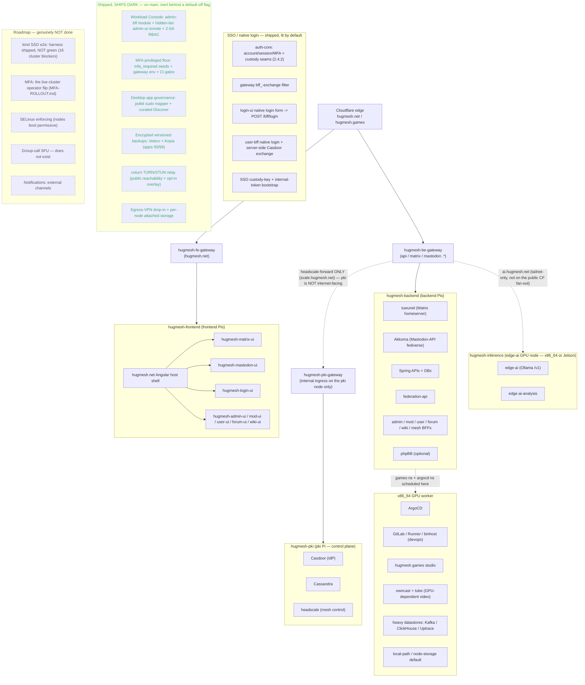
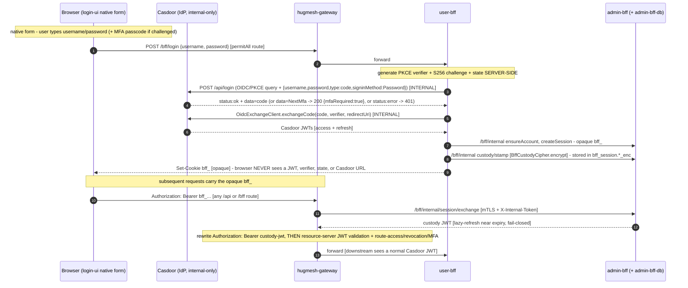

Everything connects **behind `hugmesh.net`** through per-namespace
Spring Cloud Gateways that validate a single internal Casdoor OAuth2 JWT.
Cloudflare maps the public `hugmesh.net` / `hugmesh.games` names onto
those gateways (configured later, out of scope here).

## Nodes & images

| Image | Build | Arch | Role in the cluster |
|---|---|---|---|
| `pki` | `build-rpi5-stage4.sh --role pki` | aarch64 (RPi 5) | **Kubernetes control plane** + identity: headscale (mesh control), Casdoor, Cassandra, `hugmesh-pki-gateway` |
| `backend` | `build-rpi5-stage4.sh --role backend` | aarch64 (RPi 5) | tuwunel (Matrix), Akkoma (fediverse), Spring APIs, databases, `hugmesh-be-gateway` |
| `frontend` | `build-rpi5-stage4.sh --role frontend` | aarch64 (RPi 5) | `hugmesh.net` Angular host federating `hugmesh-matrix-ui` + `hugmesh-mastodon-ui` + `hugmesh-wiki-ui` + login/admin/mod/user/forum remotes, `hugmesh-fe-gateway` |
| `host` | `build-x86-host-stage4.sh` | x86_64 (desktop/server) | GPU worker: ArgoCD, GitLab/Runner/binhost (devops), `hugmesh.games`, owncast + tube (GPU-dependent video), heavy datastores (Kafka/ClickHouse/Uptrace), local-path/node-storage default (Mesa/Vulkan via `/dev/dri`) |
| `edge-ai` | `build-x86-host-stage4.sh --role edge-ai` (x86_64) **/** `build-jetson-stage4.sh --role edge-ai` (Jetson Orin Nano, arm64 crossdev — the x86 builder is amd64-only and cannot produce a Jetson image) | x86_64 / Jetson Orin Nano (arm64) | GPU **inference** node: Ollama serving an OpenAI-compatible model API (`/v1`) to the mesh over k8s (ClusterIP) + tailnet (`ai.<domain>` gateway route); NVIDIA proprietary + CUDA + `nvidia-device-plugin` (which also makes the GPU schedulable for owncast/coturn/tube voice+video). Model library is the `edge-ai-models` ConfigMap. See [EDGE-AI.md](EDGE-AI.md) |

All nodes are hardened Gentoo, join one Kubernetes cluster, sit on one headscale
mesh, and are provisioned at first boot from a USB **KEYS** stick (see
[`keys-template/`](../keys-template/README.md)). The pki Pi is the kubeadm
control plane; backend/frontend Pis and the x86_64 host join it as workers and
are labelled (`hugmesh.net/role`, `…/compute=gpu`) so workloads land on
the right hardware.

> The **superadmin Service Catalog** surface (tailnet-only `hugmesh-superadmin-gateway`
> + Kaniko build namespace) is now ✅ shipped on `main` but is reachable **only**
> over the headscale tailnet via the internal ingress on the pki node — it is
> deliberately off every public-ingress gateway, so it is not drawn on the public
> fan-out above. See [§ Superadmin & multi-tenancy](#superadmin-multi-tenancy-and-the-role-cascade).

## The gateway pattern

`hugmesh-gateway` (Spring Cloud Gateway) is deployed once per namespace from
[one Helm chart](../specs/cluster/charts/hugmesh-gateway), differentiated by
`SPRING_APPLICATION_NAME`. Modelled on the org's `hugmesh-gateway` /
`hugmesh-pki-gateway`:

- **OAuth2 resource server** against Casdoor's JWKS — the same JWT validates at
  every gateway and API.
- **`ExternalAuthHeaderFilter`** appends `External-Authorization` /
  `External-Auth-Provider` / `External-Auth-Id` so downstreams see the outside
  identity without re-decoding tokens.
- **Public paths** (`/api/auth`, `/api/login`, `/api/registration`) allow
  Google-federated sign-up; everything else is authenticated. **Casdoor exposes
  no browser-facing login UI** — the browser hits the platform's own native form
  and `/bff/login`; Casdoor is reachable only in-cluster.
- Routes per gateway are rendered into an `application-routes.yml` ConfigMap and
  loaded via `SPRING_CONFIG_ADDITIONAL_LOCATION`.

## Identity & login

Casdoor (`id.hugmesh.net`) is the single IdP, reached **only from inside
the cluster** (there is no public ingress to Casdoor; the browser never sees it):

- **Admin-created accounts** sign in through the platform's **native login form**
  (`login-ui`), which POSTs credentials to `user-bff` `POST /bff/login`; user-bff
  drives Casdoor over the internal network.
- **Google federation** handles public registration/sign-up.
- **tuwunel** (Matrix homeserver, OIDC) and **Akkoma** (Mastodon-API-compatible
  fediverse, OIDC) both SSO against Casdoor, so the `hugmesh.net` front
  page can show **Matrix / Mastodon links to logged-in users** and hand each
  module a service access token — the
  [`hugmesh-matrix-ui`](https://github.com/hugmesh/hugmesh-matrix-ui)
  and [`hugmesh-mastodon-ui`](https://github.com/hugmesh/hugmesh-mastodon-ui)
  Angular micro-frontends never render their own login forms. The public
  hostnames stay `matrix.<domain>` / `mastodon.<domain>` for API compatibility,
  but the backing servers are tuwunel / Akkoma (never Synapse / Mastodon).

## Authentication / SSO (BFF JWT custody)

> **State convention:** ✅ shipped = merged to `main` · 🚧 in-flight = code on an
> open branch/PR, not yet merged · 🔭 planned = design-complete, no code. The whole
> ensemble **ships dark** behind flags that default off/blank, so a default
> deployment is byte-identical to today.

**The mandate:** SSO login is a **native, first-party form** — the browser POSTs
username/password (and, when challenged, an MFA passcode) to `user-bff`
`POST /bff/login` and gets back **only** an opaque `bff_` session cookie. Casdoor
and every OAuth/OIDC token stay **internal**: user-bff generates PKCE + state
server-side, POSTs the credentials to the **internal** Casdoor `/api/login`,
exchanges the returned code, and holds/refreshes the JWT under custody. The
browser never receives a JWT, the `code_verifier`, the `state`, or any Casdoor
URL; the gateway swaps `bff_` → an internal custody JWT just before
resource-server validation; the user never sees their own JWT. This keeps the
r2dbc/Casdoor management stack off the gateway's classpath and puts login in the
BFF tier — and, because there is no front-channel redirect, **Casdoor needs no
public ingress at all** (front the platform front door with Cloudflare and Casdoor
stays dark to the internet).

**Component ownership** (post auth-relocation):

- **`hugmesh-auth-core`** (shared jar `systems.hugmesh:hugmesh-auth-core`) —
  the stateful auth stack: `AccountStore`/`BffSession` (account + session + MFA),
  `OidcExchangeClient` (code→token + refresh), `BffCustodyCipher` (AES-256-GCM
  encrypt-at-rest for the held JWT), `SessionCookieService` (the opaque `bff_`
  cookie), `InternalTokenWebFilter` (mTLS + `X-Internal-Token` guard for
  `/bff/internal/**`). Consumed by **admin-bff + user-bff only** — never the gateway.
- **`hugmesh-admin-bff-api`** — owns account/session **data** (admin-bff-db) +
  the in-cluster `/bff/internal` account/session API + the custody/stamp + the
  session/exchange endpoints.
- **`hugmesh-user-bff-api`** — owns the native login **endpoint** `POST /bff/login`
  (permitAll at the BFF): server-side PKCE + state, the internal Casdoor `/api/login`
  POST, the MFA challenge handshake, and the `OidcExchangeClient` code exchange; plus
  the rest of the login surface (`/bff/register`, `/bff/session`, …). Reads/writes
  account + session data over admin-bff `/bff/internal` (never touches admin-bff-db —
  the two BFF databases are mutually denied at the NetworkPolicy layer).
- **`hugmesh-gateway`** — the `BffJwtExchangeWebFilter` that swaps `bff_` →
  custody JWT (pre-security, fail-closed, dark) + the permitAll `/bff/login`
  route-access seed. **No front-door route exposes Casdoor** (`/login/oauth/authorize`
  / the Casdoor UI are never proxied to the browser).
- **`hugmesh-login-ui`** — the first-party **native username/password form** that
  POSTs to `/bff/login` and renders the MFA step-up when challenged; it never
  redirects the browser to Casdoor and holds no Casdoor URL.
- **`hugmesh-generator`** (this repo) — the `app-user-bff` Casdoor confidential
  client (authorization_code grant + internal redirect-uri) + the permitAll
  `/bff/login` route-access seed (#156).

**Invariants** (the security contract — must hold in every deployment):

- The browser holds **only** the opaque `bff_` — the Casdoor JWT (and the
  `code_verifier`, the `state`, and any Casdoor URL) is never sent to or stored in
  the client. The session token appears **only** in the `Set-Cookie` header, never
  in a response body.
- Casdoor is reachable **only internally** (user-bff / be-gateway → `casdoor:8000`);
  no gateway route proxies `/login/oauth/authorize` or the Casdoor UI to the browser,
  and prod gives Casdoor no public ingress.
- The custody JWT is **encrypted at rest** (AES-256-GCM) in `bff_session`
  (`access_token_enc` / `refresh_token_enc`).
- The gateway swap is **pre-security** and **fail-closed**: any exchange error ⇒
  `401`, and the raw `bff_` is **never** forwarded downstream.
- The `/bff/internal/**` surface is reachable only over mTLS + `X-Internal-Token`,
  and the two BFF databases (admin-bff-db / user-bff-db) are mutually denied at the
  NetworkPolicy layer.

**Safety-flag posture.** Each piece above is individually gateable off
(`app.bff.oidc.enabled` on user-bff/auth-core · `app.bff.custody-key` on
`BffCustodyCipher` · `app.session.cookie.enabled` for the `bff_` cookie ·
`hugmesh.gateway.bff-exchange.enabled` for the gateway swap ·
`__SNAP_OIDC_ENABLED__` on login-ui), but **none of them ship dark on `main`**:
`specs/cluster/manifests/{user,admin,mod}-bff-api/deployment.yaml` bake
`APP_BFF_OIDC_ENABLED` / `APP_SESSION_COOKIE_ENABLED` / `APP_BFF_EXCHANGE_ENABLED`
`"true"` by default, and `social-ui/deployment.yaml` bakes `SNAP_OIDC_ENABLED`
`"true"`. Only the **secret values** behind two of them — the Casdoor client
secret and the AES custody key — are `optional: true` ESO-Secret refs, so a
fresh cluster without Vault/ESO populated boots with the flags lit but the
ciphers inert until those Secrets land.

### Progress (as of 2026-06-25)

**✅ shipped (merged to `main`):**

- **auth-core extracted + published (current pin `2.4.2`)** — shared
  account/session/MFA/Casdoor stack + the custody seams (`OidcExchangeClient`,
  `BffCustodyCipher`, `SessionCookieService`, `InternalTokenWebFilter`). The
  `2.1.0` BFF-JWT-custody columns, the `2.2.0` per-account session-listing seam
  and the `2.3.0` `gen_random_uuid()` mint change all shipped in that order; the
  line has since moved to **`2.4.2`** (the authoritative pin is
  `tests/stack/m2-bootstrap.sh`), which admin-bff + user-bff both consume.
  ⚠️ `2.4.x` drifted twice (2.4.0 → 2.4.1 → 2.4.2) because a released coordinate
  was re-cut — the pin-drift guard exists for exactly that and must run after
  every auth-core release.
- **admin-bff adopted auth-core** (PR #111) — behavior-preserving, 1517 tests green.
- **admin-bff `/bff/internal` account/session API** (PR #113) —
  ensure / get / complete / allowlist / sessions / namespaces, guarded by
  `InternalTokenWebFilter`; ships inert.
- (prior) gateway live + raw-API security proven + the SCG-5 route-namespace bug fixed.
- **gateway BFF-session filter (PR-2/5 / #171 merged)** — `BffJwtExchangeWebFilter`
  (`bff_` → custody-JWT, pre-security, fail-closed, `hugmesh.gateway.bff-exchange.enabled`).
- **user-bff OIDC enable (PR-2/5 / #171 merged)** — user-bff OIDC login relocation +
  admin-bff internal client (`app.bff.oidc.enabled`).
- **SSO custody-key + internal-token bootstrap (PR-3/5 / #172 merged)** — custody-key
  seeding + internal-token bootstrap for the BFF exchange path.
- **login-ui native login form shipped (#255/#256 merged)** — the native
  username/password form → `POST /bff/login` is now the platform's **only** login
  surface: the dead `/bff/auth/callback` OAuth-redirect route + its route-access
  seed were retired (#255 — "native `/bff/login` replaced it"), and e2e coverage
  (#256, `tests/e2e/specs/27-native-login.spec.ts`) drives the real form and
  asserts the old social-login testids are **absent** and no navigation to a
  Casdoor origin occurs.

> The `auth-core` `2.1.0` BFF-JWT-custody columns
> (`access_token_enc` / `refresh_token_enc` / `access_token_expires_at` /
> `custody_updated_at`) + `stampCustody` / `clearCustody` / `sessionRow` that this
> snapshot tracked as in-flight have since **shipped** (current pin `2.4.2`).

**🚧 in-flight:** none currently open — login-ui PR-4 (native form, above) has
since shipped.

**🔭 planned / next:**

- **admin-bff custody tail** — Liquibase band-180 (`bff_session` custody columns) +
  `/bff/internal/sessions/{token}/custody/stamp` + `/bff/internal/session/exchange`;
  bumps the auth-core dep in lockstep (the auth-core custody seam has since shipped
  in `2.3.0`).
- **generator #156** (✅ now merged) — `app-user-bff` Casdoor confidential client
  (authorization_code grant + internal redirect-uri) + permitAll `/bff/login` route
  seed; the user-bff native-login enable + gateway BFF-session filter (#171) and the
  SSO-secret bootstrap seeding (#172) followed on `main`.
- a cross-repo **NetworkPolicy egress peer** user-bff → admin-bff internal `:8080`
  (manifests/generator).
- **SSO end-to-end live e2e** — kind + Playwright, proving the browser holds only `bff_`.
  **Update (2026-08-05):** the harness now exists (`KIND_PROFILE=sso`, `make
  kind-images|kind-up|kind-e2e|kind-down`) and reached a real Casdoor login, but
  the run is **not green** — it fails on 16 enumerated fresh-cluster payload
  blockers, of which 5–16 are still unfixed. See
  [`KIND-SSO-E2E-FINDINGS.md`](KIND-SSO-E2E-FINDINGS.md).

## GitOps

The pki control-plane installs ArgoCD (pinned to the x86_64 worker) and a root
**app-of-apps** pointing at [`specs/cluster`](../specs/cluster). ArgoCD then
syncs Casdoor, Cassandra, the three public gateways (behind an ingress-nginx
facade) plus the tailnet-only superadmin gateway, Akkoma + tuwunel, Forgejo
(in-cluster git), the Spring APIs, the frontend host, the matrix-ui / mastodon-ui
remotes (the `social-ui` ArgoCD grouping), and hugmesh.games. See
[`specs/cluster/README.md`](../specs/cluster/README.md).

> **GitOps source migration — ⏳ PARTIAL.** Today the root app-of-apps syncs from
> the **GitHub** `hugmesh-generator` repo. The move to an **in-cluster Forgejo**
> source-of-truth is scaffolded — the Forgejo deploy (`apps/09-forgejo.yaml`), the
> service-catalog `scmProvider` ApplicationSet (`apps/13-service-catalog.yaml`,
> already configured to scan the in-cluster Forgejo) and the deploy contract
> (`catalog/hugmesh-deploy.example.yaml`) all exist — but the source flip is
> **live-gated** (needs a booted Forgejo + admin + OIDC + the org mirror +
> `forgejo-scm-token`). **9 service repos have adopted the descriptor + a
> `deploy/` kustomize tree** — as `hugmesh-deploy.yaml`, plus any that have not
> yet renamed the descriptor from the pre-rebrand spelling; all ships-dark until
> the flip. The generators filter on **both** names (the older one as
> LEGACY_COMPAT); the live adoption state is registered in
> [`catalog/adopters.yaml`](../specs/cluster/catalog/adopters.yaml) and enforced by
> `scripts/validate-catalog-discovery.sh`. The org has **38** `hugmesh-*` repos,
> **32** of which produce a container image, so **23 have not adopted yet**
> (prep-able now, no cluster needed). See [`DEVOPS.md`](DEVOPS.md).

### Autoscaling

CPU-based **HPA** is wired on many workloads — `frontend`, `social-ui`,
`remote-fragment`, `mod-bff-api`, `admin-bff-api`, `user-bff-api`, `forum-bff-api`,
`user-ui`, `mod-ui`, `forum-ui`, `api-docs` (`manifests/<svc>/hpa.yaml`) — backed
by **metrics-server** (`apps/01-metrics-server.yaml`). **KEDA** is also present
(`apps/01b-keda.yaml`) for event/queue-driven scaling. ⏳ **Remaining:**
latency/memory-based scaling beyond CPU.

## Secrets (Vault + USB)

Cluster secrets are generated once by
[`scripts/gen-cluster-secrets.sh`](../scripts/gen-cluster-secrets.sh) and pushed
to **HashiCorp Vault** (KV v2, mount `secret/`, base path `hugmesh/` — the
base segment tracks the brand slug). The **External Secrets Operator** then
materializes the k8s Secrets the workloads already consume — `casdoor-google`
(`hugmesh-pki`), `clickhouse-auth` (`hugmesh-backend` + `observability`)
and `uptrace-auth` (`observability`) — via a ClusterSecretStore
**`hugmesh-vault`** (provider `vault`, token auth from the `vault-token`
Secret in `external-secrets`), one ExternalSecret per Secret, refreshed hourly.
Workload `secretKeyRef`s are unchanged.

The same materialized secrets are also written to the KEYS stick at
`vault/secrets.json` (plus `vault/token` for online sync), so `keys-provision`
can create them offline — **Vault first, USB fallback** — when Vault is
unreachable.

## Mesh, storage & backups

- **Mesh:** headscale on the pki node; every node runs the tailscale client and
  joins via a preauth key from its KEYS stick.
- **Storage:** `storage.devices[]` in the KEYS manifest mounts attached M.2/NVMe
  or USB disks and can relocate `containerd`/`kubelet` data onto them.
- **Backups:** `backup.*` schedules etcd + PostgreSQL backups to attached
  storage and/or an NFS/CIFS network share (`/usr/local/sbin/hugmesh-backup`).

## Superadmin, multi-tenancy and the role cascade

The platform is **multi-tenant / multi-brand**: one fleet can host several
domains, and a least-privilege role cascade (**superadmin → admin → mod → user**,
domain-scoped, enforced at the gateway) governs every surface.

- **Multi-tenancy (✅ shipped):** per-domain CA loop (`brands/domains.conf`),
  per-domain namespace + mTLS isolation as the authoritative cross-domain
  boundary; one admin-bff ↔ one Casdoor org ↔ one homeserver per brand.
- **Superadmin (✅ shipped):** a real code-enforced role owning device-licenses and
  domain CRUD. Its Service Catalog console + `service-catalog-ui` remote are served by the
  tailnet-only `hugmesh-superadmin-gateway` (`apps/22-gateway-superadmin.yaml`)
  on the pki node's internal ingress — off every public gateway.
- **Superadmin Service Catalog (✅ shipped on `main`):** the data layer (admin-bff
  service-curation / app-profile / service-deployment) **and** the infra legs —
  the tailnet superadmin-gateway plus the Kaniko in-cluster build namespace
  (`apps/54-service-catalog-builder.yaml`, ships dark until a build lands) merged via
  PR #110. The per-build Kaniko Job is a template the admin-bff `AddService` task
  instantiates; ArgoCD never applies it directly.
- **Device-license + node-storage registries (✅ shipped):** see
  [`DEVICE-REGISTRY-KEY-ROTATION.md`](DEVICE-REGISTRY-KEY-ROTATION.md) and
  [`NODE-STORAGE.md`](NODE-STORAGE.md). Layer-B per-node sshd off the signed
  export is shipped. **Layer-A is shipped on the NODE side too** — the control-node
  renderer (`specs/usr/sbin/gen-headscale-policy.sh`) verifies the same signed export,
  renders `/etc/headscale/policy.hujson` from `specs/etc/headscale/policy.hujson.tmpl`,
  applies it with `headscale policy set -f`, and force-assigns the non-forgeable dst
  tags (`specs/usr/sbin/hugmesh-headscale-forcetags`); it is baked by all 10 builders
  and activated by `provision_headscale_policy_sync()` (boot service + 60 s cron) on
  every control node. What is still 🔭 **deferred is only the BFF-side push leg**
  (hugmesh-admin-bff-api `HeadscaleAclCompiler` + reconcile loop, dark behind
  `app.registry.headscale-acl.enabled=false`). Its compile side is now reconciled with
  the node side and gated offline by `layer-a-headscale-acl` in CI, but ENABLING it
  stays cluster-gated: it needs the live `docs/CANONICAL-FP.md` field confirmation, a
  provisioned headscale API key, and — first — the single-writer decision, because
  headscale runs `policy: mode: file` (the node renderer is the writer) while the BFF's
  `PUT /api/v1/policy` is DB-mode only.
- **Optional-services framework (✅ build-time, 🚧 live cut-over):** akkoma /
  tuwunel / phpBB / games add/remove via the `apps/13a` ApplicationSet; the UI
  greys when a service is absent, and games defaults to `games.<domain>`. Today
  the build-time prune ships and the hardcoded `30-*/50-*` Applications still own
  the workloads — the live ApplicationSet cut-over is pending. See
  [`OPTIONAL-SERVICES.md`](OPTIONAL-SERVICES.md).
- **Egress-VPN, games App-Store control plane, owncast, tube, notifications
  in-app MVP (✅ shipped):** see [`EGRESS-VPN.md`](EGRESS-VPN.md),
  [`GAMES-APPSTORE.md`](GAMES-APPSTORE.md), and the cluster apps `29a`, `52`, `53`,
  `13c`.
- **Pen-test CI (✅ shipped):** continuous OWASP (ZAP DAST + Dependency-Check SCA +
  nuclei + k6) as a GitLab CI-pipeline stage, not a deployed CronJob. See
  [`PENTEST-SCHEDULES.md`](PENTEST-SCHEDULES.md).

### Shipped, ships dark (✅ on `main`, inert behind a default-off flag)

A default-off flag is a **deployment posture**, not an unfinished feature. These
are complete on `main`; each entry names what lights it and what caveat survives.

- **✅ Workload Console** — podman/OpenShift-like pod-management + live-log +
  exec + port-forward. The **entire** console ships: the
  `/bff/{admin,superadmin}/workloads/**` module in the always-present admin-bff,
  the **hidden-tier federated admin-ui remote** the host mounts only when the
  grant guard passes, and this repo's `workloadConsole` slug (two-SA
  least-privilege RBAC in `apps/14-workload-console-rbac.yaml`, the superadmin
  cluster-read SA/ClusterRole, the deploy-provenance Kyverno policy, the admin-bff
  overlay `manifests/admin-bff-api/workload-console-patch.yaml`, and the two
  route-access rows). **Three independent OFFs**: the generator slug (default-off;
  deselected, the admin-bff renders byte-identical), the k8s seam (no SA token →
  the fail-closed `NoopWorkloadClient`, 503 everywhere), and the runtime
  `workload_console_config` master flag + a per-admin TTL'd grant. Superadmin gets
  cross-cluster manage+exec; admins stay default-blind until superadmin-granted
  read-only on their own domain. See [`OPTIONAL-SERVICES.md`](OPTIONAL-SERVICES.md) §7.2.
- **✅ Casdoor MFA + the gateway privileged floor** — WebAuthn + TOTP + recovery
  codes enroll/challenge in admin-bff via `auth-core`, `mfa_satisfied` stamped
  into the opaque `bff_` session, and the floor itself: the `mfa_required` column
  plus the `UPDATE` seeding every allow row under `/bff/admin/**` +
  `/bff/superadmin/**` (`manifests/route-access/initdb/20-schema.sql`), the shared
  gateway chart's `mfa:` block rendering `APP_MFA_ENABLED` /
  `APP_MFA_FRESHNESS_WINDOW` / `APP_MFA_ENFORCE_PRIVILEGED_FLOOR`, both CI gates
  (`lint:mfa-required-rules`, `lint:gateway-mfa-env` with pinned fail-closed helm)
  and compose-stack e2e coverage. Cluster default is `mfa.enabled: false` /
  `enforcePrivilegedFloor: false`, so the seeded rows are inert. What remains is
  the **live operator flip** — see the Roadmap below,
  [`MFA-ROLLOUT.md`](MFA-ROLLOUT.md) and [`ROUTE-ACCESS.md`](ROUTE-ACCESS.md).
- **✅ Desktop app governance** — per-license SSO-enforced sudo (a root
  claim→group `desktop-sudo-mapper` + polkit rule + 60 s cron, **not** SSSD),
  admin-curated Plasma Discover store, user install-requests and admin
  remote-install over the device-SSH-license transport; client side in
  `specs/etc/hugmesh/desktop-governance/`, server side a controller set in
  `hugmesh-admin-bff-api`. Dark behind `app.desktop.registry.enabled=false` /
  `app.desktop.remote-install.enabled=false`. ⚠️ The SSO greeter/PAM **token
  producer** is still deferred, so the deposit path has no producer even once the
  flags flip. See [`CLIENT-IMAGES.md`](CLIENT-IMAGES.md) §7.
- **✅ Encrypted versioned backups** — Velero server + node-agent (Kopia) as
  `apps/55-velero.yaml` and the BSL + ESO credentials + least-privilege RBAC +
  status-sweep CronJob as `apps/56-velero-config.yaml`; per-domain + superadmin,
  step-up gated in the admin-bff `cloudbackup` package. Two OFFs: both
  Applications are manual-sync, and the effector stays `Noop` until
  `app.backups.effector.enabled=true`. See [`CLOUD-BACKUPS.md`](CLOUD-BACKUPS.md).
- **✅ A/V relay via coturn (TURN/STUN)** — DEFAULT-OFF optional service in
  RFC-5766 REST credential mode sharing one ESO/Vault secret with tuwunel. A
  default build deploys no coturn and clients keep `iceServers: []`. ⚠️ **Public
  reachability is a separate, operator-deferred opt-in overlay**
  (`manifests/coturn-public`: hostNetwork relay, public-IP/URI ConfigMap, an
  `/etc/hugmesh/coturn-public` firewall marker, an unproxied A/AAAA record, a
  public cert for non-fleet clients). See [`COTURN.md`](COTURN.md).
- **✅ Egress-VPN drop-in and ✅ per-node attached storage** — admin-supplied
  WireGuard/OpenVPN `.conf` with split-tunnel keeping the tailnet direct
  (`specs/usr/sbin/hugmesh-egress-vpn`, slug `egress-vpn`, delivery app `13e`),
  and node-pinned local PV / local-path (FDE) with capacity-aware scheduling and
  graceful degrade (`apps/13b-node-storage.yaml` + the node-storage reconcile
  agent, now baked and enabled by every builder). See
  [`EGRESS-VPN.md`](EGRESS-VPN.md), [`NODE-STORAGE.md`](NODE-STORAGE.md).
- **✅ Binhost auto-update** — poller cron baked as plumbing on every target;
  absence of a policy means OFF (fail-safe to off, never to a pull). Superadmin
  opts a fleet in via the live `devops/hugmesh-update-policy` ConfigMap. See
  [`DEVOPS.md`](DEVOPS.md).

### Roadmap (🔭 planned / 🚧 in-flight)

What is genuinely **not done**. Nothing here has a working default-off
implementation on `main`.

- **🚧 kind-cluster SSO e2e — harness shipped, proof NOT achieved.**
  `KIND_PROFILE=sso` + `make kind-images|kind-up|kind-e2e|kind-down` stand up a
  real cluster, and the chain now reaches Casdoor and mints a session against a
  real IdP — but the e2e is **not green**. It fails on 16 enumerated fresh-cluster
  blockers, because the GitOps payload had never been run end to end and every
  workaround lived in `tests/stack/compose.local.yaml` instead of `specs/cluster`.
  Fixed in-repo: the `cluster-ca` / Vault KV mount / node-label items plus
  `fix/cluster-secret-contract-drift` and `fix/pki-role-san-namespace`. **Not
  fixed (5–16):** Cassandra credentials + keyspace bootstrap, gateway probes
  hitting a role-gated actuator path (no gateway can become Ready in k8s), Casdoor
  never importing `init_data.json` (the IdP keeps the well-known default admin
  password), `casdoor-init` never checking API responses, `CASDOOR_ORG` /
  client-id / redirect-uri / namespace pre-rebrand defaults across the BFFs, a
  hard-required `SVC_PASSWORD` nothing provides, and an admin-bff Liquibase
  `GRANT` to a role no initdb creates. See
  [`KIND-SSO-E2E-FINDINGS.md`](KIND-SSO-E2E-FINDINGS.md).
- **🔭 The live MFA operator flip** — verify every privileged principal can
  produce a fresh `mfa_satisfied` stamp, then flip `mfa.enabled` → `true`, then
  (separately: `enforce-privileged-floor` is **not** a sub-flag of `enabled`)
  `enforcePrivilegedFloor` → `true`, moving the posture-gate expectations in
  lockstep. See [`MFA-ROLLOUT.md`](MFA-ROLLOUT.md).
- **🔭 SELinux enforcing** — node-policy modules compile, install and load on
  every image, but the fleet boots **permissive** and the enforce-gate ships inert
  (no runlevel, `SELINUX_ENFORCE_GATE="no"`). The `.te` rules are still tagged
  `INFERRED-WIDE` and can only be narrowed against AVC logs from a real protected
  build + boot. See [`selinux-module-loading.md`](selinux-module-loading.md).
- **🔭 Group-call SFU** — coturn is a 1:1/mesh relay only; MatrixRTC / Element
  Call / LiveKit-class group calling does not exist in any form.
- **🔭 Desktop-governance SSO greeter / PAM token producer** (FD-07 increment 2).
- **🚧 MDM phones (GrapheneOS on Pixel)** — the fourth onboarding form: `scripts/phone-wizard.sh` flashes signature-verified GrapheneOS, enrolls the handset into the Tailscale root domain (headscale tailnet, ADR-14 register-and-approve), escrows a separately-encrypted enterprise profile, and emits a `phone-ingest/v2` device-registry record; Azure Intune is a co-equal provider alongside Headwind. Real pre-deploy gaps remain — see [`MDM.md`](MDM.md) "Deferred".
- **🚧 Notifications external channels** — Matrix DM + Akkoma feed + phpBB + email
  adapters on top of the shipped in-app MVP; mod-bff `notify_channels` directive.
- **🔭 Live in-cluster image build** — the always-on Kaniko pipeline
  (`apps/60-image-builder.yaml`) is correct-by-construction and lint-gated but has
  never run a real build; blocked on bringing a cluster up on a kernel-fixed x86
  image.
- **✅ Generator supply-chain hardening** — stage3 GPG/sha + headscale /
  tailscale binary checksum verification, fail-closed in all builders via
  `scripts/_download-lib.sh`, + de-defaulted baked creds (random one-time
  first-boot fallback). See [`CRYPTO-AUDIT.md`](CRYPTO-AUDIT.md).

## Related repositories

> **All org repos are `hugmesh-*` since the 2026-07-22 rebrand** — verified
> against the org listing: **38** `hugmesh-*` repos, zero pre-rebrand ones. The
> **GitHub organization itself** is `hugmesh` (see
> [`ORG-MOVE-TODO.md`](ORG-MOVE-TODO.md)), which is the prefix the paths below
> use. Two repos changed shape as well as name — the domain-named site repo became
> `hugmesh-host-shell` and `hugmesh.games` became `hugmesh-games`.

### Shared Maven libraries

| Repo | Role |
|---|---|
| `hugmesh/hugmesh-parent` | Metapom every Java service inherits (**2.8.0** — Spring Boot 4.0.7 / Spring Cloud 2025.1.2 / Java 25) |
| `hugmesh/hugmesh-commons` | Shared security/tenancy library, `systems.hugmesh.commons.*` (**2.1.0**) |
| `hugmesh/hugmesh-auth-core` | Shared account/session/bff-session store, Casdoor-admin client, MFA subsystem, session-cookie + internal-token filters (**2.4.2**; consumed by user-bff + admin-bff only) |
| `hugmesh/hugmesh-build-config` | Shared PMD/Checkstyle/SpotBugs rulesets referenced by the parent (**0.5.0**) |

### Platform services

| Repo | Role |
|---|---|
| `hugmesh/hugmesh-generator` | This repo — image builders, provisioning, GitOps payload |
| `hugmesh/hugmesh-gateway` | Shared Spring Cloud Gateway code/image |
| `hugmesh/hugmesh-pki-gateway` | PKI/identity gateway (Casdoor OAuth2, Postgres routes) |
| `hugmesh/hugmesh-be-gateway` | Backend gateway (per-node, reuses the shared gateway image) |
| `hugmesh/hugmesh-fe-gateway` | Frontend gateway (per-node, reuses the shared gateway image) |
| `hugmesh/hugmesh-actions` | Spring APIs |
| `hugmesh/hugmesh-admin-bff-api` | Spring admin BFF (allowlist, namespace access, usage, token broker; also the Workload Console, cloud-backups and desktop-governance modules) |
| `hugmesh/hugmesh-mod-bff-api` | Spring moderator BFF |
| `hugmesh/hugmesh-user-bff-api` | Spring user BFF (owns native login / session / Casdoor exchange) |
| `hugmesh/hugmesh-forum-bff-api` | Spring forum BFF (phpBB-facing) |
| `hugmesh/hugmesh-forum-api` | phpBB 3.3 headless JSON API extension — the forum-bff backend |
| `hugmesh/hugmesh-wiki-bff-api` | Spring wiki BFF (wiki pages, attachments, audit log; `/bff/wiki/**`) |
| `hugmesh/hugmesh-mesh-bff-api` | Mesh BFF: Meshtastic node directory, bridge-sync ingest, mesh functions (`/bff/mesh/**`) |
| `hugmesh/hugmesh-character-forge-bff-api` | 3D character forge: BFF + Godot character-maker + federated UI (SVG VN characters → 3D avatars for the XR chat room) |
| `hugmesh/hugmesh-owncast-bff-api` | Owncast BFF — broadcast grant/timeout/ban overlay + per-streamer provisioning (x86+GPU optional service) |
| `hugmesh/hugmesh-tube-bff-api` | Tube (LocalTube) BFF — use grants, download, owner-private viewing (x86+GPU optional service) |
| `hugmesh/hugmesh-federation-api` | Public-profile / vanity-subdomain + federation resolver (owns the `federation_modules` registrations) |

### Front ends (native-federation remotes)

| Repo | Role |
|---|---|
| `hugmesh/hugmesh-host-shell` | Angular host shell / front page — federates every remote below |
| `hugmesh/hugmesh-matrix-ui` | Matrix chat + WebRTC video micro-frontend |
| `hugmesh/hugmesh-mastodon-ui` | Mastodon micro-frontend |
| `hugmesh/hugmesh-login-ui` | Login/registration micro-frontend (the native login form) |
| `hugmesh/hugmesh-admin-ui` | Admin console micro-frontend (role-gated; hosts the hidden-tier Workload Console face) |
| `hugmesh/hugmesh-mod-ui` | Moderator console micro-frontend |
| `hugmesh/hugmesh-user-ui` | User console micro-frontend |
| `hugmesh/hugmesh-forum-ui` | Forum micro-frontend |
| `hugmesh/hugmesh-wiki-ui` | Wiki micro-frontend |
| `hugmesh/hugmesh-user-mesh-ui` | User-facing mesh dashboard: LoRa node directory, my mesh devices, mesh-enabled channels |
| `hugmesh/hugmesh-character-studio-ui` | VN character studio — layered-SVG avatar creator (optional service, default-off) |
| `hugmesh/hugmesh-owncast-ui` | Owncast console remote (My Stream + admin broadcast grants + mod view) |
| `hugmesh/hugmesh-tube-ui` | Tube console remote (My Tube + admin access grants + storage budgets) |
| `hugmesh/hugmesh-api-docs` | Admin-gated remote: browse the platform OpenAPI specs |
| `hugmesh/hugmesh-superadmin-service-catalog-ui` | Superadmin App-Store / Service Catalog console (tailnet-only, mounted at `/superadmin/service-catalog`) |
| `hugmesh/hugmesh-remote-fragment` | Sync-and-serve-static nginx fleet serving DB-hosted federated fragment bundles |
| `hugmesh/hugmesh-games` | Godot 4 WASM game studio and portal (runs on the x86_64 GPU worker) |
| `owncast` / LocalTube (`tube`) | Upstream GPU-dependent video services (per-domain enable, federated per-user remotes) |
