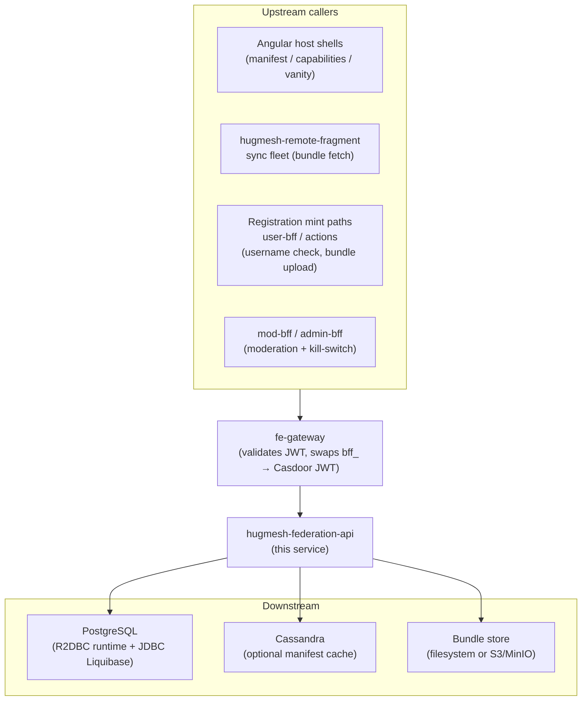
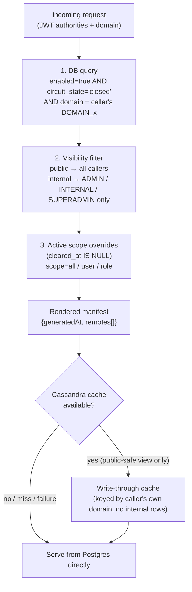
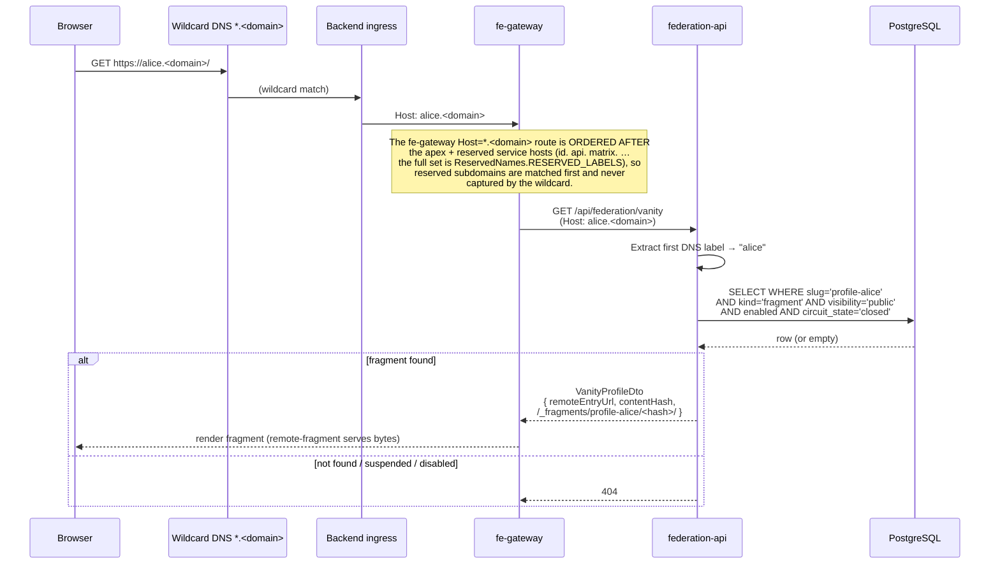
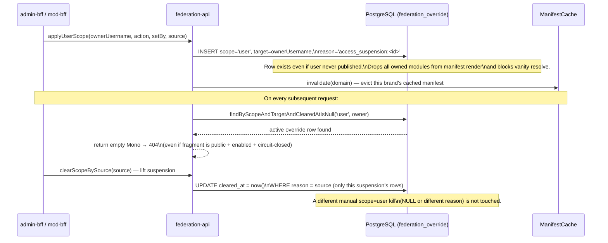
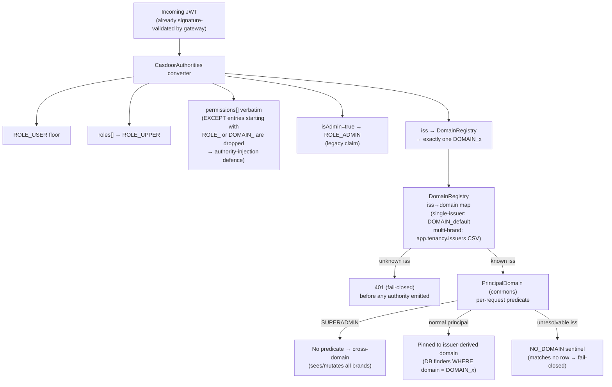

The platform's **dynamic-federation registry / DB / manifest API** — the
authoritative catalog of federated remote modules and the runtime contract the
Angular host shells bootstrap from. A reactive Spring Boot (WebFlux + R2DBC)
backend service that:

- hosts the `federation_modules` registry (the canonical list of remote shells,
  fragments and optional services that make up a brand's UI);
- serves the **runtime manifest** the Angular host bootstrap feeds into
  native-federation's `initFederation(...)`, so new remotes appear **without
  redeploying** the host shell;
- exposes a **public capabilities projection** a logged-out host reads to
  grey-out optional services that are absent / disabled;
- resolves **vanity subdomains** (`<username>.<domain>`) to a user's public
  profile fragment;
- stores per-user content-hash-versioned module **bundles** for the
  `hugmesh-remote-fragment` pods to *sync-and-serve-static*;
- owns the platform-wide **moderation + kill-switch** surface; and
- gates a **username availability / confusable** check the registration mint
  paths consult.

It is built by reusing two proven references — a DB-backed federation engine and
the productionised hugmesh-admin-bff-api conventions — not by inventing new
patterns.

## Current State

> Snapshot as of 2026-07-22 (through PR #83, the HugMesh naming rebrand — code-level
> only, no functional change). ✅ shipped (merged to `main`) ·
> 🚧 in-flight · 🔭 planned.

- ✅ **On the unified org baseline.** Migrated to **Spring Boot 4.0.7 / Spring
  Cloud 2025.1.2** (Spring Framework 7 / Spring Security 7 / Jackson 3, Java 25 LTS,
  GraalVM-native-ready). The repo is the org's **first adopter / exemplar** of the
  shared Maven artifacts: it inherits `net.hugmesh:hugmesh-parent:2.8.0`
  (a child of `spring-boot-starter-parent:4.0.7`) and consumes
  `net.hugmesh:hugmesh-commons:2.8.0` for the shared security/tenancy
  primitives (`CasdoorAuthorities`, `DomainRegistry`, `PrincipalDomain`, `Roles`,
  `TenancyResourceServerConfig`). The local copies were deleted — see *Shared
  commons library*.
- ✅ **Pure Casdoor-JWT resource server, no login/session logic here.** This
  service NEVER mints, exchanges or refreshes tokens and holds no session state.
  It deliberately does **not** depend on the new `hugmesh-auth-core` artifact —
  that account/session/MFA/Casdoor-admin core is consumed only by **user-bff** and
  **admin-bff**, where login/session/account logic now lives (the platform-wide
  relocation of login from admin-bff → user-bff does not touch this repo). The
  browser holds only an **opaque `bff_` session**; the gateway swaps `bff_` → the
  internal custody JWT *before* the request reaches a resource server, so by the
  time a token arrives here it is an ordinary, already-validated Casdoor JWT. We
  re-validate it and map claims with the commons converter (explicit `jwk-set-uri`
  so the in-container resource server fetches keys without doing OIDC discovery
  against a possibly browser-only `issuer-uri`).
- ✅ **Multi-tenancy (domain scoping) shipped.** Tenant is keyed on the
  cryptographically-validated issuer (`iss` → one `DOMAIN_<x>`); per-domain finders
  + `SUPERADMIN` cross-domain bypass enforced in code + the QUERY (changeset `026`).
  A `RoleHierarchy` bean (`SUPERADMIN > ADMIN`/`MOD`/`USER`) is wired into method
  security so `@PreAuthorize` gates (e.g. the username-availability controller) admit
  `SUPERADMIN` the same way the path-level rules already do.
- ✅ **The federation surface is feature-complete for the scaffold's scope:** the
  manifest read path + kill-switch, the public `/capabilities` projection, vanity
  resolve + owner-scoped self-publish/unpublish (+ suspension 404), owner-scoped
  bundle storage (filesystem + S3/MinIO, upload size capped/413'd), the internal
  username/confusable gate (with a ROLE_ADMIN override escape hatch on the
  heuristic-match tiers), the human moderation workflow (recommend/refer/decide,
  plus a narrower ROLE_MATRIX/MASTODON self-service instance-block filing path),
  an automated system-findings queue for edge-AI content moderation, and the
  optional-service + static-union module seeds. MFA_SATISFIED authority parity is
  inherited from the commons converter, but **no federation route gates on it**
  today.
- ✅ **GitLab CI only** (`.gitlab-ci.yml`) — the continuous-OWASP pen-test stages
  (Dependency-Check SCA + ZAP DAST + nuclei, advisory) extend the org-wide template
  from `hugmesh-generator`. **No GitHub Actions anywhere.**
- 🚧 / 🔭 open items are below in *Deferred / stubbed* and *Roadmap* (the vanity
  PUBLISH trigger, moderation auto-apply and the gateway public-path allowlist
  entry are all shipped now; the open entries are the MFA gate and the rest of the
  tailnet module class, whose registration write surface has shipped).

## Where it sits in the architecture

| | |
|---|---|
| **Tier** | Backend BFF / platform service (reactive Spring Boot, behind the gateway). |
| **Namespace** | `net.hugmesh.federation` (artifact `federation`, image built by GitLab CI). |
| **Issuer / auth** | Casdoor JWT OAuth2 **resource server**. Tokens arrive already validated by the gateway; this service re-validates the JWT and maps Casdoor claims → Spring authorities with the **canonical converter copied verbatim from `hugmesh-gateway`** (so authorities are byte-identical across the platform). |
| **Tenancy** | Multi-brand / multi-tenant. The brand a token belongs to is keyed on the **cryptographically-validated issuer** (one Casdoor per brand → distinct `iss`) → a single `DOMAIN_<x>` authority, never a user-settable claim. See *Multi-tenancy (domain scoping)*. |
| **Upstream callers** | the Angular host shells (manifest + capabilities + vanity), the `hugmesh-remote-fragment` sync fleet (bundle fetch), the registration mint paths / actions / user-bff / admin-bff (username check, bundle upload, profile-ban writes), mod-bff / admin-bff (moderation + kill-switch). |
| **Downstream** | PostgreSQL (R2DBC, all runtime reads/writes; JDBC only for Liquibase migrations), an optional best-effort Cassandra manifest cache, and the filesystem/S3 bundle store. |

This service is the **read/write source of truth for "what UI modules exist,
which are serveable, and to whom"** — the rest of the platform (gateway routing,
host bootstrap, the remote-fragment static fleet) is downstream of its manifest.



## Stack

- Spring Boot **4.0.7** / Spring Cloud **2025.1.2** (Spring Framework 7 / Spring
  Security 7 / Jackson 3), Java **25 LTS**, reactive **WebFlux** (no blocking).
- **R2DBC** (r2dbc-postgresql) for ALL runtime reads/writes. JDBC is used **only**
  by Liquibase for schema migrations.
- **Casdoor** JWT OAuth2 resource-server; the authority converter (`CasdoorAuthorities`),
  the issuer→domain `DomainRegistry`, the `Roles`/`PrincipalDomain` helpers and the
  config-gated multi-issuer `TenancyResourceServerConfig` now come from the shared
  **`net.hugmesh:hugmesh-commons`** library (see *Shared commons library*).
- **springdoc-openapi-starter-webflux-ui** — spec at `/v3/api-docs`, UI at
  `/swagger-ui.html` (profile-split gating, see *Security*). The published spec is
  pinned to **OpenAPI 3.0** (`springdoc.api-docs.version=openapi_3_0`) — springdoc
  3.x defaults to 3.1.0, which the Angular UIs' ng-openapi-gen cannot parse.
- **Resilience4j** circuit breakers on the direct-write profile-ban path.
- **ICU4j** + **commons-text** for the confusable-username skeleton computation.
- **Cassandra-reactive** driver for a best-effort manifest write-through cache
  (disabled by default; degrades gracefully when absent).
- Optional **server-side mTLS** (TLSv1.3, client-cert-required) for API↔API calls.
- GraalVM **native** profile + AOT hints. **GitLab CI** (`.gitlab-ci.yml`); no
  GitHub Actions.

## Shared commons library (`hugmesh-parent` + `hugmesh-commons`)

This service is the **first adopter** of the org's shared Maven artifacts. Two
de-duplication moves:

1. **Parent POM →** `net.hugmesh:hugmesh-parent:2.8.0` (itself a child of
   `spring-boot-starter-parent:4.0.7`, so the whole Spring Boot dependency/plugin
   management is inherited transitively). The parent consolidates the reactive-BFF
   `<dependencies>` (webflux/actuator/security/oauth2-resource-server/validation,
   R2DBC + Liquibase + JDBC, springdoc, the full test stack) and the
   `dependencyManagement` for `hugmesh-commons`, the AWS SDK BOM, resilience4j and
   springdoc. Only the **federation-specific** deps stay in this POM: `icu4j`,
   `commons-text`, `data-cassandra-reactive`, the AWS `s3` client, and the
   (now-version-managed) resilience4j artifacts.

2. **Shared security/tenancy/web →** `net.hugmesh:hugmesh-commons:2.8.0`.
   The local copies of `security.{Roles,DomainRegistry,DomainScope}` and
   `config.{CasdoorAuthorities,TenancyResourceServerConfig}` were **deleted** and
   replaced by:
   - `commons.security.Roles` — note its `Set<String>`/names overloads are
     `isSuperadminNames(...)` / `domainOfNames(...)` (the `isSuperadmin` /
     `domainOf` names take `Collection<? extends GrantedAuthority>`).
   - `commons.security.DomainRegistry` (same `knownDomains`/`isKnownDomain`/
     `trustedIssuers`/`isMultiIssuer` API).
   - `commons.security.PrincipalDomain` — the canonical replacement for the old
     instance-based `DomainScope`: `of(String)` → `forDomain(String)`,
     `superadmin()` → `superadminFor(String)`, the instance `isSuperadmin()` →
     `superadmin()`; `resolve(jwt,reg)` / `NO_DOMAIN` / `domain()` kept.
   - `commons.security.CasdoorAuthorities` (now `public`, methods `public static`;
     `MfaConfig` is a `public record`).
   - `commons.config.TenancyResourceServerConfig`.

   **Stays per-repo:** this repo's `config.SecurityConfig` (route matchers +
   CSRF/cookie/header policy) and the test `config.SecuritySliceSupport`.

   **Two consumer-wiring steps** (the canonical recipe for the fan-out):
   - `config.CommonsSecurityConfig` `@Import`s the commons `DomainRegistry` +
     `TenancyResourceServerConfig` beans, because the `@SpringBootApplication`
     component-scan over `net.hugmesh.federation` does **not** cover the
     `net.hugmesh.commons.*` packages. (`@Import` preserves
     `TenancyResourceServerConfig`'s `@ConditionalOnExpression` gate.)
   - `CapabilityController` maps an **anonymous** (`jwt == null`) public read to the
     explicit `"default"` domain, because `PrincipalDomain.resolve(null, reg)`
     deliberately fails closed to the `NO_DOMAIN` sentinel (a commons hardening over
     the old `DomainScope.resolve(null)` → `"default"` fall-through).

### Resolving the private `hugmesh-commons` artifact

`hugmesh-commons` is **not** on Maven Central — it lives in the org GitLab Maven
Package Registry. Two resolution paths, **no secrets in git**:

- **Local dev:** `hugmesh-parent` + `hugmesh-commons` are `mvn install`ed into
  `~/.m2`, so a plain `./mvnw test` resolves them locally and never touches the
  remote (this is how the build was verified green).
- **CI / Docker:** the committed [`settings.xml`](settings.xml) declares the
  `gitlab-maven` group registry, authenticated by the GitLab `CI_JOB_TOKEN`
  (`${env.CI_JOB_TOKEN}` — injected by GitLab, never committed). The
  [`Dockerfile`](Dockerfile) multi-stage build runs
  `./mvnw -s settings.xml package` with the token mounted as a **BuildKit secret**
  (`--mount=type=secret`, so it never lands in an image layer); `.gitlab-ci.yml`
  passes `--secret id=ci_job_token,env=CI_JOB_TOKEN` plus the `CI_API_V4_URL` /
  `GITLAB_GROUP_ID` build-args.

### Security CI (GitLab) ✅ shipped

`.gitlab-ci.yml` runs the platform **continuous-OWASP pen-test** stages plus a
real test-gated build (`stages: [security, dast, pentest, test, build]`):

- **`test:mvn`** runs the actual JUnit suite (`./mvnw -B -s settings.xml test`,
  incl. the full-context `@SpringBootTest`s against a **real Postgres** via
  Testcontainers/`docker:dind`) on the default branch and every merge request,
  publishing a JUnit report; `build:image` only runs after it (this stage is
  **not** advisory — a failing test blocks the image build).
- the `pentest:sca` / `pentest:dast` jobs `extends:` the **canonical, org-wide**
  pen-test template `include`d from `hugmesh-generator`
  (`/tests/pentest/ci/pentest-stage.gitlab-ci.yml`) so there is ONE source of
  truth — **OWASP Dependency-Check SCA** + the authenticated **ZAP DAST** harness
  (with the custom escalation/DoS probes) + **nuclei**. These REPLACE the earlier
  inline `dependency-check` / `zap-api-scan` jobs (migrated into the template — no
  duplicate scan path).
- the pen-test stage is **advisory** (`allow_failure: true`) — it reports but
  never gates `build:image`, and runs on the default branch + merge requests.
- this is a **dev/CI-pipeline control**, NOT a deployed CronJob or a runtime/UI
  trigger, consistent with the platform pen-test standard.

## Endpoints (the public surface)

All paths are under `/api/federation`. Role gates are enforced both in
`SecurityConfig` (path rules, defence-in-depth) and by `@PreAuthorize` on the
controllers. `SUPERADMIN` is the cross-domain infra role and reaches every
privileged surface in every brand.

| Endpoint | Method | Auth | Purpose |
|---|---|---|---|
| `/manifest` | GET | authenticated | Runtime manifest: enabled + circuit-closed + visibility-permitted + **domain-scoped** remotes, `{generatedAt, remotes[]}`. Visibility/role/domain filtered **in code**; Cassandra write-through cached (public-safe view only, keyed per-domain — see *The manifest read path*). |
| `/capabilities` | GET | **public (no JWT)** | **Public install-state projection** — `{slug, installed, mountAt, requiresRole}` per registered module. The list a logged-out / non-admin host reads to grey-out optional services. Narrow + caller-independent (no internal locator/detail). |
| `/vanity/{username}` | GET | **public (no JWT)** | **Vanity-subdomain resolve.** Returns the user's PUBLIC profile-fragment descriptor (`remoteEntryUrl`, `contentHash`, `/_fragments/<slug>/<hash>/` path) iff a `slug=profile-<username>`, `kind=fragment`, `visibility=public`, enabled, circuit-closed, **non-suspended** module exists; else **404**. Never returns internal fragments. |
| `/vanity` (+ `Host:` header) | GET | **public (no JWT)** | Same resolve, but the username is the **first DNS label** of the `Host` header (`alice.<domain>` → `alice`) so the gateway can forward the vanity host verbatim. |
| `/vanity/{username}` | PUT | authenticated (owner-or-admin) | **Self-publish.** Upserts the caller's `profile-<username>` fragment (`visibility=public, enabled=true`) FROM their own already-uploaded `PUT /bundles/profile-<username>` bundle — `remoteEntryUrl`/`contentHash` are always derived server-side, never accepted from the request. 404 if no bundle is uploaded yet; 403 if `username` != caller's own JWT subject and the caller is not ROLE_ADMIN/SUPERADMIN; 400 if `username` is reserved/confusable. |
| `/vanity/{username}` | DELETE | authenticated (owner-or-admin) | **Self-unpublish.** Flips the caller's fragment to `visibility=internal, enabled=false` (never deletes the row). Idempotent — a no-op if never published. |
| `/username/{candidate}/availability` | GET | **ROLE_SERVICE / ADMIN (INTERNAL)** | Registration gate: collision / reserved / confusable check. An enumeration oracle (`matchedWith` names the colliding label) — **never public**. |
| `/username/check` | POST | ROLE_SERVICE / ADMIN | Same check by request body. |
| `/username/{candidate}/confusables` | GET | ROLE_ADMIN | Admin debug: the computed skeleton (+ any reserved match), no DB scan. |
| `/modules` | GET/POST | ROLE_ADMIN | Registry CRUD (list / create), domain-scoped. |
| `/modules/{slug}` | GET/PUT/DELETE | ROLE_ADMIN | Registry CRUD (get / update / delete), domain-scoped. |
| `/admin/modules` | GET/POST | **ROLE_SUPERADMIN only** | **Create-and-federate wizard control plane** (admin-bff's Service Store calls it). GET = the FULL registry state — every brand, **including disabled / circuit-open / internal rows** (the view the manifest deliberately hides). POST = idempotent **upsert-by-slug** (create defaults: `kind=remote-shell`, `visibility=internal`, `enabled=false`, `domain='default'`; a refresh never touches `slug`/`domain`/`circuit_state`, and an OMITTED `enabled` leaves the flag unchanged). Write guards: `profile-*` slugs 400 (vanity territory), `remoteEntryUrl` must be absolute http(s), `metadata` must be a JSON object with well-shaped `mountAt`/`requiresRole`. A per-brand ADMIN is **403** here. |
| `/admin/modules/{slug}` | DELETE | **ROLE_SUPERADMIN only** | **Soft-disable** (`enabled=false`, 204): reversible registry off-switch — the row stays for inspection + a later re-enabling upsert; `visibility`/`circuit_state` untouched; 404 when absent. Never a hard delete (that stays on `DELETE /modules/{slug}`). |
| `/bundles/{slug}` | PUT | authenticated (owner) | Upload a module bundle (content-hash versioned). |
| `/bundles/{slug}` | DELETE | authenticated (owner) | Delete my bundle. |
| `/bundles/mine` `…/slug/{slug}` `…/{hash}` | GET | authenticated | List bundles by owner / slug / content-hash. |
| `/bundles/slug/{slug}/body` | GET | authenticated (owner) | Read my card body (the entry file) by slug. |
| `/bundles/{hash}/files/{*path}` | GET | authenticated | **FETCH a bundle file by content-hash** — the remote-fragment SYNC read. |
| `/moderation` | GET/POST | ROLE_MOD / ADMIN | Recommend / list moderation requests, domain-scoped. |
| `/moderation/recommend-instance-block` | POST | ROLE_MATRIX / MASTODON | **Self-service** instance-block filing — the USER→MOD→ADMIN chain's first hop for a plain platform participant (not mod/admin). `kind` is hardcoded server-side to `instance-block`; grants no list/refer/decide capability. |
| `/moderation/{id}/refer` | POST | ROLE_MOD / ADMIN | Refer a request up to admins. |
| `/moderation/{id}/decide` | POST | ROLE_ADMIN | Approve / deny. An approved `user-removal` auto-applies as an active `scope=user` override (see *Account-states profile-ban*); an approved `instance-block` stays decision-only. |
| `/overrides` | GET/POST | ROLE_ADMIN | Kill-switch: list / apply (`circuit-break` \| `unpublish` \| `remove`), domain-scoped. |
| `/overrides/{slug}/rearm` | POST | ROLE_ADMIN | Recover a circuit-broken module (per-slug). |
| `/overrides/clear` | POST | ROLE_ADMIN | Rearm an active scope override (`{scope,target}`; stamps `cleared_at`). |
| `/overrides/clear-source` | POST | ROLE_ADMIN / SUPERADMIN | Lift/expire a suspension by source tag: stamps `cleared_at` on **only** the `federation_override` rows whose `reason` equals the supplied `source` — so an expiring access-suspension never rearms an unrelated manual scope override (`OverrideController.clearSource` → `OverrideService.clearScopeBySource`). |
| `/findings` | POST | authenticated | File a system moderation finding about the caller's **own** content (`subject` = JWT subject, never a body field; `reporter` always `@system`). See *System findings*. |
| `/findings` | GET | ROLE_MOD / ADMIN | List findings in the caller's domain (SUPERADMIN: all domains); optional `?status=held\|dismissed\|actioned`. |
| `/findings/{id}/resolve` | POST | ROLE_MOD / ADMIN | Resolve a held finding (`?actioned=true` actions it, `false` dismisses it); cross-domain id → 404. |
| `/findings/resolved` | GET | ROLE_SERVICE / ADMIN (INTERNAL) | Cursor-paged read of resolved findings (`id > sinceId`, `subjectRef` present) on a `surface`, for the moderation → activation reconciler poll. SERVICE/SUPERADMIN read cross-domain; a per-domain ADMIN stays pinned to its own brand. |

## The manifest read path (the keystone)

`ManifestService.render(authorities, scope)` is lifted from the reference
federation engine's `FederationController.manifest()` (`findAllByEnabledTrue → DTO
→ {generatedAt, remotes}`) and extended with filters applied per request so the
**same DB rows serve every audience**:

1. **enabled** — DB-side; an `unpublish` override flips `enabled=false`.
2. **circuit-state** — only `circuit_state='closed'` rows ship; a `circuit-break`
   override flips it to `open`, dropping the remote from the manifest **without a
   redeploy** (the kill-switch).
3. **visibility / role** — `public` remotes to everyone; `internal` remotes only
   to `ROLE_ADMIN` / `ROLE_INTERNAL` (and `SUPERADMIN`) callers, against the JWT
   authorities.
4. **domain** — the module + active-scope-override finders are **pinned to the
   caller's `DOMAIN_<x>`** so a brand-X principal's manifest lists only brand-X
   remotes; `SUPERADMIN` runs the un-pinned finders (all brands). See
   *Multi-tenancy*.
5. **active scope overrides** — a `scope=all|user|role` `federation_override`
   that has not been rearmed (`cleared_at IS NULL`) is applied across the whole
   (domain-scoped) catalogue at render time. Loaded once per render and applied in
   code (`isSuppressedByScope`):
   - `scope=all` — global kill: every module drops until rearmed.
   - `scope=user` (target = the owner) — drops modules with `owner_user_id =
     target` (system NULL-owner modules untouched).
   - `scope=role` (target = a role name) — drops modules whose **declared**
     `metadata.requiresRole` (case-insensitive) equals the target role. This is a
     *content-declared* cut, not an owner-holds-role or per-caller-audience cut
     (see *Deferred / stubbed* for the honest limitation).

   Rearm with `POST /overrides/clear` `{scope,target}` (stamps `cleared_at`).
   Per-module-slug overrides mutate `circuit_state` / `enabled` at apply time and
   are dropped by the enabled+circuit DB finder, so they are **not** in the active
   scope set (no regression).



The rendered manifest is best-effort write-through cached — but **only the
public-safe view, and only under the render's own domain's cache key**
(no internal rows, no superadmin cross-domain superset are ever cached, under
any key) so a cache poller without a token never sees internal remotes, and a
brand-B poller can never be served brand-A's cached body — each brand's
public-safe render occupies its own row (per-domain cache key; see
`ManifestService`'s `cacheIfPublicSafe`). A cache miss / failure always renders
from Postgres.

## Public capabilities (greying-out optional services)

`GET /api/federation/capabilities` is the **public sibling** of the manifest. The
manifest is `authenticated()` + visibility-filtered, so a logged-out host could
never even learn that an internal-visibility optional service (e.g. forum /
mastodon / matrix) exists — it cannot drive greying. The capabilities projection is
`permitAll`, lists **every** registry row (via `findAll()`, not just the serveable
ones), and returns a deliberately narrow, public-safe `CapabilityDto`
(`slug + installed + mountAt + requiresRole` only — no `remoteEntryUrl`,
`contentHash`, `ownerUserId`, `visibility` or raw `metadata`).

- `installed=true` ⇔ the row exists AND is enabled AND circuit-closed (serveable
  right now). The host greys a registered-but-disabled / circuit-broken service
  out **by state**.
- A never-registered optional service is **absent** from the list. The host greys
  it out **by absence**.

**Seeded-but-inert optional services.** Several modules are seeded deliberately
hidden/disabled so they appear greyed/absent until a superadmin enables them
per-domain: **owncast** and **tube** are seeded `enabled=false` +
`visibility='internal'` (GPU-gated live-streaming / YouTube-archiver), and **wiki**
is seeded `visibility='internal'` (inert until a superadmin enables it per-domain; the wiki BFF and UI are shipped). The
capabilities projection therefore reports `installed=false` (or omits them from the
role-visible manifest) until they are turned on and the matching role is granted.

GET-only and caller-independent (the same body for everyone), so it is safe with
no JWT. The manifest / override read paths are untouched — this is purely additive.

## Vanity subdomains (`<username>.<domain>`)

A user can serve their PUBLIC profile at `https://<username>.hugmesh.net`.
The federation API owns the **resolve** step.



**username ↔ fragment association (the chosen convention).** A user's public
profile is ONE `federation_modules` row:

| column | value | why |
|---|---|---|
| `slug` | `profile-<username>` | deterministic from the username → resolve is a single **unique-slug** lookup, no extra mapping table (`slug` is already UNIQUE + indexed). |
| `kind` | `fragment` | served by the remote-fragment sync-and-serve-static fleet, exactly like every other fragment bundle. |
| `owner_user_id` | `<username>` | the `scope=user` kill-switch / access-suspension ban keys on this field (NOT the Casdoor sub), so it covers a user's vanity profile + manifest modules with **no new wiring**. |
| `visibility` | `public` | **the gate** — only `public` fragments are resolvable at a vanity host. |

**Why it's safe to expose without a JWT.** The vanity endpoint is `permitAll`
because it IS the public profile — anonymous browsers hit it. The finder filters
`visibility='public'` + `enabled` + `circuit_state='closed'` **in the query**, and
`VanityService` re-asserts the public-fragment invariant **in code**. An internal /
disabled / kill-switched / suspended / missing fragment yields an empty `Mono` →
the controller maps it to **404**. There is no path through this endpoint to an
internal row, and it is GET-only so it can never mutate.

**Username extraction.** `GET /vanity/{username}` takes it explicitly; `GET
/vanity` extracts the FIRST DNS LABEL of the `Host` header (`firstLabel`: strips
`:port`, lower-cases, requires ≥3 labels so the apex returns no username). The
controller then runs a **two-stage reserved-label defence** (`VanityController`,
the gateway route order already prevents most of these):

- **exact reserved label** — `ReservedNames.RESERVED_LABELS` (the canonical
  source of truth, the UNION of the deployed gateway route prefixes + reserved
  subdomains) hard-**404**s the label. The set is far broader than a handful of
  hosts — it includes `id api matrix mastodon pleroma forum wiki owncast tube
  scale headscale www admin apidocs mod user login oauth games play wasm` and the
  defensive web names (`actuator metrics health root static assets …`).
- **confusable-of-reserved** — `UsernameSkeletonService.isReservedSkeleton(label)`
  hard-404s a label whose ICU4j look-alike **skeleton** matches a reserved label
  (e.g. `4dmin`, `akk0ma`), via an O(1) precomputed reserved-skeleton membership
  check (NO DB hit), so a confusable that slipped past the exact set still 404s.

## Account-states profile-ban (read/write path)

The platform's access-suspension foundation (admin-bff / mod-bff) bans a USER's
public profile through this service — via the **read** path (vanity / manifest)
and a direct **write** path on `OverrideService`:



- **`OverrideService.applyUserScope(ownerUsername, action, setBy, source)`** writes
  a `scope='user'` `federation_override` row **directly via the repository** — no
  module lookup, **no existing-module requirement**. The durable row exists
  regardless of whether the user ever published, drops every owned module from the
  manifest render, and blocks the vanity read. Tagged `reason='access_suspension:<id>'`.
- **`VanityService.resolve()`** also consults
  `findByScopeAndTargetAndClearedAtIsNull('user', owner)` on the resolved
  fragment's `owner_user_id` and returns empty → **404 even for a public + enabled
  + circuit-closed fragment** when the owner is suspended. Identity is pinned on
  **`owner_user_id`**, NOT the Casdoor sub.
- **`ManifestCache.invalidate()`** is called on every `scope=user` mutation so a
  just-banned profile is never served from a stale cached manifest.
- **`OverrideService.clearScopeBySource(source)`** (lifting/expiring a suspension)
  stamps `cleared_at` on **only** the rows whose `reason` equals that source — so
  an expiring suspension never rearms an unrelated manual `scope=user` kill (which
  carries a NULL / different `reason`).
- Both direct-repo writes are wrapped in `@CircuitBreaker(name="federationOverride")`
  (fail-fast): the durable row is the source of truth, so the read path converges
  once it lands.

Scope of the profile ban: **unpublish / vanity-suppress only** — there is no
`ROLE_USER` self-publish endpoint today (`ModuleRegistryController` is ADMIN-only),
so the ban suppresses the existing/future profile rather than gating a create path.
The homeserver (akkoma/tuwunel) and the access-suspension table + reconcile loop
live in their own repos (generator / admin-bff / mod-bff).

## Username availability + confusable check (INTERNAL)

`/api/federation/username/**` is the registry-owned **look-alike gate** the
registration mint paths (Casdoor pre-signup webhook, OAuth handle mint, actions /
user-bff / admin-bff) call before granting a username. Every response is an
**enumeration oracle** (`matchedWith` names the colliding username / reserved
label), so the whole controller is gated to an internal service credential
(`ROLE_SERVICE`, or `ROLE_ADMIN`) — never the SPA / public surface.

- Collision is checked three ways: exact DB match, a reserved label (the
  `017`/`021` reserved-profile-slug CHECK + the reserved-username list), and a
  **confusable** match against the `username_skeleton` cache (an ICU4j-computed
  look-alike skeleton; changeset `020`). The skeleton is a *recomputable*
  NON-unique index, NOT a unique identity — the `slug` UNIQUE + `017` reserved
  CHECK stay the real exact-username backstop.
- `self` excludes the caller's OWN existing username by **exact** username only (a
  different-but-confusable owner stays flagged).
- `override=confusable` (ROLE_ADMIN only) flips an `exact`/`confusable` verdict to
  available and writes an AUDIT line; it NEVER overrides `reserved` or a hard
  reject.

## System findings (automated edge-AI moderation queue)

`POST /api/federation/findings` + `GET /api/federation/findings` +
`POST /api/federation/findings/{id}/resolve` + `GET /api/federation/findings/resolved`
are a queue for **automated** moderation findings — a separate surface from
`ModerationController`'s **human** recommend/refer/decide workflow above.

- **Producer.** The pre-publish edge-AI vision-moderation gate (`user-bff` →
  `POST /v1/analyze/content/moderate`) FILES a finding here when a check comes
  back `flag`/`reject`. `reporter` is always `@system`; `subject` (the content
  owner) is the producer's authenticated JWT subject — **never** a request body
  field, so a caller can only ever file about their own content.
- **Row shape** (`system_findings`, changesets `036`/`037`): `surface`
  (`profile-avatar`, ...), `disposition` (`flagged` queued | `rejected` blocked at
  upload), `classification`/`confidence`/`policyHit`/`perceptualHash` (the edge-AI
  verdict), an optional `subjectRef` (a producer-opaque back-reference to the
  exact source row — e.g. a character-part/sticker id — for part-activation
  correlation; NULL for the surface-level avatar/profile path), `status`
  (`held` → `dismissed` | `actioned`), and the usual `domain` multi-tenancy column.
- **Consumers.** `ROLE_MOD`/`ADMIN`/`SUPERADMIN` list + resolve findings in their
  own domain (SUPERADMIN spans all brands). `GET /findings/resolved` is a
  separate, **internal** (`ROLE_SERVICE`/`ADMIN`/`SUPERADMIN`) cursor-paged read
  (`id > sinceId`, `id`-ASC watermark, capped page size) for the admin-bff
  moderation → activation reconciler — a `ROLE_SERVICE` or `SUPERADMIN` caller
  reads cross-domain (it must close the activation loop for every brand); a
  per-domain `ROLE_ADMIN` stays pinned to its own brand.
- **Relationship to `ModerationController`.** The two workflows are independent
  and do not write each other's tables: a system finding never becomes a
  `moderation_requests` row automatically, and resolving a finding never touches
  `federation_override`. Both are DOMAIN-scoped from the validated JWT issuer via
  the same `PrincipalDomain.resolve` convention.

See `SystemFindingService`, `SystemFindingController`, `SystemFindingRepositoryTest`,
`SystemFindingResolvedEndpointTest`.

## Multi-tenancy (domain scoping)

> Status: **✅ shipped on `main`** (changeset `026` + the per-request domain-scope
> service-layer cut — shipped as this repo's own `DomainScope` via PR #14
> `feat/domain-foundation`, later migrated to the shared commons artifact as
> `commons.security.PrincipalDomain`; see *Shared commons library*). The
> capability/vanity public projections and the owner==JWT-subject bundle paths are
> untouched by it. This is the platform's multi-brand contract, enforced in code.

The platform is multi-brand / multi-tenant: one Casdoor per brand, so the token's
cryptographically-validated **issuer** (`iss`) is the trustworthy tenant
discriminator. Domain scoping is the canonical, adversarially-verified gateway
code copied verbatim (package-adjusted) into this BFF so it derives a token's
brand **the exact same way the gateway does**:



- **`CasdoorAuthorities`** (single converter shared by the single-issuer and the
  multi-issuer decoder paths) emits: `ROLE_USER` floor + `roles → ROLE_<UPPER>` +
  `permissions` verbatim **EXCEPT** any entry starting with a reserved prefix
  (`ROLE_` / `DOMAIN_`) is **dropped** (authority-injection defense — a brand-X
  token carrying `permissions:["DOMAIN_brandy"]` or `permissions:["ROLE_SUPERADMIN"]`
  can never forge a tenant scope / super-role) + legacy `isAdmin → ROLE_ADMIN` +
  **exactly one** `DOMAIN_<x>` derived from the validated issuer via
  `DomainRegistry`.
- **`DomainRegistry`** maps `iss → domain` from
  `spring.security.oauth2.resourceserver.jwt.issuer-uri` (single-issuer →
  `DOMAIN_default`) and the optional `app.tenancy.issuers` CSV (`iss=domain,…`).
  Multi-brand mode is **fail-closed**: an issuer not in the map yields `null` and
  the multi-issuer decoder (`TenancyResourceServerConfig`, config-gated on a real
  `=`-bearing CSV) 401s an unknown `iss` before any authority is emitted.
- **`PrincipalDomain`** (`commons.security.PrincipalDomain`, resolved via
  `PrincipalDomain.resolve(jwt, domainRegistry)` — the canonical replacement for
  this repo's original local `DomainScope`, see *Shared commons library*) is the
  per-request domain predicate threaded into the services. `SUPERADMIN` → no
  predicate (cross-domain, sees/mutates all). A normal principal → pinned to
  their issuer-derived domain. An unresolvable issuer → `NO_DOMAIN` sentinel that
  **matches no row** (fail-closed, never silently cross-domain).
- **`Roles`** helpers (`isSuperadmin` / `isImageBuilder` / `domainOf`,
  fail-closed) drive the least-privilege cascade
  **SUPERADMIN → ADMIN → MOD → USER** plus the orthogonal `ROLE_IMAGE_BUILDER`
  capability (mesh-workload image builds — a separate grant, not an admin default).
- Changeset **`026`** adds a NOT-NULL `domain` column (DEFAULT `'default'`) +
  domain index to the three tenant-owned tables (`federation_modules`,
  `federation_override`, `moderation_requests`). A row's domain is stamped from the
  **principal's domain at write time** (never a body value, never patchable); the
  domain-pinned finders enforce the cut in the QUERY. Changeset **`035`** extends
  the same NOT-NULL `domain` column to `user_modules` so the bundle-metadata reads
  are domain-pinned **in addition** to the owner cut (closing a cross-tenant
  metadata IDOR — see *Schema*). `username_skeleton` / vanity fragments remain
  owner-scoped only (keyed on `owner_user_id`, already a per-domain namespace).

**Backward-compatible.** With only a single issuer and no `app.tenancy.issuers`,
every token mints `DOMAIN_default`, every pre-existing/seed row defaults to
`domain='default'`, and behaviour is byte-for-byte unchanged.

## Schema (Liquibase — `src/main/resources/db/changelog`)

- **`010` `federation_modules`** — the registry. Lifted from the reference
  federation engine's `db/changelog/018`, extended with `owner_user_id`,
  `content_hash`, `visibility`, `circuit_state`.
- **`011` `user_modules`** — per-user bundle uploads (locator + content_hash +
  manifest_json + visibility + superseded_at). `016` adds `entry_file`.
- **`012` `moderation_requests`** — recommend / refer / decide workflow.
- **`013` `federation_override`** — kill-switch audit; scope triple
  (`all|role|user` + target). `014` adds `cleared_at` (the scope-override active
  lifecycle: ACTIVE while `cleared_at IS NULL`). `019` adds `reason` (the
  access-suspension SOURCE tag so `clearScopeBySource` clears only its own rows).
- **`015`** — vanity profile fragment **seed** (`profile-alice` public +
  `profile-bob` internal), reusing only existing `010` columns.
- **`017` / `021`** — reserved-profile-slug CHECK (a `profile-<reserved>` /
  `profile-forum` fragment is rejected; `021` re-issues `017` as a new changeSet).
- **`018`** — enum/domain CHECK constraints (DB parity for the API-enforced
  kind/visibility/circuit_state/scope/action/status vocabularies).
- **`020` `username_skeleton`** — confusable-skeleton cache (non-unique skeleton
  index + ICU version stamp).
- **`022`–`025`** — register the optional-service modules (phpBB **forum**,
  akkoma **mastodon**, tuwunel **matrix**, and the opt-in **games** service —
  default-off, only present when the build is generated with `--enable-games`) as
  federation modules (`kind='remote-shell'`, idempotent slug-absent seed-guard so
  install-state can appear / grey-out via the manifest + capabilities).
- **`026`** — multi-tenancy `domain` column + index on the three tenant-owned
  tables (see *Multi-tenancy*). ✅ merged to `main`.
- **`027` / `028`** — reserve the `wiki` profile-slug, then register the **wiki**
  optional-service module (`slug='wiki'`, `mountAt /wiki`, `requiresRole 'wiki'`,
  **`visibility='internal'`** — seeded INERT/hidden (`visibility='internal'`) pending per-domain superadmin enablement; hugmesh-wiki-bff-api and hugmesh-wiki-ui are shipped).
- **`029`** — **COMPLETE the `federation_modules` seed** so the dynamic manifest is
  AUTHORITATIVE: seed the three static-manifest slugs that had no DB row — `mod`
  (`visibility='internal'`, `requiresRole 'mod'`, `/mod`), `apidocs`
  (`visibility='internal'`, `requiresRole 'admin'`, `/admin/docs`) and `user`
  (`visibility='public'`, **no** `requiresRole`, `/user`). With
  login/admin/matrix/mastodon already seeded, the authenticated `/manifest` is now
  a **full superset of the host's static-union floor**.
- **`030` / `031`** — reserve the `owncast` profile-slug, then register **Owncast**
  (`slug='owncast'`, `mountAt /owncast`, `requiresRole 'owncast'`,
  **`enabled=false` + `visibility='internal'`**) — seeded INERT and DISABLED;
  GPU-gated, superadmin-enabled per-domain after verifying a GPU node.
- **`032` / `033`** — reserve the `tube` profile-slug, then register **Tube**
  (`slug='tube'`, `mountAt /tube`, `requiresRole 'tube'`, **`enabled=false` +
  `visibility='internal'`**) — seeded INERT and DISABLED; GPU-gated, superadmin-
  enabled per-domain (sibling of Owncast).
- **`034`** — partial-UNIQUE index `ux_user_modules_active_owner` on
  `(slug, owner_user_id)` over **active** (non-superseded) `user_modules` rows,
  enforcing **one active bundle per (slug, owner)** at the DB layer (Postgres
  partial-unique / H2-compat equivalent).
- **`035`** — multi-tenancy `domain` column (NOT-NULL, DEFAULT `'default'`) on
  `user_modules`, the same backward-compatible cut as `026`. Lets the bundle
  **metadata** reads (`GET /bundles/slug/{slug}`, `GET /bundles/{hash}`) be
  DOMAIN-pinned in addition to the owner cut, closing a cross-tenant metadata IDOR
  where a brand-X caller could enumerate another brand's bundle metadata. Stamped
  from the publishing principal's issuer-derived `DOMAIN_<x>` at write time
  (`BundleService.put`); SUPERADMIN un-pinned.
- **`036` `system_findings`** — the automated edge-AI moderation queue (see
  *System findings*): `reporter`/`subject`/`surface`/`disposition`/
  `classification`/`confidence`/`policy_hit`/`perceptual_hash`/`status`/
  `reviewer`/`ts`/`domain`, indexed on `status`, `domain`, `subject`.
- **`037`** — adds `system_findings.subject_ref` (optional producer-opaque
  back-reference to the exact source row a finding is about — a character-part /
  sticker id — for part-activation correlation; NULL for the surface-level
  avatar/profile path) plus a composite `(surface, status)` index backing the
  reconcile query.
- **`038`** — register **Character Forge (3D)** (`slug='character-forge'`,
  `kind='remote-shell'`, `mountAt /character-forge`, `requiresRole ROLE_USER`,
  **`enabled=false` + `visibility='internal'`**) — seeded INERT; a DEFAULT-OFF
  optional service flipped on when the operator installs the slug.
- **`039`** — rebrand follow-up to `038`: repoints the character-forge
  `remote_entry_url` from the sibling UI's pre-rebrand k8s Service short-name
  to **`hugmesh-character-forge-ui`**. It is an
  **additive `UPDATE`, not an edit of the merged `038` INSERT** — `038` may already
  have run, so rewriting it in place would break its Liquibase checksum *and* still
  leave migrated rows on the dead Service (a RAN changeSet never re-executes).
  Guarded on the exact pre-rebrand URL, so it is idempotent and never clobbers a
  superadmin override; `<rollback>` restores the old value. **Deploy ordering:** must
  not reach a cluster ahead of the matching generator manifest rename
  (`specs/cluster/manifests/character-forge/`). The `character-forge` **slug** and the
  `/character-forge/**` + `/bff/character-forge/**` route prefixes are FROZEN — only
  the sibling service's brand prefix moved.

### A note on the JSON columns (honest constraint — corrected)

Spring Data R2DBC ships no first-class JSONB Java type, so — exactly as the
reference federation engine does — `metadata` / `manifest_json` are mapped to
**String** entity fields. The changelog uses a `${json.type}` property:
**`jsonb` on Postgres**, **`clob` on the H2 slice-test DB** (H2 has no `jsonb`
type; `clob` reads back as String on both, and matches how the H2 PG-compat
profile behaves). Likewise `${str.type}` is `text` on Postgres but
`varchar(1024)` on H2 (H2 refuses to index/UNIQUE a `CLOB`). The same changelog
therefore applies on real Postgres and on the H2 PG-compat test DB.

**The `metadata` / `manifest_json` columns are ALREADY real `jsonb` on
Postgres — not `text`.** `${json.type}` has resolved to `jsonb` since the very
first changeset that creates these columns (`010-federation-modules.xml`,
`011-user-modules.xml`); there is no pending `ALTER COLUMN … TYPE jsonb`. The
reading side needs no bespoke converter either: `R2dbcConvertersConfig` builds
its custom-conversions list from `dialect.getConverters()`, and Spring Data
R2DBC's `PostgresDialect` ships a `Json→String` reading converter out of the
box, so a `jsonb` column decodes straight to the entity's `String` field with
zero extra code here. The write side round-trips correctly too — PostgreSQL's
extended query protocol infers an unspecified bind parameter's type from the
target column (`jsonb`), so a plain `String` write binds without an explicit
cast or `io.r2dbc.postgresql.codec.Json` wrapper. **Live-verified** against the
running `federation-db` container's real Postgres (not just the H2 slice
tests): `\d federation_modules` shows `metadata | jsonb`, and a parameterized
insert/read-back round-trip of a JSON string through an unspecified-type bind
parameter (mirroring R2DBC's own binding semantics) confirmed the write path
works with no explicit cast.

## Security

`SecurityConfig` (`@EnableWebFluxSecurity` + `@EnableReactiveMethodSecurity`):

- Casdoor JWT resource-server; authorities from the **canonical gateway converter**
  (`CasdoorAuthorities` — roles, permissions with the reserved-prefix guard,
  `isAdmin`, the `ROLE_USER` floor, the issuer-keyed `DOMAIN_<x>`), unit-tested.
- Profile split for the springdoc spec/UI: **permitAll** under `dev`/`test` (so
  `gen:fetch` can curl `/v3/api-docs` without a token), **ROLE_ADMIN** in prod.
- Path rules (all declared before the `anyExchange().authenticated()` catch-all):
  vanity + capabilities = **permitAll** (public reads); username = **ROLE_SERVICE
  / ADMIN** (internal oracle); modules + overrides = **ROLE_ADMIN**; moderation =
  **ROLE_MOD / ADMIN** (decide narrowed to ADMIN; the self-service
  `recommend-instance-block` sub-path is instead **ROLE_MATRIX / MASTODON only**,
  declared before the mod-only catch-all); findings = **authenticated** to file
  (about the caller's own content), **ROLE_MOD / ADMIN** to list/resolve,
  **ROLE_SERVICE / ADMIN** for the internal `resolved` reconcile read; manifest +
  bundles = **authenticated** (bundle owner = JWT subject, enforced in the
  service). `SUPERADMIN` is added to every privileged gate.
- A **`RoleHierarchy`** bean (`SUPERADMIN > ADMIN`, `SUPERADMIN > MOD`,
  `SUPERADMIN > USER`) is wired into `@EnableReactiveMethodSecurity` so
  `@PreAuthorize` gates expand the same way the path-level `hasAnyRole(...)` rules
  already do — without it, `@PreAuthorize`-only controllers (e.g.
  `UsernameAvailabilityController`) would wrongly 403 a SUPERADMIN caller even
  though the path rule and the OpenAPI contract admit it. SUPERADMIN does **not**
  imply ADMIN⇄MOD (siblings); only the top-down edges are declared.
- **API↔API mTLS (server side).** Disabled by default (`server.ssl.enabled=false`,
  `client-auth=none`) so local/dev/CI run plaintext. In-cluster, the deployment
  mounts the PKCS12 keystore (Vault-PKI identity) + truststore (cluster CA) and
  sets `SSL_ENABLED=true` / `SSL_CLIENT_AUTH=need`, so the TLS handshake **requires
  a client cert chaining to the cluster CA** (TLSv1.3 floor). A caller not
  deployed+signed by the Vault/ESO PKI process cannot reach the API at all.
- **Bean Validation** on all write/path inputs (`ValidationPatterns` +
  `ValidationExceptionHandler`) so API-enforced vocabularies match the DB CHECK
  constraints (the `018` enum parity).

## Bundle storage

Pluggable `BundleStorage` (lifted from the reference engine's `UploadStorage`),
selected by `app.bundles.storage`:
- **`filesystem`** (default) — fully functional; opaque locator
  `file:/…/<slug>/<content-hash>`, zip-slip-safe reads.
- **`s3`** ✅ — **implemented** (no longer a stub). S3-compatible storage that
  works against AWS S3 in prod and **MinIO** in dev/CI (point
  `app.bundles.s3.endpoint` at the MinIO container). Bundle files land under
  `s3://<bucket>/<slug>/<contentHash>/`; locator `s3://<bucket>/<slug>/<hash>`.
  Ported from the reference engine's `S3UploadStorage`; routes all calls through an
  `S3Ops` facade so it unit-tests cleanly. Select with `app.bundles.storage=s3` and set
  `app.bundles.s3.bucket` / `.endpoint` / `.region`.

**Owner-scoped writes (A01 / CWE-639, IDOR).** The bundle WRITE path is
owner==JWT-subject scoped: `PUT /bundles/{slug}` supersedes only the **caller's
own** prior active version, so a caller can never supersede or overwrite another
owner's bundle (a non-owner write leaves the victim's row untouched). Likewise
`GET /bundles/slug/{slug}/body` (read-my-card-body) and `DELETE /bundles/{slug}`
operate on the caller's own active row only — a non-owner gets `404`, never
another user's bytes. `ROLE_ADMIN` may act regardless of owner.

## Manifest cache

Best-effort Cassandra write-through (`CassandraManifestCache`, lifted from
admin-bff's `CassandraRouteMirror`): lazy/gated `CqlSession`, blocking calls on
`boundedElastic`, every failure swallowed. **Disabled by default**
(`app.manifest-cache.cassandra.enabled=false`) → the `NoopManifestCache` wins and
the read path always renders from Postgres. Cassandra auto-config is excluded so
startup never depends on a reachable cluster.

**Per-brand cache key.** ✅ **Shipped.** Every `ManifestCache` operation
(`put`/`get`/`invalidate`) is keyed by `domain` — `CassandraManifestCache` stores
each brand's manifest under its own Cassandra partition key
(`"manifest:" + domain`, see `CassandraManifestCache.key`). `ManifestService`
write-throughs ANY brand's public-safe render (no internal rows, not the
SUPERADMIN cross-domain superset) under that brand's OWN key — not just the
`"default"` domain as before — so a brand-B poller can never be served brand-A's
cached body, and a brand-B mutation (`OverrideService.applyUserScope` /
`clearScopeBySource`) invalidates only brand-B's row.

## Build & test

```bash
./mvnw test          # @DataR2dbcTest slices over H2-PG-compat + the REAL Liquibase
                     # changelog; filesystem storage in a temp dir; Cassandra
                     # disabled (noop) — these slices need no external infra. BUT the
                     # full-context @SpringBootTest suites in the same run (see below)
                     # extend commons.testsupport.PostgresTestSupport and spin up a
                     # REAL Postgres via Testcontainers, so a working Docker daemon
                     # IS required to run `./mvnw test` to completion (CI's `test:mvn`
                     # job attaches a `docker:27-dind` service for exactly this).
./mvnw package       # builds target/federation-0.2.0.jar
./mvnw -Pnative native:compile   # GraalVM binary (needs a GraalVM host)
```

Representative tests (the `@DataR2dbcTest` repository slices need no external infra;
the `@SpringBootTest` full-context suites below need Docker for a Testcontainers
Postgres — see `FederationApplicationContextTest` and `application-test.yml`):
- `ManifestServiceTest` / `ManifestDomainCutTest` — the keystone: filtering by
  visibility / enabled / circuit-state / scope-override + the per-domain vs
  superadmin cut + cache write-through.
- `CapabilityServiceTest` / `CapabilityEndpointTest` — the public projection.
- `VanityServiceTest` / `VanityControllerTest` — the public profile resolve + the
  suspension 404.
- `VanityPublishServiceTest` — the owner-scoped self-publish/unpublish WRITE path:
  owner-or-admin gating, reserved/confusable rejection, the no-uploaded-bundle 404
  (never a fabricated success), the upsert deriving `remoteEntryUrl`/`contentHash`
  from the caller's own bundle, an existing circuit-break surviving a republish,
  unpublish flipping to `internal`/disabled without deleting the row, AND a
  republish refusing (409, never a silent re-enable) to override the admin
  per-module kill-switch (`OverrideController` `action=unpublish`, which sets only
  `enabled=false` and leaves `visibility=public`) — recovery from that state is
  admin-only, via `POST /api/federation/overrides/{moduleSlug}/rearm`.
- `AdminModuleServiceTest` / `AdminModuleEndpointTest` /
  `AdminModulePathGateSliceTest` — the SUPERADMIN `/admin/modules` control plane:
  create-with-defaults (`kind=remote-shell`, `visibility=internal`,
  `enabled=false`, `domain=default`), refresh-in-place (`id`/`createdAt` stable, an
  OMITTED `enabled` never silently disabling the row), the write guards
  (`profile-*` slug, non-http(s) `remoteEntryUrl`, malformed
  `metadata`/`mountAt`/`requiresRole` — each 400 with a repo re-read proving
  nothing persisted), a circuit-break kill surviving wizard re-POSTs, soft-disable
  keeping the row while the REAL manifest render drops it, and the gate NARROWNESS
  (a per-brand ADMIN is 403 on every verb, victim-row proven unchanged).
- `UsernameAvailabilityServiceTest` / `UsernameSkeletonServiceTest` — the
  confusable gate, incl. the exact-vs-fuzzy reserved-match tiers (`reason=reserved`
  never overridable vs `reason=confusable` ROLE_ADMIN-overridable).
- `SystemFindingServiceTest` / `SystemFindingRepositoryTest` /
  `SystemFindingResolvedEndpointTest` — the automated findings queue: file/list/
  resolve, domain scoping, and the cursor-paged `resolved` reconcile read
  (cross-domain for SERVICE/SUPERADMIN, own-brand for a per-domain ADMIN).
- `ModerationRecommendInstanceBlockRoleGateTest` / `ModerationDecideEscalationTest`
  — the self-service ROLE_MATRIX/MASTODON filing path (fail-closed: no MOD/ADMIN/
  SUPERADMIN hierarchy edge admits it) and the MOD-vs-decide method-security
  boundary.
- `FederationModuleRepositoryTest`, `UserModuleRepositoryTest`,
  `ModerationAndOverrideRepositoryTest`, `DomainScopedRepositoryTest` — R2DBC
  slices over the real changelog (incl. the `026` domain-pinned finders).
- `MultiIssuerSecuritySliceTest` / `SecurityConfigPathGateSliceTest` /
  `AdminModulePathGateSliceTest` (see
  `docs/testing/MULTI-ISSUER-SLICE.md`) / `DomainAuthzEndpointTest` — the Casdoor
  authority mapping (incl. the authority-injection regressions), the multi-issuer
  fail-closed decoder, and HTTP authz per role.
- `FederationApplicationContextTest` — full-context boot with degraded defaults.

## Configuration (env)

| Env | Default | Purpose |
|---|---|---|
| `CASDOOR_ISSUER_URI` | `https://id.hugmesh.net` | single-issuer JWT issuer |
| `CASDOOR_JWKS_URI` | (derived: `CASDOOR_ISSUER_URI` + `/.well-known/jwks`) | overrides the JWT `jwk-set-uri` so an in-container resource server fetches signing keys directly (e.g. `http://casdoor:8000/.well-known/jwks`) instead of via OIDC discovery against a possibly browser-only `CASDOOR_ISSUER_URI` |
| `APP_TENANCY_ISSUERS` | (empty) | multi-brand `iss=domain,…` CSV (gates the multi-issuer decoder) |
| `SPRING_R2DBC_URL` / `_USERNAME` / `_PASSWORD` | …`/federation` | runtime DB |
| `SPRING_LIQUIBASE_URL` / `_USER` / `_PASSWORD` | …`/federation` | migration DB |
| `APP_BUNDLES_STORAGE` | `filesystem` | `filesystem` \| `s3` |
| `APP_BUNDLES_DIR` | `/var/hugmesh/federation/bundles` | filesystem root |
| `APP_BUNDLES_MAX_BYTES` | `268435456` (256 MiB) | max bytes accepted on a single `PUT /bundles/{slug}` before a 413 (streamed cap, staged file cleaned up) |
| `APP_BUNDLES_S3_BUCKET` | `hugmesh-federation` | S3 bucket (when `storage=s3`) |
| `APP_BUNDLES_S3_ENDPOINT` | (empty) | S3 endpoint override (point at MinIO in dev/CI) |
| `APP_BUNDLES_S3_REGION` | `us-east-1` | S3 region |
| `MANIFEST_CACHE_ENABLED` | `false` | enable the Cassandra cache |
| `SSL_ENABLED` / `SSL_CLIENT_AUTH` | `false` / `none` | API↔API mTLS (in-cluster: `true` / `need`) |
| `SSL_KEY_STORE` / `SSL_TRUST_STORE` (+ passwords) | `/stores/…p12` | PKCS12 identity + cluster-CA truststore |
| `SPRING_PROFILES_ACTIVE` | (prod) | `dev` / `test` open the spec |

## Deferred / stubbed (honest)

Intentionally NOT implemented in the scaffold:

- **Full upload pipeline.** `BundleService.put` stages + content-hashes + installs
  a **single** entry file. The reference engine's multi-file **zip** pipeline
  (zip-slip validation, `manifest.json` schema check, `register.sql` execution) is
  not ported. Port from the reference engine's upload service when needed.
- ~~**S3 / MinIO storage** is a stub that throws 501.~~ **No longer deferred — ✅
  shipped on `main`.** `S3BundleStorage` is fully implemented (AWS S3 in prod,
  MinIO in dev/CI). See *Bundle storage*.
- ~~**Auto-applying an approved `moderation_request` as a `federation_override`.**~~
  **No longer deferred — ✅ shipped on `main`.** `ModerationService.decide` now
  auto-applies an **approved `user-removal`** as an ACTIVE scope=user override via
  `OverrideService.applyUserScope` (action `unpublish`, domain = the decided row's
  own brand), tagged `reason='moderation_request:<id>'` so the decision row and the
  override row stay independently auditable; a **denied** re-decision rearms ONLY
  that request's own row(s) via `clearScopeBySource`. An **approved
  `instance-block` stays decision-only** (honest): this catalogue has no
  remote-instance surface — the approved row is the auditable authorisation signal
  for the homeserver-level block executed by the mod/admin surfaces.
- ~~**`recommend-instance-block` unreachable for its only real caller.**~~ **No
  longer deferred — ✅ shipped.** `user-bff-api`'s
  `POST /bff/user/recommend-instance-block` forwards a plain platform participant's
  own JWT (ROLE_MATRIX/MASTODON) straight through — but the general
  `POST /api/federation/moderation` submit surface is MOD/ADMIN/SUPERADMIN-only,
  and no `RoleHierarchy` edge runs MATRIX/MASTODON → MOD, so that caller could
  never reach it (the feature was end-to-end unreachable). Fixed by adding the
  dedicated, narrower `POST /api/federation/moderation/recommend-instance-block`
  (`kind` hardcoded server-side, no list/refer/decide capability) rather than
  widening the general gate. See `ModerationRecommendInstanceBlockRoleGateTest`.
- **`scope=role` is a *content-declared* cut.** It suppresses modules whose
  declared `metadata.requiresRole` equals the target role. There is **no module
  role column** and **no user→role table** in this service (roles live only in the
  Casdoor JWT), so "drop modules **owned by users who hold** role R" is not
  expressible here (add a `federation_modules.owner_role` column or a Casdoor
  user-roles lookup later). An **audience** cut (filter by the *caller's* roles) is
  rejected because the cached manifest stores a single public-safe view that
  per-caller filtering would poison. Consequence: a module with no `requiresRole`
  is unaffected by a `scope=role` kill.
- ~~**Per-brand manifest cache key.**~~ **No longer deferred — ✅ shipped.**
  `ManifestCache` is keyed by `domain`; any brand's public-safe render is cached
  under its own key (the SUPERADMIN cross-domain superset is still never
  cached, under any key). See *Manifest cache*.
- **Cassandra cache schema bootstrap.** The cache assumes
  `<keyspace>.federation_manifest (id text PRIMARY KEY, body text, updated_at timestamp)`
  exists (created by the cluster init CQL); the service does not create it.
- ✅ **Vanity PUBLISH path (cross-service) — SHIPPED.** `VanityPublishService` +
  `VanityController`'s `PUT`/`DELETE /vanity/{username}` are the owner-scoped
  self-publish/unpublish write path: `PUT` upserts the caller's
  `slug=profile-<username>`, `kind=fragment`, `visibility=public` module FROM
  their own already-uploaded `user_modules` bundle for the same slug
  (`remoteEntryUrl`/`contentHash` always derived server-side — never accepted
  from the request, so a caller can never register a fragment pointing at bytes
  they did not upload); `DELETE` symmetrically flips `visibility='internal'` /
  `enabled=false` (never deletes the row). `PUT` fails closed with `409` instead
  of silently re-enabling a row the admin per-module kill-switch
  (`OverrideController` `action=unpublish`) suppressed — that state (row still
  `visibility=public` but `enabled=false`, distinct from THIS service's own
  unpublish which always moves `visibility` to `internal` in the same write) is
  admin-recoverable ONLY, via `POST /api/federation/overrides/{moduleSlug}/rearm`.
  See `VanityPublishServiceTest`.
  `hugmesh-user-bff-api`'s `ProfileService.save` now calls this endpoint (via
  `FederationApiClient`) when the user opts in/out — see that repo's README.
- **Vanity SERVING.** The resolved `VanityProfileDto.fragmentPath`
  (`/_fragments/profile-<username>/<contentHash>/`) is served by the existing
  `hugmesh-remote-fragment` fleet (its sidecar polls `GET /manifest`, filters
  `kind=='fragment'`, mirrors the bytes; nginx serves them; the fe-gateway routes
  `/_fragments/**`). **Gap:** remote-fragment only syncs fragments that appear in
  the manifest, and the manifest only emits `federation_modules` rows — so a
  profile fragment is synced/served only once the publish path above creates its
  registry row. The vanity HOST page is a `hugmesh.net` front-end concern,
  out of scope here.
- ~~**Gateway public-path allowlist (cross-service).**~~ **✅ Shipped in
  `hugmesh-gateway`.** The shared gateway image ends every chain with
  `anyExchange().authenticated()`. The three entries `/api/federation/vanity`,
  `/api/federation/vanity/**` and `/api/federation/capabilities` live in the gateway's
  `FE_SHELL_PUBLIC_GET_PATHS` constant (`SecurityConfig.java`, not in `PUBLIC_PATHS`),
  which applies on the fe tier only and to GET only. `CanonicalSeed.java` seeds the
  same three routes as `PUBLIC`, so the fe-gateway no longer 401s the anonymous public
  read before it reaches federation. The compose route-access seed
  (`compose/route-access-seed.sql`) carries the same rows since `hugmesh-gateway`
  PR #36 (issue #34).

## Roadmap

> **State convention:** ✅ shipped (merged to `main`) · 🚧 in-flight (code on an
> open branch/PR, not yet merged) · 🔭 planned (design only, no code). Entries
> struck through below are shipped; every other entry is either marked shipped in its own
> text or not implemented in this repo — do not treat an unmarked entry as implemented.

Within this repo (detail in *Deferred / stubbed*):

- ~~🔭 Vanity PUBLISH path~~ **No longer roadmap — ✅ shipped.** An owner-scoped
  `PUT /vanity/{username}` (+ unpublish) upserts a user's
  `slug=profile-<username>` fragment row from their own bundle, republish
  never silently clears an admin per-module kill-switch, and user-bff's
  `ProfileService.save` wires the cross-service publish/unpublish trigger —
  see *Vanity PUBLISH* above.
- ~~🔭 Per-brand manifest cache key and a true JSONB `metadata` column~~ **No
  longer roadmap — ✅ both shipped / already true.** The cache is now keyed by
  `domain` (see *Manifest cache*). The JSONB half of this bullet was stale
  documentation: `metadata` / `manifest_json` have been real Postgres `jsonb`
  columns since their first changeset, with the R2DBC reading conversion
  already covered by `PostgresDialect`'s built-in converter — see *A note on
  the JSON columns* (corrected).

Cross-service / platform roadmap (other repos own the bulk; noted here for shape):

- ~~🔭 **Gateway public-path allowlist** entry for `/api/federation/vanity/**`
  + `/capabilities`~~ **No longer roadmap — ✅ shipped** in `hugmesh-gateway`
  (`FE_SHELL_PUBLIC_GET_PATHS` in `SecurityConfig.java`, fe tier and GET only, seeded
  as `PUBLIC` in `CanonicalSeed.java`; see *Deferred / stubbed* above).
- 🔭 **Casdoor MFA enforcement** (platform auth roadmap; design-complete, admin-bff
  Liquibase 150-band, `gateway_route_access.mfa_required` fail-closed gating). The
  shared commons converter already emits the `MFA_SATISFIED` authority (parity with
  the gateway), but **no federation route gates on it today**; if fail-closed MFA
  gating is ever extended to federation routes it will be noted here.
- 🚧 **Superadmin Service Catalog TAILSCALE-VPN-ONLY federated remotes.** The in-flight
  superadmin Service Catalog will register tailnet-only federated remote modules in
  *this* registry as a future module class (off the public UI, gateway role-blocked
  + authguarded). Not yet a registered module kind here. ✅ The **registration write
  surface shipped**: the SUPERADMIN-only `/api/federation/admin/modules`
  upsert/soft-disable API (see *Endpoints*) is what admin-bff's Service Store
  federate action calls; a freshly-federated module lands `visibility=internal,
  enabled=false` — dark until deliberately enabled.

## Conventions mirrored

- **Engine** = the reference DB-backed federation engine: `federation_modules`
  (`db/changelog/018`), `FederationController` (reactive `findAllByEnabledTrue →
  DTO`), `UploadStorage` (pluggable filesystem|S3, opaque locator) +
  `AssetController` reactive serving + content-hash versioning + a scope triple
  (`all|role|user`).
- **Conventions** = `hugmesh-admin-bff-api`: reactive WebFlux security
  (profile-split filter chains), R2DBC + JDBC-only-for-Liquibase, `CassandraRouteMirror`
  best-effort mirror, springdoc, native hints, Dockerfile, `.gitlab-ci.yml`,
  H2-PG-compat slice tests over the real changelog.
- **Auth / tenancy** = `hugmesh-gateway`: the `CasdoorAuthorities` converter,
  `DomainRegistry`, `Roles` helpers and `TenancyResourceServerConfig` are the
  canonical gateway code, copied verbatim so authorities + domain derivation are
  byte-identical across the platform.
