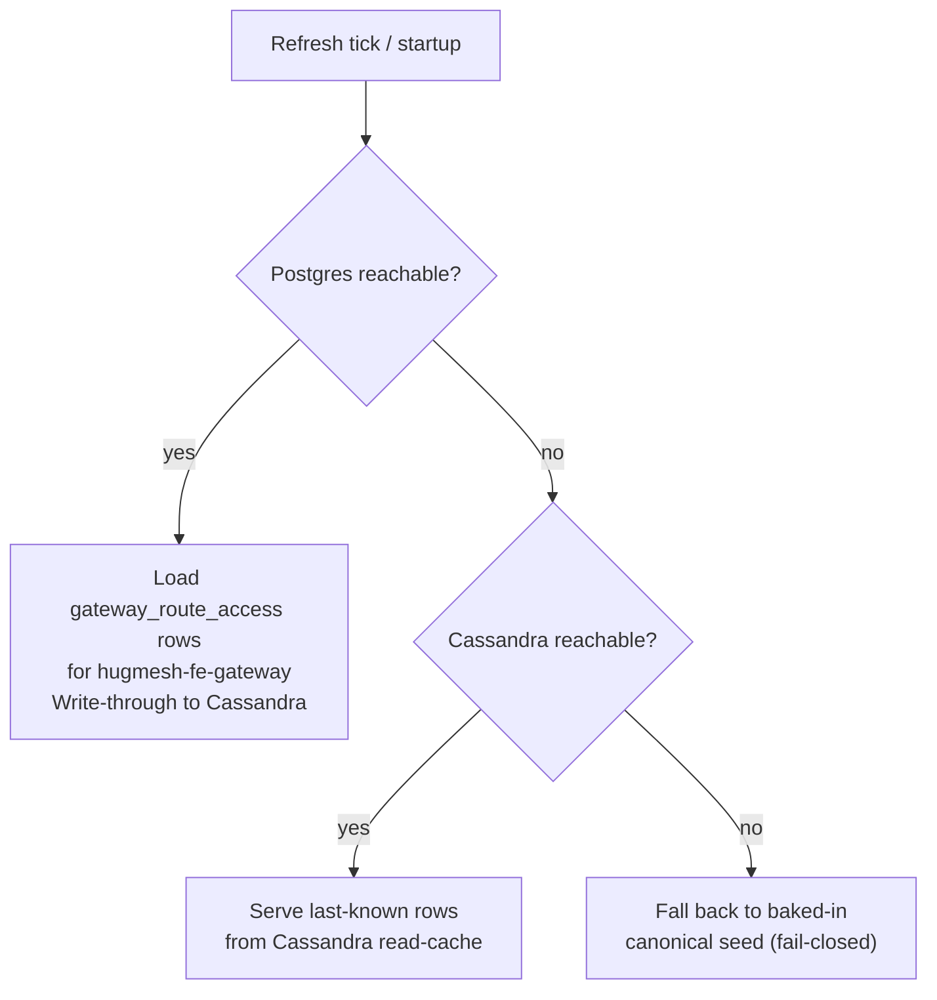
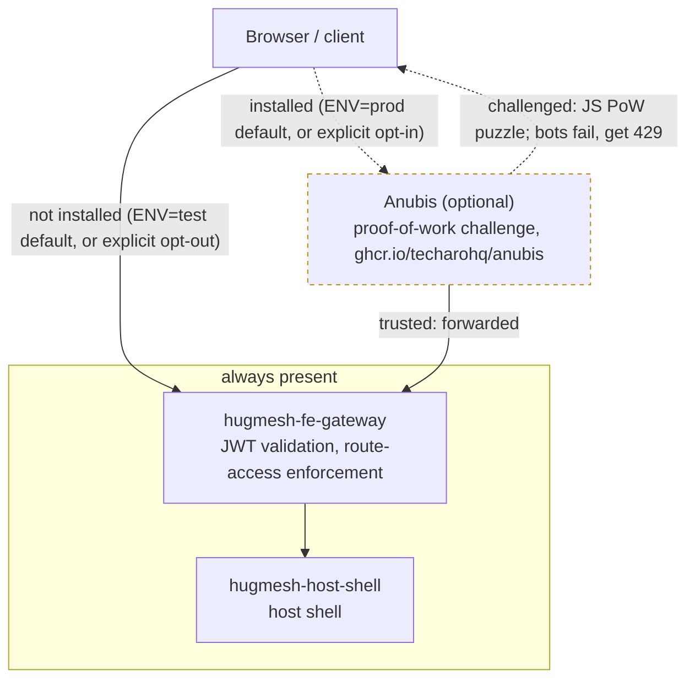

The **frontend front door** of a HugMesh brand: the per-node-type instance of
the shared [hugmesh-gateway](https://github.com/hugmesh/hugmesh-gateway)
Spring Cloud Gateway, deployed into the **frontend tier** in front of the web host
shell and its module-federation remotes (`hugmesh.net` host + remotes).

This repo is **not its own service codebase**. It is a thin **overlay** that
re-uses the audited `hugmesh-gateway` image and changes only three things:

1. its **identity** — `SPRING_APPLICATION_NAME=hugmesh-fe-gateway`;
2. its **route set** — a single catch-all `Path=/**` route to the web frontend;
3. its **downstream URI** — the in-cluster frontend web service.

Everything else (the OAuth2 resource-server, the JWT→authority conversion, the
domain-scoping, the per-gateway route-access enforcement, revocation) is
**inherited unchanged** from the shared gateway image, so every device runs
identical, audited gateway code regardless of node type.

```bash
# GATEWAY_IMAGE must point at the sibling hugmesh-gateway image (CI passes the
# same-namespace tag automatically; see .gitlab-ci.yml). Default build-arg is
# hugmesh-systems/hugmesh-gateway:dev.
docker build -t hugmesh-systems/fe-gateway:dev .
```

---

## Status

Shipped on `main` today (see "Known gaps" below for what's still unverified):

- **Frontend-tier overlay is live.** The single catch-all `fe-default`
  (`Path=/**` → `hugmesh-host-shell`) route is seeded via Liquibase and
  configured under the **SCG 5.0 `spring.cloud.gateway.server.webflux.routes`**
  namespace (the legacy `spring.cloud.gateway.routes` prefix binds nothing under
  Spring Cloud Gateway 5.0 — see the SCG-5 note in `application-fe.yml`).
- **Pure Casdoor-JWT resource server.** This gateway exposes **no external
  login**; it only validates the internal Casdoor JWT and runs the inherited
  authority conversion + route-access enforcement (see below).
- **CI is GitLab** (in-cluster). There are no GitHub Actions workflows in this
  repo.

Ecosystem baseline this overlay inherits from the shared gateway image:

- **Spring Boot 4.0.7 / Spring Cloud 2025.1.2**. The shared gateway deliberately
  builds on `spring-boot-starter-parent:4.0.7` directly (**not** the BFF-focused
  `hugmesh-parent` metapom, which would drag in liquibase / testcontainers /
  r2dbc-postgres scaffolding the gateway's Cassandra-based suite does not use) and
  pulls in `hugmesh-commons` (shared security/tenancy, `systems.hugmesh.commons.*`,
  2.1.0 — Boot-4 / Security-7 binary-compatible) as an explicit direct dependency.
- **Auth model.** Casdoor is the SSO IdP, but it is **internal-only and never
  redirects the browser** (native-login model, superseding the old OIDC
  authorization-code redirect). `login-ui` renders its own login form and POSTs
  credentials directly to a `/bff/login`-style endpoint on its own BFF
  (**`user-bff`** for the frontend); `user-bff` authenticates against Casdoor
  server-to-server and holds per-session JWT custody/refresh; the browser only
  ever holds an **opaque `bff_`-prefixed session** and never sees its own Casdoor
  JWT or talks to Casdoor directly. (Login/session/account logic is being
  **relocated from admin-bff to user-bff**, with the shared account/session/MFA/
  Casdoor-admin infra extracted to the new **`hugmesh-auth-core`** artifact;
  account/session **data** stays
  in `admin-bff-db`, reached over mTLS + `X-Internal-Token`.) The gateway stays a
  **pure Casdoor-JWT OAuth2 resource server**: a pre-security exchange filter in
  the shared image swaps the inbound `bff_` session → the internal custody JWT, so
  the gateway's JWT validation + role gate run unchanged on the frontend front
  door. This overlay carries none of that source and picks it up from the base
  image.

---

## Where it sits

| | |
|---|---|
| **Tier** | frontend (host + remotes front door) |
| **Namespace** | `hugmesh-frontend` |
| **Identity** | `hugmesh-fe-gateway` (the `gateway` key for its route-access rows) |
| **Downstream** | `hugmesh-host-shell.hugmesh-frontend.svc.cluster.local:80` (override `DOWNSTREAM_URI`) |
| **Auth** | validates the **internal Casdoor JWT** as an OAuth2 resource server; **no external login is exposed** (the shared image's pre-security filter exchanges the browser's opaque `bff_` session → custody JWT before validation) |
| **Base image** | `hugmesh-gateway` (one image, differentiated by `SPRING_APPLICATION_NAME`) |

A brand typically runs several gateway INSTANCES off this one image —
`hugmesh-fe-gateway` (this repo, the host + remotes front door),
`hugmesh-be-gateway` (backend / API + social homeservers), and
`hugmesh-pki-gateway` (identity: Casdoor + headscale) — each with its own
name, route set and route-access rows. This repo is the frontend one.

### What's in this repo

| File | Purpose |
|------|---------|
| `Dockerfile` | `FROM ${GATEWAY_IMAGE}` then bakes the fe identity + config + Liquibase changelog onto the shared image (sets `SPRING_APPLICATION_NAME` and `SPRING_CONFIG_ADDITIONAL_LOCATION`) |
| `application-fe.yml` | overlay config: `application.name`, the Casdoor `issuer-uri`, and the single `fe-default` `Path=/**` route to the web frontend (under the SCG 5.0 `spring.cloud.gateway.server.webflux.routes` namespace) |
| `liquibase/changelog/001-gateway-routes.xml` | seeds the `fe-default` route (`Path=/**` → the host shell) into the DB-backed `gateway_routes` registry. **Shipped history — never edit in place** (checksum + already-migrated DBs); migrate the value with a new changeset instead |
| `liquibase/changelog/002-route-host-shell.xml` | additive follow-up to 001: repoints `fe-default` onto the host shell's final Service name (`hugmesh-systems-web` → `hugmesh-host-shell`). Guarded by a precondition on the exact old value, so it is idempotent and never clobbers an operator override |
| `liquibase/changelog/db.changelog-master.xml` | Liquibase master changelog that includes the route seed + its follow-ups |
| `.gitlab-ci.yml` | builds + pushes this overlay image, basing the build off the sibling `hugmesh-gateway` image in the same in-cluster GitLab registry namespace |

CI is **GitLab** (in-cluster). There are no GitHub Actions workflows in this repo.

---

## Inherited capabilities (from `hugmesh-gateway`)

Because the image is the shared gateway, the fe-gateway gets the full gateway
authorization stack for free. The relevant pieces for the frontend front door:

### Opaque session → custody-JWT exchange

The browser behind this front door holds only an **opaque `bff_`-prefixed
session** — never a Casdoor JWT. A pre-security exchange filter in the shared
image swaps that `bff_` session for the internal **custody JWT** (minted/held by
`user-bff` after authenticating the POSTed native-login form server-to-server
against the internal-only Casdoor) **before** Spring Security runs, so the entire
JWT validation + authority conversion + route-access stack below operates
unchanged. The gateway itself exposes **no login** and never talks to Casdoor
directly.

```mermaid
sequenceDiagram
    participant B as Browser
    participant L as login-ui
    participant U as user-bff
    participant C as Casdoor
    participant G as hugmesh-fe-gateway
    participant W as hugmesh-host-shell

    Note over B,C: Login (native-login model, once per session; Casdoor is internal-only)
    B->>L: loads login form (own UI, no Casdoor redirect)
    L->>U: POST /bff/login (credentials)
    U->>C: authenticate server-to-server
    C-->>U: Casdoor JWT (custody, held by user-bff)
    U-->>B: Set-Cookie bff_session (opaque, HttpOnly)

    Note over B,W: Every request through the front door
    B->>G: request + bff_ session cookie
    G->>G: pre-security filter exchanges bff_ session -> custody JWT
    G->>G: JWT validation + authority conversion + route-access filters
    G->>W: forwarded request (Path=/**)
    W-->>B: response
```

### Casdoor resource server + role authorities

Every inbound request must carry a valid internal Casdoor JWT whose issuer matches
`CASDOOR_ISSUER_URI` (default `https://id.hugmesh.net`) — **with one
tier-scoped, GET-only exception**. On the fe tier specifically (instance names
suffixed `-fe-gateway`), the shared image's `SecurityConfig` `permitAll`s a
narrow anonymous surface so a logged-out visitor can load the app at all: the
SPA shell (`/`, `/index.html`, the root-level hashed JS/CSS bundles,
`/importmap.json`, `/remoteEntry.json`, `/assets/**`), the two public
federation reads (`/api/federation/vanity(/**)`, `/api/federation/capabilities`),
and the native-login page (`/login/**`) — plus the exact anonymous **POST**
`/bff/login` credential-submit endpoint and a couple of narrowly-scoped public
`/bff/public/**` reads (login-page announcements, appeal-contact). Every other
path, method, and tier stays on the coarse `authenticated()` floor. This is
enforced entirely in the shared `hugmesh-gateway` image
(`SecurityConfig.PUBLIC_PATHS` / `FE_SHELL_PUBLIC_GET_PATHS`, tier-detected by
the `-fe-gateway` suffix) and mirrored by matching `PUBLIC` rows in
`GatewayRouteAccessFilter`'s own seed (`CanonicalSeed.fe()`) so the coarse
floor and the route-access layer never disagree — this overlay carries no
source of its own for either. The shared `CasdoorAuthorities` converter
translates every *other* validated token into Spring Security authorities
using these rules, applied in order:

- Every authenticated principal receives a `ROLE_USER` floor authority.
- Each entry in the `roles` claim maps to `ROLE_<UPPER>`, accommodating Casdoor's
  string-or-object role shape.
- Each entry in the `permissions` claim becomes a verbatim authority, **except** any
  entry beginning with the reserved prefixes `ROLE_` or `DOMAIN_` is silently
  dropped — this prevents token holders from injecting elevated authorities.
- A legacy `isAdmin: true` claim maps to `ROLE_ADMIN`.
- Exactly one `DOMAIN_<x>` authority is added, derived from the
  cryptographically-validated `iss` field — never from a user-settable claim.

The least-privilege cascade is `SUPERADMIN > ADMIN`/`MOD`/`USER`, plus the separate
`ROLE_IMAGE_BUILDER` capability.

### Domain scoping (multi-tenancy)

> Status: the issuer-keyed domain-scoping described here lands with the shared
> gateway's `feat/domain-foundation` work (`CasdoorAuthorities` /
> `DomainRegistry` / `Roles` / `GatewayRouteAccessFilter`). This overlay carries
> no source of its own and picks it up automatically from the base image.

`DomainRegistry` resolves the validated issuer to a brand/domain name. The mechanism
is **opt-in and backward-compatible**:

- With `APP_TENANCY_ISSUERS` unset, the single configured issuer maps to
  `DOMAIN_default` and the cluster behaves identically to single-tenant mode.
- With `APP_TENANCY_ISSUERS` set, only the explicitly listed per-brand Casdoor
  issuers are trusted. A token whose `iss` does not appear in the list **fails
  closed (401)**.

Once a domain is established from the validated issuer, `GatewayRouteAccessFilter`
**hard-denies** any non-`SUPERADMIN` principal whose domain does not match the
request's target domain. The domain is always derived from the cryptographically
validated `iss` — never from a user-settable claim — so this check cannot be
bypassed by crafting a token's authority entries. `ROLE_SUPERADMIN` is the **only**
cross-domain bypass, reserved for the infra control plane.

### Authorization filter chain

After Spring Security authenticates the JWT, the shared WebFilters execute in
this order. These are small **positive** orders, not round hundreds — Spring
merges every `WebFilter` bean into one shared ascending `@Order` namespace
together with Spring Security's own `WebFilterChainProxy` (registered at
`-100`), so these principal-dependent filters are placed just *after* it,
deliberately, so `exchange.getPrincipal()` is already resolved by the time
they run:

| Order | Filter | Role in front of the web host |
|------:|--------|-------------------------------|
| 10 | `RevocationGatewayFilter` | reject revoked Casdoor tokens (Cassandra-cached) |
| 20 | `ExternalAuthHeaderFilter` | inject additive `External-Authorization` headers when an external-OAuth token is present (never required) |
| 25 | `GatewayRouteAccessFilter` | **per-gateway external-access rules** + the cross-domain hard-deny / `SUPERADMIN` bypass |
| 30 | `ResourceAccessFilter` | fine-grained per-resource grants (`{kind}:{id}`) for services that register them |

Before `hugmesh-gateway` commit `d0f3146` (PR #37, "run principal-dependent
WebFilters AFTER Spring Security (close fail-open)", merged 2026-06-18), these
same filters were ordered at `Integer.MIN_VALUE+100/+200/+250/+300` — i.e. far
*before* the security chain, not just before the router. With no principal
resolved yet, revocation, the route-access DENY, the cross-domain hard-deny,
the `SUPERADMIN` bypass, and the per-resource grant check all fell through
their anonymous branch and forwarded every request — a CRITICAL fail-open.
The table above reflects the current (fixed) `getOrder()` values verified
directly against `hugmesh-gateway`'s current `main`; this overlay carries none
of that source and inherits it unchanged from the base image.

`ROLE_ADMIN` on the internal JWT bypasses the access filters **within its own
domain**, so the admin who manages the rules is never locked out.
Infra/observability paths (`/actuator/**`, …) stay gated to `GAME-MASTER` /
`ADMIN` / `SUPERADMIN` by the shared `SecurityConfig` (`GAME-MASTER` is the
platform's cross-service infra role and isn't seeded in every deployment,
which is why `ADMIN` is also included rather than gating on it alone).

### Per-gateway route access

`GatewayRouteAccessService` enforces the admin-managed "which roles/users may reach
which URLs from outside **this** gateway" rules. **Postgres is the source of truth**
(`ROUTE_ACCESS_R2DBC_URL`); the pod loads the `gateway_route_access` rows for its own
`spring.application.name` (= `hugmesh-fe-gateway`), write-through-mirrors them into
the Cassandra read-cache, and refreshes every tick. The fallback chain is strictly
ordered and **never silently fail-open**:



The admin-bff (`hugmesh-admin-bff-api`) CRUDs the canonical rows. Longest-matching
`url_pattern` wins; explicit `allow=false` denies; the `PUBLIC` sentinel permits
anonymous traffic. Route-access data access follows the platform standard — Spring
Data R2DBC reactive repositories, no raw SQL strings.

### MFA-required route enforcement (✅ inherited, ships dark)

> Status: ✅ shipped + tested in the shared gateway image; **feature-flagged dark
> (default off)**, not absent. Casdoor MFA adds a `gateway_route_access.mfa_required`
> flag, fail-closed, plus a `MFA_SATISFIED` authority derived from the BFF-written,
> freshness-validated `mfa_satisfied_at` claim, plus the D8 privileged-MFA floor that
> denies even a SUPERADMIN reaching an `mfa_required` surface without a fresh second
> factor. Both `app.mfa.enabled` and `app.mfa.enforce-privileged-floor` default
> `false` (ship-dark) — when off the gateway is byte-identical to its pre-MFA
> behaviour. Because the enforcement lives in the shared gateway image's route-access
> layer, fe-gateway already carries it; no change to this overlay is expected beyond
> flipping the flags and new route-access rows flowing from the admin-bff.

---

## Configuration

The env vars below are specific to this overlay. The full configuration reference
is documented in `hugmesh-gateway`.

| Env var | Default | Purpose |
|---------|---------|---------|
| `SPRING_APPLICATION_NAME` | `hugmesh-fe-gateway` | gateway identity + route-access `gateway` key (baked into the image) |
| `CASDOOR_ISSUER_URI` | `https://id.hugmesh.net` | trusted Casdoor issuer for JWT validation |
| `DOWNSTREAM_URI` | `http://hugmesh-host-shell.hugmesh-frontend.svc.cluster.local:80` | the web frontend this gateway fronts — the literal default baked into `application-fe.yml`, and the value 002 migrates the Liquibase-seeded row to, matching the `hugmesh-host-shell` Service `hugmesh-generator` deploys |
| `APP_TENANCY_ISSUERS` | _(empty)_ | CSV `issuerUri=domain,…` — enables multi-brand mode (empty ⇒ single-tenant `default`) |
| `APP_TENANCY_HOSTS` | _(empty)_ | CSV `hostSuffix=domain,…` — defense-in-depth Host→domain map |
| `ROUTE_ACCESS_R2DBC_URL` | _(empty)_ | Postgres source-of-truth for route-access rows (empty ⇒ Cassandra-cache/seed only) |

---

## Known gaps

- **~~`SPRING_PROFILES_ACTIVE` is never set to `fe`~~ — FIXED 2026-07-17.** The
  Dockerfile now sets `ENV SPRING_PROFILES_ACTIVE=fe`, so `application-fe.yml` is
  actually loaded. The analysis previously recorded here was **correct on every
  point** and is kept below for the evidence trail.
  - The original finding: this overlay ships `application-fe.yml`, which Spring
    Boot only picks up from `SPRING_CONFIG_ADDITIONAL_LOCATION` when profile `fe`
    is active, and nothing in this repo's Dockerfile set `SPRING_PROFILES_ACTIVE=fe`.
    **Checked directly against the current `hugmesh-gateway` base image source**
    (its `Dockerfile` and `application.yml` on `origin/main`): it does **not**
    derive an active profile from `SPRING_APPLICATION_NAME` or any other
    convention — `SPRING_PROFILES_ACTIVE` isn't referenced anywhere in that repo.
    So a plain `docker run` of this overlay's own image never loaded
    `application-fe.yml`: the Casdoor `issuer-uri` override and the `fe-default`
    fallback route silently never applied.
  - **Proven empirically 2026-07-17** on this repo's exact stack (Spring Boot
    4.0.7), booting a real context with the overlay's own file shape in a
    `SPRING_CONFIG_ADDITIONAL_LOCATION` dir. Without `SPRING_PROFILES_ACTIVE`:
    `resolved active profiles = []`, the file's properties resolve to `null`.
    With `SPRING_PROFILES_ACTIVE=fe`: `resolved active profiles = [fe]` and the
    route properties bind. The failure mode was **not** a clean 404 outage — the
    base image's packaged `application.yml` ships a genuine `api-default` route
    (`/api/**` → `api:8080`), so an unprofiled overlay silently served the
    **wrong route table** with the intended `fe-default` catch-all simply absent.
    A half-working gateway is harder to notice than a dead one.
  - **Confirmed 2026-07-16 directly against `hugmesh-generator`'s current
    source (both the production Helm chart and the local compose stack) —
    neither real deployment path uses this repo's image, `application-fe.yml`,
    or Liquibase changelog at all.**
    `specs/cluster/charts/hugmesh-gateway/values.yaml` sets
    `image.repository: registry.hugmesh.net/hugmesh/hugmesh-gateway`
    — the shared **base** image, not the overlay image this repo's own
    `.gitlab-ci.yml` builds and pushes (`.../hugmesh-fe-gateway`) — and the
    chart's `deployment.yaml` sets `SPRING_PROFILES_ACTIVE=routes` plus mounts
    a Helm-templated `application-routes.yml` ConfigMap, fixed for this exact
    profile-activation bug class by `hugmesh-generator` PR #275 (merged
    2026-07-08). `tests/stack/compose.local.yaml`'s `hugmesh-fe-gateway`
    service likewise builds straight from `.stack-src/hugmesh-gateway` (the
    base repo, again not this one) with the identical
    `SPRING_PROFILES_ACTIVE: routes` fix (`hugmesh-generator` PR #261). A
    grep of `hugmesh-generator`'s full manifest/spec/compose tree turns up
    no reference to this repo's own pushed image
    (`registry.hugmesh.net/hugmesh/hugmesh-fe-gateway`) at all.
    **So this repo's own Dockerfile/`application-fe.yml`/Liquibase overlay
    mechanism is not exercised by either real deployment path today** — it is
    effectively a standalone artifact. Whether that's intentional (this repo
    predates the generator's route-templating approach and is now vestigial)
    or an oversight is a product decision, not a code fix this docs pass
    should make — flagged here so nobody assumes `docker build .` of this repo
    produces what actually runs anywhere else in the platform.
- **~~The downstream host-shell Service still carried its pre-rebrand name~~ —
  RESOLVED, but the first resolution was only HALF a rename.** The 2026-08-19
  check recorded here confirmed that `hugmesh-generator`'s
  `specs/cluster/manifests/frontend/deployment.yaml` and its rendered route in
  `specs/cluster/apps/20-gateway-fe.yaml` agreed with this repo — on
  `hugmesh-systems-web`. That agreement was real but the *name* was not final:
  `hugmesh-systems-web` was a hybrid left by an intermediate sweep, already
  `hugmesh-`-prefixed and therefore carrying no banned token, which is exactly
  why no grep-driven rename sweep ever surfaced it. The generator's compose lane
  had meanwhile moved on to `hugmesh-host-shell`, so the two lanes had silently
  split.
  Both lanes now say **`hugmesh-host-shell`**, and the generator asserts that
  cross-lane agreement mechanically (`scripts/validate-reserved-prefixes.sh`
  stage 6b: a hybrid gate plus a paired-move assertion over all 13 members of
  the shell's name set), so this can no longer drift back to prose nobody
  re-checks. This repo's side is `application-fe.yml`'s `DOWNSTREAM_URI` default
  plus `002-route-host-shell.xml`, which migrates the 001-seeded row.
  **Ordering:** the generator rename does not touch the running cluster until
  ArgoCD syncs, but that sync recreates the Service under the new name — so this
  repo's route value must be in place before the sync, or the `/**` catch-all
  dials a Service that no longer exists and the front page 502s.

---

## Roadmap

Grounded in the platform roadmap. Items below are **designed / in-flight**, not
shipped on `main`. Most are inherited from the shared `hugmesh-gateway` image or
rendered by the `hugmesh-generator`, not added to this overlay:

- **SSO native-login model — ✅ shipped**, not in-progress (internal-only
  Casdoor, `login-ui` POSTing to `user-bff`'s login endpoint, opaque `bff_`
  session, wired through `login-ui` / `user-bff` / this gateway — see "Status"
  above). Platform-wide **e2e regression coverage continues to expand**
  elsewhere in the platform; this overlay repo carries no e2e suite or test
  tree of its own to track that against.
- **MFA** (WebAuthn + TOTP + recovery; per-role defaults; step-up) — the
  platform-wide enrollment/step-up work is in flight, but the **gateway surface is
  already shipped + tested** in the base image (the `gateway_route_access.mfa_required`
  flag + `MFA_SATISFIED` authority + privileged-MFA floor, see above); it ships dark
  and is enabled by flipping `app.mfa.enabled` / `app.mfa.enforce-privileged-floor`.
- **Anubis bot-challenge layer** at the edge (proof-of-work pre-auth friction) —
  **✅ shipped**, entirely in `hugmesh-generator` (manifests, build-time
  ingress wiring, admin-console surfacing); detailed below. This repo carries
  none of that code, same as it always has.
- **Cloudflare** fronts prod.
- Platform-wide (not gateway-specific): encrypted versioned backups (Velero +
  kopia/restic), egress VPN (.conf drop-in), per-node attached storage, desktop
  app governance, workload console, device-license registry, multi-tenancy
  superadmin (per-domain CA + per-brand gateway/BFF/UI), games app-store, A/V via
  coturn/TURN, OWASP pen-test + nuclei in CI, binhost auto-update fleet
  distribution.

### Anubis bot-challenge layer (✅ shipped, in `hugmesh-generator`)

> **Status: ✅ shipped — but entirely in `hugmesh-generator`, not this repo
> or the shared `hugmesh-gateway` base image.** Verified 2026-07-16 against
> `hugmesh-generator`'s current source: `specs/cluster/manifests/anubis/`
> ships a real `Deployment`/`Service` (pinned `ghcr.io/techarohq/anubis:v1.25.0`,
> not `:latest`); `build-rpi5-stage4.sh`/`build-x86-host-stage4.sh` reroute the
> fe-gateway's public Ingress through it when installed
> (`_opt_wire_anubis_ingress`, unit-tested by
> `tests/scripts/test-anubis-env-gate.sh`); and `hugmesh-admin-bff-api`
> ships a real `anubis` package (`AnubisClient` / `AnubisController`, with
> tests) that proxies Anubis's metrics/health listener into the superadmin
> console. It is an **optional service, ENV-conditional by design**: default
> **ON** for `ENV=prod` ("shields up"), default **OFF** for `ENV=test` (so
> e2e/QEMU runs aren't PoW-throttled), always overridable by an explicit
> operator selection. This repo itself still carries **zero** Anubis
> code/manifests — correctly, since the sidecar and its Service/Ingress wiring
> live entirely in `hugmesh-generator`, exactly as this section originally
> anticipated — but the checklist below is no longer speculative; it reflects
> the real shipped shape, not a design intent.

[Anubis](https://anubis.techaro.lol/) is a proof-of-work HTTP challenge middleware designed to
block AI scrapers, credential-stuffers, and brute-force bots before they reach any upstream
service. It runs as a transparent reverse proxy in front of this gateway so suspicious traffic
is challenged at the edge, not inside the JWT-validated gateway stack.

#### Architecture

Anubis is an **optional** hop (dashed edges below) — installed and in the path by default in
PROD, bypassed by default in TEST; the boxed nodes are the gateway's own always-present path.



Anubis runs as a standalone `Deployment` in the same `hugmesh-frontend` namespace; when
installed, the public Ingress targets Anubis's `:8923` gate instead of the fe-gateway's `:8080`
directly, so the fe-gateway's own port is never exposed straight to the cluster ingress.

#### Deployment shape

Shipped exactly per the original rollout design: **shields-up / enabled by default in PROD**
and **disabled by default in TEST** (so e2e/QEMU runs aren't PoW-throttled) — either default is
overridable by an explicit operator opt-in/opt-out — with the **superadmin admin console**
exposing the challenge's status + metrics via the admin-bff's `AnubisClient`/`AnubisController`.

#### Implementation checklist

> All file paths below live in the **`hugmesh-generator`** repo, **not** this overlay
> repo. This repo has no `specs/` directory, no k8s manifests, and no `verify-client.sh`.

- [x] Anubis container: `specs/cluster/manifests/anubis/deployment.yaml`
      (pinned `ghcr.io/techarohq/anubis:v1.25.0`; listens on `:8923`, forwards to
      `TARGET=http://hugmesh-fe-gateway.hugmesh-frontend.svc.cluster.local:8080`)
- [x] fe-gateway public Ingress rerouted through Anubis `:8923` when installed
      (`_opt_wire_anubis_ingress` in the build scripts; idempotent + reversible;
      routes DIRECT to `:8080` when not installed)
- [x] Bind/target wired via env on the Deployment (`BIND=:8923`,
      `TARGET=...:8080`, `METRICS_BIND=:9090`) — different env-var names than
      this section originally guessed (`ANUBIS_BIND`/`ANUBIS_TARGET`), same effect
- [x] `DIFFICULTY=5` configured (mirrored to the admin-bff's own
      `ANUBIS_DIFFICULTY` display value)
- [ ] Bot-signature rules (`ANUBIS_BOTS_POLICY` or equivalent) — **not found**;
      the shipped Deployment uses Anubis's own upstream defaults only, no
      custom bot-policy ConfigMap
- [x] Default-on in PROD, off in TEST, explicit operator selection always wins
      (`_opt_anubis_installed` ENV policy; unit-tested by
      `tests/scripts/test-anubis-env-gate.sh`)
- [x] Challenge status + metrics surfaced in the superadmin admin console
      (`hugmesh-admin-bff-api`'s `anubis` package, with tests; degrades to a
      structured "unreachable" rather than a 503 cascade when Anubis isn't installed)
- [ ] Validate that `/login/**` + `/bff/login` + `/actuator/health` bypass the
      challenge — **not found**. The shipped Deployment forwards through a
      single blanket `TARGET` (Anubis fronts the whole fe-gateway when
      installed) with no path-based bypass config visible; still worth a live
      check of whether the login page PoW-loops before a visitor has a JS
      context to solve the puzzle
- [ ] Add QEMU/e2e regression confirming the fe-gateway is reachable through
      Anubis after a clean login — **not found** in `tests/e2e/` or any
      `verify-client.sh`

#### Security notes

- Anubis is **not a WAF** and does not replace the gateway's JWT or route-access
  enforcement. It is purely a pre-authentication friction layer at the network edge.
- Once the browser holds a valid session token, Anubis does not re-challenge
  authenticated API calls — that is intentional. Re-challenging every API request
  would break the SPA. The PoW challenge fires only on unauthenticated or
  unrecognized clients.
- Public paths (registration, `/login`, `/bff/login`) should be exempted so that
  the login flow doesn't PoW-loop before the visitor has a JS context to solve a
  puzzle — **not yet verified as implemented** (see the checklist above: no
  path-exemption config is visible in the shipped Deployment). (There is no
  browser-facing OIDC redirect/callback route under the native-login model —
  see "Auth model" above — so no callback path needs exempting.)

---

## Relationship to the platform

- **Gateways** — one shared `hugmesh-gateway` image; this overlay is its frontend
  instance. The be-gateway and identity (pki) gateway are siblings off the same image
  (and, only when the optional games service is enabled — off by default — a games
  gateway is rendered the same way).
- **Casdoor** — the gateway is a resource server only; it validates JWTs minted by the
  brand's Casdoor (fronted by the pki-gateway) and never exposes a login. The browser-facing
  login flow is owned by `login-ui` + `user-bff`; this gateway only ever sees the opaque
  `bff_` session (exchanged to the custody JWT by the shared image's pre-security filter).
- **Federation** — the host shell behind this gateway is the module-federation host;
  the same domain-scoping and route-access rows that gate ordinary traffic also gate
  federated/remote surfaces, with `SUPERADMIN` the only cross-domain reach.
- **Multi-tenancy** — per-brand instances each carry their own issuer + `gateway`
  name + route-access rows; the issuer-keyed `DOMAIN_<x>` scoping + the cross-domain
  hard-deny enforce brand isolation at the gateway.

The route table and per-instance config that actually run in the cluster are rendered
by the generator's ArgoCD Application (shared `hugmesh-gateway` Helm chart with
`instance.name: hugmesh-fe-gateway` + the fe `routes`); the admin-bff CRUDs the
`gateway_route_access` rows. As detailed under "Known gaps" above, the generator's
local compose stack renders the same identity the same way too (builds the base
`hugmesh-gateway` image directly with `SPRING_PROFILES_ACTIVE=routes`) — so
neither the cluster nor local-dev path actually consumes this repo's own
`application-fe.yml` / `liquibase/changelog`. Keep them in sync with the generator
Application's rendered config anyway, since it stays the deployed source of truth
and this repo's files are the only human-readable standalone record of that same
route/identity shape.

Note the scope of the changelog here: `001-gateway-routes.xml` seeds **only** the
single `fe-default` row into `gateway_routes`. It seeds **no** `gateway_route_access`
rows — those are CRUDed by the admin-bff at runtime (or supplied by the base image's
canonical seed), never baked in by this overlay.
