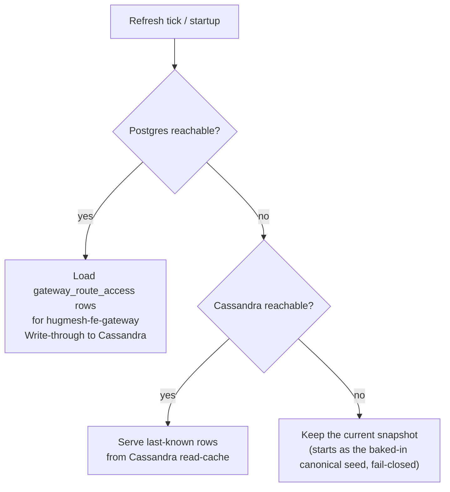
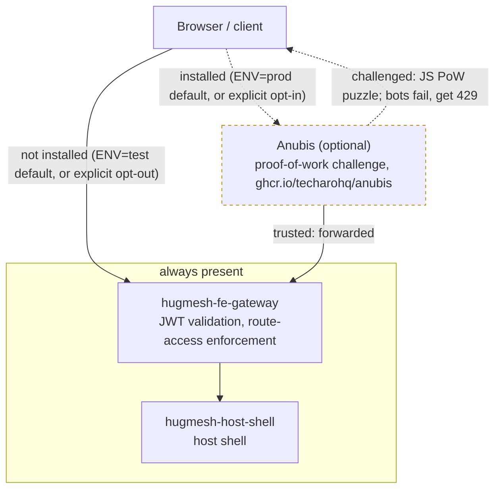

The **frontend front door** of a HugMesh brand. It is the per-node-type instance
of the shared [hugmesh-gateway](https://github.com/hugmesh/hugmesh-gateway)
Spring Cloud Gateway, deployed into the **frontend tier** in front of the web host
shell and its module-federation remotes (`hugmesh.net` host + remotes).

This repo is **not its own service codebase**. It is a thin **overlay** that
re-uses the audited `hugmesh-gateway` image and changes only three things:

1. its **identity** — `SPRING_APPLICATION_NAME=hugmesh-fe-gateway`;
2. its **route set** — a single catch-all `Path=/**` route to the web frontend;
3. its **downstream URI** — the in-cluster frontend web service.

Everything else (the OAuth2 resource-server, the JWT→authority conversion, the
domain-scoping, the per-gateway route-access enforcement, revocation) is
**inherited unchanged** from the shared gateway image. Every device runs the same
audited gateway code, whatever its node type.

```bash
# GATEWAY_IMAGE must point at the sibling hugmesh-gateway image (CI passes the
# same-namespace tag automatically; see .gitlab-ci.yml). Default build-arg is
# hugmesh-systems/hugmesh-gateway:dev.
docker build -t hugmesh-systems/fe-gateway:dev .
```

---

## Status

On `main` today (see "Known gaps" below for what is still unverified):

- **The overlay is built, but the platform does not deploy it** (see "Known
  gaps"). The single catch-all `fe-default` route (`Path=/**` →
  `hugmesh-host-shell`) is seeded via Liquibase and configured under the
  **SCG 5.0 `spring.cloud.gateway.server.webflux.routes`** namespace. The legacy
  `spring.cloud.gateway.routes` prefix binds nothing under Spring Cloud Gateway
  5.0; see the SCG-5 note in `application-fe.yml`.
- **Pure Casdoor-JWT resource server.** This gateway exposes **no external
  login**. It validates the internal Casdoor JWT (fetching Casdoor's signing
  keys) and runs the inherited authority conversion and route-access
  enforcement (see below).
- **Version `0.1.0-beta.1`** (the `VERSION` file). `0.1` means overlay: no
  code or tests of its own, and the image has not yet been published from
  GitHub.
- **CI is GitLab** (in-cluster). The one GitHub Actions workflow,
  `.github/workflows/release.yml`, publishes the overlay image to
  `ghcr.io/hugmesh/hugmesh-fe-gateway` (see "Releasing" below).

The overlay inherits this baseline from the shared gateway image:

- **Spring Boot 4.0.7 / Spring Cloud 2025.1.2.** The shared gateway builds on
  `spring-boot-starter-parent:4.0.7` directly. It does **not** use the BFF-focused
  `hugmesh-parent` metapom, which would drag in liquibase / testcontainers /
  r2dbc-postgres scaffolding the gateway's Cassandra-based suite does not use. It
  depends directly on `hugmesh-commons` (shared security/tenancy,
  `net.hugmesh.commons.*`, 2.1.0 — Boot-4 / Security-7 binary-compatible).
- **Auth model.** Casdoor is the SSO IdP. It is **internal-only and never
  redirects the browser** (native-login model, which replaced the old OIDC
  authorization-code redirect).
  - `login-ui` renders its own login form and POSTs the credentials to a
    `/bff/login`-style endpoint on its own BFF (**`user-bff`** for the frontend).
  - `user-bff` authenticates against Casdoor server-to-server.
  - The session store and the custody-held JWT live behind **`admin-bff`**, which
    answers the gateway's exchange call.
  - The browser holds only an **opaque `bff_`-prefixed session**. It never sees
    its own Casdoor JWT and never talks to Casdoor.
  - Login/session/account logic has been **relocated from admin-bff to
    user-bff**. The shared account/session/MFA/Casdoor-admin code now lives in the
    **`hugmesh-auth-core`** artifact. Account/session **data** stays in
    `admin-bff-db`, reached over mTLS + `X-Internal-Token`.
  - The gateway stays a **pure Casdoor-JWT OAuth2 resource server**. A
    pre-security exchange filter in the shared image swaps the inbound `bff_`
    session for the internal custody JWT, so the gateway's JWT validation and
    role gate run unchanged on the frontend front door.
  - The filter is off by default in the image
    (`hugmesh.gateway.bff-exchange.enabled`, env
    `HUGMESH_GATEWAY_BFF_EXCHANGE_ENABLED`, default `false`). The generator's
    cluster and compose lanes both set it `true` for the fe-gateway.
  - This overlay carries none of that source. It picks it up from the base image.

---

## Where it sits

| | |
|---|---|
| **Tier** | frontend (host + remotes front door) |
| **Namespace** | `hugmesh-frontend` |
| **Identity** | `hugmesh-fe-gateway` (the `gateway` key for its route-access rows) |
| **Downstream** | `hugmesh-host-shell.hugmesh-frontend.svc.cluster.local:80` (override `DOWNSTREAM_URI`) |
| **Auth** | validates the **internal Casdoor JWT** as an OAuth2 resource server; **no external login is exposed** (the shared image's pre-security filter exchanges the browser's opaque `bff_` session → custody JWT before validation) |
| **Base image** | `hugmesh-gateway` (one image, differentiated by `SPRING_APPLICATION_NAME`) |

A brand usually runs several gateway INSTANCES off this one image:
`hugmesh-fe-gateway` (this repo, the host + remotes front door),
`hugmesh-be-gateway` (backend / API + social homeservers), and
`hugmesh-pki-gateway` (identity: Casdoor + headscale). Each has its own
name, route set and route-access rows. This repo is the frontend one.

### What's in this repo

| File | Purpose |
|------|---------|
| `Dockerfile` | `FROM ${GATEWAY_IMAGE}` then bakes the fe identity + config + Liquibase changelog onto the shared image (sets `SPRING_APPLICATION_NAME` and `SPRING_CONFIG_ADDITIONAL_LOCATION`) |
| `application-fe.yml` | overlay config: `application.name`, the Casdoor `issuer-uri`, and the single `fe-default` `Path=/**` route to the web frontend (under the SCG 5.0 `spring.cloud.gateway.server.webflux.routes` namespace) |
| `liquibase/changelog/001-gateway-routes.xml` | seeds the `fe-default` route (`Path=/**` → the host shell) into the DB-backed `gateway_routes` registry. **Shipped history — never edit in place** (checksum + already-migrated DBs); migrate the value with a new changeset instead |
| `liquibase/changelog/002-route-host-shell.xml` | additive follow-up to 001: repoints `fe-default` onto the host shell's final Service name (`hugmesh-systems-web` → `hugmesh-host-shell`). Guarded by a precondition on the exact old value, so it is idempotent and never clobbers an operator override |
| `liquibase/changelog/db.changelog-master.xml` | Liquibase master changelog that includes the route seed + its follow-ups |
| `.gitlab-ci.yml` | builds + pushes this overlay image, basing the build off the sibling `hugmesh-gateway` image in the same in-cluster GitLab registry namespace |
| `VERSION` | this image's version (`0.1.0-beta.1`). A `v<version>` git tag must match it |
| `.github/workflows/release.yml` | GHCR publish of the same overlay, `FROM` the pinned `ghcr.io/hugmesh/hugmesh-gateway:0.3.0-beta.1`. Runs on push to `main`, on `v*` tags and on manual dispatch; see "Releasing" below. It checks that the base image can be pulled first |

CI is **GitLab** (in-cluster). The only GitHub Actions workflow is
`release.yml` above.

### Releasing

- **Version scheme:** `MAJOR.MINOR.PATCH-beta.N`. The `VERSION` file holds the
  current one. A fix during a beta raises `N`.
- **Push to `main`:** builds and pushes `:main` and `:sha-<12 hex>`.
- **Tag `v<VERSION>`** (annotated, on a commit on `main`): builds and pushes
  `:<VERSION>`, `:beta` and `:sha-<12 hex>`, and creates a GitHub prerelease
  that is never marked latest. The run fails if the tag does not match
  `VERSION`, if `VERSION` is a SNAPSHOT, or if `:<VERSION>` already exists on
  GHCR (a published version is never overwritten).
- **Manual dispatch:** on `main` it does a main build; on a `v*` tag it
  re-runs that release. Any other ref is refused. The optional
  `gateway_image` input overrides the base image on a main run only.
- **Never `:latest` for a beta.**
- **Base image:** pinned in `release.yml` (`GATEWAY_IMAGE_PIN`) to an exact
  `hugmesh-gateway` version. That version must be published first, and this
  repository needs Read under that package's Manage Actions access.
- **Runner:** the jobs use the self-hosted runner only when the
  `RUNS_ON_PUBLISH` repository variable is set (a JSON array of labels) and
  the run is for `main` or a `v*` tag. Otherwise they run on hosted
  `ubuntu-latest`. Deleting the variable switches back to hosted runners. The
  workflow has no `pull_request` trigger.

---

## Inherited capabilities (from `hugmesh-gateway`)

The image is the shared gateway, so the fe-gateway gets the full gateway
authorization stack. These are the parts that matter for the frontend front door.

### Opaque session → custody-JWT exchange

The browser behind this front door holds only an **opaque `bff_`-prefixed
session**, never a Casdoor JWT. A pre-security exchange filter in the shared
image swaps that `bff_` session for the internal **custody JWT** **before**
Spring Security runs. The custody JWT is the Casdoor JWT that `user-bff` obtained
by authenticating the POSTed native-login form server-to-server against the
internal-only Casdoor. The gateway fetches it from `admin-bff` at
`POST /bff/internal/session/exchange`. The JWT
validation, authority conversion and route-access stack below then run
unchanged.

The gateway exposes **no login** and never redirects a browser to Casdoor. It
reads Casdoor's JWKS to verify signatures. The exchange is off in the image by
default and fail-closed when on: any exchange error is a 401, and the raw `bff_`
value is never forwarded. The anonymous login POST (`/bff/login`) also passes
through this gateway, which permits it.

```mermaid
sequenceDiagram
    participant B as Browser
    participant L as login-ui
    participant U as user-bff
    participant C as Casdoor
    participant G as hugmesh-fe-gateway
    participant W as hugmesh-host-shell

    Note over B,C: Login (native-login model, once per session; Casdoor is internal-only)
    B->>L: loads login form (own UI, no Casdoor redirect)
    L->>U: POST /bff/login (credentials)
    U->>C: authenticate server-to-server
    C-->>U: Casdoor JWT (kept in custody; exchange served by admin-bff)
    U-->>B: Set-Cookie bff_session (opaque, HttpOnly)

    Note over B,W: Every request through the front door
    B->>G: request + bff_ session cookie
    G->>G: pre-security filter exchanges bff_ session -> custody JWT
    G->>G: JWT validation + authority conversion + route-access filters
    G->>W: forwarded request (Path=/**)
    W-->>B: response
```

### Casdoor resource server + role authorities

Every inbound request must carry a valid internal Casdoor JWT whose issuer matches
`CASDOOR_ISSUER_URI` (default `https://id.hugmesh.net`). The exceptions are a
fixed list of anonymous paths, all set in the shared image's `SecurityConfig`:

- **On every tier** (`PUBLIC_PATHS`, any method): `/api/auth/**`,
  `/api/registration/**`, `/api/login/**`, `/_remotes/login/**`,
  `/_remotes/registration/**`, `/_remotes/banned/**`,
  `/bff/public/announcements/**`, `/bff/public/appeal-contact`,
  `/bff/public/theme`, `/bff/public/theme.css`, `/bff/password-reset/request`,
  `/bff/password-reset/confirm` and the credential POST `/bff/login`.
- **On the fe tier only** (instance names suffixed `-fe-gateway`), GET only
  (`FE_SHELL_PUBLIC_GET_PATHS`): the SPA shell (`/`, `/index.html`,
  `/favicon.ico`, `/importmap.json`, `/remoteEntry.json`, root-level `/*.js` and
  `/*.css`, `/assets/**`), the public federation reads (`/api/federation/vanity`,
  `/api/federation/vanity/**`, `/api/federation/capabilities`) and the native
  login page (`/login/**`).
- **Homeserver passthrough** (`HOMESERVER_PASSTHROUGH_PATHS`): `/_matrix/**`,
  `/api/v1/**`, `/api/v2/**`, `/oauth/**`, `/.well-known/**` skip the JWT check
  because Matrix and Mastodon clients send opaque tokens. The homeserver
  revocation filter and the route-access rows judge them instead.

Everything else stays on the `authenticated()` floor. The fe-tier list mirrors
`PUBLIC` rows in `GatewayRouteAccessFilter`'s own seed (`CanonicalSeed.fe()`), so
the coarse floor and the route-access layer never disagree. This overlay carries
no source of its own for either.

The shared `CasdoorAuthorities` converter turns every *other* validated token
into Spring Security authorities, by these rules, in order:

- Every authenticated principal receives a `ROLE_USER` floor authority.
- Each entry in the `roles` claim maps to `ROLE_<UPPER>`. One leading `ROLE_` is
  stripped first, so a role named `ROLE_ADMIN` does not become `ROLE_ROLE_ADMIN`.
  Casdoor's string-or-object role shape is accepted.
- Each entry in the `permissions` claim becomes a verbatim authority, **except**
  entries beginning with the reserved prefixes `ROLE_`, `DOMAIN_` or
  `MFA_SATISFIED`, which are silently dropped. This stops token holders from
  injecting elevated authorities.
- A legacy `isAdmin: true` claim maps to `ROLE_ADMIN`.
- Exactly one `DOMAIN_<x>` authority is added, derived from the
  cryptographically-validated `iss` field, never from a user-settable claim.

The role hierarchy has three edges: `SUPERADMIN > ADMIN`, `SUPERADMIN > MOD` and
`SUPERADMIN > USER`. `ADMIN` and `MOD` are siblings. The hierarchy applies only to
method security (`@PreAuthorize`), after the domain match. `ROLE_IMAGE_BUILDER` is a
separate capability, not part of it.

### Domain scoping (multi-tenancy)

> Status: shipped in the shared gateway (`CasdoorAuthorities` /
> `DomainRegistry` / `Roles` / `GatewayRouteAccessFilter`). This overlay carries
> no source of its own and picks it up automatically from the base image.

`DomainRegistry` resolves the validated issuer to a brand/domain name. The mechanism
is **opt-in and backward-compatible**:

- With `APP_TENANCY_ISSUERS` unset, the single configured issuer maps to
  `DOMAIN_default` and the cluster behaves like a single-tenant one.
- With `APP_TENANCY_ISSUERS` set, only the listed per-brand Casdoor issuers are
  trusted. A token whose `iss` is not in the list **fails closed (401)**.

Once the validated issuer fixes a domain, `GatewayRouteAccessFilter`
**hard-denies** any non-`SUPERADMIN` principal whose domain does not match the
request's target domain. The domain always comes from the validated `iss`, never
from a user-settable claim, so a crafted token cannot bypass the check by
adding authority entries. `ROLE_SUPERADMIN` is the **only** cross-domain bypass,
reserved for the infra control plane.

### Authorization filter chain

After Spring Security authenticates the JWT, the shared WebFilters run in this
order. The orders are small **positive** numbers. Spring merges every `WebFilter`
bean into one ascending `@Order` namespace together with Spring Security's own
`WebFilterChainProxy` (registered at `-100`). These principal-dependent filters
sit just *after* it on purpose, so `exchange.getPrincipal()` is already resolved
when they run:

| Order | Filter | Role in front of the web host |
|------:|--------|-------------------------------|
| 10 | `RevocationGatewayFilter` | reject revoked Casdoor tokens (Cassandra-cached) |
| 11 | `HomeserverTokenRevocationFilter` | reject revoked Matrix/Mastodon bearer tokens; off unless `app.hs-revocation.enabled` (default `false`) |
| 20 | `ExternalAuthHeaderFilter` | inject additive `External-Authorization` headers when an external-OAuth token is present (never required) |
| 25 | `GatewayRouteAccessFilter` | **per-gateway external-access rules** + the cross-domain hard-deny / `SUPERADMIN` bypass |
| 30 | `ResourceAccessFilter` | fine-grained per-resource grants (`{kind}:{id}`) for services that register them |

Before `hugmesh-gateway` commit `d0f3146` ("run principal-dependent
WebFilters AFTER Spring Security (close fail-open)", 2026-06-18), these
filters were ordered at `Integer.MIN_VALUE+100/+110/+200/+250/+300`. That is
far *before* the security chain, not just before the router. With no principal
resolved yet, revocation, the route-access DENY, the cross-domain hard-deny,
the `SUPERADMIN` bypass and the per-resource grant check all fell through
their anonymous branch and forwarded every request. That was a CRITICAL
fail-open. The table above shows the current (fixed) `getOrder()` values, checked
against `hugmesh-gateway`'s current `main`. The pre-security filters run
first: `BffCookieToBearerWebFilter` (`HIGHEST_PRECEDENCE+4`) copies the
`bff_session` cookie into a Bearer header, then `BffJwtExchangeWebFilter`
(`HIGHEST_PRECEDENCE+5`) swaps it. Both exist only when the exchange flag is on.
This overlay carries none of that source.

`ROLE_ADMIN` on the internal JWT bypasses the access filters **within its own
domain**, so the admin who manages the rules is never locked out.
Infra/observability paths (`/actuator/**`, …) stay gated to `GAME-MASTER` /
`ADMIN` / `SUPERADMIN` by the shared `SecurityConfig`. `GAME-MASTER` is the
platform's cross-service infra role and is not seeded in every deployment, which
is why `ADMIN` is included rather than gating on it alone.

### Per-gateway route access

`GatewayRouteAccessService` enforces the admin-managed rules for which
roles/users may reach which URLs from outside **this** gateway. **Postgres is the
source of truth** (`ROUTE_ACCESS_R2DBC_URL`). The pod loads the
`gateway_route_access` rows for its own `spring.application.name`
(= `hugmesh-fe-gateway`), mirrors them into the Cassandra read-cache, and
refreshes every tick. The fallback chain is strictly ordered and **never
silently fails open**:



The admin-bff (`hugmesh-admin-bff-api`) CRUDs the canonical rows. The longest
matching `url_pattern` wins. An explicit `allow=false` denies. The `PUBLIC`
sentinel permits anonymous traffic. Route-access data access follows the
platform standard: Spring Data R2DBC reactive repositories, no raw SQL strings.

### MFA-required route enforcement (✅ inherited, ships dark)

> Status: ✅ shipped and tested in the shared gateway image, but **feature-flagged
> dark (default off)**, not absent. Casdoor MFA adds a
> `gateway_route_access.mfa_required` flag (fail-closed) and an `MFA_SATISFIED`
> authority derived from the BFF-written, freshness-validated `mfa_satisfied_at`
> claim. The D8 privileged-MFA floor denies even a SUPERADMIN who reaches an
> `mfa_required` surface without a fresh second factor. `app.mfa.enabled` and
> `app.mfa.enforce-privileged-floor` both default `false`; with them off the
> gateway behaves byte-for-byte as it did before MFA. The enforcement lives in
> the shared image's route-access layer, so the fe-gateway already carries it.
> Expect no change to this overlay beyond flipping the flags and receiving new
> route-access rows from the admin-bff.

---

## Configuration

These env vars are specific to this overlay. The full configuration reference is
in `hugmesh-gateway`.

| Env var | Default | Purpose |
|---------|---------|---------|
| `SPRING_APPLICATION_NAME` | `hugmesh-fe-gateway` | gateway identity + route-access `gateway` key (baked into the image) |
| `CASDOOR_ISSUER_URI` | `https://id.hugmesh.net` | trusted Casdoor issuer for JWT validation |
| `DOWNSTREAM_URI` | `http://hugmesh-host-shell.hugmesh-frontend.svc.cluster.local:80` | the web frontend this gateway fronts — the literal default baked into `application-fe.yml`, and the value 002 migrates the Liquibase-seeded row to, matching the `hugmesh-host-shell` Service `hugmesh-generator` deploys |
| `APP_TENANCY_ISSUERS` | _(empty)_ | CSV `issuerUri=domain,…` — enables multi-brand mode (empty ⇒ single-tenant `default`) |
| `APP_TENANCY_HOSTS` | _(empty)_ | CSV `hostSuffix=domain,…` — defense-in-depth Host→domain map |
| `ROUTE_ACCESS_R2DBC_URL` | _(empty)_ | Postgres source-of-truth for route-access rows (empty ⇒ Cassandra-cache/seed only) |
| `HUGMESH_GATEWAY_BFF_EXCHANGE_ENABLED` | `false` | turns on the `bff_` → custody-JWT exchange (the generator's cluster and compose lanes set `true`) |
| `APP_MFA_ENABLED` | `false` | derive the `MFA_SATISFIED` authority and enforce `mfa_required` rows |
| `APP_MFA_ENFORCE_PRIVILEGED_FLOOR` | `false` | privileged principals (SUPERADMIN included) need a fresh second factor on `mfa_required` surfaces |

---

## Known gaps

- **~~`SPRING_PROFILES_ACTIVE` is never set to `fe`~~ — FIXED 2026-07-17.** The
  Dockerfile now sets `ENV SPRING_PROFILES_ACTIVE=fe`, so `application-fe.yml` is
  loaded. The analysis recorded here earlier was **correct on every point** and
  stays below as the evidence trail.
  - The original finding: Spring Boot reads `application-fe.yml` from
    `SPRING_CONFIG_ADDITIONAL_LOCATION` only when profile `fe` is active, and
    nothing in this repo's Dockerfile set `SPRING_PROFILES_ACTIVE=fe`.
    **Checked directly against the `hugmesh-gateway` base image source** (its
    `Dockerfile` and `application.yml` on `origin/main`): it does **not** derive
    an active profile from `SPRING_APPLICATION_NAME` or any other convention.
    `SPRING_PROFILES_ACTIVE` appears nowhere in that repo. So a plain
    `docker run` of this overlay's image never loaded `application-fe.yml`. The
    Casdoor `issuer-uri` override and the `fe-default` fallback route silently
    never applied.
  - **Proven empirically 2026-07-17** on this repo's exact stack (Spring Boot
    4.0.7): a real context booted with the overlay's own file shape in a
    `SPRING_CONFIG_ADDITIONAL_LOCATION` dir. Without `SPRING_PROFILES_ACTIVE`:
    `resolved active profiles = []`, and the file's properties resolve to `null`.
    With `SPRING_PROFILES_ACTIVE=fe`: `resolved active profiles = [fe]` and the
    route properties bind. The failure was **not** a clean 404 outage. The base
    image's packaged `application.yml` ships a real `api-default` route
    (`/api/**` → `api:8080`), so an unprofiled overlay silently served the
    **wrong route table**, with the intended `fe-default` catch-all absent. A
    half-working gateway is harder to notice than a dead one.
  - **Confirmed 2026-07-16 directly against `hugmesh-generator`'s source (both the
    production Helm chart and the local compose stack): neither real deployment
    path uses this repo's image, `application-fe.yml`, or Liquibase changelog.**
    `specs/cluster/charts/hugmesh-gateway/values.yaml` sets
    `image.repository: registry.hugmesh.net/hugmesh/hugmesh-gateway`. That is the
    shared **base** image, not the overlay image this repo's `.gitlab-ci.yml`
    builds and pushes (`.../hugmesh-fe-gateway`). The chart's `deployment.yaml`
    sets `SPRING_PROFILES_ACTIVE=routes` and mounts a Helm-templated
    `application-routes.yml` ConfigMap. `hugmesh-generator` commit `e296c6b9`
    (2026-07-08) fixed this profile-activation bug there.
    `tests/stack/compose.local.yaml`'s `hugmesh-fe-gateway` service likewise
    builds straight from `.stack-src/hugmesh-gateway` (the base repo, again not
    this one) with the identical `SPRING_PROFILES_ACTIVE: routes` fix
    (`hugmesh-generator` commit `b89573e4`, 2026-07-08). A grep of
    `hugmesh-generator`'s manifest/spec/compose tree finds no reference to this
    repo's pushed image (`registry.hugmesh.net/hugmesh/hugmesh-fe-gateway`).
    **So neither deployment path exercises this repo's Dockerfile,
    `application-fe.yml` or Liquibase overlay today.** It is effectively a
    standalone artifact. Whether that is intended (this repo predates the
    generator's route templating and is now vestigial) or an oversight is a
    product decision, not something a docs pass should settle. It is flagged here
    so nobody assumes `docker build .` of this repo produces what runs anywhere
    else in the platform.
- **~~The downstream host-shell Service still carried its pre-rebrand name~~ —
  RESOLVED, but the first fix was only HALF a rename.** The 2026-08-19 check
  confirmed that `hugmesh-generator`'s
  `specs/cluster/manifests/frontend/deployment.yaml` and its rendered route in
  `specs/cluster/apps/20-gateway-fe.yaml` agreed with this repo, on
  `hugmesh-systems-web`. The agreement was real, but the *name* was not final.
  `hugmesh-systems-web` was a hybrid left by an intermediate sweep. It already
  carried the `hugmesh-` prefix and so no banned token, which is why no
  grep-driven rename sweep ever found it. Meanwhile the generator's compose lane
  had moved on to `hugmesh-host-shell`, and the two lanes had silently split.
  Both lanes now say **`hugmesh-host-shell`**. The generator checks the
  agreement mechanically (`scripts/validate-reserved-prefixes.sh` stage 6b: a
  hybrid gate plus a paired-move assertion over all 13 members of the shell's
  name set), so it cannot drift back to prose nobody re-checks. This repo's side
  is the `DOWNSTREAM_URI` default in `application-fe.yml` plus
  `002-route-host-shell.xml`, which migrates the 001-seeded row.
  **Ordering:** the generator rename does not touch the running cluster until
  ArgoCD syncs. That sync recreates the Service under the new name. This repo's
  route value must be in place before the sync, or the `/**` catch-all dials a
  Service that no longer exists and the front page returns 502.

---

## Roadmap

These items are **designed or in flight**, not shipped on `main`, unless marked
shipped. Most come from the shared `hugmesh-gateway` image or the
`hugmesh-generator`, not from this overlay:

- **SSO native-login model — ✅ shipped**, not in progress. Casdoor is
  internal-only, `login-ui` POSTs to `user-bff`'s login endpoint, and the browser
  holds an opaque `bff_` session. It is wired through `login-ui` / `user-bff` /
  this gateway (see "Status" above). Platform-wide **e2e regression coverage
  continues to grow** elsewhere; this overlay repo has no e2e suite or test tree
  of its own.
- **MFA** (WebAuthn + TOTP + recovery; per-role defaults; step-up). The
  platform-wide enrollment/step-up work is in flight. The **gateway surface is
  already shipped and tested** in the base image (the
  `gateway_route_access.mfa_required` flag, the `MFA_SATISFIED` authority and the
  privileged-MFA floor; see above). It ships dark and turns on by flipping
  `app.mfa.enabled` / `app.mfa.enforce-privileged-floor`.
- **Anubis bot-challenge layer** at the edge (proof-of-work pre-auth friction) —
  **✅ shipped**, entirely in `hugmesh-generator` (manifests, build-time ingress
  wiring, admin-console surfacing); detailed below. This repo carries none of that
  code.
- **Cloudflare** fronts prod (Cloudflare Tunnel is the primary external edge; the
  nginx Ingress is the in-cluster alternative, per
  `specs/cluster/apps/20-gateway-fe.yaml`).
- Platform-wide (not gateway-specific): encrypted versioned backups (Velero +
  kopia/restic), egress VPN (.conf drop-in), per-node attached storage, desktop
  app governance, workload console, device-license registry, multi-tenancy
  superadmin (per-domain CA + per-brand gateway/BFF/UI), games app-store, A/V via
  coturn/TURN, OWASP pen-test + nuclei in CI, binhost auto-update fleet
  distribution.

### Anubis bot-challenge layer (✅ shipped, in `hugmesh-generator`)

> **Status: ✅ shipped, but entirely in `hugmesh-generator`**, not in this repo
> or the shared `hugmesh-gateway` base image. Verified 2026-07-16 against
> `hugmesh-generator`'s source:
> - `specs/cluster/manifests/anubis/` ships a real `Deployment`/`Service`
>   (pinned `ghcr.io/techarohq/anubis:v1.25.0`, not `:latest`).
> - `build-rpi5-stage4.sh` and `build-x86-host-stage4.sh` reroute the
>   fe-gateway's public Ingress through it when installed
>   (`_opt_wire_anubis_ingress` in `scripts/_optional-services-lib.sh`, which both
>   builders source; the ENV gate is unit-tested by
>   `tests/scripts/test-anubis-env-gate.sh`).
> - `hugmesh-admin-bff-api` ships a real `anubis` package (`AnubisClient` /
>   `AnubisController`, with tests) that proxies Anubis's metrics/health listener
>   into the superadmin console.
>
> It is an **optional service, ENV-conditional by design**: default **ON** for
> `ENV=prod` ("shields up"), default **OFF** for `ENV=test` (so e2e/QEMU runs are
> not PoW-throttled), and an explicit operator selection always wins. This repo
> carries **zero** Anubis code or manifests. The sidecar and its Service/Ingress
> wiring live entirely in `hugmesh-generator`. The checklist below reflects the
> real shipped shape, not a design intent.

[Anubis](https://anubis.techaro.lol/) is a proof-of-work HTTP challenge middleware
that blocks AI scrapers, credential-stuffers and brute-force bots before they
reach an upstream service. It runs as a transparent reverse proxy in front of this
gateway, so suspicious traffic is challenged at the edge, not inside the
JWT-validated gateway stack.

#### Architecture

Anubis is an **optional** hop (dashed edges below): installed and in the path by
default in PROD, bypassed by default in TEST. The boxed nodes are the gateway's
own always-present path.



Anubis runs as a standalone `Deployment` in the same `hugmesh-frontend` namespace.
When it is installed, the public Ingress targets Anubis's `:8923` gate instead of
the fe-gateway's `:8080`, so the fe-gateway's own port is never exposed straight
to the cluster ingress.

#### Deployment shape

**Enabled by default in PROD, disabled by default in TEST** (so e2e/QEMU runs are
not PoW-throttled). An explicit operator opt-in or opt-out overrides either
default. The **superadmin admin console** shows the challenge's status and metrics
through the admin-bff's `AnubisClient`/`AnubisController`.

#### Implementation checklist

> All file paths below are in the **`hugmesh-generator`** repo, **not** this
> overlay repo. This repo has no `specs/` directory, no k8s manifests and no
> `verify-client.sh`.

- [x] Anubis container: `specs/cluster/manifests/anubis/deployment.yaml`
      (pinned `ghcr.io/techarohq/anubis:v1.25.0`; listens on `:8923`, forwards to
      `TARGET=http://hugmesh-fe-gateway.hugmesh-frontend.svc.cluster.local:8080`)
- [x] fe-gateway public Ingress rerouted through Anubis `:8923` when installed
      (`_opt_wire_anubis_ingress` in `scripts/_optional-services-lib.sh`; idempotent
      and reversible; routes DIRECT to `:8080` when not installed)
- [x] Bind/target wired via env on the Deployment (`BIND=:8923`,
      `TARGET=...:8080`, `METRICS_BIND=:9090`). The env-var names differ from the
      ones this section first guessed (`ANUBIS_BIND`/`ANUBIS_TARGET`); the effect
      is the same
- [x] `DIFFICULTY=5` configured (mirrored to the admin-bff's own
      `ANUBIS_DIFFICULTY` display value)
- [ ] Bot-signature rules (`ANUBIS_BOTS_POLICY` or equivalent) — **not found**.
      The shipped Deployment uses Anubis's own upstream defaults only, with no
      custom bot-policy ConfigMap
- [x] Default-on in PROD, off in TEST, explicit operator selection always wins
      (`_opt_anubis_installed` in `scripts/_optional-services-lib.sh`; unit-tested
      by `tests/scripts/test-anubis-env-gate.sh`)
- [x] Challenge status + metrics surfaced in the superadmin admin console
      (`hugmesh-admin-bff-api`'s `anubis` package, with tests; it degrades to a
      structured "unreachable", not a 503 cascade, when Anubis is not installed)
- [ ] Validate that `/login/**` + `/bff/login` + `/actuator/health` bypass the
      challenge — **not found**. The shipped Deployment forwards through one
      blanket `TARGET` (Anubis fronts the whole fe-gateway when installed) and no
      path-based bypass config is visible. Someone should still check live
      whether the login page PoW-loops before a visitor has a JS context to solve
      the puzzle
- [ ] Add QEMU/e2e regression confirming the fe-gateway is reachable through
      Anubis after a clean login — **not found** in `tests/e2e/` or any
      `verify-client.sh`

#### Security notes

- Anubis is **not a WAF** and does not replace the gateway's JWT or route-access
  enforcement. It is a pre-authentication friction layer at the network edge.
- Once the browser holds a valid session token, Anubis does not re-challenge
  authenticated API calls. That is intentional: re-challenging every API request
  would break the SPA. The PoW challenge fires only on unauthenticated or
  unrecognized clients.
- Public paths (registration, `/login`, `/bff/login`) should be exempt, so the
  login flow does not PoW-loop before the visitor has a JS context to solve a
  puzzle. This is **not yet verified as implemented** (see the checklist: no
  path-exemption config is visible in the shipped Deployment). The native-login
  model has no browser-facing OIDC redirect/callback route (see "Auth model"
  above), so no callback path needs exempting.

---

## Relationship to the platform

- **Gateways** — one shared `hugmesh-gateway` image; this overlay is its frontend
  instance. The be-gateway and identity (pki) gateway are siblings off the same
  image, and so is the tailnet-only `hugmesh-superadmin-gateway`
  (`specs/cluster/apps/22-gateway-superadmin.yaml`). The optional games service
  is a route (`games`, `games-servers-console`) on the be-gateway, not a gateway
  of its own.
- **Casdoor** — the gateway is a resource server only. It validates JWTs minted
  by the brand's Casdoor (fronted by the pki-gateway) and never exposes a login.
  `login-ui` + `user-bff` own the browser-facing login flow. This gateway only
  sees the opaque `bff_` session, which the shared image's pre-security filter
  exchanges for the custody JWT.
- **Federation** — the host shell behind this gateway is the module-federation
  host. The same domain-scoping and route-access rows that gate ordinary traffic
  also gate federated/remote surfaces, with `SUPERADMIN` the only cross-domain
  reach.
- **Multi-tenancy** — per-brand instances each carry their own issuer, `gateway`
  name and route-access rows. The issuer-keyed `DOMAIN_<x>` scoping and the
  cross-domain hard-deny enforce brand isolation at the gateway.

The generator's ArgoCD Application renders the route table and per-instance
config that actually run in the cluster (the shared `hugmesh-gateway` Helm chart
with `instance.name: hugmesh-fe-gateway` + the fe `routes`). The admin-bff CRUDs
the `gateway_route_access` rows. As "Known gaps" shows, the generator's local
compose stack renders the same identity the same way (it builds the base
`hugmesh-gateway` image directly with `SPRING_PROFILES_ACTIVE=routes`). So
neither the cluster nor the local-dev path consumes this repo's
`application-fe.yml` or `liquibase/changelog`. Keep them in sync with the
generator Application's rendered config anyway: that stays the deployed source of
truth, and this repo's files are the only human-readable standalone record of the
same route and identity shape.

The changelog seeds **only** the single `fe-default` row, in
`001-gateway-routes.xml`, into `gateway_routes`. It seeds **no**
`gateway_route_access` rows. The admin-bff CRUDs those at runtime (or the base
image's canonical seed supplies them). This overlay never bakes them in.
