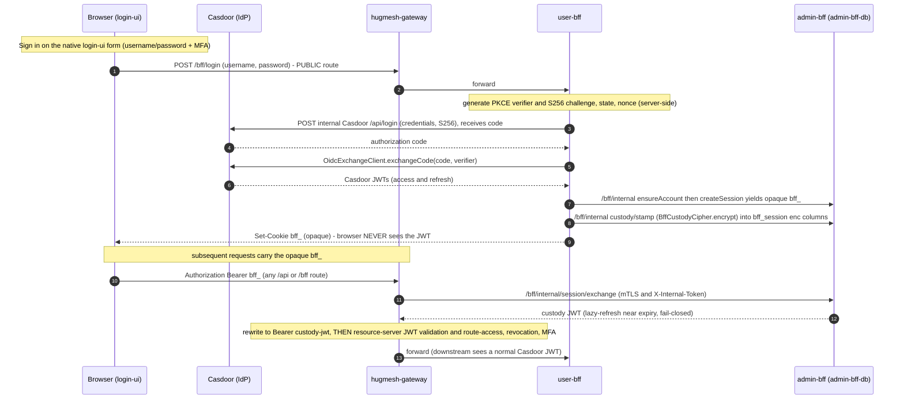

`hugmesh-gateway` is the **platform-wide** front door for the HugMesh fleet, not a
games-only slice. **One image, many roles.** The same artifact runs as the
PKI/identity, backend (BFF/API) or front-end (UI) gateway, for the platform and for
each brand. Only `SPRING_APPLICATION_NAME` differs: `hugmesh-{pki,be,fe}-gateway`, or
`${BRAND}-{pki,be,fe}-gateway`. All instances run the same code. The repos
`hugmesh-pki-gateway`, `hugmesh-be-gateway` and `hugmesh-fe-gateway` exist, but only
as thin overlays: a `Dockerfile` that builds `FROM` this image, a profile file and a
route seed. They hold no gateway code.

> **State convention.** ✅ shipped = merged to `main` · 🚧 in-flight = code on an
> open branch/PR, not yet merged · 🔭 planned = design only, no code yet.

This page lists what has shipped, so nobody mistakes it for remaining work. It also
lists what is still to build. Everything marked 🔭 is a plan, not a feature.
Cross-repo items name the current HugMesh org repos.

---

## ✅ Done / shipped (on `main`)

The foundation pieces are merged, along with several items once listed as remaining
work. Each maps to source in this repo.

| Piece | File |
|---|---|
| Casdoor JWT decoder + authorities converter (single source of truth, reserved-prefix `ROLE_`/`DOMAIN_`/`MFA_SATISFIED` strip) | [CasdoorAuthorities.java](src/main/java/net/hugmesh/gateway/config/CasdoorAuthorities.java), [SecurityConfig.java](src/main/java/net/hugmesh/gateway/config/SecurityConfig.java) |
| Roles utility (string + object `roles` shapes, issuer-keyed `domainOf`) | [Roles.java](src/main/java/net/hugmesh/gateway/security/Roles.java) |
| Cassandra-backed cluster-wide revocation list + write/snapshot API | [RevocationListService.java](src/main/java/net/hugmesh/gateway/cache/RevocationListService.java), [GatewayRevocationController.java](src/main/java/net/hugmesh/gateway/controller/GatewayRevocationController.java) |
| Cassandra-backed URL federation registry | [UrlRegistryService.java](src/main/java/net/hugmesh/gateway/cache/UrlRegistryService.java) |
| WebFilter pipeline (revocation 10/11, External-Auth 20, route-access 25, resource-access 30 — see the README's *Request pipeline* table for the current `@Order` values) | [filter/](src/main/java/net/hugmesh/gateway/filter/) |
| Per-gateway route access (Postgres source-of-truth + Cassandra read-cache + baked `CanonicalSeed`, longest-pattern-match, fail-closed) | [GatewayRouteAccessFilter.java](src/main/java/net/hugmesh/gateway/filter/GatewayRouteAccessFilter.java), [CanonicalSeed.java](src/main/java/net/hugmesh/gateway/cache/CanonicalSeed.java) |
| Multi-tenancy / domain scoping (issuer→domain `DomainRegistry`, opt-in `TenancyResourceServerConfig`) | [DomainRegistry.java](src/main/java/net/hugmesh/gateway/security/DomainRegistry.java) |
| **Cassandra schema migrations** — versioned `schema_migrations`-recorded change-ids replayed on boot (was roadmap item 4) | [CassandraSchemaMigrations.java](src/main/java/net/hugmesh/gateway/cache/CassandraSchemaMigrations.java), [GatewayCassandraSchemaAutoConfiguration.java](src/main/java/net/hugmesh/autoconfigure/GatewayCassandraSchemaAutoConfiguration.java) |
| **Resilience4j circuit breaker** on the route-access control-plane refresh (gateway portion of old item 9) | [GatewayResilienceConfig.java](src/main/java/net/hugmesh/gateway/config/GatewayResilienceConfig.java) |
| **Infra/`/actuator/**` gating** on `ROLE_GAME-MASTER`/`ROLE_ADMIN`/`ROLE_SUPERADMIN` (gateway portion of old item 10) | [SecurityConfig.java](src/main/java/net/hugmesh/gateway/config/SecurityConfig.java) |
| Cross-tenant revocation BFLA fix (CWE-639) + route-access role-perm bypass fix | [GatewayRevocationController.java](src/main/java/net/hugmesh/gateway/controller/GatewayRevocationController.java) |
| **SCG-5 route-namespace fix** — route prefix renamed to `spring.cloud.gateway.server.webflux.routes` (Boot-4 / SCG-5 renamed it; stale `spring.cloud.gateway.routes` bound zero routes) + a route-binding IT | [application.yml](src/main/resources/application.yml) |
| **`bff_`→custody-JWT exchange bridge** (pre-security swap, mTLS back-channel, fail-closed; **ships dark** `hugmesh.gateway.bff-exchange.enabled`) | [BffJwtExchangeWebFilter.java](src/main/java/net/hugmesh/gateway/filter/BffJwtExchangeWebFilter.java) |
| **`bff_`/cookie introspection bridge** (`GET /bff/internal/session/introspect` → SecurityContext, fail-closed; **live by default** `app.bff-session.enabled`) | [BffSessionAuthFilter.java](src/main/java/net/hugmesh/gateway/filter/BffSessionAuthFilter.java) |
| **D6/D8 MFA gateway floor** — `mfa_required` column on `gateway_route_access`, `MFA_SATISFIED` authority in `CasdoorAuthorities` (from a fresh `mfa_satisfied_at` claim), privileged-route MFA floor in `GatewayRouteAccessFilter`; all three **ship dark** (`app.mfa.enabled` / `app.mfa.enforce-privileged-floor`, default off) | [CasdoorAuthorities.java](src/main/java/net/hugmesh/gateway/config/CasdoorAuthorities.java), [GatewayRouteAccessFilter.java](src/main/java/net/hugmesh/gateway/filter/GatewayRouteAccessFilter.java) |
| **CSRF-disabled-by-design guard test** — asserts the bearer gateway keeps `csrf.disable()` (correct by construction; defends against a scanner "fix" that would 403 every bearer POST) | [CsrfDocGuardTest.java](src/test/java/net/hugmesh/gateway/config/CsrfDocGuardTest.java) |
| OWASP pen-test CI leg (`test → build → pentest`, centralized SCA + ZAP DAST via `hugmesh-generator` include) | [.gitlab-ci.yml](.gitlab-ci.yml) |
| `Cache-Control: no-store` forced on every `/bff/**` JSON response, even over a weaker upstream header | [BffJsonNoStoreWebFilter.java](src/main/java/net/hugmesh/gateway/filter/BffJsonNoStoreWebFilter.java) |
| Multi-instance Dockerfile + compose | [Dockerfile](Dockerfile), [compose.yaml](compose.yaml) |
| Spring Cloud Circuit Breaker dependency | [pom.xml](pom.xml) |
| Unit + context tests | [src/test/](src/test/java/net/hugmesh/gateway/) |

---

## Remaining work — separate branches / PRs / repos

The numbers follow the original design brief. Each item is a discrete deliverable.
Cross-repo items name their target repo(s). Items 3, 6 and 7 are done and stay here
so the numbers hold. Items 1, 2, 8, 9, 10 and 11 are plans, and nobody re-checked
them against the other repos on 2026-10-07. Item 5 was checked, and part of it
exists in `hugmesh-games` (see the item).

### 1. Per-instance deployment config — same image, different name 🔭

- Each gateway instance (`hugmesh-pki-gateway`, `hugmesh-be-gateway`,
  `hugmesh-fe-gateway`, and per-brand `${BRAND}-{pki,be,fe}-gateway`) runs the
  **same** gateway image with a different `SPRING_APPLICATION_NAME`, wired by the
  chart (`hugmesh-generator`, `specs/cluster/charts/hugmesh-gateway`). The
  `hugmesh-{pki,be,fe}-gateway` repos are thin overlays on that image, not copies
  of the code.
- **Work**: the per-brand ArgoCD `ApplicationSet` that creates each instance
  (namespace / CA / Casdoor org / gateway env) from `domain_registry` rows lives in
  the deploy/generator repos, not here.
- **Acceptance**: identical revocation and route-access behavior across instances,
  each selecting only its own rows by name.

### 2. Per-brand stack adoption of the gateway 🔭

- **Repo**: the per-brand deployment repos (generator-templated).
- **Work**:
  1. A per-brand stack (postgres + casdoor + cassandra + the brand's gateway
     instances) provisioned from `domain_registry` rows.
  2. The app federation pattern — DB-hosted federated remotes, host shell,
     OpenAPI explorer (per the platform UI standard).
  3. A per-role schema register on the BFFs (see item 11).
- **Acceptance**: a basic auth/listing matrix passes for a newly provisioned brand.

### 3. `hugmesh-actions` role-sync service ✅ (shipped in hugmesh-actions)

- **Repo**: `hugmesh/hugmesh-actions` (Spring Boot side service).
- **Shipped**: the scheduled reconcilers are on that repo's `main`.
  `GitHubOrgAdminReconcileAction` (`@Scheduled`, every 6 h) revokes systems-admin
  when a user's GitHub admin reach drops, and only revokes. `GameMasterAdminSyncAction`
  and `OidcDefaultRoleProbeAction` sit beside it. Actuator/Prometheus metrics are
  exposed. The whole grant feature is **dark by default** behind a master switch.
- **Acceptance** (met by the prune loop): rotating a user out of the source role
  removes their derived grant within the configured sync interval.

### 5. External-OAuth registration — federated remote 🔭 (part exists in `hugmesh-games`)

- **Found 2026-10-07**: `hugmesh-games` (`frontend/projects/registration`) has a
  `registration` remote with "Continue with GitHub". It posts to
  `/api/registration/github-org-admin/evaluate` (the `hugmesh-actions` service), not to
  the `POST /api/registration/external` below. No repo in the org has that endpoint.
  The user-linking part of this item is still a plan.

- **Repo**: the platform front-end (a new federated Angular `registration` remote,
  served through the gateway's `/_remotes/registration/**` shell).
- **Work**:
  1. A new federated remote beside `login`, handling GitHub / Google / etc. OAuth
     handshakes.
  2. `POST /api/registration/external` with the upstream provider token. The BFF
     creates a Casdoor user through the admin API and links the external identity
     claims (`identityProvider`, `identityProviderUserId`).
  3. The gateway's **`ExternalAuthHeaderFilter` (✅ shipped)** already forwards the
     upstream token to downstream APIs.
- **Acceptance**: a fresh external user signs up and lands without admin
  intervention; their Casdoor user has the external identity claims.

### 6. Org-admin auto-grant flow ✅ (shipped dark in hugmesh-actions)

- **Repo**: `hugmesh-actions`.
- **Shipped**: `GitHubOrgAdminGrantAction` checks a GitHub-authenticated user's
  org/repo admin reach and grants the systems `admin` role in Casdoor. A scheduled
  loop that only revokes (`GitHubOrgAdminReconcileAction`) takes it back.
  **Dark by default**: a master switch gates the feature. Off, the endpoint
  answers 404 and the scheduled tick does nothing.
- **Acceptance**: integration tests stub GitHub's `/user/repos` + `/user/orgs` and
  assert the grant fires (see that repo's test suite).

### 7. Banned-user landing ✅ (shipped as the login-ui appeal flow)

- **Repos**: `hugmesh-login-ui` (the `/login/appeal` page), `hugmesh-admin-bff-api`
  (the account-appeal records).
- **Shipped**: the planned `/_remotes/banned` remote was replaced by an appeal
  flow. `hugmesh-login-ui` classifies a rejected sign-in (`account_banned` /
  `account_suspended`) in `src/app/bff.service.ts` and auto-routes the visitor to
  `/login/appeal` (`src/app/appeal.component.ts`), which shows the anonymous
  appeal-contact address and lets a still-signed-in curtailed account file a
  structured appeal. `hugmesh-admin-bff-api` stores those appeals
  (changelog `250-account-appeals.xml`, `AccountAppeal*` controllers).
- **Gateway side**: the anonymous `GET /bff/public/appeal-contact` path is in
  `SecurityConfig` `PUBLIC_PATHS`. `/_remotes/banned/**` is **still** in
  `PUBLIC_PATHS` (and in `BffSessionProperties` / `application.yml`), but the
  appeal flow does not go through it. 🔭 **Still open**: decide whether that
  permit is dead surface to remove, or document why it is kept.
- **Acceptance**: `hugmesh-login-ui` `e2e/features/auth/login-blocked.feature`
  covers a blocked sign-in landing on the appeal page, and
  `e2e/features/auth/appeal-submit.feature` covers the structured submit.

### 8. Mod/admin contact-registration remote + contact DB 🔭

- **Repo**: the platform front-end + a new `contacts` table on the relevant BFF.
- **Work**: a form that captures contact email, display name and jurisdiction,
  behind a REST surface, with an admin approval step before the role is granted.

### 9. Block + revocation cascade on the BFFs 🔭 (gateway portion ✅ shipped)

- **Gateway**: the Resilience4j circuit breaker on the route-access refresh is
  **✅ shipped** ([GatewayResilienceConfig.java](src/main/java/net/hugmesh/gateway/config/GatewayResilienceConfig.java)).
- **Repo (remaining)**: the per-role BFFs (`hugmesh-*-bff-api`).
- **Work**: the BFFs should also consult the same Cassandra revocation table at the
  controller layer for outgoing calls. They should wrap downstream calls in circuit
  breakers that open when a revocation is detected for the principal.
- **Acceptance**: posting a revocation stops inbound AND outbound traffic for that
  subject within one refresh tick.

### 10. Health/infra URL audit — every Spring app 🔭 (gateway portion ✅ shipped)

- **Gateway**: `/actuator/**` and `/api/admin/{health,cassandra,cluster}/**` are
  **✅ shipped**, gated on `ROLE_GAME-MASTER`/`ROLE_ADMIN`/`ROLE_SUPERADMIN` in
  [SecurityConfig.java](src/main/java/net/hugmesh/gateway/config/SecurityConfig.java).
- **Where (remaining)**: every other Spring service (BFFs + builders).
- **Work**: audit every infra-touching `@RequestMapping` and apply a consistent
  `@PreAuthorize`. Add a test that asserts every `/actuator/*` returns 403 for
  `ROLE_USER`.

### 11. Per-role schema split 🔭

- **Repo**: the relevant BFF + a new Liquibase changelog.
- **Work**: split the `users`-shaped surface into per-role schemas (`accounts.*`)
  with foreign keys back to the Casdoor user id. This lets each role keep its own
  denormalized view: mods get scoped lists, admins get contact info, users get
  their own rosters and preferences.

### 12. SSO BFF-JWT custody — gateway `bff_` bridges ✅ (cross-repo SSO ensemble still in flight)

The mandate: **SSO login works end to end with the Casdoor JWT kept internal.** The
browser holds ONLY an opaque `bff_` session. The gateway swaps `bff_` for an
internal **custody JWT** just before resource-server validation. The user never sees
their own JWT. Most of the ensemble ships behind flags that default off (see the
*Ships-dark flags* list below; this repo verifies only its own two). **This
gateway's introspection bridge is the one exception.** `app.bff-session.enabled`
defaults ON (see "Gateway-owned" below), so a default gateway deployment already
accepts an opaque `bff_` session through introspection, even though the cross-repo
exchange path stays dark.

**The end-to-end flow:**

**Invariants.** The browser holds ONLY the opaque `bff_`. The custody JWT is
encrypted at rest (AES-256-GCM) in `bff_session`. The gateway swap is
**pre-security** and **fail-closed**: any exchange error gives `401`, and the raw
`bff_` is **never** forwarded downstream.

#### Gateway-owned (this repo) ✅ merged — introspection live by default, exchange dark

Both gateway `bff_` bridges are on `main`. They are two **alternative** answers to
one gap: a JWT-only resource server 401s an opaque `bff_` at the decoder. Each
deployment picks. The shipped default is introspection ON, exchange OFF (each flag's
default is in its bullet below).

- **`BffJwtExchangeWebFilter`** (merged) — the **exchange** bridge. It swaps `bff_`
  for a custody JWT by calling admin-bff `/bff/internal/session/exchange` (mTLS +
  `X-Internal-Token`), and rewrites `Authorization: Bearer <custody-jwt>`. It runs
  **pre-security** (`HIGHEST_PRECEDENCE + 5`, before `WebFilterChainProxy(-100)`), so
  the resource-server validation and the route-access / revocation / MFA filters see
  a normal Casdoor JWT. Fail-closed: any exchange error gives 401, and the raw `bff_`
  is never forwarded. Positive swaps are cached on `sha256(bff_)`; failures are
  never cached. **Ships dark** behind `hugmesh.gateway.bff-exchange.enabled` (default
  off: the bean is ABSENT, and a context-load test is green with the flag off).
- **`BffSessionAuthFilter`** (merged) — the **introspection** bridge. It takes a
  `bff_` token from the `Authorization: Bearer` header **or** the `bff_session`
  cookie. It calls admin-bff `GET /bff/internal/session/introspect` over the
  `X-Internal-Token` back-channel. (The JWT-only `/bff/me` would 401 a `bff_`; the
  internal surface is `permitAll()` guarded by `InternalTokenWebFilter`.) It then
  mints a `UsernamePasswordAuthenticationToken` straight into the
  `ReactiveSecurityContextHolder` (`HIGHEST_PRECEDENCE + 50`, before the OAuth2
  `BearerTokenAuthenticationWebFilter`, which then short-circuits). Authorities come
  from the introspect response body: `ROLE_<UPPER>`, a `ROLE_USER` floor, and
  `MFA_SATISFIED`; an incomplete registration gets `ROLE_USER` only. Fail-closed: BFF
  5xx or unreachable gives 503; `status: suspended/banned` gives 403; BFF 401 passes
  through unauthenticated. **Ships LIVE by default** behind `app.bff-session.enabled`
  (the `APP_BFF_SESSION_ENABLED` default is `true`; set it to `false` to dark-disable:
  no bean, no WebClient, no BFF calls). Unlike the exchange filter it also covers the
  **cookie** path and needs no back-channel custody JWT.
- **PUBLIC `/bff/login` route-access seed** (native-login model). It is the one route
  an anonymous browser hits before it has a session. The seed lets the native-login
  credential POST reach user-bff, which drives the Casdoor `/api/login` leg
  server-side and mints the opaque `bff_`. The earlier `/bff/auth/callback` seed was
  retired when the browser-PKCE redirect callback was removed. The generator side is
  in the table below.

- ✅ **exchange path suspension bypass (security finding 2026-06-25) — closed.**
  `BffJwtExchangeWebFilter` first returned the custody JWT without checking
  suspended/banned state, and a cached positive swap kept authorizing after a
  suspension. The fix came in two parts. admin-bff enforces suspension and ban
  fail-closed (403) at `/bff/internal/session/exchange`. The gateway bounds the
  positive swap cache. That bound was already in the 2026-07-29 initial public
  release: default TTL 5s, hard clamp 60s, and `cache-ttl-ms ≤ 0` turns the cache off
  for a zero-staleness window. Commit `cde7c79` (2026-09-02) made the 60s ceiling
  configurable as `cache-ttl-max-ms`. admin-bff also revokes the `subject:<custody-sub>`
  key on role-revoke and suspension.
  **2026-09-16 (#2, operator decision "B: zero window now"):** the shipped default is
  now `cache-ttl-ms=0`. The cache is OFF, and every `bff_` request goes to admin-bff.
  The admin-bff → gateway eviction push (option A) is a post-launch build.

**Still owed (cross-repo, to flip these on live):** the SSO ensemble pieces are now
merged in their repos (see the table below). The admin-bff
`/bff/internal/session/exchange` and `/bff/internal/session/introspect` endpoints
ship on admin-bff `main`, with the suspension gate. What remains is the live,
cluster-verified SSO e2e.

#### Cross-repo SSO ensemble (target repos + status)

| Piece | Target repo | Status |
|---|---|---|
| Shared stateful auth stack — `AccountStore`/`BffSession`, `OidcExchangeClient`, `BffCustodyCipher` (AES-256-GCM), `SessionCookieService` (opaque `bff_`), `InternalTokenWebFilter` (mTLS + `X-Internal-Token` guard for `/bff/internal/**`) | `hugmesh-auth-core` (jar `net.hugmesh:hugmesh-auth-core`; `main` is **2.5.1**, on parent 2.8.0) — consumed by admin-bff + user-bff only, NOT the gateway (keeps r2dbc/casdoor off the gateway classpath) | ✅ shipped |
| admin-bff **adopted auth-core** (behavior-preserving) | `hugmesh-admin-bff-api` | ✅ shipped |
| admin-bff **`/bff/internal` account/session API** — ensure/get/complete/allowlist/sessions/namespaces, guarded by `InternalTokenWebFilter`, ships inert | `hugmesh-admin-bff-api` | ✅ shipped |
| auth-core custody minor — `BffSession` JWT-custody columns (`access_token_enc` / `refresh_token_enc` / `access_token_expires_at` / `custody_updated_at`) + `stampCustody` / `clearCustody` / `sessionRow` (additive minor; 2.0.0 stays immutable). Landed at **2.1.0**; auth-core `main` is at **2.5.1** | `hugmesh-auth-core` | ✅ shipped |
| login-ui **native login** (SUPERSEDES PR-4) — native username/password (+MFA) form POSTing to `/bff/login`; **no** `/login/callback`, **no** `oidc-callback.component`, **no** browser Casdoor redirect (the old OIDC authorization-code + PKCE + `/login/callback` model is gone from login-ui `main`) | `hugmesh-login-ui` | ✅ shipped |
| user-bff **PR-A3** — OIDC login relocation (owns `/bff/auth/callback` _(surface later retired)_, `/bff/login`, …) + admin-bff internal client, behind `app.bff.oidc.enabled` (merged; `OidcCallbackController` _(surface later retired)_/`SsoAuthController`/`AdminBffInternalClient` on `main`) | `hugmesh-user-bff-api` | ✅ shipped |
| admin-bff **custody tail** — Liquibase band-180 (`bff_session` custody columns, `180-bff-jwt-custody.xml` on `main`) + `/bff/internal/sessions/{token}/custody/stamp` + `/bff/internal/session/exchange` (`InternalAccountController`); auth-core dep bumped in lockstep | `hugmesh-admin-bff-api` | ✅ shipped |
| generator — `app-user-bff` Casdoor OIDC confidential client + the PUBLIC `/bff/auth/callback` route-access seed _(surface later retired; the native-login model seeds `/bff/login` instead)_ (both in the generator's casdoor init-job + route-access initdb on `main`) | `hugmesh-generator` | ✅ shipped |
| Cross-repo **NetworkPolicy egress peer** user-bff → admin-bff internal `:8080` (tier-ingress/egress manifests carry the relocated-SSO path; the two BFF databases stay mutually denied at the NetworkPolicy layer) | manifests / `hugmesh-generator` | ✅ shipped |
| **SSO end-to-end live e2e** — kind + Playwright, proving the browser holds only `bff_` | cross-repo | 🔭 planned |

**Ships-dark flags (default off / blank in the repo):** `app.bff.oidc.enabled`
(user-bff) · `app.bff.custody-key` (`BffCustodyCipher`) ·
`hugmesh.gateway.bff-exchange.enabled` (this gateway's swap; the cluster chart turns
it on for the fe-gateway). `app.session.cookie.enabled` (the `bff_` cookie)
defaults to **true** in user-bff `main`, and login-ui `main` has no
`__SNAP_OIDC_ENABLED__` flag.

---

## Gateway-extending platform roadmap (not on `main` here)

These platform features extend **this gateway's** route-access model. They are
listed so the gateway-side work is not lost. Only the MFA primitives are shipped
here.

- ✅ **Casdoor MFA** (gateway layer merged, dark; the BFF side has code on admin-bff
  `main`). The gateway primitives are the `mfa_required` column on
  `gateway_route_access`, the `MFA_SATISFIED` authority from a fresh
  `mfa_satisfied_at` claim, and the privileged-route MFA floor in
  `GatewayRouteAccessFilter`. They **ship dark** on `main` behind `app.mfa.enabled` /
  `app.mfa.enforce-privileged-floor`. The BFF half is in other repos. admin-bff
  `main` reads the `mfa_satisfied_at` claim and carries step-up gates
  (`DeviceTerminalStepUpGate`, `BackingServiceStepUpGate`, changelog
  `150-mfa-substrate.xml`). Whether the original 9-PR plan is complete was not
  checked. Custom login stays.
- 🔭 **Workload Console gating.** The admin-bff side is on its `main`: the
  `workload/` package and changelog `110-workload-console-grants.xml`. The gateway
  may need new route-access rows or authority gates for the federated
  pod-manage / log / exec surfaces. The plan: superadmin cross-cluster; admins
  default-blind, then superadmin-granted read-only for their own domain
  (status-only / 24h / log-opt-in; dangerous tiers default-off). This repo has no
  workload-specific row. Whether the existing `/bff/admin/**` and `/bff/superadmin/**`
  floors already cover it was not checked.
- 🔭 **Tailnet superadmin-gateway posture.** A tailnet-only instance,
  `hugmesh-superadmin-gateway`, is already defined in the cluster chart
  (`hugmesh-generator`, `specs/cluster/apps/22-gateway-superadmin.yaml`): internal
  ingress only, every route gated `ROLE_SUPERADMIN` by route-access rows under its
  own name. This repo has no code for it. Its name ends in none of `-pki-gateway`,
  `-be-gateway`, `-fe-gateway`, so with the datastores down it falls back to the
  baked `/**` → `ROLE_ADMIN` floor.

---

## Why this layering

The foundation pieces (Casdoor JWT, Cassandra revocation cache, URL registry,
External-Authorization header, route-access and domain scoping) are the **shared
dependency** that every later item leans on. They are shipped. The remaining items
either use one of them directly (the registration remote, the actions
service) or repeat the same pattern in another repo. So each follow-up PR stays
small and reviewable, and nobody has to land one mega-PR across repos.
