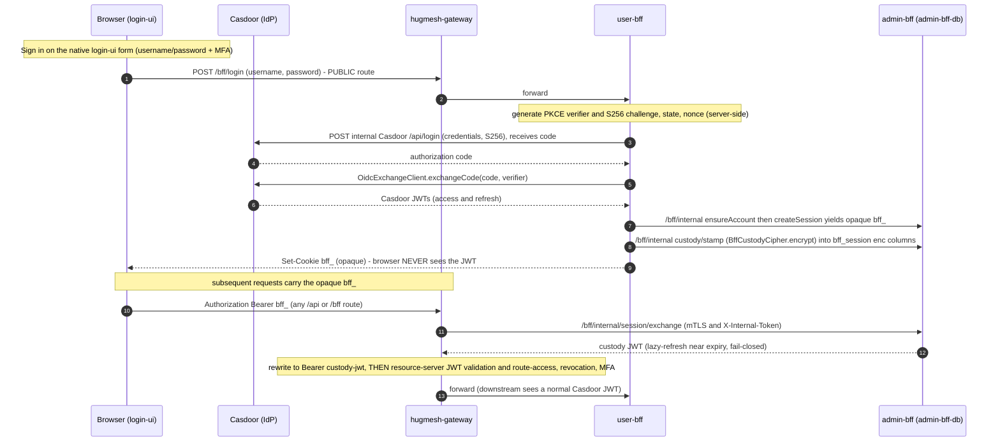

`hugmesh-gateway` is the **platform-wide** front door for the
HugMesh fleet — **not** a games-only slice. **One image,
many roles**: the same artifact runs as the PKI/identity, backend
(BFF/API), or front-end (UI) gateway, and per-brand, differentiated
only by `SPRING_APPLICATION_NAME` (`hugmesh-{pki,be,fe}-gateway`,
or `${BRAND}-{pki,be,fe}-gateway`). It is **not** a separate repo per
instance — they are all the same binary with a different name.

> **State convention.** ✅ shipped = merged to `main` · 🚧 in-flight =
> code on an open branch/PR, not yet merged · 🔭 planned = design-complete,
> no code yet.

This document tracks what has already shipped (so it isn't mistaken for
remaining work) and what is genuinely still to build, with cross-repo
items re-targeted at the current HugMesh org repos.

---

## ✅ Done / shipped (on `main`)

The foundation pieces — and several items once listed below as "remaining
work" — are merged. Each maps to source in this repo.

| Piece | File |
|---|---|
| Casdoor JWT decoder + authorities converter (single source of truth, reserved-prefix `ROLE_`/`DOMAIN_` strip) | [CasdoorAuthorities.java](src/main/java/net/hugmesh/gateway/config/CasdoorAuthorities.java), [SecurityConfig.java](src/main/java/net/hugmesh/gateway/config/SecurityConfig.java) |
| Roles utility (string + object `roles` shapes, issuer-keyed `domainOf`) | [Roles.java](src/main/java/net/hugmesh/gateway/security/Roles.java) |
| Cassandra-backed cluster-wide revocation list + write/snapshot API | [RevocationListService.java](src/main/java/net/hugmesh/gateway/cache/RevocationListService.java), [GatewayRevocationController.java](src/main/java/net/hugmesh/gateway/controller/GatewayRevocationController.java) |
| Cassandra-backed URL federation registry | [UrlRegistryService.java](src/main/java/net/hugmesh/gateway/cache/UrlRegistryService.java) |
| WebFilter pipeline (revocation 10/11, External-Auth 20, route-access 25, resource-access 30 — see the README's *Request pipeline* table for the current `@Order` values) | [filter/](src/main/java/net/hugmesh/gateway/filter/) |
| Per-gateway route access (Postgres source-of-truth + Cassandra read-cache + baked `CanonicalSeed`, longest-pattern-match, fail-closed) | [GatewayRouteAccessFilter.java](src/main/java/net/hugmesh/gateway/filter/GatewayRouteAccessFilter.java), [CanonicalSeed.java](src/main/java/net/hugmesh/gateway/cache/CanonicalSeed.java) |
| Multi-tenancy / domain scoping (issuer→domain `DomainRegistry`, opt-in `TenancyResourceServerConfig`) | [DomainRegistry.java](src/main/java/net/hugmesh/gateway/security/DomainRegistry.java) |
| **Cassandra schema migrations** — versioned `schema_migrations`-recorded change-ids replayed on boot (was roadmap item 4) | [CassandraSchemaMigrations.java](src/main/java/net/hugmesh/gateway/cache/CassandraSchemaMigrations.java), [GatewayCassandraSchemaAutoConfiguration.java](src/main/java/net/hugmesh/autoconfigure/GatewayCassandraSchemaAutoConfiguration.java) |
| **Resilience4j circuit breaker** on the route-access control-plane refresh (gateway portion of old item 9) | [GatewayResilienceConfig.java](src/main/java/net/hugmesh/gateway/config/GatewayResilienceConfig.java) |
| **Infra/`/actuator/**` gating** on `ROLE_GAME-MASTER`/`ROLE_ADMIN`/`ROLE_SUPERADMIN` (gateway portion of old item 10) | [SecurityConfig.java](src/main/java/net/hugmesh/gateway/config/SecurityConfig.java) |
| Cross-tenant revocation BFLA fix (CWE-639) + route-access role-perm bypass fix | [GatewayRevocationController.java](src/main/java/net/hugmesh/gateway/controller/GatewayRevocationController.java) (PR #30) |
| **SCG-5 route-namespace fix** — route prefix renamed to `spring.cloud.gateway.server.webflux.routes` (Boot-4 / SCG-5 renamed it; stale `spring.cloud.gateway.routes` bound zero routes) + a route-binding IT | [application.yml](src/main/resources/application.yml) |
| **`bff_`→custody-JWT exchange bridge** (pre-security swap, mTLS back-channel, fail-closed; **ships dark** `hugmesh.gateway.bff-exchange.enabled`) (PR #48) | [BffJwtExchangeWebFilter.java](src/main/java/net/hugmesh/gateway/filter/BffJwtExchangeWebFilter.java) |
| **`bff_`/cookie introspection bridge** (`GET /bff/internal/session/introspect` → SecurityContext, fail-closed; **live by default** `app.bff-session.enabled` since PR #70, was dark at #51/#55/#57) (PR #51, #55, #57, #70) | [BffSessionAuthFilter.java](src/main/java/net/hugmesh/gateway/filter/BffSessionAuthFilter.java) |
| **D6/D8 MFA gateway floor** — `mfa_required` column on `gateway_route_access`, `MFA_SATISFIED` authority in `CasdoorAuthorities`, privileged-route MFA floor in `GatewayRouteAccessFilter`; all three **ship dark** (`app.mfa.enabled` / `app.mfa.enforce-privileged-floor`, default off) (PR #40) | [CasdoorAuthorities.java](src/main/java/net/hugmesh/gateway/config/CasdoorAuthorities.java), [GatewayRouteAccessFilter.java](src/main/java/net/hugmesh/gateway/filter/GatewayRouteAccessFilter.java) |
| **CSRF-disabled-by-design guard test** — asserts the bearer gateway keeps `csrf.disable()` (correct by construction; defends against a scanner "fix" that would 403 every bearer POST) (PR #49) | [CsrfDocGuardTest.java](src/test/java/net/hugmesh/gateway/config/CsrfDocGuardTest.java) |
| OWASP pen-test CI leg (`test → build → pentest`, centralized SCA + ZAP DAST via `hugmesh-generator` include) | [.gitlab-ci.yml](.gitlab-ci.yml) (PR #29, #31) |
| Multi-instance Dockerfile + compose | [Dockerfile](Dockerfile), [compose.yaml](compose.yaml) |
| Spring Cloud Circuit Breaker dependency | [pom.xml](pom.xml) |
| Unit + context tests | [src/test/](src/test/java/net/hugmesh/gateway/) |

---

## Remaining work — separate branches / PRs / repos

Numbered by the order in the original design brief; re-targeted at the
current **HugMesh** org. Each item is a discrete deliverable;
cross-repo items list the target repo(s).

### 1. Per-instance deployment config — same image, different name 🔭

- **Not** a new repo. Each gateway instance (`hugmesh-pki-gateway`,
  `hugmesh-be-gateway`, `hugmesh-fe-gateway`, and per-brand
  `${BRAND}-{pki,be,fe}-gateway`) is the **same** `hugmesh-systems/gateway`
  image with a different `SPRING_APPLICATION_NAME`, wired by the deploy/chart.
- **Work**: the per-brand ArgoCD `ApplicationSet` that materializes each
  instance (namespace / CA / Casdoor org / gateway env) from `domain_registry`
  rows lives in the deploy/generator repos, not here.
- **Acceptance**: identical revocation + route-access behavior across instances,
  each selecting only its own rows by name.

### 2. Per-brand stack adoption of the gateway 🔭

- **Repo**: the per-brand deployment repos (generator-templated).
- **Work**:
  1. Per-brand stack (postgres + casdoor + cassandra + the brand's gateway
     instances) provisioned from `domain_registry` rows.
  2. App federation pattern — DB-hosted federated remotes, host shell,
     OpenAPI explorer (per the platform UI standard).
  3. Per-role schema register on the BFFs (see item 11).
- **Acceptance**: a basic auth/listing matrix passes for a newly provisioned brand.

### 3. `hugmesh-actions` role-sync service ✅ (shipped in hugmesh-actions)

- **Repo**: `HugMesh/hugmesh-actions` (Spring Boot side service).
- **Shipped**: the scheduled reconcilers exist on that repo's `main` —
  `GitHubOrgAdminReconcileAction` (`@Scheduled` 6h, prune-only revoke of
  systems-admin when GitHub admin reach drops), `GameMasterAdminSyncAction`,
  and `OidcDefaultRoleProbeAction`; actuator/Prometheus metrics are exposed.
  The whole grant feature is **dark by default** behind a master switch.
- **Acceptance** (met by the prune loop): rotating a user out of the source
  role removes their derived grant within the configured sync interval.

### 5. External-OAuth registration — federated remote 🔭

- **Repo**: the platform front-end (a new federated Angular `registration`
  remote, served via the gateway's `/_remotes/registration/**` shell).
- **Work**:
  1. New federated remote alongside `login` handling GitHub / Google / etc.
     OAuth handshakes.
  2. `POST /api/registration/external` with the upstream provider token; the
     BFF creates a Casdoor user via the admin API and links the external
     identity claims (`identityProvider`, `identityProviderUserId`).
  3. The gateway's **`ExternalAuthHeaderFilter` (✅ shipped)** already forwards
     the upstream token to downstream APIs.
- **Acceptance**: a fresh external user signs up and lands without admin
  intervention; their Casdoor user has the external identity claims populated.

### 6. Org-admin auto-grant flow ✅ (shipped dark in hugmesh-actions)

- **Repo**: `hugmesh-actions`.
- **Shipped**: `GitHubOrgAdminGrantAction` inspects a GitHub-authenticated
  user's org/repo admin reach and grants the systems `admin` role in Casdoor,
  with a scheduled prune-only revoke loop (`GitHubOrgAdminReconcileAction`).
  **Dark by default** — the feature is gated behind a master switch (disabled
  ⇒ the endpoint 404s and the scheduled tick is a no-op).
- **Acceptance**: integration tests stub GitHub's `/user/repos` + `/user/orgs`
  and assert the grant fires (see that repo's test suite).

### 7. Banned-user remote module 🔭

- **Repo**: the platform front-end (`/_remotes/banned/**`).
- **Work**: when the gateway denies a revoked/banned principal, the host shell
  routes to this remote — a "contact a mod/admin" page pre-filling the user's
  Casdoor id + revocation key. SecurityConfig **already (✅ shipped)** permits
  `/_remotes/banned/**` for unauthenticated traffic so a logged-out banned user
  can still read it.
- **Acceptance**: BDD scenario — log in → admin posts a revocation → user's
  next request lands on `/banned` with the right copy.

### 8. Mod/admin contact-registration remote + contact DB 🔭

- **Repo**: the platform front-end + a new `contacts` table on the relevant BFF.
- **Work**: a form capturing contact email + display name + jurisdiction behind
  a REST surface with an admin-side approval flow before the role is granted.

### 9. Block + revocation cascade on the BFFs 🔭 (gateway portion ✅ shipped)

- **Gateway**: the Resilience4j circuit breaker on the route-access refresh is
  **✅ shipped** ([GatewayResilienceConfig.java](src/main/java/net/hugmesh/gateway/config/GatewayResilienceConfig.java)).
- **Repo (remaining)**: the per-role BFFs (`hugmesh-*-bff-api`).
- **Work**: the BFFs should also consult the same Cassandra revocation table at
  the controller layer for outgoing calls, wrapping downstream calls with
  circuit breakers that open when a revocation is detected for the principal.
- **Acceptance**: posting a revocation kills inbound AND outbound traffic for
  that subject within one refresh tick.

### 10. Health/infra URL audit — every Spring app 🔭 (gateway portion ✅ shipped)

- **Gateway**: `/actuator/**` + `/api/admin/{health,cassandra,cluster}/**` are
  **✅ shipped** gated on `ROLE_GAME-MASTER`/`ROLE_ADMIN`/`ROLE_SUPERADMIN` in
  [SecurityConfig.java](src/main/java/net/hugmesh/gateway/config/SecurityConfig.java).
- **Where (remaining)**: every other Spring service (BFFs + builders).
- **Work**: audit every infra-touching `@RequestMapping` and apply consistent
  `@PreAuthorize`; add a test that asserts every `/actuator/*` returns 403 for
  `ROLE_USER`.

### 11. Per-role schema split 🔭

- **Repo**: the relevant BFF + a new Liquibase changelog.
- **Work**: split the `users`-shaped surface into per-role schemas
  (`accounts.*`) with FKs back to the Casdoor user id, enabling per-role
  denormalization (mods need scoped lists; admins need contact info; users
  need their own rosters/preferences).

### 12. SSO BFF-JWT custody — gateway `bff_` bridges ✅ (cross-repo SSO ensemble still in flight)

The mandate: **SSO login works end-to-end with the Casdoor JWT kept internal.**
The browser holds ONLY an opaque `bff_` session; the gateway swaps `bff_` → an
internal **custody JWT** just before resource-server validation; the user never
sees their own JWT. Most of the ensemble ships behind flags that default off (see
the *Ships-dark flags* list below — this repo verifies only its own two), but
**this gateway's introspection bridge is the one exception**: `app.bff-session.enabled`
defaults ON as of PR #70 (see §"Gateway-owned" below), so a default gateway
deployment already accepts an opaque `bff_` session via introspection even though
the cross-repo exchange path stays dark.

**The end-to-end flow:**

**Invariants.** The browser holds ONLY the opaque `bff_`; the custody JWT is
encrypted at rest (AES-256-GCM) in `bff_session`; the gateway swap is
**pre-security** and **fail-closed** — any exchange error ⇒ `401`, and the raw
`bff_` is **never** forwarded downstream.

#### Gateway-owned (this repo) ✅ merged — introspection live by default, exchange dark

Both gateway `bff_` bridges are now on `main`. They are two **alternative**
approaches to the same gap — a JWT-only resource server 401s an opaque `bff_` at
the decoder — selected per deployment; the shipped default is introspection ON /
exchange OFF (see each bullet below for its flag's default):

- **`BffJwtExchangeWebFilter`** (PR #48, merged) — the **exchange** bridge: swaps
  `bff_` → custody JWT by calling admin-bff `/bff/internal/session/exchange`
  (mTLS + `X-Internal-Token`), rewrites `Authorization: Bearer <custody-jwt>`, and
  runs **pre-security** (`HIGHEST_PRECEDENCE + 5`, before `WebFilterChainProxy(-100)`)
  so the existing resource-server validation + route-access / revocation / MFA
  filters see a normal Casdoor JWT. Fail-closed (any exchange error ⇒ 401, raw
  `bff_` never forwarded); positive swaps cached on `sha256(bff_)`, failures never
  cached. **Ships dark** behind `hugmesh.gateway.bff-exchange.enabled` (default
  off ⇒ bean ABSENT; context-load test green with the flag off).
- **`BffSessionAuthFilter`** (PR #51, #55, #57, merged) — the **introspection** bridge:
  resolves a `bff_` token from the `Authorization: Bearer` header **or** the
  `bff_session` cookie, calls admin-bff `GET /bff/internal/session/introspect` over the
  `X-Internal-Token` back-channel (the JWT-only `/bff/me` would 401 a `bff_`; the
  internal surface is `permitAll()` guarded by `InternalTokenWebFilter`), and mints a
  `UsernamePasswordAuthenticationToken` straight into the
  `ReactiveSecurityContextHolder` (`HIGHEST_PRECEDENCE + 50`, before the OAuth2
  `BearerTokenAuthenticationWebFilter`, which then short-circuits). Authorities are
  mapped from the introspect response body (`ROLE_<UPPER>` + `ROLE_USER` floor + `MFA_SATISFIED`;
  incomplete registration ⇒ `ROLE_USER` only). Fail-closed: BFF 5xx/unreachable ⇒ 503;
  `status: suspended/banned` ⇒ 403; BFF 401 ⇒ pass-through unauthenticated. **Ships
  LIVE by default** behind `app.bff-session.enabled` (PR #70 flipped the
  `APP_BFF_SESSION_ENABLED` default to `true`; set it to `false` to dark-disable —
  no bean, no WebClient, no BFF calls). Unlike the exchange filter it also covers
  the **cookie** path and needs no back-channel custody JWT.
- **PUBLIC `/bff/login` route-access seed** (native-login model) — the one route the
  anonymous browser hits before it has a session, seeded into the route-access
  source-of-truth so the native-login credential POST reaches user-bff (which drives
  the Casdoor `/api/login` leg server-side and mints the opaque `bff_`). The earlier
  `/bff/auth/callback` seed (PR #48) was retired once the browser-PKCE redirect
  callback was removed. The matching generator seed is tracked at generator **#156**
  (below).

- ✅ **exchange path suspension-bypass (security finding 2026-06-25) — closed** —
  `BffJwtExchangeWebFilter` originally returned the custody JWT without consulting
  suspension/banned state, and a cached positive swap kept authorizing after a
  suspension. Fixed and merged in two parts: admin-bff **#161** enforces
  suspension/ban fail-closed (403) at `/bff/internal/session/exchange`, and gateway
  **PR #68** bounds the positive swap cache (default TTL 60s → 5s; `cache-ttl-ms ≤ 0`
  disables the cache entirely for a zero-staleness window). admin-bff **#167**
  additionally revokes the `subject:<custody-sub>` key on role-revoke + suspension.

**Still owed (cross-repo, to flip these on live):** the SSO ensemble pieces are
now merged in their repos (see the table below — the admin-bff
`/bff/internal/session/exchange` + `/bff/internal/session/introspect` endpoints
ship on admin-bff `main`, with the #161 suspension gate); what remains is the
live, cluster-verified SSO e2e.

#### Cross-repo SSO ensemble (target repos + status)

| Piece | Target repo | Status |
|---|---|---|
| Shared stateful auth stack — `AccountStore`/`BffSession`, `OidcExchangeClient`, `BffCustodyCipher` (AES-256-GCM), `SessionCookieService` (opaque `bff_`), `InternalTokenWebFilter` (mTLS + `X-Internal-Token` guard for `/bff/internal/**`) | `hugmesh-auth-core` (jar `net.hugmesh:hugmesh-auth-core` **2.3.0** — landed at 2.1.0; `main` is 2.3.0, on parent 2.7.0) — consumed by admin-bff + user-bff only, NOT the gateway (keeps r2dbc/casdoor off the gateway classpath) | ✅ shipped |
| admin-bff **adopted auth-core** (behavior-preserving, 1517 tests green) | `hugmesh-admin-bff-api` (PR #111) | ✅ shipped |
| admin-bff **`/bff/internal` account/session API** — ensure/get/complete/allowlist/sessions/namespaces, guarded by `InternalTokenWebFilter`, ships inert | `hugmesh-admin-bff-api` (PR #113) | ✅ shipped |
| auth-core custody minor — `BffSession` JWT-custody columns (`access_token_enc` / `refresh_token_enc` / `access_token_expires_at` / `custody_updated_at`) + `stampCustody` / `clearCustody` / `sessionRow` (additive minor; 2.0.0 stays immutable). Landed at **2.1.0**; auth-core `main` is at **2.3.0** | `hugmesh-auth-core` | ✅ shipped |
| login-ui **native login** (SUPERSEDES PR-4) — native username/password (+MFA) form POSTing to `/bff/login`; **no** `/login/callback`, **no** `oidc-callback.component`, **no** browser Casdoor redirect (the old OIDC authorization-code + PKCE + `/login/callback` model was removed in login-ui #47/#49) | `hugmesh-login-ui` | ✅ shipped |
| user-bff **PR-A3** — OIDC login relocation (owns `/bff/auth/callback` _(surface later retired)_, `/bff/login`, …) + admin-bff internal client, behind `app.bff.oidc.enabled` (merged; `OidcCallbackController` _(surface later retired)_/`SsoAuthController`/`AdminBffInternalClient` on `main`) | `hugmesh-user-bff-api` | ✅ shipped |
| admin-bff **custody tail** — Liquibase band-180 (`bff_session` custody columns, `180-bff-jwt-custody.xml` on `main`) + `/bff/internal/sessions/{token}/custody/stamp` + `/bff/internal/session/exchange` (`InternalAccountController`); auth-core dep bumped in lockstep | `hugmesh-admin-bff-api` | ✅ shipped |
| generator **#156** — `app-user-bff` Casdoor OIDC confidential client + the PUBLIC `/bff/auth/callback` route-access seed _(surface later retired; the native-login model seeds `/bff/login` instead)_ (both in the generator's casdoor init-job + route-access initdb on `main`) | `hugmesh-generator` | ✅ shipped |
| Cross-repo **NetworkPolicy egress peer** user-bff → admin-bff internal `:8080` (tier-ingress/egress manifests carry the relocated-SSO path; the two BFF databases stay mutually denied at the NetworkPolicy layer) | manifests / `hugmesh-generator` | ✅ shipped |
| **SSO end-to-end live e2e** — kind + Playwright, proving the browser holds only `bff_` | cross-repo | 🔭 planned |

**Ships-dark flags (all default off / blank):** `app.bff.oidc.enabled`
(user-bff / auth-core) · `app.bff.custody-key` (`BffCustodyCipher`) ·
`app.session.cookie.enabled` (the `bff_` cookie) ·
`hugmesh.gateway.bff-exchange.enabled` (this gateway's swap) ·
`__SNAP_OIDC_ENABLED__` (login-ui).

---

## Gateway-extending platform roadmap (not on `main` here)

Platform features whose enforcement extends **this gateway's** route-access
model — tracked so the gateway-side work isn't lost. None are shipped here.

- ✅🔭 **Casdoor MFA** (gateway layer ✅ merged dark PR #40; BFF challenge + step-up
  🔭 still planned, 9-PR plan, admin-bff Liquibase 150-band): the gateway
  primitives (`mfa_required` column on `gateway_route_access`, `MFA_SATISFIED`
  authority from `amr`/`acr`, privileged-route MFA floor in
  `GatewayRouteAccessFilter`) **ship dark** on `main` behind `app.mfa.enabled` /
  `app.mfa.enforce-privileged-floor`. Remaining: BFF-driven MFA challenge
  (stamps `mfa_satisfied` into the opaque session), generalized step-up (sudo /
  SSH-via-UI / remote-install / superadmin ops). Custom login stays.
- 🔭 **Workload Console gating** (admin-bff 🚧 in-flight, changelog 110-band):
  new gateway route-access rows / authority gates for federated pod-manage /
  log / exec surfaces — superadmin cross-cluster, admins default-blind →
  superadmin-granted read-only own-domain (status-only / 24h / log-opt-in;
  dangerous tiers default-off).
- 🔭 **Tailnet superadmin-gateway posture** (Superadmin app-store infra legs
  🚧 in-flight): a TAILNET-ONLY gateway posture + federation registration so the
  superadmin app-store remote is reachable over the tailnet and stays off the
  public UI.

---

## Why this layering

The foundation pieces (Casdoor JWT, Cassandra revocation cache, URL registry,
External-Authorization header, route-access + domain scoping) are the **shared
dependency** every downstream item leans on, and are now shipped. The remaining
items either consume one of these directly (the registration/banned remotes,
the actions service) or extend the same pattern in another repo — so each
follow-up PR stays small and reviewable instead of one mega-PR across repos.
