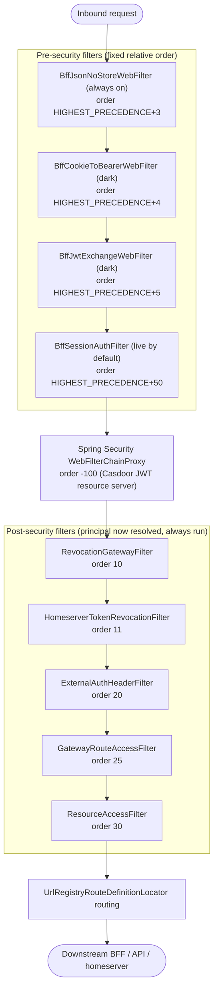

Spring Cloud Gateway (WebFlux) for [HugMesh](https://github.com/hugmesh), the
platform's public front door. A front door that also hands out keys is doing two
jobs, and this one does only one: Casdoor mints tokens, and the gateway checks them.

**One image, many roles.** The same artifact runs as the PKI/identity gateway, the
backend (BFF/API) gateway or the front-end (UI) gateway. Only `SPRING_APPLICATION_NAME`
differs: `hugmesh-pki-gateway`, `hugmesh-be-gateway`, `hugmesh-fe-gateway`, or
per-brand `${BRAND}-{pki,be,fe}-gateway`. The repos
[`hugmesh-pki-gateway`](https://github.com/hugmesh/hugmesh-pki-gateway),
[`hugmesh-be-gateway`](https://github.com/hugmesh/hugmesh-be-gateway) and
[`hugmesh-fe-gateway`](https://github.com/hugmesh/hugmesh-fe-gateway) are thin
overlays: a `Dockerfile` that builds `FROM` this image and sets the instance name,
plus a profile file and a route seed. They hold no gateway code. The cluster chart in
`hugmesh-generator` (`specs/cluster/charts/hugmesh-gateway`) runs the shared image with
per-instance environment. The gateway is a Casdoor-aware OAuth2 **resource server**.
It never exposes its own login. Casdoor mints the tokens (the BFF proxies the grant)
and the gateway validates them.

The stack is Spring Boot 4.0.7 and Spring Cloud 2025.1.2 on Java 25, reactive
throughout (WebFlux, reactive Cassandra, R2DBC Postgres). The gateway follows the
unified platform baseline. It declares the shared
[`hugmesh-commons`](https://github.com/hugmesh/hugmesh-commons) 2.2.0-beta.1 artifact
(`net.hugmesh.commons.*` security/tenancy) as a **direct, explicitly versioned
dependency**. No source file imports it yet. The gateway keeps its own `Roles`,
`DomainRegistry`, `CasdoorAuthorities` and `TenancyResourceServerConfig`, because its
`Roles` and `DomainRegistry` have methods commons lacks (see the `pom.xml` comment).
It keeps `spring-boot-starter-parent` on purpose, instead of the BFF-focused
[`hugmesh-parent`](https://github.com/hugmesh/hugmesh-parent) metapom. It does **not**
depend on [`hugmesh-auth-core`](https://github.com/hugmesh/hugmesh-auth-core); only the
BFFs use that account/session/MFA core.

This repo is one part of the HugMesh platform. A request usually flows browser →
gateway (this repo) → a per-role BFF/API (for example
[`hugmesh-admin-bff-api`](https://github.com/hugmesh/hugmesh-admin-bff-api)) → data
stores and federated services. [Where it sits](#where-it-sits) shows the gateway's
place in that chain. The [hugmesh organization](https://github.com/hugmesh) holds the
rest of the repositories.

## Current State

State of `main` after the ecosystem unification and the auth-model change:

- **Boot 4 / SCG 5 baseline.** Spring Boot 4.0.7, Spring Cloud 2025.1.2, Java 25 LTS
  (`eclipse-temurin:25`). Routes live under the **`spring.cloud.gateway.server.webflux`**
  namespace. SCG 5.0 moved them there, and the old `spring.cloud.gateway.routes`
  prefix binds nothing, silently. The starter is
  `spring-cloud-starter-gateway-server-webflux`.
- **Casdoor-JWT resource server, plus two `bff_` bridges (one live by default, one
  dark).** By default the gateway validates Casdoor JWTs and runs the data-driven
  role/domain gate described below. It never mints a login and never sees one. In the
  platform's **native-login** model, login-ui POSTs a username/password (+MFA) form
  to `/bff/login`. **user-bff** then runs the PKCE/state handshake, the internal
  Casdoor `/api/login` call and the code→token exchange, all **server-side**, and
  holds per-session JWT custody and refresh. The browser is **never redirected to
  Casdoor** and only ever holds an **opaque `bff_`-prefixed session**. The
  native-login endpoints live in user-bff (`SsoAuthController`, behind
  `app.bff.oidc.enabled`, default off in that repo), built on the shared
  `hugmesh-auth-core`. Account/session DATA stays in admin-bff-db.
  **None of that login work lives in this repo.** What does live here is two filters
  that let the gateway accept the opaque `bff_` session (a JWT-only resource server
  would 401 it at the decoder):
  - `BffSessionAuthFilter` (`app.bff-session.enabled`) asks admin-bff to introspect the
    `bff_` and fills the SecurityContext directly. **Live by default**; set
    `APP_BFF_SESSION_ENABLED=false` to dark-disable.
  - `BffJwtExchangeWebFilter` (`hugmesh.gateway.bff-exchange.enabled`) swaps `bff_` for an
    internal **custody JWT**, so the resource server validates a real JWT. **Default
    off** (ships dark).

  *Opaque `bff_` session handling* below compares the two.
- **Data-driven authorization.** `gateway_route_access` decides which roles and users
  may reach which URLs, per brand, with domain scoping derived from the issuer.
  Postgres (R2DBC) is the source of truth, Cassandra is the read-cache, and
  `CanonicalSeed` is the fallback. `SUPERADMIN` is the only cross-domain bypass.
  `ADMIN` and `GAME-MASTER` bypass only inside their own domain. Authority-injection
  and cross-tenant BFLA hardening are shipped.
- **CI is GitLab.** The main test/build/security pipeline runs on an in-cluster GitLab
  instance that mirrors this repo. GitHub Actions hosts only the release workflow,
  which publishes the container image (see *Version and releases* below).

## Where it sits

| | |
|---|---|
| **Tier** | Edge / ingress. Every external request to a brand passes through one of these gateway instances before it reaches a BFF or API pod. |
| **Namespace** | Deployed per role/brand; selects only its own rows by `spring.application.name`. Shares the Casdoor instance and Cassandra cluster (keyspace `hugmesh_gateway`) with the BFFs. |
| **Upstream of** | the per-role BFFs/APIs, the homeservers (Matrix/tuwunel, Mastodon/akkoma), and the federated UI remotes. |
| **Trusts** | Casdoor JWTs (validated against the configured issuer/JWKS). Browsers and Cloudflare reach it **without** a client cert; the optional mTLS leg is gateway→backend only. |

## Request pipeline

`BffJsonNoStoreWebFilter` always runs first. Up to three `bff_` bridges may then run
**pre-security**, before `WebFilterChainProxy(-100)` (see *Opaque `bff_` session
handling*). Two of them, `BffCookieToBearerWebFilter` and `BffJwtExchangeWebFilter`, are
dark by default and absent unless their shared flag is on. The third,
`BffSessionAuthFilter`, is live by default. Spring Security then authenticates the
Casdoor JWT (or admits a public/homeserver path), and these ordered `WebFilter`s run:

| Order | Filter | Purpose |
|------:|--------|---------|
| HIGHEST+3 | `BffJsonNoStoreWebFilter` *(always on)* | on every `/bff/**` response with a JSON content type, force `Cache-Control: no-cache, no-store, max-age=0, must-revalidate` plus `Pragma` and `Expires`, even over a weaker upstream header; set in a `beforeCommit` hook, so it also covers security-chain 401/403 |
| HIGHEST+4 | `BffCookieToBearerWebFilter` *(dark)* | pre-security cookie-mode bridge: synthesises `Authorization: Bearer bff_…` from the `bff_session` cookie (which is **retained** on the forwarded request) so a cookie-only browser request reaches the exchange filter below; **absent** unless `hugmesh.gateway.bff-exchange.enabled` (same flag as the exchange filter) |
| HIGHEST+5 | `BffJwtExchangeWebFilter` *(dark)* | pre-security `bff_`→custody-JWT swap; **absent** unless `hugmesh.gateway.bff-exchange.enabled` |
| HIGHEST+50 | `BffSessionAuthFilter` *(live by default)* | pre-security `bff_`/cookie introspection → SecurityContext; present unless `app.bff-session.enabled=false` |
| 10 | `RevocationGatewayFilter` | reject revoked **Casdoor JWTs** (Cassandra-cached revocation list) |
| 11 | `HomeserverTokenRevocationFilter` | resolve the opaque **Matrix/Mastodon bearer** and deny revoked tokens (ban / per-credential / external-client); fail-closed once `app.hs-revocation.enabled` is on (**default off**) |
| 20 | `ExternalAuthHeaderFilter` | inject `External-Authorization` headers when an external-OAuth token is present (**additive**; never required) |
| 25 | `GatewayRouteAccessFilter` | **per-gateway external-access gate + domain scoping** — which roles/users may reach which URLs from outside *this* gateway, and which **brand** they belong to |
| 30 | `ResourceAccessFilter` | per-resource grants for the **optional, opt-in** games service (`game:{slug}`, `session:{id}`); inert unless games is deployed |

Routes come from two sources that Spring Cloud Gateway merges. One is the static
routes in `application.yml` (`spring.cloud.gateway.server.webflux.routes`, with one
default `/api/**` route). The other is the Cassandra `url_registry` table, which
`UrlRegistryRouteDefinitionLocator` turns into route definitions. The registry is
seeded on boot with one baked-in route (`/be/**` to `hugmesh-be-gateway`, with
`StripPrefix=1`; `app.url-registry.seed-defaults.enabled`). Apps register more at
runtime through `UrlRegistryService`, and the next refresh tick (10 s) picks them up.

The same pipeline as a flow. `BffCookieToBearerWebFilter` and `BffJwtExchangeWebFilter`
sit behind one shared flag. `BffSessionAuthFilter` is live by default behind its own
flag. The table above says which flag arms which box. Everything from
`RevocationGatewayFilter` down always runs.



## Authentication & authorities (Casdoor)

`CasdoorAuthorities` is the **single source of truth** for the JWT→Spring-authority
mapping. Both decoder paths (below) share it, so a token maps to the same authorities
whichever path validated it. From a validated Casdoor JWT:

- every authenticated principal gets the `ROLE_USER` floor;
- each `roles` claim entry (a string **or** Casdoor's `{name: …}` object) becomes
  `ROLE_<UPPER>`. One leading `ROLE_` on the claim is stripped first, so `admin` and
  `ROLE_ADMIN` both give `ROLE_ADMIN`;
- each `permissions` entry becomes a verbatim authority, **except** entries starting
  with `ROLE_`, `DOMAIN_` or `MFA_SATISFIED`. Those are **dropped**
  (`RESERVED_PREFIXES` in `CasdoorAuthorities`), so a permission string can never
  forge a role, a tenant scope or the MFA marker (authority-injection defense);
- legacy `isAdmin: true` becomes `ROLE_ADMIN`;
- when `app.mfa.enabled` is on (default off), a `MFA_SATISFIED` marker, only if the
  `mfa_satisfied_at` claim (epoch milliseconds, as a string) is no older than
  `app.mfa.freshness-window` (default 600000, ten minutes) and not in the future;
- exactly **one** issuer-derived `DOMAIN_<x>` authority (see *Multi-tenancy*), keyed on
  the cryptographically validated `iss`, never on a claim the user can set.
  `DOMAIN_<x>` has **no** `ROLE_` prefix, so it can never satisfy a `hasRole()` or
  route-access role check.

The `Roles` helper gives filter code the same claim walk, plus the predicates
`isAdmin`, `isGameMaster`, `isSuperadmin` and `isImageBuilder`, and the issuer-keyed
`domainOf(jwt, registry)`.

### Coarse path gate (SecurityConfig)

The resource-server `SecurityWebFilterChain` applies the coarse, role-only floor.
`authorizeExchange` takes the first rule that matches, in this order:

- **PKI tier only: the headscale Host.** Every request on the `Host` of the route with
  id `headscale` needs `ROLE_SUPERADMIN`, on every path. This rule is first, so nothing
  below it is public on that Host (anonymous gets 401, anyone else 403). The Host
  patterns come from that route's own `Host` predicate. A pki instance that has a
  `headscale` route whose Host cannot be read refuses to start.
- **Public** (`permitAll`): `/api/auth/**`, `/api/registration/**`, `/api/login/**`,
  `/_remotes/{login,registration}/**`, `/bff/public/announcements/**`,
  `/bff/public/appeal-contact`, `/bff/public/theme`, `/bff/public/theme.css`,
  `/bff/password-reset/request`, `/bff/password-reset/confirm` and `/bff/login` (the
  native-login credential POST). The `/bff/public/*` paths and the password-reset paths
  are exact matches, not subtrees.
- **FE tier only** (instance name ends in `-fe-gateway`), `GET` only, `permitAll`: the
  SPA shell (`/`, `/index.html`, `/favicon.ico`, `/importmap.json`,
  `/remoteEntry.json`, `/*.js`, `/*.css`, `/assets/**`), `/login/**`,
  `/api/federation/vanity`, `/api/federation/vanity/**` and
  `/api/federation/capabilities`. On the pki and be tiers (and for an unknown instance
  name) these stay on the authenticated floor.
- **Opt-in** (`app.security.banned-remote-public`, env
  `APP_SECURITY_BANNED_REMOTE_PUBLIC`, shipped `false`): `/_remotes/banned/**`,
  the hugmesh-games `banned` remote. Only the literal `true` turns it on, and it
  then both permits the prefix anonymously and skips `bff_` introspection there.
  Off, the prefix is on the `authenticated()` floor. See `BannedRemotePermit`.
- **Homeserver passthrough** (`permitAll` at the OAuth2 layer): `/_matrix/**`,
  `/api/v1/**`, `/api/v2/**`, `/oauth/**`, `/.well-known/**`. These carry an opaque
  Matrix/Mastodon bearer, **not** a Casdoor JWT, so demanding a JWT here would 401
  every homeserver request. Authorization happens downstream, in
  `HomeserverTokenRevocationFilter` and the `ROLE_MATRIX`/`ROLE_MASTODON` route-access
  rows.
- **Infra / observability** (`/actuator/**`, `/api/admin/{health,cassandra,cluster}/**`):
  `ROLE_GAME-MASTER`, `ROLE_ADMIN` or `ROLE_SUPERADMIN` only. `ROLE_MOD` and `ROLE_USER`
  never reach infra (isolation invariant). `GatewayRouteAccessFilter`, which can see
  `Host`, applies domain scoping to admin's infra reach.
- everything else — authenticated.

CSRF protection is off by design: the gateway takes bearer tokens, not form posts.
`CsrfDocGuardTest` fails if someone turns it on.

A minimal `RoleHierarchy` (`SUPERADMIN > ADMIN/MOD/USER`) exists only to ease
`@PreAuthorize`. `ADMIN` and `MOD` are deliberately **siblings** (no `ADMIN > MOD`
edge), and no AND-intersection composite roles are wired, so the hierarchy can never
let a plain admin satisfy an intersection role.

## Opaque `bff_` session handling (two bridges, one live by default)

The gateway used to be a **pure** Casdoor-JWT resource server. An inbound
`Authorization: Bearer bff_…` (the opaque session the cookie-terminating BFF mints) is
**not** a JWT, so the decoder rejected it with **401**. Two filters, both **merged on
`main`** and each with its own flag, let the gateway accept that session. They are
alternative answers to the same gap, and each deployment picks. Turning one flag on
with the other off is the expected mode, and it is the shipped default today:
`BffSessionAuthFilter` (introspection) is **live by default** (`app.bff-session.enabled`
defaults to `true`) and `BffJwtExchangeWebFilter` (exchange) stays **dark**
(`hugmesh.gateway.bff-exchange.enabled` defaults to `false`). Setting both flags off is
the only way back to the pure-JWT behavior.

A third filter, `BffCookieToBearerWebFilter`, shares the exchange flag and runs at
order `HIGHEST_PRECEDENCE + 4`, one slot ahead of `BffJwtExchangeWebFilter`. When no
`Authorization` header is present, it builds `Authorization: Bearer bff_…` from the
`bff_session` cookie. The cookie is **retained** on the forwarded request, because
consuming it starved the cookie-terminated BFF surfaces, notably user-bff's permitAll
`GET /bff/session`. So the exchange path's "Token source" in the table below is really
*header **or** cookie*, as it is for `BffSessionAuthFilter`. See *Request pipeline*
above.

| | `BffJwtExchangeWebFilter` | `BffSessionAuthFilter` |
|---|---|---|
| **Flag** | `hugmesh.gateway.bff-exchange.enabled` (default **off**) | `app.bff-session.enabled` (default **on**) |
| **Approach** | **Exchange** — swaps `bff_` → internal **custody JWT**, rewrites `Authorization: Bearer <custody-jwt>` so the *unchanged* JWT decoder + authz chain run as for a native JWT caller | **Introspection** — resolves `bff_` and populates the `ReactiveSecurityContextHolder` directly (mints a `UsernamePasswordAuthenticationToken`); the downstream JWT filter then finds an existing authentication and short-circuits |
| **BFF call** | `POST {admin-bff}/bff/internal/session/exchange` over the **mTLS + `X-Internal-Token`** back-channel (reuses the dark `hugmesh.gateway.mtls.enabled` leg) | `GET {admin-bff}/bff/internal/session/introspect` with the `bff_` as a bearer **+ the `X-Internal-Token` header** (the JWT-only `/bff/me` would 401 a `bff_`; the internal surface is `permitAll()` guarded by `InternalTokenWebFilter`); forwards the client IP as `X-Forwarded-For`; paths in `app.bff-session.skip-paths` (the public and homeserver paths, `/actuator/**`) are never introspected |
| **Token source** | `Authorization: Bearer bff_…` only | `Authorization: Bearer bff_…` **or** the `bff_session` cookie (so cookie-mode UIs work) |
| **Order** | `HIGHEST_PRECEDENCE + 5` — **pre-security**, before `WebFilterChainProxy(-100)`, reads/rewrites only the raw header | `HIGHEST_PRECEDENCE + 50` — also before the OAuth2 `BearerTokenAuthenticationWebFilter`, populates the context before it runs |
| **Authorities** | inherited from the swapped-in JWT via `CasdoorAuthorities` (identical to a native JWT) | mapped from the introspect response body: `ROLE_<UPPER>` per role + always-on `ROLE_USER` floor + `MFA_SATISFIED` when `mfaSatisfied`; an **incomplete-registration** account is capped to `ROLE_USER` only |
| **Fail-closed** | any exchange failure (non-2xx / timeout / empty body) ⇒ **401**, the raw `bff_` is **never** forwarded; positive swaps *may* be cached on `sha256(bff_)`, but the cache is **OFF by default** since 2026-09-16 (`cache-ttl-ms` default **0**, operator decision on #2): every `bff_` request round-trips to admin-bff, which refuses the swap for a suspended or banned account. A positive `cache-ttl-ms` is clamped to `cache-ttl-max-ms` (default 60s; `cache-max-size` bounds the entry count), and any positive TTL is the suspension-staleness window (see *Known Gaps*). | BFF 5xx/unreachable ⇒ **503** `session_backend_unavailable`; `status: suspended/banned` or a BFF 403 ⇒ **403** `X-BFF-Denied`; BFF 401 ⇒ pass-through unauthenticated (the `authenticated()` floor then 401s protected paths) |

Independent of both filters, `CanonicalSeed.fe()` carries a PUBLIC `/bff/login`
route-access row, and `SecurityConfig` lists `/bff/login` as public. So the anonymous
native-login credential POST reaches user-bff before the browser holds a session. In a
default deployment `BffSessionAuthFilter` IS wired (introspection resolves a `bff_`
bearer or cookie to a SecurityContext) and `BffJwtExchangeWebFilter` is NOT. Only with
`app.bff-session.enabled=false` as well does neither bean exist, and a `bff_` bearer
falls back to a 401 at the JWT decoder.

## Per-gateway route access (`GatewayRouteAccessFilter` + `GatewayRouteAccessService`)

This layer turns static routing into a role-checked, brand-scoped front door. For
**this** gateway it answers one question: may this principal reach this URL pattern
from outside, in this brand?

**Source of truth and read-cache:**
- **Postgres** (`ROUTE_ACCESS_R2DBC_URL`, R2DBC) is the source of truth. The admin-api
  (`hugmesh-admin-bff-api`) CRUDs the canonical rows. The gateway SELECTs only its own
  gateway's rows at startup and on every refresh tick.
- **Cassandra** (`hugmesh_gateway.gateway_route_access`) is the cluster read-cache.
  Each successful Postgres load is **write-through-mirrored** into it, so if Postgres is
  briefly unreachable, the last-known rows keep being enforced.
- If neither is configured, the baked-in **canonical seed** (`CanonicalSeed`, per tier:
  `pki`/`be`/`fe`, derived by suffix for per-brand instance names) applies. An unknown
  gateway name gets a closed `/**=ROLE_ADMIN` floor, **never** fail-open.

A Resilience4j circuit breaker guards the refresh path, so a slow or partitioned
datastore cannot pile reads up on the scheduler. `app.route-access.enabled` toggles the
whole gate.

**Row shape** follows the contract: `(id, gateway, url_pattern, role, casdoor_user,
allow, domain, mfa_required, updated_at)`. `role` is the Spring authority form
(`ROLE_ADMIN`, …); matching is case-insensitive and tolerates a missing `ROLE_` prefix.
The sentinel `PUBLIC` permits anonymous traffic. `casdoor_user` optionally pins a rule
to one Casdoor id or username. `domain` is the per-row brand scope.

**Pin forms and login carriers.** `casdoor_user` is matched by **exact** string
equality against every identity the session presents, and the two login carriers
present different sets.
- A Casdoor-JWT session presents the token's `sub` UUID and `name` username. It also
  presents the native-account forms derived from its claims: `casdoor:<handle>` and the
  bare lowercase handle, for each of email / preferred_username / sub / username.
- A native-login (`bff_`) session presents its durable account id (`casdoor:<handle>`,
  where the handle was minted lowercase from email > preferred_username > sub at first
  login) and the bare handle. When admin-bff's introspect response carries the Casdoor
  `sub`, the session also presents it raw, as `casdoor:<lowercase sub>`, and as the
  bare lowercase value. An admin-bff that predates that field adds nothing. The session
  never presents the bare Casdoor username, unless that equals the handle.

So write targeted pins as `casdoor:<handle>` or as the bare lowercase handle, and they
govern BOTH carriers. A pin written as the UUID `sub` governs both only when admin-bff
sends the `sub`. A pin written as the bare Casdoor username governs JWT sessions only.
When in doubt, write two rows, one per form. Deny wins, so the extra row is harmless.

**Decision (per request): the longest matching `url_pattern` wins** (Ant-style `**`),
so `/api/admin/**=ROLE_ADMIN` overrides a broader `/api/**=ROLE_USER`:

- no rule matches the path → forward (ungoverned; SecurityConfig already
  authenticated it);
- at the longest matching pattern, among rules whose `domain` admits the request's
  target brand: an explicit `allow=false` for a held role or pinned user → **403**
  (deny wins);
- else a held-role or pinned-user (or `PUBLIC`) `allow=true` → forward;
- else (governed but not granted) → **403** + `X-Route-Denied: <gateway>:<path>`;
- a granting row with `mfa_required` set, when `app.mfa.enabled` is on, is a **403**
  unless the principal holds `MFA_SATISFIED`.

When the denial is an MFA step-up (the privileged MFA floor on either carrier, or
a granting `mfa_required` row whose only missing piece is `MFA_SATISFIED`), the
same **403** also carries `X-Step-Up-Required: X-Mfa-StepUp` so a console can tell
a step-up from a role denial. A role denial, an explicit deny, an ungranted
governed path, and a foreign-brand admin on the floor (completing MFA could not
let them through; SUPERADMIN is exempt from that carve-out) stay the bare reject.
The floor sends it only under `app.mfa.enforce-privileged-floor` and the row gate
only under `app.mfa.enabled`; both ship off, so nothing changes until an operator
turns them on.

## Multi-tenancy / domain scoping

The platform is multi-brand and multi-tenant: one Casdoor per brand, so each brand has
its own signed `iss`. The gateway scopes principals to their brand by the **validated
issuer**, never by a claim the user can set.

- **`DomainRegistry`** maps issuer→domain (`app.tenancy.issuers`, CSV) and, optionally,
  `Host` suffix→domain (`app.tenancy.hosts`, CSV, defense-in-depth). With no tenancy
  config it maps the lone `issuer-uri` to `default`, so a single-issuer cluster emits
  `DOMAIN_default` for every token and **nothing else changes** (back-compat). Once
  populated, only listed issuers are trusted. An unknown `iss` **fails closed** (401)
  before any authority is emitted.
- **Onion hosts** (hugmesh-gateway#38). A Tor v3 onion name is minted on the node at
  first boot, so it cannot be a literal in `app.tenancy.hosts`.
  - `app.tenancy.hosts-file` (`APP_TENANCY_HOSTS_FILE`) names a runtime file, either a
    plain file or a mounted ConfigMap key, of `<hash>.onion=<domain>` lines (`#`
    comments, blank lines and CSV runs allowed). The node's Tor reconcile or admin-bff
    appends to it after a mint. The registry re-reads it every
    `app.tenancy.hosts-file-refresh-ms` (default 5 s; content-compared, swapped
    atomically). A missing file means no runtime entries; an unreadable one keeps the
    last-known-good map. Only `.onion` keys are accepted from the file, and a file line
    never overrides a host set in `app.tenancy.hosts`.
  - Once **onion tenancy** is configured (the file path is set, or `app.tenancy.hosts`
    maps a named onion), an **unmapped `.onion` Host is never served**. The route-access
    filter answers 403 (`X-Route-Denied`) for every caller that reaches it: anonymous on
    a `permitAll` path, and every authenticated caller, superadmin included. It does not
    fall back to `default`, so an unregistered onion can never serve another brand.
    Spring Security runs before that filter, so an anonymous request for a protected
    path on such a Host gets 401 or a login redirect first. Either way, no brand is
    served.
  - Without onion tenancy there is at most one onion (the mesh's own door, the default
    brand's). It resolves like any unmapped host, to `default`. That holds even when
    `APP_TENANCY_HOSTS`/`_ISSUERS` are set for HTTPS brands: the compose `BRAND_B=1`
    lane and Studio's own-Casdoor domains set them on `hugmesh-fe-gateway`, whose
    `TOR=1` onion door must keep working.
  - The mapping is routing, not isolation. Tor forwards whatever `Host` the client
    sends, so a client can still name another brand's HTTPS host over any onion.
    Per-brand isolation remains the issuer-derived domain check below.
  - This repo does not write the file. The node/compose half is tracked on
    hugmesh/hugmesh-generator#582. **Contract for that writer:** (1) once
    `APP_TENANCY_HOSTS_FILE` is set, EVERY unmapped onion is refused, the mesh's own
    default-brand door included. The writer must register that onion too, as
    `<hash>.onion=default`, and not only the extra brands' onions. (2) Write a temp file
    in the same directory and `rename` it over the target. The poll reads the file
    non-atomically, so an in-place truncate-and-rewrite can briefly drop onions, which
    then fail closed until the next poll. (3) Leave `APP_TENANCY_HOSTS_FILE_REFRESH_MS`
    unset or give it a number. An EMPTY value (the compose `${VAR:-}` idiom) makes the
    schedule `""`, and the gateway fails to start. `#` starts a comment anywhere on a
    line.
- **`TenancyResourceServerConfig`** is **config-gated and opt-in**. It contributes a
  per-issuer `ReactiveAuthenticationManagerResolver` only when `app.tenancy.issuers`
  really carries `issuer=domain` pairs (a `@ConditionalOnExpression` `.contains('=')`
  guard, so the empty default does nothing). `SecurityConfig` switches to it only when
  the registry is truly multi-issuer (more than the back-compat entry). Otherwise it
  stays on the single `o.jwt(...)` jwk-set-uri path. Each per-issuer manager uses the
  same `CasdoorAuthorities` converter, so multi-brand tokens still get their
  `DOMAIN_<x>`.
- **Enforcement** (`GatewayRouteAccessFilter`): `ROLE_SUPERADMIN` is the **only**
  cross-domain bypass. It is the infra control plane and reaches every surface in every
  brand. Any other principal whose `DOMAIN_<x>` does not match the request's target
  domain (from `Host`) is **hard-denied** *before* the route-access grant layer. That
  closes the cross-tenant hole where a domain-blind `allow=true` grant could re-grant a
  brand-X admin onto brand-Y. `ROLE_ADMIN` and `ROLE_GAME-MASTER` bypass the gate only
  **within their own domain**. Single-tenant clusters always match (`default` against
  `default`), so there it does nothing.

**Authority-injection hardening (✅ shipped, main).** The converter and the filter are
hardened against authority injection on both decoder paths. `CasdoorAuthorities`
**strips reserved-prefix `permissions` entries** (`RESERVED_PREFIXES`), so a token
cannot forge a tenant scope or a super-role through a permission string.
`GatewayRouteAccessFilter` takes the principal's domain from the **validated issuer**
(`Roles.domainOf(jwt, registry)`), never from the authorities list. The legacy
authorities-list overload `Roles.domainOf(authorities)` fails closed on zero or more
than one `DOMAIN_`. This paragraph describes current `main`.

## Revocation API (`GatewayRevocationController`)

The read side above (`RevocationGatewayFilter` order 10, `HomeserverTokenRevocationFilter`
order 11) consumes a cluster-wide revocation list. This controller is the
**write/observability** side that feeds it. It lives under `/api/gateway/revocations`
and is gated at class level on `hasRole('ADMIN')`:

| Method | Path | Who | Purpose |
|--------|------|-----|---------|
| `POST` | `/api/gateway/revocations` | `ROLE_ADMIN`+ | revoke a key (with optional TTL); write-through into the Cassandra revocation list |
| `DELETE` | `/api/gateway/revocations/{key}` | `ROLE_ADMIN`+ | clear a revocation key |
| `GET` | `/api/gateway/revocations` | `ROLE_SUPERADMIN` | snapshot of the current revocation list (observability) |

**Cross-tenant gate (CWE-639 / BFLA, ✅ shipped).** Each revocation key records its
**owning domain**: the writer's issuer-derived `Roles.domainOf(jwt, registry)`, never a
claim the user can set. A non-`SUPERADMIN` caller gets **403** when it tries to clear,
overwrite or refresh a key owned by a *different* domain. The gate is **fail-closed**: a
caller whose domain cannot be proven (null), or a cross-tenant attempt, never reaches
the underlying `revoke`/`clear`. `ROLE_SUPERADMIN` is the only cross-brand bypass (infra
control plane). An unscoped or `default`-owned key stays writable in single-tenant
setups (back-compat).

## Optional capabilities

- **External-client (homeserver) issuance.** `CanonicalSeed`'s `be` rows gate the
  *token-issuance* paths (native Element/Tusky/Ivory login, register and app
  registration) on the dedicated `ROLE_*_EXTERNAL_CLIENT` roles, separately from
  *token usage* (`ROLE_MATRIX`/`ROLE_MASTODON`). A platform ban (role removal) closes
  both.
- **Image-builder / superadmin console.** `/bff/image-builds/**` is gated on the granted
  `ROLE_IMAGE_BUILDER` capability (not an admin default). `/bff/image-builds/arch/**`
  and `/bff/superadmin/**` are reserved for `ROLE_SUPERADMIN` (longest-pattern-match
  makes the arch surface superadmin-only). Those are `be` (tailnet) rows. Since
  hugmesh-generator#244 = ACCEPT (decision 41), `CanonicalSeed.fe()` **also** carries
  `/bff/superadmin/** -> ROLE_SUPERADMIN`, so the superadmin platform console is
  governed at the **public browser door** too. On the datastore-unreachable fallback it
  is a 403 with `X-Route-Denied`, instead of a `NO_RULE` forward into admin-bff. The
  cluster Postgres seed also carries an fe `/bff/superadmin/games-services/**` **deny**
  row (decision 28 = D) that the baked floor deliberately does not mirror.
- **Fleet-owner phone/MDM console gate.** `/bff/admin/phone-fleet/**` is gated on the
  granted `ROLE_FLEET_ADMIN` capability (also reachable by `ROLE_ADMIN` and
  `ROLE_SUPERADMIN`). It is the one `/bff/admin/**` subpath that a non-superadmin
  fleet-owner role can reach without falling into the broader `ROLE_ADMIN` floor. The
  owner+domain tenancy wall and the fleet entitlement are enforced in admin-bff's
  `PhoneFleetOwnerController`. The rows are baked into `CanonicalSeed.fe()` as the
  dual-DB-outage fail-safe parity copy of the identical Postgres route-access seed rows.
- **Downstream mTLS** (`DownstreamMtlsConfig`, default **off**). When in-cluster
  backends enforce `client-auth=need`, the gateway presents a client cert that chains to
  the cluster CA, and validates the backend cert, on the **proxy leg only**. Enable it
  with `HUGMESH_GATEWAY_MTLS_ENABLED=true`. Store passwords bind from `hugmesh.tls.*`,
  which the chart's keystore initContainer writes into the in-pod
  `/stores/application.properties` (never in git). A store that will not open stops
  startup with an error naming the store and its password key (see *Known Gaps*).
- **PKI cert-chain builder.** This repo is the canonical home of the platform
  cert-chain builder,
  [`scripts/pki/build-chained-cert.sh`](scripts/pki/build-chained-cert.sh). Each run
  mints one intermediate off a shared root, then a server leaf and an mTLS client leaf
  signed by it (it runs `openssl` and `keytool` in Docker). The reasoning is in
  [ADR 001 — Cert-chain hierarchy](docs/decisions/001-cert-chain-hierarchy.md). The
  gateway is the natural home: it is the first thing every external request hits and
  the canonical TLS terminator.

## Configuration (env vars)

| Var | Purpose |
|-----|---------|
| `SPRING_APPLICATION_NAME` | gateway role/brand identity (selects route-access rows) |
| `CASDOOR_ISSUER_URI` / `CASDOOR_JWKS_URI` | single-issuer resource-server wiring |
| `CASSANDRA_CONTACT_POINTS` / `CASSANDRA_KEYSPACE` / `CASSANDRA_LOCAL_DC` | read-cache + revocation store |
| `ROUTE_ACCESS_R2DBC_URL` | Postgres source-of-truth for `gateway_route_access` (unset ⇒ cache/seed only) |
| `API_DOWNSTREAM_URI` | default `/api/**` backend |
| `APP_TENANCY_ISSUERS` | CSV `issuerUri=domain,…` (opt-in multi-brand; empty ⇒ single-tenant) |
| `APP_TENANCY_HOSTS` | CSV `hostSuffix=domain,…` (defense-in-depth Host→domain map) |
| `APP_TENANCY_HOSTS_FILE` | path to a runtime `<hash>.onion=domain` host-map file (re-read on change; see *Onion hosts*) |
| `APP_TENANCY_HOSTS_FILE_REFRESH_MS` | re-read interval for that file (default `5000`) |
| `HUGMESH_GATEWAY_MTLS_ENABLED` + `HUGMESH_TLS_*` | downstream mTLS leg |
| `HUGMESH_GATEWAY_BFF_EXCHANGE_ENABLED` | enable the dark `bff_`→custody-JWT exchange filter (default off) |
| `APP_BFF_SESSION_ENABLED` / `BFF_BASE_URL` | the `bff_`/cookie introspection filter (default **on**) + its admin-bff base URL; set the former to `false` to dark-disable |
| `APP_MFA_ENABLED` / `APP_MFA_FRESHNESS_WINDOW` / `APP_MFA_ENFORCE_PRIVILEGED_FLOOR` | MFA floor (default off / `600000` ms / off) |
| `APP_DOMAIN_HEADER_FORWARD` | stamp the Host-derived brand as outbound `X-Domain` (default off; the inbound header is always stripped) |
| `INTERNAL_TOKEN` | `X-Internal-Token` sent on the `/bff/internal/session/{introspect,exchange}` back-channel; blank ⇒ dev (non-enforcing). Same secret for both the introspection and exchange legs |
| `PORT` | listen port (default 8080) |

Management endpoints expose only `health,info,metrics`. Health details are gated to
`GAME-MASTER`.

## Build & test

```bash
./mvnw test            # unit + context tests, no external services required
docker build -t hugmesh-systems/gateway:dev .
```

`hugmesh-commons` and its parent `hugmesh-parent` are not on Maven Central. Maven reads
them from GitHub Packages (`maven.pkg.github.com/hugmesh/hugmesh-commons` and
`.../hugmesh-parent`). A machine that has not cached them needs a `read:packages`
credential in its Maven settings. The release workflow passes one as the secret
`PACKAGES_READ_TOKEN`. `make pentest` runs the CI `pentest` checks locally: SCA always,
DAST when `DAST_TARGET_URL` is set (see the `Makefile`).

Run `./mvnw verify` locally before you open a pull request. *CI / security* below
explains why GitHub Actions alone will not catch regressions yet.

### Version and releases

The version lives in one place: `<project><version>` in `pom.xml`, currently
**`0.3.0-beta.1`**. It follows the org's beta scheme `MAJOR.MINOR.PATCH-beta.N`: `0.3`
means the gateway has run live on the local mesh lanes with a recorded check, and N counts
the betas published at that base. It is never a `-SNAPSHOT` and never has a `+build` part,
because it becomes the image tag. `ReleaseWorkflowGuardTest` fails the build otherwise.

The [release workflow](.github/workflows/release.yml) publishes
`ghcr.io/hugmesh/hugmesh-gateway`:

| Trigger | Image tags | GitHub release |
|---|---|---|
| push to `main`, or a manual run on `main` | `:main`, `:sha-<12>` | none |
| push of tag `v<version>`, or a manual run on that tag | `:<version>`, `:beta`, `:sha-<12>` | prerelease, never marked latest |
| anything else | refused | none |

- A `v*` tag must equal the pom version and point at a commit on `main`, or the run
  stops before building.
- A published `:<version>` is never overwritten. To publish a fix, raise N in `pom.xml`
  (`0.3.0-beta.2`), merge, and tag again.
- `:latest` is never pushed for a beta. Only a final version (no `-`) would move it.
- Before the build, the workflow checks that it can read `hugmesh-parent` and
  `hugmesh-commons` from GitHub Packages, and that the exact `hugmesh-commons` version
  pinned in `pom.xml` is published there. Publish order: build-config, parent, commons,
  auth-core, then this gateway, then the be/fe/pki-gateway overlays, which build FROM an
  exact gateway version.
- Every job runs on the self-hosted runner named by the repository variable
  `RUNS_ON_PUBLISH` (a JSON array of labels) only for `main` and `v*` tags, and on hosted
  `ubuntu-latest` otherwise. Deleting that variable sends every job back to hosted runners.

To cut a beta, on an up-to-date `main` whose pom says the version you mean:

```bash
git tag -a v0.3.0-beta.1 -m "hugmesh-gateway 0.3.0-beta.1"
git push origin v0.3.0-beta.1
```

The tag push starts the release run. To re-run it for the same tag:
`gh workflow run release.yml --repo hugmesh/hugmesh-gateway --ref v0.3.0-beta.1`.

### CI / security

The main CI runs on an in-cluster **GitLab** instance that mirrors this GitHub repo
(`.gitlab-ci.yml`). GitHub Actions has one workflow: the
[release workflow](.github/workflows/release.yml), which builds the container image and
publishes it to GHCR on a push to `main` or a `v*` tag (see *Version and releases*). It
has no pull-request trigger, so it does not test pull requests.

The GitLab stages are `test → build → pentest`. A former `security` stage was dropped
once it was verified dead: its only job, the inline `dependency-check`, had moved onto
the centralized `pentest:sca` job when the `pentest` stage was added. `test` runs
`./mvnw verify` (with JUnit reports). `build:image` builds and pushes the container
image. The pentest leg is this repo's part of the platform's OWASP pen-test standard.
It `include:`s the centralized hidden jobs from
[`hugmesh-generator`](https://github.com/hugmesh/hugmesh-generator)
(`tests/pentest/ci/pentest-stage.gitlab-ci.yml`), so there is one source of truth:
`pentest:sca` (OWASP Dependency-Check SCA) and `pentest:dast` (authenticated ZAP
baseline plus a probes/nuclei harness). Both are `allow_failure: true` for now. This is
a CI-pipeline stage, **not** a deployed CronJob or UI trigger.

## Known Gaps / TODO

These items are shipped but incomplete, and each was verified in code. The not-yet-started
work is under *Roadmap* below.

- **`BffJwtExchangeWebFilter`'s positive-swap cache is OFF by default (zero window)
  since 2026-09-16. When opted into, it is a bounded suspension-staleness window, not a
  full bypass.** Admin-bff enforces suspension on every non-cached exchange call. A
  cache hit skips that round-trip, so a session suspended after its swap was cached
  keeps authorizing until the entry expires. The operator decided on #2 ("B: zero window
  now"): the shipped `cache-ttl-ms` default is **0**, so every `bff_` request goes to
  admin-bff and a suspension takes effect on the next request. The cost is one
  in-cluster swap call per `bff_`-bearing request on the fe-gateway. As of 2026-10-07
  the fe-gateway is the only tier the mesh generator turns the exchange on for
  (`hugmesh-generator` `specs/cluster/apps/20-gateway-fe.yaml`,
  `HUGMESH_GATEWAY_BFF_EXCHANGE_ENABLED: "true"`; the be-gateway app declares no
  bff-exchange block). That fact belongs to the generator repo and can change without
  this README knowing. Native-JWT and anonymous traffic is untouched on every tier. The
  admin-bff → gateway eviction push (option A on #2) is a post-launch build.

  For a deployment that opts into a positive TTL, three knobs bound the window. All are
  configurable and all are held in place by tests:
  - `cache-ttl-ms` (5s by default until 2026-09-16, now 0) is clamped to
    `cache-ttl-max-ms` (default 60s, the widest window the deployment tolerates);
  - `cache-max-size` (default 10000, floored at 1) bounds the entry count;
  - a non-positive value of *either* TTL knob turns the cache off, for a zero-window
    posture.

  A clamp that fires logs a WARN at startup with the configured **and** the effective
  value. (It used to apply silently, so an operator who asked for ten minutes got
  sixty seconds and no message.) Raising the ceiling above its default also logs a WARN
  that the bypass window was widened.

  **Why the tests matter here.** The ceiling used to be an anonymous `60_000L` literal
  inside the clamp expression, and nothing guarded it. On that tree, deleting the
  clamp, widening it to 600 s, deleting the `cache-max-size` check and deleting the
  size floor **all left the filter's suite green**. See
  `src/main/java/net/hugmesh/gateway/filter/BffJwtExchangeWebFilter.java` and the
  `(v-d) THE BOUND ITSELF` block of `BffJwtExchangeWebFilterTest`.

  A 26-mutation battery (2026-09-04) then found the constructor's **`@Value` fallbacks**
  unpinned. Widening the `cache-ttl-max-ms` fallback to 600 s, reverting `cache-ttl-ms`
  to the old 60 s, or widening the `cache-max-size` fallback to 1000000 each left every
  filter suite green (all re-measured on the pre-change tree `34c8945`). Those fallbacks
  are the effective defaults for a deployment that *replaces* the config locations
  instead of layering over the packaged `application.yml`. Now the named constant, the
  `@Value` fallback and the wired YAML default must agree for each number, read through
  the runtime annotation. The unit suite also pins the filter's own `getOrder()`. One
  survivor remains, an *equivalent* mutant (dropping the guard on the cache **read**
  while the **write** guard keeps the map provably empty); the test records it as such.

  Two review corrections, both held by tests since 2026-09-04. First, the battery
  **under-counted its own survivors**: it reported the `cache-max-size` fallback as
  guarded when it was not, so the round closed three gaps, not two. Treat a battery's
  survivor list as a lower bound. Second, hand-listing the knobs missed
  `internal-token-header` and `request-timeout-ms`. The guard is now **enumerative**: it
  reads every `@Value` the constructor declares under `hugmesh.gateway.bff-exchange.`
  and requires each to be wired in `application.yml` with an identical default.
  `request-timeout-ms` gained the YAML key it never had. Drift on `internal-token-header`
  fails CLOSED (admin-bff's `InternalTokenWebFilter` rejects the swap), so it is an
  availability defect, not a bypass.

  One correction of **fact**: a config-less deployment does not run with the ceiling
  fallback. The effective window is `min(cache-ttl-ms, cache-ttl-max-ms)`, so it is the
  TTL fallback, **0 since 2026-09-16** (it was 5 s). The cache is OFF, and widening the
  ceiling alone changes nothing until `cache-ttl-ms` is raised too. Tests assert both
  halves of that statement.

  **Greppability (fixed).** `BffJwtExchangeWebFilter.java` carried two **raw NUL bytes**
  inside its `REJECT` sentinel literal. The compiled constant was the same, but
  `file(1)` classified the source as `data`, and GNU `grep` skipped the whole file and
  exited 1, exactly as if it had searched and found nothing. A repo-wide
  `grep -rn 'request-timeout-ms'` reported the key absent while it sat in that
  constructor. The literal is now the `\0` escape (same compiled value), and
  `SourceIsPlainTextGuardTest` fails on any NUL byte under `src/`.

  **Still open: proactive invalidation on suspension (needs a cross-repo push).** The
  open question is whether a suspension event should evict cached entries instead of
  waiting out the TTL. This repo cannot answer it alone. A gateway-side eviction driven
  off `RevocationListService` would be *redundant* where revocation is wired:
  `RevocationGatewayFilter` already denies `subject:<sub>` on **every** request, cache
  hits included, because it reads the SecurityContext populated from the swapped-in
  custody JWT. It would be *inert* where revocation is not wired, since
  `RevocationListService.revoke()` does nothing when Cassandra is unwired and
  `isRevoked()` answers `false` against the empty cold-start snapshot. The only lever
  that closes the window in a deployment without revocation is a **push from admin-bff**
  (an authenticated internal call telling the gateway to drop a specific cached swap).
  That is a new cross-repo contract and a human decision. Until then the posture is:
  **zero window by default** (`cache-ttl-ms=0` is the shipped default since 2026-09-16,
  so every `bff_` request goes to admin-bff), already immediate where revocation is on,
  and bounded by the TTL only for a deployment that opts into a positive `cache-ttl-ms`.
- **Downstream mTLS has never been booted live with `HUGMESH_GATEWAY_MTLS_ENABLED=true`,
  as far as the record shows.** The password *binding* is verified (hugmesh-gateway#1).
  The chart's `build-keystore` initContainer emits a plain `/stores/application.properties`,
  which Spring loads unconditionally from `SPRING_CONFIG_ADDITIONAL_LOCATION`. The
  earlier `application-tls.properties` was profile-named and never loaded, because the
  chart activates only `routes`, never `tls`. So `hugmesh.tls.*` fell through to the
  packaged `${HUGMESH_TLS_KEY_STORE_PASSWORD:}` (empty), and `KeyStore.load(...)` could
  not open the real PKCS12 store. The chart side was fixed in hugmesh-generator
  `39f9fce4` (2026-07-17; the same emitted-file block is in all nine BFF/API manifests).
  It was re-verified against the chart on 2026-09-09 and 2026-09-24 (every gateway
  Application that sets the flag, be, fe and superadmin, also sets `keystore.enabled:
  true`, which adds `file:/stores/` to the additional location). The Spring half of the
  hand-off is now *executed*, not just read: `DownstreamMtlsStoresFileLoadingTest` runs
  this repo's Boot version and packaged `application.yml`. It shows the plain file
  loading under `routes` alone (overriding the empty fallback) while the old
  profile-named file stays unloaded. What remains unproven is a real in-cluster pod boot
  with the flag on.

  The backstop is under test too (`DownstreamMtlsConfigTest`). Store loading fails fast
  and never falls back to plaintext. The startup error names the store and the exact
  `hugmesh.tls.*-password` key. When that key is empty, which is the #1 signature (the
  JDK alone reports it as an indistinguishable "keystore password was incorrect"), the
  error also names the unloaded `/stores/application.properties` as the usual cause. An
  empty password is not refused up front, because a passwordless PKCS12 is a supported
  shape (also tested).

## Roadmap

Future work that **extends this gateway** but is **not on `main`**. (State convention:
✅ shipped = on main · 🚧 in-flight = on an open branch/PR · 🔭 planned = design only.)
[`ROADMAP.md`](ROADMAP.md) tracks the cross-repo and non-gateway platform items.

- ✅ **Opaque `bff_` session handling: both bridges merged. Introspection is live by
  default, exchange stays dark** (see *Opaque `bff_` session handling* above). 🚧 **Still
  owed:** confirming that admin-bff's `/bff/internal/session/introspect` endpoint is
  reachable and working on every live deployment (this repo cannot check that from its
  own code); deciding whether and when to turn the exchange flag on too (the cross-repo
  SSO ensemble, tracked in [`ROADMAP.md`](ROADMAP.md) §12); and the live SSO e2e.
  Cloudflare fronts prod.
- ✅ **Casdoor MFA floor: gateway layer merged, ships dark.** The gateway-side MFA
  primitives are on `main` but default-off: the `mfa_required` column on
  `gateway_route_access` (fail-closed), the `MFA_SATISFIED` authority emitted by
  `CasdoorAuthorities` (from a fresh `mfa_satisfied_at` claim, not from `amr`/`acr`),
  and the privileged-route MFA floor in `GatewayRouteAccessFilter`. All three ship dark
  behind `app.mfa.enabled` / `app.mfa.enforce-privileged-floor`. The BFF half is
  cross-repo and no longer only planned: admin-bff `main` reads the claim and carries
  step-up gates (`DeviceTerminalStepUpGate`, `BackingServiceStepUpGate`, changelog
  `150-mfa-substrate.xml`). Whether the original 9-PR plan is complete was not checked;
  see [`ROADMAP.md`](ROADMAP.md).
- ✅ **`X-Domain` brand header: the strip is live, the producer is merged INERT (issue
  #4).** The gateway drops a client-supplied inbound `X-Domain` unconditionally, on every
  path and for every principal, so no downstream can be handed a forged brand. The
  OUTBOUND stamp of the Host-derived, registry-validated brand is merged but gated on
  `app.domain-header.forward` (`APP_DOMAIN_HEADER_FORWARD`), **default false**, because
  nothing in the org reads the header yet. 🚧 **Still owed (cross-repo):** the consumer.
  hugmesh-games decision 026 leaves public/anonymous catalog reads global because "a
  brand-partitioned *public* catalog needs the gateway to forward a Host-derived brand
  (e.g. `X-Domain`), which it does not today". When that read lands, an operator flips
  this one property. The stamp sits at the TOP of `GatewayRouteAccessFilter`, with the
  strip, and not at the route-access decision, because anonymous requests (the ones the
  consumer scopes) short-circuit long before that decision. Flipping it changes no
  authorization decision here; `route_access` stays the enforcement surface.
- 🔭 **Workload Console gating** (the admin-bff side is on its `main`: the `workload/`
  package and changelog `110-workload-console-grants.xml`). The federated
  pod-manage/log/exec admin-ui surfaces may need new gateway route-access rows or
  authority gates: superadmin cross-cluster; admins default-blind, then
  superadmin-granted read-only for their own domain (status-only / 24h / log-opt-in
  grants; dangerous tiers default-off). This repo has no workload-specific row. Whether
  the existing `/bff/admin/**` and `/bff/superadmin/**` floors already cover it was not
  checked.
- 🔭 **Tailnet superadmin-gateway posture.** A tailnet-only instance,
  `hugmesh-superadmin-gateway`, is already defined in the cluster chart
  (`hugmesh-generator`, `specs/cluster/apps/22-gateway-superadmin.yaml`): internal
  ingress only, every route gated `ROLE_SUPERADMIN` by route-access rows under its own
  name. This repo has no code for it. Its name ends in none of `-pki-gateway`,
  `-be-gateway`, `-fe-gateway`, so with the datastores down it falls back to the baked
  `/**` → `ROLE_ADMIN` floor.

## See also

- [`ROADMAP.md`](ROADMAP.md) — gateway + cross-repo roadmap.
- [`docs/README.md`](docs/README.md) — index of this repo's deeper docs (decisions,
  testing patterns).
- [`docs/decisions/001-cert-chain-hierarchy.md`](docs/decisions/001-cert-chain-hierarchy.md)
  — the cert-chain hierarchy decision behind `scripts/pki/build-chained-cert.sh`.
- [`docs/testing/MULTI-ISSUER-SLICE.md`](docs/testing/MULTI-ISSUER-SLICE.md) — the
  reusable multi-issuer security-slice test pattern, built first in this repo.
- [hugmesh on GitHub](https://github.com/hugmesh) — the rest of the platform's
  repositories (BFFs/APIs, front ends, the shared `hugmesh-generator` tooling, and more).

## Contributing

Issues and pull requests are welcome. Before you open a PR:

- Run `./mvnw verify` locally (see *Build & test* above). GitHub Actions does not run
  the test suite on PRs, so this is the only pre-merge signal an outside contributor
  has.
- Keep changes to this repo's gateway concerns. Cross-cutting platform changes
  (auth-core, admin-bff, generator, and so on) belong in their own repos under
  [hugmesh](https://github.com/hugmesh).
- For anything that touches authentication, authorization, multi-tenancy or the `bff_`
  session bridges, describe the security implications in the PR description. These are
  the areas this gateway guards most closely (see *Authentication & authorities* and
  *Multi-tenancy / domain scoping* above).

There is no separate `CONTRIBUTING.md` yet; this section is the current guidance.

## License

[MIT](LICENSE).
