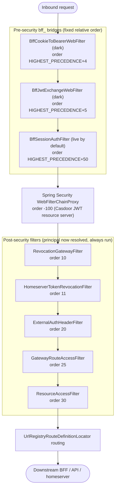

Spring Cloud Gateway (WebFlux) for [HugMesh](https://github.com/hugmesh) — the
platform's public front door. **One image, many roles**: the same artifact runs as
the PKI/identity gateway, the backend (BFF/API) gateway, or the front-end (UI)
gateway, differentiated only by `SPRING_APPLICATION_NAME` (e.g. `hugmesh-pki-gateway`,
`hugmesh-be-gateway`, `hugmesh-fe-gateway`, or per-brand
`${BRAND}-{pki,be,fe}-gateway`). It is a Casdoor-aware OAuth2 **resource server**;
it never exposes its own login — tokens are minted by Casdoor (the BFF proxies the
grant) and validated here.

Spring Boot 4.0.7 / Spring Cloud 2025.1.2 on Java 25, reactive throughout (WebFlux +
reactive Cassandra + R2DBC Postgres). The gateway tracks the unified platform
ecosystem baseline and consumes the shared
[`hugmesh-commons`](https://github.com/hugmesh/hugmesh-commons) 2.1.0 artifact
(`net.hugmesh.commons.*` security/tenancy) as a **direct, explicitly-versioned
dependency** — it deliberately keeps `spring-boot-starter-parent` rather than the
BFF-focused [`hugmesh-parent`](https://github.com/hugmesh/hugmesh-parent) metapom,
and does **not** depend on
[`hugmesh-auth-core`](https://github.com/hugmesh/hugmesh-auth-core) (that
account/session/MFA core is consumed only by the BFFs).

This repo is one component of the wider HugMesh platform. Requests generally flow
browser → gateway (this repo) → a per-role BFF/API (e.g.
[`hugmesh-admin-bff-api`](https://github.com/hugmesh/hugmesh-admin-bff-api)) →
data stores and federated services; see [Where it sits](#where-it-sits) below for
how the gateway fits into that chain, and the
[hugmesh organization](https://github.com/hugmesh) for the rest of the
platform's repositories.

## Current State

On `main`, post the recent ecosystem unification + auth-model change:

- **Boot 4 / SCG 5 baseline.** Migrated to Spring Boot 4.0.7 / Spring Cloud 2025.1.2
  on Java 25 LTS (`eclipse-temurin:25`). Routes are configured under the **`spring.cloud.gateway.server.webflux`**
  namespace (SCG 5.0 moved them there; the legacy `spring.cloud.gateway.routes`
  prefix silently binds nothing). Uses the
  `spring-cloud-starter-gateway-server-webflux` starter.
- **Casdoor-JWT resource server (+ two `bff_` bridges, one live by default, one
  dark).** By default the gateway validates Casdoor JWTs and runs the
  data-driven role/domain gate below — it never mints or sees a login. In the
  platform's current **native-login** model, login-ui POSTs a
  native username/password (+MFA) form to `/bff/login`; **user-bff** runs the
  PKCE/state handshake and the internal Casdoor `/api/login` + code→token exchange
  **server-side** and holds per-session JWT custody/refresh. The browser is
  **never redirected to Casdoor** and only ever holds an **opaque
  `bff_`-prefixed session**. Account/session login
  logic is being relocated out of admin-bff into user-bff with the shared core
  extracted to `hugmesh-auth-core`; account/session DATA stays in admin-bff-db.
  **None of that login/relocation work lives in this repo.** What *does* live here:
  two filters that let the gateway accept that opaque `bff_` session
  (a JWT-only resource server otherwise 401s it at the decoder):
  - `BffSessionAuthFilter` (gate `app.bff-session.enabled`) — the **introspection**
    path: resolves a `bff_` (Bearer header **or** `bff_session` cookie) via admin-bff
    `GET /bff/internal/session/introspect` (over the `X-Internal-Token` back-channel)
    and populates the SecurityContext directly. **Live by default**
    (`APP_BFF_SESSION_ENABLED` defaults to `true`, PR #70) — set it to `false` to
    dark-disable.
  - `BffJwtExchangeWebFilter` (gate `hugmesh.gateway.bff-exchange.enabled`) — the
    **exchange** path: swaps `bff_`→internal **custody JWT** via admin-bff over the
    mTLS+`X-Internal-Token` back-channel, so the resource server validates a real JWT.
    **Default off** (ships dark) — a deployment that leaves this flag off and only
    has the introspection path live is still byte-identical to today's shipped
    default, just not to a *pure* JWT-only resource server.

  See *Opaque `bff_` session handling* below for exactly how each works and how they
  differ.
- **Data-driven authorization.** `gateway_route_access` (Postgres, R2DBC, source of
  truth; Cassandra read-cache; `CanonicalSeed` fallback) gates which roles/users may
  reach which URLs per brand, with issuer-derived domain scoping. `SUPERADMIN` is the
  only cross-domain bypass; `ADMIN`/`GAME-MASTER` bypass only within their own domain.
  Authority-injection and cross-tenant BFLA hardening are shipped.
- **CI is GitLab.** The primary test/build/security pipeline runs on an in-cluster
  GitLab instance mirroring this repo; GitHub Actions currently hosts only a manual
  release workflow (see *CI / security* below).

## Where it sits

| | |
|---|---|
| **Tier** | Edge / ingress. Every external request to a brand passes through one of these gateway instances before reaching a BFF or API pod. |
| **Namespace** | Deployed per role/brand; selects only its own rows by `spring.application.name`. Shares the Casdoor instance and Cassandra cluster (keyspace `hugmesh_gateway`) with the BFFs. |
| **Upstream of** | the per-role BFFs/APIs, the homeservers (Matrix/tuwunel, Mastodon/akkoma), and the federated UI remotes. |
| **Trusts** | Casdoor JWTs (validated against the configured issuer/JWKS). Browsers/Cloudflare reach it **without** a client cert; the optional mTLS leg is gateway→backend only. |

## Request pipeline

Up to three `bff_` bridges may run **pre-security** (before
`WebFilterChainProxy(-100)`) — see *Opaque `bff_` session handling*. Two
(`BffCookieToBearerWebFilter` + `BffJwtExchangeWebFilter`) are dark by default and
absent unless their shared flag is on; the third (`BffSessionAuthFilter`) is live by
default. Then Spring Security authenticates the Casdoor JWT (or admits
a public/homeserver path), and these ordered `WebFilter`s run:

| Order | Filter | Purpose |
|------:|--------|---------|
| HIGHEST+4 | `BffCookieToBearerWebFilter` *(dark)* | pre-security cookie-mode bridge: synthesises `Authorization: Bearer bff_…` from the `bff_session` cookie (which is **retained** on the forwarded request) so a cookie-only browser request reaches the exchange filter below; **absent** unless `hugmesh.gateway.bff-exchange.enabled` (same flag as the exchange filter) |
| HIGHEST+5 | `BffJwtExchangeWebFilter` *(dark)* | pre-security `bff_`→custody-JWT swap; **absent** unless `hugmesh.gateway.bff-exchange.enabled` |
| HIGHEST+50 | `BffSessionAuthFilter` *(live by default)* | pre-security `bff_`/cookie introspection → SecurityContext; present unless `app.bff-session.enabled=false` |
| 10 | `RevocationGatewayFilter` | reject revoked **Casdoor JWTs** (Cassandra-cached revocation list) |
| 11 | `HomeserverTokenRevocationFilter` | resolve the opaque **Matrix/Mastodon bearer** and deny revoked tokens (ban / per-credential / external-client); fail-closed once `app.hs-revocation.enabled` |
| 20 | `ExternalAuthHeaderFilter` | inject `External-Authorization` headers when an external-OAuth token is present (**additive**; never required) |
| 25 | `GatewayRouteAccessFilter` | **per-gateway external-access gate + domain scoping** — which roles/users may reach which URLs from outside *this* gateway, and which **brand** they belong to |
| 30 | `ResourceAccessFilter` | per-resource grants for the **optional, opt-in** games service (`game:{slug}`, `session:{id}`); inert unless games is deployed |

Routes themselves come from `UrlRegistryRouteDefinitionLocator` (a
`RouteDefinitionLocator`): the static boot routes seed a URL registry, and apps
register additional routes at runtime via `UrlRegistryService`, picked up on the
next refresh tick.

The same pipeline, as a flow (`BffCookieToBearerWebFilter` + `BffJwtExchangeWebFilter`
are dark/flag-gated behind one shared flag; `BffSessionAuthFilter` is live by
default behind its own flag — see the table above for which flag arms which box;
everything from `RevocationGatewayFilter` down always runs):



## Authentication & authorities (Casdoor)

`CasdoorAuthorities` is the **single source of truth** for the JWT→Spring-authority
mapping, shared by both decoder paths (below) so a token maps to byte-identical
authorities regardless of which path validated it. From a validated Casdoor JWT:

- every authenticated principal floors to `ROLE_USER`;
- each `roles` claim entry (string **or** Casdoor's `{name: …}` object shape) →
  `ROLE_<UPPER>`;
- each `permissions` entry → verbatim authority, **except** entries carrying a
  reserved `ROLE_`/`DOMAIN_` prefix, which are **dropped** (`RESERVED_PREFIXES` in
  `CasdoorAuthorities`) so a permission string can never forge a role or a tenant
  scope (authority-injection defense);
- legacy `isAdmin: true` → `ROLE_ADMIN`;
- exactly **one** issuer-derived `DOMAIN_<x>` authority (see *Multi-tenancy*),
  keyed on the cryptographically-validated `iss` — never a user-settable claim.
  `DOMAIN_<x>` carries **no** `ROLE_` prefix, so it can never satisfy a
  `hasRole()`/route-access role check.

The `Roles` helper exposes the same claim walk to filter code, plus role
predicates: `isAdmin`, `isGameMaster`, `isSuperadmin`, `isImageBuilder`, and the
issuer-keyed `domainOf(jwt, registry)`.

### Coarse path gate (SecurityConfig)

The resource-server `SecurityWebFilterChain` applies the coarse, role-only floor:

- **Public** (`permitAll`): `/api/auth/**`, `/api/registration/**`, `/api/login/**`,
  the `/_remotes/{login,registration,banned}/**` federated UI shells, and
  `/bff/public/announcements/**` (the unauthenticated pre-auth login banners).
- **Homeserver passthrough** (`permitAll` at the OAuth2 layer): `/_matrix/**`,
  `/api/v1/**`, `/api/v2/**`, `/oauth/**`, `/.well-known/**` — these carry an
  opaque Matrix/Mastodon bearer, **not** a Casdoor JWT, so requiring a JWT here
  would 401 every homeserver request. Authorization is done downstream by
  `HomeserverTokenRevocationFilter` + the `ROLE_MATRIX`/`ROLE_MASTODON`
  route-access rows.
- **Infra / observability** (`/actuator/**`, `/api/admin/{health,cassandra,cluster}/**`):
  `ROLE_GAME-MASTER`, `ROLE_ADMIN`, or `ROLE_SUPERADMIN` only — `ROLE_MOD`/`ROLE_USER`
  never reach infra (isolation invariant). Domain scoping of admin's infra reach is
  applied downstream by `GatewayRouteAccessFilter` (which can see `Host`).
- everything else — authenticated.

A minimal `RoleHierarchy` (`SUPERADMIN > ADMIN/MOD/USER`) smooths `@PreAuthorize`
ergonomics only; `ADMIN` and `MOD` are deliberately **siblings** (no `ADMIN > MOD`
edge) and no AND-intersection composite roles are wired, so the hierarchy can never
let a plain admin satisfy an intersection role.

## Opaque `bff_` session handling (two bridges, one live by default)

Historically the gateway was a **pure** Casdoor-JWT resource server: an inbound
`Authorization: Bearer bff_…` (the opaque session the cookie-terminating BFF mints)
is **not** a JWT, so the resource server's decoder rejected it with **401**. Two
filters — both **merged on `main`**, each independently flagged — let the gateway
accept that opaque session. They are alternative approaches to the same gap,
selected per deployment; flipping either flag on with the other off is the expected
mode, and that's exactly the shipped default today: `BffSessionAuthFilter`
(introspection) is **live by default** (`app.bff-session.enabled` defaults to
`true`, PR #70) while `BffJwtExchangeWebFilter` (exchange) stays **dark**
(`hugmesh.gateway.bff-exchange.enabled` defaults to `false`). Explicitly
setting both flags off is the only way to get back to the pure-JWT-only behavior
described above.

A third filter, `BffCookieToBearerWebFilter` (#66, same flag as the exchange path,
order `HIGHEST_PRECEDENCE + 4`), sits one slot ahead of `BffJwtExchangeWebFilter` and
synthesises `Authorization: Bearer bff_…` from the `bff_session` cookie (which is
**retained** on the forwarded request — consuming it starved the cookie-terminated
BFF surfaces, notably user-bff's permitAll `GET /bff/session`) when no
`Authorization` header is already present — so the exchange path's effective "Token
source" below is really *header **or** cookie*, mirroring `BffSessionAuthFilter`'s
dual token source. See *Request pipeline* above.

| | `BffJwtExchangeWebFilter` (#48) | `BffSessionAuthFilter` (#51) |
|---|---|---|
| **Flag** | `hugmesh.gateway.bff-exchange.enabled` (default **off**) | `app.bff-session.enabled` (default **on**, PR #70) |
| **Approach** | **Exchange** — swaps `bff_` → internal **custody JWT**, rewrites `Authorization: Bearer <custody-jwt>` so the *unchanged* JWT decoder + authz chain run as for a native JWT caller | **Introspection** — resolves `bff_` and populates the `ReactiveSecurityContextHolder` directly (mints a `UsernamePasswordAuthenticationToken`); the downstream JWT filter then finds an existing authentication and short-circuits |
| **BFF call** | `POST {admin-bff}/bff/internal/session/exchange` over the **mTLS + `X-Internal-Token`** back-channel (reuses the dark `hugmesh.gateway.mtls.enabled` leg) | `GET {admin-bff}/bff/internal/session/introspect` with the `bff_` as a bearer **+ the `X-Internal-Token` header** (the JWT-only `/bff/me` would 401 a `bff_`; the internal surface is `permitAll()` guarded by `InternalTokenWebFilter`); forwards the client IP as `X-Forwarded-For` |
| **Token source** | `Authorization: Bearer bff_…` only | `Authorization: Bearer bff_…` **or** the `bff_session` cookie (so cookie-mode UIs work) |
| **Order** | `HIGHEST_PRECEDENCE + 5` — **pre-security**, before `WebFilterChainProxy(-100)`, reads/rewrites only the raw header | `HIGHEST_PRECEDENCE + 50` — also before the OAuth2 `BearerTokenAuthenticationWebFilter`, populates the context before it runs |
| **Authorities** | inherited from the swapped-in JWT via `CasdoorAuthorities` (identical to a native JWT) | mapped from the introspect response body: `ROLE_<UPPER>` per role + always-on `ROLE_USER` floor + `MFA_SATISFIED` when `mfaSatisfied`; an **incomplete-registration** account is capped to `ROLE_USER` only |
| **Fail-closed** | any exchange failure (non-2xx / timeout / empty body) ⇒ **401**, the raw `bff_` is **never** forwarded; positive swaps cached on `sha256(bff_)` (TTL-bounded, default 5s, clamped to the configurable `cache-ttl-max-ms` ceiling, default 60s; `cache-max-size` bounds the entry count). Suspension is enforced **admin-bff-side** on every non-cached exchange call (a suspended/banned account's swap is refused); a cache hit skips that round-trip, so the TTL is the suspension-staleness window (PR #68) — set `cache-ttl-ms<=0` for a zero-bypass-window, per-request-consult posture. | BFF 5xx/unreachable ⇒ **503** `session_backend_unavailable`; `status: suspended/banned` ⇒ **403** `X-BFF-Denied`; BFF 401 ⇒ pass-through unauthenticated (the `authenticated()` floor then 401s protected paths) |

`BffJwtExchangeWebFilter` also seeds a PUBLIC `/bff/login` route-access row
(via `CanonicalSeed`) so the anonymous native-login credential POST reaches user-bff
before it holds a session. In a default deployment `BffSessionAuthFilter` IS wired
(introspection resolves a `bff_` bearer/cookie to a SecurityContext) and
`BffJwtExchangeWebFilter` is NOT; only with `app.bff-session.enabled=false` as well
does neither bean exist and a `bff_` bearer fall back to 401ing at the JWT decoder.

## Per-gateway route access (`GatewayRouteAccessFilter` + `GatewayRouteAccessService`)

The enforcement layer that turns static routing into a role-checked, brand-scoped
front door. For **this** gateway it answers "may this principal reach this URL
pattern from outside, in this brand?".

**Source of truth vs. read-cache:**
- **Postgres** (`ROUTE_ACCESS_R2DBC_URL`, R2DBC) is the source of truth — the
  admin-api (`hugmesh-admin-bff-api`) CRUDs the canonical rows. The gateway
  SELECTs only its own gateway's rows on startup and every refresh tick.
- **Cassandra** (`hugmesh_gateway.gateway_route_access`) is the cluster
  read-cache: each successful Postgres load is **write-through-mirrored** into it,
  so if Postgres is briefly unreachable the last-known rows keep being enforced.
- If neither is configured, the baked-in **canonical seed** (`CanonicalSeed`, per
  tier — `pki`/`be`/`fe`, derived by suffix for per-brand instance names) is used.
  An unknown gateway name gets a closed `/**=ROLE_ADMIN` floor — **never**
  fail-open.

The refresh path is guarded by a Resilience4j circuit breaker so a slow/partitioned
datastore can't pile reads up on the scheduler. Toggle the whole gate with
`app.route-access.enabled`.

**Row shape** matches the contract: `(id, gateway, url_pattern, role, casdoor_user,
allow, domain)`. `role` is the Spring authority form (`ROLE_ADMIN`, …; match is
case-insensitive and `ROLE_`-prefix-tolerant); the sentinel `PUBLIC` permits
anonymous traffic; `casdoor_user` optionally pins a rule to one Casdoor id/username;
`domain` is the per-row brand scope.

**Pin forms vs. login carrier** — `casdoor_user` is matched by **exact** string
equality against every identity the session presents, and the two login carriers
present different sets. A Casdoor-JWT session presents the token's `sub` UUID and
`name` username, plus the native-account forms derived from its claims
(`casdoor:<handle>` and the bare lowercase handle, for each of
email / preferred_username / sub / username). A native-login (`bff_`) session
presents ONLY its durable account id (`casdoor:<handle>`, where the handle was
minted lowercase from email > preferred_username > sub at first login) and the
bare handle — it does NOT carry the Casdoor UUID `sub`, nor (when the handle is
an email) the bare username. So: write targeted pins in the account-id form
`casdoor:<handle>` or as the bare lowercase handle to govern BOTH carriers; a pin
written as the UUID `sub` or the bare Casdoor username governs only JWT sessions
until the introspect contract carries the Casdoor id + username. When in doubt,
write two rows — one per form; deny-wins makes the extra row harmless.

**Decision (per request) — longest matching `url_pattern` wins** (Ant-style `**`),
so `/api/admin/**=ROLE_ADMIN` overrides a broader `/api/**=ROLE_USER`:

- no rule matches the path → forward (ungoverned; SecurityConfig already
  authenticated it);
- at the longest matching pattern, among rules whose `domain` admits the request's
  target brand: an explicit `allow=false` for a held role/pinned user → **403**
  (deny wins);
- else a held-role/pinned-user (or `PUBLIC`) `allow=true` → forward;
- else (governed but not granted) → **403** + `X-Route-Denied: <gateway>:<path>`.

## Multi-tenancy / domain scoping

The platform is multi-brand multi-tenant (one Casdoor per brand ⇒ distinct, signed
`iss`). The gateway scopes principals to their brand using the **validated issuer**,
never a user-settable claim.

- **`DomainRegistry`** maps issuer→domain (`app.tenancy.issuers` CSV) and,
  optionally, `Host`-suffix→domain (`app.tenancy.hosts` CSV, defense-in-depth).
  With no tenancy config it seeds the lone `issuer-uri` → `default`, so a
  single-issuer cluster emits `DOMAIN_default` for every token and **nothing else
  changes** (back-compat). When populated, only listed issuers are trusted; an
  unknown `iss` **fails closed** (401) before any authority is emitted.
- **`TenancyResourceServerConfig`** is **config-gated and opt-in**: it contributes
  a per-issuer `ReactiveAuthenticationManagerResolver` only when
  `app.tenancy.issuers` genuinely carries `issuer=domain` pairs (a
  `@ConditionalOnExpression` `.contains('=')` guard, so the empty default is a
  no-op). `SecurityConfig` swaps onto it only when the registry is genuinely
  multi-issuer (more than the back-compat entry); otherwise it stays on the
  existing single `o.jwt(...)` jwk-set-uri path. Each per-issuer manager is wired to
  the same `CasdoorAuthorities` converter, so multi-brand tokens still get their
  `DOMAIN_<x>`.
- **Enforcement** (`GatewayRouteAccessFilter`): `ROLE_SUPERADMIN` is the **only**
  cross-domain bypass (the infra control plane — reaches every surface in every
  brand). Any other principal whose `DOMAIN_<x>` does not match the request's
  target domain (from `Host`) is **hard-denied** *before* the route-access grant
  layer — closing the cross-tenant hole where a domain-blind `allow=true` grant
  could otherwise re-grant a brand-X admin onto brand-Y. `ROLE_ADMIN`/`ROLE_GAME-MASTER`
  bypass the gate only **within their own domain**. Single-tenant clusters always
  match (`default` vs `default`), so this is a no-op there.

**Authority-injection hardening (✅ shipped, main).** The converter and filter are
hardened against authority injection across both decoder paths:
`CasdoorAuthorities` **strips reserved-prefix `permissions` entries**
(`ROLE_`/`DOMAIN_`) so a token can't forge a tenant scope or super-role via a
permission string (`RESERVED_PREFIXES`); `GatewayRouteAccessFilter` derives the
principal's domain from the **validated issuer** (`Roles.domainOf(jwt, registry)`),
never off the authorities list; and the legacy authorities-list overload
`Roles.domainOf(authorities)` fails closed on zero or more-than-one `DOMAIN_`.
(Landed via PR #18 → #19 → #20; this paragraph describes current `main`.)

## Revocation API (`GatewayRevocationController`)

The read side above (`RevocationGatewayFilter` order 10 / `HomeserverTokenRevocationFilter`
order 11) consumes a cluster-wide revocation list; this is the **write/observability**
side that feeds it. Under `/api/gateway/revocations`, gated at the class level on
`hasRole('ADMIN')`:

| Method | Path | Who | Purpose |
|--------|------|-----|---------|
| `POST` | `/api/gateway/revocations` | `ROLE_ADMIN`+ | revoke a key (with optional TTL); write-through into the Cassandra revocation list |
| `DELETE` | `/api/gateway/revocations/{key}` | `ROLE_ADMIN`+ | clear a revocation key |
| `GET` | `/api/gateway/revocations` | `ROLE_SUPERADMIN` | snapshot of the current revocation list (observability) |

**Cross-tenant gate (CWE-639 / BFLA, ✅ shipped — PR #30).** Each revocation key
records its **owning domain** (the writer's issuer-derived `Roles.domainOf(jwt,
registry)`, never a user-settable claim). A non-`SUPERADMIN` caller is rejected with
**403** when it tries to clear — or overwrite/refresh — a key owned by a *different*
domain, and the gate is **fail-closed**: a caller whose domain cannot be proven
(null), or a cross-tenant attempt, never reaches the underlying `revoke`/`clear`.
`ROLE_SUPERADMIN` is the only cross-brand bypass (infra control plane); an
unscoped/`default`-owned key remains writable single-tenant (back-compat).

## Optional capabilities

- **External-client (homeserver) issuance** — `CanonicalSeed`'s `be` rows gate
  *token-issuance* paths (native Element/Tusky/Ivory login/register/app-registration)
  on the dedicated `ROLE_*_EXTERNAL_CLIENT` roles, separately from *token-usage*
  (`ROLE_MATRIX`/`ROLE_MASTODON`). A platform ban (role removal) closes both.
- **Image-builder / superadmin console** — `/bff/image-builds/**` is gated on the
  granted `ROLE_IMAGE_BUILDER` capability (not an admin default), with
  `/bff/image-builds/arch/**` and `/bff/superadmin/**` reserved for `ROLE_SUPERADMIN`
  (longest-pattern-match makes the arch surface superadmin-only).
- **Fleet-owner phone/MDM console gate** — `/bff/admin/phone-fleet/**` is gated on
  the granted `ROLE_FLEET_ADMIN` capability (also reachable by `ROLE_ADMIN` /
  `ROLE_SUPERADMIN`), the one `/bff/admin/**` subpath a non-superadmin fleet-owner
  role can reach without falling into the broader `ROLE_ADMIN` floor; the
  owner+domain tenancy wall and fleet entitlement itself are enforced in
  admin-bff's `PhoneFleetOwnerController`. Baked into `CanonicalSeed.fe()` as the
  dual-DB-outage fail-safe parity copy of the identical Postgres route-access
  seed rows.
- **Downstream mTLS** (`DownstreamMtlsConfig`, default **off**) — when in-cluster
  backends enforce `client-auth=need`, the gateway presents a client cert chaining
  to the cluster CA and validates the backend cert on the **proxy leg only**.
  Enabled with `HUGMESH_GATEWAY_MTLS_ENABLED=true`; store passwords bind from
  `hugmesh.tls.*` (written by the chart's keystore initContainer, never in git).
- **PKI cert-chain builder** — this repo is the canonical home of the platform
  cert-chain builder: [`scripts/pki/build-chained-cert.sh`](scripts/pki/build-chained-cert.sh)
  mints leaf/intermediate certs off a shared root (one root, two intermediates,
  per-stack/per-brand leaves). The rationale is recorded in
  [ADR 001 — Cert-chain hierarchy](docs/decisions/001-cert-chain-hierarchy.md).
  (The gateway is the natural home: it's the first thing every external request
  hits and the canonical TLS terminator.)

## Configuration (env vars)

| Var | Purpose |
|-----|---------|
| `SPRING_APPLICATION_NAME` | gateway role/brand identity (selects route-access rows) |
| `CASDOOR_ISSUER_URI` / `CASDOOR_JWKS_URI` | single-issuer resource-server wiring |
| `CASSANDRA_CONTACT_POINTS` / `CASSANDRA_KEYSPACE` / `CASSANDRA_LOCAL_DC` | read-cache + revocation store |
| `ROUTE_ACCESS_R2DBC_URL` | Postgres source-of-truth for `gateway_route_access` (unset ⇒ cache/seed only) |
| `API_DOWNSTREAM_URI` | default `/api/**` backend |
| `APP_TENANCY_ISSUERS` | CSV `issuerUri=domain,…` (opt-in multi-brand; empty ⇒ single-tenant) |
| `APP_TENANCY_HOSTS` | CSV `hostSuffix=domain,…` (defense-in-depth Host→domain map) |
| `HUGMESH_GATEWAY_MTLS_ENABLED` + `HUGMESH_TLS_*` | downstream mTLS leg |
| `HUGMESH_GATEWAY_BFF_EXCHANGE_ENABLED` | enable the dark `bff_`→custody-JWT exchange filter (default off) |
| `APP_BFF_SESSION_ENABLED` / `BFF_BASE_URL` | the `bff_`/cookie introspection filter (default **on**, PR #70) + its admin-bff base URL; set the former to `false` to dark-disable |
| `INTERNAL_TOKEN` | `X-Internal-Token` sent on the `/bff/internal/session/{introspect,exchange}` back-channel; blank ⇒ dev (non-enforcing). Same secret for both the introspection and exchange legs |
| `PORT` | listen port (default 8080) |

Management endpoints expose only `health,info,metrics`, with health details gated to
`GAME-MASTER`.

## Build & test

```bash
./mvnw test            # unit + context tests, no external services required
docker build -t hugmesh-systems/gateway:dev .
```

Running `./mvnw verify` locally before opening a pull request is recommended —
see *CI / security* below for why GitHub Actions alone won't catch regressions yet.

### CI / security

The project's primary CI runs on an in-cluster **GitLab** instance that mirrors this
GitHub repository (`.gitlab-ci.yml`); GitHub Actions currently only hosts a manual,
`workflow_dispatch`-only [release workflow](.github/workflows/release.yml) that
builds and publishes the container image to GHCR. Stages: `test → build →
pentest` (a former `security` stage was dropped once verified dead — its only
job, inline `dependency-check`, had been migrated onto the centralized
`pentest:sca` job below when the `pentest` stage was added). `test` runs
`./mvnw verify` (with JUnit reports) and `build:image` builds + pushes the
container image. The pentest leg is the per-repo arm of the platform's OWASP
pen-test standard: it `include:`s the centralized hidden jobs from
[`hugmesh-generator`](https://github.com/hugmesh/hugmesh-generator)
(`tests/pentest/ci/pentest-stage.gitlab-ci.yml`) so there
is one source of truth — `pentest:sca` (OWASP Dependency-Check SCA) and
`pentest:dast` (authenticated ZAP baseline + probes/nuclei harness), both
`allow_failure: true` for now. This is a CI-pipeline stage, **not** a deployed
CronJob or UI trigger.

## Known Gaps / TODO

Concrete, currently-shipped-but-incomplete items verified in code (as opposed to the
forward-looking, not-yet-started work in *Roadmap* below):

- **`BffJwtExchangeWebFilter`'s positive-swap cache is a bounded suspension-staleness
  window, not a full bypass** — suspension is enforced admin-bff-side on every
  non-cached exchange call, but a cache hit skips that round-trip, so a session
  suspended after its swap was cached keeps authorizing until the cache entry
  expires. The window is bounded on three axes, all configurable and all now held in
  place by tests: `cache-ttl-ms` (default 5s) is clamped to `cache-ttl-max-ms`
  (default 60s — the widest window this deployment tolerates), `cache-max-size`
  (default 10000, floored at 1) bounds the entry count, and a non-positive value of
  *either* TTL knob disables the cache outright for a zero-window posture. A clamp
  that actually fires now WARNs at startup with the configured **and** effective
  values (it used to apply silently, so an operator who asked for ten minutes just
  got sixty seconds with nothing saying so), and raising the ceiling above its
  default WARNs that the bypass window was widened.

  **Why the tests matter here specifically:** the ceiling used to be an anonymous
  `60_000L` literal inside the clamp expression, and it was measurably unguarded —
  on that tree, deleting the clamp, widening it to 600 s, deleting the
  `cache-max-size` check, and deleting the size floor **all left the filter's suite
  green**. A bound nothing holds in place is a comment, not a bound. See
  `src/main/java/net/hugmesh/gateway/filter/BffJwtExchangeWebFilter.java` and the
  `(v-d) THE BOUND ITSELF` block of `BffJwtExchangeWebFilterTest`.

  **Still open — proactive invalidation on suspension (needs a cross-repo push).**
  The remaining half of the design question ("should a suspension event evict cached
  entries instead of waiting out the TTL?") cannot be usefully answered inside this
  repo: a gateway-side eviction driven off `RevocationListService` would be
  *redundant* where revocation is wired — `RevocationGatewayFilter` already denies
  `subject:<sub>` on **every** request including cache hits, because it reads the
  SecurityContext populated from the swapped-in custody JWT — and *inert* where it is
  not, since `RevocationListService.revoke()` no-ops when Cassandra is unwired and
  `isRevoked()` answers `false` against the empty cold-start snapshot. The only lever
  that actually closes the window in a revocation-less deployment is a **push from
  admin-bff** (an authenticated internal call telling the gateway to drop a specific
  cached swap), which is a new cross-repo contract and a human call, not a
  single-repo change. Until then the honest posture statement is: TTL-bounded where
  revocation is off, already-immediate where revocation is on, and `cache-ttl-ms=0`
  for anyone who wants neither.
- **Downstream mTLS's store passwords (`hugmesh.tls.*`) may never actually bind
  in-cluster — unverified against the chart.** `application-tls.properties` (the
  file the chart's `build-keystore` initContainer writes the real generated PKCS12
  passwords into) is a Spring Boot **profile-specific** document; an
  additional-location directory only auto-loads it when a profile literally named
  `tls` is active, and this repo has no evidence either way of that being wired on
  the be/fe-gateway deployment configs that set `HUGMESH_GATEWAY_MTLS_ENABLED=true`. If
  it isn't, `DownstreamMtlsProperties`' passwords stay at their empty default and
  `KeyStore.load(...)` (`DownstreamMtlsConfig.load`) throws on the real
  (non-passwordless) store, failing the pod to start. This is the same root-cause
  family as an already-documented, still-open fleet-wide gap on the `server.ssl.*`
  binding used by several BFFs sharing the identical `build-keystore` +
  `application-tls.properties` pattern — flagged here as a TODO
  (`src/main/java/net/hugmesh/gateway/config/DownstreamMtlsProperties.java`)
  rather than guess-fixed, since the actual fix is chart-side (a different repo)
  and needs a human decision on the mechanism (rename the emitted file, activate a
  `tls` profile, or bridge the property) that a single-repo pass can't make safely.

## Roadmap

Future work that **extends this gateway** but is **not on `main`**. (State
convention: ✅ shipped = on main · 🚧 in-flight = on an open branch/PR · 🔭 planned
= design only.) Cross-repo and non-gateway platform items are tracked in
[`ROADMAP.md`](ROADMAP.md).

- ✅ **Opaque `bff_` session handling — both bridges merged; introspection is live
  by default, exchange stays dark.** The gateway's two halves of the SSO
  opaque-session story are now on `main` (see *Opaque `bff_` session handling*
  above): the `BffSessionAuthFilter` introspection bridge (`bff_`/cookie →
  `GET /bff/internal/session/introspect` → SecurityContext, gate
  `app.bff-session.enabled`) **ships live by default** (PR #70) and the
  pre-security `BffJwtExchangeWebFilter` (swap `bff_`→custody JWT, gate
  `hugmesh.gateway.bff-exchange.enabled`) still **ships dark**. 🚧 **Still
  owed:** confirming admin-bff's `/bff/internal/session/introspect` endpoint is
  actually reachable/working on every live deployment (this repo can't verify
  that from its own code), deciding whether/when to flip the exchange flag on
  too (cross-repo SSO ensemble, tracked in [`ROADMAP.md`](ROADMAP.md) §12), and
  the live SSO e2e. Cloudflare fronts prod.
- ✅ **Casdoor MFA floor — gateway layer merged, ships dark (PR #40).** The
  gateway-side MFA primitives are on `main` but default-off: the `mfa_required`
  column on `gateway_route_access` (fail-closed), the `MFA_SATISFIED` authority
  emitted by `CasdoorAuthorities` (from `amr`/`acr`), and the privileged-route
  MFA floor in `GatewayRouteAccessFilter`. All three ship dark behind
  `app.mfa.enabled` / `app.mfa.enforce-privileged-floor`. 🚧 **Still owed:**
  the BFF-driven MFA challenge (stamps `mfa_satisfied` into the opaque session),
  generalized step-up (sudo / SSH-via-UI / remote-install / superadmin ops), and
  the remaining 9-PR plan — cross-repo, tracked in [`ROADMAP.md`](ROADMAP.md).
- 🔭 **Workload Console gating** (admin-bff work is 🚧 in-flight).
  The federated pod-manage/log/exec admin-ui surfaces will need new gateway
  route-access rows / authority gates: superadmin cross-cluster, admins
  default-blind → superadmin-granted read-only own-domain (status-only / 24h /
  log-opt-in grants; dangerous tiers default-off).
- 🔭 **Tailnet superadmin-gateway posture** (Superadmin app-store infra legs are
  🚧 in-flight). A TAILNET-ONLY gateway posture + federation registration so the
  superadmin app-store remote is reachable over the tailnet and kept off the
  public UI — implying tailnet-scoped route-access rows here. No gateway code yet.

## See also

- [`ROADMAP.md`](ROADMAP.md) — gateway + cross-repo roadmap.
- [`docs/README.md`](docs/README.md) — index of this repo's deeper-dive docs
  pages (decisions, testing patterns).
- [`docs/decisions/001-cert-chain-hierarchy.md`](docs/decisions/001-cert-chain-hierarchy.md)
  — the cert-chain hierarchy decision behind `scripts/pki/build-chained-cert.sh`.
- [`docs/testing/MULTI-ISSUER-SLICE.md`](docs/testing/MULTI-ISSUER-SLICE.md) —
  the reusable multi-issuer security-slice test pattern built first in this repo.
- [hugmesh on GitHub](https://github.com/hugmesh) — the rest of the
  HugMesh platform's repositories (BFFs/APIs, front ends, the shared
  `hugmesh-generator` tooling, and more).

## Contributing

Issues and pull requests are welcome. Before opening a PR:

- Run `./mvnw verify` locally (see *Build & test* above) — GitHub Actions does not
  currently run the test suite on PRs, so this is the only pre-merge signal available
  to an outside contributor.
- Keep changes scoped to this repo's gateway concerns; cross-cutting platform changes
  (auth-core, admin-bff, generator, etc.) belong in their own repos under
  [hugmesh](https://github.com/hugmesh).
- For anything touching authentication, authorization, multi-tenancy, or the
  `bff_` session bridges, please describe the security implications in the PR
  description — these are the areas this gateway is most careful about (see
  *Authentication & authorities*, *Multi-tenancy / domain scoping* above).

There is no separate `CONTRIBUTING.md` yet; this section is the current guidance.

## License

[MIT](LICENSE).
