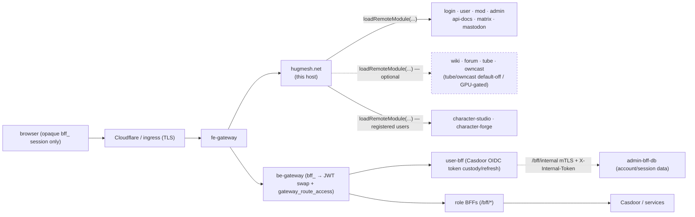

The **native-federation HOST shell** for a HugMesh brand. This Angular 22
single-page app is the front door behind the gateway. It owns the chrome (header,
menu, footer, background, the accessible skip-link and the shared profile modal),
the authgate, the universal navigation and the home routing. It owns no feature of
its own: every page is a separate repo, loaded at runtime as a **native-federation
remote**. ✅ On `main` it mounts **thirteen** remotes through the data-driven
`REMOTE_ROUTES` table: login, user, mod, admin, api-docs, matrix, mastodon, the
**optional** services wiki, forum, tube and owncast (tube and owncast are default-off
and GPU-gated; all four grey out through federation install-state when absent), and
the two character remotes, character-studio and character-forge.

In the platform's two service tiers this sits in the **architecture tier** (core,
always present), beside the gateways, Casdoor + PKI and the federation API. Each
brand or domain runs its **own instance** of this host: one container image, one
nginx, wired to that brand's gateway, Casdoor issuer and remotes.

---

## Current State

PR numbers below come from the repo's earlier tracker. They now collide with
unrelated PRs in this repo, so each is given as a commit as well (find it with
`git log --grep '(#143)'`).

✅ Shipped on `main` today:

- **Thirteen remotes** through `REMOTE_ROUTES`. Seven are core
  (login/user/mod/admin/api-docs/matrix/mastodon) and always present. Four are
  optional (wiki/forum/tube/owncast) and grey out through federation install-state
  when the service is absent. Two (character-studio/character-forge) sit behind
  `registeredGuard`.
- **Dynamic-first federation** — `resolveFederationSource()` reads the DB-driven
  manifest `GET /api/federation/manifest`, unions it over the bundled static floor,
  and falls back to the static manifest on any failure, so the shell always boots
  (commit 5a542bc; "PR #78" in the earlier tracker). The remotes are then
  **deferred**; see *Boot order* below.
- **Authgate, role-home routing, universal nav, profile modal**, plus the **home
  announcements banner**, **capabilities / graceful-degrade** grey-out, the
  **home-services launcher**, the **account-status appeal-gate** banner, the
  **notification bell** with an unread badge in the header's control cluster
  (commit eb0fbf0; "PR #101"), and a **real-time SSE toast** on
  `/bff/user/notifications/events` beside the bell's poll (commit ffa160a; "PR #104").
  *Host-owned features* below describes each.
- One `bearerInterceptor` credentials seam, and an accessibility baseline (skip-link,
  ARIA menubar, modal-dialog contract).
- **HTTP security headers and a strict nonce-CSP** on the SPA's nginx (commits
  ddca7b1 and 90e1608; "PR #100", "PR #110"). They carry `always`, so error
  responses get them too:
  `X-Content-Type-Options: nosniff`, `X-Frame-Options: DENY`,
  `Referrer-Policy: strict-origin-when-cross-origin`, HSTS
  (`max-age=31536000; includeSubDomains`), and a nonce-based
  `Content-Security-Policy` (`script-src 'self' 'nonce-$cspnonce' blob: 'wasm-unsafe-eval'`,
  `media-src 'self' blob:`, no `'unsafe-inline'` or `'unsafe-hashes'` for scripts).
  `angular.json`'s prod build sets `inlineCritical` to false, so no inline
  `<style>` or `onload=` preloader ships. `nginx.conf` rewrites every `<script` tag
  with a fresh per-request nonce (`sub_filter`), and es-module-shims copies that
  nonce onto the remote-entry scripts it injects, so module federation keeps working.
  `'wasm-unsafe-eval'` allows WebAssembly compilation only, not `eval()`. The
  character-forge remote's Godot web export needs it, because the document's policy
  governs every mounted remote. `style-src` still keeps `'unsafe-inline'`
  (Angular's inline component styles). COEP, COOP, CORP and a stricter
  Permissions-Policy remain deferred.
- ✅ **Session hydrate-on-bootstrap** (commit a93d885; "PR #143"). Detail is under
  *Where it sits*.
- ✅ **Games entry-point and derived Games Admin** (Phase 8/10, commit f0b74d2;
  "PR #120"). `/games` and `/games/admin` are host-owned, guarded **local
  placeholder** routes, not federated remotes. No `hugmesh-games-ui` remote exists
  yet; see Roadmap. Gates are under *Routes, role-gates and remotes*.

**Auth model (current).** The browser never holds a Casdoor JWT. Casdoor is
**internal-only** and never redirects the browser. login-ui shows a **native
username/password (+MFA) form** that POSTs to the public **`/bff/login`** route.
**user-bff** runs the PKCE/state and the internal Casdoor code→token exchange
server-side, and holds per-session JWT custody and refresh. The browser gets an
**HttpOnly `bff_`-prefixed session cookie**. The `SnapSession` object the host
keeps under the `hug.session` key (`id`, `label`, `provider`, `roles`,
`registrationComplete`, `status`) carries identity and role claims, never a token.
The gateway is a **pure Casdoor-JWT OAuth2 resource server**: a pre-security filter
swaps the `bff_` session cookie for the internal custody JWT, so the gateway's JWT
validation and role gate run unchanged. Authorization is data-driven by the
**`gateway_route_access` Postgres table** (the source of truth) through
`GatewayRouteAccessFilter`. `ADMIN` and `GAME-MASTER` bypass within their own
domain; `SUPERADMIN` bypasses across domains. Login, session and account logic is
being **relocated from admin-bff to user-bff**. The shared
account/session/MFA/Casdoor-admin code moved into the **hugmesh-auth-core**
artifact. Account and session **data** stay in admin-bff-db; user-bff reaches them
through admin-bff `/bff/internal` over mTLS + `X-Internal-Token`. Cloudflare fronts
prod.

**Ecosystem baseline.** The Java services this host calls (gateways, federation
API, role BFFs) run **Spring Boot 4.0.7 / Spring Cloud 2025.1.2** on **Java 25 LTS**.
They build on the shared Maven artifacts `hugmesh-parent` (metapom 2.8.0),
`hugmesh-commons` (2.1.0) and `hugmesh-auth-core` (2.5.1 on `main`; admin-bff and
user-bff pin 2.5.1 too). Spring Cloud Gateway 5.0 moved route config to
`spring.cloud.gateway.server.webflux.routes`; the legacy
`spring.cloud.gateway.routes` prefix silently binds nothing. All gateways and
generator route templates were corrected, so the prod federation manifest's
gateway-served remote paths bind.

### Known gaps

- **`/about` and `/home` are unreachable from the menu.** Both are public,
  unguarded routes (`src/app/about/`, `src/app/home/`) that build and render. No nav
  link points at either: the menu's "Home" entry goes to `/` (the authgate
  redirect), and nothing links `/about`. You reach them by typing the URL, except
  that `/home?denied=<path>` is where a signed-in user lands when a role guard
  refuses them (the `denied-notice` component explains the refusal).
  `AboutComponent` now renders real HugMesh platform copy; the old "Example
  Question?" placeholder text is gone. What remains is the missing link, and that is
  a product call, not an engineering gap. See the NOTE in `about.component.ts`.

---

## What it is

- **Stack:** Angular 22 standalone components and signals,
  `@angular-architects/native-federation`, Bootstrap 5, and a theme-driven animated
  CSS-gradient backdrop (`src/app/background/`). The backdrop is pure CSS by
  default. It reads the runtime `--sd-*` theme tokens and falls back to the shipped
  pastels. It also reads the cross-repo **`--sd-bg-effect`** token, shared with
  hugmesh-login-ui (whose README section "Theme-declared effect" holds the
  contract): `gradient` (default, the animated wash), `none` (the wash at rest; this
  shell's "flat"), or `vanta-fog|waves|net|globe`, a bundled, lazily loaded
  Vanta/three.js WebGL effect. The effect is destroyed on switch and on unmount, and
  never starts under `prefers-reduced-motion` or without WebGL. An unknown value
  degrades to `gradient`. Vanta and three.js are self-hosted package dependencies
  (the nonce'd CSP forbids CDN scripts). `federation.config.js` skips them from the
  shared surface so they stay in their own lazy chunks. The app builds to a static
  bundle that nginx serves (`Dockerfile`, `nginx.conf`) or the small Express
  fallback does (`server.js`).
- **Role:** federation **host/consumer** only. `federation.config.js`, through the
  shared `federation-base.js`, declares the host with **no `exposes` block**. The host
  only calls `loadRemoteModule(...)` on the remotes in its manifest. The shared-deps
  surface (Angular and RxJS singletons, `strictVersion`, the RxJS skip list) lives
  in `federation-base.js`, so host and remotes cannot drift into a "shared is not a
  function" runtime break.
- **Boot order:** ✅ `src/main.ts` calls `bootFederation()`
  (`src/app/federation/federation-boot.ts`) before Angular bootstraps in
  `src/bootstrap.ts`.
  1. `resolveFederationSource()` (`src/app/federation/federation-bootstrap.ts`)
     fetches the DB-driven manifest `GET /api/federation/manifest` (federation-api,
     the `federation_modules` table) with `credentials: 'include'`. The HttpOnly
     `bff_` cookie rides along when present, so an authenticated reload gets its
     domain- and visibility-scoped overlay. This runs before DI, so
     `bearerInterceptor` and `HttpClient` do not exist yet and no `Authorization`
     header is set.
  2. On success it returns the **union** of the bundled static manifest (the
     build-time floor, every baked remote) and the dynamic overlay, which overrides
     matching slugs and adds new ones. A successful read is never worse than the
     static build. A dynamic row whose URL this browser cannot fetch (a cluster
     address such as `http://admin:8080/...`) is dropped, so it never overrides a
     working floor entry.
  3. On **any** failure it falls back to the **bundled static manifest**
     (`src/assets/federation.manifest{,.prod}.json`). Failures include the `401` an
     anonymous caller gets from the `authenticated()` endpoint, network errors, 5xx,
     bad JSON and an empty list. If even that fails, the shell boots with no
     remotes rather than not at all.
  4. `bootFederation()` splits the result. `EAGER_REMOTES` is empty, so
     `initFederation({})` runs with no remotes, and each remote's name →
     `remoteEntry.json` URL is parked in `remote-loader.ts`. `federationLoader.load(...)`
     initializes a remote the first time a route guard admits the user to it. Every
     route's `loadChildren` and the profile modal call it. A logged-out boot
     therefore does not request the gated remotes.

  Routing is **path-based** (no hash), so the host's paths match the fe-gateway
  prefixes and each remote's nginx.

The host keeps the original static marketing pages (`/home`, `/about`) as public,
unguarded routes. Everything else is federated and gated.

---

## The runtime theme contract this shell consumes

The theme is derived in one place, hugmesh-generator
`studio/hugmesh_studio/core/theme.py`. It reaches the shell as token text in
`HUG_THEME_CSS`, which `docker-entrypoint.d/50-hug-theme.sh` writes to
`hug-theme.css` at container start. `index.html` `<link>`s that file. This repo does
**no** colour or shape maths. It only *reads*.

Every read ends in a shipped literal, which is what an **un-themed deploy**
renders. `--sd-*` is the contract name and `--hug-*` is the runtime twin the
generator's `css_root` emits beside it; a read may name one or both
(`var(--sd-X, var(--hug-X, <literal>))`). The "PREFIX DOCTRINE" note in
`src/styles.scss` says which prefix a rule may read. A theme that names nothing
renders the shipped chrome byte for byte, the same conservative-schema promise the
generator makes. `scripts/check-theme-token-contract.sh` (`npm run check:theme-tokens`)
catches both failures: an orphan read no theme can reach, and a dead fallback that
can never be hit.

| Axis | Tokens | What the shell does with them |
| --- | --- | --- |
| **Palette / ramps** | `--sd-bg-0`/`-1`/`-2`, `--sd-text`, `--sd-text-muted`, `--sd-accent`, `--sd-accent-soft`, `--sd-border`, `--sd-error`, `--sd-success` (the ten the shell's `:root` block defines), plus `--hug-primary*`, `--hug-*-rgb` and the other `--hug-*` ramps read directly | Chrome colours, the animated backdrop's own palette, the `:root` `--hug-*` block every federated remote reaches for. |
| **Background effect** | `--sd-bg-effect` | `gradient` \| `none` \| `vanta-fog\|waves\|net\|globe` — see the backdrop bullet above. |
| **Decor** | `--hug-nav-suffix{,-hover,-active}` | Nav-link suffixes, paired with CSS alt-text syntax so screen readers skip them. |
| **Chrome** | `--sd-{header,footer}-{display,height,bg,on,content}` | Hide a surface outright; size it (`compact` 2.5rem / `comfortable` 4rem / `tall` 6rem); paint a flat background with the generator's derived black/white text twin; replace the surface's content with the operator's own text. |
| **Style** | `--sd-radius{,-sm,-lg}`, `--sd-border-{width,style}`, `--sd-shadow{,-sm}`, `--sd-surface-blur` | The shape of every shared surface: `glass-float` chrome (header/footer/menubar/modal), `card-surface` panels, the `page-host` mixin, the routed-content backpane and help bubbles. **No shipped delivery path reaches this shell yet — see below.** |

**Chrome and Style were both inert until 2026-09-04.** The generator had shipped the
QT Themes editor's header/footer hide, size, background and content controls, and
the six style variants (`soft`, `sharp`, `outlined`, `elevated`, `flat`, `glass`),
months earlier. A census of this repo and hugmesh-login-ui found **zero** consumers
of either token family. An operator who ticked "hide the footer" or picked "sharp"
got a byte-identical page and no error. That is the same silent no-op as the
`--sd-`/`--hug-` prefix bug. Both axes are now consumed here and pinned by
rendered-geometry specs (`src/app/header/header.chrome-axis.spec.ts`,
`src/app/footer/footer.chrome-axis.spec.ts`, `src/app/theme-style-axis.spec.ts`),
never by reading the stylesheet back.

Three rules the axes may not break:

- **The scrim alpha is a contrast contract, not a taste knob.** `$scrim-alpha`
  (`src/styles/_tokens.scss`) keeps text legible over a theme's own unbounded
  background gradient. A themed flat background is therefore layered as a
  `background-image` *over* the scrim and never replaces it, and the Style axis
  reaches shape only.
- **A height is an intent, never a guillotine.** Each surface pairs its themed
  `block-size` with `min-block-size: fit-content`, so a `compact` header still shows
  every line of the operator's text and every control it must offer. Two
  shell-private ratios of the height cap the content, deliberately **not** on the
  `--hug-*` contract prefix: `--shell-chrome-fit` (0.55) caps BOXES and
  `--shell-chrome-cap` (0.45) caps TEXT. "Compact" then shrinks the chrome instead of
  drawing a smaller box around unchanged chrome. Every piece of text on a surface
  uses the same one of the two, or "compact" means illegible instead of dense.
- **Accessibility floors outrank density.** The WCAG 2.5.5 44px touch target on
  coarse pointers is not capped by a themed height, and neither is the glyph inside
  it, the half of that floor that is easy to leave behind. The derived `-on` twin
  outranks the palette text token on **every** element painted on a themed surface,
  not only the headline. Replacement text is rendered as **real markup**, not a CSS
  `content:` read (the branch the generator's own docstring offers), so the
  operator's words stay selectable, translatable and present in the accessibility
  tree.

### The Style axis has a consumer here and no producer yet

The shell's only runtime theme delivery is `HUG_THEME_CSS` / `SNAP_THEME_CSS` →
`docker-entrypoint.d/50-hug-theme.sh` → `hug-theme.css` → the `<link>` in
`index.html`. Nothing else in `src/` fetches a theme. The generator's
`cfg.login_theme_css()` fills that env. It composes `compose_login_css`, a preset's
`delta_css` and `chrome_css`, and **not** `style_tokens()`. Run against a full login
theme, it emits zero lines that match radius, shadow, border-width, border-style or
surface-blur. `style_tokens()` reaches CSS only through `core/domain_theme.py`'s
`render_css`, that is `PUT /bff/admin/themes/{domain}`, which this shell does not
read.

So the Chrome axis works end to end, and the Style axis works on this side only.
The reads are correct and pinned by `src/app/theme-style-axis.spec.ts`. They light
up when a delivery path carries the tokens. Until then, an operator who picks
`sharp` in the Studio sees no change **here**. Closing the gap is generator-side
work: thread `style_tokens()` into `login_theme_css()`, or serve the domain theme to
the shell. This repo does not claim it. A producer with no consumer, swapped for a
consumer with no producer, is the same silent no-op in a different hat, so it is
written down.

### Hiding the header is not a lockout

`--sd-header-display: none` strips the banner: surface, scrim, border, elevation,
flag ribbon, spacing, wordmark and centring gutter all go. The control cluster
survives, unpainted, at the inline end. The host is not set to `display: none`, and
the reason is a measurement: the only call to `session.clear()` in `src/app` (outside
specs) is in `src/app/header/header-controls.component.ts`. The banner is the
shell's only host of sign-out, the profile menu, the role consoles, the
notification bell and the toggles. A `display: none` there does not restyle the shell.
It locks the operator's users out of it. Signed out, with no backdrop to pause, the
cluster renders nothing and the row collapses to 0px, which is the operator's "no
header", in full. The **footer** takes the bare `display` read with no exception,
because it has no control, no navigation and no session affordance.

`--hug-header-scale` is a hand-authored escape hatch for the banner's block metrics,
with no producer in the generator. The Chrome axis above is the generator-facing
contract.

---

## Where it sits — gateway, Casdoor, federation, multi-tenancy



The seven core remotes are always mounted. The four optional remotes (wiki, forum,
tube, owncast; dashed) are mounted but **greyed out through federation
install-state** when the service is not deployed; see *Capabilities / graceful
degrade* below. The two character remotes are mounted behind `registeredGuard`.

- **Gateways:** the host is the fe-gateway `/**` catch-all upstream. Its in-app
  paths (`/login`, `/social/matrix`, `/social/mastodon`, `/admin`, `/mod`, `/user`,
  `/admin/docs`) mirror the gateway path prefixes, and the **prod** federation
  manifest (`federation.manifest.prod.json`) points each remote at the same
  gateway-served paths (`/login/remoteEntry.json`, …). The be-gateway is a pure
  Casdoor-JWT resource server. Pre-security filters turn the `bff_` session cookie
  into a `bff_` Bearer (`BffCookieToBearerWebFilter`) and swap that opaque reference
  for the internal custody JWT (`BffJwtExchangeWebFilter`). Both default to off
  behind `hugmesh.gateway.bff-exchange.enabled`. `GatewayRouteAccessFilter` enforces
  the data-driven `gateway_route_access` table.
- **Casdoor / session:** the host does **not** speak OAuth and **never holds a
  Casdoor JWT**. The login remote posts a native username/password (+MFA) form to the
  public `/bff/login` route; there is no browser redirect to Casdoor. user-bff runs
  PKCE/state and the internal code→token exchange and owns JWT custody and refresh.
  The browser keeps an **HttpOnly `bff_`-prefixed session cookie** and the canonical
  `hug.session` object in `localStorage`. That object carries identity and role
  claims only: `id`, `label`, `provider`, `roles`, `registrationComplete`, `status`.
  `SnapSession` has no `bffToken`, `matrix` or `mastodon` field and must never be
  treated as, or decoded as, a JWT.
  `SessionService` (`src/app/session.service.ts`) reads it. It is seeded
  synchronously from that mirror (no anonymous flash), then confirmed by
  `hydrate()`: a cookie-carrying `GET /bff/session` fired on bootstrap and on every
  same-document `hug-session-change` broadcast. A role granted or revoked
  **mid-session**, or a true cookie-only session with no mirror, shows up in the nav
  and guards without a re-login (commit a93d885). `hydrate()` updates the in-memory
  signal only. It never writes the `localStorage` mirror and never broadcasts, since
  login-ui owns the mirror and a host write would ping-pong. Any failure (network
  error, non-2xx including `401`, an unusable body, or a 200 whose `roles` array is
  missing) falls back to the mirror, so an e2e or mock-stack session is never
  clobbered. An empty `roles` array counts as a revocation. A cross-**tab**
  `storage` event just re-reads the mirror, with no extra round-trip. That is how the
  login remote finishing registration unlocks the host's social nav.
  ✅ For typed calls the host wires `provideHttpClient` and one `bearerInterceptor`
  (`src/app/http/bearer.interceptor.ts`). It sets `withCredentials: true` on
  **every** request so the HttpOnly `bff_` cookie rides along, and it attaches
  **no** `Authorization` header. The browser holds and sends no bearer token. This is
  the host's single **HttpClient** credentials seam. A few raw-`fetch()` call sites
  keep their own `credentials: 'include'`: announcements, `SessionService.hydrate()`,
  `NotificationToastService` (SSE needs a raw `fetch()` and `ReadableStream`, not
  `EventSource`), and the pre-DI federation bootstrap. The interceptor's name is a
  holdover from an earlier localStorage-token design.
- **Federation:** ✅ routes load from remotes through `federationLoader`
  (`loadRemoteModule` underneath). `REMOTE_ROUTES` in `src/app/app.routes.ts` is the
  single declarative table of `path → remote name → exposed module → exported routes
  constant → guard`. The role-home, forum and character remotes expose `./routes`.
  The wiki, tube and owncast remotes expose `./Wiki`, `./Tube` and `./Owncast`. A
  remote's manifest key must equal the `name` in its own `remoteEntry.json` (the
  character remotes are kebab-case, `character-studio` and `character-forge`). Any
  other key makes `loadRemoteModule` throw "Remote ... is not initialized" with no
  failed request to point at (commit e289236).
- **Multi-tenancy:** this repo is brand-agnostic. Per-brand instances are
  provisioned from a handlebars-rendered repo (ArgoCD-reconciled), each pointed at
  its own gateway, Casdoor issuer and remote manifest. The gateway and the role BFFs
  enforce domain scoping (issuer-keyed `DOMAIN_<x>`). The host only renders the
  role-gated chrome for the brand it was deployed into.

---

## Routes, role-gates and remotes

Routing is data-driven from `REMOTE_ROUTES` in `src/app/app.routes.ts`. Each
feature path is its own repo and nginx, mounted by `loadChildren →
federationLoader.load(remote, './routes')`. Two further paths, `/games` and
`/games/admin`, are host-owned **local placeholder** routes, not federated remotes;
see the note below the table.

| Path | Remote | Guard | Gate |
|---|---|---|---|
| `/login` | `login` (`hugmesh-login-ui`) | — | public (native username/password (+MFA) login + registration flow — POSTs to `/bff/login`; Casdoor is internal-only, no browser redirect) |
| `/user` | `user` (`hugmesh-user-ui`) | `userGuard` | any authenticated identity (the member home; also exposes `./profile`) |
| `/mod` | `mod` (`hugmesh-mod-ui`) | `modGuard` | `mod`, `admin` or `superadmin` (`isMod()` includes the admin tier) |
| `/admin` | `admin` (`hugmesh-admin-ui`) | `adminGuard` | Casdoor `admin` role |
| `/admin/docs` | `apidocs` (`hugmesh-api-docs`) | `adminGuard` | admin-only OpenAPI/API-docs console (listed **before** `/admin` so the more specific path wins) |
| `/social/matrix` | `matrix` (`hugmesh-matrix-ui`) | `registeredGuard` | requires full registration |
| `/social/mastodon` | `mastodon` (`hugmesh-mastodon-ui`) | `registeredGuard` | requires full registration |
| `/social/forum` | `forum` (`hugmesh-forum-ui`) | `forumGuard` | any authenticated identity — reuses our native federated identity directly, so (unlike matrix/mastodon) no per-service registration is required |
| `/character-studio` | `character-studio` (`hugmesh-character-studio-ui`) | `registeredGuard` | requires full registration; no per-service role (the gateway admits any `ROLE_USER`) |
| `/character-forge` | `character-forge` (`hugmesh-character-forge-bff-api` frontend) | `registeredGuard` | requires full registration; no per-service role |
| `/wiki` | `wiki` (`hugmesh-wiki-ui`, exposes `./Wiki`) | `wikiGuard` | optional service; `admin`/`superadmin`, or `mod` + per-service `ROLE_WIKI` |
| `/tube` | `tube` (`hugmesh-tube-ui`, exposes `./Tube`) | `tubeGuard` | optional, default-off, GPU-gated; `admin`/`superadmin`, or any holder of `ROLE_TUBE` |
| `/owncast` | `owncast` (`hugmesh-owncast-ui`, exposes `./Owncast`) | `owncastGuard` | optional, default-off, GPU-gated; `admin`/`superadmin`, or any holder of `ROLE_OWNCAST` (mods with `ROLE_OWNCAST` reach the moderation view) |
| `/games` | — (local `GamesPlaceholderComponent`, no remote yet) | `gamesGuard` | any holder of `ROLE_GAMES` (plus `admin`/`superadmin`); renders an honest `TODO` placeholder, never a faked games surface |
| `/games/admin` | — (local `GamesAdminPlaceholderComponent`, no remote yet) | `gamesAdminGuard` | derived `ROLE_GAMES_ADMIN` (`ROLE_GAMES ∩ (ROLE_ADMIN ∪ ROLE_MOD)`, plus `superadmin`) |

`/games` and `/games/admin` predate a `hugmesh-games-ui` remote (Phase 8/10, commit
f0b74d2; "PR #120"). They are real, guarded, tested routes in this host's own bundle,
as `ModPlaceholderComponent` was for `/mod` before `hugmesh-mod-ui` landed. Both
render a `TODO` placeholder instead of faking a surface. A bare `ROLE_GAMES` or a
bare `ROLE_ADMIN` alone does not earn the games admin tier. Both routes appear in the
profile dropdown ("Games Admin") and the home-services launcher (`games` and
`games-admin` cards, gated on the shared `games` capability slug). When the games
remote ships, swap each `loadComponent` for a `loadChildren → loadRemoteModule('games', …)`
entry and add `games` to the federation manifest. The `TODO(games-ui)` and
`TODO(games-admin-ui)` comments sit at each placeholder component.

Guards live in `src/app/guards/` and read `SessionService`:

- **`roleHomeGuard`** — the default `''` route is a pure **authgate and redirect**
  with no component of its own. Anonymous → `/login`. Suspended or banned →
  `/login/appeal`. Every other signed-in user → `/user` (the member home), whatever
  the role. The admin and moderation consoles are one click away in the menu
  (issue #19). `SessionService.role()` (`admin > mod > user`) is read only as the
  signed-in check.
- **The shared `roleGuard` factory** (`src/app/guards/role-guard.factory.ts`) builds
  every guard below. An anonymous visitor goes to `/login`. A signed-in caller who
  lacks the role lands on `/home?denied=<attempted path>`, where `denied-notice`
  (`src/app/home/denied-notice.component.ts`) names the refused console. Until issue
  #88 the two games guards answered both failures with `/login`, which told a
  signed-in moderator they were signed out.
- **`adminGuard` / `modGuard`** — gate `/admin` (+ `/admin/docs`) on the `admin`
  role and `/mod` on `isMod()` (`mod`, `admin` or `superadmin`).
- **`userGuard`** — every authenticated identity is a baseline `ROLE_USER`, so this
  blocks only anonymous visitors.
- **`registeredGuard`** — Matrix, Mastodon and the two character remotes work only
  after the login remote mints the per-service tokens
  (`registrationComplete === true`).
- **`forumGuard`** — gates `/social/forum` on any **authenticated** identity, not on
  `registeredGuard`. The forum reuses our native federated identity, so there is no
  registration step. This matches the home-services `forum` card (slug-gated only,
  no `requiresRegistration` or `requiresRole`).
- **`wikiGuard`** — admits `admin`/`superadmin`, or a `mod` who also holds the
  per-service `ROLE_WIKI`. The wiki remote's own child guards enforce the per-view
  `WIKI_READ`/`WRITE`/`MANAGE` boundary, and the BFF (`/bff/wiki/**` → `ROLE_WIKI`)
  is the real authorization.
- **`tubeGuard`** — admits `admin`/`superadmin`, or any identity holding
  `ROLE_TUBE` (a plain user with `ROLE_TUBE` can connect Google and browse their
  downloads). Backed by `/bff/tube/**` → `ROLE_TUBE` (admin routes
  `ADMIN`/`SUPERADMIN`).
- **`owncastGuard`** — admits `admin`/`superadmin`, or any identity holding
  `ROLE_OWNCAST` (a streamer reaches their own console; a `mod` with `ROLE_OWNCAST`
  reaches the moderation view). Backed by `/bff/owncast/**` → `ROLE_OWNCAST` (admin
  routes `ADMIN`/`SUPERADMIN`).
- **`gamesGuard`** (Phase 8) — admits `admin`/`superadmin`, or any identity holding
  `ROLE_GAMES`. This is the entry-point tier only; it does **not** admit games
  admin. A bare `mod` without `ROLE_GAMES` is refused and lands on
  `/home?denied=/games`. Gates the local `/games` placeholder.
- **`gamesAdminGuard`** (Phase 8/10) — admits `superadmin` always, or the **derived**
  `ROLE_GAMES_ADMIN` tier, computed client-side as
  `ROLE_GAMES ∩ (ROLE_ADMIN ∪ ROLE_MOD)`. It mirrors the server-computed role that
  `games-admin-sync-job` materializes. A bare `ROLE_GAMES` or a bare
  `ROLE_ADMIN`/`ROLE_MOD` does **not** earn it; they land on `/home?denied=/games/admin`.
  Gates the local `/games/admin` placeholder.

Client-side guards are UX only. The gateway's `gateway_route_access` table with
`GatewayRouteAccessFilter`, and each BFF's role checks, are the real authorization
boundary.

The **menu** (`src/app/menu/menu.component.ts`) mirrors these gates in the chrome.
The menubar lists `Home`, then, for signed-in users, `Mastodon`, `Matrix` and `Forum`
(visible but disabled, with a reason, until installed and, for Mastodon and Matrix,
until fully registered), then `Admin` and `Moderation` for the matching role. While an
admin or mod console is the active route, a submenu under the bar lists that
console's sections. A reload button beside the menubar refreshes the current view.
The bar unmounts on the login page when nobody is signed in. On the signed-in home
(`/user`) the menu renders service cards in its place.

The header's control cluster (`src/app/header/header-controls.component.*`) holds
the animation toggle, a **menubar-mode toggle**, the notification bell and the
profile dropdown. The mode is `static` (the default) or `auto`, which shows the bar
only while announcements or unread notifications exist; it is stored under
`hug.shell.menubar`. The dropdown shows **Profile**, then **Admin**, **API docs**,
**Moderation**, **Wiki**, **Owncast**, **Tube**, **Games Admin**, **Character Studio**
and **Character Forge** where the session passes each gate, then **Sign out**.

The **profile modal** (`src/app/profile-modal/`) lazy-loads the user remote's
`./profile` editor through `federationLoader` and applies the locked
accessible-dialog contract: focus moves in and is restored, focus is trapped, and
Escape, the backdrop and the close button dismiss it.

---

## Host-owned features

Remotes do almost everything. The host owns only the cross-cutting surface:

- **Authgate, role-home routing, universal nav, profile modal** (above).
- **Home announcements banner** (`src/app/announcements/`) — the logged-in home's top
  banner. `AnnouncementsService` GETs the same-origin admin-bff endpoint
  **`/bff/announcements/home`** (the id-gateway routes `/bff/*` to the BFF, with the
  HttpOnly `bff_` session cookie). It renders only active, home-targeted
  announcements in server-supplied priority order and supports **dismiss-once**
  (kept in `localStorage`). Each announcement's server-sanitized `body_html` renders
  inside a **sandboxed null-origin `srcdoc` iframe** (no `allow-scripts`, no
  `allow-same-origin`), a second line of defence, and never through raw
  `innerHTML`. The banner is a labelled `aria-live="polite"` region.
- **Capabilities / graceful degrade** ✅ — `CapabilitiesService`
  (`src/app/capabilities/`) reads the **public** install-state endpoint
  `GET /api/federation/capabilities`. It works anonymously. An unknown or failed
  read reports "nothing installed" rather than a dead link. The one predicate
  `installed(slug)` feeds the menu and the home-services cards, so absent or
  disabled **optional** services are **greyed out with explanatory helptext**, never
  silently hidden. The menu checks matrix, mastodon and forum. The cards check
  matrix, mastodon, forum, games, tube and owncast.
- **Home-services launcher** ✅ (`src/app/home-services/`) — a data-driven card grid,
  gated by role and install-state, mounted on the home page (`<div home-services>`).
  The `CARD_CATALOG` covers the optional services matrix, mastodon, forum, games,
  tube and owncast (slug-gated) and the core role-homes admin and mod (role-gated).
  Each card has one of four `CardState` kinds, each with accessible helptext:
  `enabled` (a real link), `absent` (optional service not installed here), `role`
  (a role-gated card the principal lacks: "sign in as …"), and `registration` (an
  installed social service not yet fully registered: "complete your registration").
  The tube and owncast cards are slug-gated only. Unlike those services' route
  guards, they do not require `ROLE_TUBE` or `ROLE_OWNCAST`, so they render
  `enabled` for any signed-in, registered user, and a click can still land on a
  role-gated redirect at the destination.
- **Account-status appeal-gate** ✅ (`src/app/account-status/`) — `StatusGateComponent`
  (mounted in `app.component.html`) reads `GET /bff/me` through `AccountStatusService`
  and renders an assertive `role="alert"` banner **only** when the caller's own
  status is `suspended` or `banned`. It **fails open** to active on any error. The
  banner links to the appeal page (`APPEAL_ROUTE = '/login/appeal'`, with
  `?reason=<text>` when an audit reason was recorded). The login-ui `appeal` child
  route and `AppealComponent` are **shipped** on the login remote. They show appeal
  instructions and a `mailto:` resolved from the permitAll admin-bff
  `GET /bff/public/appeal-contact`. `AccountStatusService` also syncs the `/bff/me`
  status into the shared `hug.session` (`SnapSession.status`), and `roleHomeGuard`
  sends a suspended or banned session to `/login/appeal` before anything else.
- **Notification bell** ✅ (`src/app/bell/`) — the header's control cluster shows a
  bell button (authenticated users only) with an unread-count badge.
  `BellNotificationsService` polls the same-origin BFF endpoint
  **`/bff/user/notifications`** every 60 s (`timer(0, 60_000)`), and falls back to an
  empty list on any error. It exposes `unreadCount$`. The badge shows only when
  something is unread, caps at `99+`, and carries a visually hidden accessible
  count. Polling starts and stops with the login state through an `effect()`. A
  click on the bell goes to `/user/notifications` on the user remote.
- **Real-time notification toast (SSE)** ✅ (`src/app/notification-toast.service.ts`,
  `src/app/notification-toast.component.ts`) — mounted beside the bell in
  `app.component.html`/`.ts`. `NotificationToastService` opens a cookie-auth
  (`credentials: 'include'`) server-sent-events stream to
  **`/bff/user/notifications/events`** while logged in (an `effect()` watches
  `session.loggedIn()`). It renders a queue of at most 3 toasts, each auto-dismissed
  after 4 s, in an `aria-live="polite"` region at the top, inline-end corner (upper
  right in LTR), as each `data:` frame arrives. It re-publishes each frame on
  `window` as a `hug:sse-notification` event, so mounted remotes need not open their
  own streams. It uses native `fetch()`, `ReadableStream` and `TextDecoder` rather
  than `EventSource`: the HttpOnly `bff_` cookie authenticates, and `EventSource`
  gives no way to guarantee `credentials: 'include'` semantics consistent with the
  app's other `/bff/**` calls. When the server closes the stream (for example the
  SSE idle timeout), it reconnects after a fixed 5 s backoff. It stops without
  reconnecting on a non-2xx response, an abort or a network error. The SSE parser
  follows the spec: it splits on the first colon and strips at most one leading
  space. An earlier version required an exact `"data: "` prefix. Spring's
  `ServerSentEventHttpMessageWriter` emits `data:` with no space (checked against the
  `spring-web-7.0.8.jar` user-bff-api ships), so that version never fired against a
  live user-bff while reading as shipped.
- **Accessibility baseline** — a skip-link that moves focus (not only scroll) to
  `#maincontent` per WCAG 2.4.1, the WAI-ARIA menubar roving-tabindex pattern, and
  the modal dialog contract above.

---

## Build, deploy, CI

- **Local dev:** `npm run start-dev` (`ng serve`). The dev federation manifest
  (`federation.manifest.json`) lists seven remotes (login, matrix, mastodon, admin,
  mod, user, apidocs) at `localhost:420x` ports. Run the remotes you need beside the
  host. The other remotes come from the dynamic manifest or the prod manifest.
- **Full stack:** `docker compose up -d` brings up the **hugmesh-id-gateway**
  (Spring Cloud Gateway 5, a Casdoor-JWT OAuth2 resource server with the
  `gateway_route_access` route gate) in front of this frontend, plus **Casdoor**
  (issuer) and the gateway's backing store for revocation, URL-registry and
  resource-access state. The compose file sets no `bff-exchange` flag, so the
  `bff_` → custody-JWT swap stays off there. The frontend is not exposed directly;
  the gateway is the public entry point. See
  [`docs/platform-topology.md`](docs/platform-topology.md).
- **Container:** the multi-stage `Dockerfile` builds the prod bundle and serves it
  from `nginxinc/nginx-unprivileged` on `:8080` with an SPA `try_files` fallback, the
  nonce-CSP and the baseline security headers from `nginx.conf` (all `always`).
- **CI:** GitLab (`.gitlab-ci.yml`). The GitHub repo is pull-mirrored into the
  in-cluster GitLab, which builds the image and pushes it to the in-cluster registry
  on a push to the default branch or a tag. **No keys ship in the image.** Key
  material comes from the operator key-USB at first boot. Two **GitHub Actions**
  workflows also run:
  [`.github/workflows/coverage.yml`](.github/workflows/coverage.yml) ("Code
  Coverage") runs on push and PR to `main`/`release/*`. It runs the theme-token
  contract gate, the native-federation single-copy gate, the release version gate,
  `npm run-script coverage`, the Karma viewport gate and the production build, then
  publishes JUnit results with `EnricoMi/publish-unit-test-result-action`.
  [`.github/workflows/release.yml`](.github/workflows/release.yml) ("Release")
  publishes `ghcr.io/hugmesh/hugmesh-host-shell`; see [Releasing](#releasing).

| Script | What |
|---|---|
| `npm run start-dev` | `ng serve` dev server |
| `npm run build` | production bundle (`public/hugmesh.net/browser`) |
| `npm test` / `npm run coverage` | Karma/Jasmine unit tests (+ coverage) |
| `npm run e2e` / `e2e:integration` / `e2e:nginx` | Nightwatch e2e: the offline subset / the `@cluster` subset / against the built image (see [`e2e/README.md`](e2e/README.md)) |
| `npm run check:theme-tokens` / `check:karma-viewport` | the theme-token contract gate / the Karma viewport gate |
| `npm run check:runtime-audit` | first walks the runtime tree from `package.json` and fails if `package-lock.json` flags any of it dev or names a version its tarball is not (offline, `scripts/runtime-lock.mjs`); then fails on a moderate-or-worse `npm audit --omit=dev` advisory (needs the registry; exits 2 offline). Offline floor tests: `node --test scripts/runtime-lock-floors.test.mjs` |
| `npm run dockerBuild` / `dockerRun` | build + run the container image |
| `npm run test:release-version` | tests `scripts/release-version.sh`, the release version guard (see [Releasing](#releasing)) |

### Releasing

The version lives in `package.json` (and `package-lock.json`, whose two version
fields must match it). Today it is a beta, `MAJOR.MINOR.PATCH-beta.N`
(`0.3.0-beta.1`). `.github/workflows/release.yml` publishes the image:

- A push to `main` pushes `:main` and `:sha-<12 hex>`.
- Pushing the tag `v<version>` (for example `v0.3.0-beta.1`, on a commit on `main`)
  pushes `:<version>`, `:beta` and `:sha-<12 hex>`, and creates a GitHub Release
  marked prerelease and not latest. A version tag that already exists in the registry
  is never overwritten: raise `N` instead.
- A manual run (`workflow_dispatch`) on `main` is a main build; on a `v<version>` tag
  it re-runs that release.
- `:latest` is never pushed for a beta.

`scripts/release-version.sh` is the guard: it refuses a tag that does not match the
version, a lock file that disagrees, a SNAPSHOT, `+build` metadata, any ref other than
`main` or a `v` tag, and any pull-request run. `npm run test:release-version` tests it,
including against this repo's own files.

Release jobs run on the runner named by the `RUNS_ON_PUBLISH` repository variable (a
JSON array such as `["self-hosted","Linux","X64"]`) only for a push to `main`, a `v`
tag or a manual run on either; everything else, and everything when the variable is
unset, runs on hosted `ubuntu-latest`. The Code Coverage workflow, which runs on pull
requests, always uses hosted `ubuntu-latest`.

---

## Layout

```
src/app/
  app.routes.ts            REMOTE_ROUTES table (13 remotes) + authgate/role-home + federationLoader (re-export)
  session.service.ts       hug.session reader (id/roles/registrationComplete/status — identity claims, no token field); role precedence (admin>mod>user) + registration gate
  guards/                  roleHome · admin · mod · user · registration · forum · wiki · tube · owncast · games · games-admin (+ role-guard.factory)
  federation/federation-bootstrap.ts  dynamic-first /api/federation/manifest + static-floor union/fallback
  federation/federation-boot.ts       bootFederation(): split the manifest, EAGER_REMOTES is empty
  federation/remote-loader.ts         federationLoader: initializes a deferred remote on first use
  http/bearer.interceptor.ts          withCredentials always, no Authorization header (HttpOnly bff_ cookie seam; gateway swaps cookie → JWT server-side)
  capabilities/            CapabilitiesService — public /api/federation/capabilities install-state (grey-out)
  home-services/           data-driven launcher-card catalog (CardState: enabled/absent/role/registration)
  account-status/          StatusGateComponent — /bff/me suspended/banned appeal-gate banner (fail-open)
  bell/                    BellNotificationsService — /bff/user/notifications 60s poll → unread-count badge
  notification-toast.service.ts / .component.ts   NotificationToastService — cookie-auth SSE /bff/user/notifications/events, capped (3) auto-dismiss (4s) aria-live toast queue
  menu/                    menubar (a11y), admin/mod section submenu, reload button, menubar-mode service
  profile-modal/           host modal mounting the user remote's ./profile editor
  announcements/           /bff/announcements/home banner (sandboxed srcdoc, dismiss-once)
  header/                  wordmark + header-controls (animation and menubar-mode toggles, bell, profile dropdown)
  chrome/                  chrome-token reads (--sd-header-* / --sd-footer-*)
  footer/ background/ home/ about/   chrome + public marketing pages
src/main.ts                bootFederation() (resolve manifest → park remotes → initFederation({})) → ./bootstrap
src/assets/federation.manifest{,.prod}.json  static FLOOR + fallback (remote name → remoteEntry URL)
federation.config.js + federation-base.js    host federation config (consumer; shared-deps surface)
```

## Related repos

Gateways `hugmesh-gateway` / `hugmesh-pki-gateway` (Casdoor-JWT resource servers,
`bff_` → JWT swap + `gateway_route_access`) · identity **Casdoor** · federation
`hugmesh-federation-api` + `hugmesh-remote-fragment` · the remotes
`hugmesh-{login,user,mod,admin}-ui`, `hugmesh-{matrix,mastodon,forum}-ui`,
`hugmesh-{wiki,tube,owncast}-ui`, `hugmesh-api-docs`, `hugmesh-character-studio-ui`,
`hugmesh-character-forge-bff-api` (serves the character-forge frontend) · role BFFs
`hugmesh-{user,mod,admin,wiki}-bff-api` (**user-bff** owns the Casdoor OIDC code→token
exchange and per-session JWT custody and refresh; login, session and account logic is
being relocated from admin-bff to user-bff) · shared Maven artifacts `hugmesh-parent`
(metapom), `hugmesh-commons`, **`hugmesh-auth-core`** (shared
account/session/MFA/Casdoor-admin code) · cross-realm sync `hugmesh-actions`.

---

## Roadmap (planned / in-flight — NOT yet shipped)

These items are designed or in flight at platform level and would surface through
this host shell when they land. This host's code on `main` does not have them. Where
the admin remote already routes part of an item, it says so.

- 🚧 **SSO end-to-end live + e2e (in progress).** The native `POST /bff/login` →
  user-bff-driven PKCE and token custody → opaque `bff_` session cookie → gateway
  cookie→JWT swap is the canonical model (Casdoor is internal-only and never
  redirects the browser). Wiring it live end to end, with an e2e suite that runs a
  real SSO login through this host, is in progress.
- 🔭 **Casdoor MFA (design done, 9-PR plan).** WebAuthn + TOTP + recovery with
  per-role defaults, `amr`/`acr` → `MFA_SATISFIED` and
  `gateway_route_access.mfa_required` (fail-closed), plus BFF-driven step-up. This
  host would gain an MFA challenge surface and step-up prompts for sudo, SSH-via-UI
  and superadmin operations. **No MFA challenge flow exists in the host today.**
- 🚧 **Notifications — external channels (in-flight).** Matrix DM, Akkoma feed,
  phpBB and email adapters on top of the shipped in-app MVP. The host shows in-app
  notifications through the announcements banner and the notification bell
  (`/bff/user/notifications` unread-count badge). External-channel preferences and
  silencing are future.
- 🚧 **Workload Console (in-flight).** A podman/OpenShift-like pod-management,
  live-log and exec console. It lives inside the admin remote (`/admin/workloads`,
  behind `workloadConsoleGuard` in hugmesh-admin-ui `src/app/admin.routes.ts`), not as
  a remote of its own. It is **not in `REMOTE_ROUTES`**. This host's admin submenu
  lists a "Workload console" entry only after `GET /bff/admin/workloads/capability`
  answers 200 for the signed-in admin; a 404 or any other failure keeps it out.
- 🔭 **Desktop app governance (design + queued).** SSO-enforced sudo, an
  admin-curated Plasma Discover store, user install-requests and an in-UI SSH
  terminal. The admin remote already routes `/admin/desktop` and the host's admin
  submenu lists "Desktop governance"; how much of the rest exists is unverified here.
- 🔭 **Encrypted versioned backups (design + queued).** Per-domain and superadmin
  Velero + kopia/restic backups with step-up-gated restore. The admin remote has
  `/admin/backup` and `/admin/backups` routes; the restore flow is unverified here.
- ✅ **Egress VPN and per-node attached storage (shipped, default-off).** The
  WireGuard/OpenVPN .conf drop-in egress landed in two halves: the admin BFF persists
  the posted config as the Secret the node agent reads (hugmesh-admin-bff-api PR #18),
  and `hugmesh-generator` carries the node side (`docs/EGRESS-VPN.md`). Admin-attached
  per-node storage landed in `hugmesh-generator` (commits `e8850c9c`, `ea059902`;
  `docs/NODE-STORAGE.md`). Both ship off in a default build. This host's admin submenu
  routes them: "Egress VPN" (`/admin/egress-vpn`, superadmin) and "Node storage"
  (`/admin/node-storage`) in `src/app/menu/menu.component.ts`. Tracked in
  hugmesh-admin-bff-api#10.
- 🚧 **Device-license registry — live headscale push (partly shipped).** The
  per-device SSH operate-license registry and its signed export are shipped in the
  admin BFF, and "Device licenses" (`/admin/device-licenses`, superadmin) is routed by
  `src/app/menu/menu.component.ts`. Still open: the live headscale ACL push and the
  canonical-fingerprint question, which need a live control node
  (hugmesh-admin-bff-api#7).
- 🚧 **A/V via coturn / TURN (relay shipped, group calls open).** A coturn TURN/STUN
  relay exists as an optional, default-off service in `hugmesh-generator`
  (commit `6ca52bc7`; `docs/COTURN.md`), so a default build is still LAN-only for
  Matrix and Owncast audio-video. Group-call SFU (MatrixRTC / Element Call /
  LiveKit-class) does not exist yet: hugmesh-admin-bff-api#98.
- 🚧 **Superadmin app-store — TAILNET-ONLY federated remotes.** The data layer is on
  `main` (in the admin-bff); the infra legs are in flight. Future app-store remotes
  would be registered in the federation registry and resolved by this host's
  **dynamic manifest, TAILNET-ONLY** (off the public UI). The dynamic-manifest
  mechanism is the shipped delivery path. The app-store remotes themselves are
  roadmap.
- ✅ **OWASP pen-test in CI (shipped).** `.gitlab-ci.yml` runs `pentest:sca` and
  `pentest:dast` (`allow_failure: true`, on default-branch pushes and MRs). They
  `extend:` the hidden `.pentest-sca` / `.pentest-dast-baseline` jobs that
  `hugmesh/hugmesh-generator` provides in
  `/tests/pentest/ci/pentest-stage.gitlab-ci.yml`.
- 🔭 **Binhost fleet auto-update.** Gentoo binhost-driven fleet distribution is
  still platform roadmap.
