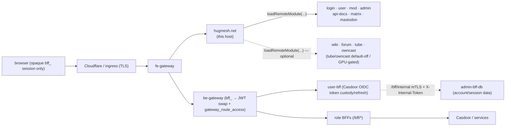

The **native-federation HOST shell** for a HugMesh brand. This Angular 22
single-page app is the user-facing front door behind the gateway: it owns the
chrome (header / menu / footer / background, the accessible skip-link and the
shared profile modal), the authgate, the universal navigation, and the
role-home routing. It **exposes nothing** of its own feature surface — every
page under it is a separate repo loaded at runtime as a **native-federation
remote**. ✅ On `main` it mounts **eleven** remotes via the data-driven
`REMOTE_ROUTES` table: login, user, mod, admin, api-docs, matrix, mastodon, plus
the **optional** services wiki, forum, tube and owncast (tube/owncast are
default-off and GPU-gated; all four grey out via federation install-state when
absent).

In the platform's two service tiers this sits in the **architecture tier**
(core, always present) alongside the gateways, Casdoor + PKI, and the
federation API. Each brand/domain runs its **own instance** of this host (one
container image, one nginx) wired to that brand's gateway, Casdoor issuer and
remotes.

---

## Current State

✅ Shipped on `main` today:

- **Eleven remotes** mounted via the data-driven `REMOTE_ROUTES` table — seven
  core (login/user/mod/admin/api-docs/matrix/mastodon) always present, four
  optional (wiki/forum/tube/owncast) that grey out via federation install-state
  when the service is absent.
- **Dynamic-first federation** — `resolveFederationSource()` reads the DB-driven
  manifest `GET /api/federation/manifest` and unions it over the bundled static
  floor, falling back to the static manifest on any failure so the shell always
  boots (PR #78).
- **Authgate + role-home routing + universal nav + profile modal**, plus the
  **home announcements banner** (sandboxed `srcdoc` iframe, dismiss-once),
  **capabilities / graceful-degrade** install-state grey-out, the **home-services
  launcher**, the **account-status appeal-gate** banner, and the **notification
  bell** with an unread-count badge in the menu's account region (PR #101), plus
  a **real-time SSE notification toast** consuming
  `/bff/user/notifications/events` for push delivery alongside the bell's poll.
- A single `bearerInterceptor` Bearer/credentials seam and an accessibility
  baseline (skip-link, ARIA menubar, modal-dialog contract).
- **HTTP security headers + strong nonce-CSP** on the SPA's nginx (PR #100, PR
  #110) — emitted with `always` so they cover error responses too:
  `X-Content-Type-Options: nosniff`, `X-Frame-Options: DENY`,
  `Referrer-Policy: strict-origin-when-cross-origin`, HSTS
  (`max-age=31536000; includeSubDomains`), and a strict nonce-based
  `Content-Security-Policy` (`script-src 'self' 'nonce-$cspnonce' blob:`, no
  `'unsafe-inline'`/`'unsafe-hashes'`) — `angular.json`'s prod build disables
  `inlineCritical` so no inline `<style>`/`onload=` critical-CSS preloader ships,
  and `nginx.conf` rewrites every `<script` tag with a fresh per-request nonce
  (`sub_filter`) that es-module-shims propagates onto the dynamic remote-entry
  scripts it injects, so module-federation bootstrap keeps working under the
  strict policy. `style-src` still keeps `'unsafe-inline'` (Angular's inline
  component styles); COEP/COOP/CORP and a stricter Permissions-Policy remain
  deferred.
- ✅ **Real-time notification toast** — `NotificationToastService` opens a
  cookie-auth SSE stream to `/bff/user/notifications/events` (authenticated
  users only, via `effect()` in `AppComponent`). Up to 3 toast cards appear at
  fixed bottom-right, each auto-dismissed after 4 s, with `aria-live="polite"`
  region. Uses native `fetch({credentials:'include'})+ReadableStream+TextDecoder`
  (not `EventSource`) so the HttpOnly `bff_` session cookie is sent — the
  browser holds no bearer token at all post-cookie-migration (PR #104).
  **Bug fix (notifications-v1):** the SSE line parser originally required an
  exact `"data: "` prefix (with a space); Spring WebFlux's
  `ServerSentEventHttpMessageWriter` (verified against the exact
  `spring-web-7.0.8.jar` user-bff-api ships) actually emits `data:` with **no**
  space before the JSON payload, so the toast never fired against a live
  user-bff despite reading as fully shipped. Now parses SSE fields per spec
  (split on first colon, strip at most one optional leading space).
- ✅ **Session hydrate-on-bootstrap** (PR #143) — `SessionService.hydrate()` GETs
  the authoritative `/bff/session` on construction and again on every
  same-document `snap-session-change` broadcast, refreshing the **in-memory**
  session signal only (never the `localStorage` mirror, never a rebroadcast —
  login-ui owns the persisted mirror; a host write would ping-pong). This closes
  the gap where a role granted/revoked **mid-session** — or a true cookie-only
  session with no mirror at all — wouldn't show up in the host's nav/guards
  until a re-login. Any hydrate failure (network error, non-2xx incl. `401`, an
  unusable body) falls back to the existing `localStorage` read, so an
  e2e/mock-stack-seeded session is never clobbered.
- ✅ **Games entry-point + derived Games Admin** (Phase 8/10, PR #120) — `/games`
  and `/games/admin` are host-owned, **guarded local placeholder** routes, not
  yet federated remotes: `gamesGuard` admits any `ROLE_GAMES` holder (plus
  admin/superadmin) to the entry-point; `gamesAdminGuard` admits only the
  **derived** `ROLE_GAMES_ADMIN` tier (`ROLE_GAMES ∩ (ROLE_ADMIN ∪ ROLE_MOD)`,
  plus superadmin) to the admin console — a bare `ROLE_GAMES` or a bare
  `ROLE_ADMIN` alone does not earn it. Both routes render an honest `TODO`
  placeholder (`GamesPlaceholderComponent` / `GamesAdminPlaceholderComponent`)
  rather than faking a working surface, and both are wired into the menu's
  profile dropdown ("Games Admin") and the home-services launcher (`games` /
  `games-admin` cards, install-state-gated on the shared `games` capability
  slug). No `hugmesh-games-ui` remote exists yet — see Roadmap.

**Auth model (current).** The browser never holds a Casdoor JWT, and Casdoor is
**internal-only** — it never redirects the browser. login-ui presents a **native
username/password (+MFA) form** that POSTs to the public **`/bff/login`** route;
**user-bff** drives the PKCE/state and the internal Casdoor code→token exchange
server-side and holds per-session JWT custody + refresh. What lands in the
browser is an **HttpOnly `bff_`-prefixed session cookie**; the `SnapSession`
object the host persists under the `hug.session` key (`id`, `label`,
`provider`, `roles`, `registrationComplete`, `status`) carries identity/role
claims only — it never carries a token. The gateway is a **pure Casdoor-JWT
OAuth2 resource server**: a pre-security exchange filter swaps the `bff_`
session cookie → the internal custody JWT so the gateway's JWT validation +
role gate run unchanged. Authorization is data-driven by the
**`gateway_route_access` Postgres table** (source of truth) via
`GatewayRouteAccessFilter` — `ADMIN`/`GAME-MASTER` bypass within their own domain,
`SUPERADMIN` cross-domain. Login / session / account logic is being **relocated
from admin-bff to user-bff**, with the shared account/session/MFA/Casdoor-admin
infra extracted into the new **hugmesh-auth-core** artifact; account/session
**data** stays in admin-bff-db (user-bff reaches it via admin-bff `/bff/internal`
over mTLS + `X-Internal-Token`). Cloudflare fronts prod.

From this host's point of view that means: the persisted `hug.session` that
`SessionService` reads is an identity/role projection, **not** a token — it must
never be treated as, or decoded as, a JWT, and it carries no bearer value at all.
`bearerInterceptor` sets `withCredentials: true` on every request so the HttpOnly
`bff_` session cookie rides along automatically; the gateway exchanges that
cookie for the custody JWT server-side, so the browser never holds (nor sends) a
bearer token. (The interceptor's name is a holdover from an earlier
localStorage-token design; httpOnly-cookie custody is the shipped model.)

**Ecosystem baseline.** The Java services this host talks to (gateways, federation
API, role BFFs) run **Spring Boot 4.0.7 / Spring Cloud 2025.1.2** on **Java 25 LTS**,
built on the shared Maven artifacts `hugmesh-parent` (metapom 2.8.0),
`hugmesh-commons` (2.1.0) and `hugmesh-auth-core` (2.4.0, consumed by
user-bff + admin-bff). Spring Cloud
Gateway 5.0 moved route config to `spring.cloud.gateway.server.webflux.routes`
(the legacy `spring.cloud.gateway.routes` prefix silently binds nothing); all
gateways + generator route templates were corrected, so the prod federation
manifest's gateway-served remote paths bind as intended.

### Known gaps

- **`/about` and `/home` are unreachable from the UI.** Both are real, public,
  unguarded routes (`src/app/about/`, `src/app/home/`) and build/render fine,
  but no nav link anywhere points at either — the menu's "Home" entry routes to
  `/` (the authgate/role-home redirect), not `/home`, and nothing links `/about`
  at all; both are reachable only by typing the URL directly. `AboutComponent`
  now renders real HugMesh platform copy (the old "Example Question?" /
  "Example Paragraph" placeholder text is gone); only the missing-nav-link part
  of this gap remains, which is a product/content call (wiring a visible link
  is a separate decision from the copy itself), not an engineering gap — see
  the NOTE left in `about.component.ts`.

---

## What it is

- **Stack:** Angular 22 standalone components + signals, `@angular-architects/native-federation`
  (`@softarc/native-federation-node`), Bootstrap 5, and a theme-driven animated
  CSS-gradient backdrop (`src/app/background/` — pure CSS by default; it reads
  the runtime `--sd-*` theme tokens and falls back to the shipped pastels).
  The backdrop also consumes the cross-repo **`--sd-bg-effect`** theme token
  (shared with hugmesh-login-ui, whose README "Theme-declared effect" section
  is the contract's home): `gradient` (default — the animated wash) | `none`
  (the wash at rest — this shell's "flat") | `vanta-fog|waves|net|globe`
  (a bundled, lazily-loaded Vanta/three.js WebGL effect; destroyed on switch
  and unmount, never started under `prefers-reduced-motion` or without WebGL,
  and any unknown value degrades to `gradient`). Vanta + three.js are
  self-hosted package dependencies (the nonce'd CSP forbids CDN scripts) and
  are skipped from the federation shared surface so they stay in their own
  lazy chunks (`federation.config.js`).
  Built to a static bundle and served by nginx (`Dockerfile`, `nginx.conf`) or
  by the tiny Express fallback (`server.js`).
- **Role:** the federation **host/consumer** only. `federation.config.js` (via
  the shared `federation-base.js` helper) declares the host with **no `exposes`
  block** — it solely `loadRemoteModule(...)`s the remotes named in
  `src/assets/federation.manifest.json`. The shared-deps surface (Angular +
  RxJS singletons, `strictVersion`, the RxJS skip list) lives in
  `federation-base.js` so the host and remotes can't drift into a
  "shared is not a function" runtime break.
- **Boot order:** ✅ `src/main.ts` resolves the federation source **dynamic-first
  with a static floor** before Angular bootstraps in `src/bootstrap.ts`.
  `resolveFederationSource()` (`src/app/federation/federation-bootstrap.ts`) first
  fetches the DB-driven manifest `GET /api/federation/manifest` (federation-api,
  the `federation_modules` table) — always sending `credentials: 'include'` (the
  HttpOnly `bff_` session cookie rides along automatically when present, so an
  authenticated reload gets its domain/visibility-scoped overlay; this runs
  pre-DI, before `bearerInterceptor`/`HttpClient` exist, so no `Authorization`
  header is set here). On success it returns the **union** of the
  bundled static manifest (the build-time floor — every baked remote) and the
  dynamic overlay (overrides matching slugs, adds new ones), so a successful read
  is never strictly worse than the static build. On **any** failure — the `401` an
  anonymous pre-login caller gets from the `authenticated()` endpoint, or
  network/5xx/parse/empty — it falls back to the **bundled static manifest**
  (`src/assets/federation.manifest{,.prod}.json`) so the shell always boots. The
  resolved value is fed to `initFederation(...)`, which maps each remote name →
  `remoteEntry.json` before bootstrap. Routing is **path-based** (no hash) so the
  host's paths line up with the fe-gateway prefixes and each remote's nginx.

The host keeps the original static marketing pages (`/home`, `/about`) as
public, unguarded routes; everything else is federated and gated.

---

## Where it sits — gateway, Casdoor, federation, multi-tenancy



The seven core remotes (login/user/mod/admin/api-docs/matrix/mastodon) are always
mounted; the four optional remotes (wiki/forum/tube/owncast, dashed) are mounted
but **greyed-out via federation install-state** when the service is not deployed —
see *Capabilities / graceful degrade* below.

- **Gateways:** the host is the fe-gateway `/**` catch-all upstream. Its in-app
  paths (`/login`, `/social/matrix`, `/social/mastodon`, `/admin`, `/mod`,
  `/user`, `/admin/docs`) mirror the gateway path prefixes, and the **prod**
  federation manifest (`federation.manifest.prod.json`) points each remote at
  those same gateway-served paths (`/login/remoteEntry.json`, …). The be-gateway
  is a pure Casdoor-JWT resource server: a pre-security filter swaps the opaque
  `bff_` session reference → the internal custody JWT, and `GatewayRouteAccessFilter`
  enforces the data-driven `gateway_route_access` table.
- **Casdoor / session:** the host does **not** speak OAuth itself, and **never
  holds a Casdoor JWT**. The login remote presents a **native username/password
  (+MFA) form** that POSTs to the public `/bff/login` route — there is no
  browser-side redirect to Casdoor; **user-bff** drives the PKCE/state and the
  internal Casdoor code→token exchange server-side and owns per-session JWT
  custody/refresh. What lands in the browser is an **HttpOnly `bff_`-prefixed
  session cookie**, plus the canonical `hug.session` object (`localStorage`)
  carrying identity/role claims only — `id`, `label`, `provider`, `roles`,
  `registrationComplete`, `status` (**no token field**: `SnapSession` never
  carries a `bffToken`, `matrix` or `mastodon` handle); `SessionService`
  (`src/app/session.service.ts`) reads it, seeded synchronously from that
  mirror (no anonymous flash) then confirmed/refreshed via
  `hydrate()` — a cookie-carrying `GET /bff/session` fired on bootstrap and
  again on every same-document `snap-session-change` broadcast, so a role
  granted/revoked **mid-session** is picked up without a re-login (PR #143).
  `hydrate()` updates the in-memory signal only — it never writes the
  `localStorage` mirror and never broadcasts (login-ui owns the persisted
  mirror) — and falls back to the last mirror read on any failure (network
  error, non-2xx incl. `401`, unusable body). A cross-**tab** `storage` event
  (a sibling tab already hydrated and wrote the mirror) just re-reads the
  mirror directly, no extra round-trip. This is how the login remote
  finishing registration immediately unlocks the host's social nav. ✅ For its
  typed calls the host wires `provideHttpClient` + a single `bearerInterceptor`
  (`src/app/http/bearer.interceptor.ts`): it sets `withCredentials: true` on
  **every** request so the HttpOnly `bff_` session cookie rides along; it does
  **not** attach an `Authorization` header — the gateway exchanges that cookie
  for the custody JWT server-side. This is the host's single **HttpClient**
  credentials seam; a handful of raw-`fetch()` call sites keep their own
  `credentials: 'include'` instead — announcements, `SessionService.hydrate()`,
  `NotificationToastService` (SSE needs a raw `fetch()`+`ReadableStream`, not
  `EventSource`), and the pre-DI federation bootstrap (runs before this
  interceptor exists). (The interceptor's name is a holdover from an earlier
  localStorage-bearer design; httpOnly-cookie custody is the shipped model.)
- **Federation:** ✅ routes are loaded from remotes via `loadRemoteModule` —
  see `REMOTE_ROUTES` in `src/app/app.routes.ts`, the single declarative table
  of `path → remote name → exposed module → exported routes constant → guard`.
  The role-home remotes expose `./routes`; the wiki/tube/owncast remotes expose
  `./Wiki` / `./Tube` / `./Owncast` respectively.
- **Multi-tenancy:** this repo is brand-agnostic. Per-brand instances are
  provisioned from a handlebars-rendered repo (ArgoCD-reconciled), each pointed
  at its own gateway / Casdoor issuer / remote manifest. Domain scoping is
  enforced at the gateway and the role BFFs (issuer-keyed `DOMAIN_<x>`); the
  host only renders the role-gated chrome for the brand it was deployed into.

---

## Routes, role-gates and remotes

Routing is data-driven from `REMOTE_ROUTES` in `src/app/app.routes.ts`. Each
feature path is its own repo + nginx, mounted via `loadChildren →
loadRemoteModule(remote, './routes')`. Two further paths (`/games`,
`/games/admin`) are host-owned **local placeholder** routes, not federated
remotes — see the note below the table.

| Path | Remote | Guard | Gate |
|---|---|---|---|
| `/login` | `login` (`hugmesh-login-ui`) | — | public (native username/password (+MFA) login + registration flow — POSTs to `/bff/login`; Casdoor is internal-only, no browser redirect) |
| `/user` | `user` (`hugmesh-user-ui`) | `userGuard` | any authenticated identity (the USER role-home; also exposes `./profile`) |
| `/mod` | `mod` (`hugmesh-mod-ui`) | `modGuard` | Casdoor `mod` role |
| `/admin` | `admin` (`hugmesh-admin-ui`) | `adminGuard` | Casdoor `admin` role |
| `/admin/docs` | `apidocs` (`hugmesh-api-docs`) | `adminGuard` | admin-only OpenAPI/API-docs console (listed **before** `/admin` so the more specific path wins) |
| `/social/matrix` | `matrix` (`hugmesh-matrix-ui`) | `registeredGuard` | requires full registration |
| `/social/mastodon` | `mastodon` (`hugmesh-mastodon-ui`) | `registeredGuard` | requires full registration |
| `/social/forum` | `forum` (`hugmesh-forum-ui`) | `forumGuard` | any authenticated identity — reuses our native federated identity directly, so (unlike matrix/mastodon) no per-service registration is required |
| `/wiki` | `wiki` (`hugmesh-wiki-ui`, exposes `./Wiki`) | `wikiGuard` | optional service; `admin`/`superadmin`, or `mod` + per-service `ROLE_WIKI` |
| `/tube` | `tube` (`hugmesh-tube-ui`, exposes `./Tube`) | `tubeGuard` | optional, default-off, GPU-gated; `admin`/`superadmin`, or any holder of `ROLE_TUBE` |
| `/owncast` | `owncast` (`hugmesh-owncast-ui`, exposes `./Owncast`) | `owncastGuard` | optional, default-off, GPU-gated; `admin`/`superadmin`, or any holder of `ROLE_OWNCAST` (mods with `ROLE_OWNCAST` reach the moderation view) |
| `/games` | — (local `GamesPlaceholderComponent`, no remote yet) | `gamesGuard` | any holder of `ROLE_GAMES` (plus `admin`/`superadmin`); renders an honest `TODO` placeholder, never a faked games surface |
| `/games/admin` | — (local `GamesAdminPlaceholderComponent`, no remote yet) | `gamesAdminGuard` | derived `ROLE_GAMES_ADMIN` (`ROLE_GAMES ∩ (ROLE_ADMIN ∪ ROLE_MOD)`, plus `superadmin`) |

`/games` and `/games/admin` predate a `hugmesh-games-ui` remote (Phase 8/10,
PR #120) — they're real, guarded, tested routes in this host's own bundle
(mirroring the `ModPlaceholderComponent` precedent used for `/mod` before
`hugmesh-mod-ui` landed), not federation mounts. When the games remote
ships, swap each `loadComponent` for a `loadChildren → loadRemoteModule('games', …)`
entry and add `games` to the federation manifest — see the `TODO(games-ui)` /
`TODO(games-admin-ui)` comments at each placeholder component.

Guards live in `src/app/guards/` and read `SessionService`:

- **`roleHomeGuard`** — the default `''` route is a pure **authgate + role
  redirect**, no component of its own: anonymous → `/login`, otherwise → the
  signed-in user's role-home (`/admin` ▸ `/mod` ▸ `/user`). Role precedence
  `admin > mod > user` is computed in `SessionService.role()`.
- **`adminGuard` / `modGuard`** — gate `/admin` (+ `/admin/docs`) and `/mod` on
  the matching Casdoor role; everyone else is bounced to `/login`.
- **`userGuard`** — every authenticated identity is a baseline `ROLE_USER`, so
  this only blocks anonymous visitors.
- **`registeredGuard`** — Matrix/Mastodon are usable only after the login
  remote mints the per-service tokens (`registrationComplete === true`).
- **`forumGuard`** — gates `/social/forum` on any **authenticated** identity
  (not `registeredGuard`): the forum reuses our native federated identity
  directly, so there is no per-service registration step to complete first —
  matching the home-services `forum` card (slug-gated only, no
  `requiresRegistration` / `requiresRole`).
- **`wikiGuard`** — admits `admin`/`superadmin`, or a `mod` who also holds the
  per-service `ROLE_WIKI`; everyone else is bounced to `/login`. The wiki
  remote's own child guards then enforce the per-view `WIKI_READ`/`WRITE`/`MANAGE`
  boundary, and the BFF (`/bff/wiki/**` → `ROLE_WIKI`) is the real authorization.
- **`tubeGuard`** — admits `admin`/`superadmin`, or any identity holding
  `ROLE_TUBE` (a plain user with `ROLE_TUBE` can connect Google and browse their
  downloads). Backed by `/bff/tube/**` → `ROLE_TUBE` (admin routes
  `ADMIN`/`SUPERADMIN`).
- **`owncastGuard`** — admits `admin`/`superadmin`, or any identity holding
  `ROLE_OWNCAST` (a streamer reaches their own console; a `mod` with `ROLE_OWNCAST`
  reaches the moderation view). Backed by `/bff/owncast/**` → `ROLE_OWNCAST`
  (admin routes `ADMIN`/`SUPERADMIN`).
- **`gamesGuard`** (Phase 8) — admits `admin`/`superadmin`, or any identity
  holding `ROLE_GAMES` (the entry-point tier only — it does **not** admit games
  admin, see `gamesAdminGuard`). A bare `mod` without `ROLE_GAMES` is not
  admitted. Gates the local `/games` placeholder route.
- **`gamesAdminGuard`** (Phase 8/10) — admits `superadmin` unconditionally, or
  the **derived** `ROLE_GAMES_ADMIN` tier computed client-side as
  `ROLE_GAMES ∩ (ROLE_ADMIN ∪ ROLE_MOD)` (mirroring the server-computed role
  materialized by `games-admin-sync-job`). A bare `ROLE_GAMES` or a bare
  `ROLE_ADMIN`/`ROLE_MOD` alone does **not** earn it. Gates the local
  `/games/admin` placeholder route. Unlike every other guard here, `gamesGuard`
  and `gamesAdminGuard` don't go through the shared `roleGuard` factory
  (`src/app/guards/role-guard.factory.ts`) — each inlines its own predicate —
  though the redirect contract (allow, or a `/login` `UrlTree`) is identical.

Client-side guards are UX only; the gateway's `gateway_route_access` table +
`GatewayRouteAccessFilter` and each BFF's role checks are the real authorization
boundary.

The **menu** (`src/app/menu/menu.component.ts`) mirrors these gates in the
chrome: a universal `Home | Mastodon | Matrix` menubar (Mastodon/Matrix
visible-but-disabled until fully registered) plus a profile dropdown whose
**Admin**, **API docs** and **Moderation** entries show only for the matching
role. The **profile modal** (`src/app/profile-modal/`) lazy-loads the user
remote's `./profile` editor via `loadRemoteModule('user', './profile')` and
applies the locked accessible-dialog contract (focus move/restore, focus trap,
Escape/backdrop dismiss).

---

## Host-owned features

Almost everything is delegated to remotes; the host shell itself owns only the
cross-cutting surface:

- **Authgate + role-home routing + universal nav + profile modal** (above).
- **Home announcements banner** (`src/app/announcements/`) — the logged-in home
  top banner. `AnnouncementsService` GETs the same-origin admin-bff endpoint
  **`/bff/announcements/home`** (routed `/bff/*` → BFF by the id-gateway, with
  the opaque `bff_` session cookie/Bearer), renders only active, home-targeted
  announcements in server-supplied priority order, and supports **dismiss-once**
  (persisted to `localStorage`). Each announcement's server-sanitized `body_html`
  is rendered inside a **sandboxed null-origin `srcdoc` iframe** (no
  `allow-scripts`, no `allow-same-origin`) as a second line of defence — never
  via raw `innerHTML`. The banner is a labelled `aria-live="polite"` region.
- **Capabilities / graceful degrade** ✅ — `CapabilitiesService`
  (`src/app/capabilities/`) reads the **public** install-state endpoint
  `GET /api/federation/capabilities` (works anonymously; an unknown/failed read
  reports "nothing installed" rather than a dead link). The single predicate
  `installed(slug)` is consumed by the menu and the home-services cards so that
  absent/disabled **optional** services (matrix/mastodon/forum/games/tube/owncast/
  wiki) are **greyed-out with explain-why helptext**, never silently hidden.
- **Home-services launcher** ✅ (`src/app/home-services/`) — a data-driven,
  role + install-state-gated launcher-card grid mounted on the home page
  (`<div home-services>`). The `CARD_CATALOG` covers the optional services
  matrix/mastodon/forum/games/tube/owncast (slug-gated) plus the core role-homes
  admin/mod (role-gated). Each card carries one of four `CardState` kinds, each
  with accessible helptext: `enabled` (a real link), `absent` (optional service
  not installed on this deployment), `role` (a role-gated card the principal
  lacks — "sign in as …"), and `registration` (an installed social service not
  yet fully registered — "complete your registration"). Note: unlike tube/owncast's
  own route guards (which additionally require the per-service ROLE_TUBE /
  ROLE_OWNCAST grant), these two cards are slug-gated only — they render
  `enabled` for any signed-in, registered user regardless of that role grant,
  so a click can still land on a role-gated redirect at the destination route.
- **Account-status appeal-gate** ✅ (`src/app/account-status/`) — the
  `StatusGateComponent` (mounted in `app.component.html`) reads `GET /bff/me`
  via `AccountStatusService` and renders an assertive `role="alert"` banner
  **only** when the caller's own status is `suspended`/`banned` (it **fails open**
  to active on any error). The banner deep-links the appeal page
  (`APPEAL_ROUTE = '/login/appeal'`, with `?reason=<text>` when an audit reason
  was recorded) — the login-ui `appeal` child route + `AppealComponent` are
  **shipped** on the login remote, rendering appeal instructions + a `mailto:`
  resolved from the permitAll admin-bff `GET /bff/public/appeal-contact`.
  `AccountStatusService` also syncs the `/bff/me` status into the shared
  `snap.session` (`SnapSession.status`), and `roleHomeGuard` short-circuits a
  suspended/banned session to `/login/appeal` BEFORE the role-home redirect.
- **Notification bell** ✅ (`src/app/bell/`) — the menu's account region shows a
  bell button (authenticated users only) with an unread-count badge.
  `BellNotificationsService` polls the same-origin BFF endpoint
  **`/bff/user/notifications`** every 60 s (from `timer(0, 60_000)`, fail-soft to
  an empty list on any error) and exposes `unreadCount$`; the badge renders only
  when there are unread items (capped at `99+`) and carries a visually-hidden
  accessible count. Polling starts/stops with the login state via an `effect()`,
  and clicking the bell navigates to `/user/notifications` on the user remote.
- **Real-time notification toast (SSE)** ✅ (`src/app/notification-toast.service.ts`,
  `src/app/notification-toast.component.ts`) — mounted alongside the bell in
  `app.component.html`/`.ts`, `NotificationToastService` opens a cookie-auth
  (`credentials: 'include'`) server-sent-events stream to
  **`/bff/user/notifications/events`** when logged in (via an `effect()` watching
  `session.loggedIn()`) and renders a capped (3), auto-dismissing (4 s),
  `aria-live="polite"` toast queue as each `data:` frame arrives. Uses native
  `fetch()`+`ReadableStream`+`TextDecoder` rather than `EventSource` — the
  HttpOnly `bff_` session cookie is what authenticates, and `EventSource` offers
  no way to guarantee `credentials: 'include'` semantics consistent with this
  app's other `/bff/**` calls. It reconnects with a fixed 5 s backoff when the
  server closes the stream (e.g. the SSE idle timeout), and stops cleanly with
  no reconnect on a non-2xx response, an abort, or a network error. SSE line
  parsing is spec-compliant (splits on the first colon, strips at most one
  optional leading space) — **not** an exact `"data: "` prefix match, which
  would silently miss every real event Spring's `ServerSentEventHttpMessageWriter`
  emits (no space before the payload).
- **Accessibility baseline** — a skip-link that moves focus (not just scroll)
  to `#maincontent` per WCAG 2.4.1, the WAI-ARIA menubar roving-tabindex
  pattern, and the modal dialog contract above.

---

## Build, deploy, CI

- **Local dev:** `npm run start-dev` (`ng serve`). The dev federation manifest
  (`federation.manifest.json`) points each remote at a `localhost:420x` port;
  run the remotes you need alongside the host.
- **Full stack:** `docker compose up -d` brings up the
  **hugmesh-id-gateway** (Spring Cloud Gateway 5 — Casdoor-JWT OAuth2
  resource server with the `bff_` → custody-JWT pre-security swap and the
  `gateway_route_access` route gate) in front of this frontend, plus **Casdoor**
  (issuer) and the gateway's backing store for its revocation / URL-registry /
  resource-access state. The frontend is not exposed directly — the gateway is
  the public entry point. See
  [`docs/platform-topology.md`](docs/platform-topology.md).
- **Container:** multi-stage `Dockerfile` builds the prod bundle and serves it
  from `nginxinc/nginx-unprivileged` on `:8080` with SPA `try_files` fallback,
  the strong nonce-CSP + baseline HTTP security headers from `nginx.conf`
  (nosniff / `X-Frame-Options: DENY` / `Referrer-Policy` / HSTS, all `always`).
- **CI:** GitLab (`.gitlab-ci.yml`) — the GitHub repo is pull-mirrored into the
  in-cluster GitLab, which builds + pushes this service's image to the
  in-cluster registry on push of the default branch / a tag. **No keys ship in
  the image** — key material is supplied from the operator key-USB at first
  boot. The image build/deploy pipeline itself stays on GitLab as above, but
  this repo also runs a real **GitHub Actions** workflow now:
  [`.github/workflows/coverage.yml`](.github/workflows/coverage.yml) ("Code
  Coverage") runs `npm run-script coverage` on push/PR to `main`/`release/*`
  and publishes JUnit results via `EnricoMi/publish-unit-test-result-action`.

| Script | What |
|---|---|
| `npm run start-dev` | `ng serve` dev server |
| `npm run build` | production bundle (`public/hugmesh.net/browser`) |
| `npm test` / `npm run coverage` | Karma/Jasmine unit tests (+ coverage) |
| `npm run e2e` | Nightwatch e2e (role authgate / nav / profile-modal suites) |
| `npm run dockerBuild` / `dockerRun` | build + run the container image |

---

## Layout

```
src/app/
  app.routes.ts            REMOTE_ROUTES table (11 remotes) + authgate/role-home + federationLoader
  session.service.ts       hug.session reader (id/roles/registrationComplete/status — identity claims, no token field); role precedence (admin>mod>user) + registration gate
  guards/                  roleHome · admin · mod · user · registration · wiki · tube · owncast
  federation/federation-bootstrap.ts  dynamic-first /api/federation/manifest + static-floor union/fallback
  http/bearer.interceptor.ts          withCredentials always, no Authorization header (HttpOnly bff_ cookie seam; gateway swaps cookie → JWT server-side)
  capabilities/            CapabilitiesService — public /api/federation/capabilities install-state (grey-out)
  home-services/           data-driven launcher-card catalog (CardState: enabled/absent/role/registration)
  account-status/          StatusGateComponent — /bff/me suspended/banned appeal-gate banner (fail-open)
  bell/                    BellNotificationsService — /bff/user/notifications 60s poll → unread-count badge
  notification-toast.service.ts / .component.ts   NotificationToastService — cookie-auth SSE /bff/user/notifications/events, capped (3) auto-dismiss (4s) aria-live toast queue
  menu/                    universal nav + role-gated profile dropdown (a11y menubar) + notification bell
  profile-modal/           host modal mounting the user remote's ./profile editor
  announcements/           /bff/announcements/home banner (sandboxed srcdoc, dismiss-once)
  header/ footer/ background/ home/ about/   chrome + public marketing pages
src/main.ts                resolveFederationSource() → initFederation(source) → ./bootstrap
src/assets/federation.manifest{,.prod}.json  static FLOOR + fallback (remote name → remoteEntry URL)
federation.config.js + federation-base.js    host federation config (consumer; shared-deps surface)
```

## Related repos

Gateways `hugmesh-gateway` / `hugmesh-pki-gateway` (Casdoor-JWT resource
servers, `bff_` → JWT swap + `gateway_route_access`) · identity **Casdoor** ·
federation `hugmesh-federation-api` + `hugmesh-remote-fragment` · the
remotes `hugmesh-{login,user,mod,admin}-ui`, `hugmesh-{matrix,mastodon,forum}-ui`,
`hugmesh-{wiki,tube,owncast}-ui`, `hugmesh-api-docs` · role BFFs
`hugmesh-{user,mod,admin,wiki}-bff-api` (**user-bff** owns the Casdoor OIDC
code→token exchange + per-session JWT custody/refresh; login/session/account
logic is being relocated admin-bff → user-bff) · shared Maven artifacts
`hugmesh-parent` (metapom), `hugmesh-commons`, **`hugmesh-auth-core`**
(shared account/session/MFA/Casdoor-admin infra) · cross-realm sync
`hugmesh-actions`.

---

## Roadmap (planned / in-flight — NOT yet shipped)

These items are designed or in-flight at the platform level and would surface
through this host shell when they land. They are **not** in the code on `main`
today.

- 🚧 **SSO end-to-end live + e2e (in progress).** The native `POST /bff/login` →
  user-bff-driven PKCE/token-custody → opaque `bff_` session cookie → gateway
  cookie→JWT-swap flow is the canonical model (Casdoor is internal-only and never
  redirects the browser); wiring it live end-to-end (incl. an e2e suite that
  exercises a real SSO login through this host) is in progress.
- 🔭 **Casdoor MFA (design-done, 9-PR plan).** WebAuthn + TOTP + recovery with
  per-role defaults, `amr`/`acr` → `MFA_SATISFIED` and
  `gateway_route_access.mfa_required` (fail-closed) + BFF-driven step-up. This
  host would gain a future BFF-driven MFA challenge surface and step-up prompts
  for sudo / SSH-via-UI / superadmin ops. **No MFA challenge flow exists in the
  host today.**
- 🚧 **Notifications — external channels (in-flight).** Matrix DM / Akkoma feed /
  phpBB / email adapters on top of the shipped in-app MVP. The host currently
  surfaces in-app notifications via the announcements banner and the menu
  notification bell (`/bff/user/notifications` unread-count badge);
  external-channel prefs/silencing are future.
- 🚧 **Workload Console (in-flight).** A podman/OpenShift-like
  pod-management + live-log + exec federated admin-ui module that would appear as
  a future remote/route resolved through this host's dynamic manifest. **Not in
  `REMOTE_ROUTES` today.**
- 🔭 **Desktop app governance (design + queued).** SSO-enforced sudo + admin-curated
  Plasma Discover store + user install-requests + in-UI SSH terminal; any
  host-side launcher entry is future.
- 🔭 **Encrypted versioned backups (design + queued).** Per-domain + superadmin
  Velero + kopia/restic backups with step-up-gated restore.
- 🔭 **Egress VPN / per-node attached storage / device-license registry
  (design + queued).** WireGuard/OpenVPN .conf drop-in egress; admin-attached
  per-node storage; per-device SSH operate-licenses.
- 🔭 **A/V via coturn / TURN.** Matrix/Owncast audio-video is currently LAN-only
  (no TURN/SFU); a coturn relay optional-service is roadmap.
- 🚧 **Superadmin app-store — TAILNET-ONLY federated remotes.** The data layer is
  on `main` (in the admin-bff); the infra legs are in-flight. Future app-store
  remotes would be registered in the federation registry and resolved by this
  host's **dynamic manifest TAILNET-ONLY** (off the public UI). The
  dynamic-manifest mechanism is the shipped delivery path; the app-store remotes
  themselves are roadmap.
- ✅ **OWASP pen-test in CI (shipped).** `.gitlab-ci.yml` runs `pentest:sca` and
  `pentest:dast` jobs (`allow_failure: true`, on default-branch pushes and MRs)
  that `extend:` the centralized hidden `.pentest-sca` / `.pentest-dast-baseline`
  jobs included from `hugmesh/hugmesh-generator`
  `/tests/pentest/ci/pentest-stage.gitlab-ci.yml`.
- 🔭 **Binhost fleet auto-update.** Gentoo binhost-driven fleet distribution is
  still platform roadmap.
