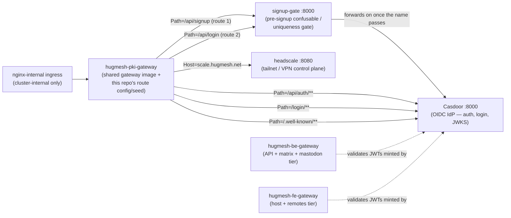

The front door of the **identity tier**. It is the per-node-type instance of the
HugMesh Spring Cloud Gateway, and it fronts Casdoor (auth, login, OIDC) and
headscale (the VPN/tailnet control plane). It is internal-only (ingress class
`nginx-internal`), never internet-facing, and it validates the internal Casdoor
JWT. No external login is exposed.

It is **the same image and code as
[hugmesh-gateway](https://github.com/hugmesh/hugmesh-gateway)**, and it holds no
logic of its own. Like its [be-](https://github.com/hugmesh/hugmesh-be-gateway)
and [fe-gateway](https://github.com/hugmesh/hugmesh-fe-gateway) siblings, this
repo is a **thin overlay**. Only three things differ: the
`SPRING_APPLICATION_NAME`, the route set (`application-pki.yml`, mirrored by a
Liquibase seed), and the downstream URIs. The image builds `FROM` the shared
gateway image, so every device runs the same audited code: the same security
filter chain, RBAC, domain-scoping converter, and Cassandra-cached revocation,
route-access and URL registry.

```bash
# bases off the sibling hugmesh-gateway image (GATEWAY_IMAGE build-arg)
docker build -t hugmesh-systems/pki-gateway:dev .
```

## Tier & namespace

| | |
|---|---|
| **Tier** | identity / PKI |
| **Namespace** | `hugmesh-pki` (downstreams resolve at `*.hugmesh-pki.svc.cluster.local`) |
| **`SPRING_APPLICATION_NAME`** | `hugmesh-pki-gateway` (set in the `Dockerfile`; selects this instance's route-access rows) |
| **Listen port** | `8080` (the gateway itself, `EXPOSE`d in the `Dockerfile`); downstreams are Casdoor `:8000` and headscale `:8080` |
| **Ingress** | `nginx-internal` — cluster-internal only, never internet-facing |
| **Sibling gateways** | `hugmesh-be-gateway` (API + matrix + mastodon), `hugmesh-fe-gateway` (host + remotes) |

## What it routes

The route table is config-driven (`application-pki.yml`, mirrored into the
`gateway_routes` Liquibase seed). The cluster reads neither file. It renders the
same six routes from the generator Application (see
[Source of truth](#source-of-truth)). All six routes go to identity-tier
downstreams in the `hugmesh-pki` namespace, and they match the deployed
generator Application one-for-one **in order**. Route order decides which
predicate wins, so the two `signup-gate` routes come first:



*Solid arrows are this gateway's own routes. Dashed arrows show why the sibling
gateways depend on the Casdoor this gateway fronts: they validate the JWTs it
mints (see [How it relates](#how-it-relates-to-the-gateways--casdoor--federation--multi-tenancy)
below). They send no traffic through this gateway.*

| # | Route id | Predicate | Downstream | Purpose |
|---|----------|-----------|------------|---------|
| 1 | `signup-gate-signup` | `Path=/api/signup` | `signup-gate` `:8000` | native self-signup — confusable/uniqueness gate |
| 2 | `signup-gate-login` | `Path=/api/login` | `signup-gate` `:8000` | OAuth signup-completion (same proxy; transparent for non-signup logins) |
| 3 | `casdoor-auth` | `Path=/api/auth/**` | Casdoor `:8000` | OAuth2 / token endpoints |
| 4 | `casdoor-login` | `Path=/login/**` | Casdoor `:8000` | hosted login UI |
| 5 | `casdoor-oidc` | `Path=/.well-known/**` | Casdoor `:8000` | OIDC discovery / JWKS |
| 6 | `headscale` | `Host=scale.hugmesh.net` | headscale `:8080` | tailnet / VPN control plane |

`SIGNUP_GATE_URI`, `CASDOOR_URI`, `CASDOOR_ISSUER_URI`, and `HEADSCALE_URI` can
be overridden by env var. The defaults point at the in-namespace services.
`CASDOOR_ISSUER_URI` is the issuer the OAuth2 resource server validates JWTs
against. Both `signup-gate-*` routes share the one `SIGNUP_GATE_URI`. An
override moves the pair together, so it cannot half-bypass the gate.

> **Why the two `signup-gate` routes come first.** `/api/signup` and
> `/api/login` are the paths that *mint* a username: native self-signup and
> OAuth-provider signup-completion. They go to the `signup-gate` service, not
> straight to Casdoor. `signup-gate` calls the federation availability endpoint
> and rejects a confusable or look-alike name before Casdoor creates the login.
> Casdoor's own forbidden-list is exact-match only, so this proxy is where
> confusable names are stopped. The proxy forwards everything else to
> `casdoor:8000` unchanged, including a non-signup `/api/login`.
> **Order is load-bearing.** These two routes must stay ahead of the `casdoor-*`
> routes in both `application-pki.yml` and the Liquibase seed. Otherwise
> `/api/signup` and `/api/login` reach Casdoor directly and the gate is
> bypassed. This was once a known gap: the local-dev mirror carried only the
> four `casdoor-*`/`headscale` routes while the deployed generator Application
> rendered six. It is closed. Both files now model `signup-gate`, and
> [`scripts/check-route-seed-drift.py`](scripts/check-route-seed-drift.py)
> fails CI on any id, uri, predicate **or order** disagreement between them.
> Agreement with the generator Application itself is still checked by eye.

> **`hugmesh-pki` and `scale.hugmesh.net` are correct, not stale (2026-08-05
> correction).** A prior pass (#20) reverted these two names to their
> pre-rebrand spellings. It reasoned that headscale's real tailnet hostname and
> the actual k8s namespace were still unrenamed. Every other current source
> says otherwise:
>
> - The sibling gateways ([hugmesh-be-gateway](https://github.com/hugmesh/hugmesh-be-gateway)
>   and [hugmesh-fe-gateway](https://github.com/hugmesh/hugmesh-fe-gateway))
>   run on `hugmesh-backend` and `hugmesh-frontend`.
> - The generator's ArgoCD Application
>   ([`specs/cluster/apps/20-gateway-pki.yaml`](https://github.com/hugmesh/hugmesh-generator/blob/main/specs/cluster/apps/20-gateway-pki.yaml))
>   targets `destination.namespace: hugmesh-pki` and `host: scale.hugmesh.net`.
> - headscale's shipped config (`keys-template/headscale/config.yaml` in
>   hugmesh-generator) sets `server_url: https://scale.hugmesh.net`.
> - Casdoor's OIDC client registration
>   (`specs/cluster/manifests/casdoor/init-job.yaml`) issues the matching
>   `https://scale.hugmesh.net/oidc/callback` redirect URI.
> - The generator's own rebrand (`generator#437`) merged 23 minutes *before*
>   #20, so the "still un-renamed" premise was stale when #20 was written.
>
> Keep this repo's namespace and hostname in sync with the generator
> Application. Never revert them to pre-rebrand spellings.

> **SCG-5 route-prefix note (DONE).** Spring Cloud Gateway 5.0 (the Spring Boot
> 4 baseline this fleet runs) moved static route config from
> `spring.cloud.gateway.routes` to `spring.cloud.gateway.server.webflux.routes`.
> The legacy prefix is **silently ignored and binds zero routes**.
> `application-pki.yml` has been **migrated** to the new prefix, matching the
> sibling be-/fe-/hugmesh-gateway configs. The deployed routes depend on the same
> prefix. The generator's `hugmesh-gateway` chart renders them into a ConfigMap
> under `server.webflux.routes`, and the pod loads it with
> `SPRING_PROFILES_ACTIVE=routes`
> (`specs/cluster/charts/hugmesh-gateway/templates/configmap.yaml`,
> `templates/deployment.yaml`). The Liquibase `gateway_routes` seed
> ([`liquibase/changelog/001-gateway-routes.xml`](liquibase/changelog/001-gateway-routes.xml))
> is a local-dev mirror only. The shared image does not read that table (see the
> `SecurityConfig` comment on `headscaleHostPatterns` in hugmesh-gateway).

## Role gates (inherited from the shared image)

The shared gateway code enforces authorization. This repo does not
re-implement it. After Spring Security authenticates the Casdoor JWT, the
per-gateway external-access gate reads the admin-managed `gateway_route_access`
rows for `hugmesh-pki-gateway`. That table is the source of truth, applied by
the shared `GatewayRouteAccessFilter`. When neither Postgres nor Cassandra is
reachable, the gate falls back to the **baked-in canonical seed** for this tier
(`CanonicalSeed.pki()`):

| URL pattern | Role |
|-------------|------|
| `/api/auth/**` | `ROLE_USER` |
| `/login/**` | `PUBLIC` (anonymous-allowed) |
| `/.well-known/**` | `PUBLIC` (anonymous-allowed) |

The headscale control plane is not a row in this table. The `headscale` route
is matched by `Host` alone, so the shared image's `SecurityConfig` requires
`ROLE_SUPERADMIN` for every request on that route's `Host` (read from the
route's own `Host` predicate). That rule is the first `authorizeExchange` rule.
It runs ahead of `PUBLIC_PATHS` and ahead of the route-access filter's
same-domain admin bypass. The baked-in seed ships no bare `/**` row. On any
other Host of this tier, a path that none of the three rows match (for example
`/api/signup`) has no rule and goes to any authenticated principal.
The generator's cluster seed
(`specs/cluster/manifests/route-access/initdb/20-schema.sql:174`) still carries
a `/**` → `ROLE_SUPERADMIN` row for `hugmesh-pki-gateway`, so a deployed cluster
can still show it.

Login and OIDC discovery are `PUBLIC` on purpose. An unauthenticated visitor
must reach the login page, and a client must fetch JWKS. The token surface
floors to `ROLE_USER`. The shared `SecurityConfig` gates infra and observability
paths (`/actuator/**`, …) to `GAME-MASTER` / `ADMIN` / `SUPERADMIN`.

> **`GAME-MASTER` is the games-tier name of the platform `MOD` authority** in
> the canonical `superadmin → admin → mod → user` cascade. The shared image's
> `Roles.isGameMaster()` matches the literal Casdoor role name `GAME-MASTER` or
> `GAME_MASTER`. `SecurityConfig` and the route-access and resource-access
> filters gate on exactly that name, and use it for the own-domain bypass. This
> doc uses `GAME-MASTER` where it names what the inherited code emits. It is not
> a typo for `MOD`.

> **What this repo provides, and what the shared image provides.** The shared
> `hugmesh-gateway` base image provides and enforces the route-access rows and
> the baked-in seed above. Admin-bff edits the rows at runtime (see
> [Source of truth](#source-of-truth)). THIS repo only seeds the
> `gateway_routes` *route-definition* table
> ([`liquibase/changelog/001-gateway-routes.xml`](liquibase/changelog/001-gateway-routes.xml)),
> and nothing in the shared image loads that table. It ships no
> `gateway_route_access` seed of its own.

## How it relates to the gateways / Casdoor / federation / multi-tenancy

- **Casdoor (auth) lives behind this gateway.** Every other tier's tokens are
  minted by the Casdoor this gateway fronts. The be/fe gateways and the BFFs
  validate those JWTs. The platform runs **one Casdoor per brand**,
  so the cryptographically validated `iss` claim is the trustworthy tenant
  discriminator.
- **Opaque-session bridge (inherited from the shared image).** The browser never
  holds a Casdoor JWT. login-ui posts the credentials to `/bff/login`. user-bff
  drives the Casdoor login leg server-side (server-generated PKCE pair),
  exchanges the code for a token, and holds per-session JWT custody and refresh.
  The browser only carries an **opaque `bff_`-prefixed session**. The shared
  gateway code has a pre-security exchange filter that swaps `bff_` for the
  internal custody JWT before Spring Security runs. The filter is **off by
  default** (`hugmesh.gateway.bff-exchange.enabled`). The generator turns it on
  for the fe-gateway (`specs/cluster/apps/20-gateway-fe.yaml:136`); its pki
  Application sets no such flag. Either way this gateway stays a **pure
  Casdoor-JWT OAuth2 resource server**. Nothing about the bridge is configured
  here beyond `CASDOOR_ISSUER_URI`.
- **Issuer-keyed domain scoping (foundation on the shared image).** The shared
  `CasdoorAuthorities` converter stamps every authenticated principal with
  exactly one issuer-derived `DOMAIN_<x>` authority. It is a non-role authority,
  and it is `DOMAIN_default` on single-issuer clusters. The `DomainRegistry`
  resolves it from the validated issuer, never from a claim the user can set. A
  reserved-prefix guard drops any `permissions` entry that begins with `ROLE_` or
  `DOMAIN_`. That closes the authority-injection and cross-domain-escalation
  hole.
- **Least-privilege cascade.** `SUPERADMIN > ADMIN > MOD > USER`. The games-tier
  name for `MOD` is `GAME-MASTER` (see the note under
  [Role gates](#role-gates-inherited-from-the-shared-image)). `SUPERADMIN` is the
  only cross-domain bypass (the infra control plane). `ADMIN` and `GAME-MASTER`
  bypass only within their own domain. Any non-superadmin whose `DOMAIN_<x>`
  does not match the request's target brand is hard-denied before the grant
  layer is consulted. `ROLE_IMAGE_BUILDER` is a separate per-domain capability.
- **Multi-brand.** A per-brand instance is named `${BRAND}-pki-gateway`. The
  shared image derives the tier, and so the seed, from the `-pki-gateway`
  suffix. A runtime-added brand gateway therefore stays closed until its
  Postgres rows load. headscale gives the platform its Tailscale-only federated
  reach for remote modules and the superadmin tailnet console.

## Source of truth

The route table and per-instance config that run in the cluster come from the
generator's ArgoCD Application
[`specs/cluster/apps/20-gateway-pki.yaml`](https://github.com/hugmesh/hugmesh-generator/blob/main/specs/cluster/apps/20-gateway-pki.yaml).
It renders the shared `hugmesh-gateway` Helm chart with `instance.name:
hugmesh-pki-gateway` and the pki `routes`. The admin-bff
(`hugmesh-admin-bff-api`) edits the `gateway_route_access` rows. This repo's
`application-pki.yml` and `liquibase/changelog` mirror that same identity for
standalone and local-dev use. The chart renders its routes into a ConfigMap, and
the pki Application does not override the chart's image
(`registry.hugmesh.net/hugmesh/hugmesh-gateway`), so the cluster runs the shared
image and reads neither file. Keep both in sync with the generator
Application, which stays the deployed source of truth.

## Known Gaps / TODO

- **The `signup-gate` routes exist, but no authorization layer names
  `/api/signup`. This is NOT fixable in this repo.** Routing is complete (six
  routes, matching the generator Application). *Reachability* is decided by two
  layers this overlay does not own, and neither mentions `/api/signup`:
  - The shared image's `SecurityConfig.PUBLIC_PATHS` permits `/api/auth/**`,
    `/api/registration/**` and `/api/login/**`, but **not** `/api/signup`. So
    the coarse `anyExchange().authenticated()` floor applies to it.
  - The `gateway_route_access` rows for this tier. The baked-in
    `CanonicalSeed.pki()` fallback carries only `/api/auth/**`, `/login/**` and
    `/.well-known/**`. `/api/signup` has no rule there, and an authenticated
    caller is forwarded. The generator's Postgres seed
    (`specs/cluster/manifests/route-access/initdb/20-schema.sql`) adds a
    `/**` → `ROLE_SUPERADMIN` row, so `/api/signup` matches only that catch-all
    there.

  The route-access filter forwards *anonymous* requests untouched, and
  `SecurityConfig` is the only anonymous gate. So for an unauthenticated caller,
  the first layer decides. Whether this is a defect depends on who drives
  `/api/signup` through this gateway. Under the current model the browser talks
  to login-ui and user-bff, and the Casdoor legs run server-side, so the caller
  may never be anonymous. **Deferred on purpose.** To resolve it, someone must
  name the caller and then edit
  [hugmesh-gateway](https://github.com/hugmesh/hugmesh-gateway)'s
  `SecurityConfig` and/or the generator's route-access seed. Both are outside
  this repo. An anonymous caller gets 401 from `SecurityConfig`; the baked-in
  fallback does not stop an authenticated one.
- **Liquibase seed rows cannot see an env override, but they can no longer drift
  *silently*.** The `gateway_routes` inserts in
  [`liquibase/changelog/001-gateway-routes.xml`](liquibase/changelog/001-gateway-routes.xml)
  hardcode the signup-gate, Casdoor and headscale URIs as plain literals. They
  are a hand-kept mirror; nothing in the shared image applies or reads them.
  Liquibase XML does not support the `${VAR:default}` syntax that
  `application-pki.yml` uses. So a `SIGNUP_GATE_URI`, `CASDOOR_URI` or
  `HEADSCALE_URI` override applied at deploy time still does **not** reach these
  seed rows. That half is unchanged. Templating the seed (envsubst before
  Liquibase runs) is the only route to a single source within this repo. What is
  fixed is the silence. [`scripts/check-route-seed-drift.py`](scripts/check-route-seed-drift.py)
  compares the two files' **defaults** in the pipeline's `check` stage (see
  [CI](#ci)). Change one and forget the other, and the build fails. Keeping them
  in step is still a manual edit. See the changeSet comment in that file and
  [Source of truth](#source-of-truth).

## CI

There are two pipelines. [`.gitlab-ci.yml`](.gitlab-ci.yml) is the main one. It
runs on the privileged `hugmesh-x86` runner:

- **`check`**: `check:route-seed-drift` runs
  [`scripts/check-route-seed-drift.py`](scripts/check-route-seed-drift.py). The
  script resolves each `${VAR:default}` in `application-pki.yml` to its default.
  It compares route id, uri and predicates, in order, against the effective
  `gateway_routes` rows the Liquibase changelogs seed. Any disagreement fails
  the build. The job runs on the default branch, a tag, and merge requests. The
  script is stdlib-only Python (no PyYAML), so the job needs only a bare
  `python` image, and it mounts the checkout read-only.
- **`build`**: `build:image` bases off the sibling `hugmesh-gateway` image
  (`GATEWAY_IMAGE` build-arg) and pushes this overlay to the in-cluster GitLab
  registry. It runs only on the default branch or a tag. No keys are baked in.

[`.github/workflows/release.yml`](.github/workflows/release.yml) is a
**manual-only** (`workflow_dispatch`) GitHub Actions workflow. It builds the
same image off `ghcr.io/hugmesh/hugmesh-gateway:latest` (or the `gateway_image`
input). It pushes the result to `ghcr.io/hugmesh/hugmesh-pki-gateway` as
`:latest` (or the `tag` input) and as `:<commit sha>`. It does not run the drift
check. Only the GitLab `check` stage does.

## Testing

This is a **config-only overlay with no source or tests of its own**.
[hugmesh-gateway](https://github.com/hugmesh/hugmesh-gateway) unit- and
e2e-tests all gateway behavior: the security filter chain, RBAC, the
issuer-keyed domain-scoping converter, the `bff_`→JWT exchange filter, and the
route-access and resource-access filters (including the `GAME-MASTER`/`ADMIN`
own-domain bypass and the reserved-prefix guard). This repo contributes the
route config and the `gateway_routes` seed. The check that matters here is that
they stay in sync with the deployed generator Application (see
[Source of truth](#source-of-truth)).
[`scripts/check-route-seed-drift.py`](scripts/check-route-seed-drift.py) enforces
the half you can verify inside this repo, the config and the seed agreeing with
**each other**, in the `check` stage (see [CI](#ci)). Agreement with the
generator Application itself is still checked by eye. An earlier branch carried
Java source and a Playwright/Gherkin e2e suite. They were removed when the repo
became a pure thin overlay, and they now live in the shared gateway repo.

## Current State

- **Ecosystem baseline.** The fleet runs **Spring Boot 4.0.7 / Spring Cloud
  2025.1.2** on **Java 25 LTS** (`eclipse-temurin:25`). The shared Maven
  artifacts are `hugmesh-parent` (metapom 2.8.0), `hugmesh-commons` (shared
  security/tenancy, `net.hugmesh.commons.*`, 2.1.0) and `hugmesh-auth-core`
  (2.5.1, shared account/session/MFA/Casdoor-admin infra). Only user-bff and
  admin-bff consume `hugmesh-auth-core`; this gateway does **not**. This overlay
  carries no Java of its own, so it inherits the baseline entirely from the
  shared `hugmesh-gateway` base image. There is no Boot-version pin in this repo.
- **Auth model.** Casdoor is the SSO IdP. login-ui posts the credentials to
  `/bff/login`. **user-bff** drives the Casdoor login leg server-side (PKCE
  generated server-side), does the code→token exchange, and holds per-session
  JWT custody and refresh. The browser only holds an opaque `bff_` session. The
  gateway remains a pure Casdoor-JWT resource server. Login, session and account
  *logic* has moved from admin-bff to user-bff (shared core in
  `hugmesh-auth-core`). The account and session **data** stays in admin-bff-db,
  and user-bff reaches it over mTLS + `X-Internal-Token`. None of this is
  configured in this repo. It is named here so the docs match the platform and do
  **not** imply login lives in admin-bff.
- **Authorization data path.** `gateway_route_access` (Postgres) is the source of
  truth, applied by the shared `GatewayRouteAccessFilter`. ADMIN and GAME-MASTER
  bypass within their own domain; SUPERADMIN bypasses across domains.
- **Signup path.** `/api/signup` and `/api/login` go through `signup-gate`
  ahead of the `casdoor-*` routes in both files, so the local-dev mirror enforces
  the same gate as the deployed Application. This repo configures no
  authorization for those paths; see [Known Gaps](#known-gaps--todo).
- **SCG-5 route namespace.** Both the standalone config and the generator's
  chart use `spring.cloud.gateway.server.webflux.routes` (see the note under
  [What it routes](#what-it-routes)).
- **Cloudflare** fronts only the platform front door in prod (generator
  `README.md`). `nginx-internal` alone serves this gateway.
- Everything in the sections above is shipped on `main`.

## Roadmap

State legend: ✅ shipped (on `main`) · 🚧 in-flight (open branch/PR, not merged) ·
🔭 planned (design only). Everything documented above is ✅ shipped. The items
below are **not** yet enforced by this overlay, for one of two reasons. Either
they have not landed (🚧 / 🔭), and will arrive through the shared
`hugmesh-gateway` image and admin-bff changelogs, which this repo inherits when
they ship. Or they **have** landed upstream and are inherited here, but **ship
dark behind a default-off flag** (marked ✅, with the flag named in the bullet).

- ✅ **SCG-5 static-route prefix rename.** `application-pki.yml` moved to
  `spring.cloud.gateway.server.webflux.routes` (see the note under
  [What it routes](#what-it-routes)). The generator's chart already used the new
  prefix; this fixes the standalone config.
- ✅ **`signup-gate` routes modelled in the local-dev mirror.**
  `application-pki.yml` and
  [`liquibase/changelog/001-gateway-routes.xml`](liquibase/changelog/001-gateway-routes.xml)
  carry `signup-gate-signup` and `signup-gate-login` on an env-overridable
  `SIGNUP_GATE_URI`. The `seed-pki-signup-gate-routes` changeSet seeds them
  **ahead of** the `casdoor-*` routes. The drift check compares order as well as
  values, so the order cannot regress silently.
- ✅ **`docker build .` profile activation.** The `Dockerfile` sets
  `SPRING_PROFILES_ACTIVE=pki` as well as `SPRING_CONFIG_ADDITIONAL_LOCATION`.
  `application-pki.yml` is a profile-specific `application-{profile}.yml`
  document, so it loads only when that profile is active. Without it, the built
  image fell back to the base image's packaged `api-default` route instead of
  the casdoor/headscale routes. The same bug class was already fixed fleet-wide
  for the local-compose stack and the Helm chart (`generator#261` /
  `generator#275`).
- 🚧 **SSO end-to-end + e2e.** The Casdoor OIDC → user-bff custody-JWT → opaque
  `bff_` session flow (with the gateway's `bff_`→JWT exchange filter) is being
  brought up live end-to-end and covered by e2e. The gateway behavior is in the
  shared image; this overlay inherits it.
- ✅ **MFA-required route enforcement: shipped upstream, ships dark.** The
  enforcement code has landed and this overlay already inherits it. It is
  **feature-flagged off**, not absent. `gateway_route_access` carries a
  fail-closed `mfa_required` column (added by admin-bff Liquibase
  `001-gateway-route-access.xml`, `NOT NULL DEFAULT false`, so every existing row
  is `false`). A deciding grant on a row with `mfa_required=true` also demands
  the `MFA_SATISFIED` marker. No marker means **denied**. With the separate
  privileged-floor flag on, the D8 floor sits *above* the `SUPERADMIN`
  cross-domain bypass. Then even a `SUPERADMIN` who reaches an `mfa_required`
  surface without a fresh second factor is denied.

  `MFA_SATISFIED` is **not** a role and **not** a permission. It is a non-role
  marker derived only from the **BFF-written, freshness-validated
  `mfa_satisfied_at` JWT-Custom claim** (epoch-millis as a string, stamped by the
  BFF after a successful MFA challenge). A stamp is fresh if and only if
  `0 <= now - ts <= app.mfa.freshness-window` (default `600000`, 10 minutes). A
  **future** timestamp is rejected as clock skew or forgery. The reserved-prefix
  guard drops a forged `permissions:["MFA_SATISFIED"]`. The marker has no
  `ROLE_` prefix, so it can never satisfy a role check by accident.

  **MFA is still not enforced on identity-tier routes today.** Both
  `app.mfa.enabled` (`APP_MFA_ENABLED`) and `app.mfa.enforce-privileged-floor`
  (`APP_MFA_ENFORCE_PRIVILEGED_FLOOR`) default to `false`. While they are off,
  the `mfa_required` column is inert. What remains is the platform-wide half:
  MFA enrollment and step-up (WebAuthn + TOTP + recovery, per-role defaults; the
  admin-bff `150`–`152` substrate/factors/WebAuthn changelogs are merged), the
  admin-bff-managed `mfa_required` rows for the identity-tier routes, and
  flipping the two flags. Nothing in this overlay changes either way.
- ✅ **Continuous-OWASP security CI stage. DECIDED: this overlay is EXEMPT.**
  The platform pen-test standard adds a shared `.gitlab-ci.yml` `include` (ZAP
  DAST + Dependency-Check SCA + nuclei + k6) to app and service repos. Decision
  (2026-07 hygiene pass): gateway-config overlays like this repo are
  **exempt**, for two verifiable reasons.
  1. This repo has no dependency manifest and no application code. It holds only
     a `Dockerfile`, `application-pki.yml`, Liquibase changelogs, one stdlib
     Python script and CI config. A Dependency-Check SCA job here would scan
     nothing and report a vacuous green.
  2. All runtime behavior comes from the shared `hugmesh-gateway` image. Its own
     repo carries the full pen-test stage jobs (`pentest:sca` + `pentest:dast`,
     extending the centralized generator template; see that repo for the current
     execution status of its DAST leg). A DAST run from this repo would re-scan
     that sibling artifact. It would double-count coverage and test nothing this
     overlay adds.

  **Revisit trigger:** if this overlay ever gains its own dependency manifest or
  app surface (anything beyond config and changelogs), it MUST adopt the shared
  `include` like the app and service repos.
