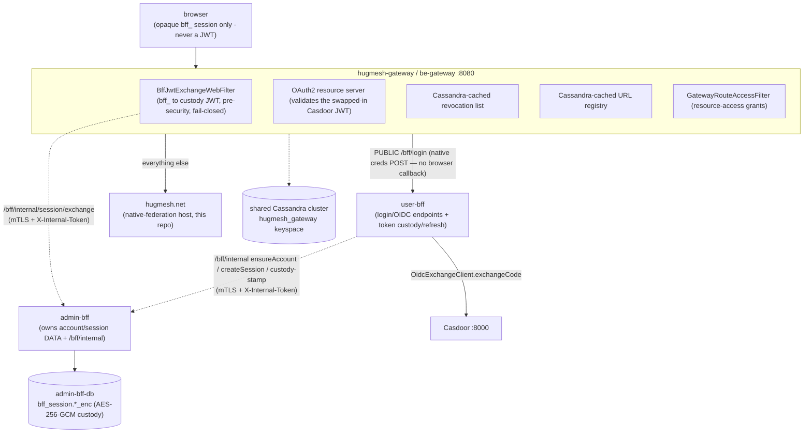

hugmesh.net ships as part of the platform's multi-tier topology:
a platform gateway in front, Casdoor as the OAuth2 issuer, Cassandra for the
gateway's revocation + URL-registry cache, and the Angular **native-federation
host shell** (this repo) as the user-facing front door served behind the
gateway. As of `main` this repo is itself a federation **host** mounting eleven
remotes (see the [README](../README.md)) — it is no longer a monolithic
single-page app.

The platform runs an **SSO BFF-custody** auth model: the browser holds **only**
an opaque `bff_` session — it never sees a Casdoor JWT. **user-bff** owns the
login/OIDC endpoints and does the server-side code→token exchange; **admin-bff**
owns the account/session **data** (and the encrypted-at-rest custody JWT); the
gateway swaps the opaque `bff_` → an internal custody JWT pre-security, just
before resource-server validation. The whole ensemble **ships dark** behind
default-off flags, so a default deployment is byte-identical to today's. The
[Auth flow](#auth-flow--bff-custody) section below is the canonical picture; this
host only ever handles the opaque `bff_` (see the [README](../README.md) auth
notes for the host-side handling).

## Topology



> Terminology note: the platform's runtime split is **fe-gateway** (the `/**`
> catch-all upstream that fronts this host) and **be-gateway** (which routes
> `/bff/*` to the role BFFs). The be-gateway is a **pure Casdoor-JWT resource
> server** — it does **not** log in itself; its `BffJwtExchangeWebFilter` swaps
> the opaque `bff_` reference → the internal custody JWT pre-security, so the
> JWT validation + route-access/revocation gate run unchanged. (The local
> docker-compose dev stack still uses `hugmesh-id-gateway` as an OAuth2 login
> client + JWT resource server for a self-contained demo.) The host actually
> calls the role-BFF surface (`/bff/me`, `/bff/announcements/home`,
> `/bff/user/notifications` (60s poll — unread-count badge), `/bff/user/notifications/events` (SSE stream — real-time toast), and
> the per-service `/bff/{wiki,tube,owncast}/**`) and the public federation API
> (`/api/federation/{manifest,capabilities}`), always attaching the opaque `bff_`
> as the Bearer (swapped to the custody JWT at the gateway).

## Auth flow — BFF custody

The end-to-end SSO login + per-request token swap. The browser holds **only** the
opaque `bff_`; the Casdoor JWT is kept **internal** and the user never sees their
own token.

```mermaid
sequenceDiagram
    autonumber
    participant B as Browser (login-ui)
    participant C as Casdoor (IdP)
    participant GW as hugmesh-gateway
    participant UB as user-bff
    participant AB as admin-bff (+ admin-bff-db)
    Note over B: "Sign in": native username/password (+MFA) form — NO client-side PKCE
    B->>GW: POST /bff/login {username, password} (PUBLIC route)
    GW->>UB: forward
    Note over UB: generate PKCE verifier+S256 challenge + state SERVER-SIDE
    UB->>C: INTERNAL /api/login (credentials) — never browser-reachable
    C-->>UB: authorization code
    UB->>C: OidcExchangeClient.exchangeCode(code, verifier)
    C-->>UB: Casdoor JWTs (access + refresh)
    UB->>AB: /bff/internal ensureAccount, createSession =&gt; opaque bff_
    UB->>AB: /bff/internal custody/stamp (encrypt) =&gt; stored in bff_session.*_enc
    UB-->>B: Set-Cookie bff_ (opaque) - browser NEVER sees the JWT
    Note over B,GW: subsequent requests carry the opaque bff_
    B->>GW: Authorization Bearer bff_ (any /api or /bff route)
    GW->>AB: /bff/internal/session/exchange (mTLS + X-Internal-Token)
    AB-->>GW: custody JWT (lazy-refresh near expiry, fail-closed)
    Note over GW: rewrite Authorization Bearer custody-jwt, THEN resource-server JWT validation + route-access/revocation/MFA
    GW->>UB: forward (downstream sees a normal Casdoor JWT)
```

Invariants to hold onto:

- The **browser holds only the opaque `bff_`** (in `localStorage` or an httpOnly
  cookie) — it must never be treated as, or decoded as, a JWT.
- The **custody JWT is encrypted at rest** (AES-256-GCM via `BffCustodyCipher`) in
  `bff_session.*_enc` in admin-bff-db; the two BFF databases are mutually denied at
  the NetworkPolicy layer (user-bff reaches account/session data only over
  admin-bff `/bff/internal`, gated by mTLS + `X-Internal-Token`).
- The **gateway swap is pre-security and fail-closed**: any exchange error ⇒ 401,
  and the raw `bff_` is never forwarded downstream.
- The whole ensemble **ships dark** behind default-off flags
  (`app.bff.oidc.enabled`, `app.bff.custody-key`, `app.session.cookie.enabled`,
  `hugmesh.gateway.bff-exchange.enabled`, `__HUG_OIDC_ENABLED__`), so a default
  deployment is byte-identical to today's.

Component ownership: **hugmesh-auth-core** (shared jar) holds the stateful auth
stack (`AccountStore`/`BffSession`, `OidcExchangeClient`, `BffCustodyCipher`,
`SessionCookieService`, `InternalTokenWebFilter`) consumed by admin-bff + user-bff
only (kept off the gateway classpath); **admin-bff** owns account/session data + the
`/bff/internal` API + custody/stamp + session/exchange; **user-bff** owns the
server-side PKCE/state + the internal Casdoor login/exchange (`/api/login` + code
exchange) driven by the native `POST /bff/login` credentials handoff (Casdoor is
never browser-exposed and there is no browser redirect/callback);
**hugmesh-gateway** owns the `BffJwtExchangeWebFilter` +
the PUBLIC `/bff/login` route seed; **login-ui** owns the native
username/password form + `POST /bff/login`.

### SSO progress (✅ shipped · 🚧 in-flight · 🔭 planned, as of 2026-07-22)

State convention: **✅ shipped** = merged to `main` · **🚧 in-flight** = code on an
open branch/PR, not yet merged · **🔭 planned** = design-complete, no code.

- ✅ **shipped:** auth-core extracted + published — now at **2.4.0** (account/session/MFA +
  the full custody seams: `BffSession` custody columns + `stampCustody`/`clearCustody`);
  admin-bff **adopted auth-core** (PR #111, behavior-preserving, 1517 tests green);
  admin-bff **`/bff/internal` account/session API** (PR #113, ships inert behind
  `InternalTokenWebFilter`); the gateway is live with raw-API security proven and the
  SCG-5 route-namespace bug fixed.
- ✅ **shipped (the SSO BFF-custody flow has since merged, all dark behind default-off
  flags):** gateway `BffJwtExchangeWebFilter` + `BffJwtExchangeConfig`
  (`hugmesh.gateway.bff-exchange.enabled`); user-bff `OidcCallbackController` (since
  retired — see the native `/bff/login` model above) /
  `SsoAuthController` / `AdminBffInternalClient` / `OidcCustodyBootGuard` (OIDC login
  relocation + admin-bff internal client, `app.bff.oidc.enabled`); login-ui
  **native username/password (+MFA) form → POST `/bff/login`** (SUPERSEDES the
  removed browser Casdoor OIDC + PKCE + `/login/callback` redirect — the browser
  never sees Casdoor; user-bff drives PKCE/state + the internal `/api/login` +
  exchange server-side); admin-bff **custody tail** (Liquibase band-180 `bff_session` custody
  columns + `/bff/internal/custody/stamp` + `/bff/internal/session/exchange`, PR #114
  auth-core 2.1.0 → since advanced to 2.4.0).
- ✅ **shipped:** generator **#156** (`app-user-bff` Casdoor OIDC client +
  PUBLIC `/bff/auth/callback` route seed — the callback route has since been retired
  in favour of the native `/bff/login` model above) — merged 2026-06-20.
- 🔭 **planned / next:** a cross-repo **NetworkPolicy egress peer**
  user-bff → admin-bff internal `:8080`; **SSO end-to-end live e2e** (kind +
  Playwright, proving the browser holds only `bff_`).

## This instance's identifiers

| Concern | Value |
|---|---|
| Gateway instance name | `hugmesh-id-gateway` |
| Cassandra keyspace | `hugmesh_gateway` |
| Casdoor organization | `hugmesh` |
| Frontend stack | Angular native-federation host + 11 remotes (this repo) |
| Browser-held credential | opaque `bff_` session only — never a Casdoor JWT |
| Token custody | user-bff exchanges code→token; admin-bff-db holds the encrypted custody JWT (`bff_session.*_enc`); gateway swaps `bff_`→JWT pre-security |
| Identity-layer responsibility | domain-scoped `superadmin > admin > mod > user` cascade |

A JWT issued by any of the platform's Casdoor instances is recognised
consistently across the platform because the
`casdoorAuthoritiesConverter()` code is identical in
[hugmesh-gateway](https://github.com/hugmesh/hugmesh-gateway/)
and its identity-tier overlay
[hugmesh-pki-gateway](https://github.com/hugmesh/hugmesh-pki-gateway/)
(a thin per-instance config layer built `FROM` the same shared gateway image —
this repo's local docker-compose dev stack labels its self-contained
demo instance `hugmesh-id-gateway`).

## Role model

The platform's authoritative identity model is the domain-scoped least-privilege
cascade **`superadmin > admin > mod > user`**, enforced at the gateway and the
role BFFs (issuer-keyed `DOMAIN_<x>`) with per-domain namespace + mTLS isolation as
the cross-domain boundary. This host's `SessionService` recognises exactly those
roles (`isSuperadmin`/`isAdmin`/`isMod` + the baseline user; `role()` precedence
`admin > mod > user` drives the role-home redirect), plus per-service sub-roles
like `ROLE_WIKI`/`ROLE_TUBE`/`ROLE_OWNCAST`.

### Cross-stack role-join: `game-master → games admin` (optional games service)

The games studio is a **separate, optional, opt-in** service — **off by default**
in the build, enabled with `--enable-games` / `ENABLE_GAMES=true` (generator
PR #112), and the `games.<domain>` subdomain is only baked when games is enabled.
It is not part of the default build.

When games **is** enabled, a domain `admin`/`superadmin` who additionally holds the
platform `game-master` role is propagated into the games realm as a games **admin**
by the [hugmesh-actions](https://github.com/hugmesh/hugmesh-actions/)
`GameMasterAdminSyncAction` — a cross-stack reconciler (a ~60 s Casdoor poll) that
keeps the games realm's admin set in sync with the platform `game-master` holders.
This propagation is **role-gated** (only `game-master` holders are eligible) and is
entirely contingent on the optional games service being deployed; `game-master` is
not a role this host shell itself guards on (no `SessionService` flag references it)
— it is consumed by the games stack via the reconciler.

## Running locally

```bash
docker compose up -d
open http://localhost:8080/
```

First-time Casdoor seed credentials print to the container log:

```bash
docker compose logs casdoor 2>&1 | grep -A4 "Casdoor seed credentials"
```

## Production posture

The gateway's edge nginx (or a managed LB upstream) holds the public
edge cert from a publicly-trusted CA. The internal cert hierarchy
between services is chained from the hugmesh.net root CA —
see
[hugmesh-gateway/docs/decisions/001-cert-chain-hierarchy.md](https://github.com/hugmesh/hugmesh-gateway/blob/main/docs/decisions/001-cert-chain-hierarchy.md).

hugmesh.net is the canonical root: the cert chain script in
the gateway repo (`scripts/pki/build-chained-cert.sh`) takes this
root + key and emits the per-service intermediates signed by it.

## History: migration from the single-container topology (completed)

> This section is historical. The repo originally shipped a single nginx serving
> the Angular bundle on port 8080 with **no auth gate**, fronted by the gateway. That
> migration is **done**: on `main` the host has real route guards
> (`adminGuard`/`modGuard`/`userGuard`/`registeredGuard`/`wikiGuard`/`tubeGuard`/`owncastGuard`),
> calls the role BFFs (`/bff/me`, `/bff/announcements/home`,
> `/bff/user/notifications` (60s poll — unread-count badge), `/bff/user/notifications/events` (SSE stream — real-time toast), per-service `/bff/{wiki,tube,owncast}/**`) and the
> public federation API
> (`/api/federation/{manifest,capabilities}`) today. The "becomes auth-checked once
> the app starts calling `/api/*`" framing no longer describes future work — it is
> the current state.
