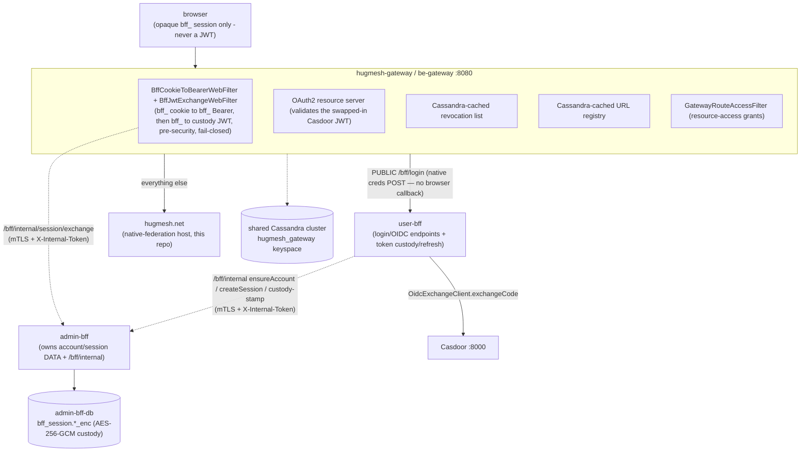

hugmesh.net runs as a multi-tier platform: a gateway in front, Casdoor as the
OAuth2 issuer, Cassandra for the gateway's revocation list and URL registry, and
the Angular **native-federation host shell** (this repo) as the front door behind
the gateway. On `main` this repo is a federation **host** that mounts thirteen
remotes (see the [README](../README.md)). It is no longer a monolithic
single-page app.

The platform uses an **SSO BFF-custody** auth model. The browser holds **only** an
opaque `bff_` session and never sees a Casdoor JWT. **user-bff** owns the
login/OIDC endpoints and does the server-side code→token exchange. **admin-bff**
owns the account/session **data** and the encrypted-at-rest custody JWT. Just
before resource-server validation, the gateway swaps the opaque `bff_` for an
internal custody JWT. The code **ships dark**: every flag in the ensemble defaults
to off, so a default deployment is byte-identical to one without it. A deployment
may switch the flags on. The [Auth flow](#auth-flow--bff-custody) section below is
the canonical picture. This host only ever handles the opaque `bff_` (the
[README](../README.md) auth notes cover the host side).

## Topology



> Terminology note: the platform runs two gateways. The **fe-gateway** is the `/**`
> catch-all upstream that fronts this host. The **be-gateway** routes `/bff/*` to
> the role BFFs. The be-gateway is a **pure Casdoor-JWT resource server** and does
> **not** log in itself. Its `BffJwtExchangeWebFilter` swaps the opaque `bff_`
> reference for the internal custody JWT pre-security, so JWT validation and the
> route-access/revocation gate run unchanged. (The local docker-compose dev stack
> still uses `hugmesh-id-gateway` as an OAuth2 login client and JWT resource server,
> for a self-contained demo.) The host calls the role-BFF surface (`/bff/me`, `/bff/announcements/home`,
> `/bff/user/notifications` (60s poll — unread-count badge), `/bff/user/notifications/events` (SSE stream — real-time toast), and
> the per-service `/bff/{wiki,tube,owncast}/**`) and the federation API
> (`/api/federation/{manifest,capabilities}`). Every call carries the HttpOnly
> `bff_` session cookie (`withCredentials` / `credentials: 'include'`) and **no**
> `Authorization` header. The gateway's `BffCookieToBearerWebFilter` turns the
> cookie into a `bff_` Bearer, and `BffJwtExchangeWebFilter` swaps that for the
> custody JWT.

## Auth flow — BFF custody

The end-to-end SSO login and the per-request token swap. The browser holds **only**
the opaque `bff_`. The Casdoor JWT stays **internal**, and the user never sees it.

```mermaid
sequenceDiagram
    autonumber
    participant B as Browser (login-ui)
    participant C as Casdoor (IdP)
    participant GW as hugmesh-gateway
    participant UB as user-bff
    participant AB as admin-bff (+ admin-bff-db)
    Note over B: "Sign in": native username/password (+MFA) form — NO client-side PKCE
    B->>GW: POST /bff/login {username, password} (PUBLIC route)
    GW->>UB: forward
    Note over UB: generate PKCE verifier+S256 challenge + state SERVER-SIDE
    UB->>C: INTERNAL /api/login (credentials) — never browser-reachable
    C-->>UB: authorization code
    UB->>C: OidcExchangeClient.exchangeCode(code, verifier)
    C-->>UB: Casdoor JWTs (access + refresh)
    UB->>AB: /bff/internal ensureAccount, createSession =&gt; opaque bff_
    UB->>AB: /bff/internal custody/stamp (encrypt) =&gt; stored in bff_session.*_enc
    UB-->>B: Set-Cookie bff_ (opaque) - browser NEVER sees the JWT
    Note over B,GW: subsequent requests carry the opaque bff_
    B->>GW: any /api or /bff route, bff_ session cookie (no Authorization header)
    Note over GW: BffCookieToBearerWebFilter builds the bff_ Bearer from the cookie
    GW->>AB: /bff/internal/session/exchange (mTLS + X-Internal-Token)
    AB-->>GW: custody JWT (lazy-refresh near expiry, fail-closed)
    Note over GW: rewrite Authorization Bearer custody-jwt, THEN resource-server JWT validation + route-access/revocation/MFA
    GW->>UB: forward (downstream sees a normal Casdoor JWT)
```

Invariants:

- The **browser holds only the opaque `bff_`**, in an HttpOnly cookie. The host's
  `hug.session` mirror in `localStorage` carries identity and role claims and no
  token. Nothing may treat the `bff_` as a JWT or decode it.
- The **custody JWT is encrypted at rest** (AES-256-GCM via `BffCustodyCipher`) in
  `bff_session.*_enc` in admin-bff-db; the two BFF databases are mutually denied at
  the NetworkPolicy layer (user-bff reaches account/session data only over
  admin-bff `/bff/internal`, gated by mTLS + `X-Internal-Token`).
- The **gateway swap is pre-security and fail-closed**: any exchange error gives a
  401, and the raw `bff_` is never forwarded downstream.
- The code **ships dark**: these flags default to off
  (`app.bff.oidc.enabled`, `app.bff.custody-key` (blank by default),
  `app.session.cookie.enabled`, `hugmesh.gateway.bff-exchange.enabled`,
  `__HUG_OIDC_ENABLED__`), so a default deployment is byte-identical to one without
  the ensemble. A deployment may switch them on.

Component ownership:

- **hugmesh-auth-core** (shared jar) holds the stateful auth stack
  (`AccountStore`/`BffSession`, `OidcExchangeClient`, `BffCustodyCipher`,
  `SessionCookieService`, `InternalTokenWebFilter`). Only admin-bff and user-bff
  use it. It stays off the gateway classpath.
- **admin-bff** owns account/session data, the `/bff/internal` API, custody/stamp
  and session/exchange.
- **user-bff** owns the server-side PKCE/state and the internal Casdoor
  login/exchange (`/api/login` plus code exchange), driven by the native
  `POST /bff/login` credentials handoff. Casdoor is never exposed to the browser,
  and there is no browser redirect or callback.
- **hugmesh-gateway** owns the `BffJwtExchangeWebFilter` and the PUBLIC `/bff/login`
  route seed.
- **login-ui** owns the native username/password form and `POST /bff/login`.

### SSO progress (✅ shipped · 🚧 in-flight · 🔭 planned, as of 2026-07-22)

The heading date is the date of the original list. The class names and endpoints
below were re-checked against `origin/main` on 2026-10-07. The 🔭 items were not
re-checked. The PR numbers of the earlier text are
dropped: in admin-bff, #113 and #114 now name unrelated PRs merged on 2026-09-30.

State convention: **✅ shipped** = merged to `main` · **🚧 in-flight** = code on an
open branch/PR, not yet merged · **🔭 planned** = design-complete, no code.

- ✅ **shipped:** auth-core extracted + published — `main` is at **2.5.1**, which
  admin-bff and user-bff both pin (account/session/MFA + the full custody seams: `BffSession`
  custody columns + `stampCustody`/`clearCustody`); admin-bff **adopted auth-core**;
  admin-bff **`/bff/internal` account/session API** (ships inert behind
  `InternalTokenWebFilter`); the gateway is live with raw-API security proven and the
  SCG-5 route-namespace bug fixed.
- ✅ **shipped (the SSO BFF-custody flow has since merged, all dark behind default-off
  flags):** gateway `BffJwtExchangeWebFilter` + `BffJwtExchangeConfig`
  (`hugmesh.gateway.bff-exchange.enabled`); user-bff `OidcCallbackController` (since
  retired — see the native `/bff/login` model above) /
  `SsoAuthController` / `AdminBffInternalClient` / `OidcCustodyBootGuard` (OIDC login
  relocation + admin-bff internal client, `app.bff.oidc.enabled`); login-ui
  **native username/password (+MFA) form → POST `/bff/login`** (SUPERSEDES the
  removed browser Casdoor OIDC + PKCE + `/login/callback` redirect — the browser
  never sees Casdoor; user-bff drives PKCE/state + the internal `/api/login` +
  exchange server-side); admin-bff **custody tail** (Liquibase band-180 `bff_session` custody
  columns + `/bff/internal/custody/stamp` + `/bff/internal/session/exchange`;
  auth-core 2.1.0, since advanced to 2.5.1).
- ✅ **shipped:** generator **#156** (`app-user-bff` Casdoor OIDC client +
  PUBLIC `/bff/auth/callback` route seed — the callback route has since been retired
  in favour of the native `/bff/login` model above) — merged 2026-06-20
  (generator commit 912524b8).
- 🔭 **planned / next:** a cross-repo **NetworkPolicy egress peer**
  user-bff → admin-bff internal `:8080`; **SSO end-to-end live e2e** (kind +
  Playwright, proving the browser holds only `bff_`).

## This instance's identifiers

| Concern | Value |
|---|---|
| Gateway instance name | `hugmesh-id-gateway` |
| Cassandra keyspace | `hugmesh_gateway` |
| Casdoor organization | `hugmesh` |
| Frontend stack | Angular native-federation host + 13 remotes (this repo) |
| Browser-held credential | opaque `bff_` session only — never a Casdoor JWT |
| Token custody | user-bff exchanges code→token; admin-bff-db holds the encrypted custody JWT (`bff_session.*_enc`); gateway swaps `bff_`→JWT pre-security |
| Identity-layer responsibility | domain-scoped `superadmin > admin > mod > user` cascade |

Every platform service recognises a JWT from any of the platform's Casdoor
instances the same way, because the `casdoorAuthoritiesConverter()` code is
identical in [hugmesh-gateway](https://github.com/hugmesh/hugmesh-gateway/) and its
identity-tier overlay [hugmesh-pki-gateway](https://github.com/hugmesh/hugmesh-pki-gateway/)
(a thin per-instance config layer built `FROM` the same shared gateway image). This
repo's local docker-compose dev stack labels its self-contained demo instance
`hugmesh-id-gateway`.

## Role model

The platform's identity model is the domain-scoped least-privilege cascade
**`superadmin > admin > mod > user`**. The gateway and the role BFFs enforce it
(issuer-keyed `DOMAIN_<x>`), with per-domain namespace and mTLS isolation as the
cross-domain boundary. This host's `SessionService` recognises those
roles (`isSuperadmin`/`isAdmin`/`isMod` + the baseline user). `isMod` is also true for
`admin` and `superadmin`. It also reads per-service sub-roles
like `ROLE_WIKI`/`ROLE_TUBE`/`ROLE_OWNCAST`/`ROLE_GAMES`. `role()` (precedence
`admin > mod > user`) now serves only as the signed-in check: the default route
sends every signed-in user to `/user`, and the consoles sit one click away in the menu.

### Cross-stack role-join: `game-master → games admin` (optional games service)

The games studio is a **separate, optional, opt-in** service. It is **off by
default** and not part of the default build. Enable it with `--enable-games` or
`ENABLE_GAMES=true` (generator `brand.conf.example`). The `games.<domain>` subdomain
is only baked when games is enabled (`build-rpi5-stage4.sh`).

When games **is** enabled, a domain `admin`/`superadmin` who also holds the platform
`game-master` role becomes a games **admin** in the games realm. The
[hugmesh-actions](https://github.com/hugmesh/hugmesh-actions/)
`GameMasterAdminSyncAction` does this. It is a cross-stack reconciler (a ~60 s
Casdoor poll) that keeps the games realm's admin set in sync with the platform
`game-master` holders. Only `game-master` holders are eligible, and the whole path
depends on the optional games service being deployed. This host shell does not guard
on `game-master` (no `SessionService` flag references it). The games stack consumes
it through the reconciler.

## Running locally

```bash
docker compose up -d
open http://localhost:8080/
```

First-time Casdoor seed credentials print to the container log:

```bash
docker compose logs casdoor 2>&1 | grep -A4 "Casdoor seed credentials"
```

## Production posture

The gateway's edge nginx (or a managed LB upstream) holds the public edge cert from
a publicly trusted CA. The internal cert hierarchy between services chains from the
hugmesh.net root CA. See
[hugmesh-gateway/docs/decisions/001-cert-chain-hierarchy.md](https://github.com/hugmesh/hugmesh-gateway/blob/main/docs/decisions/001-cert-chain-hierarchy.md).

hugmesh.net is the canonical root. The cert chain script in the gateway repo
(`scripts/pki/build-chained-cert.sh`) takes this root and key and emits the
per-service intermediates signed by it.

## History: migration from the single-container topology (completed)

> This section is historical. The repo first shipped a single nginx serving the
> Angular bundle on port 8080 with **no auth gate**, fronted by the gateway. That
> migration is **done**. On `main` the host has real route guards
> (`adminGuard`/`modGuard`/`userGuard`/`registeredGuard`/`forumGuard`/`wikiGuard`/`tubeGuard`/`owncastGuard`/`gamesGuard`/`gamesAdminGuard`),
> calls the role BFFs (`/bff/me`, `/bff/announcements/home`,
> `/bff/user/notifications` (60s poll — unread-count badge), `/bff/user/notifications/events` (SSE stream — real-time toast), per-service `/bff/{wiki,tube,owncast}/**`) and the
> public federation API
> (`/api/federation/{manifest,capabilities}`) today. The old framing, "becomes
> auth-checked once the app starts calling `/api/*`", describes the current state,
> not future work.
