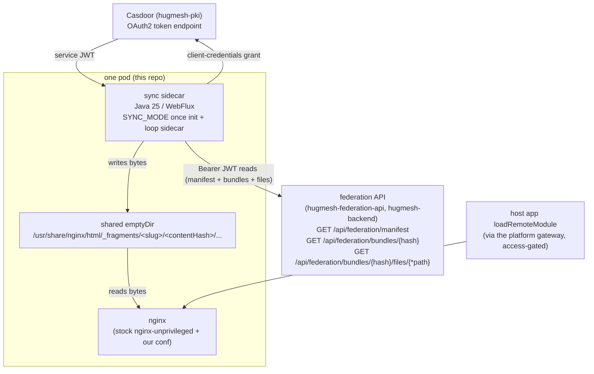
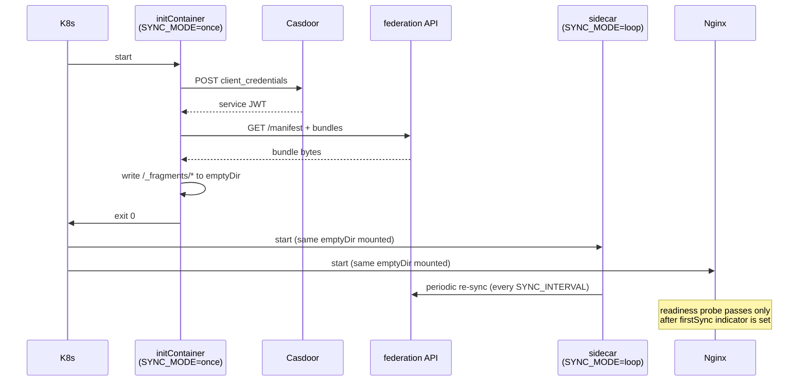

The **sync-and-serve-static** fragment fleet for [hugmesh-host-shell](https://github.com/hugmesh/hugmesh-host-shell), part of the [HugMesh](https://github.com/hugmesh) platform.

This service statically serves the platform's federated fragment bundles — user-profile/card modules, public vanity-profile fragments, and admin "contained pages" — published through the [hugmesh-federation-api](https://github.com/hugmesh/hugmesh-federation-api) keystone. The design is deliberately simple: each pod runs a stock `nginxinc/nginx-unprivileged` that serves a content-addressed, on-disk mirror of the currently-enabled fragment set. A co-located reactive Java sidecar keeps that mirror in sync by pulling from the federation API. Because nginx serves static bytes with no per-request proxy hop, the fleet is horizontally scalable (HPA-ready) and highly cacheable.

## Where this fits in the platform

| | |
|---|---|
| **Tier** | Frontend (edge static delivery), behind the platform's gateway |
| **Namespace** | `hugmesh-frontend` (the federation API it pulls from lives in `hugmesh-backend`; Casdoor in `hugmesh-pki`) |
| **Identity** | A Casdoor **machine account** (`app-fragment-sync`), client-credentials grant — NOT an end-user. It has no interactive login surface. |
| **Data store** | **None.** The federation manifest is the source of truth; the local nginx root is an ephemeral, content-addressed mirror re-derived on every pod start. |
| **Runtime** | Java 25, Spring Boot 4.0.7, WebFlux + reactive WebClient (no database, no message broker, no service registry). GraalVM-native-capable, like the rest of the platform's Java services. |

This service is a pure, one-direction **downstream consumer** of federation. It does not register, moderate, or own modules, and it enforces no RBAC of its own. Its entire job is to mint a service token, read the manifest that token is authorized to see, mirror those bytes to disk, and let nginx serve them. Every authorization decision — who may see which fragment, which brand/domain a fragment belongs to, and the admin/mod kill-switch — is made upstream in federation. This fleet receives (and therefore serves) only the bytes its service token is entitled to fetch.

## Architecture: sync-and-serve-static



There is **no per-request proxy** to the federation API. The sidecar syncs bundles into the local nginx root once and periodically thereafter; nginx then serves them as static files. RBAC, visibility, and domain scoping are enforced upstream at the gateway/federation layer; these pods only receive (and serve) the bytes their service token is permitted to fetch.

The two containers share a single pod and an `emptyDir` volume mounted at `/usr/share/nginx/html`:

* an **initContainer** runs the sidecar image with `SYNC_MODE=once` — it performs a full sync and exits 0, ensuring nginx starts with content already on disk;
* the **sidecar** runs the same image with `SYNC_MODE=loop` — it periodically re-syncs so the fleet tracks federation's kill-switch in near-real time;
* the **nginx** container serves the shared volume as static files.

The initContainer and the sidecar use the same image; `SYNC_MODE` selects the behavior.

The pod startup sequence is therefore:



## The gateway, Casdoor, federation, and multi-tenancy

* **The platform gateway** — the only public ingress to the served bytes. The host app's `loadRemoteModule` requests resolve `/_fragments/...` URLs through the gateway; the gateway owns the public-facing access rules (data-driven, keyed on route). This fleet exposes no other route (`location / { return 404; }`).
* **Casdoor (`hugmesh-pki`)** — the sidecar mints a **service JWT** via the OAuth2 **client-credentials** grant against the in-cluster Casdoor token endpoint. Federation is an OAuth2 resource server, so every manifest/bundle read carries `Authorization: Bearer <casdoor-jwt>`. The token's **authorities** decide what the manifest returns.
* **federation API (`hugmesh-federation-api`)** — the authoritative catalog. Its `ManifestService` does the visibility cut (`public` vs `internal`), applies the scope-override kill-switch, drops circuit-open remotes, and performs the **per-domain cut** in the query itself.
* **Multi-tenancy / multi-brand (the domain-scoping intent).** The platform is multi-brand, multi-tenant. In federation, a caller's brand is derived from a validated Casdoor **issuer** and surfaced as a `DOMAIN_<x>` authority; `ManifestService.render(authorities, scope)` then pins the module + active-scope-override finders to that domain, so a brand-X principal's manifest lists only brand-X remotes, and a brand-X `scope=all` kill never blanks brand-Y. A `SUPERADMIN` authority instead gets the un-pinned, cross-brand control-plane tier.

  **This fleet inherits domain scoping for free.** It contains no domain, tenant, or issuer logic of its own — it presents the configured service token and mirrors whatever per-brand manifest subset federation returns. The intended topology is therefore **one fragment fleet per brand/domain**, each paired with one `app-fragment-sync` machine account whose issuer is bound to that brand's Casdoor. Each fleet's service token then carries the right `DOMAIN_<x>`, so each fleet syncs and serves only its own brand's fragments. Content-addressed paths are naturally tenant-safe: a `<slug>/<contentHash>` URL identifies the same bytes regardless of which fleet wrote them. Realizing one brand-pure fleet per domain requires only that machine-account/issuer binding — no code change here (see [Roadmap](#roadmap)).

## The federation API contract

All three calls require a valid Casdoor JWT. The federation fetch path is gated `authenticated()`, and the pods present a service token to satisfy that gate.

| Call | Returns | Used for |
|------|---------|----------|
| `GET /api/federation/manifest` | `{ generatedAt, remotes:[ { slug, displayName, kind, remoteEntryUrl, exposedModule, version, contentHash, visibility, metadata } ] }` | The source set. Only **enabled + circuit_state='closed' + visibility-permitted + in-domain** modules appear, so the admin/mod **kill-switch and per-brand cut are honored automatically**. This fleet filters `remotes` to `kind == "fragment"`. |
| `GET /api/federation/bundles/{contentHash}` | `BundleMetadata` (`slug`, `contentHash`, `manifestJson`, `versionDir`, `visibility`, ...) | `manifestJson` is the per-bundle file list (multi-file). |
| `GET /api/federation/bundles/{contentHash}/files/{*path}` | the file bytes (content-type by extension) | The actual sync read; streamed to disk. |

`contentHash` (SHA-256 hex of the bundle tree) serves three roles at once: it is the **sync key** that identifies whether a bundle is already on disk, the **version discriminator** that makes old and new bundles coexist without conflict, and the **immutable path segment** that enables long-lived HTTP caching.

### Sync behavior (all in `FragmentSyncService`)

Each sync run executes in this order:

1. **Filter** — fetch the manifest and keep only `kind == "fragment"` remotes. The federation API has already dropped disabled, circuit-open, invisible, and out-of-domain rows server-side, so this client-side filter is a final narrow.
2. **Dedupe** — skip any `<slug>/<contentHash>` directory that already exists on disk. Because `contentHash` is content-addressed, an existing directory is guaranteed to be complete and correct; no re-fetch is needed.
3. **Atomic write** — for each new bundle, stream every file into a `.part` temporary inside a per-bundle staging directory, then promote the whole staging directory atomically. The bundle directory appears on disk only once every file has landed; a partially-written staging directory is cleaned up on the next run so retries are safe.
4. **Prune** — delete any `<slug>/<contentHash>` directory that is no longer in the manifest (the fragment was disabled, removed, kill-switched, or is out of domain). Empty slug directories and leftover `.stage-` directories are swept at the same time.
5. **Index** — write `/_fragments/index.json` mapping each slug to its current `{ contentHash, version, remoteEntryUrl, exposedModule, displayName, visibility, servePath }` for the host's `loadRemoteModule`.

**Resilience:** a single bad bundle is logged and skipped (`onErrorResume`); it never aborts the run or the periodic loop. A manifest-level failure leaves the previous on-disk state intact — a transient federation outage never empties the fleet.

All blocking filesystem I/O is dispatched to `Schedulers.boundedElastic()`; the WebFlux event loop is never blocked.

### Multi-file vs. single-file bundles

The sync reads the file list from the bundle's `manifestJson` field. As of this writing, federation stores a single staged entry file and defaults `manifestJson` to `"{}"`, so in practice the sync always takes the fallback path and fetches the single entry file `remoteEntry.json`. The multi-file path is already implemented and activates automatically once federation ships real multi-file bundles — no code change is needed here.

When `manifestJson` is non-empty and parseable, it accepts three shapes:

| Shape | Example |
|-------|---------|
| JSON array of strings | `["remoteEntry.json", "chunks/main.js"]` |
| JSON array of objects | `[{"path": "remoteEntry.json"}, {"name": "chunks/main.js"}]` |
| Object with `files` key | `{"files": ["remoteEntry.json", "chunks/main.js"]}` |

Nested paths such as `chunks/main.js` are preserved on the wire because federation maps the file route as a `{*path}` wildcard; the slash is sent literally rather than percent-encoded.

## Key modules

| Module | Role |
|--------|------|
| `RemoteFragmentApplication` | Spring Boot entrypoint (the first-party sync container). |
| `casdoor/CasdoorTokenClient` | Mints + caches the Casdoor service JWT (client-credentials grant); re-mints before `expires_in`; `invalidate()` clears the cache so the next `token()` re-mints. `FederationSyncClient` calls `invalidate()` on an auth error from federation. |
| `federation/FederationSyncClient` | Reactive read client for the three federation endpoints; injects the bearer per request; clears the cached service token on a federation 401/403 so the next request re-mints. |
| `federation/FederationManifest` / `BundleMetadata` | Wire records for the manifest + bundle-metadata DTOs (`isFragment()` is the `kind` filter). |
| `sync/FragmentSyncService` | The sync engine: filter → dedupe → fetch (atomic) → prune → write `index.json`. |
| `sync/FragmentSyncRunner` | Mode driver: `once` (init-container, sync then `System.exit`) or `loop` (resilient periodic interval). |
| `sync/FirstSyncHealthIndicator` | Readiness gate — pod is ready only after the first successful manifest sync. |
| `config/SyncConfig` | Env-driven bean wiring (all values have safe local defaults). |
| `config/NativeHintsConfig` | GraalVM reflection hints for the wire records under `-Pnative`. |

## Authorization model (service-token only)

This fleet **enforces no role-gates of its own** — it is a static byte mirror. The only authorization that matters is what its service token is permitted to read from federation, which in turn bounds what it can possibly serve:

* The federation manifest and bundle reads require only `authenticated()`. The `ROLE_USER` floor of the platform's role cascade (`SUPERADMIN → ADMIN → MOD → USER`) is therefore sufficient to fetch the manifest.
* At the `ROLE_USER` floor, federation returns **only `public` fragments**. To serve `internal` fragments, bind `app-fragment-sync` to a Casdoor role that maps to `ROLE_ADMIN` or `ROLE_INTERNAL`. This is not done by default (see [Known limitations](#known-limitations-and-design-notes)).
* The token's `DOMAIN_<x>` authority (derived from the validated issuer) restricts the manifest to a single brand, unless the token carries `SUPERADMIN` (which gets the cross-brand control-plane view). For the per-brand fleet topology, bind each fleet's machine account to its own brand's Casdoor issuer.

## Content-addressed path scheme and caching

Bundles are served at immutable, content-hashed paths:

```
/_fragments/<slug>/<contentHash>/remoteEntry.json
/_fragments/<slug>/<contentHash>/chunks/main.js
/_fragments/index.json                              # slug -> current contentHash (no-cache)
```

The nginx conf applies `Cache-Control: public, max-age=31536000, immutable` to content-hashed paths — because a new bundle always produces a new path, cache-busting is automatic. `index.json` gets `no-cache` so the host always fetches the current slug-to-hash mapping. The conf also re-declares the `.mjs` MIME type as `application/javascript` (stock nginx serves `.mjs` as `application/octet-stream`, which browsers refuse to execute as ES modules) and adds `Access-Control-Allow-Origin: *` so the host can call `loadRemoteModule` across origins. The host resolves each fragment's `remoteEntryUrl` from `index.json` to one of these immutable content-hashed paths.

## Configuration

| Env var | yaml key | default |
|---------|----------|---------|
| `FEDERATION_BASE_URL` | `federation.base-url` | `http://hugmesh-federation-api.hugmesh-backend.svc.cluster.local:8080` |
| `SYNC_TARGET_DIR` | `sync.target-dir` | `/usr/share/nginx/html` |
| `SYNC_MODE` | `sync.mode` | `loop` (`once` = initContainer one-shot) |
| `SYNC_INTERVAL` | `sync.interval` | `PT60S` (ISO-8601 duration) |
| `CASDOOR_TOKEN_URL` | `casdoor.token-url` | `http://casdoor.hugmesh-pki.svc.cluster.local:8000/api/login/oauth/access_token` |
| `CASDOOR_CLIENT_ID` | `casdoor.client-id` | `app-fragment-sync` |
| `CASDOOR_CLIENT_SECRET` | `casdoor.client-secret` | *(empty — supplied via a Secret)* |
| `SERVER_PORT` | `server.port` | `8081` (actuator; nginx owns 8080 in-pod) |

A minimal sidecar container spec in a Kubernetes Deployment (the initContainer is identical except `SYNC_MODE: once`):

```yaml
env:
  - name: SYNC_MODE
    value: loop
  - name: SYNC_INTERVAL
    value: PT60S
  - name: FEDERATION_BASE_URL
    value: http://hugmesh-federation-api.hugmesh-backend.svc.cluster.local:8080
  - name: CASDOOR_TOKEN_URL
    value: http://casdoor.hugmesh-pki.svc.cluster.local:8000/api/login/oauth/access_token
  - name: CASDOOR_CLIENT_ID
    value: app-fragment-sync
  - name: CASDOOR_CLIENT_SECRET
    valueFrom:
      secretKeyRef:
        name: fragment-sync-casdoor
        key: clientSecret
```

### Casdoor service authentication (client-credentials JWT mint)

The federation fetch path is an OAuth2 resource server, so the sidecar must present a real Casdoor-signed **bearer JWT** — not HTTP Basic. It mints one via the OAuth2 **client-credentials** grant (the standard machine-account pattern):

```
POST {CASDOOR_TOKEN_URL}
Content-Type: application/x-www-form-urlencoded
grant_type=client_credentials&client_id=app-fragment-sync&client_secret=<secret>
-> 200 { "access_token": "<RS256 JWT>", "token_type":"Bearer", "expires_in":... }
```

The token is cached and re-minted shortly before `expires_in` (and on demand via `invalidate()`, which `FederationSyncClient` triggers automatically on a federation 401/403). A service JWT with the `ROLE_USER` floor is enough for the manifest read + bundle fetch (both only require `authenticated()`). It will see **only `public` fragments** unless its Casdoor app/user carries `ROLE_ADMIN` / `ROLE_INTERNAL` — bind the machine account to a role mapping to `ROLE_INTERNAL` only if `internal` fragments must be served by this fleet.

### Secrets and configuration keys

If you are running this against the reference HugMesh cluster deployment, the relevant secret material lives here:

| What | Where |
|------|-------|
| Casdoor `client_secret` for `app-fragment-sync` | A secrets manager entry at `secret/hugmesh/fragment-sync`, property `client_secret` (KV-v2 style) |
| Materialized into the pod | Kubernetes Secret `fragment-sync-casdoor` (via an ExternalSecret in `hugmesh-frontend`), keys `clientId` (literal `app-fragment-sync`) + `clientSecret` |
| Casdoor OAuth app | `app-fragment-sync`, `grantTypes: [authorization_code, client_credentials]`. Per-brand fleets bind a per-brand machine account/issuer. |

The image carries **no keys**; the client secret is injected at runtime via `secretKeyRef` (or your platform's equivalent).

## Building and testing

```bash
./mvnw test                     # green, no external infra (federation/Casdoor stubbed)
./mvnw package -DskipTests      # runnable Spring Boot fat jar in target/
make native                     # GraalVM native binary + a runtime smoke test
make native-compile             # native binary only, no smoke test
./mvnw -Pnative native:compile  # the raw compile, if you have GraalVM on JAVA_HOME
```

`make native` is the one to use. It runs [`scripts/native-build.sh`](scripts/native-build.sh),
which compiles the binary and then **runs it** against a stub federation and a stub
Casdoor ([`scripts/NativeSmoke.java`](scripts/NativeSmoke.java)) in **both** shapes the
pod uses:

| leg | mode | asserts | covers |
|---|---|---|---|
| 1 | `SYNC_MODE=once` (initContainer) | the bundle's files (including a nested path) and `index.json` land on disk with the right bytes | reactive `WebClient` POST + form body, the Jackson-3 codec into the `FederationManifest`/`BundleMetadata` records, Jackson-2 `readTree` of the `manifestJson` string, `FragmentSyncRunner` ONCE + `System.exit` |
| 2 | `SYNC_MODE=loop` (sidecar) | `/actuator/health/readiness` returns `200 UP` over HTTP, carrying `FirstSyncHealthIndicator`'s live counters | `Flux.interval`/`concatMap` under Substrate, the embedded Netty **server** (leg 1 only exercises the client), the actuator endpoint and its detail-map serialisation |

That is the same script CI's `build:native` job runs, and the Makefile passes the same
`GRAALVM_IMAGE` / `NATIVE_BUILD_IN_DOCKER=1` / `NATIVE_IMAGE_OPTIONS=-J-Xmx6g` that job
sets, so the pinned toolchain and the builder heap cap are identical and a red pipeline
reproduces locally with one command. (The one thing that still differs is where the
private `hugmesh-commons` comes from: off CI there is no `CI_JOB_TOKEN`, so the script
bind-mounts your `~/.m2` instead of resolving cold from the GitLab registry. Set
`NATIVE_BUILD_IN_DOCKER=0` if you would rather use a locally installed GraalVM than the
pinned image.)

If the machine has no GraalVM it builds inside `ghcr.io/graalvm/graalvm-community:25`;
if it has neither GraalVM nor Docker it fails rather than skipping.

Measured on a 28-core x86 dev box, container path, warm `~/.m2`, over six runs in two
sessions: `native-image` itself took **54 s to 1 min 50 s** (Maven total 1:01–2:03) for a
**118 MB** binary, and both smoke legs added about **10 s** — the AOT-processed binary
reports `Started RemoteFragmentApplication in 0.109 seconds`. The spread is load, not
variance in the build: the fast end is an otherwise idle box, the slow end is one with
other containers running. The job's `timeout: 45m`
is sized for a slower, busier shared runner resolving Maven cold, not for those numbers.

It needs a warm `~/.m2`, for the same reason `./mvnw test` does: `net.hugmesh:hugmesh-commons`
is private and is **not on Maven Central**. The build container runs with `HOME=/tmp`
(so Maven never writes into the bind-mounted workspace), which also means it cannot
see your `~/.m2` — so the script mounts it in. Run `./mvnw test` once first if yours
is cold, or point `NATIVE_BUILD_M2` at a Maven repo that has the artifact. With no
usable repo and no `CI_JOB_TOKEN` the script stops **before** compiling and says which
of the two is missing; without that check the run dies half a minute later inside
Maven as `Could not find artifact net.hugmesh:hugmesh-commons:jar:2.1.0 in central`,
which names the one repository the artifact was never going to be in. On CI the token
is present, so the job resolves from the GitLab registry and mounts nothing.

The **resource** side of the native configuration needs no hand-written hints and has
none: Spring Boot's AOT step emits it, and the generated
`target/spring-aot/main/resources/META-INF/native-image/net.hugmesh/remote-fragment/reachability-metadata.json`
carries the `application*.yml` glob (26 resource globs in all) alongside the four app
records `NativeHintsConfig` registers — `FederationManifest`, `FederationManifest$Remote`,
`BundleMetadata` and `FragmentSyncService$SyncResult`, each with
`allDeclaredConstructors`/`allDeclaredFields`/`allDeclaredMethods`. Both smoke legs read
their whole configuration out of `application.yml`, so a dropped resource glob fails the
gate the same way a dropped reflection hint does.

Why the binary is *run* and not just compiled: missing native reflection metadata
does not fail `native-image`, it fails the first time the code path executes.
Both of these mutations of `NativeHintsConfig` were built and run, and **both
compiled as `BUILD SUCCESS`**:

* drop the `FederationManifest`/`.Remote` registrations → the binary exits 1 with
  *"Record components not available for record class …FederationManifest"*;
* drop the `BundleMetadata` registration → the binary exits **0**, logs
  `1 failed` and writes nothing.

The second is why the smoke test asserts files on disk and a readiness body rather
than just an exit status: an exit-status-only check passes that mutation.

Re-verified independently on 2026-09-04 by re-applying the `BundleMetadata` mutation:
`native-image` reported `BUILD SUCCESS` (with 7,471 types registered for reflection
against 7,529 unmutated, so the mutation demonstrably reached the image), the binary
exited **0** logging `[sync] done: 1 fragment(s) [0 synced, 0 deduped, 0 skipped, 1 failed]`,
and the gate went red only on the disk assertion — `[smoke] FAIL: expected synced file
missing: …/_fragments/smoke-ui/…/remoteEntry.json`, `make` exit 2.

Maven coordinates: `net.hugmesh:remote-fragment:0.2.0`. Java 25, Spring Boot 4.0.7, WebFlux + reactive WebClient, no database. The native profile, the `native-maven-plugin`, and `NativeHintsConfig` mirror the same pattern used by `hugmesh-federation-api` and the platform's other reactive Java services.

This repo builds two container images for one pod:

* the root [`Dockerfile`](Dockerfile) — the sync sidecar (JRE jar; the GraalVM native binary is an alternative build via the `native` Maven profile);
* [`nginx/Dockerfile`](nginx/Dockerfile) — the static server, i.e. the public `nginxinc/nginx-unprivileged` image with this repo's [`nginx.conf`](nginx/nginx.conf) baked in. Deployments can also just mount the conf from a ConfigMap over the stock public image instead of using this image at all.

### Continuous integration

* **`.gitlab-ci.yml`** — the pipeline used to build and publish images for the reference cluster deployment, run against an internally mirrored GitLab instance. It runs `lint → test → build → pentest` on pushes to the default branch and on tags; `lint`, `test` and `build:native` additionally run on **every mirrored branch push**, which is what makes them a pre-merge gate here. (The GitHub repo is pull-mirrored into that GitLab, so a GitHub pull request never becomes a GitLab merge request and a mirror-sync pipeline is always `CI_PIPELINE_SOURCE == "push"`; a `merge_request_event` rule alone can never fire for GitHub-originated work, and before the bare `$CI_COMMIT_BRANCH` rule was added a mirrored feature branch matched no rule in the file and produced no pipeline at all.) `build:sync` and `build:nginx` stay default-branch-and-tags only, because they push to the container registry. The `lint` stage runs `lint:deploy-manifest-drift`, which sparse-clones the central manifest from `hugmesh-generator` and byte-diffs `deploy/` against it (see [Known limitations](#known-limitations-and-design-notes)). The `test` stage runs `./mvnw -s settings.xml verify` in a container and publishes a JUnit report; all three build jobs `needs:` a green `test`. The `pentest` stage runs OWASP Dependency-Check (SCA) and an authenticated ZAP baseline scan (DAST) as non-blocking (`allow_failure: true`) informational jobs, shared from `hugmesh-generator`'s centralized pentest harness.
* **`build:native`** (in the `build` stage) — compiles the GraalVM native binary in `ghcr.io/graalvm/graalvm-community:25` and then **runs it**, once as the initContainer and once as the sidecar, against a stub federation + Casdoor, so a change that breaks native compatibility fails the pipeline instead of being discovered by hand. It runs on every mirrored branch push as well as on the default branch and tags. No runner needs GraalVM installed — the toolchain comes from the image, so this needs no special runner beyond the privileged x86 one the other jobs already use. Identical to `make native` locally; both are [`scripts/native-build.sh`](scripts/native-build.sh), so a red pipeline reproduces with one command. That script hands `CI_JOB_TOKEN` to the build container **by name** (`docker run -e CI_JOB_TOKEN`) rather than as `-e CI_JOB_TOKEN=<value>`: the value form puts the token in the docker CLI's argv and therefore in the **world-readable** host process table for the whole compile — minutes, on a shared `privileged` runner — where any local user or `ps` scraper can read it (GitLab's masking only covers job *log* output). Same reasoning as `build:sync` passing it as a BuildKit secret instead of a build ARG. **Scope, measured:** this closes the world-readable channel, not cross-job exposure on the same runner — a sibling job can still read the value from `docker inspect <cid> --format '{{json .Config.Env}}'` (every job here has docker access) and from `/proc/<docker-cli-pid>/environ`, which is mode 0400 owned by the one `gitlab-runner` uid a shell executor shares across all jobs. Closing those needs a file-based secret or an isolated executor, not a different `-e` form. It does not publish an image — see [Known limitations](#known-limitations-and-design-notes).
* **`.github/workflows/release.yml`** — a manual (`workflow_dispatch`) GitHub Actions workflow for anyone building from this repository directly on GitHub. It builds and pushes both images to GHCR (`ghcr.io/hugmesh/hugmesh-remote-fragment` and `.../nginx`), tagged with the short commit SHA (or a tag you supply) plus `latest`. It is not wired to run automatically — trigger it from the Actions tab.
* **`make pentest`** — runs the same OWASP checks locally (SCA via `owasp/dependency-check`, DAST via the shared harness in `hugmesh-generator`). Both are informational/non-blocking locally; see the [`Makefile`](Makefile) for details and opt-in flags.

## Health checks and probes

* The actuator listens on `:8081`. The `/_fragments` tree is served by nginx on `:8080`.
* `/actuator/health/readiness` includes a custom `firstSync` indicator: the pod does not become **ready** until at least one manifest sync has succeeded. This prevents traffic from reaching a pod before its nginx root has any content.
* Liveness is deliberately independent of the sync state. A prolonged federation outage must not restart the pod; the pod should keep serving the last-good on-disk bytes until federation recovers.
* The nginx container exposes its own `/healthz` endpoint (returns `200 ok`).

## Container UID note

The sync container runs as uid 1000 and nginx runs as uid 101 (the `nginx-unprivileged` default). Because neither container can `chown` files to the other's uid, the sync writes all bundle directories and files as world-readable and world-traversable (`a+rX`) so nginx can read them. This permission step is handled in `FragmentSyncService` on a best-effort basis (POSIX file permission APIs only; no ACL support).

## Roadmap

* **Multi-file bundle support.** The sync already understands the multi-file `manifestJson` shapes described above. It will start exercising that path automatically as soon as federation publishes bundles with more than one file — no changes needed in this repository.
* **`ROLE_INTERNAL` fragment serving.** Serving `internal` (not just `public`) fragments only requires binding the `app-fragment-sync` machine account to a Casdoor role that maps to `ROLE_INTERNAL` / `ROLE_ADMIN` (see [Authorization model](#authorization-model-service-token-only)). This is a configuration/binding change, not a code change.
* **Per-brand fleet topology.** The intended multi-tenant deployment shape is one fragment fleet, plus one issuer-bound `app-fragment-sync` machine account, per brand/domain — so each fleet's token carries that brand's `DOMAIN_<x>` and it syncs only its own brand's fragments. Federation's per-domain filtering is already in place on its side; realizing the per-brand fleets is purely a machine-account/issuer provisioning step.

## Known limitations and design notes

* **Multi-file bundle pipeline is implemented but not yet exercised end-to-end**, because federation doesn't currently produce multi-file bundles (see above). It's covered by unit tests against a synthetic multi-file `manifestJson`, plus real end-to-end coverage of the single-file fallback.
* **Domain scoping is inherited, not implemented locally.** This service holds no domain/tenant/issuer logic of its own; it presents its configured service token and serves whatever per-domain manifest subset federation returns for that token. See [multi-tenancy](#the-gateway-casdoor-federation-and-multi-tenancy) above.
* **`ROLE_INTERNAL` fragments require an explicit role binding** in Casdoor for the `app-fragment-sync` account; the default service account only ever sees `public` fragments.
* **Parent POM choice.** This project parents directly on `spring-boot-starter-parent` rather than the platform's shared `hugmesh-parent` metapom. `hugmesh-parent` carries a shared `<dependencies>` block written for the platform's reactive BFF services (Spring Security, an OAuth2 resource server, R2DBC, PostgreSQL, Liquibase); inheriting it onto this database-less, filter-less machine client auto-locks every non-`actuator/health`/`info` path behind a randomly generated HTTP Basic password and adds an unused SpringDoc/Swagger surface. Instead, this project depends directly on `hugmesh-commons` (pinned version, with `<exclusions>` stripping those same transitive artifacts) to stay aligned with the rest of the fleet without that side effect. `hugmesh-commons` is not currently used by any class in this repo — there's no security/tenancy surface here to migrate onto it.
* **No cross-restart pruning is needed.** The nginx root lives in an `emptyDir` that's re-derived from the manifest on every pod start, so a removed fragment is simply absent after a restart regardless of pruning; the sync's own prune step exists for the *live*, long-running loop case.
* **Horizontal autoscaling requires a metrics-server** in the cluster. The reference Deployment ships a static replica floor that works without one; the HPA takes over scaling above that floor once metrics-server is installed.
* **The in-repo `deploy/` Kustomize tree and `hugmesh-deploy.yaml`** are prepared for a future GitOps source (a self-hosted, Git-backed service catalog) and are not the live deployment path today — the reference cluster currently deploys from a central manifest maintained in [`hugmesh-generator`](https://github.com/hugmesh/hugmesh-generator) at `specs/cluster/manifests/remote-fragment/`. `deploy/` is a **verbatim copy** of that manifest, not a fork: there are no sanctioned local divergences, so anything repo-specific lands centrally first and is copied here after. Because nothing running today renders the copy, it cannot fail loudly on its own — so the copy is machine-checked instead. `scripts/check-deploy-drift.sh` byte-diffs `deploy/` against the central manifest in both directions and runs in CI as `lint:deploy-manifest-drift` (and locally as `make check-deploy-drift GENERATOR_ROOT=…`); with no central manifest to compare against it exits `3` (INCOMPLETE) rather than reporting a green run that verified nothing. Wiring an actual GitOps source at this repo — which would retire the copy altogether — is still future work.
* **The native binary is built and run in CI, but not published as an image.** `build:native` compiles it and smoke-runs it on every mirrored branch push, the default branch and tags, so native regressions fail the pipeline. What it does *not* do is package the binary into a container: the published sync image is still the JRE-jar build from the plain `Dockerfile`, and switching it over is a deliberate, separate decision (a native image starts in ~100 ms instead of ~1.5 s and drops the JRE layer, at the cost of a much longer build and a different failure surface).
* **The native job exists only in `.gitlab-ci.yml`, not in GitHub Actions.** It cannot usefully exist there today: this project depends on `net.hugmesh:hugmesh-commons`, which is published *only* to the org's in-cluster GitLab Maven registry (it is not on Maven Central), and a GitHub-hosted runner cannot reach that registry. A GitHub Actions native job would therefore fail at dependency resolution on every run — or, worse, be written so that it doesn't. Adding one needs either a self-hosted runner with registry access or a public mirror of `hugmesh-commons`. Note this is not specific to the native build: `release.yml` builds the same `Dockerfile` without passing the `CI_API_V4_URL`/`GITLAB_GROUP_ID` build args or the `ci_job_token` build secret, so it has the same unresolvable dependency — it is `workflow_dispatch`-only and has never been run, which is why nobody has hit it. GitLab's `build:sync` had the identical omission and *is* automatic; it was latent only because `test` could never pass, so that job never ran. Fixing `test` is what would have exposed it, so `build:sync` now passes all three explicitly (ARG and secret values are not inherited from the runner environment) — and a root [`.dockerignore`](.dockerignore) now keeps `target/`, including the ~128 MB native binary `build:native` leaves in the shared workspace, out of that build context. Worth knowing that `hugmesh-commons` is declared here for fleet-artifact alignment and is *used by no class in this repo* (see the `pom.xml` comment), so dropping it would make the whole build resolvable from Maven Central alone — but that is a fleet-wide decision, not a CI one.
* **The service never validates the Casdoor token itself** — it only mints and forwards it. Federation, as the resource server, is responsible for validating the JWT.

## Related HugMesh projects

* [hugmesh-federation-api](https://github.com/hugmesh/hugmesh-federation-api) — the federation catalog this fleet syncs from; owns visibility, the kill-switch, and per-domain scoping.
* [hugmesh-host-shell](https://github.com/hugmesh/hugmesh-host-shell) — the frontend host application that loads fragments served by this fleet via `loadRemoteModule`.
* [hugmesh-generator](https://github.com/hugmesh/hugmesh-generator) — source of the shared pentest CI stage and the reference cluster's central deployment manifests.
* [hugmesh-commons](https://github.com/hugmesh/hugmesh-commons) — the shared library this project depends on for artifact alignment with the rest of the Java fleet.
* [hugmesh-auth-core](https://github.com/hugmesh/hugmesh-auth-core) — the platform's shared account/session/MFA/Casdoor-admin library, consumed by the user- and admin-facing backends. Out of scope for this service, which has no interactive auth surface of its own.

## Contributing

Issues and pull requests are welcome. Before submitting a change:

1. Run `./mvnw test` — it's self-contained and stubs out federation/Casdoor, so it needs no external infrastructure.
2. If you touch the sync path, prefer adding/adjusting a unit test over relying on manual verification — see `src/test/java` for the existing style (`FragmentSyncServiceTest`, `FederationSyncClientTest`, `CasdoorTokenClientTest`).
3. Keep configuration changes backward compatible with the defaults documented above where practical, or call out the break clearly in your PR description.

## License

[MIT](LICENSE)
