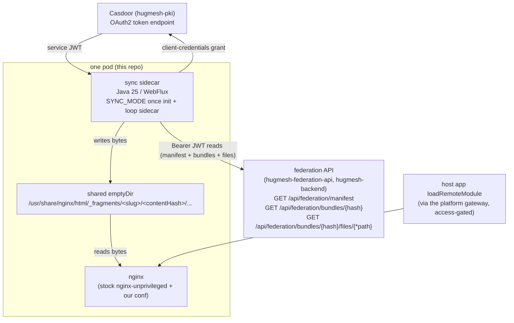
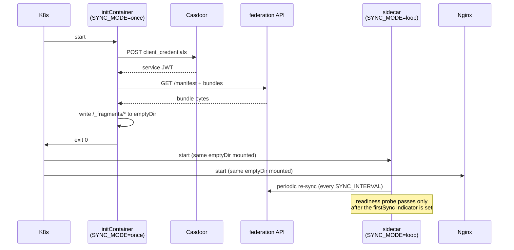

The **sync-and-serve-static** fragment fleet for [hugmesh-host-shell](https://github.com/hugmesh/hugmesh-host-shell), part of the [HugMesh](https://github.com/hugmesh) platform.

This service serves the platform's federated fragment bundles as static files: user-profile/card modules, public vanity-profile fragments, and admin "contained pages". The [hugmesh-federation-api](https://github.com/hugmesh/hugmesh-federation-api) publishes them. Each pod runs a stock `nginxinc/nginx-unprivileged` that serves a content-addressed copy of the enabled fragments on disk. A Java sidecar keeps that copy current by pulling from the federation API. A proxy that asks federation on every request is a pipe with opinions; this one serves files. Because nginx serves static bytes with no proxy hop, the fleet scales out and caches well.

## Where this fits in the platform

| | |
|---|---|
| **Tier** | Frontend (edge static delivery), behind the platform's gateway |
| **Namespace** | `hugmesh-frontend` (the federation API it pulls from lives in `hugmesh-backend`; Casdoor in `hugmesh-pki`) |
| **Identity** | A Casdoor **machine account** (`app-fragment-sync`), client-credentials grant — NOT an end-user. It has no interactive login surface. |
| **Data store** | **None.** The federation manifest is the source of truth; the local nginx root is an ephemeral, content-addressed mirror re-derived on every pod start. |
| **Runtime** | Java 25, Spring Boot 4.0.7, WebFlux + reactive WebClient (no database, no message broker, no service registry). GraalVM-native-capable, like the rest of the platform's Java services. |

This service only consumes federation, in one direction. It does not register, moderate, or own modules, and it enforces no RBAC of its own. Its job: mint a service token, read the manifest that token may see, mirror those bytes to disk, let nginx serve them. Federation makes every authorization decision: who may see which fragment, which brand/domain a fragment belongs to, and the admin/mod kill-switch. This fleet receives, and so serves, only the bytes its service token may fetch.

## Architecture: sync-and-serve-static



Nothing proxies a request to the federation API. The sidecar syncs bundles into the local nginx root once, then at an interval, and nginx serves them as static files. The gateway and federation enforce RBAC, visibility and domain scoping. These pods serve only the bytes their service token may fetch.

The pod has three containers that share one `emptyDir` volume mounted at `/usr/share/nginx/html`:

* an **initContainer** runs the sidecar image with `SYNC_MODE=once`. It does a full sync, then exits 0 if the manifest sync completed and 1 if it failed (`FragmentSyncRunner.runOnceBlocking`). A bundle that fails on its own is logged and counted, and does not change the exit code. Exit 0 therefore means the manifest sync finished, not that every bundle landed;
* the **sidecar** runs the same image with `SYNC_MODE=loop` and re-syncs on an interval, so the fleet follows federation's kill-switch within one interval;
* the **nginx** container serves the shared volume as static files.

The initContainer and the sidecar use the same image; `SYNC_MODE` selects the behavior.

The pod starts in this order:



## The gateway, Casdoor, federation, and multi-tenancy

* **The platform gateway** is the only public ingress to the served bytes. The host app's `loadRemoteModule` requests reach `/_fragments/...` through the gateway, which owns the public access rules (data-driven, keyed on route). Besides `/_fragments/` and `/healthz`, the image's conf (`nginx/nginx.conf`) answers 404 (`location / { return 404; }`). The conf the reference Deployment mounts (`deploy/nginx.conf`) ends in `location / { try_files $uri =404; }` instead, so it would serve any other file that exists under the nginx root.
* **Casdoor (`hugmesh-pki`)**: the sidecar mints a **service JWT** with the OAuth2 **client-credentials** grant against the in-cluster Casdoor token endpoint. Federation is an OAuth2 resource server, so every manifest and bundle read carries `Authorization: Bearer <casdoor-jwt>`. The token's **authorities** decide what the manifest returns.
* **federation API (`hugmesh-federation-api`)** is the authoritative catalog. Its `ManifestService` cuts by visibility (`public` vs `internal`), applies the scope-override kill-switch, drops circuit-open remotes, and cuts **per domain** in the query itself.
* **Multi-tenancy / multi-brand (the domain-scoping intent).** The platform is multi-brand and multi-tenant. Federation derives a caller's brand from a validated Casdoor **issuer** and surfaces it as a `DOMAIN_<x>` authority. `ManifestService.render(authorities, scope)` then pins the module and active-scope-override finders to that domain. A brand-X principal's manifest lists only brand-X remotes, and a brand-X `scope=all` kill never blanks brand-Y. A `SUPERADMIN` authority gets the un-pinned, cross-brand control-plane tier.

  **This fleet inherits domain scoping.** It has no domain, tenant, or issuer logic of its own. It presents the configured service token and mirrors whatever per-brand manifest subset federation returns. The intended topology is **one fragment fleet per brand/domain**, each with one `app-fragment-sync` machine account whose issuer is bound to that brand's Casdoor. Each fleet's token then carries the right `DOMAIN_<x>`, so each fleet syncs and serves only its own brand. This is a plan, not a deployment: the reference cluster runs one fleet (see [Roadmap](#roadmap)). Content-addressed paths are tenant-safe: a `<slug>/<contentHash>` URL names the same bytes whichever fleet wrote them.

## The federation API contract

All three calls require a valid Casdoor JWT. The federation security config gates the manifest and `/api/federation/bundles/**` with `authenticated()`, and the pods present a service token to satisfy that gate. The metadata call adds the scoping shown in the table.

| Call | Returns | Used for |
|------|---------|----------|
| `GET /api/federation/manifest` | `{ generatedAt, remotes:[ { slug, displayName, kind, remoteEntryUrl, exposedModule, version, contentHash, visibility, metadata } ] }` | The source set. Only **enabled + circuit_state='closed' + visibility-permitted + in-domain** modules appear, so the admin/mod **kill-switch and per-brand cut are honored automatically**. This fleet filters `remotes` to `kind == "fragment"`. |
| `GET /api/federation/bundles/{contentHash}` | `BundleMetadata` (`slug`, `contentHash`, `manifestJson`, `visibility`, ...). Federation returns a public-safe view without `versionDir` or `ownerUserId`; the client record has those fields, and they arrive null. | `manifestJson` is the per-bundle file list (multi-file). **Owner- and brand-scoped** (see [Authorization model](#authorization-model-service-token-only)): a hash outside the caller's scope returns 404. |
| `GET /api/federation/bundles/{contentHash}/files/{*path}` | the file bytes (content-type by extension) | The actual sync read; streamed to disk. Any authenticated caller: no owner or brand scoping, the 256-bit hash is the capability. |

`contentHash` (SHA-256 hex of the bundle tree) does three jobs. It is the **sync key** that says whether a bundle is already on disk. It is the **version discriminator**, so old and new bundles sit side by side. And it is the **immutable path segment** that allows long-lived HTTP caching.

### Sync behavior (all in `FragmentSyncService`)

Each sync run goes in this order:

1. **Filter**: fetch the manifest and keep only `kind == "fragment"` remotes. Federation has already dropped disabled, circuit-open, invisible, and out-of-domain rows, so this client-side filter is a final narrowing.
2. **Dedupe**: skip any `<slug>/<contentHash>` directory already on disk. The hash is content-addressed, so an existing directory is complete and correct; nothing is re-fetched.
3. **Atomic write**: for each new bundle, stream every file into a `.part` temporary inside a per-bundle staging directory, then promote the whole staging directory atomically. The bundle directory appears only once every file has landed. A staging directory (`.<contentHash>-stage-<random>`, inside the slug directory) is removed when its bundle fails. The prune step deletes any dot-prefixed leftover on the next run, so retries are safe.
4. **Prune**: delete any `<slug>/<contentHash>` directory no longer in the manifest (the fragment was disabled, removed, kill-switched, or is out of domain). Empty slug directories and leftover dot-prefixed staging directories go at the same time. A manifest entry with no `contentHash` counts as skipped, and nothing is fetched for it.
5. **Index**: write `/_fragments/index.json`: `{ generatedAt, fragments: { <slug>: { contentHash, version, remoteEntryUrl, exposedModule, displayName, visibility, servePath } } }`. `servePath` is `/_fragments/<slug>/<contentHash>/`.

**Resilience:** one bad bundle is logged and skipped (`onErrorResume`). It never aborts the run or the periodic loop. If the manifest call fails, the previous on-disk state stays, so a transient federation outage never empties the fleet.

All blocking filesystem I/O runs on `Schedulers.boundedElastic()`. The WebFlux event loop is never blocked.

### Multi-file vs. single-file bundles

The sync reads the file list from the bundle's `manifestJson` field. As of this writing, federation takes one file per bundle upload and stores `manifestJson` as `"{}"` unless the uploader passes the optional `manifest` parameter (`BundleService` sets `"{}"` when it is null). So in practice the sync takes the fallback path and fetches the single entry file `remoteEntry.json`. The fallback name is fixed in the sync (`DEFAULT_ENTRY_FILE`); the sync does not read the bundle's own entry-file name. The multi-file path is implemented and turns on once federation ships real multi-file bundles. This repo needs no change for it.

When `manifestJson` is non-empty and parseable, the sync accepts three shapes:

| Shape | Example |
|-------|---------|
| JSON array of strings | `["remoteEntry.json", "chunks/main.js"]` |
| JSON array of objects (key `path`, `name` or `file`, first one present wins) | `[{"path": "remoteEntry.json"}, {"name": "chunks/main.js"}]` |
| Object with `files` key | `{"files": ["remoteEntry.json", "chunks/main.js"]}` |

Nested paths such as `chunks/main.js` go over the wire as they are. Federation maps the file route as a `{*path}` wildcard, so the slash is sent literally, not percent-encoded.

## Key modules

| Module | Role |
|--------|------|
| `RemoteFragmentApplication` | Spring Boot entrypoint (the first-party sync container). |
| `casdoor/CasdoorTokenClient` | Mints + caches the Casdoor service JWT (client-credentials grant); re-mints before `expires_in`; `invalidate()` clears the cache so the next `token()` re-mints. `FederationSyncClient` calls `invalidate()` on an auth error from federation. |
| `federation/FederationSyncClient` | Reactive read client for the three federation endpoints; injects the bearer per request; clears the cached service token on a federation 401/403 so the next request re-mints. |
| `federation/FederationManifest` / `BundleMetadata` | Wire records for the manifest + bundle-metadata DTOs (`isFragment()` is the `kind` filter). |
| `sync/FragmentSyncService` | The sync engine: filter → dedupe → fetch (atomic) → prune → write `index.json`. |
| `sync/FragmentSyncRunner` | Mode driver: `once` (init-container, sync then `System.exit`) or `loop` (resilient periodic interval). |
| `sync/FirstSyncHealthIndicator` | Readiness gate — pod is ready only after the first successful manifest sync. |
| `config/SyncConfig` | Env-driven bean wiring (all values have safe local defaults). |
| `config/NativeHintsConfig` | GraalVM reflection hints for the wire records under `-Pnative`. |

## Authorization model (service-token only)

This fleet **enforces no role-gates of its own**. It is a static byte mirror. What matters is what its service token may read from federation, because that bounds what the fleet can serve:

* The federation manifest and bundle reads require only `authenticated()`. The `ROLE_USER` floor of the platform's role cascade (`SUPERADMIN → ADMIN → MOD → USER`) is enough to fetch the manifest and the file bytes.
* The bundle **metadata** call is scoped further (`BundleService.byContentHash`). A caller without `ROLE_ADMIN` reads only its own bundles, within its brand. `ROLE_ADMIN` reads any owner's bundle within its brand. A `SUPERADMIN` principal reads any bundle in any brand. `ROLE_INTERNAL` does not widen this tier. The sync reads the metadata before it fetches any file. For a bundle its token cannot read, the call returns 404 and the sync logs the bundle as failed. A machine account does not own the platform's user and admin bundles, so by federation's code `ROLE_USER` is not enough to sync them. The reference Deployment's comments say it is. This follows from reading federation's code; it has not been observed on a live mesh.
* At the `ROLE_USER` floor, federation returns **only `public` fragments**. To see `internal` fragments in the manifest, bind `app-fragment-sync` to a Casdoor role that maps to `ROLE_ADMIN` or `ROLE_INTERNAL`. This is not done by default (see [Known limitations](#known-limitations-and-design-notes)).
* The token's `DOMAIN_<x>` authority (from the validated issuer) limits the manifest to one brand, unless the token carries `SUPERADMIN`, which gets the cross-brand control-plane view. For the per-brand fleet topology, bind each fleet's machine account to its own brand's Casdoor issuer.

## Content-addressed path scheme and caching

Bundles are served at immutable, content-hashed paths:

```
/_fragments/<slug>/<contentHash>/remoteEntry.json
/_fragments/<slug>/<contentHash>/chunks/main.js
/_fragments/index.json                              # slug -> current contentHash
```

There are two nginx confs, and they differ.

* `nginx/nginx.conf` is baked into the `nginx/Dockerfile` image. It sets `Cache-Control: public, max-age=31536000, immutable` and `Access-Control-Allow-Origin: *` on content-hashed paths (`^/_fragments/[^/]+/[0-9a-f]{8,}/`), `Cache-Control: no-cache` on `/_fragments/index.json`, `Cache-Control: public, max-age=60` on any other `/_fragments/` path, and `autoindex off`.
* `deploy/nginx.conf` is what the reference Deployment mounts from the `remote-fragment-nginx` ConfigMap over the stock image. It sets only `Cache-Control: public, max-age=31536000, immutable` on content-hashed paths (`^/_fragments/[^/]+/[0-9a-f]+/`). It has no `no-cache` rule for `index.json`, no `Access-Control-Allow-Origin` header, no `max-age=60` fallback and no `autoindex` line.

Both confs re-declare the `.mjs` MIME type as `application/javascript`. Stock nginx serves `.mjs` as `application/octet-stream`, which browsers refuse to execute as ES modules. A new bundle always gets a new path, so cache-busting is automatic.

`index.json` is the slug-to-hash lookup. As of 2026-10-07 nothing in `hugmesh-host-shell` (`src/`) references `index.json`, `servePath` or `_fragments`, so no consumer of the file is on record. Federation's `remoteEntryUrl` for a vanity profile is `/_fragments/<slug>/<entry>` (`VanityPublishService.applyPublish`), with no hash, and this fleet serves only `/_fragments/<slug>/<contentHash>/...`. The hashed path reaches a client through federation's vanity endpoint (`fragmentPath`) or through `servePath` in `index.json`.

## Configuration

| Env var | yaml key | default |
|---------|----------|---------|
| `FEDERATION_BASE_URL` | `federation.base-url` | `http://hugmesh-federation-api.hugmesh-backend.svc.cluster.local:8080` |
| `SYNC_TARGET_DIR` | `sync.target-dir` | `/usr/share/nginx/html` |
| `SYNC_MODE` | `sync.mode` | `loop` (`once` = initContainer one-shot) |
| `SYNC_INTERVAL` | `sync.interval` | `PT60S` (ISO-8601 duration) |
| `CASDOOR_TOKEN_URL` | `casdoor.token-url` | `http://casdoor.hugmesh-pki.svc.cluster.local:8000/api/login/oauth/access_token` |
| `CASDOOR_CLIENT_ID` | `casdoor.client-id` | `app-fragment-sync` |
| `CASDOOR_CLIENT_SECRET` | `casdoor.client-secret` | *(empty — supplied via a Secret)* |
| `SERVER_PORT` | `server.port` | `8081` (actuator; nginx owns 8080 in-pod) |

A minimal sidecar container spec in a Kubernetes Deployment (the initContainer is identical except `SYNC_MODE: once`):

```yaml
env:
  - name: SYNC_MODE
    value: loop
  - name: SYNC_INTERVAL
    value: PT60S
  - name: FEDERATION_BASE_URL
    value: http://hugmesh-federation-api.hugmesh-backend.svc.cluster.local:8080
  - name: CASDOOR_TOKEN_URL
    value: http://casdoor.hugmesh-pki.svc.cluster.local:8000/api/login/oauth/access_token
  - name: CASDOOR_CLIENT_ID
    value: app-fragment-sync
  - name: CASDOOR_CLIENT_SECRET
    valueFrom:
      secretKeyRef:
        name: fragment-sync-casdoor
        key: clientSecret
```

### Casdoor service authentication (client-credentials JWT mint)

The federation fetch path is an OAuth2 resource server, so the sidecar must present a real Casdoor-signed **bearer JWT**, not HTTP Basic. It mints one with the OAuth2 **client-credentials** grant, the standard machine-account pattern:

```
POST {CASDOOR_TOKEN_URL}
Content-Type: application/x-www-form-urlencoded
grant_type=client_credentials&client_id=app-fragment-sync&client_secret=<secret>
-> 200 { "access_token": "<RS256 JWT>", "token_type":"Bearer", "expires_in":... }
```

The token is cached and re-minted 60 seconds before `expires_in` (30 minutes is assumed when Casdoor sends none), and on demand via `invalidate()`, which `FederationSyncClient` triggers on a federation 401/403. A service JWT with the `ROLE_USER` floor passes the `authenticated()` gate on the manifest and the file bytes, and sees **only `public` fragments** in the manifest. Its Casdoor app or user needs `ROLE_ADMIN` or `ROLE_INTERNAL` to see `internal` ones. For the bundle metadata call, see the scoping under [Authorization model](#authorization-model-service-token-only). The Casdoor init job maps `fragment-sync` to `ROLE_USER` (`init-job.yaml`, `APPS`).

### Secrets and configuration keys

On the reference HugMesh cluster, the secret material lives here:

| What | Where |
|------|-------|
| Casdoor `client_secret` for `app-fragment-sync` | The Vault path `secret/<brand>/casdoor-apps`, property `fragment-sync`. The ExternalSecret reads key `hugmesh/casdoor-apps` from the `hugmesh-vault` store. |
| Materialized into the pod | Kubernetes Secret `fragment-sync-casdoor` (via an ExternalSecret in `hugmesh-frontend`, refreshed hourly), keys `clientId` (literal `app-fragment-sync`) + `clientSecret` |
| Casdoor OAuth app | `app-fragment-sync`, `grantTypes: ["authorization_code", "client_credentials", "password"]` (the init job's default list for each app; it adds `refresh_token` for `user-bff`). A per-brand fleet would need a per-brand machine account and issuer; the reference cluster defines one fleet and one machine account. |

The image carries **no keys**. The client secret is injected at runtime via `secretKeyRef` (or your platform's equivalent).

## Building and testing

```bash
./mvnw test                     # needs no running service (federation/Casdoor stubbed); hugmesh-commons must resolve
./mvnw package -DskipTests      # runnable Spring Boot fat jar in target/
make native                     # GraalVM native binary + a runtime smoke test
make native-compile             # native binary only, no smoke test
./mvnw -Pnative native:compile  # the raw compile, if you have GraalVM on JAVA_HOME
```

Use `make native`. It runs [`scripts/native-build.sh`](scripts/native-build.sh),
which compiles the binary and then **runs it** against a stub federation and a stub
Casdoor ([`scripts/NativeSmoke.java`](scripts/NativeSmoke.java)) in **both** shapes the
pod uses:

| leg | mode | asserts | covers |
|---|---|---|---|
| 1 | `SYNC_MODE=once` (initContainer) | the bundle's files (including a nested path) and `index.json` land on disk with the right bytes | reactive `WebClient` POST + form body, the Jackson-3 codec into the `FederationManifest`/`BundleMetadata` records, Jackson-2 `readTree` of the `manifestJson` string, `FragmentSyncRunner` ONCE + `System.exit` |
| 2 | `SYNC_MODE=loop` (sidecar) | `/actuator/health/readiness` returns `200 UP` over HTTP, carrying `FirstSyncHealthIndicator`'s live counters | `Flux.interval`/`concatMap` under Substrate, the embedded Netty **server** (leg 1 only exercises the client), the actuator endpoint and its detail-map serialisation |

CI's `build:native` job runs the same script. The Makefile passes the same
`GRAALVM_IMAGE` / `NATIVE_BUILD_IN_DOCKER=1` / `NATIVE_IMAGE_OPTIONS=-J-Xmx6g` that job
sets, so the toolchain and the builder heap cap match, and a red pipeline
reproduces locally with one command. One thing still differs: where the
private `hugmesh-commons` comes from. Off CI there is no `CI_JOB_TOKEN`, so the script
bind-mounts your `~/.m2` instead of resolving cold from the GitLab registry. Set
`NATIVE_BUILD_IN_DOCKER=0` to use a locally installed GraalVM instead of the
pinned image.

`make native` sets `NATIVE_BUILD_IN_DOCKER=1`, so it builds inside `ghcr.io/graalvm/graalvm-community:25`. The script's own default is `auto`: it uses a local GraalVM if it finds one, and otherwise the container. With neither GraalVM nor Docker it fails rather than skipping.

Measured on a 28-core x86 dev box, container path, warm `~/.m2`, over six runs in two
sessions: `native-image` took **54 s to 1 min 50 s** (Maven total 1:01–2:03) for a
**118 MB** binary, and both smoke legs added about **10 s**. The AOT-processed binary
reports `Started RemoteFragmentApplication in 0.109 seconds`. Load explains the spread:
the fast end is an idle box, the slow end a box running other containers. The job's
`timeout: 45m` is sized for a slower, busier shared runner resolving Maven cold.

The build needs a warm `~/.m2`, as `./mvnw test` does: `net.hugmesh:hugmesh-commons`
is private and is **not on Maven Central**. The build container runs with `HOME=/tmp`
so Maven never writes into the bind-mounted workspace. That also hides your `~/.m2`,
so the script mounts it in. Run `./mvnw test` once first if yours is cold, or point
`NATIVE_BUILD_M2` at a Maven repo that has the artifact. With no usable repo and no
`CI_JOB_TOKEN`, the script stops **before** compiling and says which of the two is
missing. Without that check the run dies half a minute later inside Maven as
`Could not find artifact net.hugmesh:hugmesh-commons:jar:2.1.0 in central`, which
names the one repository the artifact was never in. On CI the token is present, so the
job resolves from the GitLab registry and mounts nothing.

The **resource** side of the native configuration has no hand-written hints. Spring Boot's AOT step emits it. The generated
`target/spring-aot/main/resources/META-INF/native-image/net.hugmesh/remote-fragment/reachability-metadata.json`
holds the `application*.yml` glob (26 resource globs in all) and the four app
records `NativeHintsConfig` registers: `FederationManifest`, `FederationManifest$Remote`,
`BundleMetadata` and `FragmentSyncService$SyncResult`, each with
`allDeclaredConstructors`/`allDeclaredFields`/`allDeclaredMethods`.

A dropped resource glob does fail the gate, but only through one assertion. Measured in the
review of 2026-09-04: the smoke was re-run against the already-built binary with
`SPRING_CONFIG_LOCATION=optional:file:/tmp/no-such-config/`, so no `application.yml` at
all. **Leg 1 passed completely**: exit 0, both bundle files and `index.json` on disk.
`NativeSmoke` hands the binary `FEDERATION_BASE_URL`, `CASDOOR_TOKEN_URL`,
`CASDOOR_CLIENT_ID`, `CASDOOR_CLIENT_SECRET`, `SYNC_TARGET_DIR`, `SERVER_PORT` and
`SYNC_MODE` as environment variables, and relaxed binding resolves every one of them
without the file. **Leg 2 caught it, through a single assertion**:
`management.endpoint.health.group.readiness.include: readinessState,firstSync` exists
only in `application.yml`. Without it the readiness group falls back to
`readinessState` alone, the body collapses to a bare `{"status":"UP"}`, and the
`firstSync` needle fails (`[smoke] FAIL: readiness body is missing "firstSync"`). The
gate fails, but one assertion wide, not two legs wide.

The binary is *run*, not just compiled, because missing native reflection metadata
does not fail `native-image`. It fails the first time the code path runs.
Both of these mutations of `NativeHintsConfig` were built and run, and **both
compiled as `BUILD SUCCESS`**:

* drop the `FederationManifest`/`.Remote` registrations → the binary exits 1 with
  *"Record components not available for record class …FederationManifest"*;
* drop the `BundleMetadata` registration → the binary exits **0**, logs
  `1 failed` and writes nothing.

The second is why the smoke test asserts files on disk and a readiness body, not just
an exit status: an exit-status-only check passes that mutation.

Re-verified on 2026-09-04 by re-applying the `BundleMetadata` mutation.
`native-image` reported `BUILD SUCCESS` (7,471 types registered for reflection
against 7,529 unmutated, so the mutation reached the image). The binary
exited **0** logging `[sync] done: 1 fragment(s) [0 synced, 0 deduped, 0 skipped, 1 failed]`,
and the gate failed only on the disk assertion: `[smoke] FAIL: expected synced file
missing: …/_fragments/smoke-ui/…/remoteEntry.json`, `make` exit 2.

Maven coordinates: `net.hugmesh:remote-fragment:0.2.0`. Java 25, Spring Boot 4.0.7, WebFlux + reactive WebClient, no database. The native profile, the `native-maven-plugin`, and `NativeHintsConfig` follow the pattern used by `hugmesh-federation-api` and the platform's other reactive Java services.

This repo builds two container images for one pod:

* the root [`Dockerfile`](Dockerfile) — the sync sidecar (JRE jar; the GraalVM native binary is an alternative build via the `native` Maven profile);
* [`nginx/Dockerfile`](nginx/Dockerfile) — the static server, i.e. the public `nginxinc/nginx-unprivileged` image with this repo's [`nginx.conf`](nginx/nginx.conf) baked in. The reference Deployment does not use this image: it runs `nginxinc/nginx-unprivileged:1.27-alpine` with `deploy/nginx.conf` mounted from a ConfigMap.

### Continuous integration

* **`.gitlab-ci.yml`** is the pipeline that builds and publishes images for the reference cluster deployment, run against an internally mirrored GitLab instance. It has four stages, `lint → test → build → pentest`. `lint`, `test` and `build:native` run on the default branch, on tags, on merge-request events and on **every mirrored branch push** (the `.verify-rules` set), which makes them a pre-merge gate here. The `pentest` jobs run on the default branch and on merge-request events, not on tags.
  * The GitHub repo is pull-mirrored into that GitLab, so a GitHub pull request never becomes a GitLab merge request, and a mirror-sync pipeline always has `CI_PIPELINE_SOURCE == "push"`. A `merge_request_event` rule alone can never fire for GitHub-originated work. Before the bare `$CI_COMMIT_BRANCH` rule was added, a mirrored feature branch matched no rule in the file and got no pipeline at all.
  * `build:sync` and `build:nginx` run on the default branch and tags only, because they push to the container registry.
  * `lint:deploy-manifest-drift` sparse-clones the central manifest from `hugmesh-generator` and byte-diffs `deploy/` against it (see [Known limitations](#known-limitations-and-design-notes)).
  * `test` runs `./mvnw -s settings.xml verify` in a container and publishes a JUnit report. All three build jobs `needs:` a green `test`.
  * `pentest` runs OWASP Dependency-Check (SCA) and an authenticated ZAP baseline scan (DAST). Both are informational (`allow_failure: true`) and come from `hugmesh-generator`'s shared pentest harness.
* **`build:native`** (in the `build` stage) compiles the GraalVM native binary in `ghcr.io/graalvm/graalvm-community:25` and then **runs it**, once as the initContainer and once as the sidecar, against a stub federation + Casdoor. A change that breaks native compatibility fails the pipeline instead of being found by hand. It runs on every mirrored branch push, the default branch and tags. The toolchain comes from the image, so no runner needs GraalVM installed; it needs only the privileged x86 runner the other jobs use. It is identical to `make native`: both run [`scripts/native-build.sh`](scripts/native-build.sh). It does not publish an image (see [Known limitations](#known-limitations-and-design-notes)).
  * The script hands `CI_JOB_TOKEN` to the build container **by name** (`docker run -e CI_JOB_TOKEN`), not as `-e CI_JOB_TOKEN=<value>`. The value form puts the token in the docker CLI's argv, and so in the **world-readable** host process table for the whole compile. That is minutes, on a shared `privileged` runner, where any local user or `ps` scraper can read it. GitLab's masking covers only job *log* output. `build:sync` passes the token as a BuildKit secret, not a build ARG, for the same reason.
  * **Scope, measured:** this closes the world-readable channel. It does not close cross-job exposure on the same runner. A sibling job can still read the value from `docker inspect <cid> --format '{{json .Config.Env}}'` (every job here has docker access) and from `/proc/<docker-cli-pid>/environ`, which is mode 0400 and owned by the one `gitlab-runner` uid a shell executor shares across all jobs. Closing those needs a file-based secret or an isolated executor, not a different `-e` form.
* **`.github/workflows/release.yml`** is a manual (`workflow_dispatch`) GitHub Actions workflow for anyone building from this repository on GitHub. It builds and pushes both images to GHCR (`ghcr.io/hugmesh/hugmesh-remote-fragment` and `.../nginx`), tagged with the first 12 characters of the commit SHA (or a tag you supply), plus `latest` when it runs on `main`. A `preflight` job runs first. It needs the repository secret `PACKAGES_READ_TOKEN` (a classic PAT with `read:packages`) and checks that it can read the `hugmesh-build-config`, `hugmesh-parent` and `hugmesh-commons` packages in GitHub Packages. The sync image build then resolves the `net.hugmesh` libraries from GitHub Packages through `.github/maven-ci-settings.xml`. Nothing runs it automatically; trigger it from the Actions tab. `gh run list` shows no run of this workflow in this repository on 2026-10-07.
* **`make pentest`** runs the same OWASP checks locally (SCA via `owasp/dependency-check`, DAST via the shared harness in `hugmesh-generator`). Both are informational and non-blocking locally. See the [`Makefile`](Makefile) for details and opt-in flags.

## Health checks and probes

* The actuator listens on `:8081`. nginx serves the `/_fragments` tree on `:8080`.
* `/actuator/health/readiness` includes a custom `firstSync` indicator: the sync container, and so the pod, is not **ready** until one manifest sync has completed. The indicator is UP once a sync result exists, even if some bundles failed; it reports `fragments`, `synced`, `deduped`, `failed` and `pruned`. The `web` container's own probes hit `/healthz` on `:8080`; the `firstSync` gate sits on the `sync` container's probe.
* Liveness does not depend on sync state. A long federation outage must not restart the pod. It keeps serving the last-good on-disk bytes until federation recovers.
* nginx answers `/healthz` with `200 ok`; the `web` container's readiness and liveness probes use it.

## Container UID note

The `nginx-unprivileged` image defaults to uid 101, and the sync `Dockerfile` sets no `USER`. The reference Deployment sets `runAsUser: 1000` for the whole pod and no container overrides it, so there both `web` and `sync` run as uid 1000. A different deployment may run them as different uids, and neither container can `chown` files to the other's uid. So the sync adds group and other read bits to every bundle file, and read plus traverse bits to every directory, so nginx can read them. `FragmentSyncService` does this on a best-effort basis (POSIX file permission APIs only; no ACL support).

## Roadmap

* **Multi-file bundle support.** Built (see [Multi-file vs. single-file bundles](#multi-file-vs-single-file-bundles)); it starts working when federation publishes bundles with more than one file.
* **`ROLE_INTERNAL` fragment serving.** To see `internal` fragments in the manifest, bind `app-fragment-sync` to a Casdoor role that maps to `ROLE_INTERNAL` / `ROLE_ADMIN` (see [Authorization model](#authorization-model-service-token-only)). That is configuration, not code in this repo. The metadata scoping there still applies.
* **Per-brand fleet topology.** One fleet and one issuer-bound `app-fragment-sync` machine account per brand/domain (see [multi-tenancy](#the-gateway-casdoor-federation-and-multi-tenancy)). Federation's per-domain filtering is in place. The reference cluster has not been provisioned that way.

## Known limitations and design notes

* **Multi-file bundles are implemented but not yet exercised against a real federation**, because federation does not produce them. Unit tests and the native smoke test (stub federation, nested path) cover a synthetic multi-file `manifestJson`; end-to-end tests cover the single-file fallback.
* **Domain scoping is inherited, not implemented locally.** See [multi-tenancy](#the-gateway-casdoor-federation-and-multi-tenancy).
* **`internal` fragments need an explicit role binding.** The default service account sees only `public` fragments in the manifest.
* **Parent POM choice.** This project parents directly on `spring-boot-starter-parent`, not the platform's shared `hugmesh-parent` metapom. `hugmesh-parent` carries a shared `<dependencies>` block written for the platform's reactive BFF services (Spring Security, an OAuth2 resource server, R2DBC, PostgreSQL, Liquibase). Inherited by this database-less, filter-less machine client, it would lock every non-`actuator/health`/`info` path behind a randomly generated HTTP Basic password and add an unused SpringDoc/Swagger surface. So this project depends directly on `hugmesh-commons` (pinned version, with `<exclusions>` stripping those same transitive artifacts) to stay aligned with the fleet without that side effect. No class in this repo uses `hugmesh-commons`; there is no security or tenancy surface here to move onto it.
* **No cross-restart pruning is needed.** The nginx root lives in an `emptyDir` that is re-derived from the manifest on every pod start, so a removed fragment is simply absent after a restart. The sync's prune step exists for the *live*, long-running loop.
* **Horizontal autoscaling requires a metrics-server** in the cluster. The reference Deployment leaves `replicas` unset on purpose, because pinning it made ArgoCD and the HPA overwrite each other (comment in `deploy/deployment.yaml`). The HPA owns the count: 2 to 6 replicas at 70% average CPU (`deploy/hpa.yaml`). `hpa.yaml` says the HPA stays inert until a metrics-server is installed. What count runs without a metrics-server is not established here; the comments in `hpa.yaml` and `hugmesh-deploy.yaml` still describe a `replicas: 2` floor that `deployment.yaml` no longer sets. A PodDisruptionBudget (`minAvailable: 1`) covers the pods.
* **The in-repo `deploy/` Kustomize tree and `hugmesh-deploy.yaml`** are prepared for a future GitOps source (a self-hosted, Git-backed service catalog). They are not the live deployment path today. The reference cluster deploys from a central manifest in [`hugmesh-generator`](https://github.com/hugmesh/hugmesh-generator) at `specs/cluster/manifests/remote-fragment/`. `deploy/` is a **verbatim copy** of that manifest, not a fork: there are no sanctioned local divergences, so anything repo-specific lands centrally first and is copied here after. Nothing running today renders the copy, so it cannot fail loudly on its own. A script checks it instead. `scripts/check-deploy-drift.sh` byte-diffs `deploy/` against the central manifest in both directions. It runs in CI as `lint:deploy-manifest-drift` and locally as `make check-deploy-drift GENERATOR_ROOT=…`. With no central manifest to compare against it exits `3` (INCOMPLETE), not a green run that checked nothing. Wiring a GitOps source at this repo, which would retire the copy, is future work.
* **The native binary is built and run in CI, but not published as an image.** `build:native` compiles it and smoke-runs it on every mirrored branch push, the default branch and tags, so native regressions fail the pipeline. It does *not* package the binary into a container. The published sync image is still the JRE-jar build from the plain `Dockerfile`. Switching is a deliberate, separate decision: a native image starts in ~100 ms instead of ~1.5 s and drops the JRE layer, at the cost of a much longer build and a different failure surface.
* **`build:native` is shown to verify something real, but not shown live: its CI-only code path has never run anywhere.** `make native` runs the *same file* as the job, but not the same *path*. With no `CI_JOB_TOKEN` the script branches the other way at all three decision points (preflight → resolve from the local `~/.m2`; `M2_MOUNT` → bind-mount it into the container; `MVN_SETTINGS` → empty). `build:native` takes the opposite at each (nothing mounted, a cold `/tmp/.m2` inside the container, `-s settings.xml`). That unrun path is the one that produces `Could not find artifact net.hugmesh:hugmesh-commons:jar:2.1.0 in central` when a variable is wrong.
  * The 2026-09-04 review closed most of the gap without a runner. A stub HTTPS Maven server was stood up at the group-registry URL shape, and the real script ran with `CI_JOB_TOKEN`/`CI_API_V4_URL`/`GITLAB_GROUP_ID` set. The CI branch was taken at all three points. `hugmesh-commons` 2.1.0 and `hugmesh-parent` 2.8.0 resolved **cold** from `${CI_API_V4_URL}/groups/${GITLAB_GROUP_ID}/-/packages/maven`. Spring AOT ran, and `native-image`'s analysis reached **22,925 types / 7,529 registered for reflection**, identical to the warm green runs. Host memory pressure then killed the runs (`-J-Xmx6g` on a box with ~6 GB free). That is an environment kill, not a path defect.
  * Still unvalidated: the real in-cluster registry's `Job-Token` auth and URL semantics (the stub accepts anything), and the first live execution.
  * `preflight_commons` also asserts `CI_API_V4_URL` is `https` (or an http loopback). Maven 3.9's `maven-default-http-blocker` (`<mirrorOf>external:http:*</mirrorOf>`) would otherwise fail the first run with `Blocked mirror for repositories: [gitlab-maven (http://…)]`, a mirror nobody configured.
  * The shared `.verify-rules: &verify_rules` anchor has never been through GitLab's own loader. Of the 46 `.gitlab-ci.yml` files checked out on the box that did this survey, the *definition* shape (a top-level hidden key whose value is a **list**, carrying an anchor) is not unique: `hugmesh-forum-api` does the same with `.composer_setup: &composer_setup`. The *dereference* shape is: this is the only file where an alias supplies the **entire value** of a job key (`rules: *verify_rules`), not one spliced-in list element. It parses as YAML, and the resulting rules were re-evaluated across five pipeline scenarios (mirrored-branch push, default-branch push, tag, merge-request event, schedule) with zero `needs:` violations. If GitLab's loader rejected it, every job's `rules` would be undefined and the gate would be off in a way no local check can see. One run through GitLab CI Lint, or a switch to `!reference [.verify-rules, rules]`, would retire that risk.
* **The native job exists only in `.gitlab-ci.yml`, not in GitHub Actions.** `release.yml` is the only workflow here. `scripts/native-build.sh` knows two ways to get `net.hugmesh:hugmesh-commons`: the GitLab registry through `CI_JOB_TOKEN`, or a local `~/.m2`. It has no GitHub Packages path, which `release.yml` reaches only through the Dockerfile's second settings file. A GitHub Actions native job needs that path added to the script, and a runner that holds `PACKAGES_READ_TOKEN`. `hugmesh-commons` is not on Maven Central. The root `settings.xml` still points at the GitLab registry, which `.github/maven-ci-settings.xml` calls "retired". Whether the internal GitLab still runs this pipeline is not established here. Earlier, GitLab's `build:sync` omitted the `CI_API_V4_URL` and `GITLAB_GROUP_ID` build args and the `ci_job_token` secret, and nobody noticed because `test` could never pass, so that job never ran. `build:sync` now passes all three (ARG and secret values are not inherited from the runner environment). A root [`.dockerignore`](.dockerignore) keeps `target/`, including the ~128 MB native binary `build:native` leaves in the shared workspace, out of that build context. `hugmesh-commons` is declared for fleet-artifact alignment and no class in this repo uses it (see the `pom.xml` comment). It is the only `net.hugmesh` dependency in the pom, so dropping it should leave a build that resolves from Maven Central alone. That is a fleet-wide decision, not a CI one.
* **The service never validates the Casdoor token itself.** It only mints and forwards it. Federation, as the resource server, validates the JWT.

## Related HugMesh projects

* [hugmesh-federation-api](https://github.com/hugmesh/hugmesh-federation-api) — the federation catalog this fleet syncs from; owns visibility, the kill-switch, and per-domain scoping.
* [hugmesh-host-shell](https://github.com/hugmesh/hugmesh-host-shell) — the frontend host application that loads fragments served by this fleet via `loadRemoteModule`.
* [hugmesh-generator](https://github.com/hugmesh/hugmesh-generator) — source of the shared pentest CI stage and the reference cluster's central deployment manifests.
* [hugmesh-commons](https://github.com/hugmesh/hugmesh-commons) — the shared library this project depends on for artifact alignment with the rest of the Java fleet.
* [hugmesh-auth-core](https://github.com/hugmesh/hugmesh-auth-core) — the platform's shared account/session/MFA/Casdoor-admin library, used by the user- and admin-facing backends. Out of scope for this service, which has no interactive auth surface.

## Contributing

Issues and pull requests are welcome. Before you submit a change:

1. Run `./mvnw test`. It stubs out federation/Casdoor, so it needs no running service. It does need `net.hugmesh:hugmesh-commons` to resolve (see [Building and testing](#building-and-testing)).
2. If you touch the sync path, add or adjust a unit test rather than rely on manual checks. See `src/test/java` for the style (`FragmentSyncServiceTest`, `FederationSyncClientTest`, `CasdoorTokenClientTest`).
3. Keep configuration changes backward compatible with the defaults documented above where practical, or call out the break in your PR description.

## License

[MIT](LICENSE)
