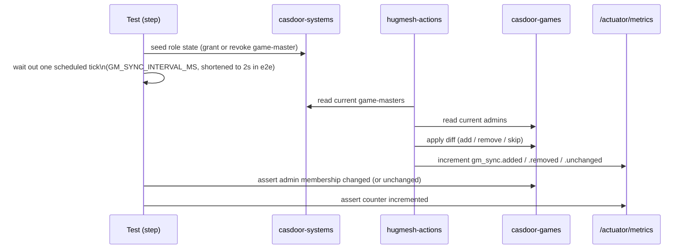

End-to-end tests using Playwright and playwright-bdd. The suite has
two concerns:

1. **Cross-stack admin sync** — verifies that granting or revoking the
   `game-master` role in the *systems* Casdoor instance propagates
   correctly to the *games* Casdoor instance via `hugmesh-actions`,
   and that Prometheus counters reflect each outcome.
2. **Per-role access matrix** — locks in the `SecurityConfig`
   path-matchers by hitting protected endpoints as each role tier and
   asserting the correct HTTP response.

## Layout

```
e2e/
├── features/
│   ├── sync/cross-stack-admin-sync.feature   ← the headline test
│   ├── auth/per-role-access.feature          ← role gate matrix
│   ├── steps/
│   │   ├── sync-steps.ts
│   │   ├── auth-steps.ts
│   │   └── helpers/{casdoor.ts, actions.ts, login-ui.ts}
│   └── support/fixtures.ts                   ← AfterStep PNG hook
├── playwright.config.ts                      ← bdd project, video=on
├── scripts/bring-up-stack.sh                 ← docker compose orchestrator
├── package.json
└── results/                                  ← HTML report + videos
```

## Running

Run all commands from the repository root.

```bash
# 1. Start casdoor-systems, casdoor-games, and hugmesh-actions via Docker Compose.
bash e2e/scripts/bring-up-stack.sh

# 2. Install dependencies and run the full BDD suite.
npm --prefix e2e install
npm --prefix e2e test

# 3. Open the HTML report in your browser (per-step PNGs + per-scenario videos).
npm --prefix e2e run report

# 4. Tear down all containers when done.
bash e2e/scripts/bring-up-stack.sh stop
```

## What the suite proves

### `cross-stack-admin-sync.feature` (3 scenarios)

Each scenario drives the full sync loop: it seeds state in both
Casdoor instances, triggers a sync tick in `hugmesh-actions`, then
asserts both the Casdoor side-effect and the Prometheus counter.



| Scenario | Arrange | Trigger | Assert |
|---|---|---|---|
| grant flows through | User exists on both Casdoors; no admin role on games | Grant `game-master` on systems | Next sync tick adds admin on games; `gm_sync.added` counter increments |
| revoke flows through | User holds `game-master` on systems and admin on games | Remove `game-master` on systems | Next tick removes admin on games; `gm_sync.removed` counter increments |
| in-sync is no-op | Both sides have empty role sets | Sync tick | No Casdoor write occurs; `gm_sync.unchanged` counter increments |

### `per-role-access.feature` (6 scenarios)

One scenario per role tier hits three endpoints that each require a
different authority level, asserting the correct HTTP status for that
tier. A regression in any `SecurityConfig` path-matcher causes the
corresponding scenario to fail immediately.

| Endpoint | Required role | Anonymous | player | producer | mod | game-master | admin |
|---|---|---|---|---|---|---|---|
| `GET /actuator/health` | public | 200 | 200 | 200 | 200 | 200 | 200 |
| `GET /actuator/metrics` | `ROLE_GAME-MASTER` | 401 | 403 | 403 | 403 | 200 | 200 |
| `POST /api/registration/github-org-admin/evaluate` | `ROLE_ADMIN` | 401 | 403 | 403 | 403 | 403 | 200 |

> **Note:** The `200` for `admin` above is the target behaviour once the
> GitHub-org-admin feature is enabled. The feature's master switch
> (`app.actions.gh-org-admin.enabled` / `GH_ORG_ADMIN_ENABLED`) defaults to
> `false` and is not set in `compose.yaml` or `bring-up-stack.sh`, so as the
> stack is wired today an admin caller gets `404` instead. See the top-level
> README's Known Gaps section.

> **What is actually asserted today.** Only the **anonymous** scenario
> runs end-to-end right now — it needs no bearer token. The five
> authenticated tiers (player / producer / mod / game-master / admin)
> depend on real per-role tokens, and the bring-up's token-generation
> step is still a stub (see [Token wiring](#token-wiring)); until it is
> wired, those scenarios fail at the `Given "<role>" is authenticated`
> step (the helper throws when no token is present) rather than
> exercising the role gate. The SecurityConfig path-matchers themselves
> are meanwhile locked in by the JVM `SecurityConfigPathRulesTest` /
> `SecurityConfigSpecPathsTest` unit tests, which do not need tokens.

## Reports

Every run writes the following artifacts under `e2e/results/`:

| Artifact | Path | Notes |
|---|---|---|
| HTML report | `html/index.html` | Browsable; open with `npm --prefix e2e run report` |
| Step screenshots | `artifacts/<test>/attachments/step-NN-….png` | One PNG per Gherkin step, linked inside the HTML report |
| Scenario video | `artifacts/<test>/video.webm` | Captured for every scenario, not just failures |
| Trace archive | `artifacts/<test>/trace.zip` | Failure only; replay with `npx playwright show-trace <path>` |

## Login policy — native login-ui form only, never Casdoor's hosted page

Two distinct things get conflated as "login". This suite keeps them apart:

**1. Browser login → OUR login-ui native form (never Casdoor).**
Any scenario that logs a user in through a real browser goes through our own
login-ui native username/password form — never Casdoor's hosted login page.
The helper lives in `helpers/login-ui.ts`:

- `loginViaNativeForm(page, { username, password, mfaPasscode? })` fills the
  login-ui form by its test ids — `login-username`, `login-password`,
  `login-submit` — and submits.
- Submitting POSTs `/bff/login` (user-bff, reached **via be-gateway**;
  `permitAll` at the BFF security layer). user-bff runs the entire OIDC/PKCE
  handshake with Casdoor **server-side**: it generates the PKCE
  `code_verifier` + S256 `code_challenge` and a random `state` itself, POSTs
  Casdoor's internal `/api/login`, exchanges the returned code via auth-core's
  `OidcExchangeClient`, and completes provision + custody + cookie.
- The browser never receives a JWT / access / refresh / id token, the
  `code_verifier`, the `state`, or any Casdoor URL. The only credential handed
  back is the opaque, httpOnly `bff_<opaque>` session cookie in the
  `Set-Cookie` header (`SameSite=Lax`, host-only). **The session token appears
  only in Set-Cookie, never in the response body.**

`/bff/login` response contract:

| Case | Status | Body | Cookie |
|---|---|---|---|
| success | 200 | `{ registrationComplete, status:"active", mfaRequired:false }` | `Set-Cookie: bff_<opaque>` |
| MFA required | 200 | `{ mfaRequired:true, mfaType:[…] }` | none (no session minted) |
| bad credentials | 401 | `{ error:"invalid_credentials", message:<casdoor msg> }` | none |
| SSO surface dark | 503 | — | none |

(503 when `app.bff.oidc.enabled=false` or the custody key is blank.)

`bffLogin(creds)` in the same helper is a headless stand-in that POSTs
`/bff/login` through be-gateway directly — still OUR contract endpoint, never
Casdoor's hosted form — for asserting the response contract without a browser.

> **login-ui dependency.** The browser helper drives login-ui test ids
> `login-username` / `login-password` / `login-submit`, plus
> `login-mfa-passcode` for the MFA follow-up (login-ui will add this one). The
> browser-login helpers target the full platform stack via `LOGIN_UI_URL`
> (default `http://localhost:8081`) and `GATEWAY_BASE_URL` (default
> `http://localhost:8080`); the actions-only compose in this repo does not ship
> login-ui / be-gateway / user-bff, so browser-login scenarios require the full
> platform stack to be up.

**2. Server-side token acquisition for test SETUP → may hit Casdoor directly.**
Minting a Bearer JWT to seed or assert cross-stack state directly against the
actions API is **server-to-server**, not a browser login, so it is allowed to
call Casdoor's token endpoint directly. Those paths are labelled
**SERVER-SIDE ONLY**:

- `helpers/casdoor.ts` — Casdoor admin REST API (add-user / get-role /
  update-role) that seeds and asserts role state.
- `scripts/bring-up-stack.sh` — per-role Bearer JWT minting via Casdoor's
  OAuth2 password grant / token endpoint.

Neither renders Casdoor's hosted login form or logs a user in through a browser.

## Token wiring

`auth-steps.ts` supplies bearer tokens to role-authenticated requests.
It looks for tokens in the following order:

1. **`e2e/.tokens.json`** — written by `bring-up-stack.sh` once the
   Casdoor seed data has settled. `auth-steps.ts`'s `tokenFor()` looks
   the key up by the *exact* role string the `.feature` file passes to
   `Given "<actor>" is authenticated with role "<ROLE>"` (no case/format
   translation), so the keys must match those literally:
   ```json
   {
     "ADMIN":       "<bearer token>",
     "GAME-MASTER": "<bearer token>",
     "PRODUCER":    "<bearer token>",
     "MOD":         "<bearer token>",
     "USER":        "<bearer token>"
   }
   ```
2. **Environment variables** — fallback when `.tokens.json` is absent
   or missing a key (`tokenFor()` upper-cases and `-`→`_`s the role for
   this lookup only): `TOKEN_ADMIN`, `TOKEN_GAME_MASTER`, `TOKEN_PRODUCER`,
   `TOKEN_MOD`, `TOKEN_USER`.

> **Note:** The token-generation step in `bring-up-stack.sh` is
> currently a stub — it writes `e2e/.tokens.json` as an empty `{}`
> (`e2e/scripts/bring-up-stack.sh:77`). Wiring it to the real Casdoor
> token-grant endpoint is a follow-up task. Until then, every
> authenticated scenario **fails** at the `Given "<role>" is
> authenticated` step — `tokenFor()` throws (`No token found for role
> …`) rather than skipping. See the "What is actually asserted today"
> note above for the per-role-access-matrix consequence of this.

## Known Gaps / TODO

- **`GM_SYNC_INTERVAL_MS` is never actually shortened for e2e runs.**
  `bring-up-stack.sh`'s header comment (`e2e/scripts/bring-up-stack.sh:6`)
  and its body comment (`e2e/scripts/bring-up-stack.sh:31-32`, "an e2e
  overlay that shortens the sync tick") both describe an override to
  `2000`ms, but no such override file exists and the script only runs
  `docker compose -f compose.yaml up -d --wait` (`e2e/scripts/bring-up-stack.sh:33`)
  against the repo-root `compose.yaml`, which does not set
  `GM_SYNC_INTERVAL_MS` — so the action service actually runs the
  `application.yml` default of `60000`ms. Meanwhile
  `waitForSyncTick()` (`e2e/features/steps/helpers/actions.ts:38-43`)
  falls back to `process.env.GM_SYNC_INTERVAL_MS ?? '2000'` and only
  waits `2.2×` that value (~4.4 s) when the env var isn't set. As wired
  today the sync scenarios wait roughly 4.4 s for a tick that actually
  fires every 60 s, which reads as a likely source of flakes/failures
  in `cross-stack-admin-sync.feature` rather than the documented
  guaranteed tick crossing. Either add the missing compose override (set
  `GM_SYNC_INTERVAL_MS=2000` on the `hugmesh-actions` service for the
  e2e stack) or raise the helper's default/timeout to match the real
  60 s interval.
