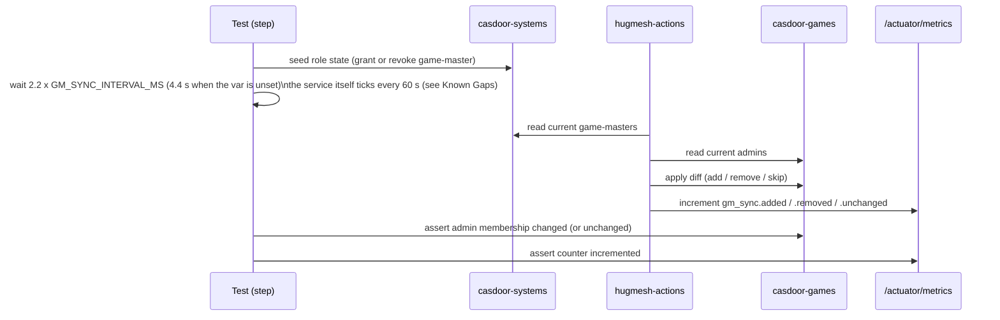

End-to-end tests with Playwright and playwright-bdd. The suite has two parts:

1. **Cross-stack admin sync** — checks that granting or revoking the
   `game-master` role in the *systems* Casdoor propagates to the *games*
   Casdoor through `hugmesh-actions`, and that the Prometheus counters record
   each outcome.
2. **Per-role access matrix** — pins the `SecurityConfig` path-matchers by
   calling protected endpoints as each role tier and asserting the HTTP
   response.

## Layout

```
e2e/
├── features/
│   ├── sync/cross-stack-admin-sync.feature   ← the headline test
│   ├── auth/per-role-access.feature          ← role gate matrix
│   ├── steps/
│   │   ├── sync-steps.ts
│   │   ├── auth-steps.ts
│   │   └── helpers/{casdoor.ts, actions.ts, login-ui.ts, e2e-credentials.ts}
│   └── support/fixtures.ts                   ← AfterStep PNG hook
├── playwright.config.ts                      ← bdd project, video=on
├── scripts/
│   ├── bring-up-stack.sh                     ← docker compose orchestrator
│   ├── lib/{casdoor-seed.sh, e2e-password-resolve.sh, token-mint-guard.sh}
│   └── test-{casdoor-seed,token-mint-guard}.sh  ← offline tests of the above
├── package.json
├── .tokens.json                              ← written by bring-up-stack.sh (git-ignored)
└── results/                                  ← HTML report + videos (git-ignored)
```

## Running

Run all commands from the repository root.

```bash
# 1. Start casdoor-systems, casdoor-games, and hugmesh-actions via Docker
#    Compose, then seed the systems Casdoor and mint real per-role bearer
#    tokens (see "Token wiring" below). Needs $E2E_PASSWORD or a
#    .e2e-credentials file resolvable BEFORE this runs — see "Password
#    wiring". FAILS (exit 1) if the password can't be resolved, or if
#    seeding/minting doesn't fully complete:
bash e2e/scripts/bring-up-stack.sh

#    To skip the seeder and run only the anonymous scenarios (no Casdoor
#    provisioning attempted). The password check above still runs first, so
#    this also fails (exit 1) when no password resolves:
E2E_ALLOW_ANONYMOUS_ONLY=1 bash e2e/scripts/bring-up-stack.sh

# 2. Install dependencies and run the full BDD suite.
npm --prefix e2e install
npm --prefix e2e test

# 3. Open the HTML report in your browser (per-step PNGs + per-scenario videos).
npm --prefix e2e run report

# 4. Tear down all containers when done.
bash e2e/scripts/bring-up-stack.sh stop
```

## What the suite proves

### `cross-stack-admin-sync.feature` (3 scenarios)

Each scenario runs the full sync loop. It seeds state in both Casdoors,
waits for a sync tick in `hugmesh-actions`, then asserts the Casdoor
side-effect and the Prometheus counter.



| Scenario | Arrange | Trigger | Assert |
|---|---|---|---|
| grant flows through | User exists on both Casdoors; no admin role on games | Grant `game-master` on systems | Next sync tick adds admin on games; `gm_sync.added` counter increments |
| revoke flows through | User holds `game-master` on systems and admin on games | Remove `game-master` on systems | Next tick removes admin on games; `gm_sync.removed` counter increments |
| in-sync is no-op | Both sides have empty role sets | Sync tick | No Casdoor write occurs; `gm_sync.unchanged` counter increments |

### `per-role-access.feature` (6 scenarios)

One scenario per role tier (anonymous, player, producer, mod, game-master,
admin) calls protected endpoints and asserts the HTTP status for that tier. If a
`SecurityConfig` path-matcher regresses, its scenario fails. The table shows
what the scenarios assert; `—` means no scenario checks that cell.

| Endpoint | Required role | Anonymous | player | producer | mod | game-master | admin |
|---|---|---|---|---|---|---|---|
| `GET /actuator/health` | public | 200 | 200 | — | — | — | — |
| `GET /actuator/metrics` | `ROLE_GAME-MASTER` | 401 or 403 | 403 | 403 | 403 | 200 | 200 |
| `POST /api/registration/github-org-admin/evaluate` | `ROLE_ADMIN` | 401 or 403 | 403 | 403 | 403 | 403 | 400, 422 or 500 |

> **Note:** The admin cell proves "past the auth gate", not the grant. The
> scenario POSTs `{}`. That fails `@Valid` on the request body before the
> feature's master switch is read, so an admin caller gets `400` today. A valid
> body would reach the switch (`app.actions.gh-org-admin.enabled` /
> `GH_ORG_ADMIN_ENABLED`). It defaults to `false` and neither `compose.yaml` nor
> `bring-up-stack.sh` sets it, so that caller would get `404`. A `200` grant needs
> the switch on and a valid body. See the top-level README's Known Gaps section.

> **What is actually asserted today.** `bring-up-stack.sh` now mints a
> real per-role bearer token for all five authenticated tiers (see
> [Token wiring](#token-wiring)). The mint is proven **offline only**: a
> shimmed `curl` stands in for Casdoor's admin API and OAuth2 password grant
> (`e2e/scripts/test-casdoor-seed.sh`). It has never run against a real
> `casbin/casdoor` container. **A person still needs to run
> `bash e2e/scripts/bring-up-stack.sh` and then `npm --prefix e2e
> test` against a real compose stack** to confirm that the six
> `per-role-access.feature` scenarios pass. See the root
> README / hugmesh-actions#7 for what to look for. Meanwhile the
> JVM tests `SecurityConfigPathRulesTest` and `SecurityConfigSpecPathsTest`
> pin the SecurityConfig path-matchers without tokens.

## Reports

Every run writes these artifacts under `e2e/results/`:

| Artifact | Path | Notes |
|---|---|---|
| HTML report | `html/index.html` | Browsable; open with `npm --prefix e2e run report` |
| Step screenshots | `artifacts/<test>/NN-<step title>.png` | One PNG per Gherkin step, linked inside the HTML report |
| Scenario video | `artifacts/<test>/video.webm` | Captured for every scenario, not just failures |
| Trace archive | `artifacts/<test>/trace.zip` | Failure only; replay with `npx playwright show-trace <path>` |

## Login policy — native login-ui form only, never Casdoor's hosted page

"Login" means two different things here. The suite keeps them apart.

**1. Browser login → OUR login-ui native form (never Casdoor).**
Any scenario that logs a user in through a real browser uses our own
login-ui username/password form, never Casdoor's hosted login page.
The helper lives in `helpers/login-ui.ts`:

- `loginViaNativeForm(page, { username, password, mfaPasscode? })` fills the
  login-ui form by its test ids — `login-username`, `login-password`,
  `login-submit` — and submits.
- Submitting POSTs `/bff/login` (user-bff, reached **via be-gateway**;
  `permitAll` at the BFF security layer). user-bff runs the whole OIDC/PKCE
  handshake with Casdoor **server-side**. It generates the PKCE
  `code_verifier` + S256 `code_challenge` and a random `state` itself, POSTs
  Casdoor's internal `/api/login`, exchanges the returned code via auth-core's
  `OidcExchangeClient`, then completes provision + custody + cookie.
- The browser never receives a JWT / access / refresh / id token, the
  `code_verifier`, the `state`, or any Casdoor URL. The only credential it gets
  is the opaque, httpOnly `bff_<opaque>` session cookie in the
  `Set-Cookie` header (`SameSite=Lax`, host-only). **The session token appears
  only in Set-Cookie, never in the response body.**

`/bff/login` response contract:

| Case | Status | Body | Cookie |
|---|---|---|---|
| success | 200 | `{ registrationComplete, status:"active", mfaRequired:false }` | `Set-Cookie: bff_<opaque>` |
| MFA required | 200 | `{ mfaRequired:true, mfaType:[…] }` | none (no session minted) |
| bad credentials | 401 | `{ error:"invalid_credentials", message:<casdoor msg> }` | none |
| SSO surface dark | 503 | — | none |

(503 when `app.bff.oidc.enabled=false` or the custody key is blank.)

`bffLogin(creds)` in the same helper is a headless stand-in. It POSTs
`/bff/login` through be-gateway directly — still OUR contract endpoint, never
Casdoor's hosted form — so you can assert the response contract without a
browser.

> **login-ui dependency.** No scenario calls `loginViaNativeForm` or `bffLogin`
> yet; the helpers exist for the browser-login scenarios to come. They drive
> login-ui test ids `login-username` / `login-password` / `login-submit`, which
> login-ui has. The helper's MFA field `login-mfa-passcode` does not exist in
> login-ui: its MFA form carries `login-mfa-code` and `login-mfa-submit`. The
> browser-login helpers target the full platform stack via `LOGIN_UI_URL`
> (default `http://localhost:8081`) and `GATEWAY_BASE_URL` (default
> `http://localhost:8080`). The actions-only compose in this repo ships no
> login-ui / be-gateway / user-bff, so browser-login scenarios need the full
> platform stack.

**2. Server-side token acquisition for test SETUP → may hit Casdoor directly.**
Minting a Bearer JWT to seed or assert cross-stack state against the
actions API is **server-to-server**, not a browser login. It may
call Casdoor's token endpoint directly. These paths are labelled
**SERVER-SIDE ONLY**:

- `helpers/casdoor.ts` — Casdoor admin REST API (add-user / get-role /
  update-role) that seeds and asserts role state.
- `scripts/lib/casdoor-seed.sh` (called by `scripts/bring-up-stack.sh`) —
  provisions the systems Casdoor (org, five role objects, the
  hugmesh-actions OAuth app, one user per role tier) and mints per-role
  Bearer JWTs through Casdoor's OAuth2 password grant / token endpoint. See
  "Token wiring" below.

Neither renders Casdoor's hosted login form or logs a user in through a browser.

## Token wiring

`auth-steps.ts` supplies bearer tokens to role-authenticated requests.
It looks for tokens in this order:

1. **`e2e/.tokens.json`** — written by `bring-up-stack.sh` (via
   `scripts/lib/casdoor-seed.sh`'s `provision_and_mint_tokens`) once the
   systems Casdoor is seeded; see the Note below. `tokenFor()` in `auth-steps.ts`
   looks the key up by the *exact* role string the `.feature` file passes to
   `Given "<actor>" is authenticated with role "<ROLE>"` (no case or format
   translation), so the keys must match literally:
   ```json
   {
     "ADMIN":       "<bearer token>",
     "GAME-MASTER": "<bearer token>",
     "PRODUCER":    "<bearer token>",
     "MOD":         "<bearer token>",
     "USER":        "<bearer token>"
   }
   ```
2. **Environment variables** — the fallback when `.tokens.json` is absent
   or lacks a key (`tokenFor()` upper-cases the role and turns `-` into `_` for
   this lookup only): `TOKEN_ADMIN`, `TOKEN_GAME_MASTER`, `TOKEN_PRODUCER`,
   `TOKEN_MOD`, `TOKEN_USER`.

> **Note (Decision 62, operator, 2026-09-18, hugmesh-actions#7): this
> repo runs its OWN Casdoor seeder** —
> `e2e/scripts/lib/casdoor-seed.sh`'s `provision_and_mint_tokens`, called
> from `bring-up-stack.sh` through the `mint_tokens_or_fail` guard
> (`e2e/scripts/lib/token-mint-guard.sh`). It does not use
> hugmesh-generator's `tests/stack/seed-e2e.sh`, which targets a
> different topology: one Casdoor on `:8000` behind a `:8088` front
> door, not this stack's two standalone Casdoors on `:8001`/`:8002`.
>
> The three prerequisites measured 2026-09-09 are fixed:
>
> 1. **Both Casdoors use their own Postgres** — `driverName:
>    postgres` / `dataSourceName: ...host=pg-systems...` (and
>    `pg-games`) in `compose.yaml`, replacing the image's MySQL default.
> 2. **The seeder provisions the identities the grant needs** — org
>    `hugmesh`, five bare role objects (`USER`, `PRODUCER`, `MOD`,
>    `GAME-MASTER`, `ADMIN`), the `hugmesh-actions`
>    OAuth app (`grantTypes` includes `password`; `tokenAttributes` maps
>    Casdoor's `Roles` field into the JWT `roles` claim), and one test
>    user per role tier (`actions-user`, `actions-producer`,
>    `actions-mod`, `actions-game-master`, `actions-admin`). The role
>    names must be bare, never pre-prefixed: the JWT→authority converter,
>    `CasdoorAuthorities` in hugmesh-commons, upper-cases whatever the
>    `roles` claim carries and adds the `ROLE_` prefix. `actions-admin`
>    holds BOTH `ADMIN` and `GAME-MASTER` in Casdoor, because
>    `SecurityConfig` gates `/actuator/**` on `hasRole("GAME-MASTER")`
>    and the admin scenario asserts `200` there. Its token is filed only
>    under the `ADMIN` key; the `GAME-MASTER` key's token comes from
>    `actions-game-master`'s own mint.
>    `bring-up-stack.sh` generates `CASDOOR_PLATFORM_CLIENT_SECRET` and
>    `CASDOOR_GAMES_CLIENT_SECRET` per run (`generate_client_secret`,
>    `lib/e2e-password-resolve.sh`) and exports them **before** `docker compose
>    up`, so the app the seeder creates and the secret the running
>    `hugmesh-actions` container booted with match.
> 3. **`origin` is pinned on both Casdoors** to the URL `hugmesh-actions`
>    validates (`http://casdoor-systems:8000` /
>    `http://casdoor-games:8000`, its own `CASDOOR_PLATFORM_URL` /
>    `CASDOOR_GAMES_URL`), so every minted token's `iss` matches
>    whichever host dialled Casdoor to mint it.
>
> **Scope.** The seeder covers ONLY the per-role-access-matrix tokens above,
> on the systems Casdoor. It does not provision the GAMES-side identities of
> `cross-stack-admin-sync.feature`: the lowercase `game-master`/`admin` role
> objects that feature grants directly, on **both** Casdoors, via
> `helpers/casdoor.ts`. That gap is open, tracked as a follow-up
> issue off hugmesh-actions#7.
>
> **Fail-closed.** If ANY step fails — unresolved password,
> unreachable Casdoor, a create/verify call that comes back wrong, a mint with no
> `access_token` — the whole pass returns non-zero, `e2e/.tokens.json` is
> overwritten with an empty `{}` (never a partial 3-of-5 map), and
> `bring-up-stack.sh` exits 1.
> `E2E_ALLOW_ANONYMOUS_ONLY=1` skips the seeder, writes an empty
> `{}` map, and exits 0 with a `⚠` warning banner, never a plain `✓`. It does not
> skip the e2e-password check, which runs first and exits 1 when nothing
> resolves.
>
> **What is verified, and what is not.** `resolve_e2e_password`,
> `generate_client_secret`, and the full `provision_and_mint_tokens`
> control flow (create-before-mint ordering, idempotent re-run, and the
> per-persona token map) are unit-tested **offline**
> against a shimmed `curl` standing in for Casdoor
> (`e2e/scripts/test-casdoor-seed.sh`). No live Docker, no real
> Casdoor. **The mint has never run against a real
> `casbin/casdoor` container.** A person still needs to
> run `bash e2e/scripts/bring-up-stack.sh` against the real
> `compose.yaml` and confirm three things: it exits 0, `e2e/.tokens.json` holds five
> non-empty, non-identical tokens, and `npm --prefix e2e test` then
> passes all six `per-role-access.feature` scenarios (not just the
> anonymous one).

## Password wiring

`helpers/casdoor.ts`'s `ensureUser()` seeds each test Casdoor account with a
password that `helpers/e2e-credentials.ts`'s `resolveE2ePassword()` resolves.
This repo is a **consumer** of the org-wide e2e credential contract. It
never generates or hardcodes a password. Precedence:

1. **`$E2E_<USERNAME>_PASSWORD`** — per-user override, e.g.
   `E2E_ALICE_PASSWORD` for the `alice` fixture in
   `cross-stack-admin-sync.feature`.
2. **`$E2E_PASSWORD`** — shared override, or same-run propagation from
   whatever process generated it first.
3. **The run-state credentials file** — `$E2E_CREDENTIALS_FILE` if set,
   otherwise the nearest `.e2e-credentials` walking up from `process.cwd()`
   (so it finds one at this repo's root when tests run from `e2e/`). Same two
   keys, `KEY=value` lines. This repo only reads the file; it is written
   by `make stack-seed` (hugmesh-generator's `e2e_password_ensure()`). A missing file is not
   an error; resolution falls through to the next step. `make stack-seed` writes the
   file at the *generator's* root (`tests/stack/e2e-password.sh`:
   `E2E_CREDENTIALS_FILE` defaults to `<generator root>/.e2e-credentials`). A walk
   up from this checkout never reaches a sibling repo, so point
   `E2E_CREDENTIALS_FILE` at that file, or set `E2E_PASSWORD`.
4. **Throw.** If nothing above resolves, `resolveE2ePassword()` throws,
   naming `make stack-seed` and the exact path it looked for. There is no
   literal fallback — see the org e2e-password contract's Rule 4.

`e2e/scripts/lib/e2e-password-resolve.sh`'s `resolve_e2e_password` is the
bash port of the same precedence. `casdoor-seed.sh` uses it to set the
five auth-matrix test users' passwords. It follows the same rule and is
equally consumer-only, and `bring-up-stack.sh` runs it **before** `docker compose up`.
The Casdoor OAuth app's own **client secret** (`CASDOOR_PLATFORM_CLIENT_SECRET` /
`CASDOOR_GAMES_CLIENT_SECRET`) is a *different*, machine-only credential. The
same file's `generate_client_secret` DOES generate it, because it has no cross-repo
consumer to stay in sync with, unlike the shared human test password.

## Known Gaps / TODO

- **`GM_SYNC_INTERVAL_MS` is never shortened for e2e runs.**
  `bring-up-stack.sh` used to claim this override twice, in its header
  and in a body comment about "an e2e overlay that shortens the sync tick". Both
  claims are gone from the script (it now says the opposite),
  but **the gap is unfixed**. No overlay file exists. The script runs
  `docker compose -f compose.yaml up -d --wait` against the repo-root
  `compose.yaml`, which sets no `GM_SYNC_INTERVAL_MS` on the
  `hugmesh-actions` service. So the service runs the
  `application.yml` default of `60000`ms
  (`src/main/resources/application.yml:47`,
  `${GM_SYNC_INTERVAL_MS:60000}`). Meanwhile
  `waitForSyncTick()` (`e2e/features/steps/helpers/actions.ts:38-43`)
  falls back to `process.env.GM_SYNC_INTERVAL_MS ?? '2000'` and waits only
  `2.2×` that value (~4.4 s) when the env var is unset. As wired
  today, the sync scenarios wait about 4.4 s for a tick that fires every 60 s.
  That is a likely source of flakes and failures
  in `cross-stack-admin-sync.feature`. (The header comment of
  `cross-stack-admin-sync.feature` also claims a 5 s interval; that is
  equally untrue.) Either add the missing compose override (set
  `GM_SYNC_INTERVAL_MS=2000` on the `hugmesh-actions` service for the
  e2e stack) or raise the helper's default/timeout to match the real
  60 s interval.

- **`cross-stack-admin-sync.feature`'s Casdoor identities are still
  unseeded.** `casdoor-seed.sh` (Decision 62) provisions only the
  per-role-access-matrix's org/roles/app/users on the SYSTEMS Casdoor.
  Nothing in `bring-up-stack.sh` creates the sync feature's own `game-master`
  (systems) / `admin` (games) role objects or the games-side org/app.
  `helpers/casdoor.ts`'s `ensureUser` / `addRoleMember` calls assume they
  already exist. Tracked as a follow-up off hugmesh-actions#7.
