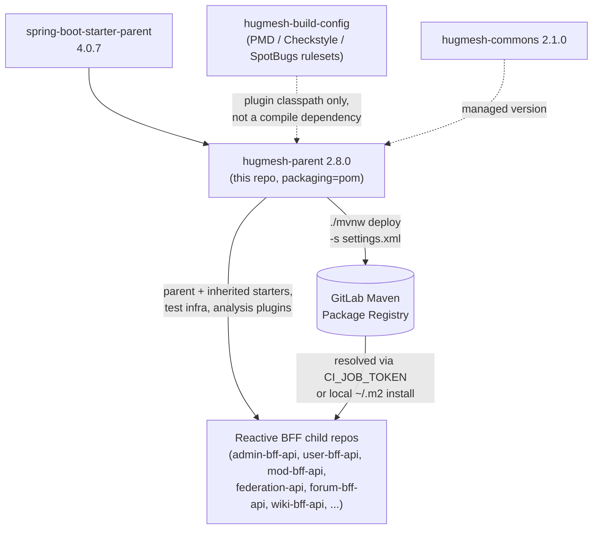

The HugMesh ecosystem **metapom** (`packaging=pom`). It consolidates the shared
Spring Boot 4.0.7 / Spring Cloud 2025.1.2 / Java 25 reactive-BFF baseline so every
service repo inherits one audited set of starters, versions, plugins, and publishing
config instead of copying them.

## Coordinates

```
groupId:    net.hugmesh
artifactId: hugmesh-parent
version:    2.8.0
packaging:  pom
```

Itself a child of `org.springframework.boot:spring-boot-starter-parent:4.0.7`.

This is the **2.8.0 / Boot-4 line**. The legacy **1.0.0 / Spring Boot 3.5.5 line**
stays untouched for any BFF that has not yet migrated, but all new and migrated
services target 2.8.0.

## What it provides

- **Properties:** `java.version=25`, UTF-8 encoding, and pinned versions for
  `hugmesh-commons` (2.1.0), the Spring Cloud release train (2025.1.2), SpringDoc
  (3.0.3, the Boot-4 / Spring Framework 7 line), Resilience4j (2.4.0, the Boot-4
  starter line), and the AWS SDK BOM (2.28.3).
- **Common dependencies** (inherited by every reactive BFF): WebFlux, Actuator,
  Security, OAuth2 Resource Server, Validation, Data-R2DBC + r2dbc-postgresql,
  Liquibase (+ `spring-boot-liquibase` runtime module — Boot 4 split
  `LiquibaseAutoConfiguration` out of the core autoconfigure umbrella, so without it
  migrations silently never run), spring-jdbc + postgresql (runtime), SpringDoc
  WebFlux UI; plus the test stack (spring-boot-starter-test, reactor-test,
  spring-security-test, r2dbc-h2, h2, the Boot-4 split test-slice modules
  `spring-boot-webflux-test` / `spring-boot-data-r2dbc-test`, and the Testcontainers
  integration-test infra `spring-boot-testcontainers` + testcontainers-postgresql/testcontainers-junit-jupiter/testcontainers-r2dbc).
- **dependencyManagement:** the Spring Cloud `spring-cloud-dependencies` BOM (import),
  `hugmesh-commons`, `hugmesh-build-config` (the resource-only ruleset jar consumed
  by the analysis plugins below), AWS SDK BOM (import), Resilience4j
  (`resilience4j-spring-boot4` + `resilience4j-reactor`), SpringDoc, the
  Testcontainers BOM (import), plus deliberate **H2 pins** (`r2dbc-h2 1.0.0.RELEASE` /
  `h2 2.3.232`) that override Boot 4's managed versions, whose combination regressed
  parameter binding for the H2 `@DataR2dbcTest` slices — children declare all of these
  without a `<version>`.
- **pluginManagement:** compiler, surefire (with the Byte Buddy
  `-Dnet.bytebuddy.experimental=true` flag for newer JDKs), spring-boot-maven-plugin,
  native-maven-plugin (GraalVM).
- **Inherited static-analysis enforcement** (`<build><plugins>`, runs in every Java
  child, no-op on this pom parent): PMD, Checkstyle and SpotBugs+FindSecBugs wire the
  org's secure/clean-Java + reactive-readability conventions and **fail the build on
  violations** (`:check` goals; `failOnViolation=true` for PMD/Checkstyle,
  `failOnError=true` for SpotBugs). See the section below.
- **`aspectjweaver`** is included in the dependency set so that `@CircuitBreaker` and
  other Spring AOP annotations from Resilience4j wire automatically across all child
  repos without any per-repo AspectJ configuration.
- **distributionManagement:** the GitLab project Maven Package Registry.

## Static-analysis enforcement (inherited, fail-mode)

Every Java repo that parents off this metapom automatically runs three analysers on
`verify` — the child declares nothing. The curated rulesets are NOT in this repo; they
ship in the resource-only **`net.hugmesh:hugmesh-build-config`** jar and are
referenced on each plugin's own classpath (PMD `/hugmesh/*.xml`, Checkstyle/SpotBugs
`hugmesh/*.xml`). That is the only mechanism by which a separate repo can see a
ruleset that physically lives elsewhere, and it gives curated rules + automatic
inheritance with one new artifact.

| Plugin | Conventions | Rules | Output |
|--------|-------------|-------|--------|
| `maven-pmd-plugin` | **A**, **B** | `FinalFieldCouldBeStatic`, `ImmutableField` | `target/pmd.xml` |
| `maven-checkstyle-plugin` | **F**, **G**, **H** | `VisibilityModifier`, `FinalClass`, `HideUtilityClassConstructor`, `MutableException`, `LambdaBodyLength` | `target/checkstyle-result.xml` |
| `spotbugs-maven-plugin` + FindSecBugs | **D**, **E** | `EI_EXPOSE_REP*`, `MS_EXPOSE_REP`, `MS_MUTABLE_*`, `MS_SHOULD_BE_FINAL` (include-filtered) | `target/spotbugsXml.xml` |

Convention **C** (enum for fixed string sets) and the *defensive-copy fix* /
*lambda→method-ref* / *nesting* halves of D and H have no reliable low-noise static
rule, so they remain agent-pass conventions — by design, no rule is added that would
flag every lambda or every collection field.

**Fail-mode.** All three run in CHECK mode via the `:check` goal (`pmd:check`,
`checkstyle:check`, `spotbugs:check`), not the reporting-only goals (`pmd:pmd`,
`checkstyle:checkstyle`, `spotbugs:spotbugs`). A finding fails the build. PMD and
Checkstyle gate on `failOnViolation=true`; **SpotBugs gates on `failOnError=true`**,
because `failOnViolation` is not a parameter of the `spotbugs:check` goal at all.

On `spotbugs:check`, `failOnError` gates real bug findings and SpotBugs-internal
analysis errors *together* (its failure message is `failed with <N> bugs and <M>
errors`); the plugin offers no way to separate them. An internal error therefore
fails the build by design — an incomplete analysis must not report green.

> **History — this gate was fail-open.** PR #6 moved SpotBugs to `spotbugs:check`
> and set `failOnViolation=true`, but that parameter does not exist on the goal
> (Maven only logs `[WARNING] Parameter 'failOnViolation' is unknown`) and left
> `failOnError=false` from the warn-first era. From `7d22f1a` until the flip to
> `failOnError=true`, **SpotBugs never failed any build in any child repo.** The
> claim that "the fleet was verified clean before each flip" is accurate for PMD
> (#4) and Checkstyle (#5), but was never true for SpotBugs (#6) — nothing was
> gating it.

**Scope.** Through build-config 0.3.0 the include filter listed only the
core-SpotBugs D/E patterns, and FindSecBugs 1.14.0's 144 patterns
(`SQL_INJECTION_*`, `COMMAND_INJECTION`, `HARD_CODE_PASSWORD`, …) share none of the
`EI_EXPOSE_REP*`/`MS_*` names, so the loaded FindSecBugs plugin contributed **zero**
findings — the gate enforced defensive-copy / mutable-static conventions only.
Build-config 0.4.0 (pinned here as `hugmesh-build-config` **0.5.0** post-rebrand)
re-scoped the include filter to admit the 137 FindSecBugs patterns empirically
measured to fire zero findings fleet-wide (SQLi, path-traversal, hard-coded
secrets, weak crypto, XXE, unsafe deserialization, SSRF, …), so the gate now
**does** enforce those security conventions on all future code, at zero cost
today. The 7 patterns that do fire fleet-wide (`SPRING_ENDPOINT`,
`CRLF_INJECTION_LOGS`, `IMPROPER_UNICODE` + 4 triaged FPs) remain excluded on
purpose; admitting them is tracked separately in `hugmesh-build-config`.

`hugmesh/spotbugs-exclude.xml` is the entity/test/Spring-injection baseline.
Through build-config 0.3.0 its Spring-injection suppression matched *layer*
package names (`.controller`/`.service`/…) while the BFF fleet uses *feature*
packages (`adminbff.announcement.AnnouncementService`), so it never fired — the
dominant reason live violation counts were high. Build-config 0.4.0 (pinned here
as 0.5.0) switched the match to the class-name **suffix** instead, so the
suppression fires for Spring constructor injection while still reporting
genuinely mutable state (`byte[]`/`char[]` key material,
`List`/`Map`/`Set`/`Collection`/`Date`) even inside a `*Service`.

**Escape hatch.** `-Dhugmesh.analysis.skip=true` skips all three (e.g. a fast
inner-loop build); default is `false`, so CI always runs them. To bump a ruleset, edit
`hugmesh-build-config` and bump `${hugmesh-build-config.version}` here — no runtime
artifact churn.

## Architecture

This repo has no runtime of its own — it is a POM artifact that sits between the
Spring Boot parent and every reactive-BFF child repo, plus the CI job that publishes it:



Two dotted inputs feed the parent without becoming a child's compile dependency:
`hugmesh-build-config` is read off each analysis plugin's own classpath (see the
table above), and `hugmesh-commons`'s version is only *managed* here — a child still
declares it explicitly to pull it in. The solid arrows are the real dependency/publish
paths: `spring-boot-starter-parent` down into this pom, this pom down into every child
BFF's effective POM, and the GitLab CI `deploy` stage publishing this artifact for
those children to resolve.

## Using it in a service repo

```xml
<parent>
  <groupId>net.hugmesh</groupId>
  <artifactId>hugmesh-parent</artifactId>
  <version>2.8.0</version>
  <relativePath/>
</parent>
```

Then remove from the child pom: `java.version`, the common dependency declarations,
and the common test dependencies. Keep only repo-specific dependencies (kafka, sshj,
cassandra, icu4j, webauthn4j, s3, …), repo-specific properties, and any custom plugin
configuration.

The **gateway** repos (Spring Boot 4.0 / Spring Cloud 2025.1) are now on the same
baseline this metapom targets; the 2.8.0 line was deliberately aligned with the
gateway's proven WebFlux + Casdoor reactive JWT resource-server + GraalVM-native
configuration on Java 25.

## What stays per-repo

Repo-specific dependencies are never pulled into the parent. See each service's pom.

## Publishing

CI publishes the POM to the GitLab Maven Package Registry on the default branch / on a
tag via `./mvnw deploy -s settings.xml`. Authentication uses the GitLab-injected
`CI_JOB_TOKEN` (a job-scoped, read-only, auto-expiring credential) read from
`settings.xml` — **no secret is committed**. See `.gitlab-ci.yml`. There is no GitHub
Actions pipeline; CI is GitLab.

For local development, `./mvnw install` writes the POM to `~/.m2` so sibling repos on
the same machine can resolve it offline.

## Current State

- On `main`, the metapom is fully on the **2.8.0 / Boot-4** baseline: Spring Boot
  4.0.7, Spring Cloud 2025.1.2, Java 25, `hugmesh-commons` 2.1.0. PRs through #20
  are merged (Boot-4 migration, static-analysis fail-mode flips, testcontainers
  baseline, TIER-A patch bumps, Java 25, testcontainers 2.x bump, three
  documentation-accuracy passes and a readability/comment cleanup through #13,
  plus #14's comprehensive docs refresh, #15 closing the SpotBugs fail-open gate,
  #16 pinning `hugmesh-build-config` 0.4.0 for the SpotBugs FP fix, #18's HugMesh
  naming rebrand, and #19/#20's HugMesh-naming + status/feature/diagram refresh
  and auth-core version-claim fix — `#17` was never opened against this repo);
  there are no outstanding feature branches (the remote branches for #8-#18 are
  merged-but-undeleted, not active work).
- This metapom carries **no application/auth code** — it only pins versions, shared
  starters, plugins, and publishing config. The org's shared security/tenancy code
  lives in `hugmesh-commons` (`net.hugmesh.commons.*`, its own release line
  is currently 2.1.0 — the same version this metapom pins in `dependencyManagement`),
  and the shared account/session/MFA/Casdoor-admin infrastructure lives in
  `hugmesh-auth-core` (own release line currently 2.4.2, depends on commons and on
  this parent 2.8.0; consumed by `user-bff` and `admin-bff`). Both are downstream
  consumers of this baseline (they parent off 2.8.0), not part of it — don't confuse
  their own artifact version with the 2.8.0 parent version they depend on.
- Ecosystem auth model (for context; enforced in the consumer repos, not here):
  Casdoor is the SSO IdP; `login-ui` does the OIDC authorization-code (PKCE)
  redirect; `user-bff` performs the server-side code→token exchange and holds the
  per-session JWT custody/refresh. The browser only ever holds an **opaque
  `bff_`-prefixed session** — the user never sees their Casdoor JWT. The gateway is a
  pure Casdoor-JWT OAuth2 resource server; a pre-security exchange filter swaps `bff_`
  → the internal custody JWT, and authorization is data-driven by the
  `gateway_route_access` Postgres table. Login/session/account logic is being
  relocated from `admin-bff` to `user-bff` (account/session **data** stays in
  `admin-bff-db`, reached over mTLS + `X-Internal-Token`).
- The Spring Cloud Gateway 5.0 route-config move
  (`spring.cloud.gateway.routes` → `spring.cloud.gateway.server.webflux.routes`) is a
  gateway/generator concern, not a metapom concern; this repo only pins the Spring
  Cloud 2025.1.2 train that introduces it.

## Roadmap

This repo is intentionally thin; its roadmap is to **track the org baseline** as the
platform evolves:

- Keep the 2.8.0 line pinned to the same Spring Boot / Spring Cloud train the
  gateways run, and bump shared versions (`hugmesh-commons`, SpringDoc,
  Resilience4j, Testcontainers, AWS SDK) in lockstep across consumers.
- Add `hugmesh-auth-core` to `dependencyManagement` (managed version) once enough
  consumers depend on it, so `user-bff` / `admin-bff` declare it without a `<version>`.
- Retire the H2 pins if/when an upstream Boot-4 r2dbc-h2 release fixes the
  parameter-binding regression.
- Continue publishing only via GitLab CI (`CI_JOB_TOKEN`); no GitHub Actions.
- Downstream platform work this baseline supports (built in the service/UI repos):
  SSO end-to-end + e2e, MFA (WebAuthn + TOTP + recovery, step-up), encrypted
  versioned backups, egress VPN drop-in, per-node attached storage, desktop app
  governance, workload console, device-license registry, multi-tenant superadmin,
  games app-store, A/V via coturn/TURN, and OWASP pen-test + nuclei in the CI pipeline.

## Known Gaps / TODO

- The previous gap here (CI images pinning JDK 21 against the Java 25 baseline)
  was fixed by bumping `validate:pom` and `deploy:maven` in `.gitlab-ci.yml` to
  `eclipse-temurin:25-jdk`.
- The previous gap here (`pom.xml:7-10`'s `<parent>` block comment citing stale
  "Spring Boot 4.0.2 ... Java 21" values) was fixed — the comment now reads
  4.0.7 / Java 25 / "2.x line", matching `spring-boot-starter-parent` **4.0.7**
  (`pom.xml:14`) and `java.version` **25** (`pom.xml:29`).
- The previous gap here (the surefire `pluginManagement` comment near `pom.xml:246`
  explaining `-Dnet.bytebuddy.experimental=true`, which still said the flag "is safe
  for the Java 21 target too") was fixed — the trailing clause now references the
  actual `java.version=25` target instead of the pre-bump value.
- New: this README's own "Current State" section was citing `hugmesh-commons` and
  `hugmesh-auth-core` as version "2.8.0" — confusing each consumer's own release
  version with the `hugmesh-parent` 2.8.0 they depend on. Checked both repos'
  actual `pom.xml` on `main`: `hugmesh-commons` is on its own 2.1.0 line (matching
  this repo's `hugmesh-commons.version` pin) and `hugmesh-auth-core` is on its
  own 2.3.4 line. Fixed the wording above to state each repo's real version and to
  call out the version-vs-parent-version distinction explicitly, since
  `hugmesh-auth-core` hit this exact same mix-up in its own README (fixed there in
  its PR #24, "commons dependency is 2.1.0, not 2.8.0").
- A previous pass fixed a drift where `pom.xml:23`'s `<description>` still read
  `"(2.0.0 / Boot-4 line)"` while `<version>` (`pom.xml:20`) had moved on, and
  updated the description to `"2.8.0 / Boot-4 line"` to match. **Reopened
  2026-07-22:** it has drifted again. `#18` (the HugMesh rebrand) bumped
  `<version>` 2.7.0 → 2.8.0 but only swapped the description's brand word,
  not its version clause — `pom.xml:23` currently
  still reads `"HugMesh ecosystem metapom (2.7.0 / Boot-4 line)"`, one release
  behind. This free-text field has now drifted from `<version>` twice; it's a
  one-line `pom.xml` fix, out of scope for this docs-only pass (`pom.xml` is a
  build file, not a doc) — flagged here for a follow-up code PR.
- **2026-07-22 pass:** naming was already fully HugMesh going in — `#18`
  rebranded groupId/artifactId, plugin config, the `hugmesh-build-config`/
  `hugmesh-commons` coordinates, and this README itself, so there was nothing to
  change on that front. Corrected two stale SpotBugs claims in the section above against the
  current `pom.xml` plugin comments: the "FindSecBugs contributes zero findings"
  line (build-config 0.4.0, pinned here as 0.5.0, already widened the include
  filter to the 137 zero-finding patterns) and the "Spring-injection suppression
  does not currently fire" line (0.4.0 switched the match to the class-name
  suffix, so it fires now). Updated the "PRs through #13" line above to #18.
  Reopened the `pom.xml:23` description drift above. `.gitlab-ci.yml` and
  `settings.xml` were re-checked and still match (GitLab CI only, `CI_JOB_TOKEN`
  via `settings.xml`, no `.github/workflows` in the tree). This metapom still has
  no Java sources, so there is no dead code to remove here.
- **Independent-verification follow-up:** the "Current State" bullet's
  `hugmesh-auth-core` version had also drifted, for the identical reason as the
  `pom.xml:23` reopen above — auth-core's own rebrand PR (`#36`, merged the same
  day as this repo's `#18`) bumped its `<version>` 2.3.4 → 2.4.0 alongside the
  rebrand coordinate swap, so the "own release line currently 2.3.4"
  claim was one release behind. Verified against `hugmesh-auth-core`'s actual
  `pom.xml` on `main` and PR #36's diff; corrected that bullet to 2.4.0. Left the
  2026-07-16 pass's log entry two bullets up ("own 2.3.4 line") as a historical
  record — it was accurate as of that pass, three days before `#36` moved the
  number.
- **2026-08-05 pass:** the "Current State" bullet's PR-count line still read
  "PRs through #18" even though `#19` ("docs: HugMesh naming + status/feature/
  diagram refresh") and `#20` ("docs: fix stale hugmesh-auth-core 2.3.4 version
  claim (now 2.4.0)") were both already merged into `main` — the content of both
  was already reflected in this section, just not the top-line counter. Bumped
  it to #20 and folded their titles into the parenthetical. Also re-checked the
  `hugmesh-auth-core` version claim this same "Current State" section makes one
  bullet up: `#20` had corrected 2.3.4→2.4.0, but `hugmesh-auth-core` has since
  shipped `#42` ("bump 2.4.1 → 2.4.2 to re-pin the coordinate after the MFA
  fixes"), so 2.4.0 was one release behind again. Verified against
  `hugmesh-auth-core`'s actual `pom.xml` on `main` and corrected the bullet to
  2.4.2. The `pom.xml:23` description drift flagged below is unchanged (still a
  build-file fix, out of scope for a docs-only pass) — re-checked, still reads
  "2.7.0 / Boot-4 line" against a 2.8.0 `<version>`.
