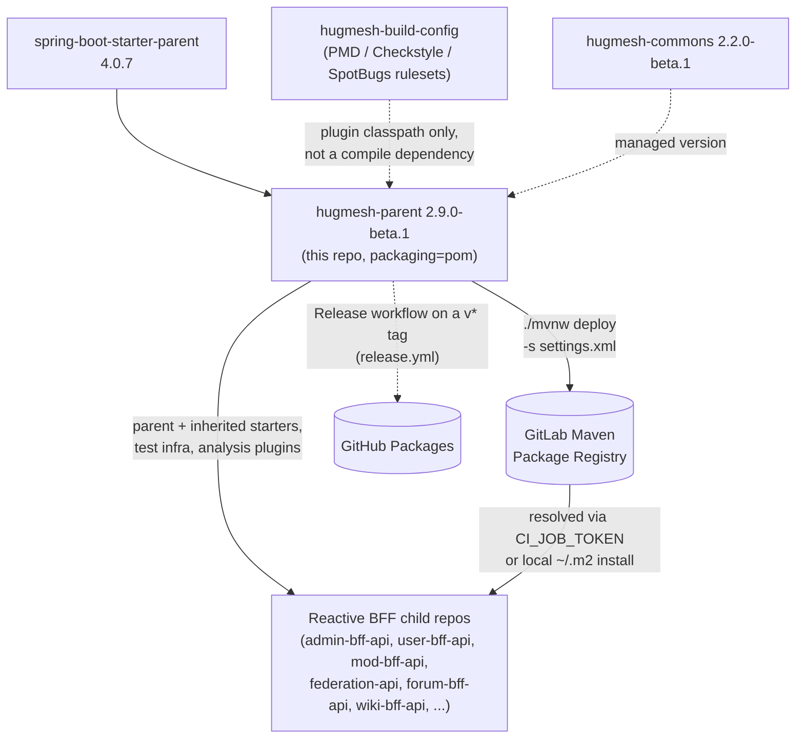

The HugMesh **metapom** (`packaging=pom`). It holds the shared Spring Boot 4.0.7 /
Spring Cloud 2025.1.2 / Java 25 reactive-BFF baseline. Every service repo inherits one
set of starters, versions, plugins and publishing config instead of copying its own.

## Coordinates

```
groupId:    net.hugmesh
artifactId: hugmesh-parent
version:    2.9.0-beta.1
packaging:  pom
```

Itself a child of `org.springframework.boot:spring-boot-starter-parent:4.0.7`.

This is the **2.x / Boot-4 line**. `2.9.0-beta.1` is its first beta under the org beta
scheme (`MAJOR.MINOR.PATCH-beta.N`); consumers move from 2.8.0 to it in their own PRs. The
legacy **1.0.0 / Spring Boot 3.5.5 line** is dead.

## What it provides

- **Properties:** `java.version=25`, UTF-8 encoding, and pinned versions for
  `hugmesh-commons` (2.2.0-beta.1), `hugmesh-auth-core` (2.6.0-beta.1, managed only),
  `hugmesh-build-config` (0.6.0-beta.1, the analyser rulesets), the Spring Cloud release
  train (2025.1.2), SpringDoc
  (3.0.3, the Boot-4 / Spring Framework 7 line), Resilience4j (2.4.0, the Boot-4
  starter line), and the AWS SDK BOM (2.28.3).
- **Common dependencies** (inherited by every reactive BFF): WebFlux, Actuator,
  Security, OAuth2 Resource Server, Validation, Data-R2DBC + r2dbc-postgresql (runtime scope),
  Liquibase (+ the `spring-boot-liquibase` runtime module: Boot 4 moved
  `LiquibaseAutoConfiguration` out of the core autoconfigure umbrella, so without the
  module migrations silently never run), spring-jdbc, the `postgresql` JDBC driver
  (runtime scope), SpringDoc WebFlux UI; plus the test stack (spring-boot-starter-test, reactor-test,
  spring-security-test, r2dbc-h2, h2, the Boot-4 split test-slice modules
  `spring-boot-webflux-test` / `spring-boot-data-r2dbc-test`, and the Testcontainers
  integration-test infra `spring-boot-testcontainers` + testcontainers-postgresql/testcontainers-junit-jupiter/testcontainers-r2dbc).
- **dependencyManagement:** the Spring Cloud `spring-cloud-dependencies` BOM (import),
  `hugmesh-commons`, `hugmesh-build-config` (the resource-only ruleset jar consumed
  by the analysis plugins below), AWS SDK BOM (import), Resilience4j
  (`resilience4j-spring-boot4` + `resilience4j-reactor`), SpringDoc, the
  Testcontainers BOM (import), plus deliberate **H2 pins** (`r2dbc-h2 1.0.0.RELEASE` /
  `h2 2.3.232`) that override Boot 4's managed versions. Boot's combination broke
  parameter binding in the H2 `@DataR2dbcTest` slices. Children declare all of these
  without a `<version>`.
- **pluginManagement:** compiler, surefire (with the Byte Buddy
  `-Dnet.bytebuddy.experimental=true` flag for newer JDKs), spring-boot-maven-plugin,
  native-maven-plugin (GraalVM).
- **Inherited static analysis** (`<build><plugins>`; runs in every Java child, does
  nothing on this pom parent): PMD, Checkstyle and SpotBugs+FindSecBugs enforce the
  org's secure-Java and reactive-readability conventions and **fail the build on
  violations** (`:check` goals; `failOnViolation=true` for PMD/Checkstyle,
  `failOnError=true` for SpotBugs). See the next section.
- **`aspectjweaver`** is in the dependency set, so `@CircuitBreaker` and the other
  Resilience4j Spring AOP annotations work in every child with no AspectJ setup.
- **distributionManagement:** the GitLab project Maven Package Registry. The manual
  GitHub Packages release (see Publishing) overrides it on the command line.

## Static-analysis enforcement (inherited, fail-mode)

Every Java repo that parents off this metapom runs three analysers on `verify`. The
child declares nothing. The rulesets are NOT in this repo. They ship in the
resource-only **`net.hugmesh:hugmesh-build-config`** jar, and each plugin reads them
off its own classpath (PMD `/hugmesh/*.xml`, Checkstyle/SpotBugs `hugmesh/*.xml`).
That is how one repo can use a ruleset that lives in another, with automatic
inheritance and one new artifact.

| Plugin | Conventions | Rules | Output |
|--------|-------------|-------|--------|
| `maven-pmd-plugin` | **A**, **B** | `FinalFieldCouldBeStatic`, `ImmutableField` | `target/pmd.xml` |
| `maven-checkstyle-plugin` | **F**, **G**, **H** | `VisibilityModifier`, `FinalClass`, `HideUtilityClassConstructor`, `MutableException`, `LambdaBodyLength` | `target/checkstyle-result.xml` |
| `spotbugs-maven-plugin` + FindSecBugs | **D**, **E** | `EI_EXPOSE_REP*`, `MS_EXPOSE_REP`, `MS_MUTABLE_*`, `MS_PKGPROTECT`, `MS_SHOULD_BE_FINAL`, `MS_CANNOT_BE_FINAL` (include-filtered) | `target/spotbugsXml.xml` |

Convention **C** (enum for fixed string sets) and the *defensive-copy fix* /
*lambda→method-ref* / *nesting* halves of D and H have no reliable low-noise static
rule. They stay agent-pass conventions. No rule is added that would flag every lambda
or every collection field.

**Fail-mode.** All three run the `:check` goal (`pmd:check`, `checkstyle:check`,
`spotbugs:check`), not the reporting-only goals (`pmd:pmd`, `checkstyle:checkstyle`,
`spotbugs:spotbugs`). A finding fails the build. PMD and Checkstyle gate on
`failOnViolation=true`. **SpotBugs gates on `failOnError=true`**, because
`failOnViolation` is not a parameter of the `spotbugs:check` goal at all.

On `spotbugs:check`, `failOnError` gates real bug findings and SpotBugs-internal
analysis errors *together* (the failure message is `failed with <N> bugs and <M>
errors`). The plugin cannot separate them. An internal error fails the build, by
design: an incomplete analysis must not report green.

> **History: this gate was fail-open.** (PR numbers in this note come from the
> repo's earlier home, not from `hugmesh/hugmesh-parent`; commit `7d22f1a` is in
> this repo's history.) PR #6 moved SpotBugs to `spotbugs:check` and set
> `failOnViolation=true`. That parameter does not exist on the goal (Maven only logs
> `[WARNING] Parameter 'failOnViolation' is unknown`), and `failOnError=false` was
> left over from the warn-first era. From `7d22f1a` until the flip to
> `failOnError=true`, **SpotBugs never failed any build in any child repo.** "The
> fleet was verified clean before each flip" is true for PMD (#4) and Checkstyle (#5).
> It was never true for SpotBugs (#6). Nothing gated it.

**Scope.** Through build-config 0.3.0 the include filter listed only the core-SpotBugs
D/E patterns. FindSecBugs 1.14.0's 144 patterns (`SQL_INJECTION_*`,
`COMMAND_INJECTION`, `HARD_CODE_PASSWORD`, …) share none of the `EI_EXPOSE_REP*`/`MS_*`
names, so the loaded FindSecBugs plugin contributed **zero** findings. The gate
enforced defensive-copy and mutable-static conventions only.
Build-config 0.4.0 (republished as 0.5.0 after the rebrand; pinned here as **0.6.0-beta.1**)
widened the include filter to the 137 FindSecBugs patterns that measured zero findings
fleet-wide (SQLi, path-traversal, hard-coded secrets, weak crypto, XXE, unsafe
deserialization, SSRF, …). The gate now **does** enforce those security conventions on
all future code, at no cost today. The 7 patterns that do fire fleet-wide
(`SPRING_ENDPOINT`, `CRLF_INJECTION_LOGS`, `IMPROPER_UNICODE` + 4 triaged false
positives) stay excluded on purpose. Admitting them is tracked in
`hugmesh-build-config`.

`hugmesh/spotbugs-exclude.xml` is the entity/test/Spring-injection baseline.
Through build-config 0.3.0 its Spring-injection suppression matched *layer* package
names (`.controller`/`.service`/…), but the BFF fleet uses *feature* packages
(`adminbff.announcement.AnnouncementService`). It never fired, which is the main
reason live violation counts were high. Build-config 0.4.0 (now 0.6.0-beta.1 here)
matches the class-name **suffix** instead. The suppression now fires for Spring
constructor injection and still reports genuinely mutable state (`byte[]`/`char[]`
key material, `List`/`Map`/`Set`/`Collection`/`Date`) even inside a `*Service`.

**Escape hatch.** `-Dhugmesh.analysis.skip=true` skips all three (for a fast inner-loop
build). The default is `false`, so CI always runs them. To change a ruleset, edit
`hugmesh-build-config` and bump `${hugmesh-build-config.version}` here. No runtime
artifact changes.

## Architecture

This repo has no runtime. It is a POM artifact between the Spring Boot parent and every
reactive-BFF child repo, plus the CI jobs that publish it:



Two dotted inputs feed the parent without becoming a child's compile dependency.
`hugmesh-build-config` is read off each analysis plugin's own classpath (see the table
above). `hugmesh-commons` is only *managed* here: a child still declares it to pull it
in. The solid arrows are the real dependency and publish paths: `spring-boot-starter-parent`
into this pom, this pom into every child BFF's effective POM, and the GitLab CI `deploy`
stage publishing this artifact for those children. The dotted arrow to GitHub Packages
is the tag-driven `release.yml` workflow.

## Using it in a service repo

```xml
<parent>
  <groupId>net.hugmesh</groupId>
  <artifactId>hugmesh-parent</artifactId>
  <version>2.9.0-beta.1</version>
  <relativePath/>
</parent>
```

Then remove from the child pom: `java.version`, the common dependency declarations and
the common test dependencies. Keep only repo-specific dependencies (kafka, sshj,
cassandra, icu4j, webauthn4j, s3, …), repo-specific properties and custom plugin
configuration.

The **gateway** (`hugmesh-gateway`) runs the same baseline (Spring Boot 4.0.7, Spring
Cloud 2025.1.2, Java 25) but does not parent off this metapom. Its `pom.xml` names
`spring-boot-starter-parent` directly. This metapom is BFF-focused and would add
Liquibase and Testcontainers scaffolding the gateway does not use. The gateway declares
its own Cassandra and R2DBC-Postgres starters.

## What stays per-repo

Repo-specific dependencies are never pulled into the parent. See each service's pom.

## Publishing

`.gitlab-ci.yml` has two jobs. `validate:pom` runs `./mvnw validate` on every pipeline.
`deploy:maven` publishes the POM to the GitLab Maven Package Registry on the default
branch or on a tag, via `./mvnw -B -ntp -s settings.xml deploy`. Authentication uses the
GitLab-injected `CI_JOB_TOKEN` (a job-scoped, auto-expiring credential) read from
`settings.xml` — **no secret is committed**.

`.github/workflows/release.yml` publishes the POM to GitHub Packages with
`-s .github/maven-ci-settings.xml` when a person pushes a tag `v<version>` that equals the
pom version (for example `v2.9.0-beta.1`), and creates a GitHub Release marked prerelease.
A manual dispatch on that tag re-runs the publish; a dispatch on `main` only verifies. There
is no publish on merge. It is link 2 of 4 in the publish chain
`hugmesh-build-config` 0.6.0-beta.1 → `hugmesh-parent` 2.9.0-beta.1 →
`hugmesh-commons` 2.2.0-beta.1 → `hugmesh-auth-core` 2.6.0-beta.1; see `RELEASING.md`.

For local development, `./mvnw install` writes the POM to `~/.m2`, so sibling repos on
the same machine resolve it offline.

## Current State

- The metapom is **2.9.0-beta.1** on the Boot-4 baseline: Spring Boot 4.0.7,
  Spring Cloud 2025.1.2, Java 25, `hugmesh-commons` 2.2.0-beta.1. Consumers still pin
  2.8.0 until their own beta PRs land, so `scripts/check_baseline_drift.py` reports them
  as drift until then. The merged PRs on
  `hugmesh/hugmesh-parent` are #1, #3, #5, #6 and #7 (the last old-brand spellings, the
  CI-only GitHub Packages route, and the `PACKAGES_READ_TOKEN` release docs and
  preflight). Older PR numbers in the git history belong to the repo's earlier home.
  Every remote branch that still exists is merged. No feature branch is active.
- The Release workflow has run once on this repo (2026-10-07, run 37699571478, in its
  earlier dispatch-only shape). It failed at the preflight step: HTTP 404 reading
  `hugmesh-build-config` from GitHub Packages, with `PACKAGES_READ_TOKEN` unset. Nothing
  has been published through it.
- This metapom carries **no application or auth code**. It pins versions, shared
  starters, plugins and publishing config. The org's shared security and tenancy code
  lives in `hugmesh-commons` (`net.hugmesh.commons.*`; its beta is 2.2.0-beta.1,
  the version this metapom pins in `dependencyManagement`). The shared
  account/session/MFA/Casdoor-admin infrastructure lives in `hugmesh-auth-core` (beta
  2.6.0-beta.1; depends on commons and on this parent; consumed by `user-bff` and
  `admin-bff`). Both are downstream of this baseline (they parent off it), not part of
  it. Do not mistake their artifact versions for the parent version they depend on.
- Ecosystem auth model (context only; the consumer repos enforce it, not this one):
  Casdoor is the SSO IdP. `login-ui` renders a native username/password (+MFA) form and
  POSTs it to `/bff/login`. `user-bff` runs the PKCE/state handshake, the internal
  Casdoor login and the code→token exchange on the server, and holds the per-session
  JWT custody and refresh. The browser is never redirected to Casdoor. It holds only an
  **opaque `bff_`-prefixed session**, never the Casdoor JWT. The gateway is a
  Casdoor-JWT OAuth2 resource server. It accepts the `bff_` session through an
  introspection filter (on by default) and, optionally, an exchange filter that swaps
  `bff_` for the internal custody JWT (off by default). The `gateway_route_access`
  Postgres table drives authorization. Login, session and account logic is moving from
  `admin-bff` to `user-bff`; the account and session **data** stays in `admin-bff-db`,
  reached over mTLS + `X-Internal-Token`.
- The Spring Cloud Gateway 5.0 route-config move (`spring.cloud.gateway.routes` →
  `spring.cloud.gateway.server.webflux.routes`) belongs to the gateway and the
  generator. This repo only pins the Spring Cloud 2025.1.2 train that introduces it.

## Roadmap

This repo is thin on purpose. Its roadmap is to **track the org baseline**. These are
plans, not shipped work:

- Keep the 2.x line on the same Spring Boot / Spring Cloud train the gateways run,
  and bump shared versions (`hugmesh-commons`, SpringDoc, Resilience4j, Testcontainers,
  AWS SDK) in lockstep across consumers.
- `hugmesh-auth-core` is now managed here (`hugmesh-auth-core.version`). Still to do:
  `user-bff` and `admin-bff` drop their explicit `<version>` after moving to a parent
  release that contains the entry; that needs a new parent version, which is a release
  decision.
- Retire the H2 pins when an upstream Boot-4 r2dbc-h2 release fixes the
  parameter-binding regression.
- Publish through GitLab CI (`CI_JOB_TOKEN`) and, once the repos can read each other's
  packages, through the manual GitHub Packages Release workflow.

### Baseline drift check

`scripts/check_baseline_drift.py` reads the Spring Boot parent version and the
`spring-cloud.version` from this `pom.xml` and compares them with the `pom.xml` on
`origin/main` of each consumer checkout next to this repo. It exits 1 on drift and 2
when a checkout or ref cannot be read. Springdoc, Resilience4j, AWS SDK, Testcontainers
and `hugmesh-commons` overrides that differ are printed as notes only.

```sh
python3 scripts/check_baseline_drift.py            # all known consumers
python3 -m unittest discover -s scripts            # its tests
```

## Known Gaps / TODO

- The Release workflow publishes on a `v*` tag push only. `scripts/test_release_workflow.py`
  fails if it gains a branch or `pull_request` trigger, deploys outside a tag run, or
  stops using the publish runner line. It is a text check run by the workflow itself;
  nothing runs it on pull requests (`RELEASING.md`).
- The metapom has no Java sources, so there is no code or test of its own to check
  beyond `./mvnw validate`.
