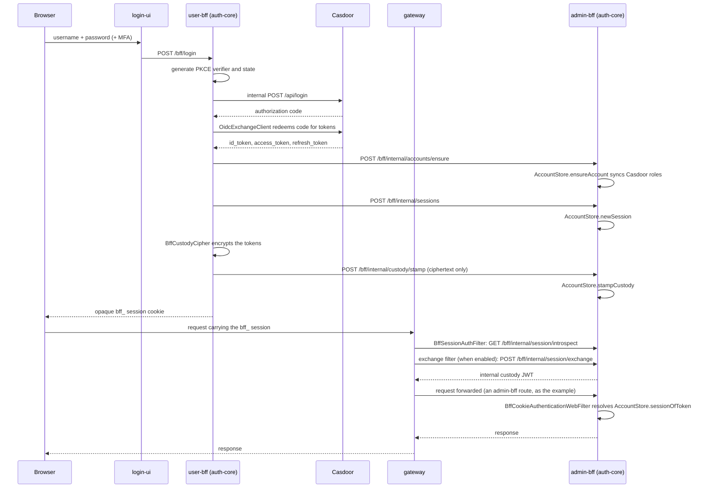

The shared **stateful** HugMesh auth core: the account, session, MFA and Casdoor-admin code
used by BOTH `hugmesh-user-bff-api` (login and OIDC token handling) and `hugmesh-admin-bff-api`
(admin features that read accounts, allowlist and suspension, and drive MFA step-up).

## Why a separate module (not `hugmesh-commons`)
`hugmesh-commons` is the **light, stateless** security and tenancy jar. The **gateway** and every
BFF depend on it (Casdoor JWT authorities, issuer→domain registry, `ApiException`). This core is the
opposite: reactive **R2DBC** entities and repositories, a Casdoor-admin **WebClient**, AES-256-GCM
crypto, **TOTP/WebAuthn**. Folding it into commons would put r2dbc and the Casdoor/MFA stack on the
gateway's classpath and risk its Boot-4 pin. So:

```
hugmesh-commons   (light; stateless)      <- gateway + ALL services
hugmesh-auth-core (heavy; r2dbc/casdoor/mfa) <- user-bff + admin-bff ONLY
   └─ depends on hugmesh-commons            (no cycle)
```

## Data ownership
The account, session, allowlist and MFA **tables stay in `admin-bff-db`**. admin-bff has about ten
synchronous readers, and the mutual-DB-denial NetworkPolicy forbids cross-DB hops. admin-bff wires the
R2DBC-backed stores against admin-bff-db and exposes a thin `/bff/internal/**` account and session API
(mTLS + `X-Internal-Token`). user-bff owns the login and OIDC **endpoints** and reaches the data
through that internal API.

## Where this fits in the auth model
Casdoor is the SSO IdP. `login-ui` renders a **native username/password (+MFA)** form and POSTs to
`/bff/login`. **user-bff** generates PKCE and state **server-side**, calls the **internal** Casdoor
`/api/login`, exchanges the code, and holds per-session JWT custody and refresh. The browser is
**never redirected to Casdoor**. It holds only an **opaque `bff_`-prefixed session**; the user never
sees their own Casdoor JWT.

The gateway is a pure Casdoor-JWT OAuth2 resource server.

- `BffSessionAuthFilter` (on unless `APP_BFF_SESSION_ENABLED=false`) introspects a `bff_` session
  through admin-bff's `GET /bff/internal/session/introspect`.
- A pre-security exchange filter (`BffJwtExchangeWebFilter`) swaps `bff_` for the internal custody JWT
  through admin-bff's `POST /bff/internal/session/exchange`. It is gated by
  `hugmesh.gateway.bff-exchange.enabled`: default `false` in the gateway image, `true` in the
  generator's gateway-fe app.
- Then the gateway's JWT validation and the data-driven `GatewayRouteAccessFilter` run unchanged. The
  `gateway_route_access` Postgres table is the source of truth. ADMIN and GAME-MASTER bypass within
  their own domain; SUPERADMIN bypasses across domains.

This jar is the **shared stateful substrate** behind that flow: the account, session and MFA stores
and the Casdoor-admin client that user-bff (login, session custody) and admin-bff (account reads, MFA
step-up) both build on. Login, session and account logic is moving from admin-bff to user-bff, and
the reusable pieces land here so both BFFs share one implementation. The account and session **data**
stays in admin-bff-db. The move is not finished: admin-bff's `AuthController` still mints sessions
(`store.newSession`, line 381).

### Native-login sequence



The browser holds only the opaque `bff_` value. Every Casdoor and custody token stays server-side,
encrypted at rest by `BffCustodyCipher`. user-bff encrypts the tokens and admin-bff stores the
ciphertext as it is. user-bff has no database access to the account tables, so `AccountStore` runs
inside admin-bff (see Data ownership). `login-ui`, `gateway` and `Casdoor` live outside this repo. The
diagram shows where auth-core's own classes (`OidcExchangeClient`, `BffCustodyCipher`, `AccountStore`,
`BffCookieAuthenticationWebFilter`) sit in the cross-service flow.

## Status (extraction landed)
- ✅ `account/` — Account, AccountRow(+repo), AccountStatus, AccountStore, Allowlist(+repo),
  BffSession(+repo), NamespaceGrant(+repo). Self-contained; builds against commons + r2dbc.
- ✅ `casdoor/` — Casdoor-admin client and config, the OIDC token-exchange client
  (`OidcExchangeClient`, optionally routed through gated outbound mTLS by `OidcExchangeClientSsl`),
  the BFF-custody cipher (`BffCustodyCipher`), the MFA challenge and step-up services. The old
  raw-JWT refresh service is deleted: its held-token branch could not be reached, and the re-mint
  now happens in admin-bff's `POST /bff/internal/session/exchange`. No `RawJwt*` class remains.
- ✅ `mfa/` — TOTP, WebAuthn (webauthn4j), recovery codes, enrollment, the secret cipher, the R2DBC
  factor, credential and challenge rows with their repositories, and `MfaPreconditionBootGuard` (see
  **MFA precondition startup check** below).
- ✅ `config/` — the session-cookie and internal-token web filters, the internal-surface boot guard,
  and the two `bff_` session bridges, `BffCookieAuthenticationWebFilter` and
  `BffSessionIntrospectionWebFilter`. Both turn an opaque `bff_` session into a real Spring Security
  `Authentication` for a consumer's own `hasAnyRole()`/`.authenticated()` gates. The first resolves
  the session through a local `AccountStore` (admin-bff); the second resolves it over HTTP, for a
  service without that store (see Current State). No consumer uses the HTTP one yet (see Known Gaps).
- ✅ `provision/` (gateway revocation client), `reserved/` (reserved-name gate), `username/`
  (federation username gate), `web/dto/` (login, register and MFA request DTOs).
- Every package from the extraction blueprint has landed. admin-bff and user-bff adopt this jar.

### MFA precondition startup check

`mfa/MfaPreconditionBootGuard` finds the MFA configurations that are silently broken or silently
unrecoverable. By **default** it logs one loud `WARN` and lets the application start. It aborts the
boot (throwing from `afterSingletonsInstantiated`, as `config/InternalSurfaceBootGuard` does)
**only** when an operator opts in with `app.mfa.preconditions.fail-fast=true` (env
`APP_MFA_PRECONDITIONS_FAIL_FAST`, default `false`).

| Precondition | Reported when | Consequence if left unfixed |
| --- | --- | --- |
| `app.mfa.factor-key` (env `APP_MFA_FACTOR_KEY`) | MFA enabled and no usable key | The key gates the TOTP cipher **and** the recovery-code HMAC, but **not** WebAuthn — so MFA arms as WebAuthn-only with TOTP enroll and recovery-code generation both 503ing, and a user who loses their passkey is locked out with no self-service way back in (an operator must clear their factors by hand). |
| `app.mfa.webauthn.rp-id` (env `APP_MFA_WEBAUTHN_RP_ID`) | MFA enabled, **no dev profile**, and the RP ID is absent or a loopback host | It silently defaults to `localhost`, so every passkey registers against the wrong Relying Party and no ceremony can ever succeed. |
| `app.mfa.webauthn.origins` (env `APP_MFA_WEBAUTHN_ORIGINS`) | MFA enabled, **no dev profile**, and every allowlisted origin is loopback | It silently defaults to `https://localhost`, so the ceremony rejects every real browser origin. |

**Why WARN by default, not fail-fast.** These states are *tolerated* in the shipped deployment.
Making them fatal by default would turn a degradation into an outage.

- hugmesh-generator `specs/cluster/manifests/admin-bff-api/deployment.yaml` sets
  `APP_CASDOOR_MFA_ENABLED: "true"` (MFA is **armed** in-cluster) and sources `APP_MFA_FACTOR_KEY`
  from an External-Secrets `secretKeyRef`. That ref used to carry `optional: true` ("*so the pod
  still starts if the Secret is somehow absent*"). Generator #508 (`087130a4`) dropped it:
  the `APP_MFA_FACTOR_KEY` ref has no `optional` now. A genuinely absent Secret therefore blocks pod
  start at the Kubernetes layer (`CreateContainerConfigError`) before this guard runs. The same
  manifest sets a real `APP_MFA_WEBAUTHN_RP_ID` and `APP_MFA_WEBAUTHN_ORIGINS`
  (`admin.hugmesh.net`). The guard still matters for every OTHER shape: compose, bare-metal runs, a brand
  whose manifest lost the WebAuthn properties. Those are the degraded-but-running band.
- The local compose stack (`tests/stack/compose.local.yaml`) runs MFA on with **neither** WebAuthn
  property set. Its `dev` profile is only the `ADMIN_BFF_PROFILES` default.

admin-bff-api is the **only** consumer that component-scans `net.hugmesh.authcore` (its
`@SpringBootApplication(scanBasePackages = …)`). It is the admin/superadmin control plane and the
gateway's cookie→JWT `POST /bff/internal/session/exchange` leg. A fatal guard would
CrashLoopBackOff that whole plane on a fresh cluster bring-up, on a new brand/tenant where
`gen-cluster-secrets` was not re-run, or on a Vault path typo. Operators would be locked out of the
plane they need to fix it. So the default is to *tell* them (`*** MFA MISCONFIGURED ***`, every
property and env var named, the consequence spelled out, the opt-in named) and keep serving. Making
it fatal is a per-deployment decision, for the misconfiguration shapes the scheduler cannot see. The
Kubernetes-layer half, dropping `optional: true`, has landed (generator #508).

The guard offers no actuator health indicator: this module declares no `spring-boot-actuator`
dependency of its own and has no health-contributor precedent, and a shared auth jar is the wrong
place to start one. (`hugmesh-parent` does declare `spring-boot-starter-actuator` among its common
dependencies.)

Two test classes cover the guard. `MfaPreconditionBootGuardTest` covers the decision logic, with a
`ListAppender` capture so "it WARNs loudly" is a real assertion. `MfaPreconditionBootGuardContextTest`
runs a **real** `AnnotationConfigApplicationContext.refresh()`, because whether a pod comes up is
decided by `refresh()` completing, not by a method call.

The class is **released in 2.4.2** (see Current State for why the version moved). A consumer picks
it up by pinning 2.4.2 or later (admin-bff and user-bff both pin 2.5.1). Only admin-bff scans
`net.hugmesh.authcore`, so only admin-bff runs it. The generator pins the `admin-bff-mfa`
`secretKeyRef` with its `[mfa-factor-key]` manifest-integrity check
(`tests/scripts/cluster_manifest_integrity.py`).

Every check is behind `app.casdoor.mfa.enabled` (**default `false`**; admin-bff's `application.yml`
takes it from `APP_CASDOOR_MFA_ENABLED`, default `false`). An MFA-off deployment stays silent. The
test class asserts that first, and asserts that arming the opt-in while MFA is off is still a no-op.
The bean is absent under the `test` profile.

**Dev detection** is "`dev` or `test` is in `Environment.getActiveProfiles()`". Those are exactly the
profiles in `InternalSurfaceBootGuard`'s `@Profile("!dev & !test")`, so the library has one dev rule
(a test asserts the set is exactly those two). `local` is deliberately **not** included: no manifest,
compose service or `application-*.yml` in this fleet activates it. The beans differ only in
presence: this one is `@Profile("!test")` because it still has something to say under `dev`. The
local compose stack runs `SPRING_PROFILES_ACTIVE=casdoor,dev` and sets no RP ID. It gets a
dev-specific WARN and is never counted as a problem, even under the opt-in, so arming fail-fast
fleet-wide cannot break a local stack. The cluster runs `casdoor,clickhouse` and sets a real RP ID.
An unprofiled deployment counts as NOT dev, the safe direction for a passkey RP ID. mDNS `*.local`
hosts are deliberately **not** loopback (a LAN node may be `foo.local`). RFC-6761 `*.localhost` is.

Build: `./mvnw -o clean package` (resolves hugmesh-parent 2.9.0-beta.1 and hugmesh-commons
2.2.0-beta.1 from `~/.m2`; until those betas are published, install them there from their own
repos first). It runs the full test suite. A handful of MFA-repo data-slice tests need a real Postgres
through Testcontainers, so a local run also needs Docker (or `-Dtest='!*PostgresTest'` to skip just
those). `./mvnw -o clean verify` also runs PMD, Checkstyle and SpotBugs (see Current State and Known
Gaps for their enforcement). Measured 2026-10-15 on this README's branch merged with `main` at
`a8010e9`: `./mvnw -o -B -s settings.xml clean verify '-Dtest=!*PostgresTest'` (the four
`*PostgresTest` classes skipped, no Docker started) is **BUILD SUCCESS** — 518 tests, `Failures: 0, Errors: 0, Skipped: 0`, 0 Checkstyle violations,
`BugInstance size is 0`. The last run of the whole suite with Docker was 2026-08-20: `clean verify`,
450 tests green. `clean verify` has been in genuine fail mode since the `hugmesh-parent` 2.8.0 bump
(`failOnError`, not the no-op `failOnViolation` of the historical 2.7.0 config). The repo-local
`spotbugs/exclude-filter.xml` triaged the 8 `EI_EXPOSE_REP2` findings (see Known Gaps).

## Current State
- **Version 2.6.0-beta.1** on the unified HugMesh baseline: **Spring Boot 4.0.7 / Spring Cloud 2025.1.2 /
  Java 25 LTS** (eclipse-temurin:25), inherited from `hugmesh-parent` (metapom) **2.9.0-beta.1**. The
  version follows the org beta scheme (`MAJOR.MINOR.PATCH-beta.N`, [`RELEASING.md`](RELEASING.md)
  §0): 2.6.0 was never published, so its first published build is the beta. The parent
  runs **PMD + Checkstyle + SpotBugs** during `verify` and pins **testcontainers 2.0.5**. All three
  analysers fail the build (SpotBugs through `failOnError` since the 2.8.0 bump). See Known Gaps for
  how this module's 8 findings were triaged.
- Depends on `hugmesh-commons` **2.2.0-beta.1** (stateless security and tenancy). A `2.7.0` commons was never
  published: #23 pinned `2.0.0`, the rebrand (#36) moved the pin to `2.1.0`, and the beta scheme
  moved it to `2.2.0-beta.1`. **No cycle**:
  commons does not depend on this core.
- **Consumers: `user-bff` and `admin-bff` only.** Both pin 2.5.1 and move to 2.6.0-beta.1 in their
  own repos. This repo's `main` now builds 2.6.0-beta.1 (see [`CHANGELOG.md`](CHANGELOG.md));
  [`RELEASING.md`](RELEASING.md) §3 and §6 record 2.5.1 as not yet published, and nothing at 2.6.0
  is published either. The gateway depends on commons, NOT on
  this jar, which keeps r2dbc/casdoor/mfa off the gateway classpath.
- Reactive throughout: **Spring Data R2DBC** repositories and no raw `DatabaseClient`, matching the
  org data-access standard. Hand-written SQL sits in `@Query` static-final constants on the
  repositories (for example `AllowlistRepository.insertIfAbsent`, the MFA `INSERT ... RETURNING`).
  Crypto is the JDK's `AES/GCM/NoPadding` (`BffCustodyCipher`, `MfaSecretCipher`) and `HmacSHA256`
  (`RecoveryCodeService`). `pom.xml` declares BouncyCastle 1.84, but no class in `src/main` imports
  it. MFA uses **webauthn4j 0.31.7** (WebAuthn) and TOTP. webauthn4j 0.31 moved internally to Jackson 3
  (`tools.jackson`). `WebAuthnService` uses the `CredentialRecord` API.
- **Username gate presents a Casdoor ROLE_SERVICE bearer (2.5.1)**: `FederationUsernameClient` takes
  an optional `Supplier<Mono<String>>` service bearer (5-arg constructor; the 4-arg one remains).
  `FederationUsernameConfig` wires `casdoor/CasdoorServiceTokenClient` — a cached OAuth2
  client-credentials mint against `POST /api/login/oauth/access_token` — from
  `federation.username-gate.service-bearer.*` (defaults: `app.casdoor.platform.*`), plus the gated
  `hugmesh.mtls.client.*` outbound connector. Known Gaps says why the old header-only credential could
  never authenticate against federation-api.
- **BFF JWT custody (2.1.0)**: `BffSession` carries the OIDC-token-custody columns
  (`access_token_enc` / `refresh_token_enc` / `access_token_expires_at` / `custody_updated_at`,
  admin-bff band-180), next to the changeset-150 MFA columns (`mfa_satisfied` / `mfa_satisfied_at` /
  `amr`). They are **NULLABLE and never written at session mint**: `AccountStore.newSession` leaves
  them null, so a pre-band-180 (2.0.0) consumer reads null. Custody goes in through
  `AccountStore.stampCustody` / `clearCustody` (delegating to `BffSessionRepository`) and comes out
  through `AccountStore.sessionRow`. admin-bff's `/bff/internal` custody endpoints use them to
  stamp, clear and read per-session encrypted tokens for the opaque `bff_`-session custody model.
- **List a user's sessions by account (2.2.0)**: `AccountStore.sessionsForAccount` and the
  `BffSessionRepository.findByAccountIdAndExpiresAtAfterOrderByCreatedAtDesc` derived finder back the
  "my active sessions" read for the session-management UI. The `accountId` MUST come **server-side**
  from the validated principal, never from a request parameter: a user may list only THEIR OWN
  sessions. Expired rows are filtered in the DB (`expires_at > now()`), newest first, and projected
  to `BffSessionRow` so callers never touch the entity's custody/MFA internals.
- **Domain-scoped allowlist and namespace grants (changeset 220)**: `Allowlist` and `NamespaceGrant`
  carry a `domain` field (composite PK `provider/handle/domain` and `grantee/namespace/domain`). This
  closed a BOLA/IDOR gap where a brand-X admin could read, write or delete brand-Y's invite or
  namespace-grant rows. `AllowlistRepository` and `NamespaceGrantRepository` expose domain-scoped
  finders, deletes and a 3-arg `insertIfAbsent(..., domain)`. Existing rows back-fill to `"default"`.
  The registration-gate read is domain-scoped too (`existsByProviderAndHandleAndDomain`, surfaced as
  `AccountStore.isEmailInvited(email, domain)` / `isDiscordInvited(handle, domain)`). The unscoped
  `existsByProviderAndHandle` overloads are **deprecated** and have no callers left in the org:
  admin-bff (hugmesh/hugmesh-admin-bff-api#46) moved its three request handlers to the scoped gate
  (see Known Gaps).
- **Subject-level revocation (`GatewayRevocationClient.revokeSubject`)**: writes a
  `subject:<casdoorSub>` key so the gateway's `RevocationGatewayFilter` denies a user's live custody
  JWT at once on role revoke, instead of waiting out its natural TTL (default 1 h). It follows the
  same best-effort, `broker.gateway-revocation.enabled`-gated pattern as the existing coarse
  homeserver-ban revocation (`revokeCoarse` / `clearCoarse`).
- **DB-generated MFA UUID PKs (2.3.0)**: the `id` columns of `mfa_factor`, `mfa_recovery_code`,
  `webauthn_credential` and `webauthn_challenge` are NO LONGER minted in Java. The production columns
  carry `DEFAULT (gen_random_uuid())::text` (admin-bff changeset 210, on tables created by changesets
  151/152). The enroll INSERT omits `id` and appends `RETURNING id` to read the generated UUID back (a
  plain non-`@Modifying` `@Query` returning `Mono<String>`). The MFA-repo data-slice tests run on
  **real Postgres** (commons `PostgresTestSupport` / Testcontainers), because H2 does not honour
  `gen_random_uuid()` or `INSERT ... RETURNING`.
- **Code-side MFA enums**: `FactorType` (`TOTP`|`WEBAUTHN`, the `mfa_factor.type` discriminator) and
  `CeremonyType` (`register`|`assert`, the `webauthn_challenge.ceremony_type` discriminator) wrap the
  app-owned closed vocabularies as `@JsonValue`/`@JsonCreator` lenses over the persisted String
  columns. R2DBC mapping stays byte-identical, and the legacy `TYPE_TOTP`/`TYPE_WEBAUTHN` constants
  delegate to the enum.
- **Casdoor role sync on every login (2.3.1)**: `AccountStore.ensureAccount(provider, handle, roles)`
  SYNCS a non-empty `roles` list onto the account row on every call, not only at creation. A Casdoor
  role grant or revoke reaches the BFF session on the next login. The null/empty-roles path delegates
  to the original 2-arg `ensureAccount(provider, handle)`, which stays a pure read for an existing
  account.
- **Service-local `bff_` session bridge (2.3.2)**: `BffCookieAuthenticationWebFilter` (`config/`)
  resolves an opaque `bff_` session directly through `AccountStore` and fills in a real Spring
  Security `Authentication`. A consumer's own `hasAnyRole()`/`.authenticated()` gates used to see only
  a real Casdoor JWT, because `oauth2ResourceServer().jwt()` is inert to an opaque token. Now they see
  native-login sessions too. It works only for a service with a LOCAL `AccountStore` bean (today:
  admin-bff only). A service without one uses the shared HTTP bridge below.
- **Shared HTTP `bff_` session bridge (2.6.0)**: `BffSessionIntrospectionWebFilter` (`config/`) resolves the
  session through a `BffSessionIntrospector`. `HttpBffSessionIntrospector` is the network
  implementation: `GET /bff/internal/session/introspect` on admin-bff with the token as
  `Authorization: Bearer`. The `WebClient` you pass in owns the base URL and the `X-Internal-Token`
  or mTLS credential. Authorities come from the same mapping as the local-store filter. It is NOT a
  `@Component`: declare it as a `@Bean`, e.g.
  `new BffSessionIntrospectionWebFilter(new HttpBffSessionIntrospector(webClient), Duration.ofSeconds(2))`,
  and register it instead of (not alongside) `BffCookieAuthenticationWebFilter`. Outcomes: an
  unknown or expired session passes through unauthenticated; `suspended`/`banned` get `403` with
  `X-Bff-Denied: account-<status>`; any other status, including a missing, blank, padded or
  non-ASCII lookalike of `active`, gets `403` with `X-Bff-Denied: account-status-unrecognized`
  (only an explicit `active` is granted); an introspection error, a timeout, or a response body
  with a duplicate key gets `503`. Pinned by `BffSessionIntrospectionWebFilterTest` and
  `HttpBffSessionIntrospectorTest`.
- **Gated outbound mTLS for the OIDC token exchange**: `OidcExchangeClientSsl` can route
  `OidcExchangeClient`'s Casdoor token-endpoint calls (the PKCE code/refresh leg, which carries
  `client_secret` and tokens) through client-cert and cluster-CA mTLS. It mirrors user-bff's
  `FederationHttpClientSsl` and uses the same `hugmesh.mtls.client.*` flag and property names. Default
  OFF. If the gate is on but the keystore file is absent, it falls back to plain HTTP with a warning,
  so a misconfigured pod never crash-loops on boot.
- **Reserved-username canonical sync (2.3.3, extended in 2.4.1)**: `ReservedNames.RESERVED` carries
  the full 82-label canonical set (`reserved/ReservedNames.java`), kept in sync with the independent
  copies in `hugmesh-federation-api` and `hugmesh-actions`. Compared on 2026-10-07, the
  `hugmesh-actions` set is identical, and the `hugmesh-federation-api` set differs only in the case of
  `remoteEntry.json`. 2.4.1 reconciled canonical `reserved-prefixes.yaml` revisions 7-9: `hmdm` and
  `attest` (Headwind MDM / AttestationServer tailnet superadmin-gateway route prefixes), and
  `character-forge`, `games-character-forge` and `games-shadows-of-the-net` (the Character Forge 3D
  fe-gateway route and the hugmesh.games wasm slugs of the XR-chat track).
- **MFA hardening release (2.4.2)**: `WebAuthnService.newChallengeBase64Url` draws the WebAuthn
  challenge as **32 CSPRNG bytes** from a shared `SecureRandom` (`CHALLENGE_BYTES = 32`). Before, it
  used `new DefaultChallenge()`, which in webauthn4j 0.31.7 is `UUID.randomUUID()` packed into 16
  bytes. That met the W3C "at least 16 bytes" floor, so this was hardening, not a live-hole fix.
  `MfaPreconditionBootGuard` ships with its `app.mfa.preconditions.fail-fast` opt-in, and the
  recovered MFA ceremony tests are verified non-vacuous (PRs #39/#40/#41). The bump matters because
  the `deploy:maven` job re-runs `deploy` at whatever version the pom holds on every `main` merge:
  once #39/#40/#41 merged, 2.4.1 was no longer a trustworthy immutable coordinate, and 2.4.2
  restores one. (Merges made while the deploy job's `verify` leg was red on the 8 SpotBugs findings
  below may not have re-published at all. The coordinate is compromised either way.)
- **Identity-fold fixes (2.3.4)**: `CasdoorAdminClient#usernameOf` strips a trailing `@...` suffix for
  EVERY provider (before, only `google`). That closes a bug where a native `casdoor:` account with an
  email-shaped handle (`casdoor:alice@gmail.com`) minted an `@`-bearing Casdoor role-member id that
  could never match a real role membership. `AccountStore.idFor` (and both `ensureAccount`
  overloads) now fold the write-side account id with `trim() + toLowerCase(Locale.ROOT)`, matching the
  gateway's read-side fold.
- **No `spring.cloud.gateway.*` route config lives here.** This is a library, not a gateway. The SCG-5
  route-namespace move (`spring.cloud.gateway.routes` → `spring.cloud.gateway.server.webflux.routes`)
  is a gateway/generator concern and does not touch this module.
- **Release/CI.** Two GitHub Actions workflows exist. `.github/workflows/release.yml` publishes
  when a person pushes a `v<version>` tag that matches `pom.xml` (and re-runs on a dispatch on that
  tag); a dispatch on `main` only verifies, and there is no branch-push or pull-request trigger.
  `.github/workflows/release-chain.yml` is dispatch-only and re-runs the four library links in order,
  each on its tag. Both pick the self-hosted runner only through the `RUNS_ON_PUBLISH` variable
  ([`RELEASING.md`](RELEASING.md) §0). The Actions runs API reported **zero runs** (2026-10-15). The GitLab path (`.gitlab-ci.yml`) cannot run: no repo carries a
  GitLab remote and `gitlab.hugmesh.net` does not resolve (the mesh deploys that host itself, see
  `hugmesh-generator/specs/cluster/apps/03-gitlab.yaml`). `main` is the only long-lived branch; the
  remote also holds short-lived topic branches. The measured release
  procedure, what still blocks a publish, and the consumer chain are in
  [`RELEASING.md`](RELEASING.md). Per-version notes are in [`CHANGELOG.md`](CHANGELOG.md).

## Known Gaps / TODO
Verified against the current code:
- **Registration gate: domain-scoped on both sides; two deliberate residuals.** The cross-brand gap
  this entry used to describe is CLOSED. This jar offers the domain-scoped gate
  (`AllowlistRepository.existsByProviderAndHandleAndDomain`, `AccountStore.isEmailInvited(email,
  domain)` / `isDiscordInvited(handle, domain)`) and **deprecates** the unscoped `AccountStore`
  overloads. The only consumer that called them, admin-bff, moved its three request handlers in
  hugmesh/hugmesh-admin-bff-api#46 (merged). The handlers are NOT uniform:
  - **The two PUBLIC pre-auth handlers derive the domain server-side.**
    `AuthController.registerGoogle` / `registerDiscord` pass
    `RegistrationDomainResolver.forRegistration(auth)`. The order is: the
    `app.tenancy.registration-domain` per-deployment pin first (it outranks a forwarded token, so a
    valid brand-A token cannot satisfy brand-B's gate); else the forwarded token's *trusted* issuer
    (strict membership of a configured, NON-EMPTY trusted-issuer set); else the deployment's only
    known brand (`"default"` on an untenanted install, which keeps single-tenant behaviour); else
    **fail closed** on the `PrincipalDomain.NO_DOMAIN` sentinel. That sentinel begins with a space,
    so it matches no sanitized domain and no row. The domain is never a request-body field and never
    the `Host` header: a caller-chosen domain there would re-open this exact hole.
  - **The INTERNAL invite read honours a caller-supplied domain, on purpose, but only a brand the
    deployment serves.** `InternalAccountController#allowlist`
    (`GET /bff/internal/allowlist/{provider}/{handle}`, the invite-gate read the tracking issue
    mis-names `ensureAccount`) takes an optional `?domain=`. That surface is mTLS + `X-Internal-Token`
    guarded and carries no untrusted principal, so the trusted in-cluster caller (user-bff, which
    holds the validated token that hop lost) knows the brand.
    `RegistrationDomainResolver.forInternalCaller` (`RegistrationDomainResolver.java:158-174`,
    admin-bff issue #47) accepts the value only when `DomainRegistry.isKnownDomain(...)` is true or it
    equals the deployment's own pin or fallback brand. Any other value fails closed to `NO_DOMAIN`.
    Omitting the parameter uses the same fallback chain, so today's callers keep their single-brand
    answer.

  Still open here: the 1-arg `AccountStore.isEmailInvited` / `isDiscordInvited` are `@Deprecated`
  (lines 147 and 158) but callable. `AllowlistRepository.existsByProviderAndHandle` has a deprecation
  note in its Javadoc and no `@Deprecated` annotation. All three remain **on the API surface**, so a
  future call site can re-open the hole by picking the shorter overload. Deleting them is a breaking
  library change that needs a version bump the org's Maven registry must publish before any consumer
  can build again. It is a deliberate follow-up, not part of this fix.
- **Gateway revocation writes do nothing unless enabled.** `GatewayRevocationClient.revokeCoarse` /
  `revokeSubject` / `clearCoarse` short-circuit to a logged STUB (`Mono.empty()`) when
  `broker.gateway-revocation.enabled` is `false` (the default). In dev, test, CI and any prod
  deployment that has not flipped the flag, the fast-path JWT/homeserver-token revocation never
  reaches the gateway. Only the authoritative Postgres row (`access_suspension`) is written
  (`GatewayRevocationClient.java:49-53,168-196`). **The library default stays `false` on purpose**
  (issue #7 decision, 2026-09-01). admin-bff, the only runtime consumer, binds the property as
  `${BROKER_GATEWAY_REVOCATION_ENABLED:false}` in its own `application.yml`, so this `@Value`
  fallback is never consulted there. Flipping it here would change nothing for admin-bff (pinned to
  auth-core 2.5.1) and would silently turn on gateway HTTP calls for any future consumer that scans
  `net.hugmesh.authcore` without binding the property. The real switch is the consumer's
  `BROKER_GATEWAY_REVOCATION_ENABLED` env var (tracked in hugmesh-admin-bff-api).
  `GatewayRevocationClientWireTest` covers both branches against a live stub gateway: disabled means
  zero wire traffic; enabled means the real POST/DELETE contract (key shapes, optional `reason`,
  30-day TTL default substitution, best-effort swallow of live 5xx responses).
- **MFA step-up: this jar's half is done; the enforcement flag ships off.** Two flags are in play.
  `app.casdoor.mfa.enabled` (`APP_CASDOOR_MFA_ENABLED`, default `false`) arms this jar's challenge and
  enrollment endpoints; the generator sets it `true` on admin-bff in the reference cluster
  (`specs/cluster/manifests/admin-bff-api/deployment.yaml`). `app.mfa.enabled` (`APP_MFA_ENABLED`, default `false`) is the gateway's and
  the BFFs' enforcement switch, and the cluster ships it `false`. hugmesh-auth-core#2 (wire real MFA
  step-up verification end to end) is still open. Everything this jar owns is in place:
  `BffStoredMfaFactorVerifier` is the `@Component @Primary` `MfaFactorVerifier` (so
  `MfaChallengeConfig`'s `@ConditionalOnMissingBean` deny-all default never wins), and
  `BffCookieAuthenticationWebFilter` grants `MFA_SATISFIED` from the session's freshness-validated
  `mfa_satisfied_at` (`AccountStore.mfaStateOf`). Consumer-side enforcement landed too: admin-bff's
  eight gates behind `AbstractStepUpGate`, mod-bff's write-effect gate, forum-bff's admin and
  moderation routes. The `MFA=1` switch is hugmesh-generator#70. What is NOT flipped:
  `app.mfa.enabled` defaults to `false` org-wide, and the reference-cluster flip is an operator step
  (generator `docs/MFA-ROLLOUT.md` §3 step 6, tracked on hugmesh-generator#47). The one remaining
  piece of *design*, per-role MFA defaults, lives in hugmesh-generator's route-access seed
  (`20-schema.sql`: the blanket `mfa_required` UPDATE selects rows by `allow` and `url_pattern`, not
  by role; only the row-scoped `/bff/superadmin/games-services/**` UPDATE names `ROLE_SUPERADMIN`).
  It is not in this jar.
- **SSO flow tests cover login → session → custody → logout, not the filters or the gateway.**
  `SsoFlowTest` drives `OidcExchangeClient` (over a real socket to a stand-in token endpoint) →
  `AccountStore.ensureAccount` / `newSession` → `BffCustodyCipher` → `stampCustody` → refresh restamp
  → logout on one path through the real repositories (R2DBC-H2). It does not drive
  `BffCookieAuthenticationWebFilter` or `SessionCookieWebFilter`; each has its own unit test. Nothing
  in this repo covers the gateway's exchange-filter path (its `BffSessionAuthFilter` calling
  `/bff/internal/session/introspect`) or the browser leg. Those need a live cluster: the generator's
  `KIND_PROFILE=sso` harness, where `make kind-e2e` runs `tests/e2e/specs/27-native-login.spec.ts`
  against the native `POST /bff/login` form and the cookie it mints. There is no browser OIDC callback
  any more: PKCE (S256) runs server-side in user-bff against Casdoor's internal `/api/login`.
  hugmesh-auth-core#4 stays open.
- **`BffCookieAuthenticationWebFilter` bridges only services with a LOCAL `AccountStore`.** It resolves
  a `bff_` session by calling `AccountStore` against the DB, so it works only where the service owns
  the accounts/bff_session tables (today: admin-bff). A service without that access uses the shared
  HTTP bridge, `BffSessionIntrospectionWebFilter` (see Current State). What is still open is
  adoption, outside this jar: user-bff (`config/BffSessionAuthenticationWebFilter`, via
  `AdminBffInternalClient`) and mod-bff (`auth/BffCookieAuthenticationWebFilter`, via
  `AdminBffSessionIntrospectClient`) still carry their own hand-rolled copies, and forum-bff-api and
  federation-api carry none. Tracked in hugmesh-auth-core#3 (open).
- **The Casdoor UUID `sub` is deliberately NOT carried by this module. Resolved, not pending.** This
  list used to ask whether a consumer would ever need the raw Casdoor subject (`Account` is `{id,
  provider, handle, registrationComplete, roles}`, and `BffSession` has no subject column, so only
  the folded `provider:handle` id is stored here). One did: the gateway's `GatewayRouteAccessFilter`
  matched UUID-form `casdoor_user` route pins for a Casdoor-JWT carrier but never for the same human
  on a native-login `bff_` session. A UUID ALLOW pin wrongly denied them, and a UUID DENY pin (a
  targeted ban) failed OPEN. The fix lives **outside auth-core**. admin-bff's Liquibase changeset
  `292-account-casdoor-sub` adds a nullable, non-unique `account.casdoor_sub`, stamped at
  `InternalAccountController#ensureAccount` through `AccountCasdoorSubService`.
  `/bff/internal/session/introspect` returns it as a nullable `casdoorSub`, which the gateway folds
  into its pin-match identity set (`BffSessionAuthFilter.SessionDetails`). auth-core keeps no field
  for it: it belongs to the account, not the session, and a field here would force a version-bump
  chain through every consumer for a column exactly one of them uses. admin-bff maps a narrow
  `(id, casdoor_sub)` projection over the same table. The two obligations on this side are met:
  `AccountStore`'s INSERT never writes the column (so 292 is nullable with no default; NOT NULL would
  fail every account creation from here), and no query in this module does `SELECT *` over
  `account`/`bff_session`. Tracked as the first bullet of hugmesh-auth-core#5.
- **Username-gate credential: was dead on arrival; now a ROLE_SERVICE bearer (second bullet of
  hugmesh-auth-core#5).** `FederationUsernameClient` could send only the shared `X-Internal-Token`
  header. hugmesh-federation-api authenticates `/api/federation/username/**` only as an OAuth2
  resource server (`SecurityConfig` rule `hasAnyRole("SERVICE","ADMIN","SUPERADMIN")` over a JWT-only
  `oauth2ResourceServer`) and has no `X-Internal-Token` filter. With
  `FEDERATION_USERNAME_GATE_ENABLED=true` every check would 401, fail closed to
  `federation-unavailable`, use up `UsernameGate`'s 9 disambiguation attempts and refuse every
  provider-derived username mint (admin-bff maps that to a 422). The gate is OFF in every committed
  deployment, so this was a trap on the flag, not a live outage. Now `CasdoorServiceTokenClient` (the
  first SHARED copy of the client-credentials supplier that hugmesh-actions and admin-bff carry
  privately) supplies `Authorization: Bearer` per call. `FederationUsernameConfig` wires it from
  `federation.username-gate.service-bearer.{casdoor-base-url,client-id,client-secret}`, each
  defaulting to `app.casdoor.platform.*`, and routes the hop through the gated `hugmesh.mtls.client.*`
  connector (`OidcExchangeClientSsl`), because the in-cluster federation-api is `https://` with
  `client-auth=need`. An enabled gate with no bearer boots but WARNs. A mint failure, an empty
  supplier, an empty 2xx body and a non-2xx all fail closed. The 4-arg constructor and the legacy
  header stay, so the change is wire-compatible. **Still open consumer-side**, tracked as
  hugmesh-generator#376. admin-bff now pins 2.5.1, which carries this, but `RELEASING.md` records 2.5.1
  as not yet published (hugmesh-generator#347 decided on 2026-09-16 to publish it; the blockers are in `RELEASING.md` §6).
  The generator's admin-bff manifest now sets `HUGMESH_MTLS_CLIENT_ENABLED` and the
  `APP_CASDOOR_PLATFORM_*` credentials (as `optional: true` Secret refs) and leaves
  `FEDERATION_USERNAME_GATE_ENABLED` unset, so the gate stays off. The Casdoor application named by
  `client-id` must hold the `service` role or federation answers 403.
- **SpotBugs fails the build, and `./mvnw -o clean verify` is GREEN** (measured 2026-10-15, see
  Build; earlier by the same command on 2026-08-20, against the `hugmesh-parent` 2.8.0 /
  `hugmesh-build-config` 0.5.0 this module resolves). The old claim that SpotBugs fail mode is a
  no-op is **stale**. `hugmesh-parent` 2.8.0 replaced the silently ignored `failOnViolation`
  parameter with the real one, `failOnError=true`. That surfaced **8 Medium `EI_EXPOSE_REP2`**
  findings here (`AccountStore` ×3, `BffStoredMfaFactorVerifier` ×4, `WebAuthnChallengeStore` ×1),
  while `clean test` and `clean package` kept passing. `hugmesh-build-config` 0.4.0/0.5.0 suppresses
  Spring constructor-injection findings by CLASS-NAME suffix (`*Service`/`*Controller`/`*Repository`/
  `*Client`/`*Config`/`*Handler`/`*Filter`/`*Resolver`). That, plus PR #35 (which fixed the two
  genuine `Account.roles` findings), took the pre-#35 count of 20 down to 8. The last 8 are the same
  kind of false positive, on `*Store`/`*Verifier` classes. The shared filter leaves that suffix
  unmuted on purpose (app-specific bean suffixes "stay reported and get triaged on their merits").
  The triage lives in **`spotbugs/exclude-filter.xml`**: the three classes by name, `EI_EXPOSE_REP2`
  only, with build-config's guard, so a genuinely mutable field (`byte[]`/`char[]` key material,
  `List`/`Map`/`Set`/`Collection`/`Date`) is still REPORTED inside them. It is wired through the
  plugin's `<excludeFilterFiles>` list, **not** `<excludeFilterFile>`: the parent points the latter
  at the shared baseline, so redeclaring it would replace that baseline. Renaming `AccountStore` /
  `WebAuthnChallengeStore` was rejected: both are public API consumed by user-bff and admin-bff.

## Roadmap
This jar advances in step with the platform auth roadmap. The next steps:
- **Adopt the jar across BFFs.** The extraction has landed. Finish admin-bff and user-bff adoption so
  login and session logic moves fully from admin-bff to user-bff, on this one shared implementation.
  In progress: user-bff already runs `POST /bff/login`, and admin-bff's `AuthController` still mints
  sessions.
- **SSO end-to-end and e2e** *(partly done)*. `SsoFlowTest` covers code exchange → account sync →
  opaque `bff_` session → custody → refresh → logout in this jar. Still open: the gateway
  exchange-filter path, which needs a live cluster via the generator's kind harness (see Known Gaps).
- **MFA BFF wiring** *(done here; enforcement off by default)*. The shared MFA store and verifier code
  (TOTP, WebAuthn, recovery codes, `FactorType`/`CeremonyType` enums, DB-generated PKs) and the
  `bff_`-session bridge have landed in this library. The BFF-side step-up enforcement landed in
  admin-bff, mod-bff and forum-bff. What remains is outside this jar: the operator flip of
  `app.mfa.enabled`, and per-role MFA defaults in hugmesh-generator's route-access seed (see Known
  Gaps).
- Follow the wider platform roadmap where it touches account, session and MFA: multi-tenancy
  superadmin, device-license registry, desktop app governance (SSO sudo), and OWASP pen-test plus
  nuclei in CI.

_Checked on 2026-10-07 against `origin/main` of this repo at `2984fc8` (auth-core 2.5.1), and the
consumer pins and generator manifest references re-checked on 2026-10-15 against this repo at
`0621f18`, the build result and the SSO-test entries re-checked the same day at `a8010e9`, and
`origin/main` of hugmesh-admin-bff-api, hugmesh-user-bff-api, hugmesh-mod-bff-api, hugmesh-gateway,
hugmesh-federation-api and hugmesh-generator. The build was run as stated under Build. Features
beyond the landed code are intentionally not invented here._
