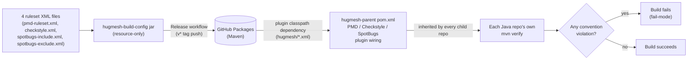

A small **resource-only JAR** that carries the shared static-analysis rulesets
of the HugMesh ecosystem. Rules kept in one place get
argued about once; rules copied into every repo get argued about in every repo.

```
groupId:    net.hugmesh
artifactId: hugmesh-build-config
version:    0.6.0-beta.1
packaging:  jar
```

It contains no Java, only ruleset XML under
`src/main/resources/hugmesh/`:

| File | Tool | Conventions enforced |
|------|------|----------------------|
| `pmd-ruleset.xml`     | PMD       | **A** `FinalFieldCouldBeStatic` (constants → `static final`), **B** `ImmutableField` (write-once fields → `final`) |
| `checkstyle.xml`      | Checkstyle | **F** `VisibilityModifier` (private fields), **G** `FinalClass` + `HideUtilityClassConstructor` + `MutableException` (final/utility/immutable-exception classes), **H** `LambdaBodyLength` (oversized lambda guardrail) |
| `spotbugs-include.xml`| SpotBugs core | **D** `EI_EXPOSE_REP`/`EI_EXPOSE_REP2`/`MS_EXPOSE_REP`/`MS_MUTABLE_*`/`MS_PKGPROTECT` (defensive copies / no rep exposure), **E** `MS_SHOULD_BE_FINAL`/`MS_CANNOT_BE_FINAL` (no mutable static) |
| `spotbugs-include.xml`| FindSecBugs 1.14.0 | 137 of its 144 security patterns (SQL/LDAP/XPath/EL injection, path traversal, weak crypto + hard-coded keys, unsafe deserialization, XXE, SSRF, cookie/CORS/CSRF config, XSS). The other 7 currently fire and are listed, with the reason each is held back, in the file's own header. |
| `spotbugs-exclude.xml`| SpotBugs | The known-pattern **baseline**: entity/dto/model packages (EI_EXPOSE_REP/EI_EXPOSE_REP2), generated sources, and test classes. Also suppresses EI_EXPOSE_REP2 (but NOT EI_EXPOSE_REP) for Spring-managed components. It matches them by component *package* and, since 0.4.0, by *class-name suffix* (`*Service`/`*Controller`/`*Repository`/`*Client`/`*Config`/`*Handler`/`*Filter`/`*Resolver`), because the fleet uses feature packages, not layer packages. A guard keeps a `byte[]`/`char[]` key or token, or a mutable collection/date, reported even inside those classes. |

## Status

Checked against the code and config on `main`:

- **Resource-only jar, no Java, no `src/test`.** `find src -type f` turns up only
  the 4 XML files under `src/main/resources/hugmesh/`. There is nothing to
  unit-test beyond the package build itself.
- **`mvn -o package` builds offline.** It produces
  `target/hugmesh-build-config-0.6.0-beta.1.jar` with exactly the 4 resources at the
  bare `hugmesh/<file>.xml` path.
- **All three analysers (PMD, Checkstyle, SpotBugs) fail the build, fleet-wide.**
  `hugmesh-parent`'s `pom.xml` shows it. PMD flipped to
  `pmd:check`/`failOnViolation=true` in parent commit `2363e60`, Checkstyle in
  `ef31599`, SpotBugs in `7d22f1a` (merged 2026-06-23/24). See "Rollout" below.
- **The `EI_EXPOSE_REP2` suppression for Spring components has shipped since
  0.3.0**, and it is in `spotbugs-exclude.xml`. But 0.3.0 matched *package path*,
  and the fleet uses *feature* packages, so it caught almost nothing (measured: 4
  of hugmesh-admin-bff-api's 185 injection findings). 0.4.0 added the
  class-name-suffix rule that covers the intended case.
- **FindSecBugs reported nothing until 0.4.0.** `spotbugs-include.xml` is an
  INCLUDE filter and named only the 9 D/E patterns. FindSecBugs' 144 patterns
  share none of those names (checked against the plugin's own `findbugs.xml`), so
  the filter dropped every security finding. 0.4.0 admits the 137 patterns
  measured at zero findings fleet-wide. That turns the security gate on for
  future code at no cost to current builds.
- **No test suite, no changelog file.** A 4-file resource jar does not need
  either; the git log is the version history. The release workflow
  (`.github/workflows/release.yml`) is described under "Publishing".

## Why a separate artifact (the distribution mechanism)

Static-analysis plugins read a ruleset from **their own plugin classpath**, not
the project's compile classpath. So `hugmesh-parent` adds this jar to each
analysis plugin's `<dependencies>` and points the plugin at a classpath path:
Checkstyle and SpotBugs use the bare `hugmesh/<file>.xml`, and PMD uses
`/hugmesh/pmd-ruleset.xml`, with a leading slash. A `classpath:` prefix makes
`maven-pmd-plugin` and `spotbugs-maven-plugin` fail with "Could not find resource". The parent is inherited by every
Java repo, so every repo gets the same audited rulesets and **no repo keeps an
XML copy**.

This jar stays **separate from `hugmesh-commons`** (the runtime security library)
on purpose. A ruleset tweak must not force a version bump of a runtime artifact,
and build-config must not drag Spring onto any plugin classpath. It is the usual
"shared build config artifact" pattern (compare `google_checks.xml`/`sun_checks.xml`,
which ship inside the checkstyle jar).



## Conventions mapping (the standard)

The conventions come from the org's secure/clean-Java and reactive-readability
standard. Each item goes to the most precise tool:

- **A** static-final constants → PMD `FinalFieldCouldBeStatic`
- **B** final write-once fields → PMD `ImmutableField`
- **D** defensive copies / no rep exposure → SpotBugs core `EI_EXPOSE_REP*` / `MS_EXPOSE_REP` / `MS_MUTABLE_*` / `MS_PKGPROTECT` (core patterns only; FindSecBugs does *not* reuse these names. It has its own 144-pattern namespace, admitted separately in `spotbugs-include.xml`)
- **E** mutable static → SpotBugs `MS_SHOULD_BE_FINAL` / `MS_CANNOT_BE_FINAL`
- **F** field visibility → Checkstyle `VisibilityModifier`
- **G** final/utility/immutable-exception classes → Checkstyle `FinalClass` + `HideUtilityClassConstructor` + `MutableException`
- **H** reactive readability → Checkstyle `LambdaBodyLength` (size guardrail only)

**C** (enum for fixed string sets) and the *defensive-copy fix* / *lambda→method-ref*
/ *nesting* halves of D and H have **no reliable low-noise static rule**. They
stay agent-pass conventions. We chose not to add a rule that flags every
lambda or every collection field.

## Rollout: fail-mode (all three tools)

All three analysers run in **fail-mode** in `hugmesh-parent`:

- PMD: `pmd:check`, `failOnViolation=true`, flipped fleet-wide once verified clean.
- Checkstyle: `checkstyle:check`, `failOnViolation=true`, with `severity=error` set here in `checkstyle.xml`.
- SpotBugs: `spotbugs:check`, `failOnError=true` since parent PR #15.

On the SpotBugs `check` goal, `failOnError` is the *only* fail switch. It gates real findings and SpotBugs-internal analysis errors together, and the two cannot be separated. An internal error means the gate never ran, so failing is correct. `failOnViolation` is **not** a parameter of that goal (it belongs to maven-pmd-plugin and maven-checkstyle-plugin). SpotBugs ignored it silently, so the SpotBugs gate sat fail-**open** from `7d22f1a` until parent PR #15. Do not re-add it.

A violation of any A/B/D/E/F/G/H convention now fails `mvn verify` fleet-wide. `${hugmesh.analysis.skip}` stays available in `hugmesh-parent` as an escape hatch for fast inner-loop builds.

## Building / testing locally

There is no Java to compile and no `src/test`. To "test" a ruleset change, build
the jar and re-run a consuming repo's analysis against it:

```bash
# 1. Build + install this jar into ~/.m2 so sibling repos resolve it offline.
mvn install

# 2. In a consuming repo (any Java repo that inherits hugmesh-parent),
#    re-run analysis to pick up the locally-installed jar:
mvn verify -Dhugmesh-build-config.version=<version you just installed>
```

`mvn -o package` (offline) is enough to check that the jar builds and packages
the 4 resources. It needs no external repository, because this artifact has no
`<dependencies>` beyond the pinned `maven-jar-plugin`.

## Publishing

Publishing is the **`Release`** GitHub Actions workflow
(`.github/workflows/release.yml`). A person publishes a version by pushing an
annotated tag `v<version>` on a commit on `main`, where `<version>` is exactly the
`<version>` in `pom.xml` (today `v0.6.0-beta.1`). The workflow then runs
`mvn verify`, `mvn deploy` to GitHub Packages
(`https://maven.pkg.github.com/hugmesh/hugmesh-build-config`) with the
workflow's own `GITHUB_TOKEN`, and creates a GitHub Release. While the version
has a `-` (a beta), that release is a prerelease and is never marked latest.

| Event | What happens |
|---|---|
| push of tag `v<version>` | verify, deploy, GitHub Release |
| manual run (`workflow_dispatch`) on a `v*` tag | the same; this is the re-run path |
| manual run on `main` | `mvn verify` only, nothing deployed |
| anything else | refused by the version guard |

There is no push-to-branch and no pull-request trigger: a Maven coordinate is
immutable, so only a tag decides that a version is published. The version guard
refuses a tag that does not match `pom.xml`, a tag on a commit that is not on
`main`, and any `-SNAPSHOT` version.

Every job runs on the runner named by the repository variable
`RUNS_ON_PUBLISH` (a JSON array such as `["self-hosted","Linux","X64"]`) when
the run is for `main` or a `v*` tag, and on hosted `ubuntu-latest` otherwise,
including whenever that variable is unset. Deleting the variable sends
publishing back to hosted runners. No job here reads `RUNS_ON`.

Version scheme: `MAJOR.MINOR.PATCH-beta.N`. N starts at 1 and goes up by one
for each published beta of the same base version. `0.6.0-beta.1` is the first
beta after `0.5.0`. `0.5.0` had one green deploy run on 2026-10-07 (run
37699404165, a manual run of the old dispatch-only workflow); nobody has read it
back from the registry yet.

This jar is link 1 of 4 in the org's publish chain (`hugmesh-build-config` →
`hugmesh-parent` → `hugmesh-commons` → `hugmesh-auth-core`); `RELEASING.md` in
this repo has the detail.

Two rules for a release:

- Bump `<version>` in the same PR as any ruleset change. A ruleset change
  published at the same coordinate silently changes what the whole fleet is analysed against.
- Bump `project.build.outputTimestamp` in `pom.xml` to the release date when you
  bump the version. It makes the jar reproducible.

The repo also keeps a GitLab pipeline, `.gitlab-ci.yml`, that packages the jar
and, on the default branch or a tag, deploys it with `mvn deploy -s settings.xml`
to the GitLab Maven Package Registry. It authenticates with the GitLab-injected
`CI_JOB_TOKEN`. The `distributionManagement` in `pom.xml` still points there; the
GitHub workflow overrides it with `-DaltDeploymentRepository`. For local dev, `mvn install`
writes the jar to `~/.m2` so sibling repos resolve it offline.

## Known Gaps / TODO

- No issues are open in this repo's issue tracker.
- Stale text: the header of `pmd-ruleset.xml`, the `<description>` in `pom.xml` and
  the comment above its `<build>` all say the plugins read the bare path
  `hugmesh/<file>.xml`. That is true of Checkstyle and SpotBugs. PMD uses
  `/hugmesh/pmd-ruleset.xml`, with a leading slash, in `hugmesh-parent`. Fixing
  the text changes the jar and the pom, so it waits for the next version bump.
