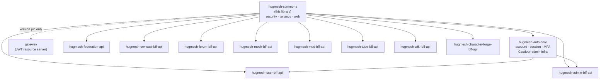

The shared, **canonical** HugMesh security / tenancy / config / web building
blocks. Every reactive BFF (`hugmesh-federation-api`, `hugmesh-admin-bff-api`,
`hugmesh-user-bff-api`, `hugmesh-owncast-bff-api`, …) and the gateway once carried its
own copy of this code, changed only in package names and access modifiers. Copies
drift. This library is the one that counts.

The BFFs take it as a compile dependency. Some keep a thin local `Roles` or
`PrincipalDomain` helper next to it: `hugmesh-mesh-bff-api`'s `Roles` delegates to
this library, and `hugmesh-forum-bff-api`'s `Roles` is a copy taken from the gateway.
The gateway is the one exception. It keeps its own vendored copies on purpose; see
below.

This library sits at the bottom of the shared-artifact stack. `hugmesh-auth-core`
(shared account / session / MFA / Casdoor-admin infrastructure, consumed by
`hugmesh-user-bff-api` and `hugmesh-admin-bff-api`) depends on it for security and
tenancy primitives. Every reactive BFF also depends on it directly for the security /
tenancy / web classes below.

The gateway also depends on commons, with an explicit version, but only to pin the
Boot-4 / Security-7 binary-compat milestone. It keeps its own vendored `Roles` /
`DomainRegistry` / `CasdoorAuthorities` / `TenancyResourceServerConfig`. A
class-by-class diff found the gateway's copies carry methods this library lacks and the gateway uses (e.g. `isGameMaster`, `usernameOf`, `namesOf`,
`domainForHost`). The commons dependency makes the shared types available to the
gateway for future use, not current use.



## Coordinates

```
groupId:    net.hugmesh
artifactId: hugmesh-commons
version:    2.2.0-beta.1
packaging:  jar
```

Child of `net.hugmesh:hugmesh-parent:2.9.0-beta.1` (the metapom), which pins the
ecosystem baseline: **Spring Boot 4.0.7 / Spring Cloud 2025.1.2** on **Java 25 LTS**
(eclipse-temurin:25), with Testcontainers 2.0.5.

## Contents

| Class | Package | Role |
|-------|---------|------|
| `Roles` | `net.hugmesh.commons.security` | JWT role / domain / MFA-stamp extraction; `roles` entries are read like `CasdoorAuthorities` reads them (`ROLE_ADMIN` and `admin` are the same role). |
| `RoleName` | `net.hugmesh.commons.security` | closed enum of the four base Casdoor role tokens (`user`/`mod`/`admin`/`superadmin`); fail-closed `fromWire`/`require`/`isBaseRole` with the lowercase on-the-wire value preserved as a live contract. |
| `MfaPolicy` | `net.hugmesh.commons.security` | per-role second-factor requirement (`REQUIRED`/`OPTIONAL`) and the `ALLOW`/`CHALLENGE` step-up decision over the `mfa_satisfied_at` stamp; roles are read like `CasdoorAuthorities` reads them (`ROLE_ADMIN` and `admin` are the same role); an unreadable `roles` claim is `REQUIRED` when the policy requires anything; the default policy requires nothing of a principal with a valid token. |
| `CasdoorAuthorities` | `net.hugmesh.commons.security` | Casdoor JWT → Spring authorities converter (the RESERVED-PREFIX injection guard lives here). |
| `DomainRegistry` | `net.hugmesh.commons.security` | issuer-URI → brand/domain map; single-issuer back-compat + multi-brand fail-closed; `knownDomains`/`isKnownDomain` validation. |
| `PrincipalDomain` | `net.hugmesh.commons.security` | instance-based, SUPERADMIN-aware per-request tenant scope (was the federation/admin `DomainScope`). |
| `DomainScope` | `net.hugmesh.commons.tenancy` | static SQL-predicate utility (`andPredicate`/`isUnscoped`) for per-domain repositories (was the user/owncast `DomainScope`). |
| `TenancyResourceServerConfig` | `net.hugmesh.commons.config` | config-gated, backward-compatible multi-issuer (per-brand Casdoor) resource-server wiring. |
| `ApiException` | `net.hugmesh.commons.web` | the BFF `{"error": msg}` exception with the full union of HTTP-status factories. |

## Preserved security behaviours

1. The JWT `roles` claim becomes `ROLE_` authorities, via `Roles.fromJwt` and
   `CasdoorAuthorities`.
2. An `isAdmin` claim that is the boolean `true` (the Casdoor legacy form) gives
   `ROLE_ADMIN`. A string such as `"true"` does not count.
3. The `DOMAIN_<x>` authority comes **only** from the cryptographically validated JWT
   issuer URI. Never from a claim a user can set.
4. **RESERVED_PREFIXES guard.** Any entry of the `permissions` claim that begins with
   `ROLE_`, `DOMAIN_`, or `MFA_SATISFIED` (matched case-insensitively, after
   trimming) is silently dropped. This blocks authority injection, cross-tenant
   escalation, and MFA forgery.
5. **Fail-closed domain resolution.** When `app.tenancy.issuers` is set, an issuer not
   in the map resolves to `null`, not a default domain, and the multi-issuer decoder
   rejects that token with `401` before any authorities are built. The converter alone
   does not fail closed: `CasdoorAuthorities` maps a `null` domain to `DOMAIN_default`,
   so the decoder is the gate. With no issuer configured at all,
   `DomainRegistry.domainOf` returns `"default"` for everything.
   `domainOf(authorities)` also returns `null` when zero or more than one `DOMAIN_`
   authority is present, because several domain authorities mean the token was
   tampered with.
6. SUPERADMIN principals are exempt from per-domain scoping. `Roles.isSuperadmin` and
   `PrincipalDomain` enforce this the same way everywhere.
7. `MFA_SATISFIED` comes only from a fresh `mfa_satisfied_at` stamp that the BFF writes
   after a successful MFA challenge. The stamp is epoch milliseconds. A stamp in the
   future, older than the window, or malformed is rejected. The authority is derived
   only when `app.mfa.enabled` is `true` (default `false`);
   `app.mfa.freshness-window` defaults to `600000` (ten minutes) in
   `TenancyResourceServerConfig`.
8. Multi-issuer support (for per-brand Casdoor deployments) is opt-in and
   backward-compatible. `TenancyResourceServerConfig` loads only when the
   `app.tenancy.issuers` property contains `=` (`@ConditionalOnExpression`).
   `DomainRegistry.isMultiIssuer()` is true when the registry maps more than one issuer.

Unit tests under `src/test/java` cover all eight.

## What stays per-repo

`SecurityConfig` stays in each service. Its `authorizeExchange` route matchers
(`/bff/admin/**`, `/bff/user/**`, `/bff/owncast/**`, `/api/federation/**`) and its CSRF
and cookie handling differ between services, so they cannot be centralised. Each
`SecurityConfig` wires in the shared `CasdoorAuthorities` / `DomainRegistry` and,
optionally, `TenancyResourceServerConfig`, then declares its own route rules.

The per-repo security-slice test scaffold (`SecuritySliceSupport`) also stays, because
it must construct that repo's `SecurityConfig`.

## Using it

```xml
<dependency>
  <groupId>net.hugmesh</groupId>
  <artifactId>hugmesh-commons</artifactId>
  <!-- version managed by hugmesh-parent -->
</dependency>
```

Then delete the repo-local copies of the classes above and update the imports. The
package root changes from the repo-specific prefix to `net.hugmesh.commons.*`:

```
# Before (example from federation-api)
import net.hugmesh.federation.security.Roles;
import net.hugmesh.federation.security.DomainRegistry;

# After
import net.hugmesh.commons.security.Roles;
import net.hugmesh.commons.security.DomainRegistry;
```

**Method rename:** Two `Roles` overloads that took `Set<String>` (raw authority name
strings, not `GrantedAuthority` objects) were renamed. With generics erased, the Java
compiler cannot tell them apart at the call site.

| Old name (federation form) | New name |
|---|---|
| `Roles.isSuperadmin(Set<String>)` | `Roles.isSuperadminNames(Collection<String>)` |
| `Roles.domainOf(Set<String>)` | `Roles.domainOfNames(Collection<String>)` |

Calls that pass a `Collection<GrantedAuthority>` use the existing overloads unchanged.

## Shared test base (published test-jar)

Alongside the main jar, the `maven-jar-plugin` `test-jar` goal publishes
`net.hugmesh.commons.testsupport.PostgresTestSupport`
(`src/test/java/net/hugmesh/commons/testsupport/PostgresTestSupport.java`) as
`net.hugmesh:hugmesh-commons:2.2.0-beta.1:tests` (test scope). Consumers extend it. They get
ONE Testcontainers-Postgres base for the whole org, not a per-repo copy of the
container, Liquibase and R2DBC wiring.

```xml
<dependency>
  <groupId>net.hugmesh</groupId>
  <artifactId>hugmesh-commons</artifactId>
  <classifier>tests</classifier>
  <version>2.2.0-beta.1</version>
  <scope>test</scope>
</dependency>
```

The version is explicit because `hugmesh-parent` manages only the main jar, not the
`tests` classifier. Maven would reject the dependency without it.

```java
class MySliceTest extends PostgresTestSupport { /* ... */ }
```

Key properties:

- One static Postgres container, reused across the whole test JVM. It starts once, not
  per class.
- A fresh `cmtest_<n>` database for each test class, so Liquibase seeds never leak
  between classes.
- An overridable `jsonTypeOverride()`, default `"text"`, for repos whose changelogs
  reference `${json.type}` against a real `jsonb` column.

## Build / publish

| Goal | Command |
|---|---|
| Compile and run unit tests | `./mvnw verify` |
| Install to local Maven cache (`~/.m2`) for offline sibling-repo use | `./mvnw install` |
| Publish to GitLab Maven Package Registry (CI only) | `./mvnw deploy -s settings.xml` |

`./mvnw verify` also builds the **test-jar** described in [Shared test base
(published test-jar)](#shared-test-base-published-test-jar). `install` and `deploy`
carry it on to the local cache and the registry.

Two pipelines are checked in:

- `.gitlab-ci.yml` runs `verify` as `build:test`. On the default branch and on any tag
  it then runs `deploy -DskipTests` to the GitLab Maven Package Registry. The
  deploy step authenticates with the GitLab-injected `CI_JOB_TOKEN`. No secret is
  committed to the repository.
- `.github/workflows/release.yml` publishes the jar and the `tests` classifier to
  GitHub Packages. A person starts it by pushing a `v<version>` tag that equals the
  pom version (or by a manual dispatch on that tag); a dispatch on `main` only runs
  `verify`, and a branch push starts nothing. `RELEASING.md` records that it has never
  run, and that no Actions job in
  the org starts at all because of a billing block.

## Current State

- **At `2.2.0-beta.1` on the unified ecosystem baseline** (the first beta; 2.1.0 is
  pinned by consumers, and no GitHub workflow here has ever published it). Spring Boot 4.0.7 / Spring Cloud
  2025.1.2 on Java 25 LTS, Testcontainers 2.0.5, child of `hugmesh-parent:2.9.0-beta.1`
  (`hugmesh-federation-api` is the migrated exemplar). The groupId is `net.hugmesh`,
  the reverse of `hugmesh.net`, for this artifact and its parent alike. The artifact's `2.2.0-beta.1` and the inherited `hugmesh-parent:2.9.0-beta.1` are two
  different version numbers and are not expected to track each other; see
  [Coordinates](#coordinates) and `pom.xml`.
- **Bottom of the shared-artifact stack.** `hugmesh-auth-core` depends on this library,
  and `hugmesh-user-bff-api` and `hugmesh-admin-bff-api` consume `hugmesh-auth-core`.
  Every reactive BFF depends on commons directly. The gateway keeps its own vendored
  copies, as described at the top of this page.
- **Auth-model alignment.** The current native-login design keeps the Casdoor JWT
  entirely server-side and Casdoor internal-only. It never redirects the browser.
  `login-ui` renders a first-party login form that POSTs credentials straight to
  `/bff/login` (via the gateway). `user-bff` runs the whole OIDC/PKCE handshake with
  Casdoor itself: it generates the PKCE verifier/challenge and state, calls Casdoor's
  internal `/api/login`, and exchanges the code for a JWT. The account and session rows
  stay in the admin-bff database; `user-bff` writes them through admin-bff's internal
  `/bff/internal` API.

  The browser never sees a Casdoor URL, authorization code, or JWT. It receives only an
  opaque `bff_`-prefixed session cookie. At the gateway, a pre-security exchange filter
  swaps the `bff_` value for the server-held Casdoor JWT by calling admin-bff
  (`POST /bff/internal/session/exchange`). JWT validation, role extraction, and domain
  resolution then run unchanged, in the gateway's own vendored `Roles` /
  `DomainRegistry` / `CasdoorAuthorities` (see the top of this page). The services default these paths
  off (`app.bff.oidc.enabled`, `hugmesh.gateway.bff-exchange.enabled`); the
  `hugmesh-generator` cluster manifests turn them on.

  ```mermaid
  sequenceDiagram
      participant Browser
      participant login-ui
      participant gateway
      participant user-bff
      participant admin-bff
      participant Casdoor

      Browser->>login-ui: fill native login form
      login-ui->>gateway: POST /bff/login (credentials)
      gateway->>user-bff: route to user-bff (permitAll)
      user-bff->>Casdoor: internal /api/login + PKCE code exchange
      Casdoor-->>user-bff: Casdoor JWT (held server-side)
      user-bff-->>Browser: Set-Cookie: bff_<opaque>
      Browser->>gateway: API request + bff_ cookie
      gateway->>admin-bff: POST /bff/internal/session/exchange (bff_ → JWT)
      admin-bff-->>gateway: internal custody JWT
      gateway->>gateway: own (vendored) CasdoorAuthorities / Roles / DomainRegistry
      gateway-->>Browser: authorised response
  ```

  Login logic now lives in `user-bff`, with the shared core extracted to
  `hugmesh-auth-core`. The account and session data, and the exchange endpoint, still
  sit in `admin-bff`. This library is unchanged by the move. It stays the
  JWT→authorities and tenancy substrate under both.
- **MFA enforcement depends on `MFA_SATISFIED`.** Behaviour 7 and the reserved-prefix
  guard are how BFF-driven MFA challenges are enforced even when the gateway sees only
  an opaque `bff_` session. The authority ships disabled until MFA is enabled in the
  deployment.
- All eight preserved security behaviours remain covered by unit tests. Two publish
  paths exist (see [Build / publish](#build--publish)); the GitHub one has never run.

## Roadmap

This library underpins several in-flight and planned platform initiatives. New shared
primitives land here as they are generalised across services. `hugmesh-generator`
(`docs/ROADMAP.md`) tracks the status of each; this section only says where each one
touches this library.

- **SSO end-to-end live + e2e.** The native-login model is built (see [Current
  State](#current-state) for why the gateway keeps vendored copies rather than using
  this library's). The proof against a running cluster is not finished.
- **MFA** (WebAuthn + TOTP + recovery, per-role defaults, step-up). Builds directly on
  the `MFA_SATISFIED` stamp derivation (behaviour 7) and the reserved-prefix guard
  already in this library. Per-role defaults and the step-up decision are in
  `MfaPolicy`. Its default policy asks a principal with a valid token for no second
  factor. Factor enrolment (WebAuthn, TOTP, recovery) is not in this library.
- **Multi-tenancy / multi-brand superadmin.** Per-domain CA with per-brand gateway /
  BFF / UI instances. This uses the opt-in multi-issuer path
  (`TenancyResourceServerConfig`) and the fail-closed domain resolution already here.
- **Downstream platform work** that uses these primitives and needs no change to them:
  data-driven gateway route authorisation (`gateway_route_access`), encrypted versioned
  backups, egress VPN drop-in, per-node attached storage, desktop app governance,
  workload console, device-license registry, games app-store, audio/video relay via
  coturn/TURN, and OWASP pen-test + nuclei integration in CI.

## License

MIT. See [LICENSE](LICENSE). The published pom names the same license.
