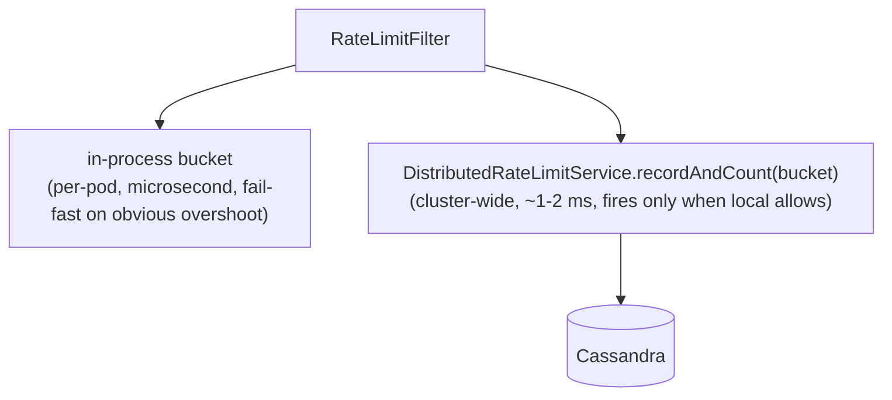

## Context

`RateLimitFilter` ([backend/src/main/java/games/hugmesh/bff/config/RateLimitFilter.java](../../../backend/src/main/java/games/hugmesh/bff/config/RateLimitFilter.java)) caps each `(remote-IP, path-prefix)` to 20 requests / minute by default on the credential-grant endpoints (`/api/auth/`, `/api/admin/actions/`). The cap and window are the properties `app.rate-limit.auth.max-per-window` and `app.rate-limit.auth.window-seconds`; the integration-test profile raises the cap to 1000. The first version kept bucket state in a per-pod `ConcurrentHashMap`. On a fleet that fails: an attacker who fans out across N pods gets N × MAX_PER_WINDOW headroom, because each pod's bucket is isolated.

## Options considered

1. **Counter table on Cassandra** — `rate_limit_counters(bucket_key, window_start, count counter)`, incremented per request. The Cassandra docs call this an anti-pattern. Counter writes aren't idempotent on retry (a timeout can double-count), and counter columns don't compose with TTL, so some out-of-band process would have to clean up old windows.

2. **Append-row log with TTL** — `rate_limit_events(bucket_key, event_id timeuuid)` with `default_time_to_live = 90`. Insert one row per gated request. To decide on a request, count the bucket's rows whose `event_id` falls inside the rolling window. TTL cleans up for free, writes are idempotent, and the `event_id` clustering makes the count a single-partition scan bounded by `MAX_PER_WINDOW + buffer`.

3. **Postgres-backed** — a `rate_limit_events` Liquibase table with `INSERT` + `SELECT COUNT(*)`. It works, but Postgres is the wrong tool: it is the durability tier for game state, not the high-write tier. Cassandra fits ephemeral cross-pod state better, and we already use it for the position cache, session membership and admin aggregate counters.

## Decision

Option 2, an append-row log on Cassandra. It augments the in-process bucket; it does not replace it.

Two layers:



The local bucket rejects without touching Cassandra. A cluster rejection already passed this pod's local cap, so it means multi-pod fan-out, not single-pod overshoot. Either rejection returns `429 Too Many Requests` with `Retry-After` set to the window (60 s by default).

## Why local + cluster, not cluster-only

A cluster-only check puts a Cassandra round-trip (~1-2 ms) on every login, even when no attacker is fanning out. The local bucket is free and catches the single-pod case, so the cluster check stays rare.

## Failure mode

When Cassandra is unreachable (network partition, cassandra-init still running on a fresh stack, maintenance), `DistributedRateLimitService.recordAndCount` falls back to `Mono.just(0L)` and the filter allows the request. The filter also wraps the call in a resilience4j circuit breaker named `cassandra`; once it opens, the cluster check is skipped and the local bucket decides alone. The local bucket keeps working. The cluster layer is best-effort defense in depth.

The service bean is registered by `CassandraBackedServicesAutoConfiguration` with `@ConditionalOnBean(ReactiveCqlTemplate.class)`, as `PositionCacheService` is. It is absent when Cassandra isn't wired (e.g. the unit-test profile), so unit tests of `RateLimitFilter` need no Cassandra fixture. (It was once a scanned `@Service`; `@ConditionalOnBean` evaluated too early there, and the service silently never existed.)

`app.rate-limit.distributed.enabled=false` turns the cluster layer off at runtime, with Cassandra still wired.

## Schema

```cql
CREATE TABLE IF NOT EXISTS rate_limit_events (
    bucket_key     text,
    event_id       timeuuid,
    pod_id         text,
    PRIMARY KEY ((bucket_key), event_id)
) WITH CLUSTERING ORDER BY (event_id DESC)
   AND default_time_to_live = 90;
```

`bucket_key = "<remote-ip>|<path-prefix>"`. `event_id = Uuids.timeBased()`, so the count query can use `WHERE event_id >= minTimeuuid(?)` to bound the window. `pod_id` is diagnostic only; it helps trace a fan-out attempt across pods in the access log.

The 90 s TTL is `RATE_LIMIT_WINDOW = 60 s` plus a 30 s grace, so a count read never races a freshly evicted row from the same window.

## Tests

- `DistributedRateLimitServiceTest` (unit): a hand-rolled `ReactiveCqlTemplate` stub, because the Mockito-inline agent is brittle on JDK 25. It pins the happy path and the three failure paths (insert error → 0, count error → 0, empty count → 0).
- `make e2e`: the integration-test stack brings Cassandra up alongside Postgres, but its profile sets the cap to 1000 per window and no spec under `e2e/tests/` asserts a 429. Nothing in the tree exercises the real Cassandra path end to end.

## What this doesn't solve

- Time skew between pods: each pod uses its own `Instant.now()` for the window start. A few seconds of skew could let a request slip in just outside one pod's window. NTP keeps this bounded; for a stricter guarantee we would quantize event times to a shared 1-second bucket boundary.
- Cassandra LWT-level uniqueness: the count read is at default consistency (`LOCAL_QUORUM` in production). A request that fires on N pods at once sees stale counts. That is fine for a 20/minute limit and not fine for a 1/window LWT-guarded operation.
