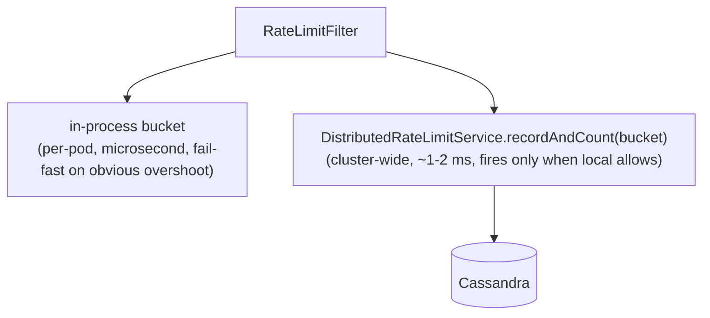

## Context

`RateLimitFilter` ([backend/src/main/java/games/hugmesh/bff/config/RateLimitFilter.java](../../../backend/src/main/java/games/hugmesh/bff/config/RateLimitFilter.java)) caps each `(remote-IP, path-prefix)` to 20 requests / minute on the credential-grant endpoints (`/api/auth/`, `/api/admin/actions/`). The original implementation kept its bucket state in a per-pod `ConcurrentHashMap`. That holds up under a single-pod deploy but a multi-pod fleet defeats it: a credential-stuffing attacker fanning across N pods sees N × MAX_PER_WINDOW headroom because each pod's bucket is isolated.

## Options considered

1. **Counter table on Cassandra** — `rate_limit_counters(bucket_key, window_start, count counter)`, increment per request. Cassandra docs explicitly call this anti-pattern out: counter writes aren't idempotent on retry (timeouts can double-count) AND counter columns don't compose with TTL, so old window state has to be GC'd by some out-of-band process.

2. **Append-row log with TTL** — `rate_limit_events(bucket_key, event_id timeuuid)` with `default_time_to_live = 90`. Insert one row per gated request; to decide on a request, count rows for the bucket whose `event_id` falls inside the rolling window. TTL handles GC for free; writes are idempotent; `event_id` clustering makes the count a single-partition scan bounded by `MAX_PER_WINDOW + buffer`.

3. **Postgres-backed** — `rate_limit_events` Liquibase table with `INSERT` + `SELECT COUNT(*)`. Works, but Postgres is the wrong tool: it's the durability tier for game state, not the high-write throughput tier. Cassandra's the better fit for ephemeral cross-pod state and we already wire it for the position cache, session membership, and admin aggregate counters.

## Decision

Option 2 — append-row log on Cassandra, augmenting the existing in-process bucket rather than replacing it.

Two-layer shape:



Local-bucket-rejected requests never round-trip Cassandra. Cluster-rejected requests already passed the local cap on this pod, so we know the rejection is multi-pod fan-out and not single-pod overshoot. Either rejection returns `429 Too Many Requests` with `Retry-After: 60`.

## Why local + cluster, not cluster-only

A pure cluster check would add the Cassandra round-trip to every gated request. For `/api/auth/`, that's a ~1-2 ms tax on the login hot path with no benefit when the attacker isn't fanning out. The local bucket is free, catches the single-pod case, and lets the cluster check stay surgical.

## Failure mode

When Cassandra is unreachable (network partition, cassandra-init still running on a fresh stack, scheduled maintenance), `DistributedRateLimitService.recordAndCount` falls back to `Mono.just(0L)` so the filter allows. The local bucket is still doing its job; the cluster augmentation is best-effort defense in depth.

`@ConditionalOnBean(ReactiveCqlTemplate.class)` mirrors `PositionCacheService` — the service no-ops when Cassandra isn't wired (e.g. unit-test profile), so unit tests of `RateLimitFilter` don't need a Cassandra fixture.

`app.rate-limit.distributed.enabled=false` disables the cluster layer at runtime so a deployment that explicitly wants in-process-only throttling doesn't have to remove Cassandra wiring.

## Schema

```cql
CREATE TABLE IF NOT EXISTS rate_limit_events (
    bucket_key     text,
    event_id       timeuuid,
    pod_id         text,
    PRIMARY KEY ((bucket_key), event_id)
) WITH CLUSTERING ORDER BY (event_id DESC)
   AND default_time_to_live = 90;
```

`bucket_key = "<remote-ip>|<path-prefix>"`. `event_id = Uuids.timeBased()` so the count query can use `WHERE event_id >= minTimeuuid(?)` to scope the window. `pod_id` is purely diagnostic (helps trace a fan-out attempt across pods in the access log).

The 90 s TTL is `RATE_LIMIT_WINDOW = 60 s` plus a 30 s grace so a count read never races a freshly-evicted row from the same window.

## Tests

- `DistributedRateLimitServiceTest` (unit): hand-rolled `ReactiveCqlTemplate` stub (the Mockito-inline agent is brittle on JDK 25); pins the happy path + the three failure-mode paths (insert error → 0, count error → 0, empty count → 0).
- `make e2e`: the integration-test stack brings Cassandra up alongside Postgres; the existing rate-limit pin in `tests/full-stack.spec.ts` (when present) exercises the real Cassandra path.

## What this doesn't solve

- Time-skew between pods: each pod uses its own `Instant.now()` for the window-start lower bound. Worst case a few seconds of skew across pods could let a request slip in just outside one pod's window. NTP keeps this bounded; for stricter guarantees we'd quantize event times to a shared 1-second bucket boundary.
- Cassandra LWT-level uniqueness: the count read is at default consistency (`LOCAL_QUORUM` in production). A request firing simultaneously across N pods sees stale counts. Acceptable for a 20/minute rate limit; not acceptable for a 1/window LWT-guarded operation.
