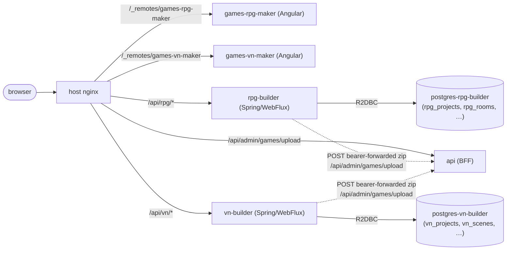
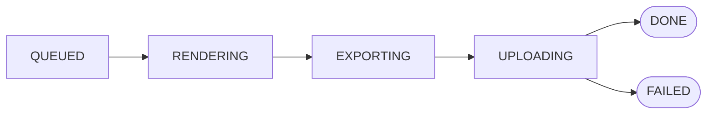

## Context

Publishers want to author and ship games without leaving the portal or
touching Godot. Two genres cover ~80% of the demand on the roadmap:

- **MUD-style RPG** with rooms, areas, exits in N/S/E/W/NE/NW/SE/SW/UP/
  DOWN/TELEPORT directions, items, NPCs and per-room scripts. It mirrors
  Mudlet's editable-world domain (`TArea`, `TRoom`, `TExit`, `TScript`,
  `TKey`, `TAlias`, `TTrigger`).
- **Visual novel** with characters, backgrounds, scenes, dialogue lines
  and branching choices. It mirrors the shape of
  `gdquest-demos/godot-2d-visual-novel` (`Character.gd` /
  `Background.gd` / `ScenePlayer.gd`).

The produced games must federate under the building user like any
admin-uploaded bundle, use the existing hugmesh-bridge GDExtension
(multiplayer and the per-player view channel come free), and support
multiple Areas / Acts so they map onto the BFF `chapters` schema (one
WASM bundle per chapter).

## Options considered

1. **One side service for both genres.** Fewer services, one codebase.
   Rejected. Two unrelated domains in one Spring Boot app give a worse
   REST surface (longer paths, weaker package boundaries). The user also
   asked for two Postgres DBs, which would mean two R2DBC connection
   factories and two Liquibase configs in one process. That costs more
   than the duplication.
2. **Twin sibling services (`rpg-builder` + `vn-builder`).** Each owns
   its DB (`postgres-rpg-builder`, `postgres-vn-builder`), its REST
   surface (`/api/rpg/*`, `/api/vn/*`) and its Liquibase changelog. The
   build pipelines are independent but share one shape (BuildJob queue
   → renderer → Godot CLI → BFF upload). Chosen.
3. **Put the editor and build inside the BFF.** Rejected. The BFF is
   the runtime hot path (SSE per-session sinks, control authorization,
   asset streaming). A build worker that fans out a 4 GB Godot
   container would fight it for threads and RAM.

## Decision

Two reactive Spring Boot side services, twin remotes, separate DBs,
and Liquibase-managed schemas from day one.

## Build pipeline

Both services follow the same five-state lifecycle, kept in a
`*_build_jobs` row that a worker claims atomically with
`FOR UPDATE SKIP LOCKED`:

- **Rendering** writes a Godot 4 project tree under `<workdir>/<job-id>/godot-src/`.
  The RPG renderer emits one `.gd` + `.tscn` pair per room. The VN
  renderer emits a per-act `scenes_data.json` that the runtime
  ScenePlayer parses. Both projects bake in `hugmesh_bridge.gdextension`,
  so the produced WASM speaks our HostBridge / multiplayer lobby / view
  channel out of the box.
- **Exporting** iterates the project's Areas (RPG) / Acts (VN) and
  produces one `bundle/<area-slug>/index.html` per — exactly the shape
  the BFF's existing chapters schema expects. With the real export, the
  RPG worker runs Godot once, moves the shared engine files into
  `bundle/_engine/`, and gives each area a patched `index.html` that
  points at them. The Godot CLI call sits behind `app.build.godot-enabled`.
  With the flag off, the worker writes a stub bundle, so the rest of the
  pipeline (manifest.json, register.sql, zip, BFF upload) runs end to
  end without the multi-GB Godot image.
- **Uploading** posts the zip to the BFF's `/api/admin/games/upload`
  endpoint with the originating user's bearer token. The BFF runs its
  own `PublisherService.requireOwns` scope check at upload time, so the
  side services never need to know which slugs the user may ship.

## Why bearer-forwarding instead of a service-to-service token

A service-to-service token would let the side service POST as itself.
Then the BFF couldn't enforce per-game scope, because the publisher
might not own the manifest's `game.slug`. Forwarding the user's bearer
keeps the existing `@PreAuthorize("hasAnyRole('ADMIN','PUBLISHER')")`
and scope check intact, and gives a correct audit trail
(`game_uploads.uploaded_by` = the building user).

The cost: a queued build that outlives its bearer token fails fast with
HTTP 401, shown in the editor as a clean `error_message`; re-running
mints a fresh token. We accept that. The queue is single-flight per pod
and bundles take seconds (stub) or minutes (real export), well under the
JWT TTL.

## Liquibase-only schema

Every table in `postgres-rpg-builder` and `postgres-vn-builder` comes
from a numbered Liquibase changeset. No psql-init seed file, no runtime
DDL, no JPA `ddl-auto`. This matches the BFF, and a drifted local DB
heals on the next service restart.

## Tests

- **Unit:** `SlugUtilTest` (regex), and `RpgProjectServiceTest` /
  `VnProjectServiceTest` (every form-error path returns the right
  ResponseStatusException and the repository never sees the bad input).
- **WebFlux slice:** `RpgProjectControllerTest` /
  `VnProjectControllerTest` (auth → 401; with a mocked service, the
  controller maps 400/201 onto the wire).
- **e2e BDD:** `features/makers/rpg-maker.feature` and
  `features/makers/vn-maker.feature` cover the launch-from-publisher
  flow, the inline form-error states (slug shape, blank name, bad
  colour, missing target scene) and the full create-→-build progress
  flow. An AfterStep hook in `features/support/fixtures.ts` saves a
  PNG screenshot per step.

## Since this decision was written

- **Real Godot export.** No longer stub-only. `GodotExporter.exportWeb`
  runs `godot --headless --export-release "Web"` for real. With
  `app.build.godot-enabled=true` it fails the build loudly on a non-zero
  exit, a timeout or an empty bundle. The default is `false`, which keeps
  the dev stub-bundle path so the pipeline runs without the multi-GB
  Godot image. `make godot-export-tools` and `make build-with-godot`
  wire in a real Godot binary through the `docker-compose.godot.yml`
  overlay. See the "Twin maker side services" section of
  [`CLAUDE.md`](../../../CLAUDE.md).
- **Asset materialization + procedural generation.** Both renderers now
  copy the actual asset bytes into the staged Godot tree. Before, they
  wrote asset UUIDs into the export JSON without shipping the bytes, so
  exports pointed at art that wasn't there. The runtime GDScript now
  loads the shipped texture instead of falling back to primitives only.
  A new `ProceduralAssetService` (a deterministic FNV-1a/SplitMix64 SVG
  generator; no wall-clock, random or UUID in its output) backs
  `POST /api/{rpg|vn}/projects/{pid}/assets/generate` in both services,
  behind the same ownership check as upload.

## What this doesn't solve

- **Asset preview in the editor** (closed since this was written).
  Both editors now fetch `GET /projects/{id}/assets/{aid}` and show a
  thumbnail for image assets (`loadAssetPreview` in each maker
  component).
- **Live collaborative editing.** Each project is single-author for
  now. The BFF's per-session SSE infrastructure could serve multiple
  authors later; nothing is wired yet.
