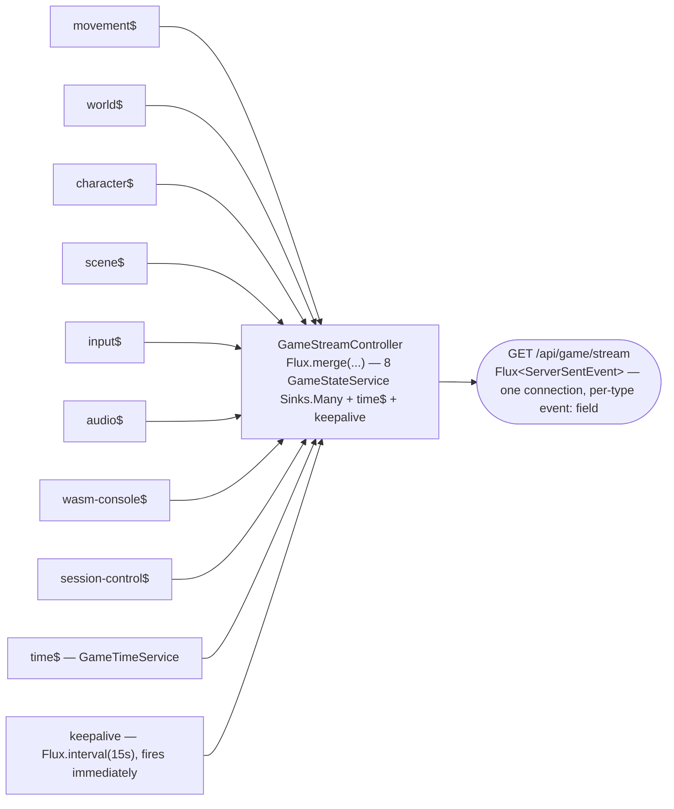
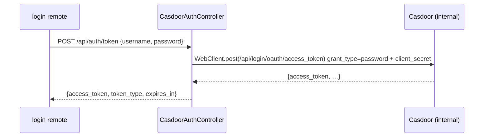
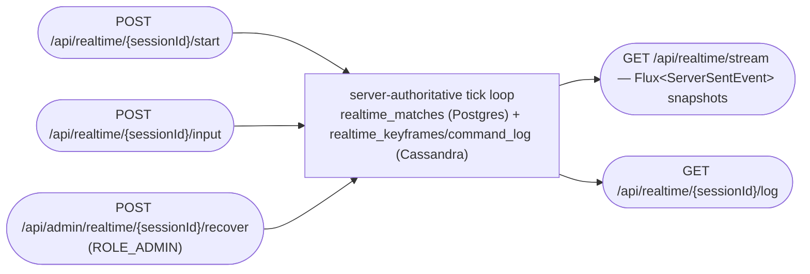
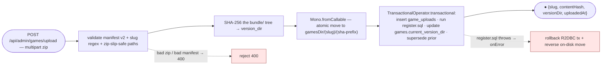
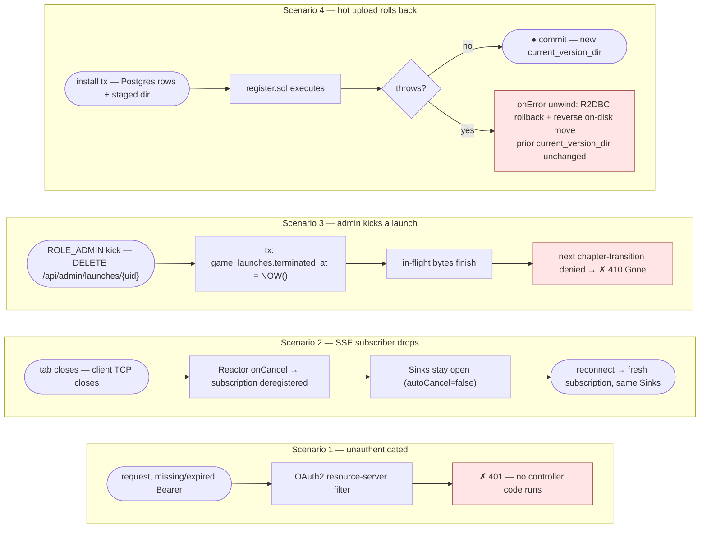

> Mirror of [`chapters/05-api-reference.tex`](../../publishing/architecture/chapters/05-api-reference.tex).

This page is a Markdown-rendered companion to the generated Javadoc HTML at [`docs/publishing/javadoc-output/index.html`](../../publishing/javadoc-output/) and the live OpenAPI explorer at `/v3/api-docs`. Every controller is listed once with its endpoints, auth posture, and a one-line description of the contract.

The PDF version of this chapter ([`chapters/05-api-reference.tex`](../../publishing/architecture/chapters/05-api-reference.tex)) ships TikZ **marble diagrams** for each reactive controller and service (sources under [`docs/publishing/architecture/marbles/`](../../publishing/architecture/marbles/), rendered to PNG by `make docs-rendered-diagrams`). On GitHub those same reactive flows render as the **mermaid pipeline flowcharts** below; the per-endpoint pipelines live in the [root README API reference](../../../README.md#api-reference).

> **Reading the pipeline flowcharts** — a request flows through the Reactor operators to a terminal emission. `([ … ])` rounded ends are the request and the emitted value(s); plain boxes are operators (`findById`, `map`, `flatMap`, `save`); `{ … }` diamonds are branches; a red `✗` node is a 4xx / error terminal. A `Mono` completes after one value, a `Flux` after N, an SSE stream stays open until the client disconnects.

## Reactive pipelines at a glance

**`GameStreamController` — nine SSE channels merged onto one connection.**



**`CasdoorAuthController` — ROPC token exchange (the browser never sees `client_secret`).**



**`RealtimeController` / `AdminRealtimeController` — 🚧 server-authoritative match surface (engine wired, catalog launch deferred).**

The FPS/RTS sim cores and their Cassandra-truth tick loop are wired and verified in-JVM (Chicory), but **no FPS/RTS title is registered as a launchable catalog game yet** — see [`docs/realtime-server-authoritative-design.md`](../../realtime-server-authoritative-design.md).



**`GameUploadService` — the transactional install pipeline.**



## Public surface (no JWT required)

### `CasdoorAuthController` — `/api/auth`

Public reverse-proxy of the Casdoor login flow. (The Java class is `CasdoorAuthController`.)

| Method | Path | Notes |
|---|---|---|
| `POST` | `/api/auth/token` | Exchanges username + password for a Casdoor access token via ROPC (`grant_type=password`). The `client_secret` is injected server-side — the browser never sees it. The federated `login` remote calls this directly. |
| `GET` | `/api/auth/me` | Returns the resolved Casdoor user from the bearer token. |

**Call example.**
```bash
curl -sS -X POST http://localhost:8080/api/auth/token \
  -H 'Content-Type: application/json' \
  -d '{"username":"player","password":"e2e-pass"}'
```
*200 OK*: `{ "accessToken": "eyJ…", "expiresAt": "2026-04-26T12:30:00Z", "casdoorUserId": "alice@threewizards" }`
*400 Bad Request*: `{ "status":400, "error":"invalid_grant", "message":"Casdoor: authorization code expired or already used" }`

### `GameStreamController` — `/api/game/stream`

Public SSE merge stream — nine typed channels plus a keepalive. See [02 — Runtime architecture](02-runtime.md#server-sent-events--nine-channels-on-one-stream).

```bash
curl -N http://localhost:8080/api/game/stream
```
*200 OK — `text/event-stream` (excerpt):*
```
event: keepalive
data: {"ts":"2026-04-26T12:30:00Z"}

event: movement
data: {"characterId":1,"x":12.4,"y":0.0,"z":-3.1,"action":"walk","tick":4421}

event: time
data: {"day":3,"hour":18,"minute":42,"phase":"dusk"}
```
**Client disconnects:** the underlying `Sinks.Many` instances stay open (`autoCancel=false`). A reconnect from the same client gets a fresh subscription on the same sinks.

### `GameController` — `/api/games`

Public game catalog (filtered by `game_access` when a JWT is present). Composes with `ProgressionService` for quest-completion-aware unlock state.

| Method | Path | Notes |
|---|---|---|
| `GET` | `/api/games` | List of all games. |
| `GET` | `/api/games/{id}` | One game by id. |
| `GET` | `/api/games/{id}/levels` | Its chapters by id. |
| `GET` | `/api/games/available/{characterId}` | JWT-aware availability list with per-game lock state. |

### `ChapterController` — `/api/chapters` (also accepts `/api/levels`)

Public per-chapter metadata and scene DTOs. The `@RequestMapping({"/api/chapters", "/api/levels"})` alias keeps already-exported WASM bundles working post-rename — see [decision 006](../decisions/006-naming-rename.md).

| Method | Path | Notes |
|---|---|---|
| `GET` | `/api/chapters/{id}` | Chapter row including `asset_url`. |
| `GET` | `/api/chapters/{id}/scene` | Typed `SceneDto` that `scene_loader.gd` consumes. |

### `ChapterAssetController` — `/api/chapters/{id}/assets`

Public per-chapter asset registry — `GET` / `POST` / `DELETE` for textures / plugins / audio looked up by stable label.

### `AssetController` — `/api/assets`

Public legacy classpath asset serving plus the launch-uid-gated filesystem path for hot-uploaded bundles. Resolves filesystem `<gamesDir>/<slug>/<sha-prefix>/...` first, classpath fallback second.

### `ControlController` — `/api/controls`

Session-validated control event ingestion, gated on `SecurityConfig.PLAYER_PATHS` requiring an authenticated principal — a caller with neither a JWT nor the legacy `X-Casdoor-Id` header gets *401* before any authorization check runs. The legacy `X-Casdoor-Id` header path is still live (not removed): `ControlController.receiveControl` declares `@RequestHeader(value = "X-Casdoor-Id", required = false)` and falls back to it whenever no JWT is present, with the JWT subject always preferred when both are supplied. Once identity is resolved, *403* when the subject isn't the controller-role holder for that session. **Auto-recovery**: `game_bridge.gd`'s `send_control` detects the 403 and posts `SD_SESSION_EXPIRED` to the host shell; `ApiBridgeService.handleSessionExpired()` re-runs `session.connect()` → `session.claimControl()` so the next keypress succeeds. The recovery path is what makes a BFF restart survivable while the Angular SPA is still mounted (the in-memory `activeSessions` / `currentController` are wiped on restart, but the SPA never sees the gap).

### `FederationController` — `/api/federation/manifest`

Public federation manifest. DB-backed read from `federation_modules`, ordered by `kind`/`slug`. See [03 — Module Federation](03-federation.md#the-manifest-endpoint).

### `GameTimeController` — `/api/time`

Public game-clock snapshot — same DTO that the `time` SSE channel emits.

### `DiagnosticsController` — `/api/diagnostics`

Anonymous endpoint for forwarded WASM-iframe console captures. Stamps a server timestamp and pushes onto the `wasm-console` SSE channel so admin docs explorers can mirror crashes live.

### `CspReportController` — `/api/security/csp-report`

Anonymous CSP violation report sink for the `Content-Security-Policy` policy shipped by `frontend/nginx.conf` + `frontend/nginx-tls.conf` (decision 023). Two accepted content-types: `application/csp-report` (legacy `report-uri` envelope) and `application/reports+json` (modern Reporting API array). Log-only at WARN; no persistence. Allow-listed in `SecurityConfig.PUBLIC_PATHS` since browsers POST these unauthenticated. Rate-limited by the standard `api` zone.

### `AppealContactController` — `/api/security/appeal-contact`

Anonymous resolver for the appeal email address shown to revoked users by the federated `banned` remote. Reads `accounts.mods` (primary on-call → secondary on-call), falling back to `app.security.appeal-contact-fallback` (default `support@hugmesh.games`). Returns `{ "email": "<address>" }`. Anonymous because a revoked user has no JWT.

### `ProducerContactController` — `/api/producer-contacts` + admin variants

| Method | Path | Auth | Notes |
|---|---|---|---|
| `POST` | `/api/producer-contacts` | JWT | Producer / mod application submitted via the `producer-registration` federated remote. One row per submission in `producer_contacts`; status starts `PENDING`. |
| `GET`  | `/api/producer-contacts/me` | JWT | Caller's own submission history (newest first). |
| `GET`  | `/api/admin/producer-contacts` | `ROLE_ADMIN` | All submissions for moderation review. |
| `POST` | `/api/admin/producer-contacts/{id}/decision` | `ROLE_ADMIN` | `{decision: 'APPROVED'\|'REJECTED', reviewerNotes?}`. On APPROVED, writes a row into `accounts.producers` or `accounts.mods` and grants the matching Casdoor role. |

## Authenticated surface (JWT required)

### `SessionController` — `/api/sessions/{connect,control,me,history}`

Legacy single-session connect / disconnect / control-claim / history — retained for the single-player path. **Capacity is hard-capped at three concurrent players**; first connect auto-claims controller. *409 server_full* when full.

### `MultiplayerSessionController` — `/api/sessions` (multiplayer)

Named multiplayer sessions. Distinct from the legacy single-session path above.

| Method | Path | Notes |
|---|---|---|
| `POST` | `/api/sessions` | `{gameSlug, name, maxPlayers?, characterId?, slotIndex?}` → mint UUID + write `game_sessions` row + first `session_members` row flagged `is_creator=true`. |
| `GET` | `/api/sessions?gameSlug=` | Open sessions (`closed_at IS NULL`), optionally filtered. Used by the home-page picker. |
| `GET` | `/api/sessions/{id}` | Session detail with active members. |
| `POST` | `/api/sessions/{id}/join` | `{characterId?, slotIndex?}`. Idempotent on `(sessionId, casdoorId)`; slot collisions resolve as *409* via the partial unique index. |
| `DELETE` | `/api/sessions/{id}/me` | Leave. Auto-closes the session if the leaver was the last active member. |
| `DELETE` | `/api/sessions/{id}` | Force-close. Creator-only. |

See [decision 010 — per-session SSE sinks](../decisions/010-per-session-sse-sinks.md) for the isolation contract.

### `RealtimeController` — `/api/realtime`  *(🚧 server-authoritative match surface)*

The REST surface for the server-authoritative FPS/RTS sim engines. The engines and the Cassandra-truth tick loop are wired and verified in-JVM via Chicory, but **no FPS/RTS title is yet registered as a launchable catalog game** — this is engine/match plumbing, not a playable entry. See [`docs/realtime-server-authoritative-design.md`](../../realtime-server-authoritative-design.md) and [`docs/realtime-sim-wiring-p4.md`](../../realtime-sim-wiring-p4.md).

| Method | Path | Notes |
|---|---|---|
| `POST` | `/api/realtime/{sessionId}/start` | Start a server-authoritative match; the server runs the tick loop and persists truth to `realtime_matches` (Postgres) + `realtime_keyframes`/`realtime_command_log` (Cassandra). |
| `POST` | `/api/realtime/{sessionId}/input` | Submit a player input to the authoritative tick. |
| `GET` | `/api/realtime/stream` | SSE stream of authoritative snapshots (`Flux<ServerSentEvent>`). |
| `GET` | `/api/realtime/{sessionId}/log` | Replay/inspect the command log for a match. |

### `AdminRealtimeController` — `/api/admin/realtime`  *(`ROLE_ADMIN`, 🚧)*

| Method | Path | Notes |
|---|---|---|
| `POST` | `/api/admin/realtime/{sessionId}/recover` | Recover/rehydrate an authoritative match from Cassandra truth. Admin-only (`@PreAuthorize("hasRole('ADMIN')")`). |

### `SessionLogController` — `/api/session-logs`

Per-user session-history reads, with role-scoped variants.

| Method | Path | Notes |
|---|---|---|
| `GET` | `/api/session-logs/me` | The caller's own session log. |
| `GET` | `/api/session-logs/admin/{casdoorId}` | Any user's session log. Admin-only (`ROLE_ADMIN`). |
| `GET` | `/api/session-logs/scoped/{casdoorId}` | A user's session log scoped to the caller's game grants. `ROLE_MOD` / `ROLE_PUBLISHER` / `ROLE_ADMIN`. |

### `ProfileController` — `/api/profile/me/{player,producer,mod}`

Per-role profile read / write against the `accounts` schema introduced in Liquibase 041 (decision: `docs/decisions/020-per-role-schema-split.md`).

| Method | Path | Notes |
|---|---|---|
| `GET`  | `/api/profile/me/player` | Caller's `accounts.players` row (xp / level / friend-count / block-count). Lazy-populated on first call. |
| `PUT`  | `/api/profile/me/player` | Patch the same row. |
| `GET`  | `/api/profile/me/producer` | Caller's `accounts.producers` row. `404` if the caller hasn't been approved as a producer. |
| `PUT`  | `/api/profile/me/producer` | Update contact email / jurisdiction. Gated on `ROLE_PRODUCER`. |
| `GET`  | `/api/profile/me/mod` | Caller's `accounts.mods` row. `404` if not approved as a mod. |
| `PUT`  | `/api/profile/me/mod` | Update contact email / `oncall_slot`. Gated on `ROLE_MOD`. |

### `UserRelationshipController` — `/api/relationships/{friends,blocks}`

Friend graph + block list, persisted in `user_relationships`. See [decision 015](../decisions/015-friends-blocks-and-session-visibility.md).

| Method | Path | Notes |
|---|---|---|
| `GET`  | `/api/relationships/friends` | Accepted friends. |
| `GET`  | `/api/relationships/friends/incoming` | Pending requests received. |
| `GET`  | `/api/relationships/friends/outgoing` | Pending requests sent. |
| `POST` | `/api/relationships/friends/request` | Send a friend request. Soft-rejected (no-op) if the target has the caller blocked. |
| `POST` | `/api/relationships/friends/accept` | Accept an incoming request. |
| `POST` | `/api/relationships/friends/remove` | Unfriend (also cancels pending). |
| `GET`  | `/api/relationships/blocks` | Caller's block list. |
| `POST` | `/api/relationships/blocks/add` | Block a user. Side-effects: cancels any pending / accepted friendship in both directions. |
| `POST` | `/api/relationships/blocks/remove` | Unblock. |

### `TelemetryController` — `POST /api/telemetry/game/{slug}`

Per-game KPI ingest from federated game remotes (decision 021, follow-up F2). Iframes POST batched samples directly; `GameKpiPublisher` ships them to the `game_kpi` Kafka topic, which ClickHouse aggregates into `kpi_rolling_avg_24h` for admin dashboards. JWT-authenticated (the player's bearer is forwarded by the iframe); existing `WebConfig` CORS allowlist covers federated origins.

### `ViewEgressController` — `POST /api/view`

Per-player camera/orientation sample ingest. Authorized via `session_members.findActiveOwnerOfCharacter` — JWT subject must be the active member who owns `characterId`. Fans out on the per-session `view` SSE channel admins watch via `/api/admin/sessions/{id}/stream`.

### `ModerationController` — `/api/mod/*` (`ROLE_MOD` or `ROLE_ADMIN`)

Per-game moderator actions. Casdoor's `mod` role grants the capability; `mod_game_scopes` decides which games. The BFF rejects every action whose target session's `game_slug` isn't in the caller's active scope.

| Method | Path | Notes |
|---|---|---|
| `GET` | `/api/mod/scopes` | Caller's active mod scopes. |
| `POST` | `/api/mod/sessions/{id}/stop` | Force-close a session; *403* if mod isn't scoped to the session's game. |
| `POST` | `/api/mod/sessions/{id}/kick` | `{targetCasdoorId, reason}`. Stamps `left_at` on the target's session_members row. |

### `PublisherController` — `/api/publisher/*` (`ROLE_PUBLISHER` or `ROLE_ADMIN`)

Per-game publisher actions. `publisher_game_scopes` decides which games.

| Method | Path | Notes |
|---|---|---|
| `GET` | `/api/publisher/scopes` | Caller's active publisher scopes. |
| `GET` | `/api/publisher/games/{slug}/mods` | List active mods for a game the caller owns. |
| `POST` | `/api/publisher/grant-mod` | `{targetCasdoorId, gameSlug}`. Idempotent. |
| `POST` | `/api/publisher/revoke-mod` | Soft-delete (`revoked_at`). |

### `CharacterController` — `/api/characters`

Character read / patch / dashboard / quest completion / use-first-item. The patch path emits a `character` SSE event after persisting.

### `SkillController` — `/api/skills`

Skill catalog, per-character known skills, and hot-bar slot assignment. Casting itself is in `InstantService` (formerly `SpellService`).

### `ItemController` — `/api/items`

Inventory + per-character equipment slots. Slot vocabulary is closed — *404 unknown_slot* on a literal not in `head` / `torso` / `mainhand` / …

### `QuestController` — `/api/quests`

Quest catalog (full) and per-character started-quest list.

### `InputEventController` — `/api/input`

Generalised input ingestion — gamepad / mouse / keyboard / touch / audio / world / control. Documented three-gate validation, only gate 1 of which is wired in today (see [04 — Data model](04-data-model.md#generalised-input-event-surface) and [README § Known gaps / TODO](../../../README.md#known-gaps--todo)).

| Status | When |
|---|---|
| *403* | Session-scoped submit where the caller isn't the active `session_member` owning `characterId`; OR a non-creator submitting `kind:'world'` (authority-spoof defence — only the session creator may post the authoritative world relay). |
| *400* | `(kind, type)` not in `input_event_types`. The upload-time validator should have caught this. |
| *405* | *Not yet implemented* — the documented `games.features.<kind>=false` / `(slug, kind, type)` not in `game_event_support` gates don't run yet; any registered `(kind, type)` currently passes regardless of the game's feature flags. |

### `GameLaunchController` — `/api/games/{slug}/launch` + `/api/admin/launches`

| Method | Path | Notes |
|---|---|---|
| `POST` | `/api/games/{slug}/launch` | Mints a `launch_uid`, snapshots `games.current_version_dir`, returns `{uid, expiresAt, gameSlug, versionDir}`. |
| `DELETE` | `/api/games/launches/{uid}` | Owner self-terminate. |
| `DELETE` | `/api/admin/launches/{uid}` | Admin force-terminate. |

### `RoleAdminController` — `/api/admin/role-grants/*` (`ROLE_ADMIN`)

Admin variant of the publisher role-grant endpoints, plus publisher-scope grants. Bypasses `requireOwns` since admins have global authority.

| Method | Path | Notes |
|---|---|---|
| `GET`  | `/api/admin/role-grants/{publishers,mods}` | List all active scope rows. |
| `POST` | `/api/admin/role-grants/grant-publisher` | `{targetCasdoorId, gameSlug}`. |
| `POST` | `/api/admin/role-grants/revoke-publisher` | Soft-delete. |
| `POST` | `/api/admin/role-grants/grant-mod` | Admin-grants-mod variant. |
| `POST` | `/api/admin/role-grants/revoke-mod` | Soft-delete. |

### `DebugModeController` — `/api/admin/debug-mode/*` (`ROLE_ADMIN`)

Runtime toggle for diagnostic ingest from the WASM iframe. Default OFF.

| Method | Path | Notes |
|---|---|---|
| `GET`  | `/api/admin/debug-mode` | `{wasmConsoleEnabled: boolean}`. |
| `PUT`  | `/api/admin/debug-mode/wasm-console` | `{enabled: boolean}`. Persists in `system_settings`. |

`DiagnosticsController.POST /api/diagnostics/wasm-console` is now `ROLE_ADMIN` + flag-gated; non-admin callers always get *403*. See [decision 012](../decisions/012-debug-mode-gate.md).

### `AdminSessionStreamController` — `/api/admin/sessions/{id}/stream` (`ROLE_ADMIN`)

Per-session SSE merge — movement / world / character / view channels scoped to one session id. The `view` channel is the per-player camera/orientation feed driven by the Rust GDExtension's `view_egress` signal. See [decision 013](../decisions/013-player-view-channel.md).

## Admin-only surface (`ROLE_ADMIN`)

### `AdminController` — `/api/admin`

Dashboard reads + force-disconnect + character moderation; backed by a `ROLE_ADMIN`-gated SSE merge.

### `GameUploadController` — `/api/admin/games`

| Method | Path | Notes |
|---|---|---|
| `POST` | `/api/admin/games/upload` | Multipart bundle zip; the install pipeline validates manifest schema v2 + slug regex + zip-slip-safe paths, hashes the bundle, atomically moves into `<gamesDir>/<slug>/<sha-prefix>`, runs the bundle's `register.sql` inside a single R2DBC transaction, and supersedes prior uploads. Returns `{slug, contentHash, versionDir, uploadedAt}`. |
| `GET` | `/api/admin/games/{slug}/uploads` | Rollback history, newest first; `supersededAt = NULL` marks the current. |

### `GameAccessController` — `/api/admin/games/{slug}/access`

| Method | Path | Notes |
|---|---|---|
| `POST` | `/api/admin/games/{slug}/access` | Body `{scope, value?}`; absorbs duplicates via `uq_game_access_triple`. |
| `DELETE` | `/api/admin/games/{slug}/access?scope=&value=` | Removes a row. |
| `GET` | `/api/admin/games/{slug}/access` | Additive list of active rows. |

### `RoleProxyController` — `/api/admin/roles`

Server-side proxy of `/api/get-roles?owner=threewizards` so the admin UI's "grant role" dropdown loads from the live Casdoor catalog without exposing the Casdoor admin client secret to the browser. On Casdoor failure: returns an empty list (`onErrorReturn`) so the dashboard never crashes — the dropdown just empties.

### `AdminActionController` — `/api/admin/actions`

Kick / ban / unban a player. Writes to `admin_actions` and broadcasts on the per-user SSE channel that the host's `AdminActionsListenerService` subscribes to (which closes any open game window via `BroadcastChannel` and redirects to `/banned`). See [howto/kick-or-ban.md](../howto/kick-or-ban.md).

## BFF service tier

The controllers above are thin: they decode the request, run a reactor chain through one or more services, and return a DTO. The real work lives in the services below.

### `GameStateService`

Owns eight `Sinks.Many`: `movement`, `world`, `character`, `scene`, `input`, `audio`, `wasm-console`, `session-control`. Every sink is built with `onBackpressureBuffer(N, /* autoCancel */ false)` so a disconnecting subscriber doesn't terminate the producer side. `@DependsOn("liquibase")` guarantees the `@PostConstruct` init query runs against the migrated schema.

### `GameTimeService`

A `Flux.interval(1s)` tick loop advances the in-memory clock, persists snapshots every 10 ticks, and emits a `GameTimeDto` on the `time` SSE channel every 5 game-minutes (or whenever `phase` changes).

### `GameUploadService`

The transactional install pipeline behind `POST /api/admin/games/upload`. `Mono.fromCallable(...)` for the blocking filesystem moves; `TransactionalOperator.transactional(...)` for the R2DBC commit that covers `game_uploads` insert + `register.sql` execution + `games.current_version_dir` update + supersede prior uploads.

### `GameLaunchSweeper`

`@Scheduled` task (default every 5 minutes) that marks expired `game_launches` rows so the admin dashboard stops counting them and the asset-tier launch-uid check stops resolving.

### `GameUploadPruner`

`@Scheduled` task (default every hour) that keeps the last `app.uploads.versions-to-keep` version directories per slug on disk and deletes the older ones inside `Mono.fromCallable`.

### `CassandraSyncService`

Heartbeat (every 15 s) writes a `pod_heartbeats` row with TTL 30 s into Cassandra so the admin dashboard can show pod liveness; daily snapshot (every 24 h, 60 s boot delay) mirrors Postgres aggregates into `daily_snapshots` for offline analytics. Slated for retirement once the Kafka → ClickHouse pipeline (decision 021) demonstrates production stability.

### `GameAuditPublisher` / `GameEventPublisher` / `GameKpiPublisher`

Kafka producers introduced by decision 021. `GameAuditPublisher` emits state-transition rows to `state_audit`; `GameEventPublisher` tees all 9 SSE channels to `game_events` from `GameStateService.tryEmitNext`/`emitInput`; `GameKpiPublisher` ships federated-game KPI samples from `TelemetryController` to `game_kpi`. Gated by `app.kafka.enabled`; no-op when disabled.

### `KafkaSessionSubscriber`

Cross-pod consumer for `game_events`. Filters self-published events via `pod_id` and dispatches per-channel to handlers registered in `GameStateService.@PostConstruct`. Covers all 9 channels (movement / world / character / view → per-session + global; scene / input / audio / wasm-console → global only; world-native → per-session only, no global sink — see decision 021).

### `SessionTopicManager`

Creates per-session Kafka topics (`session.<id>.events`) on session-create so a cross-pod subscriber can hydrate only the sessions it cares about.

### `PlayerStateRecoveryService`

Queries the ClickHouse `player_state_current FINAL` table via the ClickHouse HTTP interface (WebClient) for session-reconnect recovery. The `hydrate(characterId, chapterId, gameSlug, sessionId)` overload on `GameStateService` consults this service before the legacy Cassandra → Postgres → defaults chain. `Mono.empty()` is the expected miss path; SSE / gameplay never blocks on this.

### `DistributedRateLimitService`

Cassandra-backed cluster-wide rate-limit augment to the local in-process `RateLimitFilter` bucket. Append-row log on the `rate_limit_events` table with a 90 s TTL; window-bounded `COUNT(*)` against `event_id >= minTimeuuid(now − WINDOW)`. Disable with `app.rate-limit.distributed.enabled=false`; falls back to local-only when Cassandra is unreachable. The `hugmesh-gateway` is the primary rate-limit enforcement point — this is defence-in-depth for the BFF.

### `UploadStorage` strategy (decision 020)

`filesystem` (default) + `s3` implementations behind a common interface. `CircuitBreakerUploadStorage` decorator wraps the S3 strategy with the `s3` Resilience4j breaker — reads soft-fall through to null on OPEN (and `AssetController` then falls back to classpath); writes propagate `UploadStorageException`. `AssetController.tryPresignRedirect(...)` returns a 302 to a short-lived pre-signed URL when both `app.uploads.s3.presigned-reads=true` and the strategy returns non-null.

### `SessionService`

Concurrent in-memory map of active sessions (`ConcurrentHashMap<String, SessionDto>`) capped at three players, plus `AtomicReference<String>` for the current controller.

### `InstantService` (formerly `SpellService`)

Resolves a hot-bar slot to a skill, checks MP cost, drains MP, persists the character row, and emits the `character` SSE event.

### `ProgressionService`

Pure read composition: `game_access` × `characters` × `character_quests`. Drives the home page and `/api/games/available/{characterId}`.

### `PgNotificationService`

Cross-instance fan-out: posts to an in-process `Sinks.Many<String>` *and* fires a `pg_notify` SQL command so other pods on the same Postgres see the same events. `onErrorComplete()` swallows publish failures.

### `PositionCacheService`

Cassandra write-through cache for cross-pod position visibility. Keyed by `(characterId, chapterId)` with a 5-minute TTL. See [decision 007](../decisions/007-cassandra-position-cache.md).

### `AdminActionService`

Append-only writes to `admin_actions` plus a per-user `Sinks.Many` for live SSE that the kicked / banned player's host shell subscribes to.

## Recurring non-happy paths

The marbles in the PDF cover four scenarios beyond the happy path:

- **Scenario 1 — Unauthenticated request.** A missing or expired bearer token is rejected by the OAuth2 resource-server filter *before* the controller's reactor pipeline starts; the response is *401* with no controller code touched.
- **Scenario 2 — SSE subscriber drops mid-stream.** A browser tab closes; client TCP closes; Reactor sees `onCancel`; subscription 1 is deregistered; *the upstream Sinks stay open* because every `Sinks.many()` in this project sets `autoCancel=false`. A reconnect from the same client gets a fresh subscription against the same Sink.
- **Scenario 3 — Admin force-revokes (kicks) a launch.** `ROLE_ADMIN` clicks *kick*; the BFF runs the `DELETE` inside a transactional block that sets `game_launches.terminated_at = NOW()`. Bytes already in flight to the player's iframe finish; the kick lands at the next level-transition where the player's request is denied with *410 Gone*.
- **Scenario 4 — Hot upload rolls back.** The install transaction is the most fragile path because it commits across two stores — Postgres (the games rows) *and* the filesystem (the staged bundle directory). When `register.sql` throws inside the transactional block, Reactor's `onError` unwinds: the R2DBC transaction rolls back *and* the on-disk move is reversed. The prior `games.current_version_dir` is unchanged and the active bundle keeps serving.



## Where to find more detail

- The full Javadoc is published to [`docs/publishing/javadoc-output/`](../../publishing/javadoc-output/) when `make docs-javadocs` runs.
- The Angular API explorer remote ([`frontend/projects/api-docs/`](../../../frontend/projects/api-docs/)) loads the same merged OpenAPI document, lets you override the auth token in a textbox, supports binary uploads, and streams SSE responses into an in-window terminal panel. Reachable at `/admin/docs` on a logged-in admin session.

---

Previous: [04 — Data model](04-data-model.md) · Next: [06 — Build and deploy](06-build-and-deploy.md).
