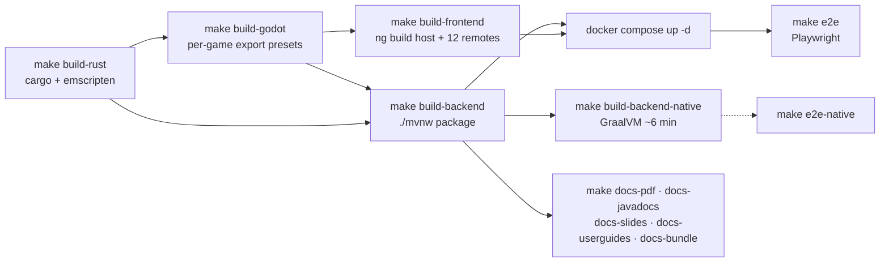

> Mirror of [`chapters/06-build-and-deploy.tex`](../../publishing/architecture/chapters/06-build-and-deploy.tex).

The repository's root [`Makefile`](../../../Makefile) is the canonical entry point. Every target is idempotent and safe to re-run; the build script for the typeset doc ([`docs/publishing/Makefile`](../../publishing/Makefile)) follows the same convention.

## Build chain



## Native (Linux) build

```bash
make build-rust      # cargo build --release + (optional) wasm32-unknown-emscripten
make build-godot     # exports every preset in every game project under games/<dir>/
make build-backend   # ./mvnw package -DskipTests
make build-frontend  # ng build for host + twelve remotes
make build           # runs all of the above in dependency order
```

The `build-rust` target builds the native `.so` for the editor and tries the WASM target. If `emcc` isn't on `PATH` it prints a warning and continues — the rest of the build chain doesn't depend on it for normal browser play through Godot's WASM target. There's a dockerised builder at [`tools/build-rust-wasm/Dockerfile`](../../../tools/build-rust-wasm/Dockerfile) that self-contains rust + emsdk; use `make build-rust-wasm` to build via that image without polluting the host.

## Docker compose (recommended)

```bash
docker compose up -d            # postgres + cassandra + casdoor + bff + frontend + remotes
make e2e                        # full Playwright run against the live stack
make e2e-native                 # same, against the GraalVM native image overlay
```

The base `docker-compose.yml` binds the frontend port to `127.0.0.1` by default so a fresh clone never accidentally exposes the BFF or Postgres to the LAN. Two knobs change that:

| Goal | Knob | How |
|---|---|---|
| LAN demo / multi-device playtest | `lan.properties` + `make lan-up` (or `make lan-up-tls` for HTTPS) | Set `FRONTEND_BIND=0.0.0.0:`. Frontend re-binds to all interfaces. `make lan-info` prints reachable URLs. `lan.properties` is a docker-compose env-file — `docker compose --env-file lan.properties up -d` produces the same result without going through make. |
| Production deploy at `hugmesh.games` | `compose.prod.yml` + `PROD_FRONTEND_BIND` | Defaults to loopback (assumes upstream LB). Set `PROD_FRONTEND_BIND=0.0.0.0:` for single-VM direct-internet deploys. Edge rate limits at the host nginx level are sized for ~10 k concurrent users — see [decision 019](../decisions/019-production-rate-limits.md). |

### ⚠ Docker 29.x needs buildx

Docker 29.x removed the legacy in-daemon image builder. `docker compose build` will hang silently if `docker-buildx` isn't installed. The fix is a user-local install of the v0.18 binary into `~/.docker/cli-plugins/docker-buildx` (no sudo needed). The README's *Running with Docker Compose* section documents the exact command.

### ⚠ Casdoor seed credentials

Casdoor randomises seed credentials per fresh database. First-time setup:

```bash
docker compose up -d
docker compose logs casdoor 2>&1 | grep -A4 "Casdoor seed credentials"
# Copy Client Secret + admin pass + player pass into a new .env at repo root:
cat > .env <<EOF
CASDOOR_CLIENT_ID=twclient001
CASDOOR_CLIENT_SECRET=<paste from log>
CASDOOR_ADMIN_PASS=<paste from log>
CASDOOR_PLAYER_PASS=<paste from log>
EOF
docker compose up -d --force-recreate api frontend
```

The BFF restart-loops on a Casdoor secret mismatch. See also [CLAUDE.md](../../../CLAUDE.md).

## GraalVM native image

The BFF compiles to a native binary via GraalVM `native-image`. The driver is a separate build profile in [`backend/pom.xml`](../../../backend/pom.xml), plus a Dockerfile ([`backend/Dockerfile.native`](../../../backend/Dockerfile.native)) and a compose overlay ([`docker-compose.native.yml`](../../../docker-compose.native.yml)).

```bash
make build-backend-native     # mvn -Pnative native:compile (~6 minutes on a workstation)
make e2e-native               # docker compose -f compose.yml -f compose.native.yml up -d
```

The native build needs reflection hints registered for every R2DBC mapping class, every controller DTO, and every Liquibase changelog entity. [`R2dbcConvertersConfig`](../../../backend/src/main/java/games/hugmesh/bff/config/R2dbcConvertersConfig.java) centralises these so adding a new entity touches one file. See [decision 004](../decisions/004-graalvm-native.md).

## The publishing pipeline

This document, the Javadoc, and the slide decks are produced by [`docs/publishing/`](../../publishing/). The published artefacts are git-ignored.

```bash
make docs-pdf          # docs/publishing/architecture/build/architecture.pdf
make docs-javadocs     # docs/publishing/javadoc-output/index.html
make docs-slides       # docs/publishing/slides/build/*.pptx
make docs-userguides   # docs/publishing/userguides/*/build/guide.pdf
make docs-bundle       # docs/hugmesh-design-docs-<UTC-TIMESTAMP>.zip
make docs-all          # all of the above
make docs-clean        # remove every produced artefact
```

### LaTeX prerequisites

- TeX Live with `pdflatex`, `xelatex`, `tcolorbox`, `tikz`, `titlesec`, `titletoc`, `enumitem`, `fontawesome`, `inconsolata`.
- On Debian / Ubuntu: `apt install texlive-latex-extra texlive-fonts-extra texlive-pictures`.
- On Gentoo: the `tex-live` portage package with USE `extra` produces the same set.

### Javadoc theming

[`backend/pom.xml`](../../../backend/pom.xml) configures the Maven Javadoc plugin to read [`docs/publishing/javadoc-theme/hugmesh.css`](../../publishing/javadoc-theme/hugmesh.css) as the override stylesheet and `header.html` as the page header. The override is purely additive — the standard doclet's default stylesheet still loads first; the HugMesh CSS layers on top.

### PowerPoint generator

The slide decks are generated by Python scripts under [`docs/publishing/slides/`](../../publishing/slides/). Each script imports `python-pptx`, builds the deck programmatically, and writes the `.pptx` file to `docs/publishing/slides/build/`. The scripts are deliberately written so a non-Python audience can edit slide content by editing the data structure at the top of each file.

### `make gen-api` poisoning `openapi.json`

If the BFF is unreachable on `:8080`, the host nginx serves Angular's `index.html` for any unknown path with HTTP 200, so a naive `curl /v3/api-docs` happily writes HTML to `openapi.json`. The Makefile JSON-validates before accepting; if you see "end of stream" parser errors during `npm run gen`, wipe `frontend/openapi.json` (it's git-ignored) and rebuild.

## CI hooks

A pre-push hook is shipped at [`docs/publishing/scripts/install-hooks.sh`](../../publishing/scripts/install-hooks.sh). It installs `.git/hooks/pre-push` that re-runs `make docs-pdf` on any push that touches `docs/publishing/` or `docs/PLAN-module-federation-and-native.md`. Failures abort the push so a broken build can't land on `main`. The hook is opt-in; the script is idempotent and prints what it changed.

---

Previous: [05 — API + service reference](05-api-reference.md) · Next: [07 — Extending the portal](07-extending.md).
