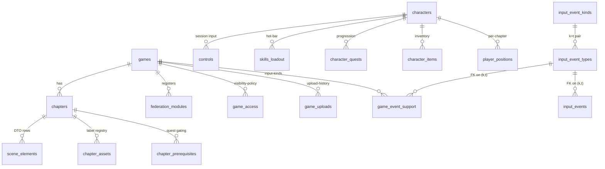

> Mirror of [`chapters/04-data-model.tex`](../../publishing/architecture/chapters/04-data-model.tex).

PostgreSQL holds the canonical relational state. Cassandra is a write-through cross-pod cache for movement events, an audit log for game state transitions, and a session store for short-lived browser tokens. Kafka + ClickHouse are the streaming-audit / telemetry side-channel (decision 021) — gated by `app.kafka.enabled` and off by default in dev. Liquibase drives Postgres schema migration through 55 changelogs at the head of `main` (`backend/src/main/resources/db/changelog/`); Cassandra schemas are bootstrapped by an init container and ClickHouse tables by its built-in Kafka-engine + materialized-view DDL bundled in `docker/clickhouse-init/`.

> **Naming note** — the current schema uses `chapter` (formerly `level`) and `instant` (formerly `spell`). See [decision 006](../decisions/006-naming-rename.md). Filenames under `backend/src/main/resources/assets/levels/<slug>/` did not move; only the schema and code did.

## Core relational schema

### Games and chapters

| Table | Purpose |
|---|---|
| `games` | Umbrella row per game. `slug` is the federation key (matches `federation_modules.slug`); `current_version_dir` is the hash-prefixed directory under `app.uploads.games-dir` that the runtime serves from. |
| `chapters` | One row per WASM bundle. `asset_url` resolves to either `/api/assets/levels/<slug>/index.html` (legacy) or `/_remotes/wasm-fragment/<slug>/index.html` (federated). |
| `scene_elements` | Per-chapter DTO rows that `scene_loader.gd` pulls from `GET /api/chapters/{id}/scene`. |
| `chapter_assets` | Optional registry for runtime-loaded textures / plugins / audio, looked up by `label` from GDScript via `ApiClient.resolve_asset(chapter_id, label, cb)`. |
| `chapter_prerequisites` | Quest gating: a chapter shows as locked on the home page until its quest is complete. |

### Federation, access, and uploads

| Table | Purpose |
|---|---|
| `federation_modules` | Source of truth for the federation manifest. Rows include `kind` (`remote-shell` / `remote-game` / `fragment` / `wasm-game`), `remote_entry_url`, `exposed_module`, and `game_slug`. The `wasm-game` kind (changelog 051) is the 14 web-native titles: `exposed_module=NULL`, `remote_entry_url` points directly at the `wasm-fragment` bundle, and `main.ts` excludes it from `initFederation` — it is read only by the host's manifest reader (`isWebNative`). Read by `FederationController`. |
| `game_access` | Per-game visibility policy. `(scope, scope_value)` can be `(all, NULL)` / `(role, ROLE_PLAY_X)` / `(user, <casdoor-id>)`; the unique constraint `uq_game_access_triple` keeps inserts idempotent. See [decision 009](../decisions/009-game-access-scopes.md). |
| `game_launches` | 256-bit URL-safe `launch_uid` per session, with a `version_dir` snapshot from `games.current_version_dir` at mint time so an in-flight launch keeps reading from its install even after a hot upload supersedes it. TTL 15 minutes; the `GameLaunchSweeper` closes stale rows. See [decision 005](../decisions/005-launch-uid-versioning.md). |
| `game_uploads` | One row per upload zip, with the `manifest_json` text (jsonb → text per migration 024-1) and a `superseded_at` timestamp on rollback. Bound by `app.uploads.versions-to-keep` via `GameUploadPruner`. |

### Players, sessions, and progression

| Table | Purpose |
|---|---|
| `characters` | One canonical character per Casdoor user, with `position_x/y/z`, `rotation_y`, HP / MP / XP, and `current_chapter_id`. |
| `skills_loadout` | Per-character skill-slot binding (key index → skill). |
| `quests`, `character_quests` | Quest catalog and per-character progress. |
| `items`, `character_items` | Inventory. |
| `controls` | Sessionised input state — at most one row per `(character_id, session_id)`; only the holder of the controller role for a session may POST. |
| `player_positions` | One row per `(character_id, chapter_id)` — Liquibase 027 promoted the legacy single-row-per-character layout into a per-chapter layout so a character traversing cave → field → cave returns to the cave coordinates they last had on re-entry instead of clobbering them across chapters. Cassandra's `character_position_cache` (composite partition `(character_id, chapter_id)`) is the cross-pod read cache that lets pod B see a position pod A wrote within one SSE round-trip; Postgres backs the cache when the 5-minute TTL drops a row. See [decision 007](../decisions/007-cassandra-position-cache.md). |
| `admin_actions` | Append-only audit ledger of admin moderation: `kick`, `ban`, `unban`. Drives the `BanGateFilter` and the `/banned` page. |

## Migration ordering

Migrations 001–017 are pre-federation. The federation work landed in:

- `018-federation-modules.xml` — `federation_modules` + seed rows for the four remotes plus `wasm-fragment`.
- `019-game-access.xml` — `game_access` + `uq_game_access_triple`.
- `020-game-launches.xml` — `game_launches`.
- `021-game-uploads.xml` — `game_uploads`.
- `022-federation-relative-urls.xml` — rewrites absolute remote URLs to relative paths.
- `023-launch-version-pin.xml` — adds `version_dir` to `game_launches`.
- `024-game-uploads-manifest-text.xml` — `ALTER manifest_json jsonb → text` plus `setval(games_id_seq, MAX(id))` (the integration test surfaced both as latent bugs).
- `025-admin-actions.xml` — kick / ban audit ledger.
- `026-input-event-kinds.xml` — generalised input surface (see below).
- `027-per-chapter-positions.xml` — `player_positions` keyed by `(character_id, chapter_id)`.
- `028-rename-chapter-instant.xml` — domain rename pass; extended in PR #24 with five follow-up changesets.
- `029-admin-actions.xml` — moderator audit ledger (kick / ban / unban).
- `030-game-sessions.xml` — `game_sessions` + `session_members` for multiplayer; partial unique indexes enforce one-active-slot-per-session and one-active-row-per-(session, casdoor).
- `031-system-settings.xml` — generic key/value table seeded with `wasm_console_debug_enabled='false'`.
- `032-mod-game-scopes.xml` — `mod_game_scopes` + `publisher_game_scopes` for per-game RBAC; seed rows for the per-game seeded users.
- `033-mod-publisher-federation.xml` — `federation_modules` rows for the new `mod` and `publisher` federated remotes.
- `036-widen-session-ids-for-sha3.xml` — widens `game_sessions.id` and `session_members.session_id` from `varchar(36)` to `varchar(64)` so the SHA3-256-derived UIDs minted by [`Crypto.mintUid()`](../../../backend/src/main/java/games/hugmesh/bff/util/Crypto.java) (43 base64url chars) fit. Old UUID-shape rows continue to fit; new rows are SHA3.
- `037-rpg-and-vn-maker-federation.xml` — seeds `federation_modules` rows for the `games-rpg-maker` + `games-vn-maker` remotes that drive the [`rpg-builder/`](../../../rpg-builder/) and [`vn-builder/`](../../../vn-builder/) Spring side services. The side services own their own DBs (`postgres-rpg-builder` + `postgres-vn-builder`) with their own Liquibase changelogs ([rpg-builder/.../db.changelog-master.xml](../../../rpg-builder/src/main/resources/db/changelog/db.changelog-master.xml), [vn-builder/.../db.changelog-master.xml](../../../vn-builder/src/main/resources/db/changelog/db.changelog-master.xml)) — see [decision 018](../decisions/018-rpg-and-vn-makers.md).
- `038-flatland-publisher-scopes.xml` — pre-grants the `publisher-flatland` Casdoor seed user the publisher scope on the two Flatland fixture games. Idempotent — guarded by `<sqlCheck expectedResult="0">`.
- `039-auth-ux-remotes-federation.xml` — `federation_modules` rows for the new `producer-registration` and `banned` federated remotes. The banned remote pairs with `AppealContactController` (`/api/security/appeal-contact`) for the appeal flow; producer-registration drives the intake table created in 040.
- `040-producer-contacts.xml` — `producer_contacts` intake table for producer / mod applications submitted via the federated producer-registration remote. One row per submission; admins flip `status` PENDING → APPROVED / REJECTED out of band. Contact email + jurisdiction are submission metadata so an applicant can re-apply with a new email after a rejection without clobbering history. See `ProducerContactController` for the REST surface.
- `041-accounts-schema-split.xml` — new `accounts` Postgres schema with three role-specific profile tables: `accounts.players` (xp + character roster summary, lazy-populated), `accounts.producers` (contact email + jurisdiction + owned-games count, populated when a `producer_contacts` row is APPROVED), `accounts.mods` (contact email + `oncall_slot`, populated when a `producer_contacts` row with `requested_role='mod'` is APPROVED). Scope tables (`mod_game_scopes` / `publisher_game_scopes`) stay in the public schema for now. See [decision 020 (per-role schema split)](../../decisions/020-per-role-schema-split.md).
- `042-session-pause-state.xml` — adds `game_sessions.paused_at` (session-wide pause stamp) and `session_members.view_paused_at` (per-player view-pause stamp). The BFF emits a `session-control` SSE event on pause/resume so WASM iframes freeze/resume ticks without polling.
- `043-games-domain-scoping.xml` — adds `games.domain VARCHAR(64) NOT NULL DEFAULT 'default'` so each game row can be tagged to a brand domain. Row predicate: `Roles.domainApplies(rowDomain, callerDomain, isSuperadmin)`. See [decision 026](../decisions/026-games-catalog-domain-partitioning.md).
- `044-chess-game.xml` — catalog registration for the multiplayer chess title. Host-authoritative: the WASM engine runs in the browser; the server only relays moves over the existing `input`/`world` SSE session channels.
- `045-wave1-games.xml` — catalog rows for wave-1 abstract 2-player titles (checkers, reversi, connect-four, dots-and-boxes, …). Same host-authoritative server-streams-only model as 044.
- `046-wave1-remainder-games.xml` — catalog rows for Battleship and Go. Same model as 044/045.
- `047-wave2-games.xml` — catalog rows for wave-2 single-player puzzles (Tetris, Minesweeper, Sudoku, Match-Three). Run entirely in the browser (WASM); server not involved.
- `048-wave3-games.xml` — catalog rows for wave-3 real-time duels (Tron, Bomberman, Asteroids Duel). Host-authoritative deterministic tick sims; the server only streams inputs.
- `049-realtime-matches.xml` — `realtime_matches` Postgres table for the 🚧 in-flight **server-authoritative** FPS/RTS engines. Postgres holds durable match metadata; Cassandra holds the *live* truth (`realtime_keyframes` + `realtime_command_log`, bootstrapped from [`docker/cassandra-init.cql`](../../../docker/cassandra-init.cql)). **No FPS/RTS title is registered as a launchable catalog game** — this is engine/sim-core wiring, not a playable entry. See [`docs/realtime-server-authoritative-design.md`](../../realtime-server-authoritative-design.md).
- `050-chess-relay-event-types.xml` — `input_event_types` + `game_event_support` rows for the chess move-relay channel.
- `051-web-game-federation.xml` — one `federation_modules` row per web-native game with the new `kind='wasm-game'` (plus the matching `game_access` + `games` rows where needed). Idempotent (`ON CONFLICT (slug) DO NOTHING`). This is what flips the host off the legacy `<app-game-canvas>` for the 14 web-native titles — no frontend change needed for future web-native games.
- `052-web-game-relay-event-types.xml` — `input_event_types` + `game_event_support` rows for the generic web-native control/world relay channels.
- `053-chess-godot-federation.xml` — registers the optional `chess-godot` Godot front-end variant (`games`/`chapters`/`federation_modules`/`game_access` rows) alongside the web-native chess title.
- `055-connect-four-godot-federation.xml` — same pattern as 053, for a `connect-four-godot` variant alongside the web-native connect-four title. The merge commit's own title flags the WASM export as not yet verified — the catalog/federation rows are real, but nobody has confirmed the produced bundle boots.
- `056-shadows-of-the-net-federation.xml` — registers "Shadows of the Net – CHAT" (`shadows-of-the-net`): the pure-GDScript XR chat chamber under the same `kind='wasm-game'` launch shape (games/chapters/federation/game_access, metadata `{"sse":true,"hostAuthoritative":true,"engine":"godot","xr":true}`) plus the slug's `game_event_support` opt-in for the host-authoritative `world/state` room-state broadcast (the `input_event_types` reference row was already seeded by 050-1). Pinned end to end — including idempotent re-runs of every statement — by `ShadowsOfTheNetFederationSeedTest`.

The catalog now spans **19 games** (5 Godot — the `chess-godot` / `connect-four-godot` front-end variants registered by changelogs 053/055 plus the `shadows-of-the-net` XR room registered by 056 — + 14 web-native). The `realtime_matches` work (049) adds engines and a match surface, not a launchable catalog title.

**Never edit a previously-merged changeset.** When something is missed, append a new changeset with `<preConditions onFail="MARK_RAN">` so re-runs are idempotent.

## Side-service schemas (rpg-builder + vn-builder)

Both maker side services own dedicated Postgres databases (`rpg_builder` and `vn_builder`) with schemas managed exclusively by Liquibase changelogs in their own service trees:

- **rpg-builder** — `rpg_projects`, `rpg_areas`, `rpg_rooms`, `rpg_exits` (CHECK on direction enum: N/S/E/W/NE/NW/SE/SW/UP/DOWN/TELEPORT), `rpg_items`, `rpg_npcs`, `rpg_scripts` (CHECK kind: TRIGGER/ALIAS/KEY/SCRIPT), `rpg_assets`, `rpg_build_jobs` (CHECK status: QUEUED/RENDERING/EXPORTING/UPLOADING/DONE/FAILED). Every project's areas become Chapters in the BFF when built.
- **vn-builder** — `vn_projects`, `vn_acts`, `vn_characters`, `vn_backgrounds`, `vn_scenes`, `vn_lines` (unique on `(scene_id, line_index)`), `vn_choices`, `vn_assets`, `vn_build_jobs` (same status enum). Every project's acts become Chapters.

Build pipeline state lives in the `*_build_jobs` table; the worker claims rows atomically with `FOR UPDATE SKIP LOCKED` so a multi-pod deployment doesn't double-execute. See [decision 018](../decisions/018-rpg-and-vn-makers.md) for the full topology.

## R2DBC + JDBC coexistence

Runtime data access is non-blocking R2DBC. Liquibase needs a blocking JDBC `DataSource`, so [`JdbcDataSourceConfig`](../../../backend/src/main/java/games/hugmesh/bff/config/JdbcDataSourceConfig.java) declares an explicit `@Primary HikariDataSource` (pool size 3) just for the migration phase. R2DBC then connects in parallel against the same database via the `spring.r2dbc.url` property. See [decision 002](../decisions/002-r2dbc-jdbc-coexistence.md).

### ⚠ MVCC snapshot race

`@PostConstruct` services that touch the database can run **before** Liquibase commits, locking their R2DBC connection into a pre-migration snapshot. The fix in this codebase is `@DependsOn("liquibase")` on `GameTimeService` and `GameStateService`, plus `spring.r2dbc.pool.initial-size=0` in tests so the pool only opens connections after Liquibase finishes. Without these, the symptom is `BadSqlGrammarException: relation does not exist` from a query the test fixture clearly sets up.

## Cassandra cache

The Cassandra keyspace holds:

- **Movement events** — write-through buffer for `ControlEvent`s; the SSE stream reads from Postgres but Cassandra holds the recent N events for fast cross-pod replay.
- **Position cache** — `character_position_cache` partitioned `(character_id, chapter_id)` with 5-minute TTL. Cross-pod write-through so pod B sees pod A's position write within one SSE round-trip.
- **Audit log** — every state transition emitted by `GameStateService` is persisted with `(character_id, occurred_at)` as the primary key.
- **Session store** — short-lived per-tab tokens bound to a Casdoor user, used by the BFF to refuse `/api/controls` requests from a tab that's not currently the controller for the target session.
- **`session_membership`** — cross-pod presence index for multiplayer sessions, partition `(session_id)`, clustered by `casdoor_id`. 30 s TTL refreshed on every SSE keepalive tick so a pod crash drops the rows naturally.
- **`session_view_state`** — per-(session, slot) ring of the most recent `PlayerViewEvent`s emitted by the Rust GDExtension's `view_egress` signal. 60 s TTL; admins joining the per-session view stream see the latest sample immediately instead of waiting for the next 10 Hz tick.

A nightly `CassandraSyncService` reconciles audit-log totals back into Postgres counters so dashboards stay consistent across reboots. Decision 021 introduces a Kafka → ClickHouse streaming pipeline as the long-term replacement; `CassandraSyncService` stays until the streaming pipeline has demonstrated production stability.

## Per-role accounts schema

[Decision 020 (per-role schema split)](../../decisions/020-per-role-schema-split.md) introduces a dedicated `accounts` Postgres schema with one profile table per role. A user with multiple granted roles has one row in each — the role gates in `ProfileController` make sure each request only touches the row matching its current authority.

| Table | Purpose |
|---|---|
| `accounts.players` | XP / level / friend-count / block-count summary. Lazy-populated on first authenticated request from a player. PK: `casdoor_user_id`. |
| `accounts.producers` | Contact email, jurisdiction, `approved_via_contact_id` (soft FK to `producer_contacts.id`). Populated when a `producer_contacts` row with `requested_role='producer'` is APPROVED. Index on `contact_email`. |
| `accounts.mods` | Contact email, `oncall_slot` (`primary` / `secondary` / NULL = off-rota), `approved_via_contact_id`. Drives the dispute-routing pipeline (`primary` → `secondary` → fall through to any mod with matching game scope) and the `AppealContactController` resolver. Index on `oncall_slot`. |

Intake remains in the public schema:

| Table | Purpose |
|---|---|
| `producer_contacts` | Submission ledger for producer / mod applications via the `producer-registration` federated remote (`POST /api/producer-contacts`). One row per application; admins flip `status` PENDING → APPROVED / REJECTED. The promotion step writes a row into `accounts.producers` or `accounts.mods` and grants the Casdoor role. |

## Streaming audit / telemetry pipeline (Kafka + ClickHouse)

[Decision 021](../decisions/021-kafka-clickhouse-streaming-pipeline.md) introduces a streaming side-channel that runs alongside the in-process gameplay path without changing it. Gated by `app.kafka.enabled` (default `false`) so vanilla `compose up` keeps the slim path.

Four Kafka topics:

| Topic | Producer | Purpose |
|---|---|---|
| `state_audit` | `GameAuditPublisher` | Every state transition emitted by `GameStateService` — durable replacement for the Cassandra audit log. |
| `game_events` | `GameEventPublisher` | All 9 SSE channels (movement / world / character / scene / input / audio / view / wasm-console / world-native) tee'd from `GameStateService.tryEmitNext`/`emitInput`. The cross-pod consumer `KafkaSessionSubscriber` filters self-published via `pod_id` and dispatches per-channel to handlers registered in `GameStateService.@PostConstruct`. `world-native` is the PR #117 addition — the raw web-native `sendWorld()` payload, teed separately from the typed Godot `world`/`WorldState` channel so a peer pod can re-emit it onto its own `worldNative` sink (merged client-side into the same `world` SSE event name). |
| `game_kpi` | `GameKpiPublisher` | Per-game KPIs posted by federated game remotes via `POST /api/telemetry/game/{slug}`. Iframes hit the BFF directly under existing `WebConfig` CORS allowlist. |
| `session.<id>.events` | `SessionTopicManager` | Per-session topics created on session-create so a cross-pod subscriber can hydrate only the sessions it cares about. |

ClickHouse consumes via Kafka-engine tables + materialized views (`docker/clickhouse-init/01-hugmesh-schema.sql`) that land each topic in a durable MergeTree counterpart. The `player_state_current` ReplacingMergeTree captures the latest per-character state for session-reconnect recovery; `PlayerStateRecoveryService` queries it through the ClickHouse HTTP interface from `GameStateService.hydrate(...)`, with `Mono.empty()` as the expected miss path (SSE / gameplay never blocks). Rolling KPI aggregates (`kpi_rolling_avg_24h`) feed admin dashboards.

## Object-storage backed uploads

[Decision 020](../decisions/020-object-storage-uploads.md) introduces an `UploadStorage` strategy with two implementations:

| Strategy | Locator scheme | Notes |
|---|---|---|
| `filesystem` (default) | `file:<absolute-path>` | Bundles land under `app.uploads.games-dir`. Same behaviour the platform shipped with — no new infra. |
| `s3` | `s3://<bucket>/<slug>/<sha-prefix>` | Bundles land in an S3-compatible bucket. `compose.yml` ships a `minio` container for dev; prod points the four `s3.*` knobs at AWS S3, Cloudflare R2, Backblaze B2, etc. |

Switch via `app.uploads.storage` (env `APP_UPLOADS_STORAGE`). The strategy is wrapped by `CircuitBreakerUploadStorage` (Resilience4j, instance `s3`) so an S3 outage soft-fails reads to the classpath fallback in `AssetController` instead of cascading 5xx. When `app.uploads.s3.presigned-reads=true`, `AssetController.tryPresignRedirect(...)` 302s to a short-lived pre-signed URL (TTL capped at 15 min) — the browser then fetches the WASM directly from the bucket and the BFF cold path stays cold. Existing `game_uploads.version_dir` rows that store raw paths (pre-prefix scheme) keep resolving via the filesystem strategy. Migration script: [`scripts/migrate-uploads-to-s3.sh`](../../../scripts/migrate-uploads-to-s3.sh) (DRY-RUN by default).

## Postgres read replica

[Decision 022](../decisions/022-postgres-read-replica.md) adds an opt-in read-replica routing layer. `R2dbcReadReplicaConfig` provides `@Qualifier("replica")` `ConnectionFactory` / `R2dbcEntityTemplate` / `DatabaseClient` beans; when `app.r2dbc.replica.url` is empty the replica beans alias the primary so the route is transparent on single-DB stacks. The compose-level pair lives in the opt-in overlay [`docker-compose.replica.yml`](../../../docker-compose.replica.yml) — both nodes run the existing `postgres:16-alpine` image so the existing `pgdata` volume layout is preserved; bring it up with [`scripts/setup-pg-replica.sh`](../../../scripts/setup-pg-replica.sh), which bounces primary with `wal_level=replica` + a replication role and the replica `pg_basebackup`s on first boot via [`docker/postgres-replica-entrypoint.sh`](../../../docker/postgres-replica-entrypoint.sh).

## Multiplayer session schema

Five Postgres tables make up the multiplayer + RBAC surface:

| Table | Purpose |
|---|---|
| `game_sessions` | Durable session ledger — `(id UUID, name, game_slug, creator_casdoor_id, max_players, created_at, closed_at, paused_at)`. `closed_at IS NULL` = open; `paused_at IS NOT NULL` = session-wide pause. |
| `session_members` | Membership history. `(session_id, casdoor_id, character_id, slot_index, is_creator, joined_at, left_at, view_paused_at)`. Two partial unique indexes — one slot per session, one active row per (session, casdoor). `view_paused_at` stamps when this player's view was paused (tab-switch). |
| `mod_game_scopes` | Per-game mod assignments. `(casdoor_id, game_slug, granted_by, granted_at, revoked_at, revoked_by)`. Soft-delete on revoke. |
| `publisher_game_scopes` | Same shape as `mod_game_scopes` but for publisher capability. |
| `system_settings` | `(key, value, updated_at, updated_by)` — runtime-toggled flags. Seeded with `wasm_console_debug_enabled='false'`. |

See [decision 010](../decisions/010-per-session-sse-sinks.md), [decision 011](../decisions/011-mod-publisher-rbac.md), [decision 012](../decisions/012-debug-mode-gate.md).

### Identifier shape: SHA3-256, not UUID

`game_sessions.id` and every other URL-facing UID (launch tokens, session tokens, pod ids) are minted by [`Crypto.mintUid()`](../../../backend/src/main/java/games/hugmesh/bff/util/Crypto.java): a SHA3-256 digest of 64 random bytes from a BouncyCastle SP800-90A HMAC-SHA256 DRBG, encoded as URL-safe base64. The result is one 43-character token per UID — no leading entropy bytes, no version bits, no dashes.

This replaces every prior call site of `UUID.randomUUID()` and JDK `SecureRandom`. The migration was driven by three goals:

1. **One source of randomness.** `Crypto` is the only place that touches the DRBG; every other component asks it for bytes or a UID. Auditing entropy hygiene is a single-file review.
2. **NIST-aligned construction.** SP800-90A HMAC-SHA256 with SHA3-256 mixing has a clearer cryptographic chain of custody than `SecureRandom + Type-4 UUID`.
3. **Indistinguishable shape across UID kinds.** Launch UIDs, session ids, session tokens, pod ids — all the same 43-char base64url shape, so a leak through a log line is equally hard to backtrack regardless of category.

Liquibase 036 widens the legacy `varchar(36)` columns; older UUID-shape rows continue to fit and are not migrated.

### Session-scoped control authorization

Two players in different sessions may legitimately use the same `character_id` (e.g. both pick "wizard 1" in their own lobby). The unscoped `findActiveOwnerOfCharacter(character_id)` returns whichever row Postgres picks first, which means the second player's `POST /api/controls/{id}` always 403s with "character not owned by caller".

Mitigation: when a control arrives with `X-Session-Id`, the controller passes that header through to the session-scoped overload `authorizeControl(casdoorId, characterId, sessionId)` which calls [`SessionMemberRepository.findActiveOwnerInSession(sessionId, characterId)`](../../../backend/src/main/java/games/hugmesh/bff/repository/SessionMemberRepository.java). The `(session_id, character_id)` tuple is unique among active members thanks to the partial constraint on `session_members`, so the lookup deterministic.

## Generalised input event surface

The five legacy game tables (`characters`, `controls`, `skills_loadout`, …) cover JRPG-shaped gameplay; the input surface added in changeset 026 covers *everything Godot can consume*: gamepad button / axis, mouse motion / button / wheel, keyboard up / down, touch gestures, audio cues, world events, plus the legacy control commands as one kind among many.

Three reference tables anchor the schema; an append-only audit table writes against them.

| Table | Purpose |
|---|---|
| `input_event_kinds` | Reference. PK on `kind`. Closed vocabulary: `gamepad`, `mouse`, `keyboard`, `touch`, `audio`, `world`, `control`. Seeded by Liquibase 026. |
| `input_event_types` | Reference. **Composite** PK `(kind, type)`. Per-kind type vocabulary (e.g. `gamepad: button_down / button_up / axis / connected / disconnected / rumble_ack`) plus an `example_payload` (jsonb) used by the upload-time validator and the OpenAPI explorer's sample generator. |
| `game_event_support` | Per-game opt-in. **Composite** PK `(game_slug, event_kind, event_type)`, FK to `input_event_types(kind, type)`. The HugMesh Export plugin writes one row per declared event during upload. Gate 3 below refuses any input emit whose triple isn't enabled here, regardless of what the client sends, but that gate is **off by default** until every shipped title's rows are seeded. |
| `input_events` | Append-only audit log. FK on `(event_kind, event_type)` into `input_event_types` so a row can never reference an unknown type. Indexed on `(character_id, occurred_at)`, `(session_id, occurred_at)`, and `(event_kind, occurred_at)` for replay + analytics. |
| `games.features` | `jsonb` column (changeset 026-1, reconciled by 063). Per-game feature flags: `instant_loadout`, `quests`, `items`, `char_progression` (the JRPG subsystems); `audio`, `gamepad`, `mouse`, `keyboard`, `touch`, `world`, `control` (one flag per input-event kind). Read by gate 2 below through [`InputEventController.InputGateLookup`](../../../backend/src/main/java/games/hugmesh/bff/controller/InputEventController.java); only a JSON `true` counts as on. Changeset 063 set the column DEFAULT to all eleven keys (it had still written the pre-028 `spell_loadout` and had no `world`/`control`), finished 028-7's `spell_loadout` → `instant_loadout` rename in the rows inserted after 028, and added `world: true` and `control: true` to every existing row. None of those three steps overwrites a value a row already has, so dodecahedron keeps `instant_loadout: false` (026-2). |

Every input emit passes these gates in `InputEventController.submit()`, in this order, before it is persisted or fanned out (hugmesh-games#13; decisions 103a = C, 103b = A, 103c = A, 2026-09-23). The controller's class Javadoc states the same rule; change both together.

1. `(kind, type)` must exist in `input_event_types` (400 if not).
2. **Feature flags** — two checks against the same `games.features` object (405 if either fails):
   1. *Kind flag, every event.* `games.features.<kind>` must be `true`. An **absent** flag is refused exactly like `false`; there is no implicit allow. An unknown `gameSlug` has no games row, so no flags, and is refused too.
   2. *Subsystem flag, a short explicit list of events.* A `(kind, type)` → flag table in the controller (`SUBSYSTEM_FLAGS`) gates individual events on a JRPG subsystem as well. It has one row: `control:cast` → `instant_loadout`. So a game with `instant_loadout: false` refuses `control:cast` while its other `control` events still pass.
3. **Per-game opt-in** — `(game_slug, kind, type)` must be an enabled `game_event_support` row (405 if not). **Implemented but OFF.** It runs only when `app.input.gate3-enabled=true`, which defaults to `false`, and it stays off until every shipped title's rows have been seeded (decision 103c = A). On main, only `three-wizards` and `dodecahedron` have input-kind rows (026-5). Eleven titles have only their relay rows (`control/*`, `world/state`, from 050 / 052 / 056), and several have none at all. Several relay titles also post `world/state` without a row for it. Enabling gate 3 before a per-title product pass has seeded those rows would refuse real input. The per-title measurement of what each title sends is on hugmesh-games#13.

`world` and `control` have flags because the host-authoritative relays use those two kinds. 026-1 gave them none; 063 seeded them `true` on every game and in the column default, so gate 2 refuses nothing that a shipped title sends. The export plugin used to defeat that: its `register.sql` *replaced* the whole `features` object with a set that had no `world` or `control` (and still carried `spell_loadout`), so a game installed or re-installed through an upload lost its relay flags and gate 2 answered its relay events with 405 (hugmesh-games#17). The plugin's defaults (`_DEFAULT_FEATURES` in `manifest_builder.gd`) are now 063's eleven keys, and the statement it emits is a jsonb merge, `UPDATE games SET features = features || '<flags>'::jsonb`, so keys the upload does not name survive. `RegisterSqlPolicy` allows that shape (it reads only the columns left of `=`), provided the generator's `--` banner lines hold no single quote or semicolon (the policy splitter does not model `--` comments; the banner used to say `BFF's`, which desynced it). A game whose manifest sets `world` or `control` to `false` still gets 405 for that kind; that is the flag doing its job. The plugin itself is GDScript and the backend build does not run it; `ManifestBuilderFeaturesGuardTest` pins its source text (defaults against changeset 063-1, the merge form, the banner) and its javadoc gives the headless Godot command that runs the plugin.

`GamepadService` (the host shell's gamepad → BFF mirror) no longer defaults its slug to the literal `"unknown"`. It sends nothing until a real slug is bound, and it logs the first failed or refused mirror POST for each game instead of swallowing it.

**Cost.** `submit()` is the hot path: Asteroids Duel posts a `control:input` vector every frame, and the gamepad mirror is per-frame when it is live. `InputGateLookup` therefore caches each game's flags (and, when gate 3 is on, its enabled triples) per slug and per pod, for `app.input.gate-cache-ttl` (default 10 s). Invalidation is by expiry only. The service never writes these tables at runtime except through an upload's `register.sql` or hand-run SQL, so a flag change takes effect on every pod within one TTL. Errors are never cached, and the cache is bounded against junk slugs.

Ahead of these three, a separate authorization pass runs first (403, not 400/405): session-membership + character-ownership (a caller may only submit for a `characterId` it owns in the target session), plus an authority-spoof gate specific to `kind:'world'` — only the session **creator** (the host running the wasm engine) may submit an authoritative `world` event; any other member gets 403.

Same surface persists every browser-tier gamepad poll, every WASM-iframe console line forwarded by the host shell, every audio cue the Godot bundle emits. The Rust GDExtension's `HostBridge` ships matching typed signals (`gamepad_received`, `mouse_received`, `keyboard_received`, `touch_received`, `audio_received`, plus outbound `audio_egress` and `console_egress`) so a Godot developer wires gameplay to named signals without caring whether the source was a player's USB Pro Controller, a `<kbd>W</kbd>` keypress, or an SSE emit from a cross-tab subscriber.

---

Previous: [03 — Module Federation](03-federation.md) · Next: [05 — API + service reference](05-api-reference.md).
