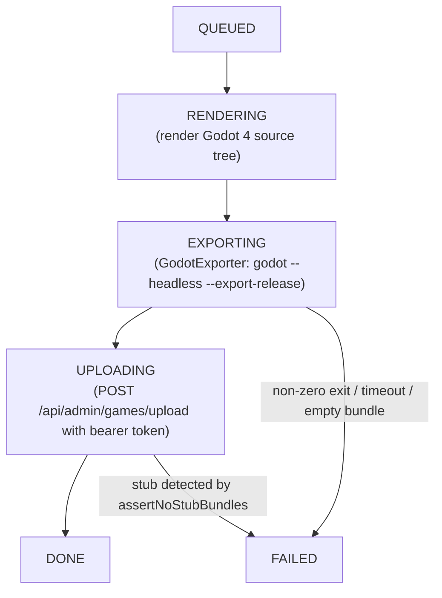

The RPG and VN makers generate a Godot 4 source project from the author's data, then
export it to a playable WASM bundle that browsers can run. The export step is performed
by `GodotExporter`, which calls `godot --headless --export-release "Web"` inside the
builder container. That requires two things on the host:

- a Godot 4 headless binary
- the matching Web export templates for that binary version

To keep the default builder image small, both are bind-mounted from the host rather than
baked into the image. The bind-mount is declared in
[`docker-compose.godot.yml`](../../docker-compose.godot.yml).

When `app.build.godot-enabled=false` (the default), the export step is skipped and the
builder emits a zero-byte stub so the rest of the pipeline (upload, registration) runs
without requiring the toolchain. Set `app.build.godot-enabled=true` — via the overlay
described below — to produce a real multi-MB WASM bundle.

## Layout this dir expects

```
tools/godot-export/
  godot/godot                 # the Godot 4.6 headless binary (chmod +x), mounted at /opt/godot
  templates/<version>/        # Web export templates, mounted at
                              #   /root/.local/share/godot/export_templates/
```

`<version>` must match the editor that produced the templates, e.g. `4.6.stable`.

> **Version-string skew (binary vs templates).** Godot resolves templates under
> `…/export_templates/<binary-version>.stable/`. If your binary is e.g. `4.6.3`
> but only `4.6.1` templates are installed, the export fails with
> *"No export template found … 4.6.3.stable/web_*.zip"*. Either fetch the matching
> templates (`make godot-export-tools` pins a version) or symlink the installed
> ones into a matching dir:
> ```bash
> TPL=~/.local/share/godot/export_templates
> mkdir -p "$TPL/4.6.3.stable"
> ln -sf "$TPL"/4.6.1.stable/web_*.zip "$TPL/4.6.3.stable/"
> printf '4.6.3.stable\n' > "$TPL/4.6.3.stable/version.txt"
> ```

## Populate it

```bash
make godot-export-tools        # downloads + unpacks the pinned Godot 4.6 + Web templates here
```

(or do it by hand from https://godotengine.org/download — grab `Godot_v4.6-stable_linux.x86_64`
into `godot/godot` and the `Godot_v4.6-stable_export_templates.tpz`, unzip its `templates/`
into `templates/4.6.stable/`.)

## Run a real build

```bash
make build-with-godot          # brings rpg-builder + vn-builder up with the overlay
# then trigger a build from the maker UI (or POST /api/{rpg,vn}/projects/{id}/build)
```

The overlay sets `app.build.godot-enabled=true`, points `app.build.godot-bin` at the
host binary, and bind-mounts the bridge WASM via `app.build.bridge-dir`. Once the
services are up, triggering a build walks the following pipeline:



Each Area (RPG) or Act (VN) becomes its own Chapter in the BFF, exported as
`bundle/<area-slug>/index.html`. The chapter chooser in the host portal handles
multi-chapter games automatically.

## Caveats

- **Shared libs.** The `eclipse-temurin:21-jre` base image is Debian-slim and may be
  missing shared libraries that the Godot headless binary requires at load time:
  `libgl1`, `libxi6`, `libxrandr2`, `libxcursor1`, `libxinerama1`, `libfontconfig1`.
  If `godot --version` fails inside the container, add an `apt-get install` line for the
  missing packages in the builder Dockerfile, or switch to a Godot image that bundles
  them.
- **Bridge binary.** The Web export requires `hugmesh_bridge.wasm` (the `web.wasm32`
  GDExtension library) so the exported bundle is multiplayer-aware. It is bind-mounted
  from `backend/src/main/resources/assets/levels/cave/`. If you modify the Rust
  GDExtension source, run `make build-rust` to rebuild it before triggering an export.
- **No silent stubs in prod (enforced).** When `app.build.godot-enabled=true`, a
  successful Web export always produces a multi-MB `index.wasm`. The build path now
  fails loudly on stub-shaped output rather than silently shipping a placeholder. Two
  independent checks enforce this:
    1. **`GodotExporter.exportWeb`** — rejects an exit-0 export whose sibling `index.wasm`
       is empty or absent (in addition to the existing `index.html` presence check).
    2. **`GodotCompileWorker.assertNoStubBundles`** — re-scans the entire staged `bundle/`
       tree immediately before upload and refuses to proceed if any
       `bundle/<area|act>/index.wasm` is empty.
  Either check failing throws an exception, and the build is marked `FAILED`. Both
  checks are covered by unit tests in `GodotExporterTest`
  (`exitZeroButEmptyWasmFailsAsStub`) and `GodotCompileWorkerTest`
  (`enabledExportRefusesToShipStubWasm`) for both makers.

  When `godot-enabled=false` (the dev default), the builder still emits a zero-byte stub
  so the upload and registration steps can run without the toolchain. The validation
  gates do not fire in that mode — they only apply when real exports are expected.

- **Verified end-to-end (2026-06).** The Flatland fixture project (RPG + VN) was exported
  on a host running Godot 4.6.3 with matching Web templates using the exact command
  `GodotExporter` issues:
  ```
  godot --headless --path <godot-src> --export-release "Web" <out>/index.html
  ```
  The resulting bundle sizes were: `index.wasm` 1,509,558 B, `index.side.wasm`
  41,113,842 B, `index.pck` ~18–20 KB, `hugmesh_bridge.wasm` 2,678,048 B. All four
  files were confirmed as valid WASM via their `\0asm` magic bytes. The maker BDD e2e
  suite (`make e2e-bdd` with the Godot overlay) additionally asserts that each bundle
  file is non-empty before the build is considered passing.
