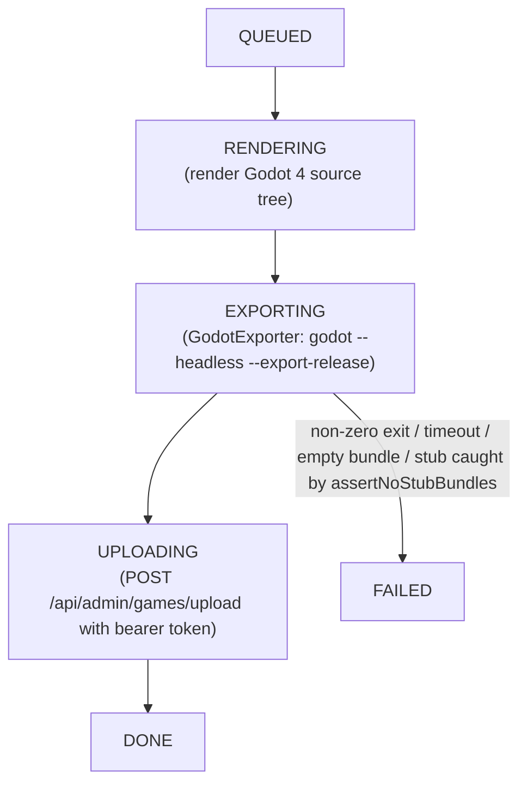

The RPG and VN makers turn the author's data into a Godot 4 project, then export it to a
WASM bundle that browsers can run. `GodotExporter` does the export. It calls
`godot --headless --export-release "Web"` inside the builder container, which needs two
things:

- a Godot 4 binary
- the matching Web export templates for that binary version

Both builder images (`rpg-builder/Dockerfile`, `vn-builder/Dockerfile`) already carry
Godot 4.6 and its templates (build arg `GODOT_VERSION`, default `4.6-stable`; set
`GODOT_RELEASE_BASE_URL` to pull from an internal mirror). The dev overlay
[`docker-compose.godot.yml`](../../docker-compose.godot.yml) bind-mounts host copies over
them instead, so this directory is what that overlay reads.

When `app.build.godot-enabled=false` (the default, image or not), the export is skipped
and the builder writes a zero-byte stub. Upload and registration still run, so the
pipeline works without the toolchain. Set `app.build.godot-enabled=true`, through the
overlay below, to get a real multi-MB WASM bundle.

## Layout this dir expects

```
tools/godot-export/
  godot/godot                 # the Godot 4.6 binary (chmod +x), mounted at /opt/godot
  templates/<version>/        # Web export templates, mounted at
                              #   /root/.local/share/godot/export_templates/
```

`<version>` must match the editor that produced the templates, e.g. `4.6.stable`.

> **Version-string skew (binary vs templates).** Godot resolves templates under
> `…/export_templates/<binary-version>.stable/`. If your binary is e.g. `4.6.3`
> but only `4.6.1` templates are installed, the export fails with
> *"No export template found … 4.6.3.stable/web_*.zip"*. Either fetch the matching
> templates (`make godot-export-tools` pins one; override it with `GODOT_MAKER_VERSION`)
> or symlink the installed ones into a matching dir:
> ```bash
> TPL=~/.local/share/godot/export_templates
> mkdir -p "$TPL/4.6.3.stable"
> ln -sf "$TPL"/4.6.1.stable/web_*.zip "$TPL/4.6.3.stable/"
> printf '4.6.3.stable\n' > "$TPL/4.6.3.stable/version.txt"
> ```

## Populate it

```bash
make godot-export-tools        # downloads + unpacks the pinned Godot 4.6 + Web templates here
                               # (GODOT_MAKER_VERSION, default 4.6-stable)
```

(or do it by hand from https://godotengine.org/download — grab `Godot_v4.6-stable_linux.x86_64`
into `godot/godot` and the `Godot_v4.6-stable_export_templates.tpz`, unzip its `templates/`
into `templates/4.6.stable/`.)

## Run a real build

```bash
make build-with-godot          # brings rpg-builder + vn-builder up with the overlay
# then trigger a build from the maker UI (or POST /api/{rpg,vn}/projects/{pid}/build
# with a JSON body carrying "targetSlug")
```

`make build-with-godot` stops with an error if `tools/godot-export/godot/godot` is missing.
If you keep the files elsewhere, set `GODOT_HOST_DIR` and `GODOT_TEMPLATES_DIR`. Before
each export, `GodotExporter` also runs `godot --headless --path <godot-src> --import`
once (`app.build.godot-import-enabled`, default `true`). The export works without it.

The overlay sets `app.build.godot-enabled=true`, points `app.build.godot-bin` at the
host binary, and bind-mounts the bridge WASM via `app.build.bridge-dir`. Once the
services are up, a build walks this pipeline:



Each Area (RPG) or Act (VN) becomes its own Chapter in the BFF, exported as
`bundle/<area-slug>/index.html`. The export runs once. The RPG worker moves the shared
engine files into `bundle/_engine/` and patches each area's `index.html` to point at
`../_engine/`. The VN worker copies the whole export into each act directory. The chapter
chooser in the host portal handles multi-chapter games.

## Caveats

- **Shared libs.** The Godot binary needs shared libraries that a bare JRE image lacks.
  Both builder Dockerfiles (`eclipse-temurin:25-jre`) install `libgl1`, `libxi6`,
  `libxrandr2`, `libxcursor1`, `libxinerama1` and `libfontconfig1`. If you swap in another
  base image and `godot --version` fails inside the container, install those.
- **Bridge binary.** The Web export requires `hugmesh_bridge.wasm` (the `web.wasm32`
  GDExtension library) so the exported bundle is multiplayer-aware. The overlay
  bind-mounts it from `backend/src/main/resources/assets/levels/cave/` and sets
  `app.build.bridge-dir` to that mount. With `bridge-dir` empty, the renderer logs a
  warning and the bundle is not multiplayer. If you modify the Rust GDExtension source,
  run `make build-godot` (it runs `make build-rust` first, then re-exports the `cave`
  bundle that holds the mounted file). `make build-rust` alone updates only
  `extensions/hugmesh-bridge/bin/` and each game's `bin/`.
- **No silent stubs in prod (enforced).** When `app.build.godot-enabled=true`, a
  successful Web export always produces a multi-MB `index.wasm`. The build fails on
  stub-shaped output instead of shipping a placeholder. Two independent checks enforce
  this:
    1. **`GodotExporter.exportWeb`** — rejects an exit-0 export whose `index.html` or
       sibling `index.wasm` is empty or absent.
    2. **`GodotCompileWorker.assertNoStubBundles`** — re-scans the staged `bundle/` tree
       before upload. RPG: `bundle/_engine/index.wasm` must be non-empty, and every area's
       `index.html` must exist and reference `../_engine/`. VN: every
       `bundle/<act>/index.wasm` must be non-empty.
  Either check failing throws an exception, and the build is marked `FAILED`. Unit tests:
  `GodotExporterTest.exitZeroButEmptyWasmFailsAsStub` (both makers);
  `GodotCompileWorkerTest.enabledExportRefusesEmptyEngineWasm` and
  `enabledExportRefusesUnpatchedAreaHtml` (RPG);
  `GodotCompileWorkerTest.enabledExportRefusesToShipStubWasm` (VN).

  When `godot-enabled=false` (the dev default), the builder still writes a zero-byte stub
  so upload and registration run without the toolchain. The checks do not fire in that
  mode. They apply only when real exports are expected.

- **Verified end-to-end (2026-06).** The Flatland fixture project (RPG + VN) was exported
  on a host running Godot 4.6.3 with matching Web templates using the exact command
  `GodotExporter` issues:
  ```
  godot --headless --path <godot-src> --export-release "Web" <out>/index.html
  ```
  The bundle sizes were: `index.wasm` 1,509,558 B, `index.side.wasm` 41,113,842 B,
  `index.pck` ~18–20 KB, `hugmesh_bridge.wasm` 2,678,048 B (the copy in
  `assets/levels/cave/` is 2,618,956 B today). The `.wasm` files were confirmed as valid
  WASM via their `\0asm` magic bytes. `make e2e-godot`
  (real exports; `make e2e-bdd` skips the `@godot` scenarios) also checks, on the player
  launch step, that the served `index.wasm` and `index.pck` are non-empty.
