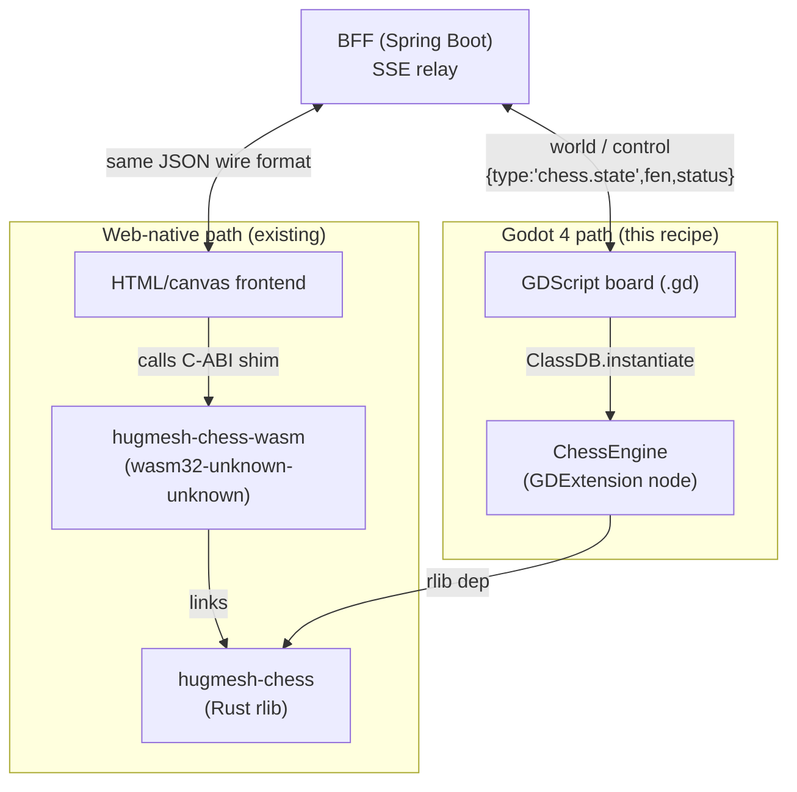
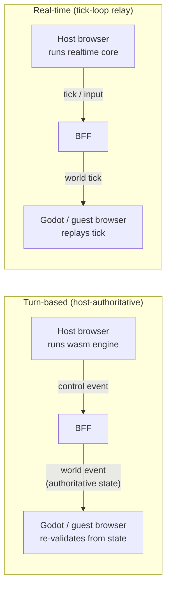

This is the **canonical recipe** for the Godot pivot:

> a web-native game (HTML/canvas + a deterministic Rust core compiled to wasm32)
> → a real **Godot 4 project outline** that **reuses the SAME Rust core** via the
> `hugmesh_bridge` GDExtension → a **Web WASM** export → a **federated app**
> the host launches like any other game.

The reference implementation is [`games/chess-godot/`](../chess-godot). It is a
complete, exportable Godot project that delegates **all chess rules** to the
existing `extensions/hugmesh-chess` Rust crate. There is **no GDScript
reimplementation** of the rules. Read it alongside this README. The two stock
games, [`games/three-wizards-in-a-trenchcoat/`](../three-wizards-in-a-trenchcoat)
and [`games/dodecahedron-demo/`](../dodecahedron-demo), show the bridge transport
and the simplest possible project with no core, respectively.

For the general Godot contract (classpath vs federated remotes, running the
editor against the live stack, asset registration, level transitions) see
[`docs/GODOT_DEVELOPER_GUIDE.md`](../../docs/GODOT_DEVELOPER_GUIDE.md). **This
file covers only one thing: reusing a Rust core from Godot.**

---

## The principle: Godot owns rendering + input + relay; the Rust core owns the rules

```
  Godot scene (.tscn + .gd)        ← rendering, input, board UI, animations
        │  calls (never reimplements rules)
        ▼
  ChessEngine  (GDExtension node)  ← thin wrapper, in hugmesh_bridge
        │  links as an rlib dependency
        ▼
  hugmesh-chess  (Rust crate)   ← THE rules engine: legal_moves / apply_uci /
                                      status / fen — the single source of truth,
                                      identical native (.so) and in the browser
                                      (compiled into hugmesh_bridge.wasm)

  HostBridge / BridgeGlue / BridgeApiClient  (hugmesh_bridge)
        ← session SSE relay + control egress, same as every HugMesh Godot game
```

The web-native bundle drives the same crate through a wasm C-ABI shim
(`extensions/hugmesh-chess-wasm`). The Godot port drives it through a Rust
**GDExtension node** instead. Both use one validated engine, so a Godot guest
that re-validates a relayed move is interchangeable with a web guest. The
`world`-channel JSON (`{"type":"chess.state","fen":..,"status":..}`) is the same
in both cases.



---

## Recipe (what `chess-godot` did — do this per game)

### 1. Expose the Rust core as a GDExtension node in `hugmesh_bridge`

The cores are **pure, dependency-free `rlib` crates** that already compile for
both native and `wasm32-unknown-emscripten`. To reuse one, link it into the
bridge and wrap it in a `#[derive(GodotClass)]` node:

* `extensions/hugmesh-bridge/Cargo.toml` — add the core as a path dep:

  ```toml
  [dependencies]
  hugmesh-chess = { path = "../hugmesh-chess" }
  ```

* `extensions/hugmesh-bridge/src/<game>_engine.rs` — a `Node`-based
  `GodotClass` that holds one core game instance and exposes a small JSON/string
  `#[func]` API. Plain strings, not typed Dictionaries, keep the binding
  compatible across every gdext version. See `chess_engine.rs` for the full API
  surface: `new_game`, `load_fen`, `board_fen`, `legal_moves` /
  `legal_moves_from`, `apply_uci`, `status`, `is_terminal`, `resign`. **Every
  method delegates to the core; none implements rules.**

* `extensions/hugmesh-bridge/src/lib.rs` — add `mod <game>_engine;` and
  `pub use <game>_engine::<Game>Engine;`. The `#[gdextension]` macro
  registers every `GodotClass` in the crate, so no manual registry entry is
  needed.

* Unit-test the reuse path with plain `cargo test` (no Godot runtime needed).
  Assert that the core produces the wire shapes the web bundle relies on. See
  the `chess_engine::tests` module.

`make build-rust` then compiles the core into both `libhugmesh_bridge.so`
(native, for the editor and tests) and `hugmesh_bridge.wasm` (from the
dockerised emscripten build, shipped inside the Web export). One validated core
serves every context.

### 2. Create the Godot project outline

Mirror `games/chess-godot/`:

* `project.godot` — set `config/name` and `run/main_scene`, and enable both
  addon plugins so the editor opens standalone:
  ```
  enabled=PackedStringArray("res://addons/hugmesh_export/plugin.cfg", "res://addons/hugmesh_bridge/plugin.cfg")
  ```
* `hugmesh_bridge.gdextension` (+ `.uid`) — copy verbatim from any existing
  game; paths are `res://bin/...`.
* `.gitignore` / `.gitattributes` / `.editorconfig` — copy from `dodecahedron-demo`.
  They ignore `bin/*.so|*.wasm` and the synced `addons/` directory (the root
  `.gitignore` also enforces `games/*/bin/*.so` and siblings). Binaries and
  synced addons are never committed; `make build-rust` regenerates them.
* `scenes/<game>.tscn` — a `GameBridge` node with a sibling `HostBridge` and a
  `BridgeGlue` child, plus your game root node. A board game needs only a
  `Node2D` root with a `CanvasLayer` HUD (chess uses exactly this).
* `scripts/game_bridge.gd` — copy from `chess-godot`. It threads the multiplayer
  URL params into `HostBridge`, requests the SSE subscription, and wires
  `session_control_received` to pause/resume/close. It handles transport only,
  with no game logic.
* `scripts/<game>_board.gd` — rendering, input, and every call to the engine
  node for a rules decision. Instantiate the engine with
  `ClassDB.instantiate("<Game>Engine")`, guarded by `ClassDB.class_exists`
  and a `push_error` on failure, so a broken extension shows up at once instead
  of leaving the game silently without rules. Relay moves with the addon
  `BridgeApiClient`, and re-sync from the authoritative FEN on each
  `world_received`.

### 3. Add a Web export preset

Add an `export_presets.cfg` with a single `platform="Web"` preset. The preset
name must lowercase to the game's slug, because `make build-godot` derives the
output directory from it. For example, `chess-godot` names its preset
`"Chess-Godot"`, which lowercases to the slug `chess-godot`. Set these keys:

```ini
variant/extensions_support=true   # the GDExtension must be included in the export
export_filter="all_resources"
export_path="../../backend/src/main/resources/assets/levels/<slug>/index.html"
```

### 4. Wire the Makefile

In the root `Makefile`, make these additions:

- Add the project directory to `GAME_PROJECTS`
- Add `PRESETS_<dir> = <PresetName>` (a record only: no recipe reads it)
- Add the slug to `GAME_SLUGS`
- Add the project to the `case` arms in **both** `build-godot` and `patch-godot`.
  These arms decide which presets get exported; skip them and the game is
  silently left out of `make build-godot`.

### 5. Register + launch (federation)

Add a Liquibase migration (use the next sequential number; take
`053-chess-godot-federation.xml` as the reference) that inserts:

* a `games` row and a `chapters` row (`asset_url = /_remotes/wasm-fragment/<slug>/index.html`)
* a `federation_modules` row with `kind='wasm-game'`, `game_slug=<slug>`, and
  `remote_entry_url=/_remotes/wasm-fragment/<slug>/index.html`
* a default `game_access` row with `scope='all'`. Without it the tile is
  hidden from all users.

Add an `<include>` for the new file in `db.changelog-master.xml`. The host
discovers `wasm-game` rows from the federation manifest and launches them as
parametrised iframes, with no frontend code change.

**Keep the web-native bundle and its existing catalog row as a fallback.** Ship
the Godot entry under a distinct slug beside it. When you are ready to cut
over, point the original chapter/federation URL at the Godot bundle. To roll
back, disable the new row; the original entry is untouched.

### 6. Build + verify

```sh
make build-rust     # core → .so + (dockerised) hugmesh_bridge.wasm
make build-godot    # headless Web export → backend/.../assets/levels/<slug>/
(cd extensions/hugmesh-bridge && cargo test --lib)   # reuse-path tests
```

Confirm that the export produced a real, non-empty `index.wasm`, `index.pck`
and `index.html`. Together they should total tens of MB, not a stub.
`make games-arch-e2e-up` exercises the host-authoritative SSE relay end to end
in the deployed stack.

---

## Toolchain note (Godot 4.6.3 binary vs 4.6.1 templates)

Godot resolves export templates from `~/.local/share/godot/export_templates/<version>.stable/`.
If your installed binary is `4.6.3` but only `4.6.1` templates are present, the
export fails with:

```
No export template found … 4.6.3.stable/web_*.zip
```

Fix it by installing the matching templates (Godot → Editor → Manage Export
Templates), or by symlinking the installed templates into a matching directory.
(`make godot-export-tools` does not help here. It downloads Godot 4.6-stable
and its templates into `tools/godot-export/` for the maker services, and leaves
`~/.local/share/godot` alone.)

```sh
TPL=~/.local/share/godot/export_templates
mkdir -p "$TPL/4.6.3.stable"
ln -sf "$TPL"/4.6.1.stable/web_*.zip "$TPL/4.6.3.stable/"
printf '4.6.3.stable\n' > "$TPL/4.6.3.stable/version.txt"
```

The native bridge build handles patch-release skew separately, with
`cargo build --features api-custom`. That regenerates the gdext bindings
against your actual Godot binary instead of the vendored stub. See
`make build-rust` for details.

---

## Wave plan — the remaining 13 games

The pattern is proven by `chess-godot`. Connect Four is also done:
`games/connect-four-godot/` wraps `hugmesh-connect-four` in a
`ConnectFourEngine` node (changelog `055`), so 12 of the 13 games in the table
below remain. They port in waves. Each already has a deterministic Rust core
under `extensions/` that drives its web-native bundle. A port runs steps 1–6
above against that core. No core has to be written from scratch.

**Turn-based games** use the host-authoritative relay path: the BFF relays moves
and the guest re-validates from the authoritative state, as in chess.
**Real-time games** are grouped into Wave C and done together, so the realtime
bridge surface is proven once. That wave is a plan, and the server-side pieces
it names are not wired for these games. Today Tron, Bomberman and Asteroids
Duel run host-authoritative over the same SSE relay as the turn-based games,
with a tick in the `world` echo. Tetris has no relay at all (the `games-arch`
e2e treats it as single-player). The `/api/realtime` surface from migration 049
runs only a Java reference sim, not these cores.

Every game already has a dependency-free `hugmesh-<slug>` core crate, plus a
`hugmesh-<slug>-wasm` C-ABI shim that the current web bundle uses. The port
reuses the **core** crate as a bridge `rlib` dependency. The `-wasm` shim stays
as the web-native fallback.



| Game | Slug | Rust core to reuse | Cadence | Notes for the port |
|------|------|--------------------|---------|--------------------|
| Connect Four | `connect-four` | `extensions/hugmesh-connect-four` | turn-based (host-auth) | done: `games/connect-four-godot/` (trivial 7×6 grid; mirrors chess board input) |
| Reversi/Othello | `reversi` | `extensions/hugmesh-reversi` | turn-based (host-auth) | flip animation is presentation-only |
| Gomoku | `gomoku` | `extensions/hugmesh-gomoku` | turn-based (host-auth) | large board; same click→`apply_move` shape |
| Dots and Boxes | `dots-and-boxes` | `extensions/hugmesh-dots-and-boxes` | turn-based (host-auth) | edges as click targets, not cells |
| Go | `go` | `extensions/hugmesh-go` | turn-based (host-auth) | scoring/ko handled by the core; UI shows territory |
| Battleship | `battleship` | `extensions/hugmesh-battleship` | turn-based (host-auth) | hidden state per slot; core owns reveal logic |
| Minesweeper | `minesweeper` | `extensions/hugmesh-minesweeper` | turn-based / single | co-op or solo; core owns mine layout + reveal |
| Sudoku | `sudoku` | `extensions/hugmesh-sudoku` | single-player | no relay needed; pure local core + persistence |
| Match Three | `match-three` | `extensions/hugmesh-match-three` | single / score-relay | cascades are core-driven; UI animates the deltas |
| Tetris | `tetris` | `extensions/hugmesh-tetris` | **real-time** (single-player today) | tick-loop; if a relay is ever added, relay piece/lock events, not whole board |
| Tron | `tron` | `extensions/hugmesh-tron` | **real-time** | continuous input; realtime relay; trail in UI |
| Bomberman | `bomberman` | `extensions/hugmesh-bomberman` | **real-time** | grid + timers in core; realtime relay |
| Asteroids Duel | `asteroids-duel` | `extensions/hugmesh-asteroids-duel` | **real-time** | physics in core; realtime relay; 2-player duel |

Suggested wave order:
1. **Wave A (turn-based, simplest):** connect-four (done), reversi, gomoku, dots-and-boxes.
   Nearly copy-paste of `chess-godot` with a different engine node and board shape.
2. **Wave B (turn-based, richer state):** go, battleship, minesweeper, sudoku, match-three.
3. **Wave C (real-time):** tetris, tron, bomberman, asteroids-duel. Do these
   last and together, so the realtime tick-loop bridge surface is proven in one pass.

> Before you start each wave, confirm that the target core is a dependency-free `rlib`.
> Every core under `extensions/hugmesh-<game>/` already declares
> `crate-type = ["rlib", "cdylib"]`; only the `-wasm` shims are cdylib-only. If
> a new core is cdylib-only, adding `rlib` is the only change needed to allow
> native/Godot reuse, as `hugmesh-chess` was already set up.
