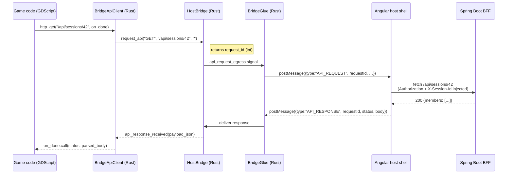

Reusable bridge layer for HugMesh-hosted Godot games. When a Godot
WASM bundle runs inside the HugMesh Angular host shell, all network
traffic and real-time events must pass through a JavaScript message
channel rather than through the browser's `fetch`/`XMLHttpRequest`
APIs directly. This addon implements that channel and exposes a clean
GDScript surface so game code never has to handle raw JavaScript
interop. It provides five components. **`HostBridge`, `BridgeGlue`,
`BridgeApiClient`, and `HugMeshMultiplayerLobby` are all native Rust
GodotClasses** registered by the `hugmesh-bridge` GDExtension
(`extensions/hugmesh-bridge/src/*.rs`) — an earlier revision of this
addon implemented them as GDScript (`bridge_glue.gd`,
`BridgeApiClient.gd`, `MultiplayerLobby.gd`); they were rewritten in
Rust and the old `.gd` files no longer exist. Game code still consumes
them exactly like any other Godot node/class — only `MultiplayerLobbyMenu`
and the plugin bootstrap remain GDScript.

- **HostBridge** — a Rust GDExtension class that is the central hub.
  It emits typed GDScript signals when the host shell pushes SSE events
  inward (`movement_received`, `world_received`, …) and it exposes
  methods for sending input, camera view, console output, and API
  requests outward to the shell. It also maintains the list of
  multiplayer player slots.
- **`BridgeGlue`** (`bridge_glue.rs`) — the `JavaScriptBridge` ↔ HostBridge adapter.
  It translates outbound signals (`input_egress`, `view_egress`,
  `api_request_egress`) into `postMessage` calls to the parent Angular
  host, and it delivers inbound `postMessage` replies (including API
  responses) back into HostBridge so signals fire on the receiving side.
- **`BridgeApiClient`** (`bridge_api_client.rs`) — a Callable-based HTTP client built on top
  of `HostBridge.request_api` and the `api_response_received` signal.
  Game code calls `http_get`, `http_post`, `http_put`, or `http_delete`
  (not `get`/`post`/… — `get` collides with `Node.get(property)`) with
  a completion callback; the client correlates requests to responses by
  request ID internally. Because every call routes through the bridge, the host
  shell's `HttpClient` interceptor automatically attaches the
  `Authorization` header and `X-Session-Id` to every request.
- **`HugMeshMultiplayerLobby`** (`multiplayer_lobby.rs`) — slot orchestration. Listens for
  `slot_registered` and `slot_released` signals from HostBridge,
  fetches the current session members from `/api/sessions/{id}` via the
  bridge, and spawns or despawns one `CharacterBody3D` per slot.
- **`MultiplayerLobbyMenu.tscn`** + `MultiplayerLobbyMenu.gd` — the one
  remaining GDScript component: a drop-in pre-game lobby UI that lists
  open sessions, lets the player pick a slot, and launches the game.

## API call flow

The diagram below shows how an outbound API call travels from game code
to the BFF and how the response finds its way back.



The host shell's `HttpClient` interceptor owns the auth headers — game
code never handles tokens or session IDs.

## Usage

In a game project's `project.godot`, enable the plugin:

```ini
[editor_plugins]
enabled=PackedStringArray("res://addons/hugmesh_bridge/plugin.cfg")
```

Add a node of type `HostBridge` named exactly `"HostBridge"` — every
other bridge node finds it by walking up to its own parent (or, failing
that, the current scene root) and looking for a child named
`"HostBridge"`, so the name match is load-bearing, not just a
convention. The shipped games (`chess-godot`, `connect-four-godot`,
`three-wizards-in-a-trenchcoat`) all follow the same real scene tree:

```
SceneRoot (Node2D / Node3D)
├── GameBridge (plain Node — a grouping node, any name)
│   └── BridgeGlue        ← type: BridgeGlue (Rust GodotClass)
├── HostBridge             ← type: HostBridge (Rust GodotClass); node name must be "HostBridge"
└── MultiplayerLobby       ← type: HugMeshMultiplayerLobby (Rust GodotClass); only for multiplayer games
```

Reference them in your root script with:

```gdscript
# scene_loader.gd or scene root
@onready var host_bridge = $HostBridge
@onready var glue        = $GameBridge/BridgeGlue
@onready var lobby       = $MultiplayerLobby
```

Alternatively, instantiate `MultiplayerLobbyMenu.tscn` as a
`Control` overlay on your scene to get the canonical session picker
without writing lobby code yourself.

## Game-developer contract

**Preferred surface — `BridgeApiClient`**

Use `BridgeApiClient` for all BFF calls. Pass a `Callable` that receives
`(status: int, body: Dictionary)` when the response arrives:

```gdscript
var api := BridgeApiClient.new()

func _ready() -> void:
    add_child(api)  # api's own ready() auto-discovers the "HostBridge" node
    api.http_get("/api/sessions/42", func(status, body):
        if status == 200:
            print("members: ", body.members)
    )

    api.http_post("/api/controls", {"action": "move", "dir": "north"}, func(status, body):
        if status != 200:
            push_error("control rejected: %d" % status)
    )
```

**Low-level surface — `HostBridge.request_api`**

If you need the raw request-ID for manual correlation:

```gdscript
var req_id := host_bridge.request_api("GET", "/api/sessions/42", "")

func _on_host_bridge_api_response_received(payload_json: String) -> void:
    var payload := JSON.parse_string(payload_json)
    if payload.requestId == req_id:
        print(payload.status, payload.body)
```

`BridgeApiClient` does this correlation automatically; prefer it over
the raw signal.

**Slot and view reporting**

- `HostBridge.register_player_slot(slot, character_id, is_local)` —
  declares a slot to HostBridge. When using `HugMeshMultiplayerLobby`
  end-to-end it calls this for you; only call it directly when
  managing slots manually.
- `HostBridge.report_view(slot, x, y, z, yaw, pitch, fov)` — call at
  approximately 10 Hz from the local player's camera. This feeds the
  per-session `view` SSE channel that administrators watch in the
  Sessions panel.

## Why route API through the bridge

Godot WASM bundles run in a sandboxed iframe. The HugMesh host shell
owns the user's session — it holds the JWT and the `X-Session-Id` — so
routing all BFF calls through the bridge gives four concrete benefits:

- **Consistent auth.** The host shell's `HttpClient` interceptor
  attaches `Authorization` and `X-Session-Id` to every outbound request.
  Game code does not need to read, store, or refresh tokens.
- **Single egress point.** All network traffic leaves through one
  JavaScript path, making it straightforward to audit, throttle, or
  log BFF calls from any game.
- **Testability.** Mocking, replaying, or intercepting API calls happens
  at the host-shell boundary, outside the Godot bundle. No Godot-side
  test harness is needed.
- **No stray `HTTPRequest` nodes.** Godot's built-in `HTTPRequest` would
  bypass the interceptor entirely, sending requests without auth headers.
  Routing through the bridge makes that impossible.

## Standalone (editor F5) mode

When the game runs outside the Angular host shell — for example when you
press F5 in the Godot editor — `HostBridge.is_streaming()` returns
`false`. In that state `BridgeApiClient` bypasses the bridge and sends
API calls directly via Godot's `HTTPRequest` node against
`http://localhost:8080/api/…`.

This means editor playthroughs work as long as the BFF is running
locally. SSE events from the host shell are unavailable in this mode
(there is no parent frame to send them), so multiplayer features that
depend on `movement_received` or `world_received` will not fire. Single-
player API calls such as loading a scene or fetching session data work
normally.
