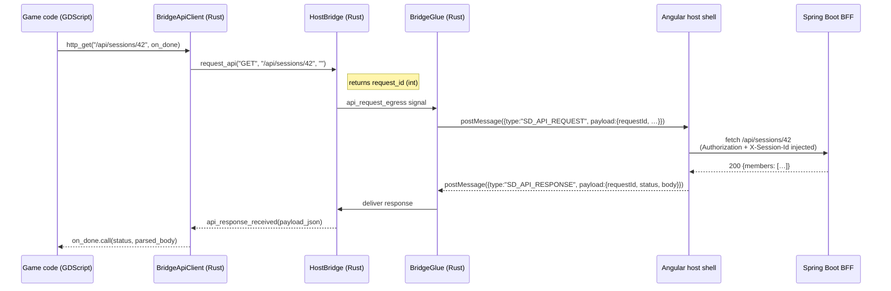

Reusable bridge layer for HugMesh-hosted Godot games. When a Godot
WASM bundle runs inside the HugMesh Angular host shell, all network
traffic and real-time events must pass through a JavaScript message
channel, not through the browser's `fetch`/`XMLHttpRequest` APIs. This addon
implements that channel and gives game code a clean GDScript surface, so it
never handles raw JavaScript interop. It provides five components.
**`HostBridge`, `BridgeGlue`, `BridgeApiClient`, and `HugMeshMultiplayerLobby`
are native Rust GodotClasses** registered by the `hugmesh-bridge` GDExtension
(`extensions/hugmesh-bridge/src/*.rs`). An earlier revision wrote them in
GDScript (`bridge_glue.gd`, `BridgeApiClient.gd`, `MultiplayerLobby.gd`). They
were rewritten in Rust and the old `.gd` files are gone. Game code uses them
like any other Godot node or class. Only `MultiplayerLobbyMenu` and the plugin
bootstrap remain GDScript.

- **HostBridge** — a Rust GDExtension class, and the central hub. It emits
  typed GDScript signals when the host shell pushes SSE events inward
  (`movement_received`, `world_received`, …). It exposes methods that send
  input, camera view, console output, and API requests outward to the shell.
  It also keeps the list of multiplayer player slots.
- **`BridgeGlue`** (`bridge_glue.rs`) — the `JavaScriptBridge` ↔ HostBridge adapter.
  It turns outbound signals (`input_egress`, `view_egress`,
  `api_request_egress`) into `postMessage` calls to the parent Angular
  host. It delivers inbound `postMessage` replies (including API
  responses) back into HostBridge, so signals fire on the receiving side.
- **`BridgeApiClient`** (`bridge_api_client.rs`) — a Callable-based HTTP client built on top
  of `HostBridge.request_api` and the `api_response_received` signal.
  Game code calls `http_get`, `http_post`, `http_put`, or `http_delete`
  (not `get`/`post`/… — `get` collides with `Node.get(property)`) with
  a completion callback. The client matches requests to responses by
  request ID internally. Every call routes through the bridge, so the host
  shell attaches `Authorization` (its `HttpClient` interceptor) and
  `X-Session-Id` (`ApiBridgeService`, from the session id in the request) to
  every request.
- **`HugMeshMultiplayerLobby`** (`multiplayer_lobby.rs`) — slot orchestration. It listens for
  `slot_registered` and `slot_released` signals from HostBridge,
  fetches the current session members from `/api/sessions/{id}` via the
  bridge, and spawns or despawns one `CharacterBody3D` per slot.
- **`multiplayer_lobby_menu.tscn`** + `multiplayer_lobby_menu.gd` — the one
  remaining GDScript component: a drop-in pre-game lobby UI that lists
  open sessions, lets the player pick a slot, and launches the game.

## API call flow

The diagram shows how an outbound API call travels from game code to the BFF,
and how the response finds its way back.



The host shell owns the auth headers. Game code never handles tokens or
session IDs.

## Usage

In a game project's `project.godot`, enable the plugin:

```ini
[editor_plugins]
enabled=PackedStringArray("res://addons/hugmesh_bridge/plugin.cfg")
```

Add a node of type `HostBridge` named exactly `"HostBridge"`. Every
other bridge node finds it by walking up to its own parent (or, failing
that, the current scene root) and looking for a child named
`"HostBridge"`, so the name match is load-bearing, not a convention. The
shipped games (`chess-godot`, `connect-four-godot`,
`three-wizards-in-a-trenchcoat`) all share the `GameBridge`/`BridgeGlue` and
`HostBridge` nodes below. Only `three-wizards-in-a-trenchcoat` also has the
`MultiplayerLobby` node:

```
SceneRoot (Node2D / Node3D)
├── GameBridge (plain Node — a grouping node, any name)
│   └── BridgeGlue        ← type: BridgeGlue (Rust GodotClass)
├── HostBridge             ← type: HostBridge (Rust GodotClass); node name must be "HostBridge"
└── MultiplayerLobby       ← type: HugMeshMultiplayerLobby (Rust GodotClass); only for multiplayer games
```

Reference them from your root script:

```gdscript
# scene_loader.gd or scene root
@onready var host_bridge = $HostBridge
@onready var glue        = $GameBridge/BridgeGlue
@onready var lobby       = $MultiplayerLobby
```

Or instantiate `multiplayer_lobby_menu.tscn` as a
`Control` overlay on your scene to get the standard session picker
without writing lobby code.

## Game-developer contract

**Preferred surface — `BridgeApiClient`**

Use `BridgeApiClient` for all BFF calls. Pass a `Callable` that receives
`(status: int, body: Dictionary)` when the response arrives:

```gdscript
var api := BridgeApiClient.new()

func _ready() -> void:
    add_child(api)  # api's own ready() auto-discovers the "HostBridge" node
    api.http_get("/api/sessions/42", func(status, body):
        if status == 200:
            print("members: ", body.members)
    )

    api.http_post("/api/controls/1", {"action": "MOVE_FORWARD", "pressed": true, "timestamp": int(Time.get_unix_time_from_system() * 1000)}, func(status, body):
        if status != 204:
            push_error("control rejected: %d" % status)
    )
```

**Low-level surface — `HostBridge.request_api`**

If you need the raw request ID for manual correlation:

```gdscript
var req_id := host_bridge.request_api("GET", "/api/sessions/42", "")

func _on_host_bridge_api_response_received(payload_json: String) -> void:
    var payload := JSON.parse_string(payload_json)
    if payload.requestId == req_id:
        print(payload.status, payload.body)
```

`BridgeApiClient` does this correlation for you. Prefer it over the raw
signal.

**Slot and view reporting**

- `HostBridge.register_player_slot(slot, character_id, is_local)` —
  declares a slot to HostBridge. `HugMeshMultiplayerLobby` calls it for you
  when you use the lobby end to end. Call it directly only when you manage
  slots manually.
- `HostBridge.report_view(slot, x, y, z, yaw, pitch, fov)` — call it at
  about 10 Hz from the local player's camera. It feeds the per-session `view`
  SSE channel that administrators watch in the Sessions panel.

## Why route API through the bridge

Godot WASM bundles run in a sandboxed iframe. The HugMesh host shell
owns the user's session: it holds the JWT and the `X-Session-Id`. Routing
all BFF calls through the bridge gives four concrete benefits:

- **Consistent auth.** The host shell attaches `Authorization` (its
  `HttpClient` interceptor) and `X-Session-Id` (`ApiBridgeService`) to every
  outbound request. Game code does not read, store, or refresh tokens.
- **Single egress point.** All network traffic leaves through one
  JavaScript path, so any game's BFF calls are easy to audit, throttle, or
  log.
- **Testability.** You can mock, replay, or intercept API calls at the
  host-shell boundary, outside the Godot bundle. No Godot-side test harness
  is needed.
- **No stray `HTTPRequest` nodes.** Godot's built-in `HTTPRequest` would
  bypass the interceptor and send requests without auth headers. Routing
  through the bridge rules that out.

## Standalone (editor F5) mode

When the game runs outside the Angular host shell, for example when you
press F5 in the Godot editor, `HostBridge.is_streaming()` returns
`false`. `BridgeApiClient` then skips the bridge and sends API calls
directly through Godot's `HTTPRequest` node to `http://localhost:8080/api/…`.

Editor playthroughs therefore work as long as the BFF runs locally. SSE
events from the host shell are unavailable in this mode (there is no parent
frame to send them), so multiplayer features that depend on `movement_received`
or `world_received` will not fire. Single-player API calls, such as loading a
scene or fetching session data, work normally.
