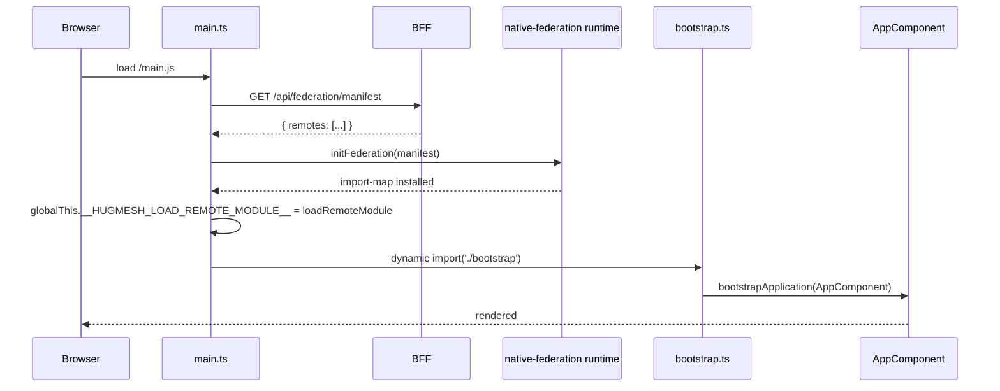

> Mirror of [`chapters/03-federation.tex`](../../publishing/architecture/chapters/03-federation.tex).

The host shell loads *everything* above the WASM iframe through `@angular-architects/native-federation`. Adding a new route-bearing remote means adding a row to `federation_modules`, shipping a per-remote bundle, and pointing `loadComponent` at the exposed module. Adding a new game means the same plus an `<app-<slug>-remote>` Web Component the host can place in its template.

See also: [howto/add-federated-route.md](../howto/add-federated-route.md).

## The two ordering rules

1. **`initFederation` before `bootstrapApplication`.** [`frontend/src/main.ts`](../../../frontend/src/main.ts) dynamic-imports `bootstrap.ts` after the federation runtime resolves. Static imports of `@angular/*` from `main.ts` would be evaluated before the import map is installed and would therefore fail to resolve.
2. **Remote-loader access through `globalThis`.** Route handlers reach the federation runtime through `globalThis.__HUGMESH_LOAD_REMOTE_MODULE__`, set by `main.ts` once `initFederation` resolves. This keeps `@angular-architects/native-federation` out of karma's static graph and out of every route-handler bundle.

## Federation bootstrap



New remotes appear by inserting rows into `federation_modules` — no host redeploy required.

## The manifest endpoint

`GET /api/federation/manifest` is **DB-backed and public on purpose** because the host needs the `login` remote URL before any user has authenticated. It returns the active rows of `federation_modules` ordered by `kind, slug`:

```json
{
  "generatedAt": "2026-04-26T05:30:11Z",
  "remotes": [
    { "slug": "login",  "kind": "remote-shell",
      "remoteEntryUrl": "/_remotes/login/remoteEntry.json",
      "exposedModule": "./LoginComponent",
      "displayName": "Login",  "version": "1.0.0", "metadata": {} },
    { "slug": "admin",  "kind": "remote-shell",
      "remoteEntryUrl": "/_remotes/admin/remoteEntry.json",
      "exposedModule": "./AdminShell",
      "displayName": "Admin",  "version": "1.0.0", "metadata": {} }
    /* ...games-three-wizards, games-dodecahedron, wasm-fragment... */
  ]
}
```

## Shared dependencies

[`frontend/federation-base.js`](../../../frontend/federation-base.js) consolidates the shared-package configuration so the host and all twelve remotes ship the same Angular version:

```javascript
// One source of truth for shareAll + skip helpers.
const STD_SHARED = ['@angular/core','@angular/common','@angular/forms',
                    '@angular/router','rxjs','zone.js'];
const STD_SKIP   = ['@angular/compiler','@angular-architects/native-federation'];

module.exports = {
  hugmeshHost:   () => hugmeshShared({singleton:true,strictVersion:true}),
  hugmeshRemote: () => hugmeshShared({singleton:true,requiredVersion:'auto'}),
};
```

The angular-architects builder enforces that `@angular/core` and the rest of the standard set are loaded **exactly once per page**; mismatched versions across remotes produce the `NG0203 inject() must be called from an injection context` runtime error, which is the federation-shaped variant of the more familiar `NullInjectorError`.

## Routing into a remote

The `loadRemote<T>` helper in [`frontend/src/app/app.routes.ts`](../../../frontend/src/app/app.routes.ts) is what every federated route reaches for:

```ts
export function loadRemote<T>(
  remoteName: string, exposedModule: string, exportName: string,
): () => Promise<T> {
  return async () => {
    const loadRemoteModule = (globalThis as any)
      .__HUGMESH_LOAD_REMOTE_MODULE__;
    if (!loadRemoteModule) throw new Error('federation runtime missing');
    const m = await loadRemoteModule({ remoteName, exposedModule });
    return m[exportName];
  };
}
```

The exported factory is plugged into `loadComponent` for every federated route:

```ts
{ path: 'login',       loadComponent: loadRemote('login',                './LoginComponent',    'LoginComponent')   },
{ path: 'register',    loadComponent: loadRemote('producer-registration', './RegistrationComponent', 'RegistrationComponent') },
{ path: 'banned',      loadComponent: loadRemote('banned',               './BannedComponent',   'BannedComponent')  },
{ path: 'admin',       loadComponent: loadRemote('admin',                './AdminShell',        'AdminShell')       },
{ path: 'admin/games', loadComponent: loadRemote('admin',                './UploadShell',       'UploadShell')      },
{ path: 'mod',         loadComponent: loadRemote('mod',                  './ModShell',          'ModShell')         },
{ path: 'publisher',   loadComponent: loadRemote('publisher',            './PublisherShell',    'PublisherShell')   },
{ path: 'rpg-maker',   loadComponent: loadRemote('games-rpg-maker',     './RpgMakerRemote',    'RpgMakerRemote')   },
{ path: 'vn-maker',    loadComponent: loadRemote('games-vn-maker',      './VnMakerRemote',     'VnMakerRemote')    },
// … plus per-game routes loaded lazily via SCENE_TYPE_TO_GAME_SLUG
```

## Maker remotes (RPG + VN)

Two more federated remotes — `games-rpg-maker` and `games-vn-maker` — mount at `/rpg-maker` and `/vn-maker`. They are *editor* remotes, not game remotes: the host shell loads them as plain Angular components (no Web-Component wrapper, no iframe), and they POST to side-service REST surfaces (`/api/rpg/*` and `/api/vn/*`) backed by the [`rpg-builder/`](../../../rpg-builder/) and [`vn-builder/`](../../../vn-builder/) Spring services. Their federation_modules rows are seeded by [`037-rpg-and-vn-maker-federation.xml`](../../../backend/src/main/resources/db/changelog/037-rpg-and-vn-maker-federation.xml). The publisher console exposes "Launch RPG Maker" / "Launch Visual Novel Maker" buttons that `window.open` these in a new tab so a publisher can keep the upload form alive while authoring. See [decision 018](../decisions/018-rpg-and-vn-makers.md).

## Per-game federation

A game remote exposes a *Web Component* (built with `createCustomElement` and registered with `customElements.define`). The host places it as a normal element:

```html
@switch (activeRemoteSlug()) {
  @case ('three-wizards') {
    <app-three-wizards-remote
      [levelSlug]="activeLevelSlug()"
      [levelId]="activeLevelId()"
      [launchUid]="activeLaunchUid()" />
  }
  @case ('dodecahedron') {
    <app-dodecahedron-remote [launchUid]="activeLaunchUid()" />
  }
}
```

The remote internally builds an iframe URL that points at the `wasm-fragment` remote:

```ts
this.iframeUrl = `/_remotes/wasm-fragment/${this.levelSlug}/index.html` +
                 `?level_id=${this.levelId}&launch_uid=${this.launchUid}` +
                 `&t=${Date.now()}`;
```

The cache-busting `&t=...` parameter is intentional — the iframe HTML itself is small and cheap, but the browser is otherwise prone to caching it across rebuilds and showing a stale Godot bundle.

## Error handling

When a federated chunk fails to load (host nginx down, remote returned 500, network drop), the host's [`AppComponent`](../../../frontend/src/app/app.component.ts) subscribes to `Router.events` and shows a banner with the human-readable label of the broken route, plus a *Retry* button. The label lookup uses `FEDERATED_ROUTE_LABELS` (longest-prefix-first, so `/admin/games` resolves before `/admin`).

### ⚠ CORP saves WASM iframes

WASM games loading inside the federated iframe need:

1. `Cross-Origin-Resource-Policy: cross-origin` on the `wasm-fragment` response
2. The host nginx must strip any duplicate COOP / COEP headers from the upstream and re-emit a single canonical set

Missing CORP shows up as `net::ERR_BLOCKED_BY_RESPONSE`; duplicates show up as `NotSameOriginAfterDefaultedToSameOriginByCoep`. **Both are silent in DevTools' *Console* but show clearly in *Network*'s *Cross-origin isolation* column.**

---

Previous: [02 — Runtime architecture](02-runtime.md) · Next: [04 — Data model](04-data-model.md).
