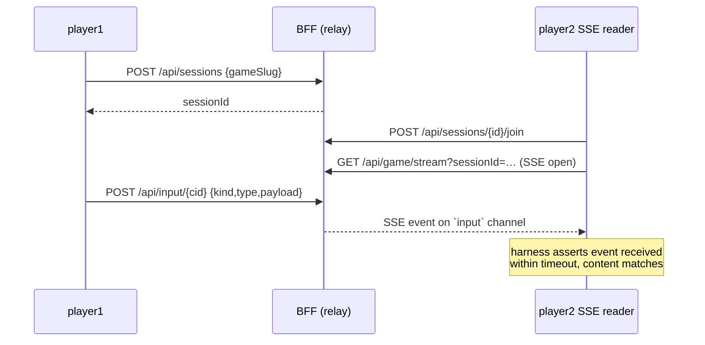

A **committed, re-runnable** harness that proves the 14 web-native games work
correctly in the deployed architecture **with real users** — the
host-authoritative SSE relay, session lifecycle, multiplayer event delivery,
and cross-session isolation — at the **API/SSE layer**, without a browser.

In the host-authoritative model, the BFF's job is to relay events between
players over per-session Server-Sent Events; the game engine itself runs in the
host player's WASM process. That means the meaningful "does multiplayer work?"
proof lives at the relay layer, not in a headless Chrome. The harness exercises
that layer directly.

This is the live multi-user complement to the agent-free build proof (all 14
wasm bundles rebuild byte-identically + 29/29 node suites pass). It does not
repeat those checks.

## What it asserts

**Per RELAY game** (chess, connect-four, reversi, gomoku, dots-and-boxes, go,
battleship, tron, bomberman, asteroids-duel):

1. Mint 2 tokens (player1, player2) via Casdoor ROPC.
2. player1 `POST /api/sessions {gameSlug}` → `sessionId`.
3. player2 `POST /api/sessions/{id}/join`.
4. player2 opens and actively reads the **real** SSE stream
   (`GET /api/game/stream?sessionId=…`) via a manual line-reader over the fetch
   body. Reading the stream is not optional — a harness that only sends events
   and never verifies receipt proves nothing.
5. player1 sends the game's **representative move** via `POST /api/input/{cid}`,
   using the exact `(kind, type, payload)` tuple the game's frontend emits (see
   `scenarios.mjs`). For games that broadcast a world snapshot, the host's
   `world/state` echo is sent as well.
6. **Assert** that player2 receives the relayed event on the `input` channel
   within the timeout, and that the event content matches.

The diagram below shows the event flow the harness exercises:



**Isolation**: the harness opens a second session for a different game and
asserts that its events do **not** appear on session 1's SSE stream. This is
the live end-to-end counterpart to the unit-level `SessionIsolationTest` — it
confirms that the in-process isolation guarantee holds through the full HTTP +
SSE stack.

**Per SOLO game** (tetris, minesweeper, sudoku, match-three): `POST
/api/games/{slug}/launch` mints a uid and the bundle is served; no relay
is involved.

**Global**: a plain `player` sees all 14 games via
`/api/games/available/{cid}`; the federation manifest contains 14 `wasm-game`
rows; each bundle's `index.html` and real `.wasm` file return HTTP 200 from
the wasm-fragment.

## Relay contract (verified from source)

**Reading events**: Clients subscribe to
`GET /api/game/stream?sessionId={id}` as a standard `EventSource`. Both the
guest's `kind:'control'` move and the host's `kind:'world', type:'state'` echo
are delivered on the **`input`** SSE channel. This is because
`GameStateService.emitInput` fans every `/api/input` call to the
session-scoped input sink regardless of the event's `kind` field.

**Sending events**: `POST /api/input/{characterId}` with a JSON body of
`{gameSlug, sessionId, kind, type, payload}` (called `sendInput` for control
events and `sendWorld` for world-state broadcasts).

**Authorization gates in `InputEventController`**:
- Gate 0: the caller must be a session member who owns `characterId`.
- Gate 0b: a session-scoped `kind:'world'` event is the authoritative relay —
  only the session **creator** (the host running the wasm engine) may submit
  one. A guest posting `kind:'world'` is rejected with **403** (closes an
  authority-spoof: without this gate any member could forge the host's
  broadcast state).
- Gate 1: the `(kind, type)` pair must exist in `input_event_types`. An
  unrecognised pair is rejected with **400**.
- Gates 2/3 (per-game `features` + `game_event_support` opt-in) are not yet
  implemented — see the README's "Known gaps / TODO" section.

## Run it

The BFF API is not exposed on a host port, so the harness must run from inside
a container on the `sdgames_default` network.

```bash
# One-shot (brings the stack up, runs the harness, then tears down):
make games-arch-e2e-up

# Against an already-running stack:
make games-arch-e2e
# or invoke the driver script directly:
PROJECT=sdgames bash e2e/games-arch/run-in-docker.sh
```

`run-in-docker.sh` handles credential resolution automatically. Because Casdoor
randomises the client secret and player passwords on every fresh database, the
script greps the seed values out of `docker compose -p sdgames logs casdoor`
and injects them as environment variables before starting the harness. To
supply credentials manually, set any of these environment variables before
invoking the script:

| Variable | What it overrides |
|---|---|
| `CASDOOR_CLIENT_SECRET` | Casdoor OAuth client secret |
| `PLAYER1_PASS` | password for the `player1` seed user |
| `PLAYER2_PASS` | password for the `player2` seed user |
| `PLAYER_PASS` | password for the `player` seed user (global assertions) |

## Files

| File | Role |
|---|---|
| `scenarios.mjs` | Scenario table: relay games with their representative moves, solo games, and expected slugs. |
| `lib.mjs` | Zero-dependency transport layer: ROPC token mint, JSON fetch helper, manual SSE line-reader, health-wait. |
| `run.mjs` | Test runner: drives relay, isolation, solo, and global assertions; prints per-game pass/fail and emits a `RESULTS_JSON` block. |
| `run-in-docker.sh` | Credential-resolving driver: extracts Casdoor seed values from compose logs and runs `run.mjs` in a `node:20` container on `sdgames_default`. |
