A self-hosted multi-game studio and portal. Authors build RPG and visual-novel titles with the built-in makers. Players get a 20-title catalog through an **Angular** shell with live SSE multiplayer sessions. The **HugMesh Gaming BFF** (Spring Boot) handles game state, controls, and role management. **Casdoor** (OAuth2/OIDC) handles authentication, and its admin UI is never exposed to the network.

The catalog has two **technical families** (see [Two game technologies](#two-game-technologies)):

- **Godot 4 WASM titles**:
  - *Three Wizards In A Trenchcoat*, the flagship: a JRPG romp across cave depths and open fields.
  - *Spinning Dodecahedron*, a tech demo of the chrome-less standalone-WASM path (no HUD, no controls overlay, no quests or items).
  - *Chess (Godot)*, a Godot reference game that reuses the web-native chess's deterministic Rust rules engine through the bridge (changelog [`053-chess-godot-federation.xml`](backend/src/main/resources/db/changelog/053-chess-godot-federation.xml)).
  - *Connect Four (Godot)*, the second title ported with the same reference recipe (changelog [`055-connect-four-godot-federation.xml`](backend/src/main/resources/db/changelog/055-connect-four-godot-federation.xml)). It merged with its Godot export still flagged export-unverified in its own PR title, and no bundle for it is committed under `backend/src/main/resources/assets/levels/`. Treat it as unproven until someone confirms a real `make build-godot` run.
  - *Shadows of the Net – CHAT*, a pure-GDScript XR chat chamber (no Rust bridge). It seats up to 16 participants around a noir round table, with a WebXR/Quest entry on top of the desktop fallback (changelog [`056-shadows-of-the-net-federation.xml`](backend/src/main/resources/db/changelog/056-shadows-of-the-net-federation.xml); see [`games/shadows-of-the-net/README.md`](games/shadows-of-the-net/README.md)).
  - *Character Forge*, a single-player 3D character maker (changelog [`062-character-forge-federation.xml`](backend/src/main/resources/db/changelog/062-character-forge-federation.xml); see [`games/character-forge/README.md`](games/character-forge/README.md)).
- **Web-native Rust→wasm32 titles**: 14 board, puzzle and duel games (chess, connect-four, reversi, gomoku, dots-and-boxes, go, battleship, tron, bomberman, asteroids-duel, tetris, minesweeper, sudoku, match-three). Their pure-Rust engines compile to `wasm32-unknown-unknown` and drive a canvas frontend through the host-authoritative SSE relay (see [`games/_shared/`](games/_shared/README.md)).

> **State convention.** ✅ shipped = merged to `main`; 🚧 in-flight = code on an open branch/PR, not yet merged; 🔭 planned = design-complete, no code. The [Roadmap](#roadmap) collects the 🚧 / 🔭 items.

> Branch policy: work on your own branches and open PRs. Do not commit directly to `main`.

---

## Quick links

| Resource | Link |
|---|---|
| Issue Tracker | [hugmesh/hugmesh-games/issues](https://github.com/hugmesh/hugmesh-games/issues) |
| Pull Requests | [hugmesh/hugmesh-games/pulls](https://github.com/hugmesh/hugmesh-games/pulls) |
| **Wiki (in-repo)** | [docs/wiki/](docs/wiki/) — architecture chapters, audience guides, how-to recipes, decisions |
| Godot developer guide | [docs/GODOT_DEVELOPER_GUIDE.md](docs/GODOT_DEVELOPER_GUIDE.md) |
| LAN access (workstation) | [`lan.properties`](lan.properties) + `make lan-info` / `make lan-up` / `make lan-up-tls` |
| Production deploy notes | [decision 019](docs/wiki/decisions/019-production-rate-limits.md) |
| Contributor onboarding | [CLAUDE.md](CLAUDE.md) |
| **Build status** | [What builds today + the key dev commands](#build-status) |
| **Roadmap** | [Done / in progress / planned](#roadmap) |
| **Known gaps / TODO** | [Verified unfinished spots in the current source](#known-gaps--todo) |

The [in-repo wiki](docs/wiki/) is the fastest way into the codebase. Start with [Intro for coders](docs/wiki/guides/intro-for-coders.md) for orientation, read the [Architecture overview](docs/wiki/architecture/01-overview.md) for the typeset reference, or jump to a [how-to](docs/wiki/howto/) for a specific task.

---

## Status

A summary of what is real on `main` today, backed by the code, tests, and merged PR history in this repo. Detail is in [Roadmap](#roadmap) and [Known gaps / TODO](#known-gaps--todo).

**Shipped and working:**
- 20-title catalog (Godot 4 WASM + web-native Rust→wasm32), all registered for launch through Module Federation; see [Two game technologies](#two-game-technologies).
- Multiplayer sessions with per-session SSE sink isolation, enforced at three independent layers (unit test plus two e2e specs).
- The host-authoritative web-native relay is proven end to end on `main`. The guest-side gap and the cross-pod Kafka leg are both merged and mutation-tested (full backend suite green). All 10 relay-capable web-native games have two-browser UI-level e2e specs: nine in `e2e/tests/web-games-multiplayer.spec.ts`, and battleship, whose two-sided placement needs its own driver, in `e2e/tests/battleship-two-sided.spec.ts`. These relay e2e specs have not yet been confirmed green against a live two-browser stack.
- The RPG + VN makers compile authored projects to real Godot WASM bundles when `app.build.godot-enabled=true`, including byte-copied asset materialization and deterministic procedural-SVG asset generation. See [decision 018](docs/wiki/decisions/018-rpg-and-vn-makers.md).
- The Kafka → ClickHouse streaming/audit pipeline, object-storage uploads, Postgres read-replica routing, and the per-brand `DOMAIN_` tenancy foundation. See decisions [021](docs/wiki/decisions/021-kafka-clickhouse-streaming-pipeline.md), [020](docs/wiki/decisions/020-object-storage-uploads.md), [022](docs/wiki/decisions/022-postgres-read-replica.md), [025](docs/wiki/decisions/025-bff-domain-guard.md)/[026](docs/wiki/decisions/026-games-catalog-domain-partitioning.md).
- A recent OWASP-driven security pass closed several IDOR/BOLA/fail-open findings across the games BFF (see recent history on [Pull Requests](https://github.com/hugmesh/hugmesh-games/pulls?q=is%3Apr)).

**Known gaps** (detail in [Known gaps / TODO](#known-gaps--todo)): `InputEventController`'s third validation gate (per-game opt-in) exists but is switched off. The server-authoritative FPS/RTS surface runs only a Java reference sim and has no catalog title. Strict CSP is not done. `CassandraSyncService` is superseded but not yet retired. *Connect Four (Godot)* is catalog-registered, but its own merge commit flags the WASM export as unverified.

---

## Two game technologies

The 20-title catalog (✅ registered on `main`) splits into two delivery models. Both share the same SSE session transport, role gating, and launch-UID minting. They differ in how the game runs in the browser:

| Family | Titles | Engine | Delivery | Authority |
|---|---|---|---|---|
| **Godot 4 WASM** | *Three Wizards In A Trenchcoat*, *Dodecahedron Demo*, *Chess (Godot)*, *Connect Four (Godot)*, *Shadows of the Net – CHAT*, *Character Forge* | Godot 4.6 project under [`games/<slug>/`](games/) exported to a self-contained WASM bundle | per-game `remote-game` Angular Web Component (or the legacy iframe path) loading the bundle from `wasm-fragment`; *Chess (Godot)* / *Connect Four (Godot)* / *Shadows of the Net – CHAT* / *Character Forge* federate via a `wasm-game` row straight at the `wasm-fragment` bundle (changelogs [`053-chess-godot-federation.xml`](backend/src/main/resources/db/changelog/053-chess-godot-federation.xml), [`055-connect-four-godot-federation.xml`](backend/src/main/resources/db/changelog/055-connect-four-godot-federation.xml), [`056-shadows-of-the-net-federation.xml`](backend/src/main/resources/db/changelog/056-shadows-of-the-net-federation.xml), [`062-character-forge-federation.xml`](backend/src/main/resources/db/changelog/062-character-forge-federation.xml)) | server (BFF) holds canonical game state (*Chess (Godot)* / *Connect Four (Godot)* are host-authoritative, reusing the matching Rust core via the bridge — the guest re-validates); *Shadows of the Net – CHAT* is also host-authoritative but pure GDScript — no Rust bridge, no rules core to reuse — with the session creator arbitrating room seat/stage state; *Character Forge* is single-player (`"sse":false`) |
| **Web-native Rust→wasm32** | chess, connect-four, reversi, gomoku, dots-and-boxes, go, battleship, tron, bomberman, asteroids-duel, tetris, minesweeper, sudoku, match-three | pure-Rust engine under [`extensions/hugmesh-<game>/`](extensions/) + a `-wasm` shim crate compiled to `wasm32-unknown-unknown` (zero host imports), driving a vanilla-JS canvas frontend under [`games/<slug>/`](games/) | **no per-game Angular remote** — a `federation_modules` row of `kind='wasm-game'` points the host straight at the `wasm-fragment` bundle (changelog [`051-web-game-federation.xml`](backend/src/main/resources/db/changelog/051-web-game-federation.xml)) | **host-authoritative** — the host browser runs the engine, the BFF only relays `control`/`world` over the per-session SSE stream, the guest re-applies and re-validates |

Each web-native engine runs in the browser (`WebAssembly.instantiateStreaming`) and in a Node functional test (`games/_shared/test/<slug>-wasm.test.mjs`), so the same `.wasm` binary is verified without environment-specific shims. The zero-host-imports contract also lets the JVM run these modules through Chicory, but the only JVM test today covers the FPS core shim. See [`games/_shared/README.md`](games/_shared/README.md) for the shared shell contract, [`docs/multiplayer-chess-design.md`](docs/multiplayer-chess-design.md) for the host-authoritative relay model, and the "Web-native games" section of [CLAUDE.md](CLAUDE.md) for the add-a-game recipe.

> Server-authoritative realtime FPS/RTS sim cores ([`extensions/hugmesh-fps-core`](extensions/), [`extensions/hugmesh-rts-core`](extensions/)) and a Cassandra-truth tick loop exist as 🚧 engines, but **no FPS/RTS title is registered in the catalog yet**. What is and is not wired is in the [Roadmap](#roadmap).

---

## Build status

Six components build from the monorepo, chained by the root [`Makefile`](Makefile):

| Component | Toolchain | Build command | Status |
|---|---|---|---|
| **HugMesh Gaming BFF** | Java 25 / Spring WebFlux (Maven wrapper) | `make build-backend` (`./mvnw package`) | Builds + tests pass on a host with JDK 25. |
| **Angular host + remotes** | Node 22 / Angular 22, [native-federation](docs/wiki/decisions/001-native-federation.md) | `make build-frontend` (host) · `make build-frontend-all` (host + every remote bundle) | Builds, and Karma unit tests pass. Frontend tests run in a Chromium-baked Docker image, so the host needs no browser. |
| **hugmesh-bridge** (Rust → native `.so`) | `cargo build --release --features api-custom` | `make build-rust` | Builds, and `cargo test` passes, on a host with `cargo` and Godot (gdext regenerates `extension_api.json` against your Godot binary). |
| **hugmesh-bridge** (Rust → WASM) | `wasm32-unknown-emscripten` | `make build-rust-wasm` (dockerised emsdk) | Needs Docker, not a host emscripten. Built via a pinned `rust + emsdk` Docker image ([`tools/build-rust-wasm/Dockerfile`](tools/build-rust-wasm/Dockerfile)); produces a 3.3 MB `hugmesh_bridge.wasm`. Not optional: `build-rust` depends on it, and its `deps-rust` step stops with an error when `docker` is missing. |
| **Godot 4.6 web export** | Godot 4.6 CLI + export templates | `make build-godot` (one bundle per export preset, per game) | Needs the Godot 4.6 binary on `PATH` *and* installed 4.6 export templates. Writes one WASM bundle per chapter under `backend/src/main/resources/assets/levels/<slug>/`, then runs [`scripts/patch-godot-html.py`](scripts/patch-godot-html.py). |
| **Web-native game cores** (14 × Rust → WASM) | `wasm32-unknown-unknown`, freestanding cdylib | `make build-games-wasm` (dockerised rustc) · `make clean-games-wasm` | Builds every `extensions/hugmesh-<game>-wasm/` shim through [`tools/build-games-wasm/Dockerfile`](tools/build-games-wasm/Dockerfile), a thin layer on the official `rust` image with no emsdk. All 14 crates depend only on their sibling engine by path, so the build runs with `--offline` and needs no network. Output lands in `extensions/<crate>/target/wasm32-unknown-unknown/release/`. The target **builds only** and installs nothing. |

`make build` runs all of the above **except** `build-games-wasm`, in dependency order (`build-rust → build-godot → build-backend → build-frontend`). The game cores stay out of the default chain for the same reason the committed bundles do: the shipped `.wasm` files under `games/<slug>/wasm/` are tracked artefacts, so regenerating them is a deliberate, reviewable act and not a side effect of `make build`.

**Tests.** `make test` runs six legs: `test-rust` (cargo, in `extensions/hugmesh-bridge`), `test-rust-cores` (`cargo test --offline` in every other `extensions/hugmesh-*` crate), `test-backend` (`./mvnw test`), `test-godot` (headless GDScript suites for `shadows-of-the-net` and `character-forge`; needs a Godot binary), `test-games-js` (the node suites under `games/_shared/test/`), and `test-frontend` (Karma in Docker). End-to-end tests are Playwright against the live Docker Compose stack: `make e2e` (the canonical suite: TLS, all images, self-isolation specs), `make e2e-bdd` (Gherkin `.feature` files with per-step screenshots), and `make e2e-native` (the same suite against the GraalVM native image overlay). The other Godot projects have no GDScript unit suite; `make e2e` exercises them by loading the real WASM bundle in a browser.

**Run it.** `docker compose up -d` starts Postgres, Cassandra, Casdoor, the BFF, the Angular host, and the federated remotes. Liquibase migrates the schema on first boot. `make lan-up` / `make lan-up-tls` expose the stack to the LAN through [`lan.properties`](lan.properties). Dev servers: `make dev-backend` (`:8080`) and `make dev-frontend` (`:4200`, proxied to the BFF). See [architecture · 06 — build and deploy](docs/wiki/architecture/06-build-and-deploy.md) for the full chain and the Docker 29.x buildx caveat.

**Parent POM note.** The three Spring services (`backend/`, `rpg-builder/`, `vn-builder/`) each inherit directly from `spring-boot-starter-parent`. Moving to the org-wide `hugmesh-parent` metapom (v2.8.0) is a pending fan-out item tracked in the HugMesh org. It is not applied to this repo yet.

**CI is GitLab, not GitHub Actions.** [`.gitlab-ci.yml`](.gitlab-ci.yml) builds and pushes one Docker image per deployable component (`backend`, `frontend`, `rpg-builder`, `vn-builder`, `wasm-fragment`) to the in-cluster GitLab container registry. The builds run in parallel on a privileged x86 runner, on the default branch and on tags. Images carry no secrets; key material is supplied from USB at first boot.

**Opt-in / external-toolchain paths.** The GraalVM native image (`make build-backend-native`, `make e2e-native`; see [decision 004](docs/wiki/decisions/004-graalvm-native.md)) needs ~6–8 GB RAM for the AOT compile and is not gated on PR CI. The Rust→WASM bridge and the Godot export both need toolchain (emsdk, or a Godot binary plus templates) that the base JVM/Angular flow does not.

---

## Roadmap

Status as of the current `main`. Phase-2 detail is in [`docs/PLAN-module-federation-and-native.md`](docs/PLAN-module-federation-and-native.md). Per-brand tenancy detail is in decisions [025](docs/wiki/decisions/025-bff-domain-guard.md) and [026](docs/wiki/decisions/026-games-catalog-domain-partitioning.md).

### Done — merged on `main`

- **Module Federation (host + remotes + fragment).** Done. The Angular host shell loads `login` / `admin` / `mod` / `publisher` / per-game remotes at runtime through native-federation, plus a `wasm-fragment` nginx that serves Godot bundles. The manifest is DB-backed (`GET /api/federation/manifest`). See [decision 001](docs/wiki/decisions/001-native-federation.md) and PLAN sections A & F.
- **Native / Godot run path + per-game project layout.** Done. Per-game Godot 4.6 projects under `games/<slug>/`, the canonical `hugmesh-bridge` Rust crate (`HostBridge`), per-game WASM bundles, and the GraalVM native-image build profile with its `e2e-native` overlay. PLAN sections D & G.
- **Hot upload + cryptographic launch UIDs.** Done. The `POST /api/admin/games/upload` install pipeline (validate → SHA-256 → atomic move → one R2DBC tx → version pinning + pruner). `POST /api/games/{slug}/launch` mints launch UIDs, with admin revoke and a sweeper. PLAN sections C & H.
- **JWT roles + per-game access policy + mod/publisher RBAC.** Done. `game_access` scopes, `RoleProxyController`, per-game `mod_game_scopes` / `publisher_game_scopes`. Decisions [009](docs/wiki/decisions/009-game-access-scopes.md), [011](docs/wiki/decisions/011-mod-publisher-rbac.md).
- **The makers (RPG + VN editors).** Done. The `/rpg-maker` and `/vn-maker` federated remotes, backed by the `rpg-builder/` and `vn-builder/` Spring services, compile authored projects to upload-ready Godot bundles. [Decision 018](docs/wiki/decisions/018-rpg-and-vn-makers.md).
- **Chess (Godot) — Godot pivot pilot title.** Done (migration [`053-chess-godot-federation.xml`](backend/src/main/resources/db/changelog/053-chess-godot-federation.xml)). The `games/chess-godot/` Godot 4 project reuses the web-native `chess` title's deterministic `hugmesh-chess` Rust rules engine through the `ChessEngine` GDExtension node (no GDScript rules). It is federated as its own `kind='wasm-game'` row beside the original web-native `chess` tile, not in place of it. `games/_godot-template/` documents it as the reference recipe for porting the remaining web-native titles to Godot. To roll back to web-native only, disable the `games-chess-godot` federation row with one UPDATE.
- **Connect Four (Godot) — second Godot port, catalog-registered but export-unverified.** Catalog rows done (migration [`055-connect-four-godot-federation.xml`](backend/src/main/resources/db/changelog/055-connect-four-godot-federation.xml)). It mirrors the chess-godot pattern exactly: `games/connect-four-godot/` reuses `hugmesh-connect-four` through a `ConnectFourEngine` GDExtension node, and is federated as its own `kind='wasm-game'` row beside the web-native `connect-four` tile, not in place of it. The merge commit's own title flags the actual `make build-godot` WASM export as not yet verified in this repo's history. The game is discoverable and launchable per the catalog data, but nobody has confirmed that the produced bundle boots. Treat it as 🚧 until a real export is confirmed.
- **Shadows of the Net – CHAT — XR chat chamber, the 19th catalog title.** Done (migration [`056-shadows-of-the-net-federation.xml`](backend/src/main/resources/db/changelog/056-shadows-of-the-net-federation.xml)). `games/shadows-of-the-net/` is a pure-GDScript Godot 4 project. Unlike the chess and connect-four ports, it has no Rust rules core and no `hugmesh_bridge` GDExtension. It implements a 16-seat noir chat room with media surfaces and a WebXR/Quest entry on top of the desktop fallback. It is federated as its own `kind='wasm-game'` row (`enabled=true`) with a `scope='all'` `game_access` row, so every player can see and launch it; no role or feature flag gates it. Seat and stage relay ride the existing `control`/`world` SSE channels (the session creator arbitrates), and `ShadowsOfTheNetFederationSeedTest` pins this end to end. See [`games/shadows-of-the-net/README.md`](games/shadows-of-the-net/README.md) and [decision 028](docs/wiki/decisions/028-parametric-humanoid-avatars.md) for the character-rendering contract it shares with `hugmesh-character-forge-bff-api`.
- **Character Forge — 3D character maker, the 20th catalog title.** Done (migration [`062-character-forge-federation.xml`](backend/src/main/resources/db/changelog/062-character-forge-federation.xml)). `games/character-forge/` is a Godot 4 project that moved into this repo from the character-forge BFF repo. The engine renders and answers the bridge; every control lives in the Angular host. It is federated as a `kind='wasm-game'` row with a `scope='all'` `game_access` row, and is single-player (`"sse":false`). No bundle for it is committed under `backend/src/main/resources/assets/levels/`. Its headless GDScript suite runs under `make test-godot`. See [`games/character-forge/README.md`](games/character-forge/README.md).
- **Per-brand domain foundation (the `DOMAIN_` authority).** Done (merged via PR #65). The games BFF now derives a tenant the way hugmesh-gateway does: `DomainRegistry` (issuer → brand), `CasdoorAuthorities` (stamps exactly one issuer-derived `DOMAIN_<x>` per token, with a reserved-prefix anti-forgery guard), and `Roles.isSuperadmin` / fail-closed `Roles.domainOf`. *Note:* PR #65 stamped the authority and hardened the converter. The **enforcement** layer that consumes it (the BFF-side guard and catalog partitioning below) has since merged to `main` too.
- **BFF-side `DOMAIN_` guard.** Done. `DomainGuardFilter` is a reactive `WebFilter` that re-runs the gateway's per-instance domain hard-deny as defence in depth, for callers that reach the BFF without passing through the gateway. It is gated on `app.tenancy.domain` and does nothing when that is unset (single-tenant today). [Decision 025](docs/wiki/decisions/025-bff-domain-guard.md), 16-spec `DomainGuardFilterTest`.
- **Per-brand games-catalog domain partitioning.** Done. The `games.domain` column (migration 043, defaults to `'default'` = unscoped), the `Roles.domainApplies` predicate, `DomainScopeService.requireGameDomain`, server-controlled first-writer-wins upload stamping (safe against an untrusted `register.sql`), and the `GameAccessController` list/grant/revoke enforcement surface. [Decision 026](docs/wiki/decisions/026-games-catalog-domain-partitioning.md).
- **Domain-scope fan-out across the management controllers.** Done. The follow-on from decision 026: `requireGameDomain` is plumbed into `GameLaunchController` (`launch` + `adminRevoke`), `ModerationController` (`stop` / `kick`), and `PublisherController` (`grantMod` / `revokeMod`). `DomainScopeService.requireSessionDomain` resolves `sessionId → game_slug → domain` for the session-targeting moderation actions. Each controller has a `*DomainScopeTest` suite, and PRs #79 / #82 added cross-domain DENY HTTP coverage.

### In progress — server-authoritative realtime engines (catalog launch deferred)

- **FPS / RTS sim cores + Cassandra-truth tick loop.** 🚧 In-flight (engine level). On `main` today: the `hugmesh-fps-core` / `hugmesh-rts-core` Rust sim cores, the server-authoritative tick loop (`AuthoritativeTickService`), the `realtime_matches` Postgres table (changelog [`049-realtime-matches.xml`](backend/src/main/resources/db/changelog/049-realtime-matches.xml)) and its Cassandra live-truth companions (`realtime_keyframes` + `realtime_command_log`), and the `RealtimeController` / `AdminRealtimeController` REST surface. The tick loop registers only the Java `ReferenceArenaSim`. The Rust cores are not wired in: the FPS core runs in-JVM through Chicory in tests only, and the RTS core has no wasm shim. **No FPS/RTS title is registered in the catalog or federation as a launchable game.** These are engines and a match surface, not a playable catalog entry. Design records: [`docs/realtime-server-authoritative-design.md`](docs/realtime-server-authoritative-design.md), [`docs/realtime-sim-wiring-p4.md`](docs/realtime-sim-wiring-p4.md).
- **Godot 4 + Web export templates baked into rpg-builder / vn-builder images.** Code-complete on `main` (PR #101, superseding the closed draft #89). Both `rpg-builder/Dockerfile` and `vn-builder/Dockerfile` fetch the Godot 4.6 headless binary and the Web export templates into the image, and `.gitlab-ci.yml` passes an optional `GODOT_MIRROR_BASE_URL` CI/CD variable through as the build-arg for the air-gapped runner. 🚧 Two ops steps remain, and both are still outstanding. One: mirror the Godot release artifacts into the project's package registry and set that CI/CD variable (today's builds still fall through to the public GitHub default). Two: flip `APP_BUILD_GODOT_ENABLED=true` (plus ephemeral storage / `APP_BUILD_BRIDGE_DIR`) in the maker Deployment manifests, a deploy-time config change tracked outside this repo.
- **More game ports.** 🔭 Planned. [`docs/game-ports-backlog.md`](docs/game-ports-backlog.md) is an explicit planning backlog (kdegames / FPS / RTS ports). Each row is a future epic, not yet built.

### Planned — platform integration (gated on broader HugMesh rollout)

- **Games app-store.** Planned. A per-domain catalog of dockerized FOSS game servers. A new `games-services` role lets domain admins add and run servers from a Postgres-backed catalog, the superadmin gates instance creation, and mods may create and run instances. Gated on `games-up`.
- **`games` subdomain + two-Casdoor architecture.** Planned. The games realm runs its own Casdoor, separate from the platform Casdoor (the two-Casdoor split that the `DOMAIN_` foundation above is built for). The portal defaults to a `games.<domain>` subdomain until a dedicated TLD is obtained.
- **Optional-service add/remove + graceful degradation.** Planned. The games subdomain is an optional service that can be added or removed by command on any deployment. Federation and UI surfaces degrade gracefully (greyed out) when the games realm is omitted.
- **Multi-brand e2e.** Planned. A second Casdoor issuer in the integration-test harness, so the domain guard and catalog partitioning are exercised end to end. Today the `make e2e` stack runs a single Casdoor, and unit suites pin the filter logic.

### Planned — hardening follow-ups

- **Strict CSP.** 🔭 Planned. The first-cut Content-Security-Policy ships in both nginx confs ([decision 023](docs/wiki/decisions/023-content-security-policy.md)). The path to *strict* CSP, which drops the remaining `unsafe-*` tokens once the es-module-shims and Angular runtime needs are gone, is a documented future step and is not done.
- **Retire `CassandraSyncService`.** 🔭 Planned. The Kafka → ClickHouse streaming pipeline foundation, producers, and cross-pod consumer are ✅ on `main` ([decision 021](docs/wiki/decisions/021-kafka-clickhouse-streaming-pipeline.md)). `CassandraSyncService` stays until the streaming pipeline has shown production stability; retiring it is a planned follow-up.
- **Move bearer tokens off web storage.** 🔭 Planned. The frontend stores the Casdoor token in `localStorage` (`tw_auth`, moved from `sessionStorage` in PR #57 so that open-in-new-tab keeps the user signed in). Moving off XSS-readable web storage entirely (HttpOnly `bff_` session cookies, the platform's native-login convention) is a platform-wide security backlog item that this repo inherits if and when the games frontend is in scope.
- **Re-export the Godot bridge onto the `localStorage` auth store.** 🚧 Source fixed, bundles not yet re-exported. `games/three-wizards-in-a-trenchcoat/scripts/game_bridge.gd` now reads the JWT from `window.parent.localStorage` first and falls back to `sessionStorage`, the same order as the `rpg-builder` Godot template; `games/_shared/test/godot-bridge-auth-storage.test.mjs` fails if a bridge that reads `tw_auth` stops doing so. The compiled bridge also ships inside the tracked `index.pck` bundles under `backend/src/main/resources/assets/levels/{cave,field}/`, and those have not been re-exported from the new source. Until `make build-rust && make build-godot` is run with the Godot 4.6 toolchain the bundles were built with, the shipped game still sends `POST /api/controls/{characterId}` with no `Authorization` header and the BFF refuses it with 401. The bridge's `fetch` ignores that failure: it is a silent loss of the server-side control event, not a crash. The in-WASM cast still plays locally, and the Angular page sends its own control POST with the token.

---

## Known gaps / TODO

Unfinished spots verified in the current source, beyond the roadmap items above:

- **`InputEventController` gate 3 is off.** `POST /api/input/{characterId}` runs these gates in order. Gate 0: the caller is an active session member who owns the character, and a session-scoped `kind:'world'` event must come from the session creator (else 403). Gate 1: the `(kind, type)` pair exists in `input_event_types` (else 400). Gate 2: the game's `games.features` has the event's kind set to `true`, plus a subsystem flag for `control:cast` (else 405). Gate 3: an enabled `game_event_support` row exists for the `(game_slug, event_kind, event_type)` triple (else 405). Gate 3 is built but switched off by `app.input.gate3-enabled=false`. It stays off until every shipped title has its rows: only `three-wizards` and `dodecahedron` have input rows, and several titles have none, so switching it on would refuse real input. One more gap, from the class Javadoc: the export plugin's `register.sql` still replaces the whole `features` object without the `world`/`control` keys, so an uploaded or re-installed game gets 405 until hugmesh-games#17 lands. See also [04 — data model](docs/wiki/architecture/04-data-model.md#generalised-input-event-surface).
- **Server-authoritative FPS/RTS engines have no catalog title yet.** No FPS/RTS game is registered in the `games` catalog or the federation manifest, and the tick loop runs only a Java reference sim. See [Roadmap](#roadmap).
- **Strict CSP not done.** Both nginx confs still ship `'unsafe-eval'`/`'unsafe-inline'` in `script-src` and `'unsafe-inline'` in `style-src`. es-module-shims and Angular's runtime style injection need them today. Dropping them is a documented follow-up and has not started ([decision 023](docs/wiki/decisions/023-content-security-policy.md)).
- **`CassandraSyncService` not yet retired.** The Kafka → ClickHouse streaming pipeline supersedes it in intent (`decision 021`), but it stays in the codebase until a production soak period ends.
- **CI now has a test stage, but it has not been observed running on the real runner.** `.gitlab-ci.yml` gained a `test` stage with four jobs (`test:backend`, `test:frontend`, `test:games-js`, `test:rust-cores`) that `build:image` `needs:`, so a red suite should fail the pipeline before any image is built or pushed. What is *verified* is each job's command, run verbatim in its own container on a developer box: 700 backend tests, 219 Karma specs, 18 games-JS suites, and 496 Rust game-core tests across 31 crates, all green. What is *not* verified is the GitLab pipeline itself. No runner is available outside the cluster, so the first run on `main` is the first real execution. The jobs bind-mount `${CI_PROJECT_DIR}` into sibling containers, which needs the shell executor that the rest of this file already implies (no job declares an `image:`, yet `build:image` and the pentest jobs run bare `docker`/`bash`). A `before_script` guard on `.test:base` fails fast with an explicit message if that assumption is wrong, instead of surfacing as a confusing missing-file error. Treat the first pipeline on `main` as the acceptance test for the stage.
- **Two unit suites still have no CI runner.** `make test-godot` (needs a `godot4` binary) and `make test-rust` (needs gdext by git URL) cannot run on the Tailscale-only x86 runner, which reaches neither github.com nor a Godot download. Both un-gate once `GODOT_MIRROR_BASE_URL` is seeded and a crate mirror exists. The `test` stage documents this in place.

---

## Multiplayer sessions

The portal supports many concurrent **named sessions** per game, each with its own slot-bound players. Click a game card on the home page to open the session picker, then pick an existing session or start a new one. In Three Wizards, the game client (`HugMeshMultiplayerLobby`) spawns one wizard `CharacterBody3D` per registered slot. The local player drives their own slot through `/api/controls/{characterId}`, and movement events from the other players arrive on the per-session SSE stream and drive the remote wizards.

| Surface | What it does |
|---|---|
| `POST /api/sessions` | Create a named session for a game (creator becomes slot 0). |
| `GET /api/sessions?gameSlug=` | List open sessions for the game-menu picker. |
| `POST /api/sessions/{id}/join` | Join an existing session at a free slot. |
| `GET /api/game/stream?sessionId=` | Per-session SSE stream — only this session's movement / world / character / input events. (`view` is not on this stream; see the admin stream below.) |
| `GET /api/admin/sessions/{id}/stream` | Admin-only per-session merged stream including the `view` channel. |

The per-session SSE sinks are **isolated by construction** ([decision 010](docs/wiki/decisions/010-per-session-sse-sinks.md)): a subscriber to session A never sees session B's events. Three independent layers enforce this: [`SessionIsolationTest`](backend/src/test/java/games/hugmesh/bff/service/SessionIsolationTest.java) (BFF unit), [`multiplayer-same-session.spec.ts`](e2e/tests/multiplayer-same-session.spec.ts) (two players, one session; strict positive assertion), and [`cross-session-isolation.spec.ts`](e2e/tests/cross-session-isolation.spec.ts) (two players, two sessions; strict negative assertion). The e2e suite passes 21/21. See [howto/run-multi-user-e2e.md](docs/wiki/howto/run-multi-user-e2e.md) for adding new specs.

Two players may legitimately use the same `character_id` in different sessions. The BFF resolves the ambiguity with [`findActiveOwnerInSession(sessionId, characterId)`](backend/src/main/java/games/hugmesh/bff/repository/SessionMemberRepository.java). `POST /api/controls/{id}` passes the `X-Session-Id` header to a session-scoped overload of `authorizeControl`, so neither player gets a spurious 403.

## Roles

| Role | Capability | Scope |
|---|---|---|
| `player` | Play unlocked games, create/join sessions. | Global. |
| `mod` | Stop sessions + kick players. | Per-game (`mod_game_scopes`). |
| `publisher` | Upload game bundles + grant the `mod` role. | Per-game (`publisher_game_scopes`). |
| `admin` | Everything, including granting publisher / mod scope. | Global. |

Casdoor owns role membership. Per-game scope rows in Postgres decide which games each mod or publisher may act on. Admins manage both layers through `/api/admin/role-grants/*`. Per-game seed users (`mod-three-wizards`, `publisher-dodecahedron`, and so on) are pre-loaded on first boot, and `casdoor/entrypoint.sh` prints their passwords. See [decision 011](docs/wiki/decisions/011-mod-publisher-rbac.md) and [howto/grant-mod-or-publisher.md](docs/wiki/howto/grant-mod-or-publisher.md).

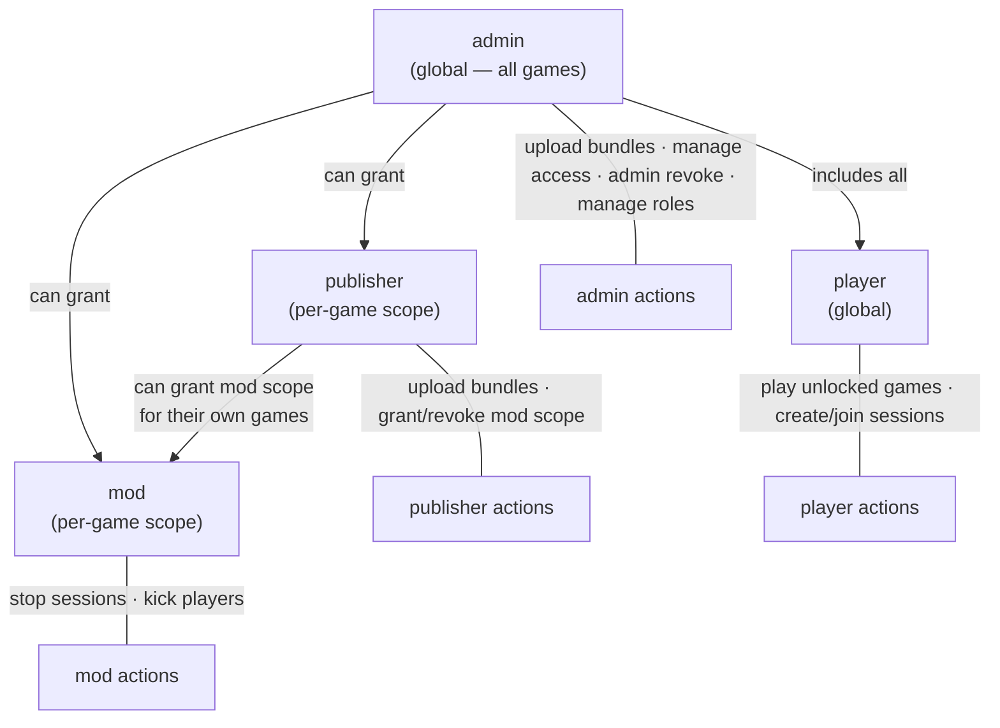

The frontend ships **separate federated remotes** for each role: `/admin`, `/mod`, `/publisher`. The host shell loads each one only when the matching role is in the JWT. A fourth federated remote, `/admin/docs`, embeds an OpenAPI explorer (backed by the live `/v3/api-docs` endpoint, with `openapi.fallback.json` as a static backup) and is gated to admins by the federation manifest's `requires: ROLE_ADMIN` metadata. Per-audience guides cover each role end to end: [admin](docs/wiki/guides/administration.md), [mod](docs/wiki/guides/moderator.md), [publisher](docs/wiki/guides/publisher.md), and the [maintainer runbook](docs/wiki/guides/maintainer-runbook.md) for on-call.

The `/publisher` console exposes **two more federated remotes** for authoring new games end to end without touching Godot directly:
- `/rpg-maker` — a Mudlet-shaped editor (areas / rooms / 6+1-direction exits / items / NPCs / scripts), backed by the [`rpg-builder/`](rpg-builder/) Spring service and its dedicated Postgres DB.
- `/vn-maker` — a godot-2d-visual-novel-shaped editor (acts / characters / backgrounds / scenes / dialogue / branching choices), backed by the [`vn-builder/`](vn-builder/) Spring service and its dedicated Postgres DB.

Each maker compiles the authored project to a HugMesh-bridge-aware Godot 4 WASM bundle (one bundle per Area or Act, which maps to one Chapter in the BFF), zips it, and POSTs it to `/api/admin/games/upload` with the originating user's bearer token. The resulting game federates under the building user exactly like any manually uploaded bundle. See [decision 018](docs/wiki/decisions/018-rpg-and-vn-makers.md).

## Security primitives

Every URL-facing identifier comes from one function: [`Crypto.mintUid()`](backend/src/main/java/games/hugmesh/bff/util/Crypto.java). It makes a SHA3-256 digest of 64 random bytes from a BouncyCastle SP800-90A HMAC-SHA256 DRBG, encoded as a 43-character URL-safe base64 string. Launch tokens, session IDs, session tokens, and pod IDs all share this shape, so a value leaked through a log line is equally hard to trace back whatever category it belongs to. Liquibase 036 widens legacy `varchar(36)` columns to fit the new length. Existing UUID-shaped rows stay valid.

JWT role extraction lives in one class: [`Roles`](backend/src/main/java/games/hugmesh/bff/security/Roles.java). New role checks use `Roles.has(jwt, "ADMIN")` or `Roles.fromAuthentication(auth)`. `@PreAuthorize("hasRole('ADMIN')")` is the preferred form at controller boundaries. No copy-pasted extraction helpers exist elsewhere in the codebase.

## Diagnostic capture is admin-only and off by default

`POST /api/diagnostics/wasm-console` requires both `ROLE_ADMIN` and the runtime flag `wasm_console_debug_enabled` (default: off). An admin turns the flag on with `PUT /api/admin/debug-mode/wasm-console` while triaging an iframe issue. Console captures from non-admins are never forwarded to the BFF: the frontend gate ensures the POST is never attempted. See [decision 012](docs/wiki/decisions/012-debug-mode-gate.md).

---

## Content hierarchy — games → chapters → scenes

The **Godot 4 WASM** family has three tiers (below), with one exception noted inline. Web-native Rust→wasm32 titles map to a single self-contained canvas bundle and do **not** use the `scene_elements` tier. See [Two game technologies](#two-game-technologies).

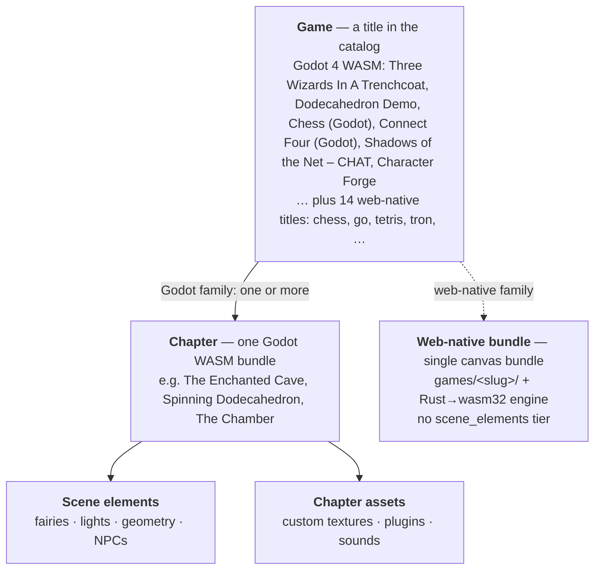

- A **Game** is one row in the `games` table, and appears as a card on the HugMesh
  Games portal home page. The catalog ships 20 titles in two families (see
  [Two game technologies](#two-game-technologies)). The Godot 4 WASM titles are
  *Three Wizards In A Trenchcoat* (a JRPG with quests, HUD, and movement controls),
  the *Dodecahedron Demo* (a chrome-less single-scene tech demo with no HUD, no
  quests, no items), *Chess (Godot)* and *Connect Four (Godot)* (Godot reference
  games, each reusing its matching Rust rules engine through the bridge),
  *Shadows of the Net – CHAT* (a pure-GDScript XR chat chamber; its single
  chapter, "The Chamber", has no `scene_elements` rows of its own, so in
  practice it skips the Scene-element tier the way the web-native family
  does), and *Character Forge* (a single-player 3D character maker with one
  chromeless chapter). The other 14 are web-native Rust→wasm32 board, puzzle and
  duel titles. Web-native games are delivered as a single canvas bundle and do
  not use the Chapter → Scene-element tier described below.
- Each **Chapter** inside a game is its own compiled Godot WASM bundle, served from
  `/api/assets/levels/{slug}/` (the filesystem path is kept for back-compat). Chapter transitions
  unload the current WASM and mount the next one in the Angular iframe (see "Chapter transitions" below).
- A chapter whose `scene_type` is in the `CHROMELESS_SCENE_TYPES` set in
  [home.component.ts](frontend/src/app/home/home.component.ts) (currently just
  `dodecahedron`) renders without `app-game-hud` or `app-game-controls`. This
  suits pure-visual demos that have no character, quest, or spell loadout.
- **Scene elements** and user-registered **chapter assets** (textures, plugins,
  sounds) are fetched from the API by the running Godot bundle at load time.
- Chapters gate on completed **Quests** through `chapter_prerequisites`: complete all
  prerequisite quests and the next chapter unlocks. Games with no quests (like the
  Dodecahedron Demo) have a chapter that is always unlocked.

Adding levels and assets is a documented workflow. See the
[Godot developer guide](docs/GODOT_DEVELOPER_GUIDE.md).

---

## Architecture

Up to three players may be connected at once, and exactly one holds the **controller** role and can send input. For the Godot family, all game state starts in the Spring Boot API and reaches every connected client over a single SSE stream with nine typed event channels. The 14 web-native titles reuse the same per-session SSE channels (`control` / `world`) as a **host-authoritative relay**: the host browser's Rust engine is authoritative, re-emits state to the session through `GameStateService.reemitToSession`, and the guest re-applies and re-validates each incoming event (see [`e2e/games-arch/README.md`](e2e/games-arch/README.md)).

The Angular shell is a [native-federation](https://www.npmjs.com/package/@angular-architects/native-federation) host. At runtime it loads role-gated sibling bundles (`login`, `admin`, `mod`, `publisher`, `games-three-wizards`, `games-dodecahedron`, `games-rpg-maker`, `games-vn-maker`, `registration`, `producer-registration`, `banned`, `api-docs`) plus a `wasm-fragment` asset-tier nginx. Per-remote services on the compose network serve them all, and the host's nginx proxies them at `/_remotes/<slug>/`. The runtime data flow below shows the **post-federation** rendering path. The legacy `<app-game-canvas>` stays as a fallback for sceneTypes outside `SCENE_TYPE_TO_GAME_SLUG`. For the bundle-view companion to this runtime view, see *Module Federation: host + remotes + a fragment* under [Key architectural decisions](#key-architectural-decisions).

In a platform deployment, all browser traffic enters through the **hugmesh-gateway** (Spring Cloud Gateway). This repo's own `docker-compose.yml` has no gateway service; there the `frontend` nginx on `:8080` is the entry point. The gateway terminates TLS, enforces the primary rate limit, and holds the revocation list, stamping `X-Revoked` on requests from banned keys. It routes `/api/*` to the BFF and all other paths to the Angular host nginx. The BFF re-runs the same revocation and rate-limit checks as defence in depth (`RevocationListService` / `RateLimitFilter`), so service-to-service traffic on the compose network that bypasses the gateway edge is still gated at the application layer.

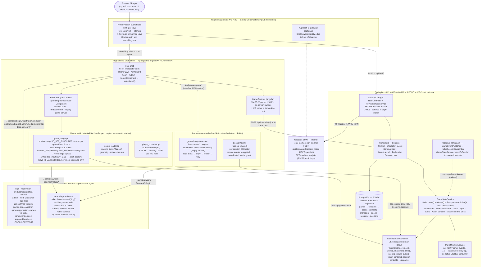

> **Two launch paths.** The Godot family loads through a per-game `remote-game` Web Component into the iframe (server-authoritative). The 14 web-native titles load through a `kind='wasm-game'` manifest row that points the host straight at the `wasm-fragment` bundle (no per-game Angular remote) and run **host-authoritative**: the host browser runs the Rust engine and relays `control`/`world` over the **same per-session SSE channels** through `GameStateService.reemitToSession`, and the guest re-validates. `main.ts` deliberately excludes `wasm-game` rows from `initFederation`. See [`games/_shared/README.md`](games/_shared/README.md) and [decision 016](docs/wiki/decisions/016-rust-extension-and-fragment-relay.md).

### Key architectural decisions

**Per-chapter WASM bundles.**
Each chapter compiles to its own Godot export under `/api/assets/levels/{slug}/` (the filesystem path is kept as is for back-compat). The iframe URL carries `?chapter_id=N`. `index.html` prefetches `/api/chapters/N/scene` at once, so the scene config is ready before the 30 s+ WASM compile finishes. The prefetch checks `if (!r.ok) throw new Error(...)`, so a BFF error goes to `.catch()` with a console warning and does not silently produce an empty scene config. A new chapter needs four things: a new `.tscn`, a new preset in `export_presets.cfg`, a new row in `chapters`, and a Liquibase migration if new data is needed. See [docs/GODOT_DEVELOPER_GUIDE.md](docs/GODOT_DEVELOPER_GUIDE.md).

**All controls authenticate through a session.**
Every `POST /api/controls/{charId}` is JWT-authenticated, and the server rejects it with 403 unless the JWT subject holds the controller role. `HomeComponent.ngOnInit` calls `session.connect()` → `session.claimControl()` on page load, so solo play "just works". If the BFF restarts (clearing the in-memory `activeSessions`/`currentController`), `game_bridge.gd` detects the first 403 and posts `SD_SESSION_EXPIRED` to the host shell, and `ApiBridgeService` re-runs connect + claim. The next keypress works without a page reload. Up to 3 players may be connected at once; only one holds the controller role at a time.

**Spells fire both client-side and server-side.**
The key handler in `game_bridge.gd` calls `player._cast_spell(N)` directly in-WASM, so the visual is instant and does not wait for the SSE round trip. The same keypress also POSTs `/api/controls/1`, so the server can eventually apply MP cost, XP, and cooldown. Angular's hotbar handler also fires a CSS overlay as a cue that is always visible, which helps when debugging iframe focus issues.

**Nine typed SSE channels on one stream.**
`GameStreamController` merges eight `Sinks.Many` from `GameStateService` (movement, world, character, scene, input, audio, wasm-console, session-control), one from `GameTimeService` (time), and a keepalive `Flux.interval(Duration.ZERO, 15s)` into a single `Flux<ServerSentEvent>`. The immediate first-tick keepalive forces the response headers to flush at connect time, so the browser's `EventSource.onopen` fires in milliseconds and does not wait for the first real event. Each payload carries an `event:` field, so clients register per-type listeners.

**SSE sinks must not autoCancel.**
`Sinks.many().multicast().onBackpressureBuffer(N)` defaults to `autoCancel=true`. When every subscriber disconnects (an iframe remount, an EventSource reconnect, a momentary network blip), the sink terminates for good and every later `tryEmitNext` call is silently dropped. Every sink in this project passes `autoCancel=false` explicitly. Before the fix, the symptom was "first keypress works, then all subsequent input dies".

**Two JS-side queues, drained in Rust.**
The Angular wrapper owns the EventSource and posts each typed SSE event into the iframe as `SD_SSE_EVENT`. Rust's `BridgeGlue` puts inbound postMessages on `window._twSseEventQueue` (and API responses on `window._twApiResponseQueue`). Every `_process` frame it splices the queue atomically and dispatches each event through `HostBridge.dispatch_event` into typed signals (`movement_received`, `world_received`, …). `player_controller.gd`'s `_on_movement_json` → `_on_state_updated` consumes them in FIFO order. This replaced storing only the most recent payload, which collapsed rapid keydown+keyup pairs (exactly what spell keys produce) into just the keyup and lost the `pressed=true` event between Godot's 16 ms polls. See [decision 016](docs/wiki/decisions/016-rust-extension-and-fragment-relay.md).

**Casdoor kept internal; JWKS at `/.well-known/jwks`.**
`docker-compose.yml` exposes no host port for Casdoor, so it is not reachable from outside the compose network. Spring Security's JWT decoder uses the anonymous `/.well-known/jwks` endpoint. Do not use `/api/get-jwks`. It requires admin authentication and returns an error payload that makes Spring Security throw `"Missing required keys member"` on every Bearer-tagged request, including `permitAll` routes.

**R2DBC + JDBC coexistence.**
Runtime data access is non-blocking R2DBC. Liquibase needs a blocking JDBC `DataSource`. Spring Boot 4 skips `DataSourceAutoConfiguration` when an R2DBC `ConnectionFactory` bean exists, so `JdbcDataSourceConfig` creates an explicit `@Primary HikariDataSource` for Liquibase only (pool size 3).

**Per-brand domain isolation, mirrored from hugmesh.net.**
The BFF derives tenant identity the way the hugmesh-gateway does: each brand has its own Casdoor instance, which produces a distinct, cryptographically validated `iss` claim. `DomainRegistry` maps that issuer to a brand name. `CasdoorAuthorities` stamps exactly one `DOMAIN_<x>` authority on every token, with a reserved-prefix guard that stops a `permissions:["DOMAIN_other"]` entry from forging a cross-tenant identity. `DomainGuardFilter` is the first consumer of this authority. When `app.tenancy.domain` names the brand this BFF instance serves, it returns 403 (with `X-Domain-Denied`) for any authenticated non-SUPERADMIN token whose `DOMAIN_<x>` does not match. It mirrors the gateway's domain hard-deny as defence in depth, and covers compose-network traffic that reaches the BFF without passing the gateway edge. When `app.tenancy.domain` is unset (the single-Casdoor default), the filter does nothing. An optional `app.tenancy.issuers` CSV turns on a per-brand multi-issuer decoder (`TenancyResourceServerConfig`). See [decision 025](docs/wiki/decisions/025-bff-domain-guard.md).

**Module Federation: host + twelve remotes + a fragment + 18 `wasm-game` rows.**
The Angular shell is a [native-federation](https://www.npmjs.com/package/@angular-architects/native-federation) host. At runtime it loads role-gated sibling bundles, served by per-remote nginx services on the compose network and proxied through the host's nginx at `/_remotes/<slug>/`. The 14 web-native titles add no per-remote container; they ride the shared `wasm-fragment` through `wasm-game` manifest rows (last row below). The four Godot titles registered by changelogs 053, 055, 056 and 062 add four more `wasm-game` rows, 18 in all:

| Slug | Kind | Exposes | Where in the host |
|---|---|---|---|
| `login` | `remote-shell` | `./LoginComponent` | `loadComponent` for `/login` |
| `admin` | `remote-shell` | `./AdminShell` + `./UploadShell` + `./SessionsShell` | `loadComponent` for `/admin`, `/admin/games` and `/admin/sessions` |
| `mod` | `remote-shell` | `./ModShell` | `loadComponent` for `/mod` (per-game moderation surface; gated by `mod_game_scopes`) |
| `publisher` | `remote-shell` | `./PublisherShell` | `loadComponent` for `/publisher` (uploads + per-game grants; gated by `publisher_game_scopes`) |
| `api-docs` | `remote-shell` | `./DocsShell` | `loadComponent` for `/admin/docs` (OpenAPI explorer) |
| `registration` | `remote-shell` | `./RegistrationComponent` | Served at `/_remotes/registration/` (player self-registration; manifest `mountAt` is `/registration`). `app.routes.ts` has no route that loads it. |
| `producer-registration` | `remote-shell` | `./ProducerRegistrationComponent` | Served at `/_remotes/producer-registration/` (intake form → `POST /api/producer-contacts`; manifest `mountAt` is `/producer-registration`). `app.routes.ts` has no route that loads it. |
| `banned` | `remote-shell` | `./BannedComponent` | Served at `/_remotes/banned/` (manifest `mountAt` is `/banned`). The host's own `/banned` route uses its local `BannedPageComponent` (auth-error interceptor redirects on `X-Revoked`; resolves appeal email via `GET /api/security/appeal-contact`). |
| `games-three-wizards` | `remote-game` | `./GameRoot` | `<app-three-wizards-remote>` Web Component (cave + field) |
| `games-dodecahedron` | `remote-game` | `./GameRoot` | `<app-dodecahedron-remote>` Web Component (chrome-less demo) |
| `games-rpg-maker` | `remote-shell` | `./RpgMakerShell` | RPG maker UI; drives the `rpg-builder/` side service (decision 018) |
| `games-vn-maker` | `remote-shell` | `./VnMakerShell` | VN maker UI; drives the `vn-builder/` side service (decision 018) |
| `wasm-fragment` | `fragment` | — (asset tier) | Redirects `?slug=` to `/api/assets/levels/<slug>/index.html` |
| `<game-slug>` (×14 web-native, plus `chess-godot`, `connect-four-godot`, `shadows-of-the-net`, `character-forge`) | `wasm-game` | — (`exposed_module=NULL`) | Web-native titles. `remote_entry_url` points **directly** at `/_remotes/wasm-fragment/<slug>/index.html` (not a `remoteEntry.json`), `game_slug` carries the catalog slug. The host mounts it as a parametrised iframe; `home.component` reads `isWebNative` off the manifest. `main.ts` excludes `wasm-game` from `initFederation`. The 14 web-native rows are seeded by [`051-web-game-federation.xml`](backend/src/main/resources/db/changelog/051-web-game-federation.xml); the Godot rows by 053, 055, 056 and 062. |

The **`wasm-game`** federation kind was added for the 14 web-native titles. It was later reused as is for the *Chess (Godot)* pilot title (migration 053), then for *Connect Four (Godot)* (055), *Shadows of the Net – CHAT* (056) and *Character Forge* (062). That shows the kind works for a Godot-authored bundle too, not just the Rust→wasm32 engines. A `wasm-game` row carries no Angular module (`exposed_module=NULL`), and its `remote_entry_url` resolves directly to the `wasm-fragment` bundle. So a new web-native (or Godot) game can be federated by inserting one database row, with no frontend rebuild. `main.ts` passes only `kind ∈ {remote-game, remote-shell}` into `initFederation`, so `wasm-game` rows are read only by the host's manifest reader and cannot affect the federation runtime. See the "Web-native games" section of [CLAUDE.md](CLAUDE.md).

`HomeComponent` forks the renderer on `SCENE_TYPE_TO_GAME_SLUG` for the Godot family (cave/field → `three-wizards`, dodecahedron → `dodecahedron`) and on the manifest's `isWebNative` flag for the web-native family. Chapters with sceneTypes outside that map and no `wasm-game` row fall through to the legacy in-tree `<app-game-canvas>` iframe. SessionService.connect and the `TW_CHAPTER_TRANSITION` window listener live on `HomeComponent`, so they fire whichever renderer mounts.

The host's `main.ts` calls `initFederation(...)` BEFORE `bootstrapApplication` (split into `bootstrap.ts`, because `@angular/*` imports cannot resolve before the import map exists). Federated route components reach the federation runtime through `globalThis.__HUGMESH_LOAD_REMOTE_MODULE__`, which `main.ts` stashes after `initFederation` resolves. That keeps the federation package out of karma's static graph and out of route-handler bundles. The federation manifest is fetched from `GET /api/federation/manifest` (DB-backed, see migration `018-federation-modules.xml`), so a new remote can come online without redeploying the host.

---

## Data model

### SSE event types — `GET /api/game/stream`

| Event name | Payload fields | Emitted when | Delivery |
|---|---|---|---|
| `movement` | `x`, `y`, `z`, `rotationY`, `action`, `pressed`, `tick` | Every control event (press AND release, see `pressedChanged` gate) | Queued FIFO in-bridge |
| `world` | `sessionId`, `tick`, `timestamp`, `characters[]` | When any character's state changes | Latest-wins snapshot |
| `character` | `health`, `mana`, `level`, `xp`, `xpToNext` | Stat patch or item use | Latest-wins snapshot |
| `time` | `dayNumber`, `hour`, `minute` | Every 5 game-minutes (~5 s real; one game-minute is one real second) | Latest-wins snapshot |
| `scene` | `sceneId`, `sceneName`, `sceneType`, `eventType` | Scene transition / scene_element NOTIFY | Latest-wins snapshot |
| `input` | `eventKind`, `eventType`, `payload` | Generalised input emit (gamepad / mouse / keyboard / touch / world / control) | Latest-wins snapshot |
| `audio` | `eventKind`, `eventType`, `payload` | Audio cue from Godot bundle | Latest-wins snapshot |
| `wasm-console` | `line`, `level`, `timestamp` | WASM iframe console capture (admin-only + debug flag) | Latest-wins snapshot |
| `session-control` | `sessionId`, `eventType` | Session pause / resume / close lifecycle | Latest-wins snapshot |
| `:keepalive` (SSE comment) | — | `t=0` on connect, then every 15 s | Flushes response headers so `onopen` fires immediately |

### HUD layout

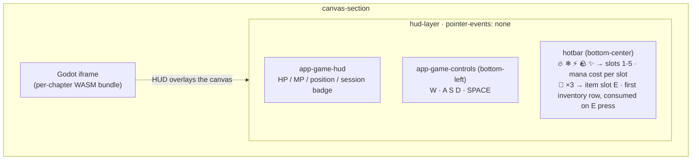

### Input flow — keypress to visible effect

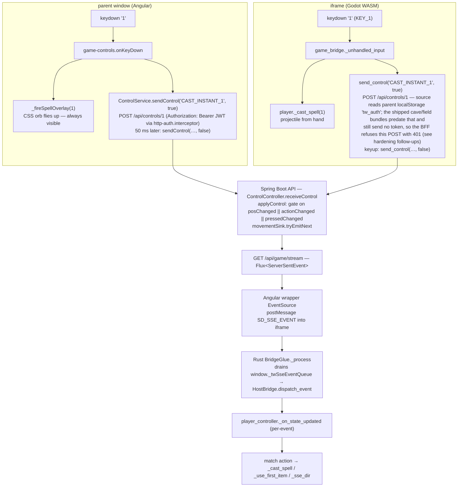

Spells are cast by two redundant paths. The direct in-WASM call fires the visual at once. The round trip through the API exists so the server can eventually subtract MP, grant XP, resolve collisions with enemies, and so on.

### `ControlEvent` — `POST /api/controls/{characterId}` body

| Field | Type | Values |
|---|---|---|
| `action` | `String` | `MOVE_FORWARD`, `MOVE_BACKWARD`, `MOVE_LEFT`, `MOVE_RIGHT`, `JUMP`, `INTERACT`, `CAST_INSTANT_1/2/3/4/5` |
| `pressed` | `boolean` | `true` = key down, `false` = key up |
| `timestamp` | `long` | Client epoch-ms |
| `chapterId` | `Long` (nullable) | Explicit chapter the move applies to; falls back to the character's `current_chapter_id` when omitted |

### `SceneDto` — `GET /api/chapters/{id}/scene` response

| Field | Type | Description |
|---|---|---|
| `id` | `Long` | Chapter ID |
| `name` | `String` | Display name |
| `slug` | `String` | URL slug (matches classpath directory) |
| `sceneType` | `String` | `cave`, `field`, … |
| `assetUrl` | `String` | Path to this chapter's Godot WASM bundle entry-point |
| `elements` | `List<SceneElementDto>` | Scene elements with positions, rotations, properties |

### Chapter transitions — `TW_CHAPTER_TRANSITION` postMessage

When a running Godot WASM must hand off to another chapter's bundle:

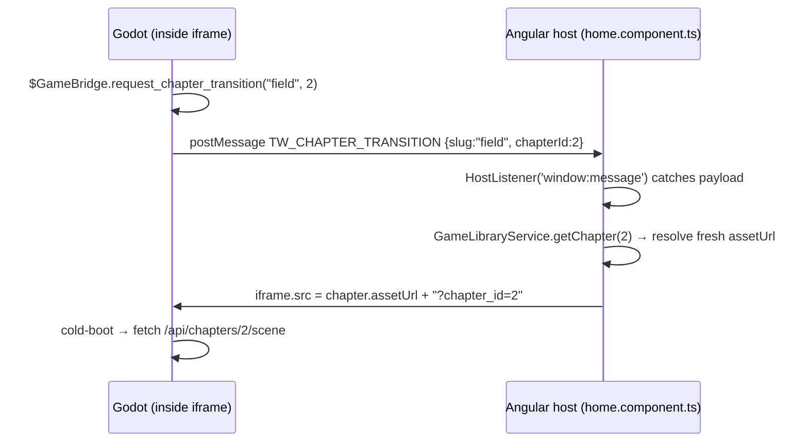

The previous WASM is fully unloaded. Persist any in-memory state through the API
(`PUT /api/characters/{id}` and so on) *before* you call `request_chapter_transition`.

---

## API reference

> The canonical list of every controller is in [architecture · 05 — API + service reference](docs/wiki/architecture/05-api-reference.md) (38 of the 39 controllers) and the live OpenAPI explorer at `/v3/api-docs`. The selection below is a representative set of reactive-pipeline walk-throughs, not the full surface. In particular, the **server-authoritative realtime PvP** controllers (`RealtimeController` at `/api/realtime`, `AdminRealtimeController` at `/api/admin/realtime`) back the 🚧 in-flight FPS/RTS match engines (see [Roadmap](#roadmap)) and are documented in the wiki, not here.

The reactive endpoints below are drawn as **pipeline flowcharts**. A request flows
left to right through the Reactor operators to a terminal emission:

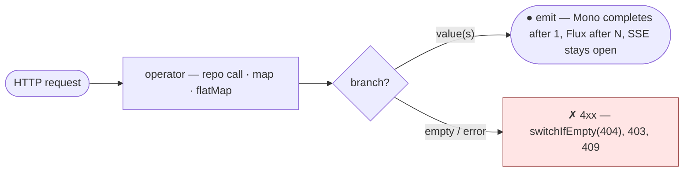

- `([ … ])` rounded ends — the incoming request and the terminal emission(s).
- plain boxes — Reactor operators (`findById`, `map`, `flatMap`, `save`, …).
- `{ … }` diamond — a branch (found vs empty, controller vs not).
- red `✗` node — an error / 4xx terminal (`switchIfEmpty`, `403`, `404`, `409`).
- A `Mono` completes after one value, a `Flux` after N; an SSE stream stays open until the client disconnects.

---

### `CasdoorAuthController` — `/api/auth`  *(public)*

> The Java class is `CasdoorAuthController` (mapped at `/api/auth`).

#### `POST /api/auth/token`

Exchanges username and password for a Casdoor OAuth2 access token through the Resource Owner Password Credentials grant. The `client_secret` is injected server-side; the browser never sees it.

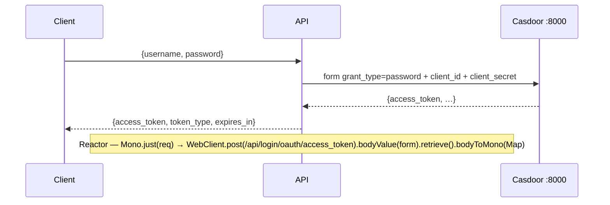

---

### `GameStreamController` — `/api/game`  *(public)*

#### `GET /api/game/stream`

A multiplexed SSE stream. Nine typed channels plus a keepalive are merged into one connection. Each event carries an `event:` type field, so clients can register per-type listeners.

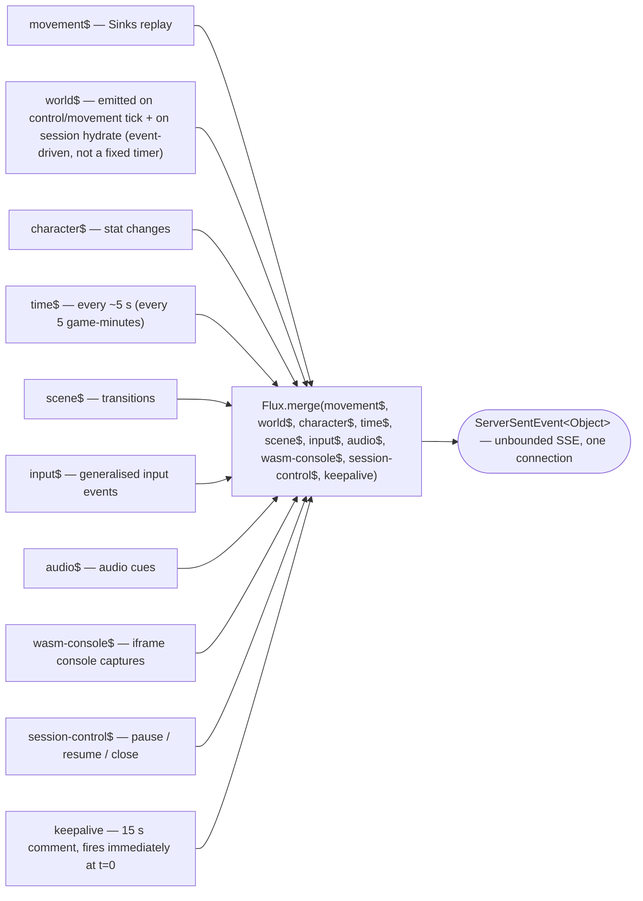

#### `GET /api/game/state`

A snapshot of the current game state, with no subscription to the stream.

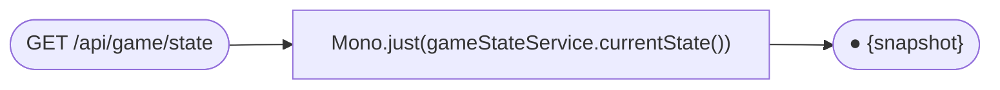

---

### `GameController` — `/api/games`  *(public)*

The umbrella tier. Each game groups one or more chapters.

#### `GET /api/games` · `GET /api/games/{id}`

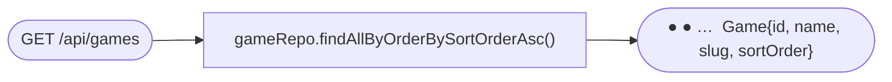

#### `GET /api/games/{id}/chapters` · `GET /api/games/{id}/levels` (legacy alias)

Returns every Chapter inside the umbrella game, ordered by sort_order. The
Java controller method is `listChapters(...)`. `/levels` is kept as a
back-compat alias (the same dual mapping `ChapterController` uses) for
any already-exported WASM bundle that still calls the pre-PR-#20 path.

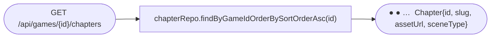

#### `GET /api/games/available/{characterId}`

A nested structure: every umbrella game with its chapters, each chapter annotated
with `unlocked` / quest progress for the caller's character. It drives the home
page's games-with-chapters drilldown.

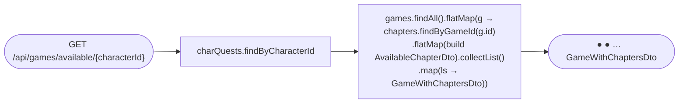

### `ChapterController` — `/api/chapters`  *(public)*

One chapter = one compiled Godot WASM bundle.

#### `GET /api/chapters` · `GET /api/chapters/{id}`

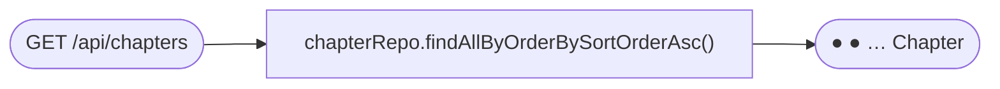

#### `GET /api/chapters/{id}/scene`

The descriptor consumed by `scene_loader.gd` at bundle startup.

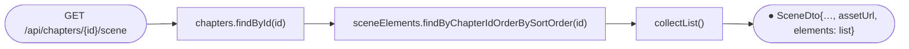

### `ChapterAssetController` — `/api/chapters/{chapterId}/assets`  *(public)*

A registry for user-added textures, plugins and sounds attached to a chapter. GDScript
uses labels to look assets up without hardcoding filenames.

#### `GET /api/chapters/{chapterId}/assets`

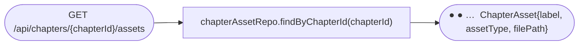

#### `GET /api/chapters/{chapterId}/assets/by-label/{label}`

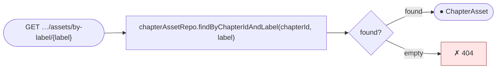

#### `POST /api/chapters/{chapterId}/assets`

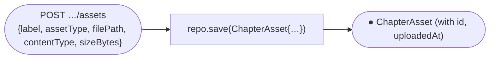

#### `DELETE /api/chapters/{chapterId}/assets/{assetId}`

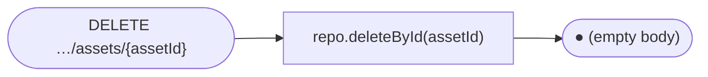

---

### `AssetController` — `/api/assets`  *(public)*

#### `GET /api/assets/levels/{slug}/{filename}`

The legacy path for per-level WASM bundles, with no launch uid required. Each level's compiled files live under
`classpath:assets/levels/{slug}/`. The Angular iframe mounts `index.html` from here
and Godot fetches its `.wasm`/`.pck` from the same directory. Setting `app.assets.require-launch-uid=true` makes this path return 403
and forces callers onto the uid-gated `GET /api/assets/levels/{slug}/{uid}/{filename}`.

#### `GET /api/assets/{filename}`

Root-level static assets, fetched directly from the classpath. Kept for
backward compatibility with content that has not moved into the `levels/` hierarchy.

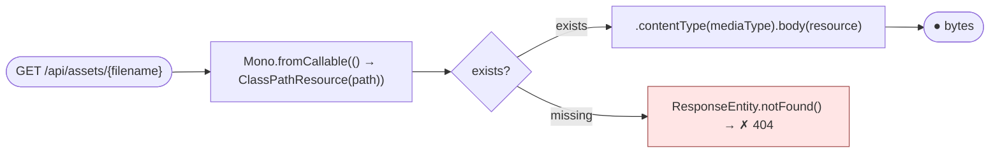

Supported extensions and their content types:

| ext | type |
|---|---|
| `html` | `text/html` |
| `js` | `application/javascript` |
| `wasm` | `application/wasm` |
| `pck` | `application/octet-stream` |
| `png`/`jpg` | `image/png` · `image/jpeg` |
| `glb`/`gltf` | `model/gltf-binary` · `model/gltf+json` |

---

### `ControlController` — `/api/controls`  *(authenticated — validated by session)*

#### `POST /api/controls/{characterId}`

Accepts control events. `SecurityConfig.PLAYER_PATHS` requires an authenticated principal on `/api/controls/**`. A caller with no JWT and no legacy `X-Casdoor-Id` header gets `401` before either authorization mode below runs. (This was a deliberate hardening fix: the endpoint used to fall through to `anyExchange().permitAll()`.) Two authorization modes then apply, depending on whether `X-Session-Id` is present. Multiplayer mode checks `gameSessionService.authorizeControl` (session_members ownership, `403` on mismatch). Legacy single-session mode checks `sessionService.isController(casdoorId)` (`403` if not the controller). The legacy `X-Casdoor-Id` header is still a live fallback for the caller identity when no JWT is present. See the API reference for the identity-resolution detail.

```mermaid
flowchart LR
    R(["POST /api/controls/{characterId}"]) --> H{"X-Session-Id present?"}
    H -->|yes| Chk["gameSessionService.authorizeControl(casdoorId, characterId, sessionId)"] --> D{"authorized?"}
    D -->|yes| AC["gameStateService.applyControl(event, characterId, sessionId)"] --> O(["● 204 No Content"])
    D -->|no| F["✗ 403 Forbidden"]:::err
    H -->|no| Chk2["sessionService.isController(casdoorId)"] --> D2{"is controller?"}
    D2 -->|yes| AC
    D2 -->|no| F2["✗ 403 Forbidden"]:::err
    classDef err fill:#ffe5e5,stroke:#a14a4a;
```

---

### `SessionController` — `/api/sessions`  *(authenticated)*

#### `POST /api/sessions/connect`

Creates or resumes a player session, enforcing the player cap (`app.session.max-players`, default 3).

```mermaid
flowchart LR
    R(["POST /api/sessions/connect"]) --> C["activeSessions.size() >= MAX_SESSIONS (in-memory ConcurrentHashMap, cap=3)"] --> D{"under 3-player cap?"}
    D -->|"yes — count under 3"| OK["createOrResumeSession()<br/>first joiner auto-claims controller"] --> O(["● {sessionToken, isController, activePlayers}"])
    D -->|"no — count = 3"| F["✗ 409 Conflict"]:::err
    classDef err fill:#ffe5e5,stroke:#a14a4a;
```

#### `POST /api/sessions/control`

Tries to claim the exclusive controller role.

```mermaid
flowchart LR
    R(["POST /api/sessions/control"]) --> C["currentController.compareAndSet(null, casdoorId) (AtomicReference)"] --> D{"count = 0?"}
    D -->|"count = 0"| OK["setController(true)"] --> O1(["● {claimed: true}"])
    D -->|"count over 0"| O2(["● {claimed: false}"])
```

#### `DELETE /api/sessions/me`

```mermaid
flowchart LR
    R(["DELETE /api/sessions/me"]) --> S["sessionRepo.deleteByCasdoorId(casdoorId)"] --> O(["● (no body)"])
```

---

### `CharacterController` — `/api/characters`  *(authenticated)*

#### `GET /api/characters`

```mermaid
flowchart LR
    R(["GET /api/characters"]) --> Adm{"admin?"}
    Adm -->|yes| Q["characterRepo.findAll()"] --> Mp["map(toDto)"] --> O(["● ● ● …  CharacterDto"])
    Adm -->|no| Q2["characterRepo.findByCasdoorId(jwt.sub)"] --> Mp
```

#### `GET /api/characters/{id}`

```mermaid
flowchart LR
    R(["GET /api/characters/{id}"]) --> F["characterRepo.findById(id)"] --> D{"found?"}
    D -->|found| OK["map(toDto)"] --> O(["● CharacterDto"])
    D -->|empty| NF["switchIfEmpty(404) → ✗"]:::err
    classDef err fill:#ffe5e5,stroke:#a14a4a;
```

#### `PUT /api/characters/{id}`

Patches HP, MP, level, XP, ability stats, and current scene, then notifies the SSE character channel.

```mermaid
flowchart LR
    R(["PUT /api/characters/{id}"]) --> F["characterRepo.findById(id)"] --> P["map(applyPatch)"] --> S["characterRepo.save()"] --> N["gameStateService.notifyCharacterChange()"] --> O(["● CharacterDto (updated)"])
```

#### `PUT /api/characters/{id}/quests/{questId}/complete`

Marks the quest complete. If the quest has a `reward_skill_id`, the character is granted that skill (idempotent).

```mermaid
flowchart TB
    R(["PUT /api/characters/{id}/quests/{questId}/complete"]) --> F["charQuests.findByCharacterIdAndQuestId(id, qid)"] --> D{"found?"}
    D -->|empty| NF["switchIfEmpty(404) → ✗"]:::err
    D -->|found| S["status='completed' · completedAt=NOW()<br/>charQuests.save()"]
    S --> Q["questRepo.findById(qid)"] --> RW{"reward_skill_id present?"}
    RW -->|no| O(["● CharacterQuest (updated)"])
    RW -->|yes| H["charSkills.findByCharacterId<br/>.filter(skillId == reward).hasElements()"] --> HD{"already has?"}
    HD -->|"already has"| O
    HD -->|new| GR["charSkills.save({charId, rewardSkillId})"] --> O
    classDef err fill:#ffe5e5,stroke:#a14a4a;
```

#### `POST /api/characters/{id}/use-first-item`

Consumes the lowest-id inventory item (typically a potion), applies its JSON effect, decrements the quantity, and broadcasts the updated character over SSE, so the HUD HP/MP bars update at once.

```mermaid
flowchart TB
    R(["POST /api/characters/{id}/use-first-item"]) --> F["charItems.findByCharacterId(id)<br/>.filter(qty &gt; 0).sort(by id).next()"] --> D{"found?"}
    D -->|empty| NF["✗ 404 — no usable item"]:::err
    D -->|found| I["itemRepo.findById"]
    I --> P["parse effect_json:<br/>heal:N → currentHp += N (cap maxHp)<br/>mana:N → currentMp += N (cap maxMp)"]
    P --> S1["charItems.save(qty-1)"] --> S2["characters.save(updated)"] --> N["gameStateService.notifyCharacterStatChange"] --> O(["● CharacterDto (updated)"])
    classDef err fill:#ffe5e5,stroke:#a14a4a;
```

#### `GET /api/characters/{id}/dashboard`

A passive snapshot for the player dashboard (character stats, time, games with levels, quests, session playtime), with no need to load the game canvas.

```mermaid
flowchart LR
    R(["GET /api/characters/{id}/dashboard"]) --> Z["zip(<br/>characterRepo.findById(id).map(toDto),<br/>progression.availableGamesWithLevels(id).collectList(),<br/>charQuests.findByCharacterId(id).flatMap(cq → questRepo.findById → toDto).collectList(),<br/>sessions.findHistoryByCasdoorId(char.casdoorId).collectList())"]
    Z --> Mp["map"] --> O(["● DashboardDto{character, gameTime, games,<br/>quests, totalPlayMinutes, totalSessions}"])
```

---

### `SkillController` — `/api/skills`  *(authenticated)*

#### `GET /api/skills`

```mermaid
flowchart LR
    R(["GET /api/skills"]) --> Q["skillRepo.findAll()"] --> Mp["map(toDto)"] --> O(["● ● ● …  SkillDto"])
```

#### `GET /api/skills/character/{characterId}`

```mermaid
flowchart LR
    R(["GET /api/skills/character/{characterId}"]) --> Q["characterSkillRepo.findByCharacterId(id)"] --> FM["flatMap(cs → skillRepo.findById(cs.skillId))"] --> Mp["map(toDto)"] --> O(["● ● …  SkillDto (learned only)"])
```

#### `GET /api/skills/character/{characterId}/slots`

```mermaid
flowchart LR
    R(["GET /api/skills/character/{characterId}/slots"]) --> Q["slotRepo.findByCharacterIdOrderBySlotNumber(id)"] --> Mp["map(slot → {slotNumber, skill or null})"] --> O(["● ● …  {slot:1, skill:{…}}<br/>{slot:2, skill:null} — empty slot"])
```

#### `PUT /api/skills/character/{characterId}/slots/{slot}`

```mermaid
flowchart LR
    R(["PUT /api/skills/character/{characterId}/slots/{slot}"]) --> F["slotRepo.findByCharacterIdAndSlotNumber(charId, slot)"] --> D{"found?"}
    D -->|found| S["setSkillId(skillId) → slotRepo.save()"] --> O(["● (no body)"])
    D -->|empty| NF["switchIfEmpty(404) → ✗"]:::err
    classDef err fill:#ffe5e5,stroke:#a14a4a;
```

---

### `ItemController` — `/api/items`  *(authenticated)*

#### `GET /api/items/character/{characterId}/inventory`

```mermaid
flowchart LR
    R(["GET /api/items/character/{characterId}/inventory"]) --> Q["charItemRepo.findByCharacterId(id)"] --> FM["flatMap(ci → itemRepo.findById(ci.itemId)<br/>.map(item → ItemDto{…, quantity: ci.quantity}))"] --> O(["● ● …  ItemDto (with quantity)"])
```

#### `GET /api/items/character/{characterId}/equipment`

```mermaid
flowchart LR
    R(["GET /api/items/character/{characterId}/equipment"]) --> Q["charEquipRepo.findByCharacterId(id)"] --> FM["flatMap(ce → itemRepo.findById(ce.itemId))"] --> Mp["map(item → {slot, item or null})"] --> O(["● ● …  {slot:head, item:{…}}<br/>{slot:chest, item:null} — empty"])
```

#### `PUT /api/items/character/{characterId}/equipment/{slot}`

```mermaid
flowchart LR
    R(["PUT /api/items/character/{characterId}/equipment/{slot}"]) --> F["charEquipRepo.findByCharacterIdAndSlot(charId, slot)"] --> D{"found?"}
    D -->|found| S["setItemId(itemId) → charEquipRepo.save()"] --> O(["● (no body)"])
    D -->|empty| NF["switchIfEmpty(404) → ✗"]:::err
    classDef err fill:#ffe5e5,stroke:#a14a4a;
```

---

### `QuestController` — `/api/quests`  *(authenticated)*

#### `GET /api/quests`

```mermaid
flowchart LR
    R(["GET /api/quests"]) --> Q["questRepo.findAll()"] --> Mp["map(toDto)"] --> O(["● ● …  QuestDto"])
```

#### `GET /api/quests/character/{characterId}`

```mermaid
flowchart LR
    R(["GET /api/quests/character/{characterId}"]) --> Q["charQuestRepo.findByCharacterId(id)"] --> FM["flatMap(cq → questRepo.findById(cq.questId)<br/>.map(q → QuestDto{…, status, completedAt}))"] --> O(["● ● …  QuestDto (character-specific status)"])
```

---

### `AdminController` — `/api/admin`  *(ROLE_ADMIN only)*

#### `GET /api/admin/sessions`

```mermaid
flowchart LR
    R(["GET /api/admin/sessions"]) --> Q["sessionService.activeSessions() (in-memory presence map)"] --> O(["● ● …  SessionDto"])
```

#### `DELETE /api/admin/sessions/{casdoorId}`

Force-disconnects a player session, whether or not it holds the controller role.

```mermaid
flowchart LR
    R(["DELETE /api/admin/sessions/{casdoorId}"]) --> S["sessionRepo.deleteByCasdoorId(casdoorId)"] --> O(["● (no body)"])
```

#### `GET /api/admin/characters`

```mermaid
flowchart LR
    R(["GET /api/admin/characters"]) --> Q["characterRepo.findAll()"] --> Mp["map(toDto)"] --> O(["● ● …  CharacterDto"])
```

#### `PUT /api/admin/characters/{id}`

The same patch pipeline as the player `CharacterController`, without the ownership check.

```mermaid
flowchart LR
    R(["PUT /api/admin/characters/{id}"]) --> F["characterRepo.findById(id)"] --> P["map(applyPatch)"] --> S["characterRepo.save()"] --> O(["● CharacterDto (updated)"])
```

---

### `GameTimeController` — `/api/time`  *(public)*

#### `GET /api/time`

Returns the current in-game clock state. The `GameTimeService` scheduler advances 1 game-minute every real second and persists it to `game_time_state` every 10 s.

```mermaid
flowchart TB
    subgraph sched["GameTimeService scheduler — tick every 1 s real, persist every 10 s, SSE emit every 5 s"]
        direction LR
        T["──tick── loop (1 s)"] --> Inc["minute++ · day++ at 23:59"] --> Persist["persist every 10 s + emit time$ SSE event every 5 s"]
    end
    R(["GET /api/time"]) --> Q["timeRepo.findFirst()"] --> Mp["map(toDto)"] --> O(["● {dayNumber, hour, minute}"])
```

---

### `FederationController` — `/api/federation`  *(public)*

#### `GET /api/federation/manifest`

Returns the active rows of `federation_modules` (slug, display name, kind, remote_entry_url, exposed_module, version, metadata), ordered by kind and slug. The Angular host calls this BEFORE `bootstrapApplication` and feeds the result into `initFederation(...)`. It is public on purpose: the host needs the `login` remote URL before any user authenticates.

```mermaid
flowchart LR
    R(["GET /api/federation/manifest"]) --> Q["fedRepo.findAllByEnabledTrueOrderByKindAscSlugAsc()"] --> Mp["map(FederationRemoteDto::from) · collectList"] --> O(["● {generatedAt, remotes: list}"])
```

---

### `GameLaunchController` — `/api/games`  *(authenticated; admin endpoints under /api/admin/launches)*

#### `POST /api/games/{slug}/launch`

Mints a 256-bit URL-safe `launch_uid` for the active session, persists a `game_launches` row with a 15-minute TTL (with a `version_dir` snapshot from `games.current_version_dir`), and returns `{uid, expiresAt, gameSlug}`. The federated remote threads the uid into the iframe URL as `?launch_uid=…` for traceability. `AssetController.getLevelAssetByUid` (`GET /api/assets/levels/{slug}/{uid}/{filename}`) validates it. `GET /api/games/launches` (ROLE_ADMIN) lists the active launches.

#### `DELETE /api/games/launches/{uid}`

Self-terminate. The owner of the launch (matched by JWT subject against `game_launches.casdoor_user_id`) can clear the `terminated_at` column. A different user gets 403.

#### `DELETE /api/admin/launches/{uid}`  *(ROLE_ADMIN)*

The route in the code is `DELETE /api/games/admin/launches/{uid}` (`GameLaunchController`, mapped under `/api/games`). Admin force-terminate. It skips the ownership check and backs the admin UI's "kick" button beside the active-launches list.

---

### `GameUploadController` — `/api/admin/games`  *(ROLE_ADMIN)*

#### `POST /api/admin/games/upload`

A multipart bundle zip goes through the install pipeline: validate manifest_json schema_version=2, the slug regex, and zip-slip-safe paths → SHA-256 the bundle/ tree → atomic move to `<gamesDir>/<slug>/<sha-prefix>` → ONE R2DBC tx that inserts `game_uploads`, runs the bundle's `register.sql` statement by statement, UPDATEs `games.current_version_dir`, and supersedes prior uploads. Returns `{slug, contentHash, versionDir, uploadedAt}`. The `GameUploadPruner` scheduled task, bound by `app.uploads.versions-to-keep` (default 3), trims old versions.

#### `GET /api/admin/games/{slug}/uploads`

Rollback history for a slug, newest first. Each row carries `supersededAt` (NULL = current).

---

### `GameAccessController` — `/api/admin/games`  *(ROLE_ADMIN)*

#### `POST /api/admin/games/{slug}/access`

Body: `{scope:"all"|"role"|"user", value?:"<role-name | casdoor-user-id>"}`. Adds a row to `game_access`. Idempotent: the `uq_game_access_triple` unique constraint absorbs duplicates.

#### `DELETE /api/admin/games/{slug}/access?scope=…&value=…`

Removes the matching `game_access` row.

#### `GET /api/admin/games/{slug}/access`

Lists the active access policies for a slug. Multiple rows are additive (union).

---

### `RoleProxyController` — `/api/admin/roles`  *(ROLE_ADMIN)*

#### `GET /api/admin/roles`

Proxies Casdoor's `/api/get-roles?owner=threewizards`, so the admin UI's "grant role" dropdown loads from the live Casdoor catalog and not from a free-text input. The BFF holds the Casdoor admin client_secret; the browser does not.

---

## Database schema

```mermaid
erDiagram
    games ||--o{ chapters : "game_id"
    chapters ||--o{ scene_elements : "chapter_id"
    chapters ||--o{ chapter_assets : "chapter_id"
    chapters ||--o{ chapter_prerequisites : "chapter_id"
    quests ||--o{ chapter_prerequisites : "required_quest_id"
    chapters ||--o{ player_characters : "current_chapter_id"
    player_characters ||--o{ player_sessions : "character_id"
    player_characters ||--o{ player_positions : "character_id"
    chapters ||--o{ player_positions : "chapter_id"
    player_characters ||--o{ character_skills : "character_id"
    skills ||--o{ character_skills : "skill_id"
    player_characters ||--o{ character_skill_slots : "character_id"
    skills ||--o{ character_skill_slots : "skill_id"
    player_characters ||--o{ character_items : "character_id"
    items ||--o{ character_items : "item_id"
    player_characters ||--o{ character_equipment : "character_id"
    items ||--o{ character_equipment : "item_id"
    player_characters ||--o{ character_quests : "character_id"
    quests ||--o{ character_quests : "quest_id"
    quests ||--o{ quest_objectives : "quest_id"
    skills ||--o{ quests : "reward_skill_id — granted on complete"
    chapters ||--o{ quests : "chapter_id"

    games {
        bigint id PK
        text name
        text slug
        int sort_order
        text thumbnail_url
        timestamp created_at
        text current_version_dir
        text domain
    }
    chapters {
        bigint id PK
        bigint game_id FK
        text slug
        text scene_type
        text asset_url
        jsonb scene_config
        int sort_order
    }
    scene_elements {
        bigint id PK
        bigint chapter_id FK
        text element_type
        float position_x_y_z
        jsonb properties
    }
    chapter_assets {
        bigint id PK
        bigint chapter_id FK
        text label
        text asset_type
        text file_path
        bigint size_bytes
    }
    chapter_prerequisites {
        bigint id PK
        bigint chapter_id FK
        bigint required_quest_id FK
    }
    player_characters {
        bigint id PK
        text casdoor_id
        int level "XP level"
        int current_hp
        int current_mp
        bigint current_chapter_id FK
    }
    player_sessions {
        bigint id PK
        text session_token
        bigint character_id FK
        bool is_controller
        timestamp disconnected_at "null = active"
    }
    player_positions {
        bigint id PK
        bigint character_id FK
        bigint chapter_id FK
        float pos_x_y_z
        timestamp updated_at "drives pg NOTIFY trigger"
    }
    game_time_state {
        bigint id PK
        int day_number
        int hour
        int minute
    }
    skills {
        bigint id PK
        text name
        text skill_type
        int mana_cost
        jsonb effect_json
    }
    character_skills {
        bigint character_id FK
        bigint skill_id FK
        timestamp learned_at
    }
    character_skill_slots {
        bigint character_id FK
        int slot_number
        bigint skill_id FK
    }
    items {
        bigint id PK
        text name
        text item_type
        jsonb effect_json
    }
    character_items {
        bigint character_id FK
        bigint item_id FK
        int quantity
    }
    character_equipment {
        bigint character_id FK
        text slot
        bigint item_id FK
    }
    quests {
        bigint id PK
        text name
        int reward_xp
        int reward_gold
        bigint reward_skill_id FK
        bigint chapter_id FK
    }
    quest_objectives {
        bigint id PK
        bigint quest_id FK
        text description
        int required_count
    }
    character_quests {
        bigint character_id FK
        bigint quest_id FK
        text status
        timestamp completed_at
    }
```

### Spell catalog (migration 014)

Five starter spells are auto-slotted for character 1 at slots 1–5. Completing the five quests grants five advanced spells.

| Slot | Starter spell | Element | MP | Damage | Quest reward → Advanced |
|---|---|---|---|---|---|
| 1 | Fireball | fire | 10 | 25 | Into the Cave → **Inferno Lance** (55 dmg, 22 MP) |
| 2 | Ice Shard | ice | 8 | 20 | The Cottage Secret → **Glacial Storm** (48 dmg, slow, 20 MP) |
| 3 | Thunder Bolt | lightning | 12 | 28 | Voice of the Storm → **Chain Lightning** (62 dmg, chain-3, 25 MP) |
| 4 | Stone Spike | earth | 11 | 24 | Heart of the Mountain → **Earthquake** (58 dmg, 28 MP) |
| 5 | Holy Light | light | 14 | 18 + heal 20 | Dawn at the Cottage → **Solar Flare** (70 dmg + heal 40, 30 MP) |

Projectile size scales with tier through `projectileScale` in `effect_json`: 0.8–1.2 for the starter spells, 1.4–2.0 for the advanced ones.

---

## Godot asset pipeline

Each game lives in its **own** Godot project under `games/<game-slug>/`, and
each chapter in that project compiles to its **own** WASM bundle. Per-game
`export_presets.cfg` holds one preset per chapter. The Makefile walks
`GAME_PROJECTS` and the preset list in each game's `case` arm, runs
`godot --headless --export-release "<preset>"` from each game's directory, and
writes the output under `backend/src/main/resources/assets/levels/<slug>/`.

```mermaid
flowchart TB
    subgraph br["make build-rust"]
        direction TB
        BR0["deps-rust: fails unless cargo and docker are on PATH"]
        BR1a["build-rust-wasm (dockerised emsdk 3.1.74 via tools/build-rust-wasm/Dockerfile)<br/>→ extensions/hugmesh-bridge/bin/hugmesh_bridge.wasm — requires Docker"]
        BR1b["sync-bridge-addon: rsync hugmesh_bridge/hugmesh_export addons into every game project"]
        BR1["cd extensions/hugmesh-bridge · GODOT4_BIN=&lt;godot&gt; cargo build --release --features api-custom<br/>→ target/release/libhugmesh_bridge.so"]
        BR2["cp libhugmesh_bridge.so + hugmesh_bridge.wasm → games/(game)/bin/ — each game"]
        BR0 --> BR1a --> BR1b --> BR1 --> BR2
    end
    subgraph bg["make build-godot — depends on build-rust"]
        direction TB
        BG1["for game in GAME_PROJECTS · for preset in the game's case-arm preset list<br/>cd games/(game) · godot --headless --export-release preset"]
        BG2["→ backend/src/main/resources/assets/levels/(slug)/<br/>index.html · index.wasm · index.pck · index.js · index.side.wasm"]
        BG3["scripts/patch-godot-html.py on (slug)/index.html + index.side.wasm"]
        BG4["✓ all bundles exported"]
        BG1 --> BG2 --> BG3 --> BG4
    end
    subgraph sd["make seed-db"]
        SD1["scripts/seed-games.sql — ON CONFLICT (slug) DO UPDATE<br/>upserts game + chapter rows into the &quot;chapters&quot; table · asset_url = /api/assets/levels/(slug)/index.html"]
    end
    br --> bg --> sd --> Deploy["make deploy = build-godot + seed-db<br/>then rebuild api + wasm-fragment images so new classpath assets ship"]
```

The federated path serves the same exports through `wasm-fragment/` (an
nginx that bakes `assets/levels/` and emits the COOP/COEP/CORP headers WASM
games need) at `/_remotes/wasm-fragment/<slug>/index.html`. The Angular host's
`HomeComponent` chooses between the legacy classpath URL and the federated
one through `SCENE_TYPE_TO_GAME_SLUG`.

Adding a chapter touches four places: the game's `export_presets.cfg`,
the Makefile's `case` arms in `build-godot` and `patch-godot`, the `chapters` DB row, and (optionally)
`chapter_prerequisites`. Adding a brand-new game touches a fifth, a row in
`federation_modules`. Or let the editor's *HugMesh Export*
plugin produce an upload zip, and let `GameUploadController` register
everything atomically. For the full walk-through with naming rules and common
mistakes, see the [Godot developer guide](docs/GODOT_DEVELOPER_GUIDE.md).

### User-added assets (textures, plugins, sounds)

Drop a file into `backend/src/main/resources/assets/levels/<slug>/`, then register
it so GDScript can resolve it by label:

```
curl -X POST http://localhost:8080/api/chapters/<id>/assets \
  -H 'Content-Type: application/json' \
  -d '{"label":"oak-bark","assetType":"texture",
       "filePath":"/api/assets/levels/field/oak.png",
       "contentType":"image/png"}'
```

(The on-disk path keeps `/levels/` as a rename holdout. Only the API path changed to `/chapters/`.)

From GDScript (editor or web, through the `ApiClient` helper):

```gdscript
var api := ApiClient.new(); add_child(api)
api.resolve_asset(chapter_id, "oak-bark", func(url):
    # … HTTPRequest the url and apply as albedo_texture …
)
```

A chapter transition from inside the game is one call:

```gdscript
$GameBridge.request_chapter_transition("field", 2)
```

See the [Godot developer guide](docs/GODOT_DEVELOPER_GUIDE.md#mid-game-chapter-transitions) for the full flow.

---

## Prerequisites

| Tool | Version | Purpose |
|---|---|---|
| Rust + Cargo | stable (1.78+) | GDExtension + optional WASM |
| Godot 4 | 4.6 | Game engine / WebGL export |
| Java (JDK) | 25 | Spring Boot API |
| Node.js | 22 LTS | Angular frontend |
| npm | 10+ | JS package manager |
| Angular CLI | 22 | Frontend build tool |
| Make | any | Build orchestration |
| Docker + Compose | 24+ / v2 | Full stack (Postgres, Casdoor, API, nginx) |
| Emscripten | 3.1+ | *(optional)* Rust → WASM |

---

## Installation — Linux

### 1. Rust + Cargo

```bash
curl --proto '=https' --tlsv1.2 -sSf https://sh.rustup.rs | sh
source "$HOME/.cargo/env"
cargo --version
```

Optional WASM target:
```bash
rustup target add wasm32-unknown-emscripten
```

### 2. Godot 4.6

Download the **Linux (64-bit)** build from [godotengine.org/download](https://godotengine.org/download/linux/).

```bash
unzip Godot_v4.6-stable_linux.x86_64.zip -d ~/tools/godot
sudo ln -s ~/tools/godot/Godot_v4.6-stable_linux.x86_64 /usr/local/bin/godot
godot --version
```

**Export templates** are required for `make build-godot`:

1. Open Godot → Editor → Manage Export Templates
2. Download the templates for **4.6 stable**
3. Or place them by hand at `~/.local/share/godot/export_templates/4.6.stable/`

### 3. Java 25

```bash
# Debian/Ubuntu
sudo apt update && sudo apt install -y openjdk-25-jdk

# Fedora/RHEL
sudo dnf install java-25-openjdk-devel

# Arch
sudo pacman -S jdk25-openjdk

# SDKMAN (distro-agnostic)
curl -s "https://get.sdkman.io" | bash
source "$HOME/.sdkman/bin/sdkman-init.sh"
sdk install java 25-tem
```

### 4. Node.js 22 + npm

```bash
curl -o- https://raw.githubusercontent.com/nvm-sh/nvm/v0.39.7/install.sh | bash
source ~/.bashrc
nvm install 22 && nvm use 22
node --version && npm --version
```

### 5. Angular CLI

```bash
npm install -g @angular/cli@22
ng version
```

### 6. Make

```bash
# Debian/Ubuntu
sudo apt install -y make
# Fedora
sudo dnf install make
# Arch
sudo pacman -S make
```

### 7. Docker + Compose

```bash
# Debian/Ubuntu (official repo)
sudo apt install -y docker.io docker-compose-plugin
sudo usermod -aG docker $USER   # re-login after this
docker compose version
```

### 8. Rust → WASM build (optional, but required for `wasm32-unknown-emscripten`)

The Rust GDExtension (`extensions/hugmesh-bridge/`) compiles to a native
`.so` for the editor and to `wasm32-unknown-emscripten` for the web build.
The native path needs no extra tooling. The WASM path runs inside a pinned
Docker image (`tools/build-rust-wasm/Dockerfile`, `EMSDK_VERSION=3.1.74`).
Install Docker (step 7) and run:

```bash
make build-rust-wasm
```

You need no host emscripten install. The Makefile builds and caches the
`hugmesh-rust-wasm` image on first run (~5 min, once), then runs
`cargo build --release --target wasm32-unknown-emscripten` inside the
container.

**Legacy/manual fallback (no Docker).** This may drift from the pinned emsdk
version (3.1.74) the Docker image uses:

```bash
# 1. emscripten via emsdk
git clone https://github.com/emscripten-core/emsdk.git ~/Tools/emsdk
cd ~/Tools/emsdk && ./emsdk install latest && ./emsdk activate latest
source ./emsdk_env.sh

# 2. wasm32-unknown-emscripten target. If your distro Rust ships it, skip
#    rustup. Otherwise install rustup parallel to system Rust (no sudo,
#    no PATH writes — call ~/.cargo/bin/cargo directly when needed):
rustup-init -y --no-modify-path --default-toolchain stable --profile minimal
~/.cargo/bin/rustup target add wasm32-unknown-emscripten

# 3. Build manually (bypasses the Makefile's dockerised build-rust-wasm target):
source ~/Tools/emsdk/emsdk_env.sh
PATH=$HOME/.cargo/bin:$PATH cargo build --release \
  --target wasm32-unknown-emscripten \
  --manifest-path extensions/hugmesh-bridge/Cargo.toml
# → extensions/hugmesh-bridge/target/wasm32-unknown-emscripten/release/hugmesh_bridge.wasm
```

godot-rust gates the WASM target behind an `experimental-wasm` Cargo
feature. `extensions/hugmesh-bridge/Cargo.toml` enables it by default
through the local `wasm-opt-in` feature, so a plain `cargo build` works on
both target triples without extra flags.

Add `source ~/Tools/emsdk/emsdk_env.sh` to your shell profile to persist it (manual fallback only).

---

## Installation — Windows

### 1. Rust + Cargo

```powershell
winget install Rustlang.Rustup
# Restart terminal
cargo --version
```

### 2. Godot 4.6

Download the **Windows (64-bit)** zip from [godotengine.org/download](https://godotengine.org/download/windows/).

1. Extract to `C:\tools\godot\`
2. Rename `Godot_v4.6-stable_win64.exe` → `godot.exe`
3. Add `C:\tools\godot` to your `PATH`
4. Open Godot → Editor → Manage Export Templates → Download for **4.6 stable**

### 3. Java 25

```powershell
winget install Microsoft.OpenJDK.25
java -version
```

### 4. Node.js 22 + npm

```powershell
winget install OpenJS.NodeJS.LTS
node --version && npm --version
```

### 5. Angular CLI

```powershell
npm install -g @angular/cli@22
```

### 6. Make

```powershell
# Via Chocolatey (run as Administrator):
choco install make

# Or use Git for Windows — make.exe is at C:\Program Files\Git\usr\bin\
```

### 7. Docker Desktop

Download it from [docs.docker.com/desktop/install/windows-install](https://docs.docker.com/desktop/install/windows-install/). Enable the WSL 2 backend.

---

## Running with Docker Compose (recommended)

```bash
# First run: Casdoor generates random credentials and prints them to its logs
docker compose up -d

# Check Casdoor seed credentials (client-id, client-secret, admin/player passwords)
docker compose logs casdoor | grep -A 6 "Casdoor seed"

# Open the app — the frontend nginx serves the SPA on :8080, not :4200
# (only `make dev-frontend`'s standalone Angular dev server uses :4200)
open http://localhost:8080
```

The `api` container starts only after `postgres`, `casdoor`, and `cassandra` report healthy and the one-shot `cassandra-init` keyspace-bootstrap job completes. Liquibase runs the schema migrations automatically on first boot.

```mermaid
flowchart TB
    PG["postgres\n(healthcheck: pg_isready)"]
    CAS["casdoor\n(healthcheck: /api/health)"]
    CASS["cassandra\n(healthcheck: service_healthy)"]
    CASSINIT["cassandra-init\n(one-shot keyspace bootstrap, service_completed_successfully)"]
    API["api (BFF)\nwaits for postgres + casdoor + cassandra + cassandra-init\nruns Liquibase migrations"]
    FE["frontend (Angular host nginx)\nwaits for api"]
    REMOTES["federated remotes\n(login, admin, mod, publisher, …)"]
    WASM["wasm-fragment nginx\n(static bundle serving)"]

    PG --> API
    CAS --> API
    CASS --> API
    CASSINIT --> API
    API --> FE
    REMOTES -.->|"proxied at /_remotes/<slug>/ by frontend nginx"| FE
    WASM -.->|"proxied at /_remotes/wasm-fragment/ by frontend nginx"| FE
```

To override credentials:
```bash
CASDOOR_CLIENT_SECRET=mysecret CASDOOR_ADMIN_PASS=mypass docker compose up -d
```

### Staging and production overlays

The portal is deployed at:

- Production:  `hugmesh.games` (apex host) and `<service-or-game>.hugmesh.games` per-service / per-game subdomains.
- Staging:     `staging.hugmesh.games` and `<service-or-game>.staging.hugmesh.games`.

Two compose overlays sit on top of the dev `docker-compose.yml` for these targets:

```bash
# Staging — pin a build tag, narrow CORS to *.staging.hugmesh.games:
HUGMESH_TAG=2026-04-26.42 \
  docker compose -f docker-compose.yml -f compose.staging.yml up -d

# Production — same pattern, narrower allowlist + separate volumes:
HUGMESH_TAG=2026-04-26.42 \
  docker compose -f docker-compose.yml -f compose.prod.yml up -d
```

Each app service is tagged `hugmesh-games/<svc>:${HUGMESH_TAG:-dev}` in the dev compose, so the same images can be pushed to a registry unchanged. The staging and prod overlays require `HUGMESH_TAG` to be set explicitly (no `:dev` fallback). The image-name map:

| Compose service | Image |
|---|---|
| `api`                  | `hugmesh-games/bff` |
| `frontend`             | `hugmesh-games/portal-host` |
| `login`                | `hugmesh-games/login-remote` |
| `admin`                | `hugmesh-games/admin-remote` |
| `api-docs`             | `hugmesh-games/api-docs-remote` |
| `registration`         | `hugmesh-games/registration-remote` |
| `producer-registration` | `hugmesh-games/producer-registration-remote` |
| `banned`               | `hugmesh-games/banned-remote` |
| `mod`                  | `hugmesh-games/mod-remote` |
| `publisher`            | `hugmesh-games/publisher-remote` |
| `games-three-wizards`  | `hugmesh-games/three-wizards-remote` |
| `games-dodecahedron`   | `hugmesh-games/dodecahedron-remote` |
| `games-rpg-maker`      | `hugmesh-games/rpg-maker-remote` |
| `games-vn-maker`       | `hugmesh-games/vn-maker-remote` |
| `rpg-builder`          | `hugmesh-games/rpg-builder` |
| `vn-builder`           | `hugmesh-games/vn-builder` |
| `wasm-fragment`        | `hugmesh-games/wasm-fragment` |

**CORS posture across environments.** `WebConfig.java` ships a development-friendly default allowlist that covers localhost, e2e origins, and `*.hugmesh.games`. The staging and prod overlays narrow it with `SPRING_WEB_CORS_ALLOWED_ORIGINS`, so a production BFF accepts only requests whose `Origin` header is `hugmesh.games` or `*.hugmesh.games`. The two values are merged, so a developer who points a local browser at a staging BFF for debugging is unaffected.

**Casdoor public URL.** Both overlays set `CASDOOR_PUBLIC_BASE_URL` to the matching environment's Casdoor host (`login.staging.hugmesh.games` / `login.hugmesh.games`), so OAuth2 redirect URIs match the public DNS.

**Large-file upload + storage.** Game bundle zips can reach gigabytes. These Spring and compose environment variables control it (defaults in parentheses):

| Var | Default | Purpose |
|---|---|---|
| `APP_MAX_IN_MEMORY` | `1MB` (dev), `2MB` (prod) | Heap-buffered prefix of each multipart part. |
| `APP_MAX_PART_SIZE` | `1024MB` (dev), `2048MB` (staging), `4096MB` (prod) | Per-part on-disk cap; spilling above this aborts the request. |
| `APP_MAX_PARTS` | `32` | Max parts per request. |
| `APP_CODEC_MAX` | `16MB` | WebFlux codec in-memory ceiling for non-multipart bodies. |
| `APP_UPLOADS_GAMES_DIR` | `/var/hugmesh/games` | In-container path the BFF writes installed bundles into. |
| `APP_GAMES_UPLOAD_HOST_DIR` | (named volume in dev; required in prod) | **Host** path the in-container `/var/hugmesh/games` is bind-mounted from. Set to a fast SSD / NFS / managed volume in staging+prod. |

Production refuses to start without `APP_GAMES_UPLOAD_HOST_DIR` set. `compose.prod.yml` declares it required, so a misconfigured deploy fails at once and does not silently write game bundles into ephemeral container storage.

### Gamepad / generalised input / WASM error capture

Liquibase changeset 026 added a generalised input surface that covers everything Godot can consume: gamepad button and axis, mouse motion, button and wheel, keyboard up and down, touch gestures, audio cues, world events, and the legacy JRPG control commands as one kind among many. Three reference tables anchor it:

- `input_event_kinds` — closed vocabulary (`gamepad`, `mouse`, `keyboard`, `touch`, `audio`, `world`, `control`).
- `input_event_types` — **composite** primary key on `(kind, type)`. The per-kind type vocabulary, with example payloads.
- `game_event_support` — per-game opt-in. **Composite** key `(game_slug, event_kind, event_type)`. The HugMesh Export plugin writes this table on upload.

A `games.features` JSONB column adds per-game feature flags. They let you switch off JRPG-only subsystems (spell loadout, quests, items, character progression) and individual input kinds for non-JRPG games.

`InputEventController` validates against these tables in gates. Gate 0 checks session membership and character ownership (and that a session-scoped `world` event comes from the session creator). Gate 1 requires the `(kind, type)` pair to exist in `input_event_types` (400 if not). Gate 2 requires the game's `games.features` to switch the event's kind on (405 if not). The third check, which rejects a `(game_slug, event_kind, event_type)` triple missing from `game_event_support`, is implemented but off by default (`app.input.gate3-enabled`). See [Known gaps / TODO](#known-gaps--todo).

The browser-tier [`GamepadService`](frontend/src/app/services/gamepad.service.ts) polls `navigator.getGamepads()` on every animation frame, diffs the state, and forwards canonical input events both into the active game iframe (by `postMessage` for Godot) and to the BFF (`POST /api/input/{characterId}`). Any standard-mapped gamepad, such as a Nintendo Pro Controller, drives gameplay with no per-game JS changes. [`wasm-fragment/hugmesh-shim.js`](wasm-fragment/hugmesh-shim.js) is injected by `nginx sub_filter` into every Godot bundle's `index.html` and exposes inputs through `window._sdInputQueue`. The Rust `BridgeGlue` does not drain that queue. The only drains in the repo are the reference script [`extensions/hugmesh-bridge/example/bridge_glue.gd`](extensions/hugmesh-bridge/example/bridge_glue.gd) and `games/shadows-of-the-net/scripts/session_bridge.gd`. A drain dispatches through `HostBridge`, which fires the Rust extension's typed signals (`gamepad_received`, `mouse_received`, `keyboard_received`, `touch_received`, `audio_received`) in-game.

The same shim also wraps `console.error`, `window.onerror`, and `unhandledrejection`. It forwards captured errors to `POST /api/diagnostics/wasm-console`, and they fan out on the `wasm-console` SSE channel, so admin devtools can mirror crashes inside the WASM iframe in real time.

---

## Building the project

### First-time setup

```bash
make install
```

This installs the frontend `node_modules` and generates the Maven wrapper.

### Full production build

```bash
make build
```

Order: `cargo build --release` → `godot --export-release` → `patch-godot-html.py` → `mvn package` → `ng build`

### Individual steps

```bash
make build-rust            # Rust GDExtension → extensions/hugmesh-bridge/bin/
make build-godot           # Godot WebGL export + HTML patch → backend classpath assets
make build-backend         # Spring Boot JAR (artifact: hugmesh-gaming-bff)
make build-backend-native  # GraalVM native-image of the BFF (~5–10 min, ~150 MB image per the Makefile)
make build-frontend        # Angular dist (project: hugmesh-games-frontend)
make seed-db               # Upsert game records with asset_url in running Postgres
make seed-roles            # Idempotent per-game Casdoor role create (post-deploy)
make deploy                # build-godot + seed-db (rebuild api image afterwards)
```

### GraalVM native-image build (BFF)

The native build trades a longer compile (~5–10× the JVM build) for a sub-second cold start and a container image about 70% smaller. The flow:

```bash
make build-backend-native        # one-shot: docker build -f backend/Dockerfile.native
make e2e-native                  # full Playwright suite against the native image
```

**Prerequisites + tradeoffs**:
- The AOT compiler (GraalVM `native-image`) needs **6–8 GB of free RAM**
  during the compile pass. On a 16 GB laptop the build takes roughly 5–10 minutes.
  On smaller machines it runs out of memory midway, with no graceful fallback. Use
  `make build-backend` (the JVM build) on memory-constrained hosts.
- The build is **not** wired into CI. `.gitlab-ci.yml` has no native job, so
  nothing pays the 5–10 minute compile cost unless you run
  `make build-backend-native` or `make e2e-native` yourself, for example when
  preparing a release branch.
- The image is ~150 MB at runtime (vs ~600 MB for the JVM build). Cold start
  is **~0.4 s** (vs ~3 s JVM). RSS at idle is ~100 MB (vs ~400 MB JVM).
- `backend/Dockerfile.native` builds on `ghcr.io/graalvm/native-image-community:21`, while `backend/pom.xml` sets `java.version` to 25. Nothing in this repo shows the native build running since the BFF moved to Java 25.
- Liquibase migrations run from a separate init container at startup
  (see `docker-compose.native.yml`); the native binary itself runs with
  `SPRING_LIQUIBASE_ENABLED=false`. You can deploy schema-only changes
  without rebuilding the native image, because the init container applies them on the next boot.

Implementation notes: gotchas found and fixed during the first verification.
All are visible in [HugMeshRuntimeHints.java](backend/src/main/java/games/hugmesh/bff/aot/HugMeshRuntimeHints.java) and the
[backend/pom.xml](backend/pom.xml) `native` profile:

- **Liquibase moves to a separate init container** ([docker-compose.native.yml](docker-compose.native.yml)).
  Spring's auto-Liquibase needs reflection metadata for ~30+ ServiceLocator
  classes. Running migrations from the official `liquibase/liquibase` image
  (with `SPRING_LIQUIBASE_ENABLED=false` on the api) avoids that whole
  reflection chain.
- **Netty's jctools-shaded MPSC queues** read field offsets through `Unsafe` at
  class-init. Spring Boot 4's bundled GraalVM reachability metadata pins
  a netty version that can drift from the resolved runtime, and the Producer/Consumer/Limit
  index-field classes fall out of coverage. The fix: defer init of
  `io.netty.util.internal.shaded.org.jctools` to runtime AND register
  the index-field classes for `DECLARED_FIELDS`.
- **R2DBC ↔ Postgres `timestamptz`** returns `OffsetDateTime`, but entities use
  `Instant`. Spring auto-registers a converter on the JVM, but its
  reflection-based discovery skips it under native-image. The fix: an explicit
  `R2dbcCustomConversions` bean in
  [R2dbcConvertersConfig.java](backend/src/main/java/games/hugmesh/bff/config/R2dbcConvertersConfig.java).
- **Per-level WASM bundles** ship as classpath resources under
  `assets/levels/<slug>/`. native-image strips classpath resources by default,
  so the `native` profile build args now include `-H:IncludeResources=assets/.*`.

Cold-start measurement: 0.39 s on the test rig (vs ~3 s JVM). The runtime
base image is `debian:bookworm-slim` with `wget` and `ca-certificates`
added, so the `make e2e-native` health-check loop and outbound HTTPS to
Casdoor work.

### Testing

Per-project unit tests are wired into `make`. Each runs in isolation, and `make test`
chains them in sequence.

```bash
make test            # test-rust, test-rust-cores, test-backend, test-godot, test-games-js, test-frontend
make test-rust       # cargo test in extensions/hugmesh-bridge (host toolchain; needs cargo)
make test-rust-cores # cargo test --offline in every other extensions/hugmesh-* crate
make test-backend    # mvnw test in backend/ (host toolchain; needs JDK 25)
make test-godot      # headless GDScript suites (shadows-of-the-net, character-forge; needs a Godot binary)
make test-games-js   # node games/_shared/test/*.test.mjs
make test-frontend   # ng test inside Docker (Chromium baked into the image,
                     # so the host doesn't need a browser installed)
```

The frontend runner builds [frontend/Dockerfile.test](frontend/Dockerfile.test) once
(node:22-bookworm-slim + chromium) and reuses it on every run. Karma uses
the `ChromeHeadlessCI` launcher (no-sandbox flags, so it runs inside containers).

### Cross-platform end-to-end test

> **Docker buildx required.** Docker 29+ deprecated the legacy
> builder. Without `docker-buildx` installed, every `docker compose
> build` (and so `make e2e`) hangs silently on a
> "Building" status that never moves. On Gentoo:
> `sudo emerge -av app-containers/docker-buildx`. On distros without
> a system package, drop the v0.18+ binary into
> `~/.docker/cli-plugins/docker-buildx` (chmod +x). The user-local
> install needs no root, and `docker buildx version` confirms it.

```bash
make e2e             # full Docker stack + Playwright browser test
make e2e-down        # tear down the e2e compose stack manually
make e2e-logs        # tail logs from the running e2e stack
```

`make e2e` boots the entire stack with TLS (self-signed certs are generated under
`e2e/certs/`, or set `CERT_PATH=/abs/path` to use your own). It waits for the
`cassandra-init → api → frontend` chain to become healthy, then runs the Playwright
suite, which logs in, opens the cave level (asserts that the WASM/PCK assets serve), closes
it, and opens the Dodecahedron Demo (asserts that it loads chrome-less: no HUD, no controls
overlay). Pin the player password with `E2E_PLAYER_PASS=...` (otherwise a generated one is used).

### Clean

```bash
make clean
```

### Versions and releases

All five images (`backend`, `frontend`, `rpg-builder`, `vn-builder`, `wasm-fragment`) carry one
version, kept in the top-level [`VERSION`](VERSION) file. The current version is `0.2.0-beta.1`:
built and tested, not yet in the default mesh. The same string is written into the three poms,
the three Java Dockerfiles' jar names, `frontend/package.json` and its lock, and the Makefile's
`BACKEND_JAR`. `make check-version` fails if any of them disagree.

[`.github/workflows/release.yml`](.github/workflows/release.yml) runs the same four test legs as
the GitLab test stage, then builds and pushes `ghcr.io/hugmesh/hugmesh-games/<component>`:

| Trigger | Image tags | GitHub Release |
|---|---|---|
| push to `main`, or a manual run on `main` | `:main`, `:sha-<12>` | none |
| push of tag `v<VERSION>`, or a manual run on that tag | `:<VERSION>`, `:beta`, `:sha-<12>` | prerelease, never marked latest |

A beta is never tagged `latest`, and a published `<VERSION>` tag is never overwritten: the run
fails if it already exists. To cut the next beta, raise `N` in `-beta.N` in every file above
(`make check-version` green), merge, then tag that commit on `main` with `v<VERSION>`.

The jobs run on hosted `ubuntu-latest` unless the repo variable `RUNS_ON_PUBLISH` holds a runner
label array (for example `["self-hosted","Linux","X64"]`) and the run is on `main` or a `v*` tag.
Deleting the variable sends every job back to hosted runners. The workflow has no pull-request
trigger.

---

## Running in development

Open **two terminals**:

**Terminal 1 — Spring Boot API (port 8080):**
```bash
make dev-backend
```

**Terminal 2 — Angular dev server (port 4200):**
```bash
make dev-frontend
```

Open [http://localhost:4200](http://localhost:4200).

> **Important:** Do not start the backend from the VS Code Spring Boot Dashboard or an IntelliJ Spring Boot run config. They run stale compiled classes. Always use `make dev-backend`, which runs `./mvnw clean spring-boot:run`.

> The Godot game iframe appears only after `make build-godot` has run at least once. Until then the canvas area is blank.

---

## Camera and controls

### Camera

- **Third-person** by default. The camera orbits a pivot at shoulder height inside the player node.
- The **mouse wheel** zooms in and out (arm length 0–12 units).
- **Click and drag** on the viewport orbits the camera (yaw and pitch).
- When the arm length drops below 0.5 units, the camera switches to **first-person** on its own.
- The player body turns with the camera yaw, so "forward" always matches the direction the camera faces.

### Keyboard shortcuts

| Key | Alt | Action |
|---|---|---|
| W | ↑ | Move forward (camera-relative) |
| S | ↓ | Move backward |
| A | ← | Strafe left |
| D | → | Strafe right |
| Space | — | Jump |
| E | — | Interact |
| 1 | — | Cast Spell 1 (Fire) |
| 2 | — | Cast Spell 2 (Ice) |
| 3 | — | Cast Spell 3 (Lightning) |
| 4 | — | Cast Spell 4 (Earth), from the Angular page only |
| 5 | — | Cast Spell 5 (Light), from the Angular page only |

Keyboard input works from the Angular page and from inside the Godot canvas. Both paths POST to `/api/controls/{characterId}`. The Godot canvas binds only keys 1–3 (`KEY_ACTIONS` in `game_bridge.gd`); keys 4 and 5 come from the Angular page's `game-controls` handler. Only the session holding `is_controller = true` has its events applied.

---

## Project structure

```
hugmesh.games/                         # HugMesh Game Studio repo
├── Makefile                              # Master build + seed-db + e2e + e2e-native + docs
├── scripts/
│   ├── patch-godot-html.py              # Patches WASM sizes + scene prefetch
│   ├── gen-certs.sh                     # Self-signed TLS certs for `make e2e`
│   ├── seed-games.sql                   # Idempotent game/chapter record upserts
│   ├── setup-pg-replica.sh              # Streaming-replica bootstrap (decision 022)
│   └── migrate-uploads-to-s3.sh         # One-shot filesystem → S3 upload migration
├── docker-compose.yml                   # postgres + cassandra + casdoor + api + frontend
│                                          + ~12 federated remotes + wasm-fragment + rpg/vn-builder
├── docker-compose.e2e.yml               # TLS overlay for `make e2e` / `make e2e-bdd`
├── docker-compose.native.yml            # Native-image overlay: GraalVM api + Liquibase init
├── docker-compose.replica.yml           # Optional Postgres streaming-replica overlay
├── docker-compose.godot.yml             # Real Godot export overlay for the makers (opt-in)
├── compose.staging.yml / compose.prod.yml  # Staging / prod overlays (image tags, CORS, storage)
├── casdoor/
│   ├── conf/app.conf                    # Casdoor config (postgres, origin, initDataFile)
│   ├── init_data.json.tpl               # Org / app / user / role seed template
│   └── entrypoint.sh                    # Substitutes env vars, generates random secrets
├── extensions/                           # Rust GDExtension + web-native game engines
│   ├── hugmesh-bridge/               # Reusable Rust GDExtension (HostBridge)
│   │   ├── Cargo.toml                   # crate-type cdylib (native + WASM target)
│   │   ├── src/
│   │   │   ├── lib.rs                   # Crate entry, registers HostBridge/BridgeGlue/BridgeApiClient/…
│   │   │   ├── host_bridge.rs           # HostBridge node: typed signals + Standalone mode
│   │   │   ├── bridge_glue.rs           # BridgeGlue node: JavaScriptBridge <-> HostBridge (decision 014)
│   │   │   └── bridge_api_client.rs     # BridgeApiClient node: Callable-based HTTP surface for game scripts
│   │   ├── addons/hugmesh_export/    # Editor → upload-zip export plugin
│   │   ├── addons/hugmesh_bridge/    # plugin.gd + the one remaining GDScript UI piece (lobby menu)
│   │   └── example/bridge_glue.gd       # Superseded reference (pre-dates BridgeGlue's Rust rewrite)
│   ├── hugmesh-fps-core/, hugmesh-rts-core/  # 🚧 server-authoritative sim cores (no catalog title yet)
│   ├── hugmesh-fps-core-wasm/          # wasm shim of the FPS core, used by the JVM/Chicory test only
│   └── hugmesh-<game>/ + hugmesh-<game>-wasm/  # 14 pure-Rust engines → wasm32-unknown-unknown
├── games/                               # Per-game Godot 4.6 projects + web-native canvas frontends
│   ├── three-wizards-in-a-trenchcoat/  # Flagship JRPG (cave + field)
│   │   ├── project.godot
│   │   ├── export_presets.cfg           # Cave + Field web export presets
│   │   ├── scenes/{cave,field}.tscn
│   │   ├── scripts/                     # game_bridge.gd, player_controller.gd,
│   │   │                                  scene_loader.gd, camera_controller.gd,
│   │   │                                  fairy.gd, api_client.gd
│   │   ├── addons/hugmesh_export/   # Project → Tools → HugMesh → Export plugin
│   │   ├── bin/                         # libhugmesh_bridge.so (per-project copy)
│   │   └── hugmesh_bridge.gdextension
│   ├── dodecahedron-demo/               # Chrome-less single-scene tech demo
│   │   ├── project.godot
│   │   ├── scenes/dodecahedron.tscn
│   │   ├── scripts/dodecahedron_spinner.gd
│   │   └── (same export plugin + bridge layout)
│   ├── chess-godot/                     # Godot pilot port of chess (reuses ChessEngine GDExtension node)
│   ├── connect-four-godot/              # Godot port of Connect Four (ConnectFourEngine node)
│   ├── shadows-of-the-net/              # Pure-GDScript XR chat chamber
│   ├── character-forge/                 # Single-player 3D character maker
│   ├── _shared/                        # Shared GAME interface for web-native titles
│   ├── _godot-template/                # Starter template for new Godot games (chess-godot is the reference)
│   └── chess/, tetris/, go/, …          # 14 web-native canvas frontends (one per engine)
├── frontend/                            # Angular 22 host shell
│   ├── nginx.conf / nginx-tls.conf     # Reverse-proxy /api/* and /_remotes/<slug>/
│   ├── Dockerfile                       # ng build under @angular-architects/native-federation
│   ├── federation.config.mjs            # Host-side federation config
│   ├── projects/                        # Federated remote bundles (per-remote Angular projects):
│   │                                      login, admin, mod, publisher, api-docs,
│   │                                      games-three-wizards, games-dodecahedron,
│   │                                      games-rpg-maker, games-vn-maker, registration,
│   │                                      producer-registration, banned
│   └── src/app/                         # Host shell sources
│       ├── http-auth.interceptor.ts    # Attaches Bearer token to /api/* requests
│       ├── auth.guard.ts                # Route guard: AuthService.isAuthenticated()
│       ├── app.routes.ts                # Route table incl. loadRemote() federated routes
│       ├── home/                        # Game listing + federated render fork
│       ├── game-canvas/                 # Legacy iframe path (fallback, sceneType not in
│       │                                  SCENE_TYPE_TO_GAME_SLUG and no wasm-game row)
│       ├── game-controls/ + game-hud/   # WASD/instant overlays, character status
│       └── services/                    # auth/control/game-state/federation/gamepad/…
├── wasm-fragment/                       # Asset-tier nginx (federated WASM bundle serving)
│   ├── Dockerfile                       # Bakes classpath assets/levels/<slug>/ into nginx
│   ├── nginx.conf                       # COOP/COEP/CORP headers, .wasm/.pck MIME, /<slug>/
│   └── hugmesh-shim.js               # Injected via sub_filter — gamepad/input/console capture
├── rpg-builder/ · vn-builder/            # Twin Spring Boot maker side-services (decision 018)
│   └── src/main/java/games/hugmesh/{rpgbuilder,vnbuilder}/  # own Postgres DB + Liquibase
└── backend/                             # Spring Boot 4.0 / Java 25 / WebFlux + R2DBC
    ├── pom.xml                          # `native` profile for GraalVM AOT
    ├── Dockerfile / Dockerfile.native  # JVM image / GraalVM native-image multi-stage
    └── src/main/java/games/hugmesh/
        ├── autoconfigure/                  # Cassandra-backed services auto-config (outside scan root)
        └── bff/
            ├── aot/HugMeshRuntimeHints.java  # Native-image reflection hints
            ├── config/
            │   ├── JdbcDataSourceConfig.java   # @Primary HikariDataSource for Liquibase
            │   ├── R2dbcConvertersConfig.java  # OffsetDateTime ↔ Instant (native-image)
            │   ├── SecurityConfig.java         # JWT resource server, path rules
            │   ├── R2dbcReadReplicaConfig.java # @Qualifier("replica") beans (decision 022)
            │   ├── DomainGuardFilter.java       # Multi-brand DOMAIN_ hard-deny (decision 025)
            │   ├── CasdoorAuthorities.java      # Stamps one DOMAIN_<x> authority per token
            │   └── WebConfig.java              # CORS
            ├── controller/                     # See API reference below — 39 controllers
            ├── model/                          # R2DBC entities + DTOs + records
            ├── repository/                     # ReactiveCrudRepository interfaces
            ├── security/                       # Roles.java, DomainRegistry.java
            ├── audit/                           # Kafka producers/subscribers (decision 021)
            ├── upload/                          # UploadStorage strategy: filesystem / S3 (decision 020)
            └── service/
                ├── GameStateService.java       # @DependsOn(liquibase) — per-session sinks, 8 typed channels
                ├── GameTimeService.java        # @DependsOn(liquibase) — 1 s = 1 game minute scheduler
                ├── GameUploadService.java      # Hot-upload pipeline: validate → stage → tx-install
                ├── GameUploadPruner.java       # @Scheduled — keep-last-N version_dir trees
                ├── GameLaunchSweeper.java      # @Scheduled — bulk-terminate expired launches
                ├── PgNotificationService.java  # pg_notify publisher + in-process sink (no LISTEN consumer)
                ├── SessionService.java         # Legacy 3-player-cap single-session path
                ├── CassandraSyncService.java   # 🔭 planned retirement once Kafka pipeline soaks
                └── AdminPasswordService.java   # Dev profile: prints credentials at startup
```

---

## SSE debugging

```bash
# Watch the full multiplexed stream (9 typed channels + keepalive — see
# "SSE event types" in the Data model section above)
curl -N http://localhost:8080/api/game/stream

# Filter to a single channel
curl -N http://localhost:8080/api/game/stream | grep -A1 "^event: time"
```

Example events:
```
event: movement
data: {"x":3.2,"y":0.9,"z":-1.4,"rotationY":1.05,"action":"MOVE_FORWARD","pressed":true}

event: time
data: {"dayNumber":1,"hour":8,"minute":12}

event: world
data: {"sessionId":"abc123","tick":441,"timestamp":1714000800000}
```

To enable DEBUG logging:
```yaml
# backend/src/main/resources/application.yml
logging:
  level:
    games.hugmesh.bff: DEBUG
```

---

## Troubleshooting — recurring gotchas

Symptoms, and the causes that have already bitten this project. If you hit one
of these again, start with the listed file and do not chase the symptom across the
stack.

### Every API request returns 500 with `Missing required "keys" member`

Spring Security's reactive JWT decoder is fetching JWKs from the wrong endpoint.
Casdoor exposes two paths: `/api/get-jwks` (it needs admin authentication and returns
an error JSON that Spring cannot parse as a JWK Set) and `/.well-known/jwks`
(anonymous, returns a real JWK Set). Always use the well-known path:

```yaml
spring:
  security:
    oauth2:
      resourceserver:
        jwt:
          jwk-set-uri: ${CASDOOR_ENDPOINT}/.well-known/jwks
```

### Iframe blocked by Firefox / Chrome refuses to embed the WASM bundle

`SecurityConfig` must call `.headers(h -> h.frameOptions(fo -> fo.mode(SAMEORIGIN)))`.
Spring Security WebFlux defaults to `X-Frame-Options: DENY`, which blocks all iframe
embedding, including same-origin iframes like the Godot WASM bundle. `SAMEORIGIN`
lets the Angular host embed the bundle and still blocks third-party framing.

### "API offline" stays on for 30 s after every page load

`Flux.interval(period)` does not emit until `t = period`, and Reactor-Netty does
not flush response headers until the first body chunk arrives. So the
browser's `EventSource` never fires `onopen`, and the Angular `connected$`
BehaviorSubject stays `false` for the whole interval. The fix in
`GameStreamController` is `Flux.interval(Duration.ZERO, Duration.ofSeconds(15))`,
which emits a `:keepalive` comment at `t=0`, flushes the headers, and fires
`onopen` within milliseconds.

### Liquibase fails on `relation "games_pkey" already exists`

PostgreSQL's `<renameTable>` renames only the table. The backing primary
key index, unique constraints, and sequences keep their old names. When
changeset `012-6` tries to create a new `games` table, Postgres rejects it because
`games_pkey` already exists from the table's previous incarnation. Changeset
`012-5b` fixes this by renaming `games_pkey`, `games_slug_key`, and `games_id_seq`
to their `levels_*` equivalents (guarded with `IF EXISTS`) before `012-6` runs.
Any future `<renameTable>` migration must include a matching cleanup changeset for
its constraints and sequences.

### Cave loads but is empty (no lights, fairies, or geometry)

Two separate GDScript bugs produce the same empty-world symptom:

- Calling `add_child` from inside `_ready()` or `_process()` while the scene tree
  is still propagating `_ready` to siblings makes Godot 4 log `Parent node is
  busy setting up children, add_child() failed` and silently skip the child.
  Always use `node.add_child.call_deferred(child)` for any tree change from
  these callbacks. In `scene_loader.gd`, both the loading-overlay attachment and
  each per-element `_apply(config)` call are deferred for this reason.
- Comparing `JavaScriptBridge.eval(...) != true` is an unreliable Variant
  comparison. Use `bool(JavaScriptBridge.eval("!!window.foo"))` instead, which
  forces the bridge to marshal a real JS boolean. Without it, the polling loop
  stalls at the first check and the loading dots animate forever.

### Iframe shows a stale Godot bundle after rebuild

Browsers cache iframe contents aggressively, even with `Cache-Control: no-store`,
because the URL is identical between mounts and the browser treats it as
"same page, already cached". The Angular game-canvas component now appends
`&t=${Date.now()}` to the iframe `src`, so each mount gets a distinct URL and
the browser always refetches.

### Movement events silently dropped at the API

`POST /api/controls/{characterId}` returns `403` (reason `Not the current controller`) when the caller does not hold
the controller role for the current session. The frontend must call
`POST /api/sessions/connect` on login, which grants the controller role
to the first joiner, before it sends any control events. If the handshake is
skipped, the server rejects every control event, and nothing in the UI shows
the player the error. The Angular home-page session bootstrap
(`HomeComponent.ngOnInit`) completes this handshake.
