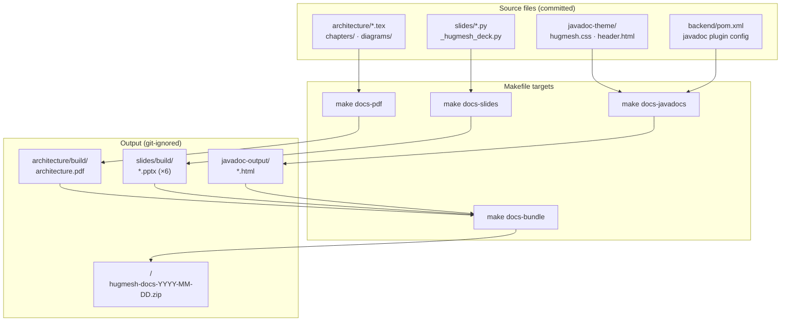

This directory produces three families of artefacts that document and
introduce the project. Every output is git-ignored — only the sources
(LaTeX, Python, CSS, and the `pom.xml` plugin configuration) are committed.
Rebuild any of them locally with the targets in this directory's `Makefile`,
or with the matching `make docs-*` shortcuts at the repo root.

```
docs/publishing/
├── architecture/              LaTeX architecture reference (~30 pp PDF)
│   ├── architecture.tex       Main document
│   ├── hugmesh-theme.sty   Brand colors, fonts, lstlisting styles, callouts
│   ├── chapters/              One file per chapter
│   ├── diagrams/              TikZ figures included by the chapters
│   └── build/                 ← output (git-ignored)
├── slides/                    Six python-pptx decks
│   ├── _hugmesh_deck.py    Shared deck builder (cover, section, closing layouts)
│   ├── intro_for_coders.py    Entry-level coder tour
│   ├── administration_manual.py
│   ├── godot_developer.py
│   ├── fullstack_developer.py
│   ├── maintainer_runbook.py
│   ├── data_architect_overview.py
│   └── build/                 ← output (git-ignored)
├── javadoc-theme/             Custom CSS + header/footer for Maven Javadoc
│   ├── hugmesh.css
│   ├── header.html
│   └── footer.html
├── javadoc-output/            ← output (git-ignored)
├── scripts/
│   ├── build-pdf.sh           Wrappers around `make` for path-driven callers
│   ├── build-slides.sh
│   ├── build-javadocs.sh
│   └── install-hooks.sh       Optional pre-push hook installer
└── Makefile                   The single source of truth for builds
```

The diagram below shows how the source files flow through the build
pipeline and where each artefact lands.



## Quick start

```
make docs-pdf           # ~10 s — runs pdflatex twice for cross-refs
make docs-slides        # ~5 s — produces six .pptx files
make docs-javadocs      # ~30 s — runs `mvn javadoc:javadoc` on the BFF
make docs-bundle        # ~3 s — zip every produced artefact at repo root
make docs-all           # everything above + bundle
make docs-clean         # remove every produced artefact (incl. zips)
make docs-install-hooks # opt-in pre-push hook that re-runs docs-pdf on touch
```

### Build provenance

Every produced artefact — the architecture PDF, the six slide decks,
the themed Javadoc HTML, and the zip bundle's `MANIFEST.txt` — embeds
the same project name and UTC build timestamp. This lets a printed or
emailed page be traced back to an exact build. The Makefile writes
`HugMesh Games · YYYY-MM-DD HH:MM UTC` on every cover slide and in
every PDF page footer. Override the project label at build time:

```
make docs-all HUGMESH_PROJECT_NAME='HugMesh Games (RC1)'
```

The bundle target writes to `<repo-root>/hugmesh-docs-<YYYY-MM-DD>.zip`.
The zip has a top-level `hugmesh-docs-<YYYY-MM-DD>/` prefix and a
`MANIFEST.txt` that lists every included file. The zip itself is git-ignored.

Every target is idempotent, so re-running a target is always safe. The
`make docs-*` targets at the repo root delegate to this directory's
`Makefile`, so `make docs-pdf` and `make -C docs/publishing pdf` are
equivalent.

## Prerequisites

| Artefact | Tool | Notes |
|---|---|---|
| Architecture PDF | `pdflatex` (TeX Live 2024+), `tikz`, `tcolorbox`, `titlesec`, `csquotes`, `enumitem`, `inconsolata`, `fontawesome` | On Debian/Ubuntu: `apt install texlive-latex-extra texlive-fonts-extra texlive-pictures`. On Gentoo: `dev-tex/tex-live` with USE `extra`. |
| PowerPoints | `python3.12` + `python-pptx` | The Make target creates a venv at `~/.venvs/hugmesh-publishing` on first run. |
| Javadoc | `mvn` (Maven 3.9+), Java 21 | Plugin config lives in `backend/pom.xml`. |

The Make `venv` target probes for `python3.12` specifically because
Gentoo's stock Python 3.14 does not include `ensurepip`, which is
required to bootstrap the venv. Any Python ≥ 3.10 works at the language
level — if you don't have 3.12, edit the `PYTHON` variable at the top
of the Makefile to point at your interpreter before running `make docs-slides`.

## What each artefact is for

### `architecture/` — typeset architecture reference (PDF)

A printable, ~30-page companion to the repository `README.md` and the
plan document. It has seven chapters (overview, runtime architecture,
module federation, data model, API reference, build & deploy, and
extending the portal) and five TikZ diagrams (runtime data flow,
three-tier topology, federation bootstrap, data-model clusters, and
the build chain). Every section heading links back to the corresponding
source file on GitHub.

The PDF builds into `architecture/build/architecture.pdf` and is
git-ignored. To include it in a release, attach the built PDF as a
GitHub release asset — do not commit the binary.

### `slides/` — six PowerPoint walkthroughs

| Deck | Audience | Slides | What it covers |
|---|---|---|---|
| `intro-for-coders.pptx` | New engineers, generalists | ~14 | Whirlwind tour of the architecture, where code lives, click-to-frame flow, common gotchas. |
| `administration-manual.pptx` | Operators / `ROLE_ADMIN` holders | ~16 | Bring-up, admin UI, hot upload, rollback, role grants, scheduled jobs, troubleshooting. |
| `godot-developer.pptx` | Game developers | ~16 | New Godot project from scratch, slug contract, export presets, ship via Make or upload via admin. |
| `fullstack-developer.pptx` | Backend + frontend engineers | ~18 | Mental model, file-by-file tour, endpoint addition end-to-end, federation rules, native-image hints. |
| `maintainer-runbook.pptx` | On-call / SRE | ~16 | Health checks, seven runbooks (BFF flap, SSE drop, federated 500s, blank iframe, upload failure, stuck launches, native-image start), DR posture. |
| `data-architect-overview.pptx` | Data architects / steering committee | ~16 | Domain map, data lifecycle, schema posture, regulatory + DR posture, cloud-relocation swap-points. |

Each deck is data-driven: the `SECTIONS` list at the top of each
`*.py` file is the only surface you need to edit to change content.
Re-run the deck's script directly, or run `make docs-slides`, to
regenerate all six decks.

### `javadoc-theme/` — branded Maven Javadoc

The `javadoc:javadoc` Maven goal, configured in `backend/pom.xml`,
reads the three assets in this directory:

- `hugmesh.css` — replaces the doclet's default stylesheet with
  HugMesh brand colours, typeface choices, and header/footer chrome.
- `header.html` — a gradient brand strip injected at the top of every
  generated page.
- `footer.html` — links back to the repository, the architecture PDF,
  and the main README.

The generated HTML is written to `javadoc-output/`, which mirrors
`backend/target/reports/apidocs/` and is git-ignored.

## Hooks

`make docs-install-hooks` installs a Git `pre-push` hook that
automatically re-runs `make docs-pdf` whenever a push touches anything
under `docs/publishing/` or the file
`docs/PLAN-module-federation-and-native.md`. The hook is opt-in because
most developers do not update docs on every push; install it when you
know you are actively working on documentation.

The installer is idempotent — re-running it is a no-op if the hook is
already in place. If a `pre-push` hook already exists in your repo,
the installer does not overwrite it; instead it writes a
`pre-push.sample` file next to the existing hook so you can merge the
relevant lines by hand.

## CI

No CI publishing step exists yet. When you are ready to publish
artefacts on every release, the setup is straightforward:

1. Add a job that runs `make docs-all` on a builder image that has
   TeX Live 2024+, Python 3.12, Maven 3.9+, and Java 21. The
   `docs-all` target handles dependency ordering automatically.
2. Upload the following paths as GitHub release assets:
   - `docs/publishing/architecture/build/architecture.pdf`
   - `docs/publishing/slides/build/*.pptx` (six files)
   - All files under `docs/publishing/javadoc-output/`
3. Optionally deploy the Javadoc HTML to GitHub Pages. The
   `hugmesh.css` brand stylesheet is fully self-contained and
   requires no changes to work in a Pages environment.

A minimal GitHub Actions job skeleton:

```yaml
jobs:
  publish-docs:
    runs-on: ubuntu-latest
    steps:
      - uses: actions/checkout@v4
      - uses: actions/setup-java@v4
        with: { java-version: '21', distribution: 'temurin' }
      - run: sudo apt-get install -y texlive-latex-extra texlive-fonts-extra texlive-pictures python3.12
      - run: make docs-all
      - uses: actions/upload-release-asset@v1
        # ... point at docs/publishing/architecture/build/architecture.pdf etc.
```
