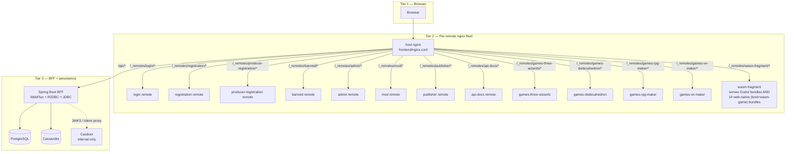
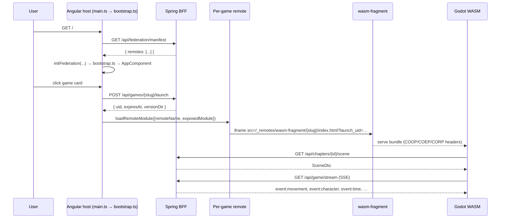
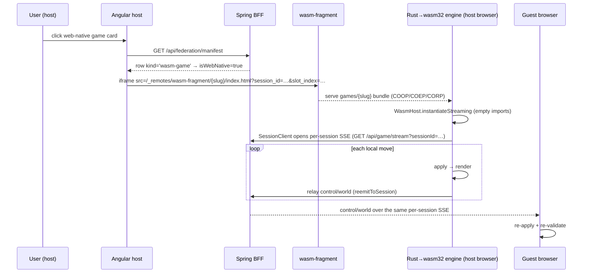
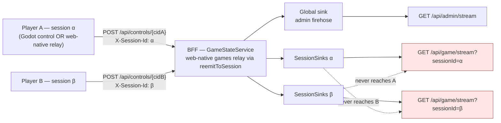

> Mirror of [`chapters/02-runtime-architecture.tex`](../../publishing/architecture/chapters/02-runtime-architecture.tex).

The runtime data flow has three tiers:

1. **The player's browser** — federated Angular host, the active remote module, the WASM iframe (Godot or web-native).
2. **Per-remote nginx fleet** — host nginx, twelve role-gated remotes, the asset-tier `wasm-fragment` (which serves both Godot bundles and the 14 web-native bundles).
3. **BFF + persistence** — Spring Boot WebFlux on top of Postgres and Cassandra, behind Casdoor.

## Three-tier topology

Each box is a Docker container. Arrows are HTTP routes proxied by the host nginx. The BFF is the only container that talks to Postgres / Cassandra / Casdoor.

## Browser-side flow

`SCENE_TYPE_TO_GAME_SLUG` forks the renderer; federated games mint a `launch_uid` for operational visibility; `TW_CHAPTER_TRANSITION` `postMessage` is caught at the host level so it works regardless of which renderer is mounted. The sequence above is the **Godot** (server-authoritative) launch path.

### Browser-side flow — web-native (host-authoritative)

The 14 web-native titles take a different path: the host reads `isWebNative` off the manifest (`kind='wasm-game'`), mounts the `games/<slug>` bundle from `wasm-fragment`, and the **host browser runs the Rust engine**. The BFF only relays control/world events over the per-session SSE stream; the guest re-applies and re-validates.

Reference: [`games/_shared/README.md`](../../../games/_shared/README.md) (the `WasmHost` / `SessionClient` / `mountGame` shell) and [decision 016](../decisions/016-rust-extension-and-fragment-relay.md).

### Why `globalThis` and not a service

The federation runtime can't be reached through Angular's DI without making `@angular-architects/native-federation` a static import into a route-handler chunk, which puts it on karma's module graph and breaks tests that don't load the federation runtime at all. Stashing the function on `globalThis` after bootstrap keeps the package out of karma's static graph and out of every route bundle that doesn't need it. See [decision 001](../decisions/001-native-federation.md).

## The host shell

The host nginx serves the host bundle plus a set of `location /_remotes/<slug>/` blocks that proxy each remote's `remoteEntry.json` and chunks. For `wasm-fragment` the host strips upstream COOP / COEP duplicates with `proxy_hide_header` and re-emits the canonical set so the WASM iframe loads with isolated headers.

## The remotes

| Slug | Kind | What it exposes / does |
|---|---|---|
| `login` | `remote-shell` | `./LoginComponent` — mounted via `loadComponent` on `/login`. Inline `POST /api/auth/token` + `sessionStorage.tw_auth` write, mirrors the host `AuthService.StoredAuth` shape. |
| `registration` | `remote-shell` | `./RegistrationComponent` — intake form mounted on `/register`. |
| `producer-registration` | `remote-shell` | `./RegistrationComponent` — producer/mod application form; POSTs to `/api/producer-contacts`. Mounted on `/register` (producer variant). |
| `banned` | `remote-shell` | `./BannedComponent` — auth-error interceptor redirects on `X-Revoked`; resolves appeal email via `GET /api/security/appeal-contact`. |
| `admin` | `remote-shell` | `./AdminShell` + `./UploadShell` — both expose under `federation_modules.slug='admin'` so `/admin` and `/admin/games` share a build. |
| `mod` | `remote-shell` | `./ModShell` — per-game moderation surface; mounted on `/mod`, gated by `mod_game_scopes`. |
| `publisher` | `remote-shell` | `./PublisherShell` — uploads + per-game grants; mounted on `/publisher`, gated by `publisher_game_scopes`. |
| `api-docs` | `remote-shell` | OpenAPI explorer (live `/v3/api-docs` + static fallback); mounted at `/admin/docs`, gated to `ROLE_ADMIN`. |
| `games-three-wizards` | `remote-game` | `./GameRoot` — Web Component (`createCustomElement`) with `@Input levelSlug + levelId + launchUid`. Renders cave and field. |
| `games-dodecahedron` | `remote-game` | `./GameRoot` — same pattern, single chrome-less scene. |
| `games-rpg-maker` | `remote-shell` | `./RpgMakerRemote` — Mudlet-shaped RPG editor; drives `rpg-builder/` side service at `/api/rpg/*`. Mounted at `/rpg-maker`. |
| `games-vn-maker` | `remote-shell` | `./VnMakerRemote` — visual-novel editor; drives `vn-builder/` side service at `/api/vn/*`. Mounted at `/vn-maker`. |
| `wasm-fragment` | `fragment` | Asset-tier nginx; bakes `backend/src/main/resources/assets/levels/` and serves at `/_remotes/wasm-fragment/<slug>/index.html`. Serves **both** the Godot bundles **and** the 14 web-native bundles — no per-game container for the latter. |
| `<game-slug>` (×17) | `wasm-game` | The 14 web-native titles (seeded by [`051-web-game-federation.xml`](../../../backend/src/main/resources/db/changelog/051-web-game-federation.xml)) **plus** the three Godot games that reuse this same kind instead of a per-game Angular remote — `games-chess-godot` ([`053`](../../../backend/src/main/resources/db/changelog/053-chess-godot-federation.xml)), `games-connect-four-godot` ([`055`](../../../backend/src/main/resources/db/changelog/055-connect-four-godot-federation.xml)) and `games-shadows-of-the-net` ([`056`](../../../backend/src/main/resources/db/changelog/056-shadows-of-the-net-federation.xml) — the pure-GDScript XR chat room). `remote_entry_url` points **directly** at `/_remotes/wasm-fragment/<slug>/index.html` (not a `remoteEntry.json`), `exposed_module=NULL`, `game_slug` carries the catalog slug. The host reads `isWebNative` off the manifest and mounts the bundle as a parametrised iframe — no per-game Angular remote. `main.ts` excludes `wasm-game` from `initFederation`. See [decision 016](../decisions/016-rust-extension-and-fragment-relay.md). |

## The BFF

[`backend/`](../../../backend/) runs as a single Spring Boot 4.0 application with both WebFlux (R2DBC, runtime path) and JDBC (Liquibase, blocking) wired in. Spring auto-config skips `DataSourceAutoConfiguration` when an R2DBC `ConnectionFactory` is present, so `JdbcDataSourceConfig` declares an explicit `@Primary HikariDataSource` of pool size 3 just for Liquibase to acquire on boot. See [decision 002](../decisions/002-r2dbc-jdbc-coexistence.md).

## Authentication and access

Casdoor is reachable only from inside the compose network. The host BFF proxies the login flow at `/api/auth/*` and verifies JWTs against the anonymous `/.well-known/jwks` endpoint (not `/api/get-jwks`, which requires admin auth and would 401 on every request). Per-game visibility is enforced by the `game_access` table — see [04 — Data model](04-data-model.md).

## Server-Sent Events — nine channels on one stream

[`GameStreamController`](../../../backend/src/main/java/games/hugmesh/bff/controller/GameStreamController.java) merges **nine** SSE channels onto a single `Flux<ServerSentEvent>`:

- Eight `Sinks.Many` from `GameStateService`: `movement`, `world`, `character`, `scene`, `input`, `audio`, `wasm-console`, `session-control`
- One from `GameTimeService`: `time`
- Plus a 15-second `Flux.interval` keepalive that fires immediately on subscribe so the response headers flush at connect time and the browser `EventSource.onopen` fires in milliseconds.

The `input`, `audio`, and `wasm-console` channels are part of the generalised input surface introduced for gamepad / mouse / keyboard / touch / audio support — see [04 — Data model](04-data-model.md#generalised-input-event-surface). The `session-control` channel carries session lifecycle events (pause / resume / close) — per-session when a `sessionId` is supplied, global otherwise. Subscribers opt into individual channels via the EventSource event-listener model (`source.addEventListener('input', cb)`); merging onto the single connection keeps the host page from needing N EventSources.

### ⚠ The `autoCancel` trap

`Sinks.many().multicast().onBackpressureBuffer(N)` defaults to `autoCancel=true`. When every subscriber disconnects (iframe remount, EventSource reconnect, network blip), the sink terminates **permanently** and all subsequent `tryEmitNext` calls silently drop.

**Every sink in this project passes `autoCancel=false` explicitly.** If a freshly-deployed sink "works once and then silently dies", this is the cause. See [decision 003](../decisions/003-autocancel-false.md).

## Per-session SSE sink isolation

Multiplayer sessions add a new layer: `GameStateService` keeps a `ConcurrentHashMap<String, SessionSinks>` of per-session sink bundles alongside the legacy global sinks. When a control event arrives with a `sessionId`, the resulting `PlayerMovement` / `WorldState` / `CharacterDto` / `PlayerViewEvent` fans out on **both**:

- the **legacy global sink** (so the admin firehose at `/api/admin/stream` still sees everything across the fleet), and
- the **session-scoped sink** keyed by `sessionId` (so a subscriber to `/api/game/stream?sessionId=A` sees only session A's events).

The isolation contract is locked in by [`SessionIsolationTest`](../../../backend/src/test/java/games/hugmesh/bff/service/SessionIsolationTest.java) — emit on session A's sinks, assert session B's per-session subscriber sees nothing. Five specs cover movement, world, view, bidirectional isolation, and the legacy single-player path's non-leakage.

The same per-session sinks carry the **web-native game relay**: when a host browser re-emits a control/world event via `GameStateService.reemitToSession`, it fans out only to that session's sink — so the isolation guarantee above covers web-native multiplayer too.

A new **`view`** channel carries per-player camera/orientation samples (~10 Hz) that the Rust GDExtension's `view_egress` signal feeds. Admins watch via `/api/admin/sessions/{id}/stream`. See [decision 010](../decisions/010-per-session-sse-sinks.md) and [decision 013](../decisions/013-player-view-channel.md).

---

Previous: [01 — Overview](01-overview.md) · Next: [03 — Module Federation](03-federation.md).
