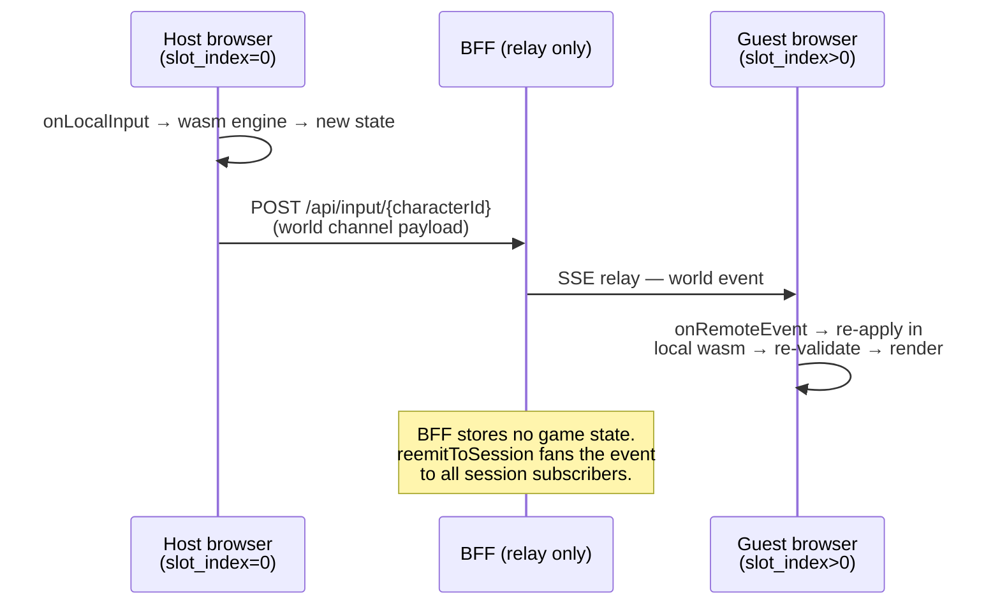
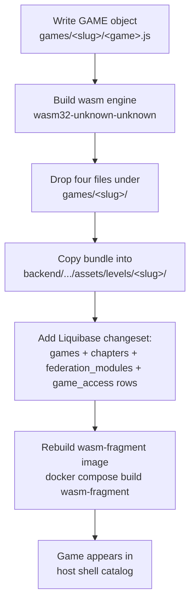

Every **web-native** HugMesh game frontend (chess first, then 13 more) reuses
the three ES modules in this directory. They are **vanilla JS with no build
step**, served as static files straight out of the bundle. A new game needs one
`GAME` object and four files.

This directory implements the **host-authoritative** model from
[`docs/multiplayer-chess-design.md`](../../docs/multiplayer-chess-design.md).
**The host browser runs the wasm engine and is the single source of truth for
game state.** The BFF runs no game logic. It only **relays** input and world
events over the per-session SSE stream (`GameStateService.reemitToSession`). The
guest browser receives those events, re-applies them against its own local wasm
engine, and re-validates the result.



## The three shared modules

| File | Class / fn | Responsibility |
|---|---|---|
| [`wasm-host.js`](wasm-host.js) | `WasmHost` | Loads the game's `.wasm` (`instantiateStreaming`, **empty imports**) and marshals JSON across the boundary: `call(fnName, jsonStringOrNull) -> parsedJson`. |
| [`sse-host-client.js`](sse-host-client.js) | `SessionClient` | Opens the per-session SSE relay (via the host-shell bridge **or** a direct `EventSource`), exposes `on(channel, handler)`, sends controls/inputs/world. Degrades to pure-local single-player when there's no `session_id`. |
| [`game-frame.js`](game-frame.js) | `mountGame` | Lifecycle glue: parse URL params, boot `WasmHost` + `SessionClient`, wire local-input→apply→render→relay and remote-event→apply→render. |

### `WasmHost` — the wasm marshalling contract

The marshalling contract is the **exact inverse** of the freestanding Rust shim
([`extensions/hugmesh-fps-core-wasm/src/lib.rs`](../../extensions/hugmesh-fps-core-wasm/src/lib.rs))
and **agrees byte for byte** with the JVM driver
([`WasmSimCore.java`](../../backend/src/test/java/games/hugmesh/bff/service/realtime/wasm/WasmSimCore.java)).
All three callers (browser JS, tests, JVM) speak the same protocol, so any
`.wasm` built against the Rust shim works the same in all three.

The protocol in both directions:

- **Bytes IN** (`host → module`): allocate a buffer in the module's linear
  memory with `alloc(len)` → write the UTF-8 payload into `[ptr, ptr+len)` →
  call the named export with `(ptr, len)` as the **last two arguments** →
  free the buffer with `dealloc(ptr, len)`.
- **Bytes OUT** (`module → host`): the export returns a **packed `i64`** encoding
  `(ptr << 32) | (len & 0xFFFF_FFFF)`. JS unpacks it with
  `BigInt.asUintN(64, …)`, which handles sign extension the way the JVM's
  `& 0xFFFF_FFFFL` masking does. It then reads `ptr = packed >> 32n` and
  `len = packed & 0xFFFF_FFFFn`, decodes the UTF-8 bytes as JSON, and **frees
  the buffer with `dealloc(ptr, len)`** (the Rust side leaked a `Box<[u8]>` for
  the host to reclaim). A return value of `packed == 0` means `null`.

```js
import { WasmHost } from './_shared/wasm-host.js';

const host = new WasmHost('./wasm/hugmesh_chess.wasm');
await host.load();                              // instantiateStreaming, empty imports

host.callStatus('chess_new');                   // -> 1  (plain status int)
host.callPacked('chess_legal_moves');           // -> ["e2e4", "d2d4", …]  (packed JSON)
host.call('chess_apply_uci', 'e2e4');           // -> { type:'chess.state', … } (raw UCI token)
host.callRaw('fps_new', configJson, [seed]);    // leading args BEFORE (ptr,len)
```

Use `callPacked` / `callStatus` when you know the export's return shape.
`call` auto-detects: if the packed return value points to a valid memory region
it decodes it as JSON, and otherwise it treats the value as a plain status
integer. `callRaw` returns the export's raw return value, with no decoding. All
four methods take two optional argument arrays after the payload: `leadingArgs`
(passed before the `(ptr, len)` pair, as `[seed]` is for `fps_new`) and
`trailingArgs` (passed after it, as `[size, side]` is for `go_from_board`).

The string argument is written **verbatim** as UTF-8 bytes. `WasmHost` does not
JSON-encode it for you. Pass exactly what the export expects: a raw token
(`'e2e4'` for `chess_apply_uci`, a FEN string for `chess_from_fen`) or a full
JSON document (the FPS `config`/`commands` payloads). The alloc → write →
`(ptr,len)` → dealloc round trip is the same for every payload shape.

### `SessionClient` — transport

```js
import { SessionClient, CHANNELS, SESSION_CONTROL } from './_shared/sse-host-client.js';

const client = new SessionClient(sessionId);     // null sessionId ⇒ single-player, no network
client.on('world', (w) => guestReapply(w));      // host's authoritative board
client.on('input', (i) => hostApplyGuestMove(i));// guest's relayed move
client.on('session-control', (e) => { /* PAUSED / RESUMED / CLOSED */ });
client.connect();

client.sendControl(characterId, { action: 'JUMP', pressed: true }); // JRPG verb path
client.sendInput(characterId, { gameSlug:'chess', kind:'control', type:'move', payload:{ uci:'e2e4' } });
client.sendWorld(characterId, 'chess', { fen, san, status, lastMove }); // host authoritative broadcast
```

It picks its transport from its context:

- **Embedded** (inside the Angular host shell, the normal production case):
  delegates to the parent window. It asks for an `EventSource` with a
  `SD_SSE_SUBSCRIBE` postMessage, receives events as `SD_SSE_EVENT`, and sends
  via `SD_API_REQUEST`. This reuses the existing
  [`ApiBridgeService`](../../frontend/src/app/services/api-bridge.service.ts)
  transport, so the host shell attaches the JWT and `X-Session-Id` header
  uniformly, and the game iframe knows nothing about them. (The
  [`hugmesh-shim.js`](../../wasm-fragment/hugmesh-shim.js) that `wasm-fragment`
  injects handles console capture and input events, not this SSE transport.)
- **Standalone** (no distinct parent window: local dev or tests): opens its own
  `EventSource('/api/game/stream?sessionId=…')` and POSTs controls directly,
  attaching a bearer token through the optional `tokenProvider` callback.

Relay channels (`CHANNELS`): `movement, world, character, time, scene, input,
audio, wasm-console, session-control`. This is the exact set that
[`GameStreamController`](../../backend/src/main/java/games/hugmesh/bff/controller/GameStreamController.java)
fans out to session subscribers.

## The `GAME` interface a new game implements

```js
const GAME = {
  slug: 'chess',                              // catalog slug (used on the relay)

  // wasm loaded, container is the mount point. Return the initial state to render.
  async init(host, container, ctx) { /* host.callStatus('chess_new'); */ return state; },

  // Draw a state object into the container. Called after every apply.
  render(stateJson, ctx) { /* paint the board */ },

  // A captured DOM event (click/keydown/drag). Apply it AUTHORITATIVELY to the
  // wasm engine, then return what to render + what to relay (or null to ignore):
  //   { control?: {...},          // → POST /api/controls/{characterId}  (verb path)
  //     input?:   { kind, type, payload }, // → POST /api/input/{characterId} (relay)
  //     world?:   {...},          // host authoritative broadcast on the `world` channel
  //     state:    <stateJson> }   // what render() draws
  onLocalInput(evt, ctx) { const s = ctx.host.call('chess_apply_uci', uci); // raw UCI token
                           return { input: { kind:'control', type:'move', payload:{ uci } },
                                    world: s, state: s }; },

  // A relayed event arrived. Re-apply against wasm + re-validate; return the new
  // state to render (or null to ignore).
  onRemoteEvent(channel, json, ctx) { /* guest: re-apply json.payload, re-validate */ return state; },
};
```

`ctx` (the `GameContext`) carries `{ host, client, params, isHost, container,
GAME }` plus `handleLocalInput(evt)` and `destroy()`. Feed every captured DOM
event into `ctx.handleLocalInput(evt)`, and the frame runs the full apply →
render → relay cycle for you. The frame relays only when `character_id` is
present; without it (single-player) nothing leaves the browser. It calls
`GAME.onRemoteEvent` for the channels `input`, `world`, `movement`,
`character`, `scene` and `session-control`, and calls the optional
`GAME.destroy(ctx)` on `pagehide`.

### URL params the frame parses

The host shell appends these query parameters to the iframe `src` URL at launch.
`game-frame.js` reads them on mount and exposes them as `ctx.params`.

| param | meaning |
|---|---|
| `session_id` | multiplayer session id (absent ⇒ single-player hot-seat) |
| `launch_uid` | the launch token minted for this iframe instance |
| `chapter_id` | the playable chapter (chess → the chessboard chapter) |
| `slot_index` | this slot (`0` = host/authoritative, `>0` = guest) |
| `character_id` | the character this slot drives (the relay target) |

## The four files a new game adds

Drop a `games/<slug>/` directory with these artifacts. There is no build step;
everything is served as a static file. (Every shipped game has five: the four
below plus a `<game>.css`. It also has a `test/` directory.)

| File | Purpose |
|---|---|
| `index.html` | Imports `./_shared/game-frame.js`, defines the `GAME` object, calls `mountGame(GAME, { wasmUrl: './wasm/<engine>.wasm' })`, and routes DOM events to `ctx.handleLocalInput`. |
| `<game>.js` | The `GAME` implementation: board or scene rendering plus the wasm call logic. For small games this can be inlined directly in `index.html`. |
| `wasm/<engine>.wasm` | The freestanding `wasm32-unknown-unknown` engine binary (zero host imports). For example: `chess/wasm/hugmesh_chess.wasm`. |
| `icon.svg` (or `.png`) | The catalog and launcher icon. |

`games/<slug>/` has no `_shared/` directory. The import path `./_shared/` works
only in the deployed bundle, where the three modules are copied to
`backend/src/main/resources/assets/levels/<slug>/_shared/`.
`test/bundle-sync.test.mjs` fails if any bundle's copy differs from
`games/_shared/`.

To wire the game into the catalog, add these database rows with Liquibase
changesets (see [`044-chess-game.xml`](../../backend/src/main/resources/db/changelog/044-chess-game.xml)
for the `games` and `chapters` shape, and
[`051-web-game-federation.xml`](../../backend/src/main/resources/db/changelog/051-web-game-federation.xml)
for the other two):

1. A `games` row.
2. A `chapters` row whose `asset_url` points to `/api/assets/levels/<slug>/index.html`.
3. A `federation_modules` row with `kind='wasm-game'` (and `exposed_module=NULL`).
   It tells the host shell to treat the game as web-native, not a Godot bundle,
   with no new Angular remote and no frontend change.
4. A `game_access` row with `scope='all'`. A game with no `game_access` row is
   hidden from every non-admin player, and its launch returns 403 (see the
   comment in `051`).



## Tests

`games/_shared/test/chess-wasm.test.mjs` drives the real
`chess/wasm/hugmesh_chess.wasm` through the marshalling contract with `node`.
No browser is needed. Run it with:

```bash
node games/_shared/test/chess-wasm.test.mjs
```

`make test-games-js` runs every `games/_shared/test/*.test.mjs`.

Syntax-check the shared modules without running them. `node --check` looks
only at the first file you give it, so loop:

```bash
for f in games/_shared/*.js; do node --check "$f"; done
```

When you add a game, add a matching `games/_shared/test/<slug>-wasm.test.mjs`
that exercises at least `init`, one move, and the packed-return decoding for
your engine. These modules are the dependency-free base that every per-game
implementation builds on.
