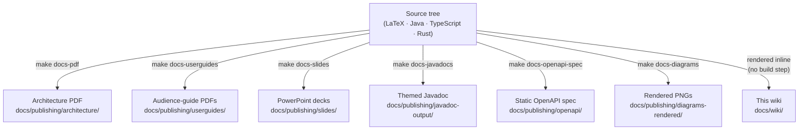

A Markdown-rendered companion to the LaTeX-typeset reference under [`../publishing/`](../publishing/). The PDFs and PowerPoints are the canonical artefacts; this tree presents their content in a form that renders inline on GitHub and requires no TeX installation.

When this wiki disagrees with the source tree, the source tree wins. Each page links back to the file you would edit to fix something.

---

## Architecture reference

Mirror of [`docs/publishing/architecture/architecture.pdf`](../publishing/architecture/architecture.tex). Seven chapters, key diagrams inlined as Mermaid. The catalog ships **19 games in two delivery models** — Godot 4 WASM (5 titles, incl. *Chess (Godot)* federated via changelog 053, *Connect Four (Godot)* via changelog 055, and *Shadows of the Net – CHAT* — an XR chat chamber — via changelog 056) and web-native Rust→wasm32 (14 titles, host-authoritative over the SSE relay); the chapters below cover both.

| # | Page | Contents |
|---|---|---|
| 01 | [Overview](architecture/01-overview.md) | What HugMesh Games is in three sentences, the container list, and the two game families (Godot WASM vs web-native Rust→wasm32). |
| 02 | [Runtime architecture](architecture/02-runtime.md) | Browser → host nginx → BFF; the Godot and web-native (`wasm-game`) launch flows; the SSE merge; the `autoCancel=false` rule. |
| 03 | [Module Federation](architecture/03-federation.md) | The two ordering rules, the manifest endpoint, per-game routing, the `wasm-game` kind for web-native games. |
| 04 | [Data model](architecture/04-data-model.md) | Postgres schema clusters (55 changelogs), Cassandra cache, Liquibase order incl. the web-native catalog + realtime-match tables. |
| 05 | [API + service reference](architecture/05-api-reference.md) | All 38 controllers + services with marbles, examples, error paths (incl. the 🚧 realtime PvP surface). |
| 06 | [Build and deploy](architecture/06-build-and-deploy.md) | The `make` chain, GraalVM native-image, doc publishing. |
| 07 | [Extending the portal](architecture/07-extending.md) | Add a game (Godot or web-native) / route / role / SSE channel / DB column. |

## Audience guides

Eight audience-targeted condensations of the full reference. Mirror of [`docs/publishing/userguides/`](../publishing/userguides/).

| Audience | Page | When to read it |
|---|---|---|
| Brand-new contributor | [Intro for coders](guides/intro-for-coders.md) | First day on the repo. |
| Godot developer | [Godot developer guide](guides/godot-developer.md) | You're shipping a new game / level. |
| Full-stack developer | [Full-stack developer guide](guides/fullstack-developer.md) | DB → BFF → Angular round-trip. |
| Data architect | [Data architect overview](guides/data-architect-overview.md) | Where data lives, what the SLAs are. |
| Administrator | [Administration manual](guides/administration.md) | You hold `ROLE_ADMIN` and run the stack. |
| On-call / SRE | [Maintainer runbook](guides/maintainer-runbook.md) | The lights are red, fix it. |
| Moderator | [Moderator guide](guides/moderator.md) | You hold `ROLE_MOD` for one or more games and need to keep sessions healthy. |
| Publisher | [Publisher guide](guides/publisher.md) | You hold `ROLE_PUBLISHER` for one or more games — upload, pin, edit access. |

## How-tos

Recipe cards. Each one is a task you've done before and want to do again without re-reading three chapters.

- [Add a new game](howto/add-game.md) (commit-path or hot-upload)
- [Add a federated route](howto/add-federated-route.md)
- [Add an admin view](howto/add-admin-view.md)
- [Add a role and gate a game on it](howto/add-role-and-grant.md)
- [Add a new SSE channel](howto/add-sse-channel.md)
- [Add a database column](howto/add-db-column.md)
- [Hot-upload and roll back a game bundle](howto/upload-and-rollback-game.md)
- [Kick or ban a player](howto/kick-or-ban.md)
- [Create or join a multiplayer session](howto/create-or-join-session.md)
- [Grant the mod or publisher role for a game](howto/grant-mod-or-publisher.md)
- [Toggle WASM-console debug mode](howto/toggle-wasm-debug-mode.md)
- [Run + extend multi-user e2e specs](howto/run-multi-user-e2e.md)

## Decisions and notes

Why the system has the shape it has. Each entry records one decision, the constraint that drove it, and the trade-off accepted.

- [001 — Native federation over Webpack ModuleFederation](decisions/001-native-federation.md)
- [002 — R2DBC + JDBC coexistence in one BFF](decisions/002-r2dbc-jdbc-coexistence.md)
- [003 — `Sinks.many(autoCancel=false)` everywhere](decisions/003-autocancel-false.md)
- [004 — GraalVM native-image as an opt-in build path](decisions/004-graalvm-native.md)
- [005 — Launch-UID + version-pinning for hot uploads](decisions/005-launch-uid-versioning.md)
- [006 — `level → chapter`, `spell → instant` rename](decisions/006-naming-rename.md)
- [007 — Cassandra position cache, keyed by `(character, chapter)`](decisions/007-cassandra-position-cache.md)
- [008 — Casdoor never exposed; BFF reverse-proxies the login flow](decisions/008-casdoor-internal.md)
- [009 — Three additive scopes for `game_access`](decisions/009-game-access-scopes.md)
- [010 — Per-session SSE sink isolation](decisions/010-per-session-sse-sinks.md)
- [011 — Mod / publisher roles with per-game Postgres scoping](decisions/011-mod-publisher-rbac.md)
- [012 — Admin-only debug-mode gate on WASM console capture](decisions/012-debug-mode-gate.md)
- [013 — Per-player view egress channel for admin observation](decisions/013-player-view-channel.md)
- [014 — All Godot networking flows through the bridge](decisions/014-bridge-routed-networking.md)
- [015 — Friends, blocks, session visibility, and per-user session log](decisions/015-friends-blocks-and-session-visibility.md)
- [016 — Rust GDExtension owns the bridge; Angular wrapper relays SSE + HTTP](decisions/016-rust-extension-and-fragment-relay.md)
- [017 — Cross-pod rate limit](decisions/017-cross-pod-rate-limit.md)
- [018 — RPG + VN makers](decisions/018-rpg-and-vn-makers.md)
- [019 — Production rate limits](decisions/019-production-rate-limits.md)
- [020 — Object-storage backed uploads](decisions/020-object-storage-uploads.md)
- [021 — Kafka → ClickHouse streaming pipeline](decisions/021-kafka-clickhouse-streaming-pipeline.md)
- [022 — Postgres read replica](decisions/022-postgres-read-replica.md)
- [023 — Content-Security-Policy (strict CSP is 🔭 a documented follow-up)](decisions/023-content-security-policy.md)
- [024 — WCAG palette audit](decisions/024-wcag-palette-audit.md)
- [025 — BFF-side `DOMAIN_` guard (multi-brand; full single-BFF operation 🚧 deferred)](decisions/025-bff-domain-guard.md)
- [026 — Games-catalog domain partitioning (public-read brand filtering 🚧 deferred)](decisions/026-games-catalog-domain-partitioning.md)

> **Engine-level and roadmap design records** (not yet catalog-launchable): [`docs/realtime-server-authoritative-design.md`](../realtime-server-authoritative-design.md) and [`docs/realtime-sim-wiring-p4.md`](../realtime-sim-wiring-p4.md) (🚧 server-authoritative FPS/RTS engines); [`docs/game-ports-backlog.md`](../game-ports-backlog.md) (🔭 future game ports).

## Where the canonical sources live

The wiki is one of several views over the same source tree. For depth that this view does not carry, consult the sources below:

| Source | What it has | Build |
|---|---|---|
| [`docs/publishing/architecture/`](../publishing/architecture/) | LaTeX chapters → typeset PDF with full tables, marble diagrams, hyperref links. | `make docs-pdf` |
| [`docs/publishing/userguides/`](../publishing/userguides/) | Per-audience PDFs, one per guide above. | `make docs-userguides` |
| [`docs/publishing/slides/`](../publishing/slides/) | Six PowerPoint decks via `python-pptx`. | `make docs-slides` |
| [`docs/publishing/javadoc-output/`](../publishing/javadoc-output/) | Themed Javadoc for every `@Operation` / `@Tag` in the BFF. | `make docs-javadocs` |
| [`docs/publishing/openapi/`](../publishing/openapi/) | Static fallback OpenAPI spec; the live one is `/v3/api-docs`. | `make docs-openapi-spec` |
| [`docs/publishing/diagrams-rendered/`](../publishing/diagrams-rendered/) | Every marble + topology diagram rendered to PNG (git-ignored output). | `make docs-diagrams` |
| [`docs/PLAN-module-federation-and-native.md`](../PLAN-module-federation-and-native.md) | The 921-line plan that produced the federated topology. Pre-rename language. |
| [`docs/GODOT_DEVELOPER_GUIDE.md`](../GODOT_DEVELOPER_GUIDE.md) | Slug contract, presets, asset registration. |
| [`CLAUDE.md`](../../CLAUDE.md) | Contributor onboarding for AI + human pair-programmers. |
| [`README.md`](../../README.md) | Setup, build, deploy, troubleshooting. |
