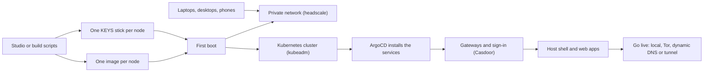

A mesh goes from a build on your computer to a cluster of nodes serving your community.
This page follows that path once, from start to finish.

## 1. Build one image per node

The Studio, or the build scripts behind it, builds a hardened Gentoo Linux image for each
node. Each image has a role: `pki` runs the cluster's control plane and the sign-in
service, `backend` runs the APIs, `frontend` serves the web interface, and
there are others, such as a GPU node or an all-in-one `omnibus` node. Nodes are Raspberry
Pi 5 boards or x86_64 computers. The [build matrix](/reference/build-matrix) lists every
combination.

## 2. Put the keys on a USB stick, not in the image

An image carries no secrets. Each node gets its own USB stick, labelled `KEYS`, holding
its users, SSH keys, certificates, network keys and the token it needs to join the
cluster. That is what makes it safe to build one image and use it on many nodes.
[The KEYS stick](/operations/keys-usb) lists what a stick holds.

## 3. First boot: the node sets itself up

At first boot a node finds its KEYS stick, reads it, and applies what is there. It joins
the mesh's private network, which runs on headscale, a self-hosted Tailscale control
server. Then it joins the Kubernetes cluster: the `pki` node creates the cluster with
`kubeadm init`, and every other node joins it with the token from its own stick. A node
booted without a stick still starts with a console user, so you are never locked out.

## 4. ArgoCD installs the services

Each image also carries the cluster's configuration: which services run, in which
namespaces, with which settings. Once the cluster exists, ArgoCD reads that
configuration and installs everything, then keeps the cluster matching it. This is
called GitOps. [What the cluster deploys](/operations/gitops-payload) describes the
configuration.

## 5. Gateways and one sign-in

Every request from outside passes through a gateway before it reaches a service. One
gateway image runs in three roles: the identity gateway in front of the sign-in service,
the backend gateway in front of the APIs, and the frontend gateway in front of the web
interface. Each one checks the caller's roles against its route rules
([Gateways](/architecture/gateway)).

Members sign in once with Casdoor, which runs inside your cluster. Each service has an
API of its own, a backend-for-frontend (BFF), that holds the signed-in member's token.
The browser only ever holds a session cookie, so a page script cannot steal a token.

## 6. The web interface

The web interface is one page frame, the [host shell](/architecture/host-shell), that
loads a separate web app for each service: chat, the fediverse, the forum, the wiki, the
consoles. Each web app is built and released on its own, and the host shell only shows a
member the ones their roles open. The [Reference](/reference) has a page for each.

## 7. Go live, if you want to

A mesh can stay on your local network. The go-live wizard makes it reachable from
outside when you choose to: as a Tor onion service, on a dynamic DNS name, or through a
tunnel. Each way is opt-in ([Go live with the wizard](/operations/go-live-wizard)).

## 8. Your own devices join

Laptops, desktops and Docker hosts join the private network as clients, not as cluster
nodes, using a [mesh desktop image](/devices/client-images) or
[Docker](/operations/docker-mesh-node). Phones and headsets are enrolled with
[MDM](/devices/mobile-device-management).

## Three ways to drive a build

All three run the same `make` targets underneath:

| Way | Good for |
|---|---|
| The Studio, a desktop app | first builds; it shows each choice and the exact command |
| The text menu (`make menu`) | repeat builds, and builds over SSH |
| `make` targets and the scripts | automation and CI |

## Words you will see

| Word | Meaning |
|---|---|
| Studio | The desktop app that builds images and runs a local mesh. |
| generator | `hugmesh-generator`, the repository with the build scripts, the KEYS template and the cluster configuration. |
| image | The operating system for one node, written to its SD card or disk. |
| role | What a node does in the cluster: `pki`, `backend`, `frontend` and others. |
| KEYS stick | The USB stick that carries one node's secrets and settings to its first boot. |
| headscale, tailnet | The self-hosted control server for the mesh's private network, and that network. |
| Casdoor | The sign-in service. One account works for every service. |
| gateway | The front door every outside request passes; it checks roles against route rules. |
| BFF | Backend-for-frontend: the API behind one web app, which holds the member's token. |
| host shell | The page frame that loads every service's web app. |
| web app (remote) | One service's user interface, loaded into the host shell at run time. |
| ArgoCD, GitOps | ArgoCD installs the services and keeps the cluster matching its configuration. |
| domain | One community on the mesh, with its own address, users and roles. |
| go live | Making the mesh reachable from outside your network. |
