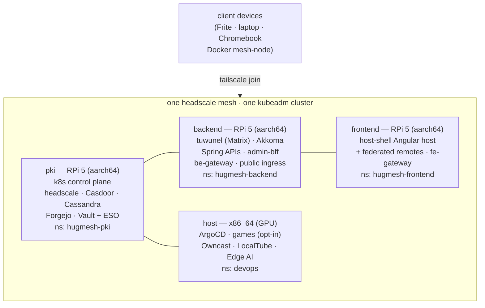

> **Who this is for:** anyone who wants to generate images, bring up a cluster,
> or understand what this platform is and why it exists. Website and documentation:
> [hugmesh.net](https://hugmesh.net).

---

## What is HugMesh?

HugMesh is a **self-hosted home-lab platform** that lets you run your own
community — Matrix chat, Mastodon/fediverse, a forum, games, a wiki, live
streaming, and an admin control plane — all behind a single public front door,
on hardware you own, with no third-party cloud services required.

The whole thing boots from **generated Gentoo stage4 images** written to SD
cards or NVMe drives. Every image knows its role (identity node, backend,
frontend, or GPU host), phones home at first boot to a **USB KEYS stick** you
prepared, and joins a Tailscale/headscale mesh automatically. When all four
nodes are up, an ArgoCD app-of-apps converges the full platform.

```
┌────────────────────────────────────────────────────────────────────────┐
│  Your hardware                    Your community                       │
│                                                                        │
│  3× Raspberry Pi 5 ─────────────▶  id.yourdomain / yourdomain         │
│  1× x86_64 GPU desktop             (Matrix · Mastodon · Forum · Wiki)  │
│  USB KEYS sticks (one per node)                                        │
│                                                                        │
│  hugmesh-generator ──────────▶  hardened Gentoo images                 │
│  (builds, provisions, GitOps)       + ArgoCD app-of-apps               │
└────────────────────────────────────────────────────────────────────────┘
```

**Design choices that matter:**

- **No vendor lock-in.** Gentoo + k8s + Vault + headscale + Casdoor — all
  open-source, all self-hosted, no cloud dependency in the default posture.
- **Keys, not passwords, by default.** SSH is key-only. The KEYS USB carries
  everything the node needs at first boot — user keys, certs, mesh preauth,
  k8s join token — then goes offline.
- **Optional services are truly optional.** Matrix, Mastodon, forum, games —
  each is an add/remove-by-command service. Omit one and the UI gracefully
  greys it out; the platform doesn't break.
- **One identity, every surface.** Casdoor is the IdP. One login works across
  chat, fediverse, admin console, wiki, and games. The browser never sees
  the JWT — it holds only an opaque session token.

---

## The Generator

[`hugmesh-generator`](https://github.com/hugmesh/hugmesh-generator)
is the image factory. It builds the OS images, assembles the GitOps payload,
and emits the provisioning artefacts. There are **three ways to drive it**,
all backed by the same `make` targets under the hood:

| Interface | Best for | Launch |
|-----------|----------|--------|
| **[Studio (GUI wizard)](#studio-graphical-wizard)** | First builds, new operators | `python studio/hugmesh-studio.py` |
| **[Console menu (ncurses)](#console-menu-ncurses)** | Repeat builds, SSH sessions | `make menu` |
| **[CLI (make / scripts)](#command-line)** | CI, automation, scripted builds | `make build-all` |

---

## Studio (graphical wizard)

> Studio is a cross-platform PySide6 wizard (Linux + Windows) that wraps the
> generator's `make` targets in a guided UI. It handles branding, optional-service
> toggles, KEYS-stick creation, and build progress — no terminal required for a
> first build. Beta downloads: [hugmesh.net/downloads](https://hugmesh.net/downloads).

### The walkthrough moved

The page-by-page walkthrough that used to live here now sits beside the code it
documents, where it can be checked against it:

**[The operator's walkthrough](https://github.com/hugmesh/hugmesh-generator/blob/main/docs/STUDIO-WALKTHROUGH.md)**
— every page of the wizard in the order you meet them, which of the ten
build-menu cards routes where, and why only three of them are image modes.

It was rewritten from the wizard's own source. The version that lived here had
drifted badly: it described a linear nine-page flow, and the Studio has
twenty-six pages whose order depends on what you are building.

Two companion documents:

- **[Studio overview](https://github.com/hugmesh/hugmesh-generator/blob/main/studio/README.md)**
  — what it does, and how to run it.
- **[Wizard flow](https://github.com/hugmesh/hugmesh-generator/blob/main/docs/STUDIO-WIZARD-FLOW.md)**
  — the flow's design, for people changing it rather than using it.


---

### Quick start — LAN fleet

```bash
# Recommended first-build command: ENV=test LAN fleet on hugmesh.test
make local
```

### All `make` targets

| Target | What it does |
|--------|--------------|
| `make local` | ENV=test + `brands/local.conf` → LAN `hugmesh.test` fleet |
| `make prod` | ENV=prod, real domain (announced; needs creds on KEYS USB) |
| `make build-all` | full fleet (3 Pi + x86 host) |
| `make rebuild` | wipe work dir then `build-all` |
| `make rpi` | all 3 Pi roles |
| `make rpi-pki` / `rpi-backend` / `rpi-frontend` | one Pi role |
| `make x86` | all x86 roles |
| `make x86-host` / `x86-pki` / `x86-omnibus` / `x86-be+gpu` | one x86 role |
| `make omnibus` | x86 all-namespaces-on-one-node image |
| `make frite` | Frite light-desktop (arm64, Libre Computer) |
| `make menu` | interactive ncurses build menu |
| `make flash DEV=/dev/sdX ROLE=frontend ARCH=arm64` | write image to a disk |
| `make qemu` / `qemu-rpi` / `qemu-x86` | boot an image under QEMU |
| `make e2e` | boot a role VM + run Playwright e2e tests |
| `make ci` / `ci-quick` | full pipeline / fast (x86 be+gpu → e2e) |
| `make clean` | wipe the work dir |
| `make help` | live target list |

Common overrides (pass as `KEY=value`):

| Variable | Default | Meaning |
|----------|---------|---------|
| `ENV` | `test` | `test` or `prod` — baked into the image |
| `BRAND` | `hugmesh` | brand slug; auto-loads `brands/<BRAND>.conf` |
| `DOMAIN` | from profile | overrides the profile's `CLUSTER_DOMAIN` |
| `WORK_DIR` | `./out` | build output directory |
| `JOBS` | `$(nproc)` | parallel emerge/make jobs |
| `NATIVE` | `0` | `1` = use Gentoo host toolchain (no Docker) |
| `ROLE` | — | target role for single-role targets |
| `ARCH` | — | `x86` or `arm64` |
| `DEV` | — | device path for `make flash` |
| `RESUME` | `false` | `true` = skip packages already in the sysroot |
| `CA_CERT` / `CA_KEY` | — | import an existing CA |

### Direct scripts

```bash
# Pi roles (must run as root for cross-emerge):
sudo ./build-rpi5-stage4.sh --role pki      --env test -j "$(nproc)"
sudo ./build-rpi5-stage4.sh --role backend  --env test -j "$(nproc)"
sudo ./build-rpi5-stage4.sh --role frontend --env test -j "$(nproc)"

# All three Pi roles in parallel:
sudo ./scripts/build-all-roles.sh -j "$(nproc)"

# x86 GPU host:
sudo ./build-x86-host-stage4.sh -j "$(nproc)"

# Custom brand inline:
sudo ./build-rpi5-stage4.sh --role backend \
  --brand acme --domain acme.example \
  --org Acme-Inc --brand-title "Acme Corp" --env prod

# Custom brand via profile file:
sudo ./build-rpi5-stage4.sh --config brands/acme.conf --role backend --env prod
```

Key flags (see `./build-rpi5-stage4.sh --help` for the full reference):

| Flag | Meaning |
|------|---------|
| `--role pki\|backend\|frontend` | which image to build |
| `--env test\|prod` | build ENV (baked into `/etc/hugmesh/env`) |
| `--config FILE` | source a brand profile |
| `--brand` / `--domain` / `--org` / `--brand-title` | inline brand overrides |
| `-j N` | parallel jobs |
| `-w DIR` | output directory |
| `--resume` | reuse existing sysroot packages |
| `--skip-kernel` / `--skip-iso` | skip build phases |
| `--pcie-gen3` | force PCIe Gen 3 for NVMe (RPi) |

### Rebranding

```bash
# Profile approach (recommended — commit to brands/, no secrets):
cp brands/example.conf brands/acme.conf
# edit: BRAND / BRAND_TITLE / ORG / CLUSTER_DOMAIN / MAIL_PROVIDER
make build-all BRAND=acme ENV=prod

# Inline:
sudo ./build-rpi5-stage4.sh --role pki \
  --brand acme --domain acme.example \
  --org Acme-Inc --brand-title "Acme Corp" --env prod
```

> Never put real secrets (OAuth credentials, SMTP passwords, CA keys) in a
> committed `brands/*.conf`. Put them in the gitignored `./brand.conf` or
> supply them via the KEYS USB at provisioning time.

---

## Post-build: provisioning + cluster bring-up

### 1 — Generate users and secrets

```bash
# Seed users (Gmail/Discord identities + roles → Casdoor + allowlist):
./scripts/gen-users.sh          # interactive

# Cluster-wide secrets (Vault KV + USB fallback) — once per cluster:
./scripts/gen-cluster-secrets.sh

# Per-node KEYS provisioning directories:
./scripts/gen-provision-keys.sh -r pki      -o keys-pki
./scripts/gen-provision-keys.sh -r backend  -o keys-backend
./scripts/gen-provision-keys.sh -r frontend -o keys-frontend
./scripts/gen-provision-keys.sh -r host     -o keys-host
```

### 2 — Write KEYS USB sticks (one per node)

```bash
sudo ./scripts/make-keys-usb.sh /dev/sdb keys-pki
sudo ./scripts/make-keys-usb.sh /dev/sdc keys-backend
sudo ./scripts/make-keys-usb.sh /dev/sdd keys-frontend
sudo ./scripts/make-keys-usb.sh /dev/sde keys-host
```

The KEYS stick carries everything the node needs at first boot: OS users,
SSH authorized_keys, host keys, hostname, headscale preauth key, Kubernetes
PKI + kubeadm init/join config, Vault auto-unseal token, certificates, and
optional storage/backup configuration.

⚠ **Keep KEYS sticks offline after provisioning. Remove before the second boot.**

### 3 — Flash images to each node

```bash
# RPi: mount the role ISO and run the installer
sudo mount -o loop out/gentoo-rpi5-arm64-pki-*.iso /mnt/iso
sudo /mnt/iso/install.sh /dev/sda        # SD card or /dev/nvme0n1
sudo umount /mnt/iso

# x86 host: boot the live ISO, then:
install-x86.sh /dev/sda

# Or use make flash from the build host:
make flash DEV=/dev/sdb ROLE=pki ARCH=arm64
```

### 4 — Boot and bring up the cluster

```bash
# Boot the pki node first (it is the k8s control plane).
# Insert its KEYS stick and power on. First boot auto-provisions.
# After kubeadm init completes:

# On the pki node:
export KUBECONFIG=/etc/kubernetes/admin.conf
sudo -E /var/lib/hugmesh/cluster/bootstrap/bootstrap.sh
# Installs ArgoCD + the root app-of-apps (~5 minutes).

# Boot backend, frontend, and host — they join automatically
# (kubeadm join token is in their KEYS sticks).

# Watch ArgoCD converge:
kubectl -n devops get applications
kubectl get pods -A

# ArgoCD admin password (first login):
kubectl -n devops get secret argocd-initial-admin-secret \
  -o jsonpath='{.data.password}' | base64 -d; echo
```

### 5 — (Optional) Test under QEMU before flashing

```bash
# Boot a built image under QEMU:
sudo ./tests/qemu/run-qemu-test.sh --role pki

# Emulate first-boot provisioning (no block device needed):
./tests/boot/emulate-firstboot.sh          # all four roles
./tests/boot/emulate-firstboot.sh pki      # one role

# Run the Playwright e2e suite:
make e2e
```

---

## Node roles at a glance

| Image | What it runs | Build command |
|-------|-------------|---------------|
| **pki** (RPi 5, aarch64) | k8s control plane · headscale · Casdoor (systems realm) · Cassandra · route-access-db · Forgejo · Vault + ESO · pki-gateway · internal ingress | `make rpi-pki` |
| **backend** (RPi 5, aarch64) | tuwunel (Matrix) · Akkoma (fediverse) · Spring APIs · admin-bff · databases · analytics · be-gateway · public ingress | `make rpi-backend` |
| **frontend** (RPi 5, aarch64) | host-shell Angular host + federated remotes (login/matrix/mastodon/admin/wiki) · fe-gateway | `make rpi-frontend` |
| **host** (x86_64) | ArgoCD · GPU workloads · games (opt-in) · Owncast · LocalTube · Edge AI | `make x86-host` |



---

## Deeper reading

| Doc | Content |
|-----|---------|
| [`hugmesh-generator/docs/RUNNING.md`](https://github.com/hugmesh/hugmesh-generator/blob/main/docs/RUNNING.md) | End-to-end operator runbook |
| [`hugmesh-generator/docs/ARCHITECTURE.md`](https://github.com/hugmesh/hugmesh-generator/blob/main/docs/ARCHITECTURE.md) | Generator + cluster architecture |
| [`hugmesh-generator/docs/LOCAL-TESTING.md`](https://github.com/hugmesh/hugmesh-generator/blob/main/docs/LOCAL-TESTING.md) | LAN testing without public internet |
| [`hugmesh-generator/docs/SECURITY.md`](https://github.com/hugmesh/hugmesh-generator/blob/main/docs/SECURITY.md) | Auth model, mTLS, SELinux, PKI |
