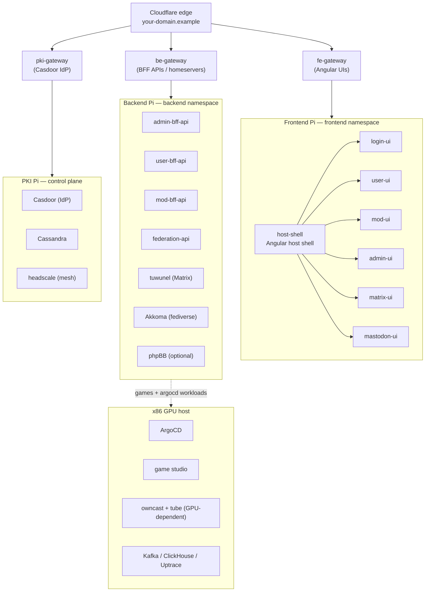

## HugMesh

A self-hosted, multi-tenant community platform built on hardened Gentoo Linux and Kubernetes. A single
USB key and a small cluster of Raspberry Pi 5 nodes plus an x86 GPU host are all an operator needs to
run their own social network, Matrix chat, fediverse instance, game studio, and moderation stack —
under their own domain, with their own role hierarchy, behind their own identity provider.

---

## What it is

HugMesh is a **generator-first, production-grade platform**: the [`hugmesh-generator`](https://github.com/hugmesh/hugmesh-generator)
repo builds hardened OS images for each cluster role, drops GitOps manifests into ArgoCD, and
provisions everything from a single FAT32 `KEYS` USB partition at first boot. Once the cluster is up,
operators manage it entirely through role-gated UIs and BFF APIs — no direct cluster access is needed
after provisioning.

The platform is multi-tenant from the ground up. A single deployment can host multiple independent
brands/domains, each with its own namespace, mTLS boundary, Casdoor issuer, and role hierarchy. A
`SUPERADMIN` can add new domains at runtime through the superadmin Service Catalog; domain admins,
moderators, and users operate strictly within their own brand and cannot see across tenant boundaries.

---

## Architecture overview

Every external request enters through a [Spring Cloud Gateway](https://github.com/hugmesh/hugmesh-gateway)
instance. The gateway validates Casdoor JWTs, enforces the per-brand `gateway_route_access` table
(Postgres, mirrored to Cassandra), and injects domain-scoping headers before forwarding to a BFF or
homeserver. The gateways are the only services the public Internet reaches.

---

## Repositories

### Core platform

| Repo | Role |
|---|---|
| [`hugmesh-generator`](https://github.com/hugmesh/hugmesh-generator) | Crossdev build scripts → hardened Gentoo images + GitOps manifests. Start here if you're operating the cluster. |
| [`hugmesh-gateway`](https://github.com/hugmesh/hugmesh-gateway) | Spring Cloud Gateway (WebFlux). One image, three roles: PKI, BE, FE. JWT resource server + data-driven route-access enforcement. |
| [`hugmesh-commons`](https://github.com/hugmesh/hugmesh-commons) | Shared Maven artifact. JWT authority extraction, `DomainRegistry`, `PrincipalDomain`, and the RESERVED_PREFIX injection guard consumed by every BFF and the gateway. |

### Backend services (BFF APIs)

| Repo | Role |
|---|---|
| [`hugmesh-admin-bff-api`](https://github.com/hugmesh/hugmesh-admin-bff-api) | Admin control plane: registration allowlist, session store, homeserver token brokering, gateway route-access rules, ban/suspend/domain-lock, ClickHouse analytics, cloud backups, device licensing, superadmin service catalog, notifications outbox. |
| [`hugmesh-user-bff-api`](https://github.com/hugmesh/hugmesh-user-bff-api) | User BFF: profile, preferences, federation cards, connected-client management. Owner-enforced — every endpoint operates only on the caller's own data. |
| [`hugmesh-mod-bff-api`](https://github.com/hugmesh/hugmesh-mod-bff-api) | Moderator BFF: moderation queue, federation-block recommendations, server-wide blocks, domain-lock desired-state. Narrow surface by design — no infrastructure access. |
| [`hugmesh-federation-api`](https://github.com/hugmesh/hugmesh-federation-api) | Dynamic federation registry: runtime Angular remote manifest, public capabilities projection, vanity subdomain resolution, per-user content bundles, platform-wide kill-switch. |
| [`hugmesh-forum-bff-api`](https://github.com/hugmesh/hugmesh-forum-bff-api) | phpBB forum BFF. |
| [`hugmesh-wiki-bff-api`](https://github.com/hugmesh/hugmesh-wiki-bff-api) | Wiki BFF. |
| [`hugmesh-owncast-bff-api`](https://github.com/hugmesh/hugmesh-owncast-bff-api) | Owncast live-streaming BFF (GPU-dependent optional service). |
| [`hugmesh-tube-bff-api`](https://github.com/hugmesh/hugmesh-tube-bff-api) | LocalTube BFF — yt-dlp-backed in-platform video (GPU-dependent optional service). |

### Frontend (Angular micro-frontends)

All UIs are **Angular 22 native-federation remotes** loaded at runtime by the host shell. No remote is
deployed as a standalone app — each is a separate nginx pod that exposes a `remoteEntry.json` and one
`./routes` module.

| Repo | Mounted at | Gate |
|---|---|---|
| [`hugmesh-host-shell`](https://github.com/hugmesh/hugmesh-host-shell) | `/` | Host shell — owns chrome, authgate, role-home routing. Loads all remotes. |
| [`hugmesh-login-ui`](https://github.com/hugmesh/hugmesh-login-ui) | `/login` | Public — Casdoor OIDC flow + two-stage registration. |
| [`hugmesh-user-ui`](https://github.com/hugmesh/hugmesh-user-ui) | `/user` | Any authenticated user. |
| [`hugmesh-mod-ui`](https://github.com/hugmesh/hugmesh-mod-ui) | `/mod` | `ROLE_MOD` or `ROLE_ADMIN`. |
| [`hugmesh-admin-ui`](https://github.com/hugmesh/hugmesh-admin-ui) | `/admin` | `ROLE_ADMIN`. |
| [`hugmesh-matrix-ui`](https://github.com/hugmesh/hugmesh-matrix-ui) | `/social/matrix` | Registered users. |
| [`hugmesh-mastodon-ui`](https://github.com/hugmesh/hugmesh-mastodon-ui) | `/social/mastodon` | Registered users. |
| [`hugmesh-forum-ui`](https://github.com/hugmesh/hugmesh-forum-ui) | `/forum` | Registered users. |
| [`hugmesh-wiki-ui`](https://github.com/hugmesh/hugmesh-wiki-ui) | `/wiki` | Registered users. |
| [`hugmesh-owncast-ui`](https://github.com/hugmesh/hugmesh-owncast-ui) | `/stream` | Optional service — greys out when absent. |
| [`hugmesh-tube-ui`](https://github.com/hugmesh/hugmesh-tube-ui) | `/tube` | Optional service — greys out when absent. |
| [`hugmesh-api-docs`](https://github.com/hugmesh/hugmesh-api-docs) | `/admin/docs` | Admin-only OpenAPI console. |
| [`hugmesh-remote-fragment`](https://github.com/hugmesh/hugmesh-remote-fragment) | Per-user vanity subdomain | Serves user content-bundle fragments synced from the federation API. |
| [`hugmesh-superadmin-service-catalog-ui`](https://github.com/hugmesh/hugmesh-superadmin-service-catalog-ui) | Tailnet only | Superadmin Service Catalog — reachable only over a private mesh network, never on a public gateway. |
| [`hugmesh-games`](https://github.com/hugmesh/hugmesh-games) | `games.<domain>` | Godot 4 WASM game studio: self-hosted, SSE multiplayer sessions, built-in RPG and visual-novel authoring. |

---

## Auth and security model

Authentication is **Casdoor-OIDC throughout**. The login-ui remote runs a native username/password
(+MFA) form; user-bff generates the PKCE pair server-side and exchanges it with Casdoor internally —
the browser is never redirected to Casdoor and never sees a raw JWT, only an opaque `bff_`-prefixed
session cookie. The gateways validate JWTs (or resolve the opaque session via the `BffSessionAuthFilter`
bridge) before any request reaches a BFF.

Role authority flows from the Casdoor JWT claim. The `hugmesh-commons` library extracts roles, derives
the `DOMAIN_<x>` scope from the cryptographically-validated issuer (never from a claim), and applies the
RESERVED_PREFIX guard to prevent authority injection. SUPERADMIN is the only cross-domain bypass.

The role cascade is: `SUPERADMIN` → `ADMIN` → `MOD` → `USER`. Each level is strictly contained to its
own domain except SUPERADMIN.

---

## Key design decisions

- **One image, many roles.** The gateway, BFFs, and frontend remotes are all built once and
  differentiated at deploy time by `SPRING_APPLICATION_NAME` and ConfigMap. ArgoCD reconciles the
  per-brand GitOps payloads.

- **Federation-first UI.** The Angular host shell is brand-agnostic and exposes no pages of its own.
  Every route is a separately deployed nginx pod loaded at runtime via `native-federation`. The runtime
  manifest is served dynamically by `hugmesh-federation-api`, so new remotes appear without redeploying
  the host.

- **Optional services degrade gracefully.** Akkoma, tuwunel, phpBB, and the games studio are
  add/remove-by-command. The UI greys out their routes when a service is absent; the gateway
  route-access table and the federation capabilities projection drive the visual state without any
  frontend code changes.

- **Security is load-bearing, not bolted on.** All services are Spring Security reactive resource
  servers. The `hugmesh-commons` library is the single source of truth for JWT authority extraction and
  tenancy scoping. Per-app SCRAM Postgres roles, Cassandra mTLS, SELinux ENFORCING on every node, and
  continuous OWASP ZAP + Dependency-Check + nuclei CI are baseline requirements, not optional hardening.

- **Built for real hardware.** Three Raspberry Pi 5 nodes cover PKI/control-plane, backend services, and
  frontend/gateway duties. A desktop x86 machine (RTX 4060 or better) runs ArgoCD, the game studio,
  GPU-dependent video services, and the Gentoo binhost. Images are built by crossdev, distributed over
  a mesh network, and applied without interrupting running services.

---

## Getting started

If you are **operating a cluster**: start with [`hugmesh-generator/docs/RUNNING.md`](https://github.com/hugmesh/hugmesh-generator/blob/main/docs/RUNNING.md)
— the end-to-end runbook from prerequisites through first-boot provisioning. Then read
[`docs/ARCHITECTURE.md`](https://github.com/hugmesh/hugmesh-generator/blob/main/docs/ARCHITECTURE.md)
for the full topology.

If you are **contributing to a service**: each repo has its own README describing where it sits, its
API surface, test conventions, and current state. The platform-wide conventions (security hardening,
reactive code style, data-access standard, test standard) are documented in
[`hugmesh-generator/docs/SECURITY.md`](https://github.com/hugmesh/hugmesh-generator/blob/main/docs/SECURITY.md).

Releases (container images, OS image artifacts) are published via GitHub Releases once a repo's
release workflow is enabled.
