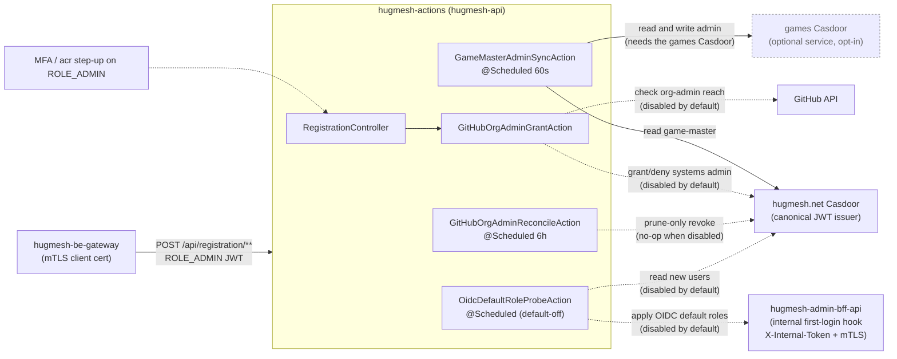
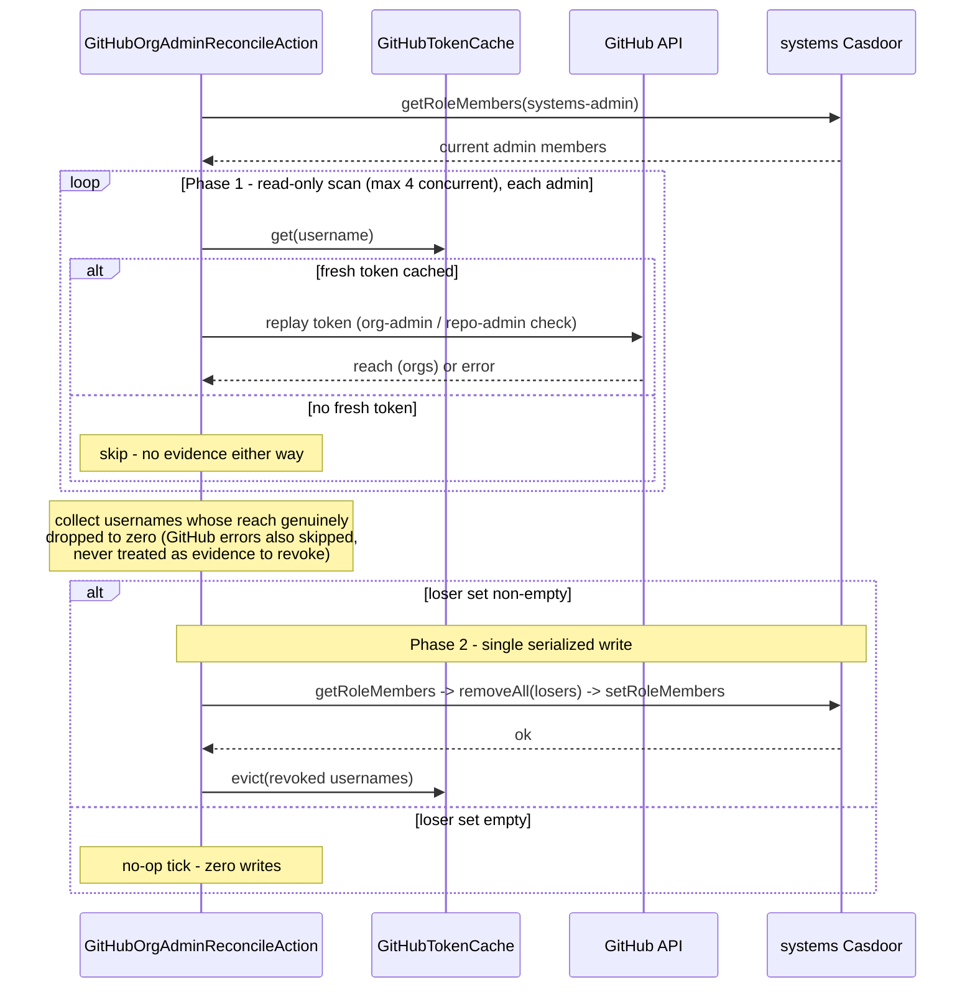

Reactive Spring (WebFlux, Java 25, `@EnableScheduling`) service. It runs the
HugMesh platform's **cross-stack role-reconciliation** jobs and hosts the
**registration org-admin grant** endpoint. It is stateless by design. Every
scheduled tick reads the truth from the canonical Casdoor instances (and
GitHub) and reconciles the downstream side-effect. The only durable state
lives in Casdoor. The GitHub-token cache is process-local and best-effort;
losing it on a restart only delays an auto-revoke.

## Where it sits in the platform

| | |
|---|---|
| **Tier** | Backend effector / reconciler — talks to Casdoor admin APIs + GitHub; not a user-facing UI. |
| **In-cluster identity** | Deployed under the name **`hugmesh-api`** (its mTLS identity is the `hugmesh-api-mtls` ESO Secret). The deployment manifest lives in `hugmesh-generator` (`specs/cluster/manifests/hugmesh-apis/`), not in this repo. See [SECURITY.md](SECURITY.md). |
| **Port** | `8090` (env `PORT`) in the container. The in-cluster Service `hugmesh-api` listens on `8080` and forwards to `8090`. |
| **Fronted by** | `hugmesh-be-gateway` — the legitimate caller of `/api/registration/**`; an external client never reaches this API directly. |
| **Trusts** | The **hugmesh.net Casdoor** as its canonical JWT issuer (this surface mutates state in *both* the systems and games Casdoors, so only the systems side is trusted to authorize the call). |

The reconcilers keep two platform invariants true after the fact, not only at
sign-in. A `game-master` on hugmesh.net becomes an `admin` in the **optional,
opt-in games realm** (the games service is OFF by default and exists only
when the build is generated with `--enable-games`). A platform admin who loses
their GitHub org-admin reach loses hugmesh.net admin (when the GitHub grant
feature is on).



Solid edges are **✅ shipped** and active by default. The dotted
GitHub-org-admin and OIDC-default-role edges are shipped but **gated off
by default** (`app.actions.gh-org-admin.enabled=false`,
`app.actions.oidc-default-roles.enabled=false`). The `MFA` node is the
registration step-up guard, also shipped but **gated off by default**
(`app.mfa.enabled=false`). See [Roadmap](#roadmap---planned-not-shipped) and
[Current State](#current-state).

## Actions

### `GameMasterAdminSyncAction` — systems game-master → games admin

> This action belongs to the **optional games service** (HugMesh Game
> Studio), which is OFF by default and on only when a build is
> generated with `--enable-games` / `ENABLE_GAMES=true`. Without games there
> is no games Casdoor to reach. Each tick reads both Casdoors together, so
> the tick fails and counts `actions.gm_sync.errors`. The action
> propagates a domain admin/superadmin who holds the `game-master` role
> into the games realm as a games admin.

It propagates the `game-master` role from the hugmesh.net Casdoor into
the `admin` role on the games Casdoor. It runs every
`app.actions.game-master-sync.interval-ms` (default **60 s**; first tick after
`initial-delay-ms`, default 5 s). The role names are
`app.actions.game-master-sync.systems-role` (`GM_SYNC_SYSTEMS_ROLE`, default
`game-master`) and `…games-role` (`GM_SYNC_GAMES_ROLE`, default `admin`). Those
are defaults only. The in-cluster deployment
(`hugmesh-generator/specs/cluster/manifests/hugmesh-apis/deployment.yaml`) sets
`GM_SYNC_SYSTEMS_ROLE=ROLE_GAMES_ADMIN`, so there the sync mirrors
`ROLE_GAMES_ADMIN` on systems into `admin` on games.

Each tick reads both role memberships. It computes the desired games-admin
set by rewriting every systems member's `<org>/<username>` identifier to
the games organization (`hugmesh/alice` →
`threewizards/alice` — the literal Casdoor org identifiers,
`app.casdoor.platform.organization` / `app.casdoor.games.organization`,
neither yet renamed). It POSTs the new membership to the games Casdoor
**only when it differs**. A tick with no change writes nothing. The per-Casdoor
side-effect is wrapped in a Resilience4j `@CircuitBreaker(name="casdoor")`, so a
stalled Casdoor opens the breaker and the next tick retries instead of piling
up work.

| systems `game-master` | games `admin` (before) | games `admin` (after) |
|---|---|---|
| `{alice, bob}` | `{alice}` | `{alice, bob}` |
| `{alice}` | `{alice, dropped}` | `{alice}` |
| `{alice}` | `{alice}` | `{alice}` (no-op) |

#### Notifications v1 — first caller (`RoleChangeNotifier`)

> **Disabled by default (✅ shipped).** Gated behind
> `app.actions.notify.enabled` (env `APP_ACTIONS_NOTIFY_ENABLED`), default
> `false`. While disabled, `RoleChangeNotifier` is a **logged no-op**
> (`actions.notify.skipped` counts every call). The reconciler's write
> behaviour is unchanged and **nothing writes `user_notifications`**. This is
> the platform's declared "first caller" of notifications v1
> (hugmesh-user-bff-api `#20`). Until this flag flips in-cluster, the
> notifications floor exists but stays empty.

After a **confirmed** games-admin membership write, every added or removed
member gets a notification. Delivery is best-effort: a notification failure
never fails the sync tick. The call is `POST /bff/user/internal/notifications`
on hugmesh-user-bff-api, with a Casdoor `ROLE_SERVICE` client-credentials
bearer (the same mint and cache the federation username client uses). The
target user's JWT subject is resolved from their username against the
**hugmesh.net** Casdoor (`CasdoorClient#getUserId` —
`GET /api/get-user`). Login identity always lives in systems, whichever org's
role changed. An unresolvable username is skipped and counted, never guessed.

user-bff reports an outcome for every delivery. `delivered=false,
reason=suppressed` means the target silenced the `role-change` category (not an
error). `deduped=true` means the same reconcile-tick delivery was
already applied (idempotent on `(sourceTable, sourceId)`). The sourceId
stamps the tick's epoch-millis, so a retried HTTP call dedupes while a
later, genuine re-grant or re-revoke of the same role still notifies.

### `GitHubOrgAdminGrantAction` — GitHub org admin → systems admin

> **Disabled by default (✅ shipped).** A master switch gates the whole
> GitHub-org-admin auto-grant: `app.actions.gh-org-admin.enabled` (env
> `GH_ORG_ADMIN_ENABLED`), **default `false`**. While it is off, the evaluate
> endpoint returns **`404`** (not `403`), the scheduled reconciler is a
> **no-op** (no GitHub calls, no Casdoor writes), and the cached-token path is
> never seeded. The superadmin opts in by setting the env var and rolling the
> pod. Everything below describes the **enabled** behaviour.

The action grants hugmesh.net `admin` to a GitHub-authenticated user who
holds admin authority on a configured GitHub org (the HugMesh org). Two kinds of
authority count: **org-level admin** (`GET /user/memberships/orgs/{org}` →
`admin`) **or** admin permission on **any repo** the org owns (a paginated
walk of `GET /user/repos`). Orgs default to `hugmesh,HugMesh`
(`app.actions.gh-org-admin.orgs`). Both casings are deliberate: the repo-admin
path matches the repo owner's login case-sensitively. The granted role defaults
to `admin` (`…systems-admin-role`).

It has two entry points, plus a scheduled revoke loop:

| Caller | Trigger | Behaviour |
|---|---|---|
| **Sign-up (on demand)** | `POST /api/registration/github-org-admin/evaluate` | Evaluates the forwarded GitHub token; on a match adds the user to systems-admin and returns the Casdoor member id, otherwise `403`. Caches the forwarded GitHub token so the reconciler can re-check the user later. |
| **Reconcile (scheduled)** | `GitHubOrgAdminReconcileAction` | Revokes systems-admin from users whose GitHub admin reach has dropped to zero. |

GitHub shows admin reach only through **the user's own token**. No service
account can see another user's private org or repo admin rights. So the
evaluate call stores that token in an in-memory `GitHubTokenCache` (TTL
`app.actions.gh-org-admin.token-ttl`, default **24 h**) for the reconciler to
replay. The GitHub-side calls sit behind a `@CircuitBreaker(name="github")`, so
a GitHub outage fails fast instead of cascading through every sign-up
evaluation.

### `GitHubOrgAdminReconcileAction` — scheduled prune-only revoke loop

Without it, an admin who loses GitHub org-admin reach would keep
systems-admin until their next sign-in. It mirrors the sync action's shape:
a reactive `Mono`/`Flux` pipeline, `@CircuitBreaker(name="github")`, and
configurable `…reconcile.interval-ms` (default **6 h**) and
`…initial-delay-ms` (default 30 s).

Each tick:

1. Reads the current member list of the systems-admin role from the
   hugmesh.net Casdoor.
2. **Phase 1 — concurrent read-only scan** (at most 4 in flight). For every
   member with a **fresh** cached GitHub token, it replays the token
   against GitHub and collects the usernames whose reach has dropped to
   zero. Members with no fresh token are **skipped**; the loop never
   revokes on missing or stale evidence. A transient or inconclusive GitHub
   error also counts as missing evidence and is skipped.
3. **Phase 2 — single serialized write.** It removes the whole loser set in
   one `getRoleMembers → removeAll → setRoleMembers`. That closes the
   lost-update race a per-user read-modify-write would have. An empty loser
   set writes nothing.



The loop is **prune-only**: it removes admin and never grants it. It is
**idempotent**: a tick where everyone still has reach is a pure read with zero
writes. The token cache is process-local and best-effort. After a pod restart,
an auto-revoke waits until the user signs in again. The grants themselves live
in Casdoor.

### `OidcDefaultRoleProbeAction` — OIDC default roles for new sign-ups

> **Disabled by default (✅ shipped).** Gated behind
> `app.actions.oidc-default-roles.enabled` (env
> `APP_OIDC_DEFAULT_ROLES_ENABLED`), **default `false`**, like the
> GitHub-org-admin grant. While it is off, the scheduled tick returns
> immediately (no Casdoor read, no admin-bff call). The
> `@ConditionalOnProperty` role-hook client bean does not exist either, so the
> action short-circuits a second way. Everything below describes the
> **enabled** behaviour.

This action is the missing **caller** for the registration-flow default-role
hook in `hugmesh-admin-bff-api`. Admin-bff already reads the
per-`(domain, provider)` default-role map and applies it through Casdoor. But
Casdoor exposes no first-login webhook in this org. So this scheduled
probe watches the newest Casdoor users and calls the existing
admin-bff `POST /bff/internal/oidc/first-login` endpoint once per new
signup. That endpoint sits on admin-bff's `/bff/internal/**` internal
surface: `permitAll` at the Spring layer, gated instead by in-cluster
mTLS (`server.ssl.client-auth=need`) plus a constant-time
`X-Internal-Token` header check. So `OidcRoleHookClient` presents the
shared `X-Internal-Token`
(`app.actions.oidc-default-roles.internal-token`) and carries this
service's own cluster mTLS client identity. It does **not** send a Casdoor
`ROLE_SERVICE` bearer. The probe runs every `app.actions.oidc-default-roles.interval-ms`
(default **5 min**). It reads the `limit` newest users and keeps only those
created within the `lookback` window, whose `signupApplication` maps to a
configured provider, and which it has not seen. Then it applies each
user's provider defaults.

It is idempotent and stateless like the other reconcilers. A process-local,
best-effort seen-set (like `GitHubTokenCache`) stops re-POSTing
within a pod's lifetime, and each tick prunes it to the lookback window. The
underlying `addUserToRole` is itself idempotent. Even fully enabled, a
provider with no default-role map configured causes zero Casdoor
writes. Metrics: `actions.oidc_default_roles.{applied,skipped,errors}`.

## HTTP surface

The only request endpoint is the registration org-admin gate. The rest of the
service is scheduled work with no request principal.

`POST /api/registration/github-org-admin/evaluate` — body
`{ githubAccessToken, hugmeshUsername }`. Jakarta Bean Validation bounds both
fields and checks their charset; malformed input gets `400`. The
**registration remote's BFF** calls this endpoint after a new user
completes external GitHub OAuth. It forwards the user's GitHub
access token and their freshly minted Casdoor username. In order, the
controller does three things:

1. **Local reserved-username gate** (runs unconditionally). It rejects with
   `422` any username that, normalised to the vanity-subdomain DNS-label
   form, collides with a dedicated gateway route or prefix. The reserved
   list (`ReservedNames`, currently **82 labels**, asserted by
   `ReservedNamesTest`) is the canonical union
   of the fe-/be-gateway route prefixes, reserved subdomains, the
   app routes of the optional (opt-in, default-off) games service, and
   defensive infra names. It must stay **byte-for-byte in lockstep**
   with the canonical `specs/cluster/reserved-prefixes.yaml` in
   `hugmesh-generator`, the route prefixes in `hugmesh-gateway`'s `CanonicalSeed`,
   and the other hand-synced copies (`hugmesh-federation-api`, and
   `hugmesh-auth-core`, which user-bff and admin-bff consume). The
   `hugmesh-auth-core` copy asserts the same 82. This gate is defence-in-depth;
   Casdoor's own forbidden-username policy is the source gate.
2. **Federation confusable / availability gate** (defence-in-depth,
   **config-gated, default off**). When
   `app.federation.username-check.enabled=true`, it asks
   `hugmesh-federation-api`
   (`GET /api/federation/username/{candidate}/availability`, a
   ROLE_SERVICE call) to catch homoglyph, look-alike and reserved-
   confusable handles the exact local check can't see. A collision gets `422`.
   The check **fails closed**: a federation outage rejects the name rather than
   mint a look-alike. The service bearer comes from the OAuth2
   client-credentials grant against the systems Casdoor (reusing
   `app.casdoor.platform.*`) and is cached and re-minted.
3. **Grant** — only when both gates pass. It runs
   `GitHubOrgAdminGrantAction.evaluateAndGrant` and returns
   `{ memberId }` on success, or `403` when the user has no HugMesh
   org-admin reach. **When the master switch
   `app.actions.gh-org-admin.enabled` is `false` (the default), this step
   short-circuits and the endpoint returns `404`.** The reserved-name
   and confusable gates still run, but no grant is attempted.

## Security & multi-tenancy

Two independent layers defend the service (full detail in
[SECURITY.md](SECURITY.md)):

- **OAuth2 resource server (application layer).** It validates Casdoor-
  issued JWTs from the systems Casdoor issuer. Path policy (reactive
  `SecurityConfig`):
  - `/actuator/health`, `/actuator/health/**` + `/actuator/info` — public (probes);
  - `/actuator/**` — `ROLE_GAME-MASTER` (metrics, Prometheus and Casdoor
    reachability never leak);
  - `/api/registration/**` — `ROLE_ADMIN`;
  - SpringDoc spec + Swagger-UI (`/v3/api-docs/**`, `/swagger-ui/**`,
    `/swagger-ui.html`, `/webjars/swagger-ui/**`) — **permitAll under
    `dev`/`test`** (so the platform's `ng-openapi-gen gen:fetch` can curl
    the spec locally without a token) and **`ROLE_ADMIN` in prod**;
  - everything else — authenticated.
- **Mutual TLS (transport layer).** `server.ssl.*` is parameterized and
  **off by default** (local, dev and CI run plaintext). In-cluster, the
  deployment mounts the PKCS12 keystore and truststore from the
  `hugmesh-api-mtls` ESO Secret and sets `SSL_ENABLED=true` +
  `SSL_CLIENT_AUTH=need`. The TLS handshake then requires a client cert
  chaining to the cluster CA, so only services signed by the Vault/ESO PKI
  (the be-gateway) can call this API at all.

### How this service fits the platform auth model

The platform's user-facing auth is an SSO flow. `login-ui` POSTs a native
username/password form to `/bff/login`. `user-bff` drives the
internal Casdoor `/api/login` and the code exchange server-side, and holds
per-session JWT custody. The browser is never redirected to Casdoor and holds
only an **opaque `bff_`-prefixed session**; the end user never sees a Casdoor
JWT. The `hugmesh-gateway` is a pure Casdoor-JWT OAuth2 resource server. A
pre-security exchange filter swaps the `bff_` session for the internal custody
JWT, then runs JWT validation and a data-driven role gate (the
`gateway_route_access` Postgres table, via `GatewayRouteAccessFilter`).

`hugmesh-actions` sits **behind** that gateway as another Casdoor-JWT
resource server. It is **not** part of the login/session path. It never
performs a code exchange, holds no session, and validates only the
resolved internal JWT the gateway forwards. The login/session
relocation (admin-bff → user-bff) and the `hugmesh-auth-core`
extraction (shared account, session, MFA and Casdoor-admin infra, consumed by
user-bff and admin-bff only) **do not touch this repo's code**; it consumes
neither. It shares two things: the stateless JWT→authority converter
(`CasdoorAuthorities`, from `hugmesh-commons`) and the `ReservedNames` canonical-82
union (see [HTTP surface](#http-surface)). The SCG-5 route-namespace fix
(`spring.cloud.gateway.routes` → `…server.webflux.routes`) does
**not** apply either. This service is not a Spring Cloud Gateway, and its
`application.yml` has no `spring.cloud.gateway.*`.

### Domain-scoping (issuer-keyed) — ✅ shipped

The platform's per-brand multi-tenancy keys a token's brand off its
**cryptographically-validated issuer** (one Casdoor per brand → distinct
`iss`). This service takes the canonical machinery from `hugmesh-commons`
(pinned at 2.2.0-beta.1; `net.hugmesh.commons.*`; `CommonsSecurityConfig` imports the beans).
There are no local copies. `SecurityConfig` delegates JWT → authority mapping
to `CasdoorAuthorities.converter(domainRegistry, mfaConfig)` and switches to the
per-issuer resolver only when the registry is genuinely multi-issuer:

- **`CasdoorAuthorities`** — the single canonical JWT → authority
  converter, used by both the single-issuer and the optional multi-issuer
  decoder paths, so they emit byte-identical authorities. It floors every
  principal to `ROLE_USER` and maps `roles` → `ROLE_<UPPER>`. It passes
  `permissions` through **verbatim except** entries carrying a reserved prefix
  (`ROLE_` / `DOMAIN_`, and `MFA_SATISFIED`), which are **stripped**. That is
  the authority-injection defence: a token can't forge a super-role or a tenant
  scope through a permission claim. It honours legacy `isAdmin` → `ROLE_ADMIN`,
  and stamps **exactly one** issuer-derived `DOMAIN_<x>` authority.
- **`DomainRegistry`** — issuer-URI → brand map. It is **backward-compatible**:
  with only the existing single `issuer-uri` it maps the lone issuer to
  `DOMAIN_default`, so this single-issuer cluster is unchanged. When
  `app.tenancy.issuers` carries `issuer=domain` pairs, the map becomes the trusted
  allowlist and **fails closed** on an unknown `iss`.
- **`TenancyResourceServerConfig`** — config-gated, opt-in per-issuer
  resolver that 401s an unknown `iss` before any authority is emitted.
- **`Roles`** helpers (`hugmesh-commons`; this service calls none of them) —
  including the least-privilege cascade markers: `SUPERADMIN` (the only role
  exempt from per-domain scoping — the infra control plane) and the separate
  `IMAGE-BUILDER` capability.

**This service adds no per-query domain predicate, by design.** It is a
single-writer effector. Its one request endpoint
(`/api/registration/github-org-admin/evaluate`, `ROLE_ADMIN`) mutates
fixed Casdoor instances and GitHub orgs whatever the caller's brand, and the
reconcilers are scheduled (no request principal). It owns no
per-domain row store, so there is no domain-scoped query to filter. It gets
the canonical converter, the issuer-keyed `DOMAIN_<x>` authority and the
multi-issuer back-compat, and nothing more.

### Roadmap — 🔭 planned (NOT shipped)

This platform-wide initiative touches this service. Both halves that
live here (the converter and the endpoint guard) ship dark on `main`; turning
them on in the live cluster is still planned.

- **Casdoor MFA / step-up (endpoint guard ✅ ships dark; converter parity
  ✅ ships dark).** A platform-wide design (9-PR plan) introduces
  WebAuthn + TOTP + recovery, with `amr`/`acr` → `MFA_SATISFIED` and
  step-up enforcement on sensitive operations. The **converter half**
  already ships dark on `main`. `CasdoorAuthorities` derives the
  `MFA_SATISFIED` authority from the validated `mfa_satisfied_at` claim
  behind `app.mfa.enabled` (default `false`). `MFA_SATISFIED` is in the
  reserved-prefix injection defence, and `Roles` carries the markers
  (covered by `CasdoorAuthoritiesTest` and `RolesTest` in `hugmesh-commons`).
  The *endpoint-enforcement guard* now ships dark too. With
  `app.mfa.enabled=true`, `/api/registration/**` requires `MFA_SATISFIED` on top
  of `ROLE_ADMIN`, and a `ROLE_ADMIN` caller refused only for the missing marker
  gets `403` with `X-Step-Up-Required: X-Actions-StepUp`
  (`MfaStepUpPathGateSliceTest`). With the flag off (the default) the endpoint
  authorizes on `ROLE_ADMIN` alone. Still planned: turning the flag on in the
  live cluster (platform-level).

## Current State

*(checked against origin/main on 2026-10-07 — reserved list at 82 labels, `hugmesh-commons`
2.1.0, `GH_ORG_ADMIN_ORGS` default `hugmesh,HugMesh`, GitHub release workflow and per-role e2e
seeder in place)*

**Shipped & active on `main`:**

- The two cross-stack reconcilers (`GameMasterAdminSyncAction`,
  `GitHubOrgAdminReconcileAction`) and the single request endpoint
  (`/api/registration/github-org-admin/evaluate`), defended by the
  OAuth2-resource-server and mTLS layers above.
- Issuer-keyed domain-scoping (canonical `CasdoorAuthorities` +
  `DomainRegistry` multi-issuer back-compat, fail-closed on unknown
  `iss`), the reserved-username gate (canonical 82 labels, see
  [HTTP surface](#http-surface)), the config-gated federation confusable gate,
  the SpringDoc/Swagger surface, and the GitLab three-stage CI pipeline
  (test → build:image → pentest).

**Shipped but gated off by default:**

- GitHub-org-admin auto-grant (`app.actions.gh-org-admin.enabled=false` →
  evaluate `404`, reconciler no-op).
- `OidcDefaultRoleProbeAction`, the scheduled OIDC-default-role caller for
  admin-bff's first-login hook (`app.actions.oidc-default-roles.enabled=false`
  → tick returns immediately, role-hook client bean absent).
- MFA **converter parity**: `CasdoorAuthorities` derives the `MFA_SATISFIED`
  authority from the validated `mfa_satisfied_at` claim only when
  `app.mfa.enabled=true` (default `false` → marker never emitted).
- The MFA step-up guard on `/api/registration/**`, behind the same
  `app.mfa.enabled` flag (off → the endpoint authorizes on `ROLE_ADMIN` alone;
  on → `MFA_SATISFIED` is also required, covered by `MfaStepUpPathGateSliceTest`).
- Notifications v1's **first caller** (`RoleChangeNotifier`, wired into
  `GameMasterAdminSyncAction`; `app.actions.notify.enabled=false` → logged
  no-op, `user_notifications` stays empty). It calls hugmesh-user-bff-api's
  `ROLE_SERVICE`-only `POST /bff/user/internal/notifications` (merged to
  `main` in user-bff `#20`) with a Casdoor client-credentials bearer. It
  resolves the target's JWT subject through the systems Casdoor's `getUserId`.

**Baseline:** this repo is on **Spring Boot 4.0.7** (Java 25 LTS).
`pom.xml` inherits `org.springframework.boot:spring-boot-starter-parent:4.0.7`
directly. Other pins: Resilience4j `…-spring-boot4` 2.4.0, plus a direct
`aspectjweaver` dependency so the `@CircuitBreaker` aspect registers (Boot 4
removed the old `spring-boot-starter-aop` convenience starter); SpringDoc 3.0.3,
with `springdoc.api-docs.version: openapi_3_0` so the published spec stays
OpenAPI 3.0. `application.yml` says ng-openapi-gen 0.51.0 cannot parse 3.1;
`hugmesh-login-ui` and `hugmesh-character-studio-ui` still pin `^0.51.0`, the
other UIs `^1.0.5`. The Boot-4 WebFlux JSON codec is Jackson 3.

**Commons adoption (✅ done — metapom parent deliberately NOT adopted):** the
local `CasdoorAuthorities` / `DomainRegistry` copies are gone. The service
imports `net.hugmesh.commons.security.*` through a `CommonsSecurityConfig`
`@Import` (the recipe `federation-api` uses), so the converter cannot drift
from the gateway and BFFs. `Roles` is retired onto `commons.security.Roles` too,
EXCEPT `isGameMaster` / `usernameOf(Jwt)` / `namesOf(...)`, which commons does
not carry and which had no production call sites here (dropped, not ported).

`pom.xml` inherits `spring-boot-starter-parent` **directly**, not
`hugmesh-parent` (the metapom). A live trial showed the metapom's shared
`<dependencies>` block forces `spring-boot-starter-data-r2dbc` /
`r2dbc-postgresql` / `postgresql` / `liquibase-core` / `spring-jdbc` onto every
child. This service is "INTENTIONALLY stateless... No local DB" (see
`HugMeshActionsApplication`'s javadoc). With those artifacts it would
auto-configure an R2DBC `ConnectionFactory` with no `spring.r2dbc.*` and fail to
**start** in production. So `hugmesh-commons:2.2.0-beta.1` is a direct, pinned
dependency with `<exclusions>` for those DB artifacts (plus
`spring-boot-liquibase`), which commons carries through its own `hugmesh-parent`
ancestry. Its other transitives (security, oauth2-resource-server, validation,
springdoc) are already declared here at the same Boot-4-BOM version, so
excluding them would change nothing.

## Roadmap

Platform-wide initiatives, designed or in flight, listed where they
touch this effector. Items marked ✅ are on `main`; the rest are in flight
or planned.

- **✅ Adopt `hugmesh-commons` for the converter/registry/role types (done,
  #37; version bumped to 2.1.0 in #44).** See *Commons adoption* above.
- **Casdoor MFA / step-up (endpoint guard ✅ ships dark).** WebAuthn + TOTP +
  recovery, per-role defaults, `amr`/`acr` → `MFA_SATISFIED`. The converter
  parity and the `MFA_SATISFIED` step-up guard on the `ROLE_ADMIN` registration
  endpoint both **ship dark** here, behind `app.mfa.enabled`. What remains is
  turning the flag on in the live cluster. See the block above.
- **SSO end-to-end live + e2e (in progress, platform-level).** It does not
  change this service's code, but the cross-stack admin-sync and
  per-role access matrix exercised here are part of the platform e2e
  story.
- **OWASP pen-test + nuclei in CI (✅ wired here, expanding).** The
  `pentest` stage (SCA + authenticated ZAP baseline + nuclei) already
  runs on this repo through the centralized `hugmesh-generator` templates.
  Template hardening continues platform-wide.

Other in-flight platform initiatives — encrypted versioned backups
(Velero + kopia/restic), egress VPN drop-in, per-node attached storage,
desktop app governance, workload console, device-license registry,
multi-tenancy superadmin (per-domain CA + per-brand gateway/BFF/UI), the
games app-store, and A/V via coturn/TURN — belong to other repos and
do not change this effector's code.

## Metrics

Prometheus is exposed at `/actuator/prometheus` (gated to
`ROLE_GAME-MASTER`).

| Name | Type | Meaning |
|---|---|---|
| `actions.gm_sync.added` | counter | Members added to games-admin during a sync |
| `actions.gm_sync.removed` | counter | Members removed from games-admin during a sync |
| `actions.gm_sync.unchanged` | counter | Sync ticks where membership already matched (no write) |
| `actions.gm_sync.errors` | counter | Sync ticks that failed to read or write Casdoor |
| `actions.gh_org_admin.granted` | counter | Users granted systems-admin via GitHub org membership |
| `actions.gh_org_admin.revoked` | counter | Users stripped of systems-admin after losing GitHub reach |
| `actions.gh_org_admin.denied` | counter | Sign-up evaluate requests rejected (no HugMesh org admin) |
| `actions.gh_org_admin.errors` | counter | Sign-up evaluations that errored before a decision |
| `actions.gh_org_admin.reconciled` | counter | Admins re-evaluated against GitHub on a reconcile tick |
| `actions.gh_org_admin.reconcile_skipped` | counter | Admins left untouched for lack of a fresh GitHub token |
| `actions.gh_org_admin.reconcile_errors` | counter | Reconcile ticks / per-user checks that failed |
| `actions.oidc_default_roles.applied` | counter | New users for whom OIDC-provider default roles were applied via admin-bff (default-off) |
| `actions.oidc_default_roles.skipped` | counter | New users skipped (already seen / unmapped provider / outside lookback) |
| `actions.oidc_default_roles.errors` | counter | OIDC default-role probe ticks / per-user applies that failed |
| `actions.notify.delivered` | counter | In-app notifications freshly delivered to user-bff |
| `actions.notify.deduped` | counter | Deliveries user-bff recognised as an already-delivered source event |
| `actions.notify.suppressed` | counter | Deliveries user-bff suppressed per the target's category preference |
| `actions.notify.skipped` | counter | Notifications skipped (writer dark, or target user unresolvable) |
| `actions.notify.errors` | counter | Notification deliveries that failed (fail-soft — the reconcile tick continues) |

## Configuration

Casdoor endpoints and credentials, the GitHub orgs and role, the schedule
intervals, the token TTL, the federation toggle and the mTLS stores are all
driven by env vars. See `src/main/resources/application.yml` for most keys
and defaults. The `app.actions.notify.*` and `app.mfa.*` keys below are
the exception: they exist only as inline `@Value`/`@ConditionalOnProperty`
defaults in `UserNotificationClientConfig`/`RoleChangeNotifier`/
`SecurityConfig`, not in application.yml. The main ones:

| Concern | Key (env override) | Default |
|---|---|---|
| Systems Casdoor | `app.casdoor.platform.*` (`CASDOOR_PLATFORM_URL`, `…CLIENT_ID`, `…CLIENT_SECRET`, `…ORG`) | `…hugmesh` (literal Casdoor org identifier, `app.casdoor.platform.organization`; matches the main stack's CASDOOR_PLATFORM_ORG and seed-e2e.sh's CASDOOR_ORG) |
| Games Casdoor | `app.casdoor.games.*` (`CASDOOR_GAMES_URL`, …, `CASDOOR_GAMES_ORG`) | `…threewizards` |
| JWT issuer | `spring.security.oauth2.resourceserver.jwt.issuer-uri` (`CASDOOR_PLATFORM_URL`) | systems Casdoor |
| GM sync interval | `app.actions.game-master-sync.interval-ms` (`GM_SYNC_INTERVAL_MS`) | `60000` |
| GM sync roles | `app.actions.game-master-sync.systems-role` / `…games-role` (`GM_SYNC_SYSTEMS_ROLE` / `GM_SYNC_GAMES_ROLE`) | `game-master` / `admin` (the cluster deployment sets `ROLE_GAMES_ADMIN` as the systems role) |
| GitHub-org-admin auto-grant | `app.actions.gh-org-admin.enabled` (`GH_ORG_ADMIN_ENABLED`) | `false` (off → evaluate returns `404`, reconciler no-op) |
| GitHub orgs | `app.actions.gh-org-admin.orgs` (`GH_ORG_ADMIN_ORGS`) | `hugmesh,HugMesh` (both casings — the repo-admin reach path matches the repo owner's login case-sensitively) |
| Granted systems role | `app.actions.gh-org-admin.systems-admin-role` (`GH_ORG_ADMIN_ROLE`) | `admin` |
| GitHub token TTL | `app.actions.gh-org-admin.token-ttl` (`GH_ORG_ADMIN_TOKEN_TTL`) | `PT24H` |
| Revoke reconcile interval | `app.actions.gh-org-admin.reconcile.interval-ms` (`GH_ORG_ADMIN_RECONCILE_INTERVAL_MS`) | `21600000` (6 h) |
| OIDC default-role probe | `app.actions.oidc-default-roles.enabled` (`APP_OIDC_DEFAULT_ROLES_ENABLED`) | `false` (off → tick returns immediately, role-hook bean absent) |
| OIDC probe interval | `app.actions.oidc-default-roles.interval-ms` | `300000` (5 min) |
| OIDC admin-bff base URL | `app.actions.oidc-default-roles.admin-bff-base-url` (`APP_OIDC_DEFAULT_ROLES_ADMIN_BFF_BASE_URL`) | in-cluster admin-bff DNS |
| OIDC internal-token | `app.actions.oidc-default-roles.internal-token` (`APP_OIDC_DEFAULT_ROLES_INTERNAL_TOKEN`) | _(empty)_ — shared `X-Internal-Token` for the admin-bff first-login call |
| MFA converter parity + registration step-up guard | `app.mfa.enabled`, `app.mfa.freshness-window` (ms) | `false` (off → `MFA_SATISFIED` marker never emitted and `/api/registration/**` needs `ROLE_ADMIN` alone); `600000` |
| Federation confusable gate | `app.federation.username-check.enabled` (`APP_FEDERATION_USERNAME_CHECK_ENABLED`) | `false` |
| Notifications v1 writer | `app.actions.notify.enabled` (`APP_ACTIONS_NOTIFY_ENABLED`) | `false` (off → `RoleChangeNotifier` is a logged no-op, nothing writes `user_notifications`) |
| Notifications v1 target user-bff | `app.actions.notify.user-bff-base-url` (`APP_ACTIONS_NOTIFY_USER_BFF_BASE_URL`) | in-cluster user-bff DNS |
| Notifications v1 domain tag | `app.actions.notify.domain` (`APP_ACTIONS_NOTIFY_DOMAIN`) | `default` |
| GitHub API base | `app.github.base-url` (`GITHUB_API_BASE_URL`) | `https://api.github.com` |
| mTLS | `server.ssl.*` (`SSL_ENABLED`, `SSL_CLIENT_AUTH`, …) | off / `none` |

Resilience4j circuit breakers are configured per downstream
(`casdoor`, `github`, `federation`, `admin-bff`) under
`resilience4j.circuitbreaker.*`.

## API docs

SpringDoc publishes the OpenAPI 3 spec at `/v3/api-docs` and Swagger-UI
at `/swagger-ui.html`, scoped to this service's own `web` package. The
platform's `ng-openapi-gen` typed clients, the admin api-docs/SwaggerUI
federated module and the docs pipeline all consume it. The
spec paths are public under `dev`/`test` and `ROLE_ADMIN` in prod (see
above).

## Running locally

```bash
docker compose up -d                        # two Casdoors (systems + games) + the action
docker compose logs -f hugmesh-actions   # watch ticks (compose.yaml's service name)
curl localhost:8090/actuator/health         # public probe
```

A cold `docker compose up` builds the image, and that build must fetch the
private `hugmesh-commons`. See `hugmesh-generator/docs/LOCAL-STACK.md`, "Cold
builds". (UNVERIFIED here: a cold build with no build args.)

The compose stack brings up two Casdoor instances (each with its own
Postgres), so you can exercise the game-master → admin sync end to end
without production endpoints. The action service is stateless:
restarting it replays the next tick against live Casdoor state.

## Build & CI

The build is a standard Spring Boot Maven build (`./mvnw package`). The
multi-stage `Dockerfile` produces a slim JRE runtime image. CI is **GitLab**
(`.gitlab-ci.yml`): the GitHub repo is pull-mirrored into the in-cluster
GitLab, which runs the pipeline on push and mirror-sync. Images carry no
keys; PKI material comes from the USB at first boot.

The pipeline has three stages (`stages: [test, build, pentest]`):

1. **`test`** (✅ shipped) — runs `./mvnw verify -B` inside an
   `eclipse-temurin:25-jdk-noble` container on the default branch, merge
   requests and tags, and publishes the JUnit surefire reports as artifacts.
2. **`build:image`** (✅ shipped) — `needs: [test]`. It builds the
   container image and pushes it to the in-cluster registry on the default
   branch or on a tag, tagged with the release tag or short SHA plus a moving
   branch tag.
3. **`pentest`** (✅ shipped) — the continuous-OWASP stage. Thin
   `pentest:sca` / `pentest:dast` jobs `extends:` the centralized hidden
   `.pentest-sca` / `.pentest-dast-baseline` templates `include`d from
   `hugmesh-generator` (`/tests/pentest/ci/pentest-stage.gitlab-ci.yml`).
   SCA (OWASP Dependency-Check) and DAST (authenticated ZAP baseline +
   probes + nuclei) thus share one source of truth across every onboarded repo.
   Both run on the default branch and merge requests with
   `allow_failure: true`, so findings show in the MR security widget
   without blocking the pipeline. `make pentest` runs the same checks
   locally as a pre-push gate (see the `Makefile`).

### GitHub release image and versions

The version is `pom.xml` `<project><version>`, today **`0.2.0-beta.1`**:
built and tested, not yet proven on a live mesh. A beta is
`MAJOR.MINOR.PATCH-beta.N`; a fix during a beta raises N. A published version
is never reused and never a SNAPSHOT.

`.github/workflows/release.yml` ("Release image") builds this `Dockerfile` and
pushes `ghcr.io/hugmesh/hugmesh-actions`:

| Event | Image tags | GitHub Release |
|---|---|---|
| push to `main` | `:main`, `:sha-<12 hex>` | none |
| push of tag `v<version>` | `:<version>`, `:beta`, `:sha-<12 hex>` | prerelease, not latest |
| `workflow_dispatch` on a `v*` tag | same as the tag push (re-run) | created if missing |
| `workflow_dispatch` on `main` | same as a push to `main` | none |
| anything else | refused | none |

The first job (`version`) refuses a SNAPSHOT, a tag that does not equal the pom
version, and a tag whose commit is not on `main`. A release run also refuses
when `:<version>` is already in the registry. `:latest` is pushed only for a
final release (no `-` in the version); none exists yet.

To publish a beta: merge the version bump to `main`, then tag that commit
`v<version>` (annotated) and push the tag. To re-run a release, dispatch the
workflow on the tag (`gh workflow run release.yml --ref v<version>`).

**Runner.** Every job uses the runner in the repository variable
`RUNS_ON_PUBLISH` (a JSON array such as `["self-hosted","Linux","X64"]`), but
only for `main` and `v*` tags and never for a pull request. Anything else, or
an unset variable, runs on hosted `ubuntu-latest`. Deleting the variable is the
off switch. The workflow has no `pull_request` trigger.

**Private libraries.** `net.hugmesh:hugmesh-commons` (and its parent
`hugmesh-parent`) come from GitHub Packages through
`.github/maven-ci-settings.xml`, selected by the BuildKit secret
`packages_read_token`. That secret is the **`PACKAGES_READ_TOKEN` repository
secret**: a classic personal access token with `read:packages` (operator
decision 90a = B, `hugmesh-commons/RELEASING.md` section 6). The `image` job's
preflight step fails by name when the secret is unset or cannot read the two
registries. The optional `PACKAGES_READ_ACTOR` secret names the user for that
token (default: the triggering actor). The pinned commons version must be
published before this image builds (release chain: build-config, parent,
commons). Without that secret mounted, the `Dockerfile` uses the repo-root
`settings.xml` (GitLab group registry). GitLab CI and the local compose stack
(`hugmesh-generator/docs/LOCAL-STACK.md`, "Cold builds") rely on that path.

## Adding new actions

Each action is a `@Service` with a `@Scheduled` method;
`GameMasterAdminSyncAction` is the reference shape. Wrap any external
side-effect in a Resilience4j `@CircuitBreaker(name=…)` so a slow
downstream doesn't pile up tick work. Emit per-action Micrometer
counters for what was applied, skipped and errored.

## Native image (GraalVM)

The build carries a `native` profile (same shape as `hugmesh-gateway`)
plus app-specific AOT reflection hints in `NativeHintsConfig` for the
JSON-bound DTOs that cross the HTTP boundary and the
`@CircuitBreaker`-advised action beans:

```bash
./mvnw -Pnative native:compile   # requires a GraalVM native-image toolchain
```

The AOT pipeline (`./mvnw -Pnative spring-boot:process-aot`) is verified.
Run `native:compile` on a GraalVM JDK to produce the binary.

## Known Gaps / TODO

- **The e2e per-role access matrix does not test the admin grant.** The
  coded scenario in `per-role-access.feature` POSTs an **empty body** to
  `POST /api/registration/github-org-admin/evaluate` and asserts `one of 400 or
  422 or 500` (the admin cell in `e2e/README.md`'s table). That is a
  deliberate dodge: an empty body fails `@Valid` before the
  `app.actions.gh-org-admin.enabled` check (default `false`) is reached.
  The scenario proves "admin is past the auth gate", not the grant outcome.
  Setting `GH_ORG_ADMIN_ENABLED=true` alone would not make it assert `200`,
  since it never sends a body that could pass the grant.
- **The e2e per-role token mint (Decision 62, operator, 2026-09-18,
  hugmesh-actions#7) is implemented but UNVERIFIED against a live stack.**
  `e2e/scripts/lib/casdoor-seed.sh` provisions the systems Casdoor (org,
  five role objects, the `hugmesh-actions` OAuth app, one user per role
  tier) and mints five per-role bearer tokens into `e2e/.tokens.json`. It is
  proven **offline only**: `e2e/scripts/test-casdoor-seed.sh` runs the control
  flow against a shimmed `curl`, never a real `casbin/casdoor` container.
  `bring-up-stack.sh` fails closed by default (non-zero exit, never a partial
  token map). See `e2e/README.md`'s "Token wiring" for the detail and the
  `E2E_ALLOW_ANONYMOUS_ONLY=1` opt-out (which skips the seeder, not the
  e2e-password check). **A person still needs to run it against the real
  compose stack** and confirm `npm --prefix e2e test` passes all six
  `per-role-access.feature` scenarios, not just the anonymous one.
- **`cross-stack-admin-sync.feature`'s own Casdoor identities remain
  unseeded.** Decision 62's seeder covers only the per-role-access-matrix
  on the systems Casdoor. The sync feature's `game-master`/`admin` role
  objects on both Casdoors are a separate, open gap. See
  `e2e/README.md`'s Known Gaps.

## License

MIT. See [LICENSE](LICENSE), the same MIT file most hugmesh repositories carry.
The Maven wrapper scripts (`mvnw`, `mvnw.cmd`) keep their own Apache License 2.0 headers.
