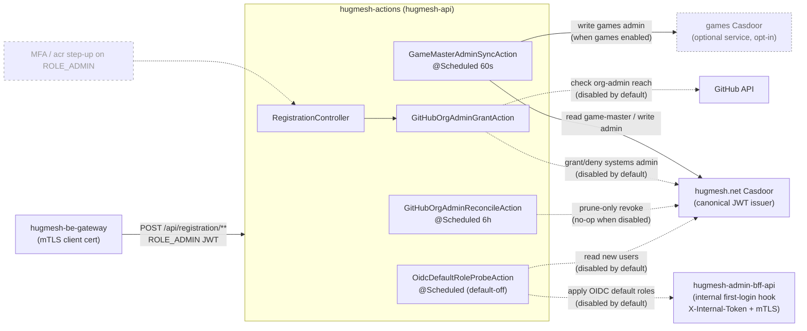
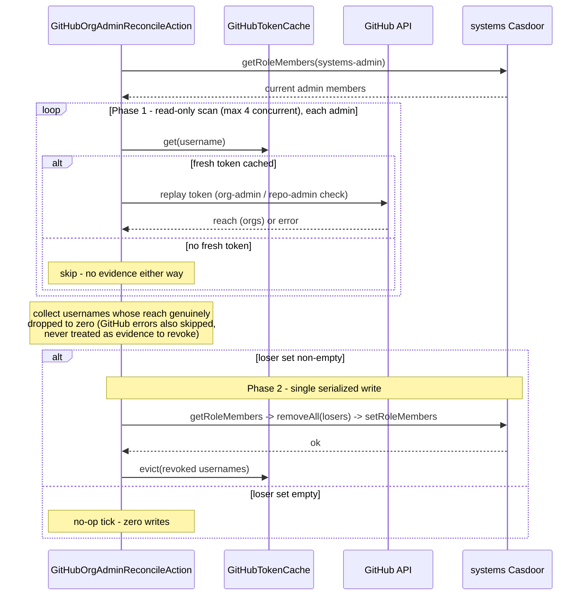

Reactive Spring (WebFlux, Java 25, `@EnableScheduling`) service that runs
the HugMesh platform's **cross-stack role-reconciliation** jobs and
hosts the **registration org-admin grant** endpoint. Stateless by
design — every scheduled tick reads source-of-truth from the canonical
Casdoor instances (and GitHub) and reconciles the downstream
side-effect; the only durable state lives in Casdoor, never here (the
GitHub-token cache is a process-local, best-effort optimisation —
losing it on a restart only delays an auto-revoke).

## Where it sits in the platform

| | |
|---|---|
| **Tier** | Backend effector / reconciler — talks to Casdoor admin APIs + GitHub; not a user-facing UI. |
| **In-cluster identity** | Deployed under the name **`hugmesh-api`** (its mTLS identity is the `hugmesh-api-mtls` ESO Secret). The deployment manifest lives in `hugmesh-generator` (`specs/cluster/manifests/hugmesh-apis/`), not in this repo. See [SECURITY.md](SECURITY.md). |
| **Port** | `8090` local/dev (env `PORT`); the in-cluster deployment maps it to `8080`. |
| **Fronted by** | `hugmesh-be-gateway` — the legitimate caller of `/api/registration/**`; an external client never reaches this API directly. |
| **Trusts** | The **hugmesh.net Casdoor** as its canonical JWT issuer (this surface mutates state in *both* the systems and games Casdoors, so only the systems side is trusted to authorize the call). |

The reconcilers in this service are what make two platform invariants
self-healing rather than sign-in-only: a `game-master` on
hugmesh.net automatically becomes an `admin` in the **optional,
opt-in games realm** (the games service is OFF by default and only
present when the build is generated with `--enable-games`), and a
platform admin who loses their GitHub org-admin reach automatically
loses hugmesh.net admin.



Solid edges are **✅ shipped** and active by default; the dotted
GitHub-org-admin and OIDC-default-role edges are shipped but **gated off
by default** (`app.actions.gh-org-admin.enabled=false`,
`app.actions.oidc-default-roles.enabled=false`); the greyed `MFA` node is
**🔭 planned** for the endpoint-enforcement guard — see
[Roadmap](#roadmap---planned-not-shipped) (note: the MFA *converter*
support already ships dark on `main`, see Current State).

## Actions

### `GameMasterAdminSyncAction` — systems game-master → games admin

> Role-gated and tied to the **optional games service** (HugMesh Game
> Studio), which is OFF by default and only enabled when a build is
> generated with `--enable-games` / `ENABLE_GAMES=true`. When games is
> not deployed this reconciler simply has no games Casdoor to write to;
> it is the cross-stack reconciler that propagates a domain
> admin/superadmin holding the `game-master` role into the games realm as
> a games admin.

Propagates the `game-master` role from hugmesh.net Casdoor into
the `admin` role on the games Casdoor. Scheduled every
`app.actions.game-master-sync.interval-ms` (default **60 s**).

Each tick reads both role memberships, computes the desired games-admin
set by rewriting every systems member's `<org>/<username>` identifier to
the games organization (`hugmesh/alice` →
`threewizards/alice` — the literal Casdoor org identifiers,
`app.casdoor.platform.organization` / `app.casdoor.games.organization`,
neither yet renamed), and POSTs the new membership to games Casdoor
**only when it actually differs**. Idempotent (a no-change tick writes
nothing) and stateless. The per-Casdoor side-effect is wrapped in a
Resilience4j `@CircuitBreaker(name="casdoor")` so a stalled Casdoor
opens the breaker and the next tick retries instead of piling up work.

| systems `game-master` | games `admin` (before) | games `admin` (after) |
|---|---|---|
| `{alice, bob}` | `{alice}` | `{alice, bob}` |
| `{alice}` | `{alice, dropped}` | `{alice}` |
| `{alice}` | `{alice}` | `{alice}` (no-op) |

#### Notifications v1 — first caller (`RoleChangeNotifier`)

> **Disabled by default (✅ shipped).** Gated behind
> `app.actions.notify.enabled` (env `ACTIONS_NOTIFY_ENABLED`), default
> `false`. While disabled `RoleChangeNotifier` is a **logged no-op**
> (`actions.notify.skipped` counts every call) — the reconciler's write
> behaviour is bit-for-bit unchanged and **nothing writes
> `user_notifications`**. This is the platform's declared "first caller"
> of notifications v1 (hugmesh-user-bff-api `#20`): until this flag
> flips in-cluster, the notifications floor exists but stays empty.

After a **confirmed** games-admin membership write, every added/removed
member is notified (best-effort — a notification hiccup never fails the
sync tick) via `POST /bff/user/internal/notifications` on
hugmesh-user-bff-api, using a Casdoor `ROLE_SERVICE` client-credentials
bearer (same mint+cache the federation username client uses). The target
user's JWT subject is resolved from their username against the
**hugmesh.net** Casdoor (`CasdoorClient#getUserId` —
`GET /api/get-user`; login identity always lives in systems regardless of
which org's role changed). An unresolvable username is skipped and
counted, never guessed.

user-bff reports an honest outcome for every delivery: `delivered=false,
reason=suppressed` means the target silenced the `role-change` category
(not an error); `deduped=true` means the same reconcile-tick delivery was
already applied (idempotent on `(sourceTable, sourceId)` — the sourceId
stamps the tick's epoch-millis so a retried HTTP call dedupes while a
later genuine re-grant/re-revoke of the same role still notifies).

### `GitHubOrgAdminGrantAction` — GitHub org admin → systems admin

> **Disabled by default (✅ shipped).** The whole GitHub-org-admin
> auto-grant feature is gated behind a master switch
> `app.actions.gh-org-admin.enabled` (env `GH_ORG_ADMIN_ENABLED`),
> **default `false`**. While disabled the evaluate endpoint returns
> **`404`** (not `403`), the scheduled reconciler is a **no-op** (no
> GitHub calls, no Casdoor writes), and the cached-token path is never
> seeded. Superadmin opts in by setting the env var and rolling the pod;
> everything below describes the **enabled** behaviour.

Auto-grants hugmesh.net `admin` to a GitHub-authenticated user
who holds admin authority on a configured GitHub org (the HugMesh org) —
either **org-level admin** (`GET /user/memberships/orgs/{org}` → `admin`)
**or** admin permission on **any repo** owned by that org (a paginated
walk of `GET /user/repos`). Orgs default to
`hugmesh,HugMesh` (`app.actions.gh-org-admin.orgs`) — both casings
deliberately, because the repo-admin reach path matches the repo owner's
login case-sensitively; the
granted role defaults to `admin` (`…systems-admin-role`).

It has two entry points, plus a scheduled revoke loop:

| Caller | Trigger | Behaviour |
|---|---|---|
| **Sign-up (on demand)** | `POST /api/registration/github-org-admin/evaluate` | Evaluates the forwarded GitHub token; on a match adds the user to systems-admin and returns the Casdoor member id, otherwise `403`. Caches the forwarded GitHub token so the reconciler can re-check the user later. |
| **Reconcile (scheduled)** | `GitHubOrgAdminReconcileAction` | Revokes systems-admin from users whose GitHub admin reach has dropped to zero. |

GitHub admin reach is only visible through **the user's own token**
(there is no service-account view of another user's private org/repo
admin), so the evaluate call seeds that token into an in-memory
`GitHubTokenCache` (TTL `app.actions.gh-org-admin.token-ttl`, default
**24 h**) for the reconciler to replay. The GitHub-side calls are
guarded by a `@CircuitBreaker(name="github")` so a GitHub outage fails
fast instead of cascading through every sign-up evaluation.

### `GitHubOrgAdminReconcileAction` — scheduled prune-only revoke loop

Closes the audit gap where an admin who loses GitHub org-admin reach
would otherwise keep systems-admin until their next sign-in. Mirrors the
sync action's shape (reactive `Mono`/`Flux` pipeline,
`@CircuitBreaker(name="github")`, configurable `…reconcile.interval-ms` /
`…initial-delay-ms`, default **6 h**).

Each tick:

1. Reads the current member list of the systems-admin role from
   hugmesh.net Casdoor.
2. **Phase 1 — concurrent read-only scan** (bounded to 4 in flight):
   for every member we hold a **fresh** GitHub token for, replays it
   against GitHub and collects the usernames whose reach has dropped to
   zero. Members with no fresh token are **skipped** (never revoked on
   missing/stale evidence); a transient/inconclusive GitHub error is
   also treated as missing evidence and skipped.
3. **Phase 2 — single serialized write**: removes the whole loser set in
   one `getRoleMembers → removeAll → setRoleMembers`, which closes the
   lost-update race that a per-user read-modify-write would have. An
   empty loser set writes nothing.



The loop is **prune-only** (it only ever removes admin, never grants)
and **idempotent** (a tick where everyone still has reach is a pure read
with zero writes). The token cache is process-local and best-effort:
losing it (a pod restart) only delays an auto-revoke until the user
signs in again; the grants themselves live in Casdoor.

### `OidcDefaultRoleProbeAction` — OIDC default roles for new sign-ups

> **Disabled by default (✅ shipped).** Gated behind
> `app.actions.oidc-default-roles.enabled` (env
> `APP_OIDC_DEFAULT_ROLES_ENABLED`), **default `false`** — exactly like the
> GitHub-org-admin grant. While disabled the scheduled tick returns
> immediately (no Casdoor read, no admin-bff call), and the
> `@ConditionalOnProperty` role-hook client bean does not even exist, so
> the action short-circuits a second way. Everything below describes the
> **enabled** behaviour.

Supplies the missing **caller** for the registration-flow default-role
hook in `hugmesh-admin-bff-api`: admin-bff already reads the
per-`(domain, provider)` default-role map and applies it via Casdoor, but
Casdoor exposes no first-login webhook in this org, so this scheduled
probe observes the newest Casdoor users and calls the existing
admin-bff `POST /bff/internal/oidc/first-login` endpoint once per new
signup. That endpoint lives under admin-bff's `/bff/internal/**` internal
surface — `permitAll` at the Spring layer and gated instead by in-cluster
mTLS (`server.ssl.client-auth=need`) plus a constant-time
`X-Internal-Token` header check — so `OidcRoleHookClient` presents the
shared `X-Internal-Token`
(`app.actions.oidc-default-roles.internal-token`) and carries this
service's own cluster mTLS client identity; it does **not** send a Casdoor
`ROLE_SERVICE` bearer. Scheduled every `app.actions.oidc-default-roles.interval-ms`
(default **5 min**), it reads the `limit` newest users, keeps only those
created within the `lookback` window whose `signupApplication` maps to a
configured provider and that it hasn't already seen, and applies each
user's provider defaults.

Idempotent and stateless like the other reconcilers: a process-local,
best-effort seen-set (mirroring `GitHubTokenCache`) prevents re-POSTing
within a pod lifetime and is pruned to the lookback window each tick, the
underlying `addUserToRole` is itself idempotent, and even fully enabled a
provider with no default-role map configured results in zero Casdoor
writes. Metrics: `actions.oidc_default_roles.{applied,skipped,errors}`.

## HTTP surface

The only request endpoint is the registration org-admin gate; the rest
of the service is scheduled work with no request principal.

`POST /api/registration/github-org-admin/evaluate` — body
`{ githubAccessToken, hugmeshUsername }` (both bounded + charset-
validated by Jakarta Bean Validation → `400` on malformed input). Called
by the **registration remote's BFF** after a new user
completes external GitHub OAuth; it forwards the user's GitHub
access-token + their freshly-minted Casdoor username. The controller, in
order:

1. **Local reserved-username gate** (runs unconditionally) — rejects
   `422` any username that, normalised to the vanity-subdomain DNS-label
   form, collides with a dedicated gateway route/prefix. The reserved
   list (`ReservedNames`, currently **82 labels**) is the canonical union
   of the fe-/be-gateway route prefixes, reserved subdomains, the
   app routes of the optional (opt-in, default-off) games service, and
   defensive infra names — **kept
   byte-for-byte in lockstep** with `hugmesh-gateway`'s `CanonicalSeed`
   and `hugmesh-admin-bff-api`'s copy (all three must agree on the same
   82). This is defence-in-depth; Casdoor's own forbidden-username policy
   is the source gate.
2. **Federation confusable / availability gate** (defence-in-depth,
   **config-gated, default off**) — when
   `app.federation.username-check.enabled=true`, asks
   `hugmesh-federation-api`
   (`GET /api/federation/username/{candidate}/availability`, a
   ROLE_SERVICE call) to catch homoglyph / look-alike / reserved-
   confusable handles the exact local check can't see, and rejects `422`
   on a collision. The check **fails closed** — a federation outage
   rejects rather than mints a look-alike. The service bearer is minted
   via the OAuth2 client-credentials grant against systems Casdoor
   (reusing `app.casdoor.platform.*`) and cached/re-minted.
3. **Grant** — only when both gates pass, runs
   `GitHubOrgAdminGrantAction.evaluateAndGrant`; returns
   `{ memberId }` on success or `403` when the user has no HugMesh
   org-admin reach. **When the master switch
   `app.actions.gh-org-admin.enabled` is `false` (the default), this step
   short-circuits and the endpoint returns `404`** — the reserved-name
   and confusable gates above still run, but no grant is ever attempted.

## Security & multi-tenancy

The service is defended in depth by two independent layers (full detail
in [SECURITY.md](SECURITY.md)):

- **OAuth2 resource server (application layer).** Validates Casdoor-
  issued JWTs from the systems Casdoor issuer. Path policy (reactive
  `SecurityConfig`):
  - `/actuator/health` + `/actuator/info` — public (probes);
  - `/actuator/**` — `ROLE_GAME-MASTER` (metrics / Prometheus / Casdoor
    reachability never leak);
  - `/api/registration/**` — `ROLE_ADMIN`;
  - SpringDoc spec + Swagger-UI (`/v3/api-docs/**`, `/swagger-ui/**`,
    `/swagger-ui.html`, `/webjars/swagger-ui/**`) — **permitAll under
    `dev`/`test`** (so the platform's `ng-openapi-gen gen:fetch` can curl
    the spec locally without a token) and **`ROLE_ADMIN` in prod**;
  - everything else — authenticated.
- **Mutual TLS (transport layer).** `server.ssl.*` is parameterized and
  **off by default** (local/dev/CI run plaintext). In-cluster the
  deployment mounts the PKCS12 keystore/truststore from the
  `hugmesh-api-mtls` ESO Secret and sets `SSL_ENABLED=true` +
  `SSL_CLIENT_AUTH=need`, so the TLS handshake requires a client cert
  chaining to the cluster CA — only services signed by the Vault/ESO PKI
  process (the be-gateway) can call this API at all.

### How this service fits the platform auth model

The platform's user-facing auth is an SSO flow: `login-ui` POSTs a native
username/password form to `/bff/login` and `user-bff` drives the
internal Casdoor `/api/login` + code exchange server-side and holds
per-session JWT custody; the browser is never redirected to Casdoor,
and the browser only ever holds an **opaque `bff_`-prefixed session** (the
end user never sees a Casdoor JWT). The `hugmesh-gateway` is a pure
Casdoor-JWT OAuth2 resource server: a pre-security exchange filter swaps
the `bff_` session for the internal custody JWT, then runs JWT validation
+ a data-driven role gate (`gateway_route_access` Postgres table via
`GatewayRouteAccessFilter`).

`hugmesh-actions` sits **behind** that gateway as another Casdoor-JWT
resource server. It is **not** part of the login/session path — it never
performs a code exchange, holds no session, and validates only the
fully-resolved internal JWT the gateway forwards. The login/session
relocation (admin-bff → user-bff) and the `hugmesh-auth-core`
extraction (shared account/session/MFA/Casdoor-admin infra, consumed by
user-bff + admin-bff only) therefore **do not touch this repo's code** —
it consumes neither. The one auth machinery it *does* share is the
stateless JWT→authority converter (`CasdoorAuthorities`, copied from
`hugmesh-gateway`) and the `ReservedNames` canonical-82 union (kept in
lockstep with `hugmesh-gateway` and `hugmesh-admin-bff-api`).

### Domain-scoping (issuer-keyed) — ✅ shipped

The platform's per-brand multi-tenancy keys a token's brand off its
**cryptographically-validated issuer** (one Casdoor per brand → distinct
`iss`). This service adopts the same canonical machinery the gateways
use, so it participates consistently. The pieces below are **part of the
service today** (merged via PR #12), and `SecurityConfig` already
delegates JWT → authority mapping to
`CasdoorAuthorities.converter(domainRegistry)` and swaps to the per-issuer
resolver only when the registry is genuinely multi-issuer:

- **`CasdoorAuthorities`** — the single canonical JWT → authority
  converter (copied from `hugmesh-gateway`), used by both the single-
  issuer and the optional multi-issuer decoder paths so they emit
  byte-identical authorities. It floors every principal to `ROLE_USER`,
  maps `roles` → `ROLE_<UPPER>`, passes `permissions` through **verbatim
  except** entries carrying a reserved prefix (`ROLE_` / `DOMAIN_`),
  which are **stripped** (authority-injection defence — a token can't
  forge a super-role or a tenant scope via a permission claim), honours
  legacy `isAdmin` → `ROLE_ADMIN`, and stamps **exactly one** issuer-
  derived `DOMAIN_<x>` authority.
- **`DomainRegistry`** — issuer-URI → brand map. **Backward-compatible:**
  with only the existing single `issuer-uri` it maps the lone issuer to
  `DOMAIN_default`, so this single-issuer cluster is byte-for-byte
  unchanged. When `app.tenancy.issuers` carries `issuer=domain` pairs it
  becomes the trusted allowlist and **fails closed** on an unknown `iss`.
- **`TenancyResourceServerConfig`** — config-gated, opt-in per-issuer
  resolver that 401s an unknown `iss` before any authority is emitted.
- **`Roles`** helpers — including the least-privilege cascade markers:
  `SUPERADMIN` (the only role exempt from per-domain scoping — the infra
  control plane) and the separate `IMAGE-BUILDER` capability.

**No per-query domain predicate is added here, by design.** This service
is a single-writer effector: its one request endpoint
(`/api/registration/github-org-admin/evaluate`, `ROLE_ADMIN`) mutates
fixed Casdoor instances + GitHub orgs regardless of the caller's brand,
and the reconcilers are scheduled (no request principal). It owns no
per-domain row store, so it gains the canonical converter + issuer-keyed
`DOMAIN_<x>` authority + multi-issuer back-compat — but there is no
domain-scoped query to filter, and none is invented.

### Roadmap — 🔭 planned (NOT shipped)

These platform-wide initiatives would touch this service when adopted.
They are **design-only today** *except where noted as ships-dark*; the
endpoint-enforcement and Boot-4 items below are not yet a current
capability on `main`.

- **Casdoor MFA / step-up (🔭 endpoint guard planned; converter parity
  ✅ ships dark).** A platform-wide design (9-PR plan) introduces
  WebAuthn + TOTP + recovery with `amr`/`acr` → `MFA_SATISFIED` and
  step-up enforcement on sensitive operations. The **converter half**
  already ships dark on `main`: `CasdoorAuthorities` derives the
  `MFA_SATISFIED` authority from the validated `mfa_satisfied_at` claim
  behind `app.mfa.enabled` (default `false`), `MFA_SATISFIED` is in the
  reserved-prefix injection defence, and `Roles` carries the markers
  (`CasdoorAuthoritiesMfaTest`). What is **still planned** is the
  *endpoint-enforcement guard* — an `mfa_satisfied` / `acr` step-up check
  guarding the `ROLE_ADMIN` registration endpoint; no such check exists
  yet, so the endpoint authorizes on `ROLE_ADMIN` alone.

## Current State

*(as of 2026-07-19 — includes the reserved-name canonical-77 sync in #42,
the GitHub-org-admin opt-in work through #38, and the HugMesh
package/groupId rebrand in #44, which also bumped the `hugmesh-commons`
dependency to 2.1.0; `GH_ORG_ADMIN_ORGS`'s transition-window default has
since been narrowed to `hugmesh,HugMesh` now the GitHub org rename is live)*

**Shipped & active on `main`:**

- The two cross-stack reconcilers (`GameMasterAdminSyncAction`,
  `GitHubOrgAdminReconcileAction`) and the single request endpoint
  (`/api/registration/github-org-admin/evaluate`), all defended by the
  OAuth2-resource-server + mTLS layers above.
- GitHub-org-admin auto-grant is **gated off by default**
  (`app.actions.gh-org-admin.enabled=false` → evaluate `404`, reconciler
  no-op).
- `OidcDefaultRoleProbeAction` (the scheduled OIDC-default-role caller for
  admin-bff's first-login hook) ships **dark / gated off by default**
  (`app.actions.oidc-default-roles.enabled=false` → tick returns
  immediately, role-hook client bean absent).
- MFA **converter parity** ships **dark / gated off by default**:
  `CasdoorAuthorities` derives the `MFA_SATISFIED` authority from the
  validated `mfa_satisfied_at` claim behind `app.mfa.enabled` (default
  `false` → marker never emitted), `MFA_SATISFIED` is in the converter's
  reserved-prefix injection defence, and `Roles` defines the
  `MFA_SATISFIED` / `mfa_satisfied_at` helpers (covered by
  `CasdoorAuthoritiesMfaTest`). The endpoint-enforcement guard is still
  🔭 planned (the `ROLE_ADMIN` endpoint authorizes on `ROLE_ADMIN` alone).
- Issuer-keyed domain-scoping (canonical `CasdoorAuthorities` +
  `DomainRegistry` multi-issuer back-compat, fail-closed on unknown
  `iss`), reserved-username gate (canonical 82 labels, in lockstep with
  `hugmesh-gateway` + `hugmesh-admin-bff-api`), the config-gated
  federation confusable gate, SpringDoc/Swagger surface, and the GitLab
  three-stage CI pipeline (test → build:image → pentest).
- Notifications v1's **first caller** (`RoleChangeNotifier`, wired into
  `GameMasterAdminSyncAction`) ships **dark / gated off by default**
  (`app.actions.notify.enabled=false` → logged no-op, `user_notifications`
  stays empty). It calls hugmesh-user-bff-api's `ROLE_SERVICE`-only
  `POST /bff/user/internal/notifications` (merged to `main` in user-bff
  `#20`) with a Casdoor client-credentials bearer, resolving the target's
  JWT subject via the systems Casdoor's `getUserId`.

**Where this repo sits vs the platform auth model (2026 cycle):** the
platform SSO flow now runs `login-ui` → `user-bff` (server-side code
exchange + JWT custody) with the browser holding only an opaque `bff_`
session, and the gateway swapping `bff_` → the internal custody JWT
before its JWT validation + `gateway_route_access` role gate. Login /
session / account logic is being **relocated from `admin-bff` to
`user-bff`**, and the shared account/session/MFA/Casdoor-admin infra is
extracted into **`hugmesh-auth-core`** (consumed by user-bff +
admin-bff only). **None of that changes `hugmesh-actions`:** it is a
downstream resource server that only ever validates the resolved internal
JWT the gateway forwards; it performs no code exchange, holds no session,
and depends on neither `hugmesh-auth-core` nor the login path. The
SCG-5 route-namespace fix
(`spring.cloud.gateway.routes` → `…server.webflux.routes`) likewise does
**not** apply — this service is not a Spring Cloud Gateway and carries no
route config (its `application.yml` has no `spring.cloud.gateway.*`).

**Baseline:** this repo is on **Spring Boot 4.0.7** (Java 25 LTS) —
`pom.xml` inherits `org.springframework.boot:spring-boot-starter-parent:4.0.7`
directly, with Resilience4j `…-spring-boot4` 2.4.0 (+ a direct `aspectjweaver`
dependency so the `@CircuitBreaker` aspect actually registers — Boot 4 removed
the old `spring-boot-starter-aop` convenience starter) and SpringDoc 3.0.3 (with
`springdoc.api-docs.version: openapi_3_0` so the published spec stays OpenAPI
3.0 for ng-openapi-gen 0.51.0). The Boot-4 WebFlux JSON codec is Jackson 3.

**Commons adoption (✅ done — metapom parent deliberately NOT adopted):** the
local `CasdoorAuthorities` / `DomainRegistry` copies are retired in favour of
`net.hugmesh.commons.security.*` imports (via a `CommonsSecurityConfig`
`@Import`, the same recipe `federation-api` uses), removing the byte-for-byte
converter-drift risk between this service and the gateway/BFFs. `Roles` is
also retired onto `commons.security.Roles`, EXCEPT `isGameMaster` /
`usernameOf(Jwt)` / `namesOf(...)`, which commons does not carry and which had
zero production call sites here (dropped, not ported). `pom.xml` still
inherits `spring-boot-starter-parent` **directly** rather than
`hugmesh-parent` (the metapom itself) — a live trial showed the metapom's
shared `<dependencies>` block forces `spring-boot-starter-data-r2dbc` /
`r2dbc-postgresql` / `postgresql` / `liquibase-core` / `spring-jdbc` onto every
child, which for this "INTENTIONALLY stateless... No local DB" service (see
`HugMeshActionsApplication`'s own javadoc) would auto-configure an R2DBC
`ConnectionFactory` bean with no `spring.r2dbc.*` configured and fail to
**start** in production. `hugmesh-commons:2.1.0` is instead a direct, pinned
dependency with `<exclusions>` stripping those same DB artifacts (commons
carries them transitively via its own `hugmesh-parent` ancestry) — every
other commons transitive (security / oauth2-resource-server / validation /
springdoc) is already declared explicitly above at the same Boot-4-BOM-managed
version, so excluding those too is a no-op dedupe, not a footprint change.

## Roadmap

Platform-wide, designed-or-in-flight initiatives, called out where they
specifically touch this effector. Nothing below is a current capability
on `main`.

- **✅ Adopt `hugmesh-commons` for the converter/registry/role types.** The
  local `CasdoorAuthorities` / `DomainRegistry` / (most of) `Roles` copies are
  folded onto `net.hugmesh.commons.*`, removing the byte-for-byte-copy
  maintenance burden. **NOT adopted:** `hugmesh-parent` as this repo's
  actual Maven `<parent>` — live-verified to force a DB dependency stack
  (`r2dbc`/`postgresql`/`liquibase`) onto this stateless, DB-less service that
  would fail to start in production; `hugmesh-commons` is instead a direct
  pinned dependency with `<exclusions>` (see *Baseline* above).
- **Casdoor MFA / step-up (🔭 endpoint guard planned).** WebAuthn + TOTP +
  recovery, per-role defaults, `amr`/`acr` → `MFA_SATISFIED`. The
  `MFA_SATISFIED` converter parity already **ships dark** here (behind
  `app.mfa.enabled`); what remains planned is the `mfa_satisfied` / `acr`
  step-up guard on the `ROLE_ADMIN` registration endpoint (today it
  authorizes on `ROLE_ADMIN` alone). See the planned block above.
- **SSO end-to-end live + e2e (in progress, platform-level).** Does not
  change this service's code, but the cross-stack admin-sync and
  per-role access matrix exercised here are part of the platform e2e
  story.
- **OWASP pen-test + nuclei in CI (✅ wired here, expanding).** The
  `pentest` stage (SCA + authenticated ZAP baseline + nuclei) already
  runs on this repo via the centralized `hugmesh-generator` templates;
  template hardening continues platform-wide.

Other in-flight platform initiatives — encrypted versioned backups
(Velero + kopia/restic), egress VPN drop-in, per-node attached storage,
desktop app governance, workload console, device-license registry,
multi-tenancy superadmin (per-domain CA + per-brand gateway/BFF/UI), the
games app-store, and A/V via coturn/TURN — are owned by other repos and
do not change this effector's code.

## Metrics

Prometheus is exposed at `/actuator/prometheus` (gated to
`ROLE_GAME-MASTER`).

| Name | Type | Meaning |
|---|---|---|
| `actions.gm_sync.added` | counter | Members added to games-admin during a sync |
| `actions.gm_sync.removed` | counter | Members removed from games-admin during a sync |
| `actions.gm_sync.unchanged` | counter | Sync ticks where membership already matched (no write) |
| `actions.gm_sync.errors` | counter | Sync ticks that failed to read or write Casdoor |
| `actions.gh_org_admin.granted` | counter | Users granted systems-admin via GitHub org membership |
| `actions.gh_org_admin.revoked` | counter | Users stripped of systems-admin after losing GitHub reach |
| `actions.gh_org_admin.denied` | counter | Sign-up evaluate requests rejected (no HugMesh org admin) |
| `actions.gh_org_admin.errors` | counter | Sign-up evaluations that errored before a decision |
| `actions.gh_org_admin.reconciled` | counter | Admins re-evaluated against GitHub on a reconcile tick |
| `actions.gh_org_admin.reconcile_skipped` | counter | Admins left untouched for lack of a fresh GitHub token |
| `actions.gh_org_admin.reconcile_errors` | counter | Reconcile ticks / per-user checks that failed |
| `actions.oidc_default_roles.applied` | counter | New users for whom OIDC-provider default roles were applied via admin-bff (default-off) |
| `actions.oidc_default_roles.skipped` | counter | New users skipped (already seen / unmapped provider / outside lookback) |
| `actions.oidc_default_roles.errors` | counter | OIDC default-role probe ticks / per-user applies that failed |
| `actions.notify.delivered` | counter | In-app notifications freshly delivered to user-bff |
| `actions.notify.deduped` | counter | Deliveries user-bff recognised as an already-delivered source event |
| `actions.notify.suppressed` | counter | Deliveries user-bff suppressed per the target's category preference |
| `actions.notify.skipped` | counter | Notifications skipped (writer dark, or target user unresolvable) |
| `actions.notify.errors` | counter | Notification deliveries that failed (fail-soft — the reconcile tick continues) |

## Configuration

Every Casdoor endpoint + credential, the GitHub orgs/role, the schedule
intervals, the token TTL, the federation toggle, and the mTLS stores are
env-var driven — see `src/main/resources/application.yml` for most keys
and defaults (the `app.actions.notify.*` and `app.mfa.*` keys below are
the exception: they only exist as inline `@Value`/`@ConditionalOnProperty`
defaults in `UserNotificationClientConfig`/`RoleChangeNotifier`/
`SecurityConfig`, not in application.yml). Highlights:

| Concern | Key (env override) | Default |
|---|---|---|
| Systems Casdoor | `app.casdoor.platform.*` (`CASDOOR_PLATFORM_URL`, `…CLIENT_ID`, `…CLIENT_SECRET`, `…ORG`) | `…hugmesh` (literal Casdoor org identifier, `app.casdoor.platform.organization`; matches the main stack's CASDOOR_PLATFORM_ORG and seed-e2e.sh's CASDOOR_ORG) |
| Games Casdoor | `app.casdoor.games.*` (`CASDOOR_GAMES_URL`, …, `CASDOOR_GAMES_ORG`) | `…threewizards` |
| JWT issuer | `spring.security.oauth2.resourceserver.jwt.issuer-uri` (`CASDOOR_PLATFORM_URL`) | systems Casdoor |
| GM sync interval | `app.actions.game-master-sync.interval-ms` (`GM_SYNC_INTERVAL_MS`) | `60000` |
| GitHub-org-admin auto-grant | `app.actions.gh-org-admin.enabled` (`GH_ORG_ADMIN_ENABLED`) | `false` (off → evaluate returns `404`, reconciler no-op) |
| GitHub orgs | `app.actions.gh-org-admin.orgs` (`GH_ORG_ADMIN_ORGS`) | `hugmesh,HugMesh` (both casings — the repo-admin reach path matches the repo owner's login case-sensitively) |
| Granted systems role | `app.actions.gh-org-admin.systems-admin-role` (`GH_ORG_ADMIN_ROLE`) | `admin` |
| GitHub token TTL | `app.actions.gh-org-admin.token-ttl` (`GH_ORG_ADMIN_TOKEN_TTL`) | `PT24H` |
| Revoke reconcile interval | `app.actions.gh-org-admin.reconcile.interval-ms` | `21600000` (6 h) |
| OIDC default-role probe | `app.actions.oidc-default-roles.enabled` (`APP_OIDC_DEFAULT_ROLES_ENABLED`) | `false` (off → tick returns immediately, role-hook bean absent) |
| OIDC probe interval | `app.actions.oidc-default-roles.interval-ms` | `300000` (5 min) |
| OIDC admin-bff base URL | `app.actions.oidc-default-roles.admin-bff-base-url` (`APP_OIDC_DEFAULT_ROLES_ADMIN_BFF_BASE_URL`) | in-cluster admin-bff DNS |
| OIDC internal-token | `app.actions.oidc-default-roles.internal-token` (`APP_OIDC_DEFAULT_ROLES_INTERNAL_TOKEN`) | _(empty)_ — shared `X-Internal-Token` for the admin-bff first-login call |
| MFA converter parity | `app.mfa.enabled` | `false` (off → `MFA_SATISFIED` marker never emitted) |
| Federation confusable gate | `app.federation.username-check.enabled` (`APP_FEDERATION_USERNAME_CHECK_ENABLED`) | `false` |
| Notifications v1 writer | `app.actions.notify.enabled` (`ACTIONS_NOTIFY_ENABLED`) | `false` (off → `RoleChangeNotifier` is a logged no-op, nothing writes `user_notifications`) |
| Notifications v1 target user-bff | `app.actions.notify.user-bff-base-url` (`APP_ACTIONS_NOTIFY_USER_BFF_BASE_URL`) | in-cluster user-bff DNS |
| Notifications v1 domain tag | `app.actions.notify.domain` (`APP_ACTIONS_NOTIFY_DOMAIN`) | `default` |
| GitHub API base | `app.github.base-url` (`GITHUB_API_BASE_URL`) | `https://api.github.com` |
| mTLS | `server.ssl.*` (`SSL_ENABLED`, `SSL_CLIENT_AUTH`, …) | off / `none` |

Resilience4j circuit breakers are configured per downstream
(`casdoor`, `github`, `federation`, `admin-bff`) under
`resilience4j.circuitbreaker.*`.

## API docs

SpringDoc publishes the OpenAPI 3 spec at `/v3/api-docs` and Swagger-UI
at `/swagger-ui.html`, scoped to this service's own `web` package. This
is the source the platform's `ng-openapi-gen` typed-clients, the admin
api-docs/SwaggerUI federated module, and the docs pipeline consume. The
spec paths are public under `dev`/`test` and `ROLE_ADMIN` in prod (see
above).

## Running locally

```bash
docker compose up -d                        # two Casdoors (systems + games) + the action
docker compose logs -f hugmesh-actions   # watch ticks (compose.yaml's service name)
curl localhost:8090/actuator/health         # public probe
```

The compose stack brings up two Casdoor instances (each with its own
Postgres) so the game-master → admin sync can be exercised end-to-end
without production endpoints. The action service itself is stateless —
restarting it replays the next tick against live Casdoor state.

## Build & CI

A standard Spring Boot Maven build (`./mvnw package`); the multi-stage
`Dockerfile` produces a slim JRE runtime image. CI is **GitLab**
(`.gitlab-ci.yml`): the GitHub repo is pull-mirrored into the in-cluster
GitLab, which runs the pipeline on push / mirror-sync. Images carry no
keys — PKI material is supplied from the USB at first boot.

The pipeline has three stages (`stages: [test, build, pentest]`):

1. **`test`** (✅ shipped) — runs `./mvnw verify -B` inside an
   `eclipse-temurin:25-jdk-noble` container on the default branch / merge
   requests / tags, publishing the JUnit surefire reports as artifacts.
2. **`build:image`** (✅ shipped) — `needs: [test]`; builds and pushes the
   container image to the in-cluster registry on the default branch / on
   tag, tagged with the release tag or short SHA plus a moving branch tag.
3. **`pentest`** (✅ shipped) — the continuous-OWASP stage. Thin
   `pentest:sca` / `pentest:dast` jobs `extends:` the centralized hidden
   `.pentest-sca` / `.pentest-dast-baseline` templates `include`d from
   `hugmesh-generator` (`/tests/pentest/ci/pentest-stage.gitlab-ci.yml`),
   so SCA (OWASP Dependency-Check) and DAST (authenticated ZAP baseline +
   probes + nuclei) share one source of truth across every onboarded repo.
   Both run on the default branch / merge requests with
   `allow_failure: true` so findings surface in the MR security widget
   without blocking the pipeline. `make pentest` runs the same posture
   locally as a pre-push gate (see the `Makefile`).

## Adding new actions

Each action is a `@Service` with a `@Scheduled` method;
`GameMasterAdminSyncAction` is the reference shape. Wrap any external
side-effect in a Resilience4j `@CircuitBreaker(name=…)` so a slow
downstream doesn't pile up tick work, and emit per-action Micrometer
counters for what was applied / skipped / errored.

## Native image (GraalVM)

The build carries a `native` profile (same shape as `hugmesh-gateway`)
plus app-specific AOT reflection hints in `NativeHintsConfig` for the
JSON-bound DTOs that cross the HTTP boundary and the
`@CircuitBreaker`-advised action beans:

```bash
./mvnw -Pnative native:compile   # requires a GraalVM native-image toolchain
```

The AOT pipeline (`./mvnw -Pnative spring-boot:process-aot`) is verified;
run `native:compile` on a GraalVM JDK to produce the binary.

## Known Gaps / TODO

- **e2e per-role access matrix's `admin` row is aspirational, and doesn't
  run today regardless.** `e2e/README.md`'s `per-role-access.feature` table
  lists `200` for an admin caller on
  `POST /api/registration/github-org-admin/evaluate` as the **target**
  behaviour, but the actual coded scenario (`per-role-access.feature`) POSTs
  an **empty body** and asserts `one of 400 or 422 or 500` instead — a
  deliberate dodge (empty body fails `@Valid` before the
  `app.actions.gh-org-admin.enabled` check, which defaults `false`, is ever
  reached) so the scenario only proves "admin is past the auth gate," not the
  grant outcome. Even that doesn't execute yet: `e2e/scripts/bring-up-stack.sh`
  writes `e2e/.tokens.json` as an empty stub, so every authenticated scenario
  (including this one) fails at the `Given "<role>" is authenticated` step
  before the HTTP call ever fires — see e2e/README.md's "Token wiring" and
  "What is actually asserted today" notes. Wiring real per-role tokens is the
  actual blocker; flipping `GH_ORG_ADMIN_ENABLED=true` alone would not make
  this specific scenario assert `200`, since it never sends a body that could
  pass the grant.
