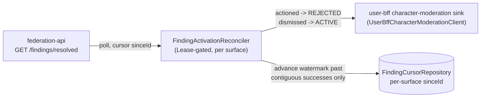

The top-level [`README.md`](../README.md) documents the core control-plane surfaces
(allowlist/namespaces/route-access/routes/suspension/domain-lock, the SUPERADMIN
control plane, announcements, notifications, the `/bff/internal` account/session API).
This page covers subsystems that are on `main` and grew the codebase after that
README's endpoint catalogue was written, so the README does not describe them. Each
item names its package, controller or service class, gating flag and tests.

All state markers follow the top-level README's convention: **✅ shipped** (merged to
`main`), **🚧 in-flight**, **🔭 planned**.

---

## Passwordless local login (`net.hugmesh.adminbff.locallogin`) — ✅ shipped, dark by default

`POST /bff/login/local` (in `AuthController`, wired through this package) is a
**sibling** of the legacy `POST /bff/login`. A Casdoor-native deployment uses it for a
direct username/password login without the OIDC PKCE round-trip. `LocalSecretVerifier`
performs a real resource-owner-password-credentials grant against Casdoor's
`/api/login/oauth/access_token`. `LocalLoginRateLimiter` throttles per IP **and** per
(IP, username) *before* Casdoor is called, which closes a credential-stuffing and
Casdoor-hammering vector.

- **Ships dark**: gated by `app.local-login.enabled` (default `false`). With the bean
  absent, `AuthController` injects a `@Nullable LocalSecretVerifier = null` and the
  endpoint **401s fail-closed**. There is no local-login trust surface until an
  operator opts in.
- It reuses the `casdoor.admin.*` client-id, secret and base-url config. A deployment
  that already configured the Casdoor admin write client flips one env var.
- Tests: `AuthControllerLocalLoginWebFluxTest`, `AuthControllerLocalLoginDisabledWebFluxTest`,
  `AuthControllerLocalLoginRateLimitWebFluxTest`, `LocalLoginRateLimiterTest`.

## Superadmin go-live wizard (`net.hugmesh.adminbff.golive`) — ✅ shipped, dark by default

`GoLiveController` (`/bff/admin/go-live`, `hasRole('SUPERADMIN')`) lets a superadmin
**record intent** to take a brand's domain public (DNS/registrar provider and desired
target). This BFF never touches DNS itself:

- `GET /bff/admin/go-live` — current intents for the caller's domain.
- `GET /bff/admin/go-live/providers` — the supported DNS/registrar provider catalogue
  (`GoLiveProviderCatalog`). `byo-domain` is the current key. It was **renamed** from
  `generic-registrar`, which the catalogue still accepts as a legacy alias, so rows
  exported or stored before the rename keep resolving.
- `POST /bff/admin/go-live/intents` — record a new signed intent.
- `DELETE /bff/admin/go-live/intents/{id}` — withdraw one.
- `GET /bff/admin/go-live/export` — the **signed** export a host-side go-live agent
  polls, and verifies before it touches `/etc/hugmesh/go-live` on the host. This BFF
  runs in-cluster and can never write that file itself.
- `POST /bff/internal/go-live/{intentId}/applied-ack` (`GoLiveInternalController`,
  `/bff/internal/**` service principal: `X-Internal-Token` or a SERVICE JWT, no human
  JWT) — the host agent's write-back once it has verified and applied an intent. It
  advances `status='recorded'` to `'applied'`, so the wizard UI stops reporting
  `applied:true` falsely. CAS-guarded by id, status and generation, and idempotent: a
  host agent that polls in a loop and calls it again for an already-applied, withdrawn
  or superseded intent is normal, not an error.
- Step-up gated (`GoLiveStepUpGate`, mirrors the image-gen / SSH-issue / terminal-dial
  step-up shape described in the top-level README's security section).
- Tests: `GoLiveControllerTest`, `GoLiveInternalControllerTest`, `GoLiveServiceTest`,
  `GoLiveExportServiceTest`, `GoLiveIntentRepositoryTest`.

## Account-ban appeals (`net.hugmesh.adminbff.appeal`) — ✅ shipped

The top-level README documents only the **public** `AppealContactController`
(`GET /bff/public/appeal-contact`). The submit and decide flow is a separate, larger
surface:

- `POST /bff/me/appeal` / `GET /bff/me/appeal` (`AccountAppealUserController`,
  authenticated) — a suspended or banned user submits an appeal and reads their own
  appeal history.
- `GET /bff/admin/account-appeals` / `POST /bff/admin/account-appeals/{id}/decide`
  (`AccountAppealAdminController`, `hasAnyRole('ADMIN','SUPERADMIN')` — **deliberately
  not MOD**. Approving an appeal indirectly restores access, and only the ADMIN-gated
  `/bff/admin/access-roles/**` suspension surface can grant or lift it. If MOD could
  decide appeals, that would be a privilege-escalation path around the gate). Decide is
  a single-winner CAS `PENDING -> APPROVED/DENIED`, brand-scoped via `PrincipalDomain`
  (SUPERADMIN unscoped). An APPROVE that fails to lift the underlying suspension
  returns an error, not a false 200.
- Backed by `AccountAppealService` / `AccountAppealRepository` / the `account_appeal`
  table (`AccountAppealRow`).

## Mastodon-UI appearance defaults (`net.hugmesh.adminbff.appearance`) — ✅ shipped

Lets an admin set a **platform-wide, per-brand default** for hugmesh-mastodon-ui's
`PreferencesService` appearance settings. Any user who has not customised their own
look inherits it:

- `PUT /bff/admin/mastodon/appearance-default` (`MastodonAppearanceDefaultAdminController`,
  `hasRole('ADMIN')`) — upsert one or more `AppearancePreferences` fields for the
  caller's own brand. Every key and value is validated against the known vocabulary
  before it reaches the durable row; a bad value is a clean 400, never a silent no-op.
- `GET /bff/mastodon/appearance-default` (`MastodonAppearanceDefaultSurfaceController`,
  any authenticated caller) — read the caller's own brand's currently configured
  default; an empty object means no admin default has been set (the client's built-in
  default applies).
- Domain-scoped both ways via `PrincipalDomain`: an admin can set, and a user can read,
  only their own brand's row.

## Character/sticker moderation activation reconciler (`net.hugmesh.adminbff.charactermoderation`) — ✅ shipped, dark by default

The last leg of the character-part and sticker moderation loop that the platform's
sticker/character-ban design introduced. `FindingActivationReconciler` is a
`@Scheduled` single-writer loop (`LeaderElection`-gated, mirrors the
`NotificationReconciler` idiom) that:

1. polls federation-api's `GET /findings/resolved?surface=&sinceId=&limit=` for each of
   `character-part` and `character-sticker` (strict `id > sinceId` cursor, persisted per
   surface via `FindingCursorRepository`);
2. maps each resolved finding (`actioned → REJECTED`, `dismissed → ACTIVE`) and pushes
   it to user-bff's character-moderation sink (`UserBffCharacterModerationClient`),
   flipping the PENDING row to its final state;
3. advances the watermark only past the contiguous prefix of *successful* pushes, so a
   mid-page push failure never skips an un-delivered outcome on the next tick.

Gated by `character-moderation.reconciler.enabled` (default `false`). Best-effort:
every error is metered (Micrometer `Counter`) and swallowed, so the scheduler thread
never dies. Tests: `CharacterModerationClientsTest`.

## Optional-services control plane (`net.hugmesh.adminbff.optionalservices`) — ✅ shipped, actuation dark by default

A SUPERADMIN REST surface **plus** a background reconciler.

`OptionalServiceSuperadminController` (`/bff/superadmin/optional-services`,
`hasRole('SUPERADMIN')` at the coarse path gate and again per method) is the runtime half of
"an image ships with only its selected services until a superadmin enables others":
`GET ""` returns every slug the platform knows with its live CR state AND whether it is
actually `toggleable` (with a NAMED `notToggleableReason` when it is not), and
`PUT /{slug}` writes `spec.enabled` + the audit `reason`/`requestedBy` onto the CR.
Every path that cannot actuate refuses rather than no-ops: unknown slug 404;
known-but-unactionable slug 422 with the named reason and no write; reconciler not wired to
a cluster 503 `dark:true` with no write (`NoopOptionalServiceClient.setEnabled` throws
instead of returning a success it cannot deliver); API-server rejection 422. Tests:
`OptionalServiceSuperadminControllerTest` (role matrix + refusal ladder through the real
`SecurityConfig`), `OptionalServiceSuperadminMethodGateTest` (the per-method
`@PreAuthorize` proven with the coarse path gate removed — otherwise the annotation is
untestable decoration), `NoopOptionalServiceClientTest`.

`OptionalServiceRegistry` carries TWO halves — the MANAGED slugs the reconciler can actuate
and the platform-known slugs it cannot, each with a named reason —
because a registry that lists only what works cannot report what does not. That was the
`character-forge` defect: in the CRD enum, in the seed CRs, in `apps/13a`, in the
`installed-services` ConfigMap, and MISSING from the registry, so the toggle was accepted and
did nothing, with no trace. `OptionalServiceRegistryParityTest` now DERIVES every side from
vendored copies of the generator manifests (`src/test/resources/optionalservices/`) and fails
when they disagree; an empty derivation is a hard failure rather than a vacuous pass.
`OptionalServiceManifestDriftTest` compares those vendored copies back to a generator
checkout when one is present (and SKIPS when it is not — so a stale fixture is a residual
risk that only a generator-side check can fully close).

The reconciler half (`OptionalServiceReconciler`,
`@Scheduled`, `LeaderElection`-gated single-writer, gated by
`app.optional-services.reconcile.enabled`, default `false`) that turns an
`OptionalService` custom resource's desired state into the two build-time-rendered live
write targets: the `apps/13a-optional-services.yaml` ArgoCD Application's `installed`
flags (`OptionalServiceApplicationSetPatcher`) and the `installed-services` ConfigMap
booleans (`InstalledServicesConfigMapWriter`) — so a live add/remove of an optional
service flips one CR instead of hand-editing baked manifests ArgoCD never re-reads.
Both writers are `Noop*` by default (inert) with a `Fabric8*` real implementation
behind the same flag. Tests: `OptionalServiceReconcilerTest`,
`Fabric8OptionalServiceApplicationSetPatcherTest`.

> **Known gaps.** (1) `app.optional-services.reconcile.enabled`
> has one supported switch, and it is off. The generator's
> `specs/cluster/manifests/admin-bff-api/deployment.yaml` sets
> `APP_OPTIONAL_SERVICES_RECONCILE_ENABLED` to `"false"`; a reviewed commit that flips
> it to `"true"` is the lever. `specs/cluster/apps/31-admin-bff-api.yaml` carries
> `automated:{prune,selfHeal}` with no `ignoreDifferences`, so a manual `kubectl set env`
> is reverted on the next selfHeal pass. The flag stays `false` until the hardcoded
> akkoma/tuwunel/phpbb Applications are cut over (generator `docs/OPTIONAL-SERVICES.md`
> §10); lit earlier, the first tick would create ApplicationSet elements that
> double-manage manifests those Applications already own. Until then the toggle surface
> is honest but inert, and answers 503.
> (2) CLOSED (#106) — this used to say `apps/16` lacked `/data/character-forge` and
> `/data/meshbridge` and that `meshbridge` had no CRD enum value or seed CR. The generator had
> fixed all of that while the registry and this repo's vendored fixtures still described the
> old state, so `meshbridge` was refused as `NOT_IN_CRD_ENUM` (and its seeded CR ignored by
> the reconciler) and `character-forge` carried a false selfHeal warning. Both are corrected
> and the fixtures refreshed. `apps/16` still deliberately omits `/data/headwind` and
> `/data/attestation-server`: those slugs are not-toggleable here, so nothing writes their keys.
> (3) The risk that hid (2) is still open: the parity test cannot see a stale vendored
> fixture, and `OptionalServiceManifestDriftTest` skips in this repo's CI. The generator's
> slug-closure gate (`tests/scripts/test-optional-service-slug-closure.sh`), which parses
> `OptionalServiceRegistry.java` against the live manifests, is what catches the resulting
> registry drift. It does not compare the fixtures themselves.
> (4) The `installed-services` ConfigMap (`hugmesh-policy` ns) that
> `Fabric8InstalledServicesConfigMapWriter` writes is WRITE-ONLY: no Deployment mounts it, no
> `configMapKeyRef` names it, and the user-facing greying reads `federation_modules` in
> Postgres instead — so half of every reconcile pass writes an artefact with no consumer.
> **Do not mistake the near-miss for a consumer:** `cloudbackup.ConfigMapRunningServiceProvider`
> reads a DIFFERENTLY-NAMED, per-brand object — `hugmesh-installed-services-<domain-slug>` in
> `hugmesh-backend` — which this writer never touches. Recorded deliberately; do NOT "fix" (4)
> by inventing a consumer, and do not wire the two together without a design decision.
> (1)-(4) are generator-side and out of scope for this repo.

## Federation bearer-forwarding + native-login custody exchange (`net.hugmesh.adminbff.federation`) — ✅ shipped, dark by default

Two related pieces that let a **native-login** (`bff_` session) moderator's requests to
federation-api (and other Casdoor-gated downstreams) be authorised as the real
principal, not a service identity:

- `BearerForwardingFilter` — a reactive `ExchangeFilterFunction` on this BFF's outbound
  `WebClient`s. A real Casdoor-JWT caller's token is forwarded verbatim (unchanged
  behaviour). A native-login caller's `Authentication` carries no raw JWT, so the filter
  hands off to `SessionExchangeService`.
- `SessionExchangeService` — exchanges the caller's `bff_` custody for a real Casdoor
  JWT via a **loopback call to this BFF's own** `/bff/internal/session/exchange` (the
  same custody-exchange endpoint documented in the top-level README's Internal section),
  optionally cached (`SessionExchangeCache`; `app.bff-exchange.cache-ttl-ms`
  defaults to `0`, which turns the cache off, and a positive value is clamped to 60 s).
  **Soft-degrades on every failure**
  (deliberately unlike the gateway's own `BffJwtExchangeWebFilter`, which hard-fails
  401). federation-api and the other downstreams each have their own independent,
  fail-closed JWT and role gate, so forwarding without a bearer bypasses nothing. A
  native-login caller gets the behaviour it had before this feature, not a new outage
  mode.
- Gated by `app.bff-exchange.enabled` (default `false`, `APP_BFF_EXCHANGE_ENABLED`).
  `FederationOverrideClearClient` / `SuspensionExpiryFederationClearWireTest` cover the
  federation-side clear-on-restore wiring for domain-lock/suspension expiry.

## Node radio attachments (`net.hugmesh.adminbff.radio`) — ✅ shipped, real live-usable API — not yet the meshbridge's live device source

`RadioDeviceController` (`/bff/admin/device-radios`, `hasAnyRole('ADMIN','SUPERADMIN')`)
lets an operator attach/detach a **Meshtastic LoRa radio** to a specific mesh node for
the meshbridge optional service (the mesh↔Matrix bridge — see the top-level README's
Endpoints section for the full `serial`/`tcp`/`mqtt` transport contract). It clones the
`net.hugmesh.adminbff.storage.NodeStorageService`/`StoragePoolController` idioms
exactly: resolve-the-node-first, an ownership ALLOW/DENY matrix (own-domain ADMIN-owned
nodes only for an ADMIN; SUPERADMIN unrestricted), idempotent attach, CAS detach (never
a hard delete), and a SUPERADMIN/internal-mTLS-only signed per-node
`GET /export?node=<machine_key_fp>` (`NodeRadioExportService`, reuses `RegistrySigner`
for the detached Ed25519 signature + monotonic generation).

- Schema: `node_radio_device` (Liquibase changelog `300-node-radio-device`).
- Tests: `RadioDeviceControllerTest`, `NodeRadioServiceTest` (ownership matrix,
  idempotency/CAS, per-transport shape validation, tenant isolation),
  `NodeRadioExportServiceTest` (confidentiality + signing), `NodeRadioChangelogTest` —
  55 test methods across the four classes (counted in source on 2026-10-07). The
  2026-07-17 run that reported 55/55 green was not repeated for this review.

> **Known gap — the export has no live consumer yet.** The companion meshbridge daemon
> (`hugmesh-generator` PR #374, merged the same day as this feature) reads a
> **separate, static, manually-edited** `meshbridge-devices` ConfigMap (`devices.json`)
> for its `tcp`/`serial`/`mqtt` device list — it does **not** call this repo's
> `/bff/admin/device-radios/export`. The generator repo's own manifest comment names
> the missing piece exactly: "Admin-driven per-node attachment (device_registry-linked
> rows + signed per-node export + on-node reconcile writing this ConfigMap...) is the
> planned follow-up; this ConfigMap is the operator surface until then." So today an
> admin can manage radio rows through this API and admin-ui (PR #79) and the meshbridge
> pod will never see them until that reconcile agent is built. This is an open
> cross-repo integration gap, not a documentation lag.

## Edge-AI infra triage (`net.hugmesh.adminbff.inference`) — ✅ shipped, dark by default

`AioTriageService` turns a batch of mesh infra/security signals (NIDS, file-integrity,
k8s events) into an admin-facing Matrix `@system` alert, reusing the existing
notifications outbox end-to-end: `EdgeAiInferenceClient.triageInfra(...)` (gated by
`inference.edge-ai.enabled`, default `false` — a `disabled` sentinel with no
notification emitted when off) feeds `FeatureNotificationService`, which the existing
`ExternalChannelReconciler` then delivers as a Matrix DM to each admin/superadmin.
Idempotent: the per-admin outbox natural key is derived from the caller-supplied
`eventKey` (see below), so a retried signal never double-alerts.

**The caller** is `AioTriageIngestController` — `POST /bff/internal/aio-triage/ingest`,
the in-cluster collector's entry point (`{domain, adminSubjects[], eventKey, signals}` →
`{accepted, alerted}`). It sits on the same `/bff/internal/**` trust boundary as the other
node/Job ingests (`ROLE_SERVICE`, satisfied by `X-Internal-Token` or a SERVICE JWT, no
human JWT) and
performs no cross-tenant check of its own — tenancy is the caller's concern at this hop,
exactly as `DomainCapabilityInternalController` states; it only *bounds* the batch so a
malformed or runaway post is a clean 400 instead of an `IllegalArgumentException` or an
unbounded prompt. Wiring the caller does **not** turn the feature on: with
`inference.edge-ai.enabled=false` the endpoint accepts the batch, gets the `disabled`
sentinel and emits nothing (`alerted:0`).

> **Still open — the collector itself.** The node-level DaemonSet that tails
> Snort/Suricata + AIDE + k8s events and posts to this endpoint lives outside this repo
> and is not built yet, so the endpoint has no *production* caller. The gap is now
> only that the agent on the other side is not written. Before, the service had no
> caller in any repo.

> **Why the per-admin outbox key is derived, not concatenated.** `notification_outbox.source_id`
> is `varchar(36)` (changeset 062). The original `eventKey + ":" + admin` composition overflows
> it for any realistic Casdoor subject. On the H2 test store that is a hard `BadSqlGrammar` on
> the INSERT (measured); where the driver reports the overflow as a data-integrity violation
> instead (Postgres `22001`), it is *invisible* — `NotificationOutboxRepository#insertIfAbsent`
> classifies that as the natural-key DUPLICATE it exists to swallow, so the alert is dropped
> and reported as `0` newly-alerted admins. `AioTriageService#outboxKey` now derives a 36-char
> `sha256(eventKey + ":" + admin)` prefix instead — same pair → same key (retries still dedup),
> different admin → different key (the fan-out survives), always inside the column.

## Registration a11y display-name forwarder (`net.hugmesh.adminbff.profile`) — ✅ shipped, dark by default

`ProfileForwarder` (wired into `AuthController`'s registration path) forwards a
freshly-registered principal's `displayName` (UTF-8) and `screenReaderName` (ASCII
aria-label, collected by login-ui at registration time) to two places, independently:

1. the hugmesh-user-bff profile service's `user_profile.screen_reader_name` column
   — gated by `profile.forward.enabled` (default `false`); the endpoint contract is
   defined but not yet exposed by user-bff, so this leg stays dark until it is;
2. the registering subject's Casdoor user object (`display_name`, via
   `CasdoorAdminClient.updateDisplayName`, GET-then-MERGE so sibling fields survive) —
   independent of gate (1), so the human-visible Casdoor name lands even while the
   user-bff leg is still dark, whenever `casdoor.admin.enabled=true`.

Both legs are best-effort and fail-**open**: a transport/parse error is logged and
swallowed, never fails registration (the account + session are already durable by the
time this runs).

## Moderator channel directive (`notifyChannels`)

mod-bff sends the moderator's per-action channel choice as `notifyChannels` in the body of
`POST /bff/admin/access-roles/{role}/{user}`. `SuspensionRequest.notifyChannels` accepts it,
`SuspensionService.suspend(..., notifyChannels)` hands it to `AccountRestrictionPayload`, and
it is stored on the `notification_outbox` row as the `notify_channels` array (no schema
change: the payload is already a JSON string). `ExternalChannelReconciler` reads it per row.

- **Names.** Canonicalised by `NotifyChannelDirective.normalize` (the HTTP pattern already
  rejects capitals and spaces, so trimming and lower-casing only matter to direct callers):
  trimmed, lower-cased, de-duplicated; `mastodon` (mod-bff's platform name) maps to the `akkoma` channel. A
  well-formed name outside `in-app`, `email`, `matrix`, `akkoma`, `mastodon`, `forum` is
  **ignored with a warning**, not rejected; a malformed token or more than 8 names is a 400.
- **Absent or empty** (or nothing left after normalising): the payload is byte-for-byte what it
  was before, and the default fan-out applies.
- **Never enables a channel.** A channel the directive does not name records a terminal `skipped` delivery
  (no send, its cursor moves on). A named channel still has to pass its own `enabled()` and
  `available()` gates, so a directive never turns a channel on.
- **In-app and the default.** The in-app reconciler does not read the directive, so it never
  changes whether the in-app row is attempted (that reconciler keeps its own retry,
  dead-letter and suppression outcomes). A directive that names no *enabled* external channel (only `in-app`, only unknown
  names, only disabled channels) is treated as absent, so e.g. "email only" with email disabled
  widens to the full default external fan-out rather than narrowing it.
- **No external guarantee.** A directive that names an enabled channel is not checked against
  that channel's `available()` or recipient resolution. If the named channel is unavailable (stub
  transport, no SMTP, unwired seam) or skips the row (email with no resolvable address), the
  excluded channels have already recorded a terminal `skipped`, so no external channel delivers
  that row and the skip is not retried when the named channel recovers.
- **Open decision (operator).** Whether "email only" with email disabled should keep widening to
  the default fan-out (today, pinned by tests) or deliver nothing external.
- **First request wins.** If an active suspension already exists, `suspend` returns it and a
  new request's `notifyChannels` is dropped, as the reason is.
- Not consumed: mod-bff's redundant `notifyEmailOnly` flag (its channel list already carries
  `email` + `in-app` in that case), and the lift path (mod-bff sends no directive there).
