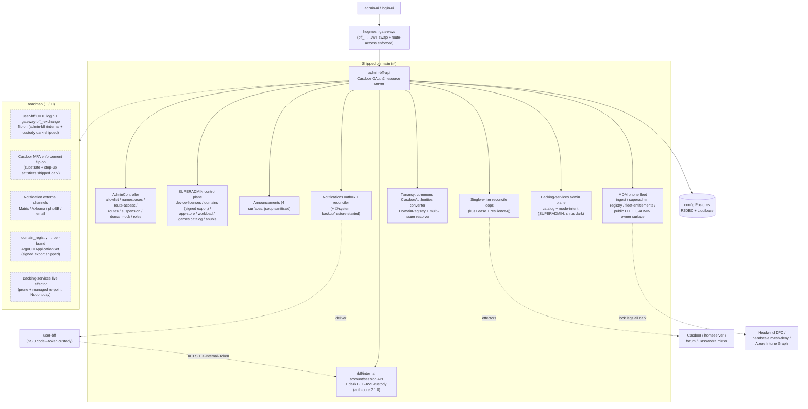

The **admin Backend-For-Frontend** of the HugMesh platform: a reactive Spring
Boot (WebFlux) service that backs the admin UI/console. It sits in the **backend
tier** (`hugmesh-backend` namespace), behind the platform gateways, and is a
**Casdoor OAuth2 resource server**. It owns the admin-side control plane:

- the Google/Discord, admin-invited **registration allowlist** + per-user
  **namespace grants**, with a best-effort **Casdoor** user/role write through the
  PKI gateway;
- the durable **account/session store** (`admin-bff-db`) that the SSO login flow
  reads/writes — note the *login/session orchestration* itself is being relocated to
  **user-bff** (see [Current State](#current-state)); admin-bff remains the system of
  record and exposes it over the internal mTLS surface;
- brokering **real Matrix/Mastodon service tokens** server-side (the UI never holds
  homeserver admin credentials);
- the **gateway access-control surfaces** — per-gateway role→URL `route-access`
  rules (the `gateway_route_access` Postgres table is the source of truth the
  gateways' `GatewayRouteAccessFilter` enforces; mirrored to Cassandra for the
  gateways) and the DB-driven gateway **route definitions** (`url_registry`);
- **access-role suspension** (ban / timed-suspend) and **domain-lock** (force
  local-only / no-federation) desired-state, each driven by a single-writer
  reconcile loop;
- site **announcements** (multi-surface: home / public login / akkoma / forum);
- the **phpBB forum admin console** proxy, **ClickHouse usage analytics**, an
  ADMIN **cloud backup & recovery** flow, the **test-architecture reports** console,
  and **ISO artifact** download links.

In short: if an operator needs to invite a user, ban an account, lock down a domain to
federate less, roll out a new service, or check on a mesh device from the admin
console, the request ends up here. See [Related HugMesh repositories](#related-hugmesh-repositories)
for how this service fits into the rest of the platform.

It also owns the **multi-tenancy** boundary (per-brand issuer-keyed domain scoping —
✅ shipped), the **device-license registry** + **domain registry** SUPERADMIN control
plane (✅ shipped), an **in-app notifications** outbox/reconciler (✅ shipped) with
external channel adapters wiring up (🚧 in-flight), **OIDC provider default roles**
+ **first-login role hook** (✅ shipped), the **superadmin service app-store** +
**games-services** + **workload console** + **egress-VPN** + **node-storage** +
**Anubis** surfaces (✅ shipped), and a **device-enrollment** liveness self-report
channel (✅ shipped).

> **State convention used throughout this README:** **✅ shipped** = merged to `main`;
> **🚧 in-flight** = code on an open branch/PR, not yet merged; **🔭 planned** =
> design-complete, no code yet. Roadmap (🔭 / 🚧) items are collected in the
> [Roadmap](#roadmap) section; the rest of this README describes `main`.

---

## Status

_Reflects `src/main/java` on `main` through PR #241 (the HugMesh rebrand in PR #236,
the fleet-owner/Azure-Intune MDM waves, and the managed-backing-services plane). A full
offline test run (`./mvnw -o test`) currently reports **2414 tests, 8 failures, 0
errors, 10 skipped.** The 8 failures share a single, already-diagnosed root cause, not
8 unrelated bugs — see the callout right below the shipped/gaps lists._

**✅ Shipped & real** (code + tests on `main`, independent of whether the feature's
own runtime flag defaults on): the full `/bff/admin/**` + `/bff/superadmin/**` control
plane described under [Endpoints](#endpoints) below; multi-tenancy domain-scoping;
the device-license + domain registries with signed exports; the in-app notifications
outbox; OIDC default-roles + first-login hook; the superadmin app-store / workload
console / games-services / egress-VPN / node-storage / device-radios (Meshtastic LoRa
attachments, mesh-bridge track) / Anubis surfaces; the `/bff/internal` account/session
API + the (suspension-gated, see below) BFF-JWT-custody tail; desktop app governance,
cloud-backup v2 (Velero), the image-build pipeline, SSH key issuance and the
SSH-terminal-dial authorize step (**including** a real, host-key-pinned sshj dial
factory — ships dark, see below); the **MDM phone fleet control plane** (device
ingest, the SUPERADMIN fleet registry + management/lockout mutations, the public
per-owner `FLEET_ADMIN` surface with its fleet-entitlement gate, and the Headwind /
mesh-deny / Azure-Intune lock-enforcement legs — all ships dark, see
[Endpoints](#endpoints)); the **SUPERADMIN managed/self-hosted backing-services admin
plane** (catalog + mode-intent recording, ships dark); and the subsystems documented in
[`docs/SUBSYSTEMS.md`](docs/SUBSYSTEMS.md) — passwordless local login, the go-live
wizard, account-ban appeals, Mastodon appearance defaults, the character/sticker
moderation activation reconciler, the optional-services reconciler, node radio
attachments, and federation bearer-forwarding/custody-exchange. A large share of the
above **ships dark** behind a default-off config flag even though the code is real and
tested — see each section for its specific gate.

**Test-suite callout:** the 8 failures are ALL the same pre-existing Boot 4
`HttpStatus` rename regression (`UNPROCESSABLE_ENTITY` was renamed to
`UNPROCESSABLE_CONTENT`) that PR #219 (2026-07-11) fixed everywhere it then knew about;
these 8 assertions live in newer/untouched test files that still hardcode the old
constant — `DesktopSudoAdminControllerTest` (×2), `DeviceLicenseControllerTest` (×2),
`EgressVpnControllerTest`, `RadioDeviceControllerTest`, `DesktopDialAdminControllerTest`,
`StoragePoolControllerTest`. Each asserts `.isEqualTo(HttpStatus.UNPROCESSABLE_ENTITY)`
against a controller that actually (correctly) returns 422 as `UNPROCESSABLE_CONTENT`,
so the behavior under test is fine — only the assertion's enum constant is stale.
**Not yet fixed** — flagged here so it isn't mistaken for a live behavioral
regression; each fix is a one-line constant swap in the test file (a good first pull
request if you're looking for one).

**2026-07 security hardening:** a cross-cutting native-login identity-fold review found
and fixed several real HIGH/MEDIUM authz bugs (Mastodon-localpart takeover-by-collision,
an MFA-freshness bypass on the `bff_` introspect path, suspension
gateway-revoke/Casdoor-role-sync identity-key mismatches, a workload-console
superadmin-suspension bypass, and the `/bff/internal/session/exchange`
suspension-bypass noted in the [Internal](#internal-service-to-service-mtls-bounded)
section below) — all fixed on `main` (`#161`, `#209`/`#210`/`#218`, `#220`/`#221`/`#223`/`#224`).

**Known gaps** (real, not speculative — see [Roadmap](#roadmap) for the platform-scale
items and the "Edge-AI infra triage" section of [`docs/SUBSYSTEMS.md`](docs/SUBSYSTEMS.md)
for the narrower ones):
- Casdoor MFA and the SSO login/session relocation to user-bff are both **substrate
  shipped, enforcement/cutover still roadmap** (see [Roadmap](#roadmap)).
- Notification external channels (Matrix DM / Akkoma / phpBB / email) are wired but
  gated off; the superadmin app-store's ArgoCD provisioning effector is dark (the
  Kaniko in-cluster image builder, by contrast, is live).
- Device-license Layer-A headscale enforcement needs a live control node to confirm
  which reported key is canonical — tracked in [`docs/CANONICAL-FP.md`](docs/CANONICAL-FP.md),
  unresolved.
- The SSH-terminal dial's real, host-key-pinned `SshjDeviceSshChannelFactory` (sshj,
  no TOFU — refuses without an ACTIVE `device_ssh_dial` row and a matching pinned
  `host_key_fp`) **already exists and is tested** (merged 2026-06-18, #81). It ships
  dark behind its own second flag (`app.device-terminal.dial.enabled=false` by
  default, independent of `app.device-terminal.enabled`); the fail-closed
  `UnconfiguredDeviceSshChannelFactory` is only what's wired while that second flag
  stays off. What's genuinely roadmap is the security re-review the class's own
  Javadoc calls for before flipping it on.
- Edge-AI infra triage now has its in-repo caller (`AioTriageIngestController`,
  `POST /bff/internal/aio-triage/ingest`), but the node-level DaemonSet **collector**
  that would post to it lives outside this repo and is not built yet — so the endpoint
  has no production caller. See `docs/SUBSYSTEMS.md`.
- Node radio attachments (`RadioDeviceController` + the signed per-node export) are
  real and tested, but the companion meshbridge daemon (`hugmesh-generator` PR #374)
  reads a **separate, static, manually-edited devices ConfigMap** instead of this
  export — the on-node/cluster reconcile agent that would connect the two doesn't
  exist yet. See `docs/SUBSYSTEMS.md`.
- A narrow role-string length/count cap is missing before the CSV join in
  `InternalAccountController#rolesFromIdToken` — flagged inline as a `TODO` (see
  `src/main/java/net/hugmesh/adminbff/internalapi/InternalAccountController.java`).

---

## Current State

_This section describes the platform's SSO authentication model as of the 2026-06-25
auth reshape; see [Status](#status) above for everything that has shipped since. It
remains accurate except for the version numbers and the fixed known-gap in the
[Internal](#internal-service-to-service-mtls-bounded) section, both of which have
moved on._

**Ecosystem baseline.** Spring **Boot 4.0.7** / Spring Cloud **2025.1.2** on
**Java 25 LTS**. Shared Maven artifacts:

- `net.hugmesh:hugmesh-parent:2.8.0` — the metapom (child of
  `spring-boot-starter-parent:4.0.7`; manages testcontainers 2.0.5);
- `net.hugmesh:hugmesh-commons:2.1.0` (managed by the parent BOM) — shared
  security/tenancy/web (`net.hugmesh.commons.*`);
- `net.hugmesh:hugmesh-auth-core:2.4.0` (currently-pinned version — see
  `pom.xml`) — the shared account / session / MFA / Casdoor-admin infrastructure
  (the account/session/MFA/Casdoor-admin classes that used to live in this repo were
  extracted into it). It depends on `hugmesh-commons` and is
  consumed by **only** `user-bff` and this `admin-bff`. **2.1.0** added the
  BFF-JWT-custody seam (`bff_session` custody columns + `BffCustodyCipher` AES-256-GCM +
  `OidcExchangeClient`), bumped in lockstep with the band-180 custody migration and the
  `/bff/internal` custody/stamp & session/exchange endpoints below; **2.2.0** added the
  per-account live-session listing seam (`AccountStore.sessionsForAccount`); **2.3.0**
  drops the `UUID.randomUUID()` mints from the MFA enrollment / WebAuthn-challenge stores
  in favour of the DB-generated `(gen_random_uuid())::text` PKs (band-210 here, #134);
  **2.3.1**–**2.3.4** are identity-fold correctness fixes from the 2026-07-11/15 native-login
  authz review; **2.4.0** is a coordinate-only rename (legacy groupId → `net.hugmesh`
  groupId + package move, no behavior change, part of the HugMesh rebrand, #236) — see
  the version-by-version changelog under
  [Shared libraries](#shared-libraries-hugmesh-parent--hugmesh-commons--hugmesh-auth-core)
  below for the full detail.

**The SSO auth model.** Casdoor is the SSO IdP and the platform
login flow has moved off a custom BFF login:

- **login-ui** POSTs a **native username/password (+MFA)** form to `/bff/login`;
  **user-bff** runs **PKCE (S256) + state server-side**, POSTs the credentials to the
  **internal-only Casdoor `/api/login`** (never browser-reachable), then exchanges the
  returned code. Casdoor is never browser-exposed — there is **no** hosted-login
  redirect and **no** browser-visible Casdoor URL.
- **user-bff** does the server-side **code→token exchange** and holds per-session
  JWT custody + refresh. The browser only ever holds an **opaque `bff_`-prefixed
  session** (localStorage or httpOnly cookie) — a user **never** sees their own
  Casdoor JWT.
- the **gateway** is a pure Casdoor-JWT OAuth2 resource server: a pre-security
  exchange filter swaps `bff_` → the internal custody JWT, so the gateway's JWT
  validation + role gate run unchanged. Authorization is **data-driven** by the
  `gateway_route_access` Postgres table (this service's source-of-truth surface) via
  `GatewayRouteAccessFilter`; **ADMIN / GAME-MASTER** bypass within their own domain,
  **SUPERADMIN** cross-domain. **Cloudflare** fronts prod.

**What that means for admin-bff specifically:**

- admin-bff stays a **Casdoor OAuth2 resource server** that validates the Casdoor
  JWT presented at the backend tier (post-`bff_`-swap by the gateway). Its
  three-layer defence-in-depth (gateway route-access → filter chain → `@PreAuthorize`)
  is unchanged.
- **Login / session / account *orchestration* is being RELOCATED from admin-bff to
  user-bff**, and the shared core for it has been **extracted into `hugmesh-auth-core`**
  (#111 — the `AccountStore` / Casdoor-admin client / MFA subsystem / session + internal
  filters now live in the library, no longer in this repo). The **account / session DATA
  stays in `admin-bff-db`**: user-bff reaches it via this service's **`/bff/internal`**
  account/session API (`InternalAccountController`, #113) over **mTLS + an
  `X-Internal-Token`** header, with the **BFF-JWT-custody tail** (`/bff/internal/custody/stamp`
  & `/session/exchange`, band-180, auth-core 2.1.0 — #114) **shipped dark** so admin-bff
  custodies the Casdoor JWT once user-bff's OIDC login flips on. The legacy user-facing
  `AuthController` paths (`/bff/login`, `/bff/register/**`, `/bff/me`, `/bff/provision/**`)
  described under [User flow](#user-flow-base-bff) are the contract being moved — treat
  their *ownership* as in-transition (see [Roadmap](#roadmap)); the durable allowlist /
  namespace / entitlement data and the token broker remain admin-bff responsibilities.
- **SCG-5 awareness.** Spring Cloud Gateway 5.0 moved route config from
  `spring.cloud.gateway.routes` to `spring.cloud.gateway.server.webflux.routes` (the
  legacy prefix silently binds nothing). admin-bff is **not** a gateway, but it is the
  writer of the DB-driven route **definitions** (`url_registry`) and **route-access**
  rules the gateways and the generator route templates consume; the gateways +
  generator templates were corrected to the new namespace so the rules this service
  emits actually bind.

**Shipped & stable on `main`:** the full `/bff/admin/**` + `/bff/superadmin/**`
control plane (allowlist / namespaces / route-access / routes / suspension /
domain-lock / standalone roles / announcements / forum / backups / test-reports /
ISOs), multi-tenancy domain-scoping, the device-license + domain registries (now with
the SUPERADMIN signed domain-registry `/export` + provisioning-status `/status` —
#118), the in-app notifications outbox MVP (now emitting `@system` backup/restore-started
rows — #117), OIDC default-roles + first-login hook, the service-store /
workload-console / games / egress-VPN / node-storage / Anubis superadmin surfaces, the
`/bff/internal` account/session API + the dark BFF-JWT-custody surface (#113/#114), and
the dark MFA substrate (factor/challenge tables + `gateway_route_access.mfa_required` +
the image-gen / SSH-issue / terminal-dial step-up satisfiers — #115/#116).

---

## Architecture at a glance



---

## Where it sits

| | |
|---|---|
| **Tier / namespace** | backend (`hugmesh-backend`) |
| **Framework** | Spring Boot **4.0.7** (reactive **WebFlux**), Spring Cloud **2025.1.2**, **Java 25 LTS** |
| **AuthN** | Casdoor OAuth2 **resource server** — validates the Casdoor JWT presented at the backend tier (the gateway swaps the browser's opaque `bff_` session → the internal custody JWT before it reaches here) |
| **Shared libs** | `hugmesh-parent:2.8.0` (metapom) → `hugmesh-commons:2.1.0` (security/tenancy/web) + `hugmesh-auth-core:2.4.0` (shared account/session/MFA/Casdoor-admin + the BFF-JWT-custody seam; consumed by user-bff + admin-bff only) |
| **Persistence** | config Postgres over **R2DBC** (runtime, non-blocking); **Liquibase** owns schema (JDBC, migrations only) |
| **Other stores** | **ClickHouse** (usage analytics, best-effort), **Kafka** (usage-event bus, optional), **Cassandra** (best-effort route-access mirror the gateways poll) |
| **Image / CI** | multi-stage Dockerfile (temurin 25), `:8080`; built + pushed to the in-cluster GitLab registry by `.gitlab-ci.yml`, which also runs the platform OWASP pen-test stages (SCA + DAST + nuclei) — see [CI & pen-test stages](#ci--pen-test-stages). **CI is GitLab** (no GitHub Actions). Images carry **no** KEYS material |
| **App id** | `net.hugmesh.adminbff` (`AdminBffApplication`) |

It is the production Spring port of the verified reference contract in
`catalyst-scripts/tests/stack/mock-bff.mjs`; JSON shapes mirror that mock so the
admin-ui / login-ui typed clients work unchanged.

---

## Security — defence in depth

`SecurityConfig` is a reactive Casdoor OAuth2 resource server
(`issuer-uri` from `CASDOOR_ISSUER_URI`). `@EnableReactiveMethodSecurity` activates
the `@PreAuthorize("hasRole('ADMIN')")` method gates. Every admin path is gated at
**three** independent layers and no layer trusts the network:

1. the gateway denies `/bff/admin/**` to non-admins via the Postgres
   `gateway_route_access` rules this service itself manages (enforced by the gateway's
   `GatewayRouteAccessFilter`, after the pre-security `bff_` → JWT swap);
2. the resource-server filter chain re-applies the path rule;
3. `@PreAuthorize` re-checks at the controller method.

### JWT → authority mapping (✅ on `main`)

The canonical `commons.security.CasdoorAuthorities` converter — shared by both
`SecurityConfig` (single-issuer) and the opt-in multi-issuer decoder path
(`commons.config.TenancyResourceServerConfig`) — mirrors the hugmesh-gateway /
hugmesh-actions converter and emits:

- a `ROLE_USER` floor on every authenticated principal;
- `ROLE_<UPPER>` for each `roles` claim entry (string or `{name}` object), plus
  `ROLE_ADMIN` from the legacy `isAdmin` boolean;
- a verbatim authority for each `permissions` entry — **except** any entry carrying a
  reserved `ROLE_`/`DOMAIN_` prefix (`RESERVED_PREFIXES = {"ROLE_","DOMAIN_"}`), which
  is **dropped** as an **authority-injection defence** (a user-settable `permissions`
  claim can never forge a `ROLE_SUPERADMIN` or a `DOMAIN_<brand>` tenant scope);
- **exactly one** issuer-derived `DOMAIN_<x>` authority, resolved from the
  cryptographically-validated `iss` via `DomainRegistry` (never a user-settable claim;
  an unknown issuer maps defensively to `DOMAIN_default`).

### Path matchers

| Path | Rule |
|---|---|
| `/actuator/health{,/**}`, `/actuator/info` | `permitAll` (probes) |
| `POST /bff/login`, `/bff/register/**` | `permitAll` — no JWT yet; the BFF enforces the **admin-invite gate itself** (login/register orchestration is being relocated to user-bff — see [Current State](#current-state)) |
| `/bff/public/**` | `permitAll` — intentionally unauthenticated; serves both the anonymous login-page **announcements** feed and the public **appeal-contact** (`GET /bff/public/appeal-contact`) |
| `/bff/internal/**` | `hasRole('SERVICE')` — service-to-service only (user-bff account/session access, the gateway's session introspect/exchange, `POST /bff/internal/device-enrollment/self-report`, …). Satisfied by a Casdoor **client-credentials `ROLE_SERVICE` JWT** *or* by the in-cluster **`X-Internal-Token`**, which `SecurityConfig` promotes to a SERVICE principal — so every existing caller is unchanged. **Not** `permitAll`: this subtree mints `bff_` sessions for arbitrary accounts and it *is* reachable through the fe-gateway's `/bff/**` route (no `gateway_route_access` row covers it ⇒ NO_RULE ⇒ forward), and mTLS does not separate that traffic because the gateway presents its own cluster-CA client cert on the proxy leg. Human roles — **including SUPERADMIN** — get 403. Blank `app.internal.token` is dev/test-only parity with the old behaviour; `InternalSurfaceTokenBootGuard` refuses to boot a prod profile without it |
| `/bff/admin/**` | `hasAnyRole('ADMIN','SUPERADMIN')` (each endpoint then re-applies its own `@PreAuthorize`; SUPERADMIN-only mutations 403 an ADMIN) |
| `/bff/superadmin/**` | `hasRole('SUPERADMIN')` |
| `/bff/games-services/**` | `hasAnyRole('GAMES_SERVICES','GAMES_SERVICES_ADMIN','GAMES_SERVICES_RUNNER')` |
| `/bff/announcements/**` | authenticated (validated JWT, no special role) |
| `/v3/api-docs/**`, `/swagger-ui/**` | `permitAll` under `dev`/`test` (so `gen:fetch` can curl the spec); `hasAnyRole('ADMIN','SUPERADMIN')` in prod |
| everything else | authenticated |

`/bff/provision/matrix` additionally requires `hasRole('MATRIX')`,
`/bff/provision/mastodon` requires `hasRole('MASTODON')` — a user whose platform
role was stripped by a suspension can no longer mint a fresh token.

### mTLS (server side, config-only)

When the in-cluster keystore initContainer is mounted, the deployment sets
`SSL_ENABLED=true` + `SSL_CLIENT_AUTH=need` (TLSv1.3 floor) so the handshake
**requires** a client cert chaining to the cluster CA — a caller not signed by the
platform Vault/ESO PKI cannot reach the API at all. This is the boundary the user-bff
→ `/bff/internal` account/session traffic rides (mTLS + `X-Internal-Token`). Defaults
keep local/CI plaintext.

### Role cascade & SUPERADMIN (✅ on `main`)

The platform's least-privilege cascade is **superadmin → admin → mod → user**,
domain-scoped, enforced at the gateway and re-checked here:

- **SUPERADMIN** is a real, code-enforced role and is **unscoped** (the infra control
  plane). It is the sole mutator of the **device-license registry**, the **domain
  registry**, the superadmin **service app-store** (curation / app-profiles /
  deployments / **scaffold + federate** wizard), the **workload console** (cross-cluster manage + exec + log-stream),
  the **games-services catalog**, the **Anubis** PoW-shield console, and per-domain
  **system-account** / **egress-VPN** provisioning. These live under `/bff/superadmin/**`
  or are `@PreAuthorize("hasRole('SUPERADMIN')")` endpoints under `/bff/admin/**`.
- **ADMIN** is domain-scoped. On SUPERADMIN-owned surfaces (device-licenses, etc.) an
  ADMIN may **read** but mutations 403; on its own surfaces (allowlist, namespaces,
  route-access, routes, suspension, domain-lock, announcements, forum, test-reports)
  it has full CRUD within its domain.
- `ROLE_IMAGE_BUILDER` and the `GAMES_SERVICES{,_ADMIN,_RUNNER}` capabilities are
  recognised as separate, narrowly-scoped authorities.

### Service-Store scaffold + federate wizard (SUPERADMIN)

The "scaffold a new service, then federate it" surface of the app-store, all under
`/bff/superadmin/service-store/**` (`hasRole('SUPERADMIN')` on every method); the two
mutating verbs additionally require the `X-ServiceStore-StepUp` step-up token
(`ServiceStoreStepUpGate`, cloned from the go-live gate — a workload step-up token OR a
fresh Casdoor-MFA stamp):

| endpoint | operationId | what it does |
| --- | --- | --- |
| `GET  /scaffold/archetypes` | `serviceScaffoldArchetypes` | the embedded scaffold catalog (`spring-bff` / `angular-mfe` / `angular-host` / `remote-fragment`) |
| `POST /{domain}/scaffold` | `serviceScaffoldCreate` (201, **step-up**) | records a `service_scaffold` row (schema `320`) — INTENT only |
| `GET  /{domain}/scaffold/{id}/archive` | `serviceScaffoldArchive` | renders the starter codebase to `application/zip` (marks the row `archived`) |
| `POST /{domain}/deployments/{id}/federate` | `serviceDeploymentFederate` (**step-up**) | registers the deployment's UI as a federation module → `FederateOutcome {deployment, federationReal, gitopsDescriptorPending}` |
| `GET  /federation` | `serviceCatalogFederationStatus` | `{enabled, warnings}` for the federate leg |

- **Scaffolds ship the render dark of any deploy.** A scaffold row is intent + hints
  (`mount_at` / `requires_role`); the ZIP is rendered on demand from the **embedded
  example codebases** under `src/main/resources/scaffold/*` — vendored verbatim from the
  generator's `templates/archetypes/*` skeletons (provenance + resync in
  `resources/scaffold/README.md`). `TokenRenderer` substitutes the `{{TOKEN}}` identity
  tokens (values follow the generator's `render-repo-tree.sh` derivations) and **hard-fails
  on any unrendered `{{UPPER_SNAKE}}`** so a broken starter never ships; the spring-bff
  Java sources are relocated into the real `net.hugmesh.<slug>` package path.
- **Federate ships dark** behind `app.appstore.federation.enabled` (default false): the
  `FederationModuleClient` bean-pair (noop / real, gated exactly like `ArgoCdConfig`)
  means a federate call is *logged, not written* until enabled, and `FederateOutcome`
  reports `federationReal` honestly. The real `RestFederationModuleClient` upserts against
  federation-api's SUPERADMIN admin API (`/api/federation/admin/modules`); its
  `auth-token` must be a Casdoor JWT carrying `ROLE_SUPERADMIN`.
  `gitopsDescriptorPending` stays **true** until the GitOps descriptor automation exists.

### Multi-tenancy / domain-scoping (✅ on `main`)

Issuer-keyed **per-brand scoping** lets one deployment serve multiple brands (per-brand
Casdoor ⇒ distinct, cryptographically-validated `iss`). This is **shipped on `main`**
(changelogs `010-domain-scope`, `061-announcement-domain`, `011-device-license-registry`,
`012-domain-registry`):

- the canonical `commons.security.CasdoorAuthorities` converter stamps the
  issuer-derived `DOMAIN_<x>` authority and strips reserved-prefix `permissions` (see
  [JWT → authority mapping](#jwt--authority-mapping--on-main) above);
- `commons.security.DomainRegistry` maps issuer→domain (single-issuer clusters →
  `DOMAIN_default`, byte-for-byte unchanged; multi-issuer is opt-in via
  `app.tenancy.issuers` / `APP_TENANCY_ISSUERS` and **fails closed** on an unknown
  issuer). `commons.config.TenancyResourceServerConfig` contributes the per-issuer
  authentication-manager resolver only when real `issuer=domain` pairs are configured
  (`@ConditionalOnExpression` on the CSV containing a `=`);
- `commons.security.Roles` / `commons.security.PrincipalDomain` resolve the acting
  principal's tenant per request; the admin services apply a **per-query domain
  predicate** (`WHERE domain = :domain`) and stamp `domain` on every row they write.
  **SUPERADMIN is unscoped**;
- the per-row `domain` discriminator column (+ index) is present on `access_suspension`,
  `domain_lock`, `gateway_route_access`, `announcement`, and the registry tables.

> 🔭 **Roadmap — provisioning leg.** The `domain_registry` table + SUPERADMIN CRUD are
> shipped; **materialising** rows into a per-brand ArgoCD `ApplicationSet` (namespaces /
> CA / Casdoor org / gateway / BFF / UI) is a later PR. See [Roadmap](#roadmap).

### Shared libraries (`hugmesh-parent` + `hugmesh-commons` + `hugmesh-auth-core`)

The canonical security/tenancy/web building blocks above now come from the org's shared
Maven artifacts (`hugmesh-parent` on `2.8.0`, `hugmesh-commons` on `2.1.0`,
`hugmesh-auth-core` on `2.4.0`) rather than per-repo copies:

1. **Parent POM →** `net.hugmesh:hugmesh-parent:2.8.0` (itself a child of
   `spring-boot-starter-parent:4.0.7`, so the whole Spring Boot dependency/plugin
   management is inherited transitively). The parent consolidates the reactive-BFF
   `<dependencies>` (webflux/actuator/security/oauth2-resource-server/validation,
   R2DBC + Liquibase + JDBC, springdoc, the core test stack) and the
   `dependencyManagement` for `hugmesh-commons`, the AWS SDK BOM, resilience4j and
   springdoc. Only the **admin-bff-specific** deps stay in this POM:
   `spring-boot-starter-mail`, `jsoup`, `spring-cloud-kubernetes-fabric8-leader`,
   `spring-kafka`(+`-test`), the Cassandra `java-driver-core`, `sshj`, BouncyCastle,
   `webauthn4j-core`, and the (now version-managed) resilience4j artifacts.

2. **Shared security/tenancy/web →** `net.hugmesh:hugmesh-commons:2.1.0`
   (version-managed by the parent BOM, not pinned directly in this POM).
   The local copies of `security.{Roles,DomainRegistry,DomainScope}`,
   `config.{CasdoorAuthorities,TenancyResourceServerConfig}` and `web.ApiException` were
   **deleted** and replaced by:
   - `commons.security.Roles` — note its `Collection`/names overloads are
     `isSuperadminNames(...)` / `domainOfNames(...)` (the `isSuperadmin` / `domainOf`
     names take `Collection<? extends GrantedAuthority>`).
   - `commons.security.DomainRegistry` (same `knownDomains`/`isKnownDomain`/
     `trustedIssuers`/`isMultiIssuer` API).
   - `commons.security.PrincipalDomain` — the canonical replacement for the old
     instance-based `security.DomainScope`: `of(Authentication, registry)`,
     `superadminFor(String)`, `domain()`/`superadmin()`/`scoped()`/`NO_DOMAIN` kept
     1:1 (the admin services and repositories thread it exactly as before).
   - `commons.security.CasdoorAuthorities` (now `public`, methods `public static`;
     `MfaConfig` is a `public record`).
   - `commons.config.TenancyResourceServerConfig`.

3. **Shared account / session / MFA / Casdoor-admin →**
   `net.hugmesh:hugmesh-auth-core:2.4.0` (currently pinned; **adopted** this
   cycle at #111, since bumped through several identity-fold correctness fixes and a
   2.4.0 coordinate-only rebrand rename — see the version-by-version list below). The
   stateful auth core that used to live in this BFF — the account / allowlist /
   `bff_session` store + `AccountStore`, the `CasdoorAdminClient`, the full MFA subsystem,
   the session-cookie + internal-token filters, the username gate, the login/MFA DTOs, and
   the OIDC token-custody seams (`OidcExchangeClient` / `BffCustodyCipher`) — was extracted
   into this library. It depends on `hugmesh-commons` and is consumed by **only**
   `user-bff` and this `admin-bff`, as the login/session orchestration moves to user-bff.
   The durable **account/session DATA still lives in `admin-bff-db`** (admin-bff wires
   `AccountStore` against it); user-bff reaches the same data via this service's
   `/bff/internal` surface over mTLS + `X-Internal-Token`. **2.1.0** (#114) added the
   BFF-JWT-custody seam: the `bff_session` custody columns (Liquibase **band-180**),
   `AccountStore.stampCustody/clearCustody/sessionRow`, the AES-256-GCM `BffCustodyCipher`,
   and the `OidcExchangeClient` refresh leg; **2.2.0** (#132) added the per-account
   live-session listing seam (`AccountStore.sessionsForAccount`); **2.3.0** (#134) drops the
   `UUID.randomUUID()` mints from `MfaEnrollmentService` / `WebAuthnChallengeStore` so those
   tables' PKs come from the DB-side `(gen_random_uuid())::text` DEFAULT (band-210).
   **2.3.1**–**2.3.4** are the 2026-07-11/15 native-login identity-fold correctness fixes
   (see [Status](#status) above); **2.4.0** is a coordinate-only rename (legacy groupId
   → `net.hugmesh` groupId + package move, no behavior change, part of the HugMesh
   rebrand, #236). This library is pinned explicitly here (it is BFF-only — kept off
   the gateway classpath — so it is not in the parent BOM).

   **Stays per-repo:** this repo's A2 cookie/CSRF `config.SecurityConfig` (route matchers
   + CSRF/cookie/header policy), the per-repo `web.ApiExceptionHandler` /
   `web.ValidationExceptionHandler`, the DB-backed `domainregistry.*` feature (the
   SUPERADMIN domain-registry CRUD — distinct from the security `DomainRegistry`), and the
   test `config.SecuritySliceSupport`.

   **Two consumer-wiring steps** (the canonical recipe for the fan-out):
   - `config.CommonsSecurityConfig` `@Import`s the commons `DomainRegistry` +
     `TenancyResourceServerConfig` beans, because the `@SpringBootApplication`
     component-scan over `net.hugmesh.adminbff` does **not** cover the
     `net.hugmesh.commons.*` packages. (`@Import` preserves
     `TenancyResourceServerConfig`'s `@ConditionalOnExpression` gate.)
   - the security-slice tests reach the package-private commons
     `TenancyResourceServerConfig.tenantAuthManagerResolver()` `@Bean` through a
     same-package **test** accessor `net.hugmesh.commons.config.TenancyResolvers`.

#### Resolving the private shared artifacts

`hugmesh-parent` / `hugmesh-commons` / `hugmesh-auth-core` are **not** on Maven
Central — they live in the org GitLab Maven Package Registry. Two resolution paths,
**no secrets in git**:

- **Local dev:** the shared artifacts are `mvn install`ed into `~/.m2`, so a plain
  `./mvnw test` resolves them locally and never touches the remote.
- **CI / Docker:** the committed [`settings.xml`](settings.xml) declares the
  `gitlab-maven` group registry, authenticated by the GitLab `CI_JOB_TOKEN`
  (`${env.CI_JOB_TOKEN}` — injected by GitLab, never committed). The
  [`Dockerfile`](Dockerfile) multi-stage build runs `./mvnw -s settings.xml package`
  with the token mounted as a **BuildKit secret** (`--mount=type=secret`, so it never
  lands in an image layer); `.gitlab-ci.yml` passes
  `--secret id=ci_job_token,env=CI_JOB_TOKEN` plus the `CI_API_V4_URL` /
  `GITLAB_GROUP_ID` build-args.

---

## Endpoints

### User flow (base `/bff`)

> **Relocation note.** Two-stage, admin-invited, **Google/Discord-only** registration
> plus login/session were originally served here by `AuthController`. Under the new SSO
> model the *login/session orchestration* is being relocated to **user-bff** (login-ui
> POSTs a native username/password (+MFA) form to `/bff/login`; user-bff runs PKCE (S256)
> + state server-side, POSTs the internal-only Casdoor `/api/login`, then does the
> code→token exchange and holds JWT custody; the browser holds only the opaque `bff_`
> session and never sees a Casdoor URL). The **account/session DATA
> and the invite/entitlement logic remain here** — user-bff consumes them over
> `/bff/internal` (mTLS + `X-Internal-Token`). The endpoints below describe the contract
> as it stands on `main` during that transition.

`/bff/login` and `/bff/register/**` are `permitAll` (no JWT yet); the authenticated
endpoints accept either the opaque BFF **session token**
(`Authorization: Bearer <bffToken>`, durable in Postgres) **or** the validated Casdoor
JWT principal.

- `POST /bff/register/google` / `POST /bff/register/discord` — stage 1. 403 if the
  identity was not invited by an admin; returns
  `{token,id,provider,roles,registrationComplete}`.
- `POST /bff/login` — sign in to an existing account (401 if none).
- `POST /bff/register/complete` — stage 2; flips `registrationComplete` and releases
  the Matrix/Mastodon entitlement.
- `GET /bff/me` / `GET /bff/me/namespaces` — the caller's identity and granted
  namespaces (admins see all platform namespaces).
- `POST /bff/provision/matrix` (`ROLE_MATRIX`) / `POST /bff/provision/mastodon`
  (`ROLE_MASTODON`) — broker **real** tuwunel/Mastodon access tokens server-side, only
  after registration completes. The broker refuses a **suspended** or **reserved**
  localpart. The homeserver service password (`broker.svc-password`) is now **mandatory**:
  the old baked-in default (`hugmesh-svc-pw`) is **gone** (#136), so `SVC_PASSWORD`
  must be set or the app fails to start — a deployment can never silently mint tokens
  against a publicly-known credential.

### Admin flow (`hasRole('ADMIN')`, base `/bff/admin`)

**`AdminController`**

- `/allowlist` (GET/POST/DELETE) — the Gmail/Discord invite list. On invite the
  durable allowlist row is written **and** the Casdoor user/role is created/enabled
  best-effort (`casdoor.admin.enabled`) so a Casdoor failure never loses the row.
  Each invited handle's **derived username** is pre-checked against the reserved list
  + the federation **confusable** engine (`UsernameGate`) — a reserved / non-recoverable
  collision is a hard **422** before anything is written.
- `/namespace-access` (GET/POST/DELETE) — grant/revoke user access to a namespace
  (`hugmesh-pki`, `hugmesh-backend`, `hugmesh-frontend`, `hugmesh-games`,
  `observability`); reserved usernames are refused.
- `/usage` (GET) — ClickHouse-backed usage analytics with an in-memory fallback.
- `/access-roles` (GET) + `/access-roles/{role}/{user}` (POST/DELETE) — **access-role
  suspension** desired state (`ROLE_MATRIX`, `ROLE_MASTODON`, `ROLE_MESH`, `PROFILE`).
  POST writes an active `access_suspension` row (optional TTL + reason); DELETE lifts it.
  The endpoints only write the table + trigger a reconcile tick — the single-writer
  reconcile loop is the sole caller of the Casdoor role add/remove + homeserver suspend
  seam, so a clobber self-heals (the table is the source of truth).
  `ROLE_MESH` (the gateway route-access floor for `/bff/mesh/**`; Liquibase **band-330**
  widened the `ck_access_suspension_role` CHECK) is enforced by `MeshAccessSyncAction`,
  whose only leg is the **Casdoor role-membership drop** — deliberately, not as a stub.
  Mesh has no homeserver to deactivate and mints no bearer token of its own, so removing
  the role makes every gateway allow-predicate on `/bff/mesh/**` false, which is
  *governed-but-ungranted* → **DENY**; that single leg is the whole ban. The base class's
  `subject:<user>` revoke still runs (it denies the in-flight custody JWT that still
  carries `ROLE_MESH`), but no `hs:mesh:*` coarse key is written — nothing could ever
  match it. Temp-bans auto-restore through the shared `SuspensionExpiryAction` unchanged.
- `/domain-lock` (GET) + `/domain-lock/{role}/{user}` (POST/DELETE) — **domain-lock**
  (force local-only / no-federation) desired state
  (`ROLE_MATRIX_DOMAINLOCKED`, `ROLE_MASTODON_DOMAINLOCKED`). ADD-semantics: the locked
  user **keeps** its platform role; the active set is the force-local allowlist the
  generator akkoma-MRF + egress NetworkPolicy read. Ships dark
  (`homeserver.domainlock.enabled=false`) until that enforcement is deployed.
- `/route-access` (GET/POST/DELETE) — per-gateway role→URL external-access rules.
  **Postgres** (`gateway_route_access`) is the source of truth (enforced by the
  gateway's `GatewayRouteAccessFilter`); each write is best-effort **mirrored to the
  Cassandra** table the gateways poll. A new route prefix not in the reserved set yields
  a `reservedWarning`. Each rule also carries an `mfaRequired` flag
  (`gateway_route_access.mfa_required`, threaded through the entity / repo / request DTO —
  #116) for the fail-closed step-up gate; it **ships dark** (the MFA enforcement that
  reads it is roadmap — see [Roadmap](#roadmap)).
- `/routes` (GET/POST), `/routes/{pathPrefix}` (DELETE) — the DB-driven gateway
  **route definitions** (`url_registry`). **SUPERADMIN-only** (`hasRole('SUPERADMIN')`,
  #137): the `url_registry` table is keyed solely on `path_prefix` with no `domain`
  column, so route DEFINITIONS are a CLUSTER-LEVEL resource shared across all brand
  gateways; a brand-scoped ADMIN editing them would be a cross-tenant BFLA. Brand admins
  use the domain-scoped route-ACCESS rules (`/route-access`) instead. The
  encoded-slash-tolerant firewall lets an encoded path-prefix segment reach the
  `@PathVariable`. (The gateways + generator consume these under the SCG-5
  `spring.cloud.gateway.server.webflux.routes` namespace.)
- `/isos` (GET) — links to the latest ISO artifacts from the GitLab/ArgoCD CI pipeline
  (no KEYS material in the images).
- `/roles/{roleName}/{user}` (POST/DELETE) — **standalone Casdoor role grant/revoke**
  (FEAT-07). A direct best-effort Casdoor add/remove for arbitrary roles, distinct from
  the reconcile-backed `/access-roles/{role}/{user}` (which writes the desired-state
  table that the single-writer loop effects). Use `/access-roles/**` when you want the
  suspension/homeserver-seam semantics; use `/roles/**` for a plain role mutation.

**`DeviceLicenseController`** — `/bff/admin/device-licenses`: the **device-license
registry**, the source of truth for which operator may SSH which mesh node.
`GET` (`hasAnyRole('ADMIN','SUPERADMIN')`, read-only for ADMIN) lists devices/licenses;
`GET /pending` lists not-yet-admitted devices; all mutations are
`hasRole('SUPERADMIN')`: `POST /register`, `DELETE /{deviceId}`, `POST /{deviceId}/grant`,
`POST /domains/{domain}/grant`, `DELETE /licenses/{licenseId}`, and `GET /export` (the
**signed, unscoped** export each node's sshd obeys). Backed by changelog
`011-device-license-registry` (`device_registry` + `device_ssh_license`).

**`DomainRegistryController`** — `/bff/admin/domains` (all `hasRole('SUPERADMIN')`):
the runtime **domain registry**, the SUPERADMIN-managed twin of the generator's
build-time brands/domains config. `GET` list, `GET /{clusterDomain}`, `POST`,
`PUT /{clusterDomain}`. Each row stores a CA **reference** (`ca_ref`) — never the key
bytes — plus `brand` / `org` / `ns_prefix` / `casdoor_org` / `mesh_tag` / `enabled`.
Backed by changelog `012-domain-registry`. The **runtime add-domain bridge** (✅ on
`main`, #118) adds:

- `GET /status` — the same domain rows carrying the band-190 provisioning-status fields
  (`caProvisioned` / `appsetRegistered` / `lastReconciledGeneration`, all default
  `false`/`false`/`0` until the later generator domain-reconcile effector flips them);
- `GET /export` — the **signed** `domain_registry` export the (not-yet-built) generator
  domain-reconcile agent consumes (the missing export symmetry alongside the
  device-license / egress-VPN / node-storage exports). Canonical line-oriented bytes +
  detached **Ed25519** + monotonic generation; carries every ENABLED domain (CA
  *reference* only — secrets stay off-export); an empty registry yields an empty signed
  body (fail-closed). SUPERADMIN-only and served over in-cluster mTLS.

Backed by changelog `190-domain-registry-provisioning-status`.

**`AnnouncementAdminController`** — `/bff/admin/announcements` (POST / GET list /
GET `/{id}` / PUT `/{id}` / DELETE `/{id}`): CRUD + scheduling for site announcements.

**`BackupController`** — ADMIN cloud **backup & recovery**:
`POST /backups`, `GET /backups`, `GET /backups/{id}/events` (SSE progress for a backup
**or** restore id), `GET /usb-devices`, `POST /restores`. Creating a backup/restore now
emits a `@system` **`backup-started` / `restore-started`** `notification_outbox` row in
the **same reactive transaction** as the effect (the lossless transactional-outbox idiom,
closing the prior `BackupService` TODOs — #117); the row **ships dark** (nothing delivers
it until an external channel is enabled).

**`ForumAdminController`** — `/bff/admin/forum/**`: the phpBB **forum admin console**.
PROXIES the forum-bff (`PhpbbAdminClient`) for `stats` (live phpBB content counts) and
`usage` (ClickHouse), plus user ban/groups, categories, moderation queue
approve/reject, styles/extensions install, and an audit feed. Gated `hasRole('ADMIN')`
end-to-end; every action is usage-recorded. The `PhpbbAdminClient` proxy leg is
**gated-real** (#120): a real reactive `WebClient` HTTP call to the forum-bff when
`external.forum.enabled=true`, and a logged `stubbed()` no-op when off (default).

**`TestReportsController`** — `/bff/admin/test-reports`: the **test-architecture**
console. `GET` list of runs (LEAN/HEAVY, pass/fail, tier, source); `GET /{id}` one
run's summary + per-`(suite,role)` matrix; `GET /{id}/download` the stored bundle
streamed as a re-scrubbed `tar.gz`; `POST /run?tier=LEAN|HEAVY` triggers a run —
launches the **real** test-runner k8s Job (fabric8) when
`testreports.launch.enabled=true`, else a documented no-op seam;
`GET /{id}/events` SSE live progress; `POST /{id}/ingest` the in-cluster runner's
event path. See `src/main/resources/jobs/README.md` for the Job + RBAC + storage.

**Other ADMIN-tier surfaces (✅ on `main`)**

- **`EgressVpnController`** — `/bff/admin/egress-vpn`: register provider-issued
  WireGuard/OpenVPN `.conf` for **outgoing public egress** (split-tunnel keeps the
  tailnet direct), per-domain and role-gated. `GET` (`hasAnyRole('ADMIN','SUPERADMIN')`)
  reads; mutations are `hasRole('SUPERADMIN')`. Secrets stay off-git (changelog
  `080-egress-vpn-configs`).
- **`StoragePoolController`** — `/bff/admin/device-storage-pools`
  (`hasAnyRole('ADMIN','SUPERADMIN')`): attach + register extra storage to a specific
  node (node-pinned local PV / local-path pool, FDE) so capacity-aware scheduling can
  bind PVCs there (changelog `085-node-storage`).
- **`RadioDeviceController`** — `/bff/admin/device-radios`
  (`hasAnyRole('ADMIN','SUPERADMIN')`): attach a **Meshtastic LoRa radio** to a specific
  node for the meshbridge optional service (the mesh↔Matrix bridge) — `serial` (a
  USB-serial device path on that node), `tcp` (a LoRa-WiFi radio over the Meshtastic
  TCP API, default port 4403), or `mqtt` (a WAN/LoRaWAN-gateway mesh via a Meshtastic
  MQTT broker: host+port+topic root+channel name, optional `!hex8` gateway node id).
  Clones the node-storage idioms exactly: ADMIN-capable but ownership-gated in the
  service (own-domain ADMIN-owned nodes only; SUPERADMIN-owned → 403), domain stamped
  from the node's residency, CAS detach (never DELETE), and a SUPERADMIN-only signed
  per-node `GET /export?node=<machine_key_fp>` (detached Ed25519 + monotonic
  generation) the future on-node meshbridge reconcile agent consumes (changelog
  `300-node-radio-device`).
- **`AnubisController`** — `/bff/admin/anubis`: the Anubis proof-of-work shield status
  / metrics console for the fe-gateway. `GET /status` and friends are
  `hasRole('SUPERADMIN')`.
- **`OidcProviderRolesController`** — `/bff/admin/oidc-providers` (`hasRole('ADMIN')`):
  per-domain **default role assignments** for OIDC identity providers. `GET /roles`,
  `PUT /{provider}/roles`, `DELETE /{provider}/roles` (changelog `081-oidc-provider-roles`).
  The **first-login role-assignment hook** that applies them is `OidcFirstLoginController`
  (✅ on `main`, #139): `POST /bff/internal/oidc/first-login` — an mTLS-bounded internal
  endpoint the SSO login flow calls when it first sees an OIDC user, applying that
  provider's default-role map best-effort through the Casdoor admin client (a DRY-RUN
  no-op when `casdoor.admin` is disabled).
- **`DomainCapabilityAdminController`** — `/bff/admin/domain-capabilities`: the
  **per-domain capability gate** — first consumer `user-mesh-devices` (a user may
  register a mesh radio under their own name only if a SUPERADMIN has **granted** the
  capability to their domain AND the domain's ADMIN has **enabled** it — two
  independent boolean keys, `domain_capability` changelog `303`). Clones the
  `workload_console_config` master-kill-switch idioms, generalised to (domain,
  capability): a GLOBAL `' global'` sentinel row (same leading-space idiom) whose
  `granted` flag **is** the platform-wide kill, evaluated as `GLOBAL.granted AND
  perDomain.granted AND perDomain.enabled` (absent row / any error ⇒ `false`,
  fail-closed).
  - `GET ""` (`hasAnyRole('ADMIN','SUPERADMIN')`) — SUPERADMIN sees every domain's gate
    rows; a scoped ADMIN sees ONLY their own domain's rows (never the GLOBAL sentinel,
    never another brand) — this is what backs the admin view's "granted / not yet
    granted" state without a second read endpoint.
  - `PUT /{domain}/{capability}` `{granted}` (`hasRole('SUPERADMIN')` — an ADMIN never
    reaches the method) — the SUPERADMIN key; `domain=' global'` is the documented
    platform-wide kill.
  - `PUT /{domain}/{capability}/enabled` `{enabled}` (`hasAnyRole('ADMIN','SUPERADMIN')`,
    own-domain-checked IN-BODY since both roles share the method) — the domain ADMIN's
    own key; an ADMIN is 403 on another domain or on `' global'`; SUPERADMIN may set it
    for any domain. Each PUT preserves the OTHER key's current value (a grant never
    silently flips `enabled` and vice versa).

### SUPERADMIN flow (`hasRole('SUPERADMIN')`, base `/bff/superadmin`)

These surfaces are the unscoped infra control plane; an ADMIN never reaches them
(`/bff/superadmin/**` is gated at the filter chain *and* each method re-checks).

- **Service app-store** — `AdminServiceStoreController` (`/bff/admin/service-store`,
  `hasAnyRole('ADMIN','SUPERADMIN')`) reads the per-domain catalogue; the SUPERADMIN
  data plane is `ServiceCurationController` (`/bff/superadmin/service-store`),
  `AppProfileController` (`/bff/superadmin/app-profiles`), and
  `ServiceDeploymentController` (`/bff/superadmin/service-store/{domain}/deployments`, now
  in the `servicecatalog` package). Backed by changelogs `100-service-curation` /
  `101-app-profile` / `102-service-deployment`. The deployment plane now exposes
  `POST …/deployments/{id}/provision` (#147), which drives the **`AddServiceEffector`**
  (AddService → ArgoCD `create/deleteApplication`) and returns a `ProvisionOutcome`
  carrying an `effectorReal` flag (false when the injected `NoopArgoCdClient` ran, i.e.
  dark mode); a `GET /bff/superadmin/service-store/effector` pre-flight
  (`ServiceCatalogEffectorController`) reports the same `real` mode so the UI can warn
  before a provision. The ArgoCD leg **ships dark** — gated by
  `app.appstore.effector.enabled` (default **false** → `NoopArgoCdClient`); the Casdoor
  role leg is independently gated by `casdoor.admin.enabled`.
  > ✅ The **Kaniko in-cluster image builder** is now shipped (`app.appstore.builder.enabled=true`;
  > `KanikoBuildLauncher` creates a Kaniko Job via Fabric8 — PR #152). What remains
  > **in-flight**: the TAILNET-ONLY superadmin-gateway + federation registration, and
  > per-service Vault/ESO/cert — see [Roadmap](#roadmap).
- **Workload console** — `WorkloadSuperadminController` (`/bff/superadmin/workloads`)
  is the podman/OpenShift-like pod-management plane: `GET /pods`, log `…/logs/stream`
  (SSE), `POST …/rollout-restart`, `DELETE …`, `POST /exec/{ns}/{pod}`,
  `POST /port-forward/…`, `POST /lifecycle/…/{verb}`, `POST /step-up`, and the
  **grant** plane `GET|POST /grants`, `DELETE /grants/{id}` + `GET|PUT /config…`.
  `WorkloadAdminController` (`/bff/admin/workloads`, `hasAnyRole('ADMIN','SUPERADMIN')`)
  is the **default-blind, read-only** admin view (capability/pods/logs/metrics/events/
  storage/network) an ADMIN only sees once a SUPERADMIN issues a TTL-leased,
  log-opt-in `workload_console_grant` (changelog `110-workload-console-grants`, cloned
  from `device_ssh_license`: CAS active→revoked, monotonic generation,
  propagation_state, domain from the validated issuer).
- **Games-services** — `GamesCatalogSuperadminController` (`/bff/superadmin/games-services`,
  `hasRole('SUPERADMIN')`) gates the per-domain FOSS game-server catalogue;
  `GameInstanceController` (`/bff/games-services/instances`) is the domain-side instance
  lifecycle, gated on the `GAMES_SERVICES{,_ADMIN,_RUNNER}` capabilities (changelogs
  `090-games-server-catalog` / `091-game-instance`).
- **System accounts** — `SystemAccountController`
  (`POST /bff/admin/system-account/{domain}/provision`, `hasRole('SUPERADMIN')`):
  provisions the per-domain `@system` infra account the notifications subsystem sends from.

### MDM phone fleet (✅ shipped, ✅ tested, enforcement ships dark)

The Mobile Device Management control plane (changelogs `302`–`307`) — one `phone_device`
row per onboarded handset, a reversible lock/unlock, and a public per-owner surface for
non-superadmin fleet operators. See `docs/MDM.md` in `hugmesh-generator` for the
operator-side (Headwind + `phone-wizard.sh`) half.

- **Ingest (internal only)** — `PhoneIngestController`
  (`POST /bff/internal/device-registry/phone-ingest`): where `phone-wizard.sh ingest`
  UPSERTs a `phone-ingest/v1`/`v2` record at the end of onboarding. Lives under
  `/bff/internal/**` (mTLS + `X-Internal-Token`, **no JWT**) and writes **no** authorizing
  column (no owner, no license, no grant) — an ingest record is device-/operator-reported
  and trivially spoofable in-cluster, so it can never confer access on its own.
- **SUPERADMIN fleet registry (read)** — `PhoneFleetSuperadminController`
  (`/bff/superadmin/phone-devices`, `hasRole('SUPERADMIN')`): `GET ""` / `GET /{deviceId}`
  over the whole fleet, cross-domain (a phone's `attachedDomain` is telemetry, not a
  tenancy wall) — read-only, no delete.
- **SUPERADMIN fleet registry (write)** — `PhoneManagementSuperadminController`
  (same base path, `hasRole('SUPERADMIN')` + step-up `X-PhoneLock-StepUp` or a fresh
  Casdoor-MFA stamp): `PUT /{deviceId}/management` (managed `mesh_owned` vs BYOD
  `unmanaged`), `PUT /{deviceId}/owner` (assigns the `physical_owner`/`owner_domain`
  columns, changeset 305 — the **sole** tenancy wall the public owner surface below
  relies on; a fleet-admin can never set its own owner), `POST /{deviceId}/lock`
  (409 if BYOD), `POST /{deviceId}/unlock`.
- **Fleet-owner surface (public gateway)** — `PhoneFleetOwnerController`
  (`/bff/admin/phone-fleet`, `hasAnyRole('FLEET_ADMIN','ADMIN','SUPERADMIN')`): the ONE
  phone controller reachable off the public gateway by a non-superadmin. Every read/lock/
  unlock is predicated `WHERE physical_owner = caller AND owner_domain = caller-domain`
  (a cross-owner or cross-domain device is a uniform 404, never a 403, to avoid
  enumeration); a non-superadmin additionally needs an **active fleet entitlement**
  (403 otherwise) and step-up on the two mutations. A genuine `ROLE_SUPERADMIN` is
  unscoped and entitlement-exempt. Mark-managed and owner-assignment stay
  SUPERADMIN-only (provisioning, not day-to-day fleet ops). **Step-up gotcha:** a pure
  `FLEET_ADMIN` cannot mint a workload step-up token (both mint endpoints require
  ADMIN+SUPERADMIN or SUPERADMIN and an active `device_ssh_license`), so its ONLY
  step-up path is the Casdoor-MFA leg — fleet lock/unlock is reachable by a fleet
  owner only where `app.casdoor.mfa.enabled=true` (default `false`).
- **Fleet entitlements** — `FleetEntitlementSuperadminController`
  (`/bff/superadmin/fleet-entitlements`, `hasRole('SUPERADMIN')`, changeset 306):
  `GET ""` / `PUT /{subject}` (upsert `{active?, seats?, expiresAt?}`, step-up) /
  `DELETE /{subject}` (revoke, step-up) — the subscription gate a non-superadmin
  `FLEET_ADMIN` needs to reach the owner surface above.
- **Lock enforcement legs (all ship dark, independent flags)** — `DefaultPhoneLockEnforcer`
  fans a lock/unlock out to whichever legs are enabled and reduces their outcomes (any
  hard-rejected leg ⇒ FAILED; any disabled/unreachable leg ⇒ DEGRADED with a documented
  fallback reason; all-enabled-and-applied ⇒ APPLIED). A lock/unlock always records
  authoritative DB state regardless of leg status.
  - **Headwind** (`app.phone-lock.headwind.enabled=false` default) — device-owner DPC
    lock over the Headwind admin REST API.
  - **Mesh-deny** (`app.phone-lock.mesh-deny.enabled=false` default) — a headscale ACL
    phone-deny for the device's tailnet host.
  - **Azure Intune** (`app.phone-lock.azure-intune.enabled=false` default,
    `AzureIntuneLockClient`) — the co-equal cloud DPC leg over Microsoft Graph
    (`POST …/managedDevices/{intuneDeviceId}/remoteLock`) for a device whose
    device-reported provider is `azure-intune`; enabling it is an explicit
    sovereignty-vs-convenience tradeoff (a Microsoft SaaS dependency), which is why
    Headwind stays the default. Intune has no native "unlock" verb, so `unlock` is a
    deliberate control-plane-only no-op for this leg (documented asymmetry).

### Managed backing-services (`/bff/superadmin/backing-services`, ✅ shipped, ships dark)

`BackingServiceController` (`hasRole('SUPERADMIN')` + step-up
`X-BackingServices-StepUp` on the mutating verb) is the admin web-UI half of the
managed/self-hosted axis (cloud-deploy DESIGN I8-DESIGN, Lane M3): `GET ""` returns the
closed `BackingServiceCatalog` (object-store / SMTP / Kafka / ClickHouse / federation
bundles / the per-service Postgres set / Cassandra / Harbor / Vault-KV / Vault-PKI, each
tagged trivial/easy/docs-only-tier) joined with each service's current recorded mode;
`PUT /{id}/mode` records a self-hosted/managed **mode intent** (a `backing_service_mode`
row + an outbox event in one tx) — tier-3 (docs-only) ids are refused (409). While
`app.backing-services.enabled=false` (the default) the mutating verb 503s with a `dark:
true` descriptor and writes nothing, but reads and the SUPERADMIN+step-up authorization
run for real either way. **Intent-only, today:** the actual cluster prune / managed-
endpoint re-point is a build-time generator act or a future reconciler; the
`BackingServiceModeReconciler` skeleton that would drive it is wired but currently only
calls a `NoopBackingServiceEffector` (logs only, no live effect) — see
[Roadmap](#roadmap).

### Internal (service-to-service, mTLS-bounded)

- **user-bff account/session API** — `InternalAccountController` (`/bff/internal/**`,
  ✅ on `main`, #113): the thin account/session API the SSO login flow in user-bff calls
  to read/write the account/session DATA that remains in `admin-bff-db` (the two BFFs'
  databases are mutually denied at the NetworkPolicy layer, so user-bff never touches
  `admin-bff-db` directly). `POST /accounts/ensure` — for provider=casdoor, the raw
  OIDC id_token is decoded server-side and a short, stable subject (email >
  preferred_username > sub) is stored as the handle so account.id is bounded and stable
  across logins (changelog 181-casdoor-provider, #160); other providers pass the handle
  verbatim. `GET /accounts/{id}`,
  `POST /accounts/{id}/complete`, `GET /allowlist/{provider}/{handle}`,
  `GET /accounts/{id}/namespaces`, `POST /sessions`, `DELETE /sessions/{token}`, and
  `GET /sessions/{accountId}` — the per-account live-session listing (auth-core 2.2.0,
  #132). The boundary is **mTLS (cluster CA) + `X-Internal-Token`**, never a JWT role.
  - **Gateway BFF session introspection** (✅ on `main`, #126): `GET /session/introspect`
    validates an opaque `bff_` Bearer, resolves the account from the `bff_session` table,
    checks live suspension + the per-session MFA-satisfied flag, and returns a body whose
    shape matches the gateway's `BffSessionAuthFilter.MeResponse` so the gateway can build
    a Spring `SecurityContext` for the BFF bridge. Fail-closed: unknown/expired session →
    401; a banned account that still holds a live session is denied. (Replaces the prior
    broken design where the gateway filter called `/bff/me`, which 401s an inert `bff_`
    Bearer at the JWT resource server.)
  - **BFF-JWT-custody tail** (✅ on `main`, #114; **ships dark**): two more endpoints
    complete the SSO custody chain (browser holds only the opaque `bff_`; admin-bff
    custodies the Casdoor JWT). `POST /custody/stamp` — user-bff sends the
    ALREADY-ciphertext (its own `BffCustodyCipher`-encrypted) access/refresh blobs and
    admin-bff stores them AS-IS (no re-encryption) onto the session row.
    `POST /session/exchange` — the gateway sends a raw `bff_` token; admin-bff resolves
    the row, decrypts the held access JWT, lazily refreshes it near expiry, and returns
    the Bearer. **Fail-closed:** 503 when no custody key is set, 404 on an
    unknown/expired session, 401 on undecryptable custody, and (fixed same day as the
    endpoint's own launch, PR #161) **403 when the account behind the session is
    suspended/banned** — `InternalAccountController.suspensionGate` consults
    `SuspensionService` *before* the custody row is even read, closing the
    bff-exchange-bypasses-ban gap this section previously flagged as an open risk (that
    note is now stale; the check is live in `InternalAccountController#exchange`).
    Ships dark so no live traffic is affected until `app.bff.custody-key` is set.
    Backed by the `bff_session`
    custody columns (changelog **`180-bff-jwt-custody`**) and **DARK at defaults** —
    `app.bff.custody-key` unset (so `BffCustodyCipher.isAvailable()` is false → exchange
    503s) and `app.bff.oidc.enabled=false` (so the `OidcExchangeClient` refresh bean is
    absent). Nothing in-cluster calls these until the gateway bff-exchange flag + the
    user-bff OIDC flag flip; admin-bff's own `AuthController` keeps calling the in-process
    `AccountStore` directly.
- **`DeviceEnrollmentController`** — `POST /bff/internal/device-enrollment/self-report`:
  the **liveness-reconciliation** channel for the headscale-anchored `machine_key_fp`
  auto-capture flow. A node POSTs a cross-check ("node reports fp X; headscale reports
  fp Y; they agree"); this is **not** an authority — the trust gate remains headscale,
  and a superadmin still admits from the pending list (changelog `130-device-enrollment`).
  No JWT role; the boundary is mTLS.
- **`DomainCapabilityInternalController`** — `GET
  /bff/internal/domain-capabilities/{domain}/{capability}` → `{"active": <bool>}`: the
  SERVICE-to-service capability check, mirroring `InternalAccountController`'s wiring
  exactly (no human JWT; `/bff/internal/**` is `hasRole('SERVICE')` at the Spring
  layer — see the route table above — satisfied by a Casdoor client-credentials
  SERVICE JWT or by the in-cluster `X-Internal-Token`, with mTLS as defence in
  depth). **ALWAYS 200** — an absent row, an ungranted
  domain, or a lookup error all resolve to `active:false`, never a 404/403/5xx a naive
  caller could mistake for "allowed". **Contract for the integrating caller
  (user-bff's mesh-device registration/claim path, NOT wired by this change):** resolve
  `domain` SERVER-SIDE from the caller's own validated `PrincipalDomain` (never from a
  request body field), call this endpoint with `capability=user-mesh-devices`, and
  gate the claim on `active===true`. No cross-tenant check happens at this hop — same
  "account scoping is the caller's responsibility" posture as
  `InternalAccountController#sessionsForAccount`, because there is no untrusted
  principal at this internal surface.
- **`AioTriageIngestController`** — `POST /bff/internal/aio-triage/ingest`
  (`{domain, adminSubjects[], eventKey, signals}` → `{accepted, alerted}`): where the
  in-cluster signal collector hands a batch of Snort/Suricata + AIDE + k8s signals to
  `AioTriageService`, which triages it on the edge-AI node and emits one
  `infra-impacting` `@system` notification per admin. Same boundary as the other node
  ingests (no JWT; `ROLE_SERVICE` over mTLS + `X-Internal-Token`), same
  "tenancy is the caller's concern" posture as the capability check above. **Ships dark
  with the feature**: at `inference.edge-ai.enabled=false` (default) the batch is
  accepted, the triage is the `disabled` sentinel, and nothing is emitted
  (`alerted:0`). The collector DaemonSet itself lives outside this repo and is not
  built yet — see the "Edge-AI infra triage" section of `docs/SUBSYSTEMS.md`.

### Desktop app governance, cloud-backup v2, image-build, SSH surfaces (✅ shipped, ships-dark)

These control-plane surfaces exist on `main` (predate this README's stated "as of" date) but were
missing from the sections above; documenting them here to close that gap:

- **Desktop app governance** (`net.hugmesh.adminbff.desktop`) — a curated-Discover +
  SSO-sudo console: `DesktopCatalogAdminController` (`/bff/admin/desktop/catalog`,
  `hasAnyRole('ADMIN','SUPERADMIN')`) curates the installable app catalogue;
  `DesktopInstallRequestAdminController` (`/bff/admin/desktop/install-requests`) approves/denies
  install requests raised by `DesktopInstallRequestUserController`
  (`/bff/desktop/install-requests`, `isAuthenticated()`); `DesktopRemoteInstallController`
  (`/bff/admin/desktop/remote-install`) drives the remote-install action;
  `DesktopSudoAdminController` (`/bff/admin/desktop/sudo`) + `DesktopSudoEntitlementController`
  (`/bff/internal/desktop/sudo`, mTLS-bounded) manage per-(subject,device) sudo entitlement grants;
  `DesktopStepUpController` (`/bff/admin/desktop/step-up`) and `DesktopSshTerminalController`
  (`/bff/admin/desktop/ssh-terminal`) gate the step-up + authorize the in-UI SSH terminal; and
  `DesktopRegistryController` (`/bff/desktop/registry`, `hasRole('DISCOVER')`) is the device-side
  registry read. The live WebSocket transport behind the terminal authorize step
  (`/bff/admin/device-terminal/{deviceId}`) **ships dark behind two independent flags**
  (`app.device-terminal.enabled`, default false → `StubDeviceSshTransport`; and
  `app.device-terminal.dial.enabled`, default false → no real device is ever dialed even with the
  transport flag on, per `src/main/resources/application.yml:646-689`).
- **Cloud-backup v2 / Velero** (`net.hugmesh.adminbff.cloudbackup`) — a second,
  Velero-based backup plane distinct from the k8s-Job-templating `backup` package described under
  [`BackupController`](#admin-flow-hasroleadmin-base-bffadmin) above: `BackupAdminController`
  (`/bff/admin/cloud-backups`), `BackupSuperadminController` /
  `BackupSweepController` (both `/bff/superadmin/cloud-backups`, `hasRole('SUPERADMIN')`). The
  real `VeleroBackupEffector` (Velero CR + `kopia`/`restic` AES repo) **ships dark**
  (`app.backups.effector.enabled`, default false / `BACKUPS_EFFECTOR_ENABLED` →
  `NoopBackupEffector`; a created `backup_set` stays `pending` until flipped on) — this is the
  same feature the [Roadmap](#roadmap) previously described as pure 🔭 future work; the data
  plane + effector seam are actually already on `main`, just dark by default.
- **Image-build pipeline** (`net.hugmesh.adminbff.imagegen`) — `ImageBuildController`
  (`/bff/admin/image-builds`, `hasAnyRole('ADMIN','SUPERADMIN')`): trigger/list/SSE-progress/
  download a per-user OS image build + optional non-secret SSH-keys bundle, own-domain-walled
  + step-up gated; `ImageBuildIngestController` (`/bff/internal/image-builds`) is the in-cluster
  builder's event-ingest callback. Gated by `IMAGEGEN_LAUNCH_ENABLED` (default false).
- **SSH key issuance** (`net.hugmesh.adminbff.sshissue`) — `AdminSshKeyIssuanceController`
  (`/bff/admin/ssh-issue`, `hasRole('SUPERADMIN')` for issue/download/revoke): mints a transient,
  single-use, 5-minute-TTL Ed25519 credential against a licensed device's
  `device_ssh_license` fingerprint set; never persists the private key. **Ships dark**
  (`app.ssh-issue.enabled` / `APP_SSH_ISSUE_ENABLED`, default false — the verbs 503 while the
  role/step-up/own-domain checks still run for real).
- **SSH terminal dial** (`net.hugmesh.adminbff.sshterminal`) — `DesktopDialAdminController`
  (`/bff/superadmin/desktop/dials`, `hasRole('SUPERADMIN')`) manages the per-device dial-key
  grant that the device-terminal transport above requires.
- **`PlatformCapabilitiesController`** — `GET /bff/admin/platform-capabilities`
  (`hasAnyRole('ADMIN','SUPERADMIN')`): a read-only, fail-safe, ~45s-cached probe (ArgoCD /
  Velero / build-node presence, images-generated count, and config flags for anubis/forum/
  test-launch/casdoor-admin/homeserver-admin) so the admin UI can degrade infra-dependent
  consoles gracefully instead of erroring.

### Notifications (in-app MVP, ✅ on `main`)

Account-status / infra / feature events are emitted from a per-domain `@system`
infra account (NOT from a personal mod/admin) via a **transactional outbox +
reconciler** engine that delivers in-app to the user-bff:

- `NotificationOutbox` / `NotificationReconciler` / `NotificationOutboxRepository` +
  `AccountRestrictionPayload` + `UserBffNotificationClient`; suspension and domain-lock
  writes **enqueue** outbox rows. Changelogs `062-notification-outbox` /
  `063-notification-delivery-skipped`.
- `FeatureNotificationController` (`/bff/admin/notifications`,
  `hasAnyRole('ADMIN','SUPERADMIN')`): `POST /feature-availability`,
  `POST /infra-impacting`.
- `AnnouncementSuppressionController` (`/bff/admin/announcements/suppression`,
  `hasRole('ADMIN')`): GET/PUT the user-silenceable suppression prefs.

> 🚧 **External channels are in-flight, not shipped.** Adapter classes exist
> (`notification/channel/{Matrix,Akkoma,Forum,Email}Channel`) behind an
> `ExternalChannelReconciler`, but each channel's `enabled()` gate is **off by default**
> (a disabled channel contributes no work). Treat Matrix DM / Akkoma feed / phpBB forum
> / email delivery as roadmap until those gates ship on. See [Roadmap](#roadmap).

### Announcement surface feeds (`AnnouncementSurfaceController`)

An announcement (`announcement` table) may show on any combination of four surfaces
via per-surface flags: HOME banner, public LOGIN page, **akkoma** (LOCAL-ONLY instance
announcement), and the FORUM main page. ACTIVE on a surface = `state='published'` AND
now within `[starts_at, ends_at]` AND the relevant `target_*` flag.

- `GET /bff/announcements/home` (authenticated) — the HOME top-banner feed.
- `GET /bff/announcements/forum` (authenticated) — the FORUM main-page banner feed
  (the phpBB forum-ui that consumes it is a separate, later repo).
- `GET /bff/public/announcements/login` (**unauthenticated** — `permitAll` + PUBLIC at
  the gateway) — the anonymous LOGIN-page feed.

The `/bff/public/**` family also serves the **public appeal-contact** surface
(`AppealContactController`, `GET /bff/public/appeal-contact`, `permitAll`) so a
suspended/anonymous visitor can find how to appeal a restriction.

**Sanitisation.** `body_html` is admin HTML shown to users *including anonymous login
visitors*, so it is sanitised server-side at create/update (`AnnouncementSanitizer`, a
jsoup `Safelist` allowlist — scripts, `on*` handlers, `javascript:` URLs,
iframes/forms stripped) **before** storage; the UIs additionally render it inside a
sandboxed null-origin `srcdoc` iframe.

**akkoma propagation (gated stub-seam).** A published `target_akkoma` announcement is
mirrored as a LOCAL-ONLY akkoma server announcement (`AnnouncementMastodonClient`,
gated by `external.mastodon.enabled`, default `false`); a `@Scheduled` reconcile sweep
removes posts for expired/unpublished announcements. Never hard-fails.
*Live-stack probe (2026-07, mainline Mastodon 4.3.1 standing in for Akkoma):* the
`POST`/`DELETE /api/v1/pleroma/admin/announcements` verbs this client issues are
**Akkoma-only** — mainline has no `/api/v1/pleroma/*` routes (route-level 404; its
admin announcements are HTML-UI only), so the create/remove request shape stays
unconfirmable until probed against a real Akkoma. The **Mastodon-family read model IS
confirmed**: a created announcement is served by `GET /api/v1/announcements` as
`{"id":"<string>","content":"<html>","all_day":false,…}`, matching the string-id
`akkoma_ref` + `content` naming this client relies on. Against a pleroma-less target
the create leg was verified to resolve `degraded:` (never a fake ref) — pinned in
`AnnouncementMastodonClientTest`. Do NOT flip the flag against a non-Akkoma target:
the remove leg's idempotent 404-swallow assumes the route exists. **Redirects are
failures:** Mastodon's force-HTTPS plain-HTTP port answers the `DELETE` with a
method-preserving **308** that WebClient's default handlers pass through — pre-fix
that resolved a false OK and cleared `akkoma_ref`, permanently orphaning the live
Akkoma post. Both legs now raise every non-2xx (remove keeps only the 404 swallow) →
`degraded:`, and `AnnouncementService` clears `akkoma_ref` only on a confirmed OK
(a degraded remove keeps the ref for the reconcile sweep to retry) — pinned in
`AnnouncementMastodonClientTest` + `AnnouncementServiceTest`.

---

## Reconcile loops & single-writer guard

The `access_suspension` and `domain_lock` desired-state tables are effected by
**single-writer** `@Scheduled` reconcile/expiry loops. Multi-replica deployments elect
one writer via a k8s **Lease** (`spring-cloud-kubernetes` fabric8 leader election); a
single replica / dev / test uses `AlwaysLeader`. Both loops share the same Lease and
differ only in cadence. The external suspend/force-local effectors
(akkoma/tuwunel/Casdoor) are wrapped in **resilience4j** circuit breakers, and every
external leg (homeserver admin, Casdoor admin, forum proxy, federation username gate)
is a **gated, default-off stub-seam** so a service-less environment boots clean and an
outage degrades rather than fails.

The suspension loop runs one reconciler per access role — `MatrixAccessSyncAction`
(breaker `tuwunel`), `MastodonAccessSyncAction` (breaker `akkoma`) and
`MeshAccessSyncAction` (breaker `casdoor`, reused: Casdoor is its only external
dependency, so no new resilience4j instance is needed) — all fanned out by the
`AccessSyncActions` facade alongside `SuspensionExpiryAction`. The mesh reconciler
inherits the desired-set diff, the fail-safe ordering and the clobber self-heal
unchanged, and overrides only the two homeserver legs (to an unconditional OK, so a mesh
row settles on `propagation_state='applied'` rather than parking on `'pending'` forever)
and the coarse-bearer revoke (to a no-op). The **expiry** path needs no mesh special-case
at all: its homeserver and coarse-key switches already fall through to no-op defaults for
any role that is neither `ROLE_MATRIX` nor `ROLE_MASTODON`, and the Casdoor role re-add
skips only `PROFILE` — pinned by tests so a later edit cannot silently strand mesh
temp-bans as permanent.

---

## Configuration

Driven entirely by environment variables (defaults in
`src/main/resources/application.yml`). Highlights — every external integration is
**off by default**:

| Env | Purpose |
|---|---|
| `CASDOOR_ISSUER_URI` | OAuth2 issuer the resource server validates JWTs against |
| `SPRING_R2DBC_URL` / `SPRING_LIQUIBASE_URL` | runtime (R2DBC) + migration (JDBC) Postgres handles |
| `CLICKHOUSE_URL`, `APP_KAFKA_ENABLED` | usage-analytics store + usage-event bus |
| `CASDOOR_ADMIN_ENABLED`, `PKI_GATEWAY_BASE` | Casdoor admin write (best-effort) via the PKI gateway |
| `FEDERATION_USERNAME_GATE_ENABLED` | confusable/reserved username gate against the federation API |
| `HOMESERVER_ADMIN_ENABLED`, `HOMESERVER_DOMAINLOCK_ENABLED` | homeserver suspend + force-local seams |
| `SVC_PASSWORD` | **mandatory** homeserver service-token-broker password (`broker.svc-password`) — no baked default (#136); the app **fails to start** if unset |
| `EXTERNAL_MASTODON_ENABLED`, `EXTERNAL_FORUM_ENABLED` | akkoma announcement + forum-console proxy seams |
| `ROUTE_MIRROR_*` | best-effort Cassandra mirror of route-access for the gateways |
| `TESTREPORTS_LAUNCH_ENABLED`, `TESTREPORTS_STORAGE_DIR` | test-runner Job launch + report PVC |
| `ACCESS_SUSPENSION_LEASE_ENABLED`, `SPRING_CLOUD_KUBERNETES_*` | multi-replica single-writer Lease |
| `SSL_ENABLED`, `SSL_CLIENT_AUTH` | server-side mTLS (TLSv1.3, client cert required); the boundary for user-bff → `/bff/internal` |
| `app.bff.custody-key`, `app.bff.oidc.enabled` | the BFF-JWT-custody seam (#114) — **dark by default**: no custody key ⇒ `/bff/internal/session/exchange` 503s, OIDC off ⇒ the `OidcExchangeClient` refresh bean is absent |
| `APP_CASDOOR_MFA_ENABLED`, `APP_MFA_ENABLED` | the MFA step-up / enrollment substrate (#115/#116) — **off by default** (the `mfaFresh` step-up leg and `gateway_route_access.mfa_required` enforcement stay inert until flipped on) |
| `APP_TENANCY_ISSUERS` | per-brand multi-issuer map (`issuer=domain,…`); empty = single-issuer mode. When it contains a `=`, `TenancyResourceServerConfig` activates and unknown issuers fail closed (401) |

## API spec & docs

SpringDoc serves the OpenAPI spec at `/v3/api-docs` and Swagger UI at
`/swagger-ui.html` (scoped to `net.hugmesh.adminbff`). The spec is the source
the platform `ng-openapi-gen` typed clients and the docs pipeline consume; it is
`permitAll` under `dev`/`test` and `hasAnyRole('ADMIN','SUPERADMIN')` in prod.

Longer-form, code-adjacent documentation (this repo's "wiki" — the platform does not
use GitHub's built-in wiki) lives under [`docs/`](docs/README.md), starting from its
[index](docs/README.md).

## Build & run

```bash
./mvnw test          # slice + converter tests (H2-backed, no external deps)
./mvnw package       # build the executable jar
docker build -t hugmesh-admin-bff-api .
```

The reference contract this service implements is
`catalyst-scripts/tests/stack/mock-bff.mjs` (exercised by the Playwright integration
suite). See also `SECURITY.md` for the threat model and `src/main/resources/jobs/`
for the backup / test-runner Job manifests + RBAC.

### CI & pen-test stages

**CI is GitLab** (there are no GitHub Actions). `.gitlab-ci.yml` runs on push /
mirror-sync (the GitHub repo is pull-mirrored into the in-cluster GitLab) on the
privileged x86 runner. Stages are **`security`, `pentest`, `build`**:

- **`build:image`** — multi-stage docker build + push to the in-cluster registry
  (immutable SHA/tag + a moving branch tag), default branch / tags only. No KEYS material.
- **`pentest:sca`** (security) — OWASP **Dependency-Check** SCA, `allow_failure: true`.
- **`pentest:dast`** (pentest) — authenticated **ZAP** baseline + custom probes +
  **nuclei** against the running service, `allow_failure: true`.

The SCA + DAST job **bodies** are not defined here: they `extends:` the hidden
`.pentest-*` jobs `include`d from `hugmesh-generator`
(`/tests/pentest/ci/pentest-stage.gitlab-ci.yml`) so the org has **one** source of
truth, per the platform continuous-OWASP pen-test standard (ZAP + Dependency-Check +
nuclei + k6 as CI stages, advisory/non-blocking — not a deployed CronJob or UI trigger).

## Roadmap

Items below are **not** on `main`. They are listed to set expectations; do not treat
them as shipped.

- 🚧 **SSO login/session relocation → user-bff** — the platform login flow is moving to
  Casdoor OIDC auth-code (PKCE) in login-ui + user-bff code→token custody + an opaque
  `bff_` browser session. The *orchestration* moves out of this repo into user-bff (on
  the shared `hugmesh-auth-core`); admin-bff keeps the **account/session DATA** in
  `admin-bff-db`. **Landed on admin-bff's side (✅, ships dark):** the `/bff/internal`
  account/session API (#113) and the BFF-JWT-custody tail (`/bff/internal/custody/stamp`
  & `/session/exchange`, band-180, on auth-core 2.1.0 — #114). What remains roadmap is the
  user-bff OIDC login itself, the gateway `bff_`→JWT exchange filter flipping on
  (`app.bff.oidc.enabled` / `app.bff.custody-key`), and the legacy `AuthController`
  user-facing paths being fully retired; the end-to-end SSO + e2e is in progress.
- 🔭 **Casdoor MFA** (Liquibase 150-band, 9-PR plan) — WebAuthn + TOTP + recovery;
  per-role MFA defaults (superadmin/admin required, mod relaxable, user optional);
  enforced via `amr`/`acr` → `MFA_SATISFIED` + `gateway_route_access.mfa_required`
  (fail-closed) + step-up (sudo / SSH-via-UI / remote-install / superadmin ops). Keeps
  the custom login + a BFF-driven challenge stamping `mfa_satisfied` into the opaque
  `bff_session`. Shared MFA infrastructure lives in `hugmesh-auth-core`. **Substrate
  already on `main` (ships dark, `app.casdoor.mfa.enabled=false`):** the MFA factor /
  WebAuthn-challenge tables (bands 150–152), the `gateway_route_access.mfa_required` column
  wired through the route-access entity/repo/DTO (#116), and the co-equal MFA step-up
  satisfier (auth-core `MfaStepUpService`) wired into the **image-gen / SSH-key-issue /
  terminal-dial** step-up gates (#115). What remains roadmap is flipping the enforcement on.
- 🚧 **Notification external channels** — Matrix DM / Akkoma feed / phpBB / email
  adapters on top of the shipped in-app outbox MVP; per-channel `enabled()` gates,
  mod-bff `notify_channels` directive, minimal prefs tables, user-silenceable.
- 🚧 **Superadmin app-store infra effectors** — the data layer (curation / app-profile /
  service-deployment) is shipped, and the **`AddServiceEffector` ArgoCD leg**
  (AddService → `create/deleteApplication`) + the `provision` action / `effector`
  pre-flight have landed **dark** (`app.appstore.effector.enabled=false` → `NoopArgoCdClient`;
  Casdoor role step gated by `casdoor.admin.enabled` — #147). ✅ The **Kaniko in-cluster
  image builder** is now shipped (`app.appstore.builder.enabled=true`;
  `KanikoBuildLauncher` creates a Kaniko Job via Fabric8 — PR #152). What remains
  in-flight is the TAILNET-ONLY superadmin-gateway + federation registration, and
  per-service Vault/ESO/cert.
- 🔭 **Multi-tenancy provisioning leg** — materialise `domain_registry` rows into a
  per-brand ArgoCD `ApplicationSet` (namespaces / CA / Casdoor org / gateway / BFF / UI).
- 🔭 **Device-license enforcement Layer-A** — the registry + signed export are shipped
  and the `device_enrollment` self-report channel exists; the live **headscale ACL push**
  + `machine_key` auto-capture admission (needs a live control node) is deferred.
- 🔭 **MDM phone-lock real device push** — the control plane (ingest, fleet registry,
  management/lockout mutations, the fleet-entitlement gate) is shipped and tested; the
  three enforcement legs the aggregate (`DefaultPhoneLockEnforcer`) fans out to —
  Headwind device-owner DPC, headscale tailnet mesh-deny, and Azure Intune Graph
  `remoteLock` — all ship **dark** (independent flags, default off), so a lock/unlock
  today records authoritative DB state and reports DEGRADED with the documented
  Headwind-console fallback reason. Live-cluster smoke of each leg is the remaining
  work, not new code.
- 🔭 **Backing-services live effector** — the SUPERADMIN managed/self-hosted admin plane
  (catalog + mode-intent recording + step-up) is shipped; the actual cluster prune /
  managed-endpoint re-point is still a `NoopBackingServiceEffector` (logs only) pending
  a follow-on generator/effector leg — today's mutation is genuinely intent-only.
- 🔭 **Platform roadmap (org-wide, dependent on this BFF):** egress VPN drop-in `.conf`,
  per-node attached storage, and A/V via coturn/TURN (currently LAN-only, no TURN/SFU).
  These ride the surfaces above as they land.

  > **Note:** encrypted versioned backups (Velero + kopia/restic) and desktop app
  > governance (SSO sudo + curated Plasma Discover) are **not** roadmap items — both are
  > already implemented on `main` (`cloudbackup.*` / `desktop.*` packages), each shipping
  > dark behind its own default-off flag (`app.backups.effector.enabled`,
  > `app.device-terminal.enabled` + `app.device-terminal.dial.enabled`). See
  > [Desktop app governance, cloud-backup v2, image-build, SSH surfaces](#desktop-app-governance-cloud-backup-v2-image-build-ssh-surfaces--shipped-ships-dark)
  > above for the full detail, including the host-key-pinned `SshjDeviceSshChannelFactory`
  > SSH dial implementation and the security re-review still needed before it can be
  > enabled by default.

---

## Related HugMesh repositories

This service is one part of the wider HugMesh platform. Repos it talks to directly, or
that share code/contracts with it, include:

| Repo | Relationship |
|---|---|
| [`hugmesh/hugmesh-commons`](https://github.com/hugmesh/hugmesh-commons) | Shared security/tenancy/web building blocks (`CasdoorAuthorities`, `DomainRegistry`, `PrincipalDomain`, …) |
| [`hugmesh/hugmesh-auth-core`](https://github.com/hugmesh/hugmesh-auth-core) | Shared account/session/MFA/Casdoor-admin library consumed by this service and `user-bff` |
| [`hugmesh/hugmesh-user-bff`](https://github.com/hugmesh/hugmesh-user-bff) | `user-bff` — the SSO login/session orchestration this service's `/bff/internal` API backs |
| [`hugmesh/hugmesh-admin-ui`](https://github.com/hugmesh/hugmesh-admin-ui) | The admin console frontend this BFF serves |
| [`hugmesh/hugmesh-login-ui`](https://github.com/hugmesh/hugmesh-login-ui) | The login frontend that posts to `/bff/login` / `/bff/register/**` |
| [`hugmesh/hugmesh-gateway`](https://github.com/hugmesh/hugmesh-gateway) | The platform gateway(s) that enforce `gateway_route_access` and perform the `bff_` → JWT exchange |
| [`hugmesh/hugmesh-generator`](https://github.com/hugmesh/hugmesh-generator) | Cluster/image tooling: `docs/MDM.md` (Headwind + `phone-wizard.sh`), device provisioning scripts, the shared OWASP pen-test CI stage this repo's pipeline includes |
| [`hugmesh/hugmesh-forum-api`](https://github.com/hugmesh/hugmesh-forum-api) | The phpBB forum backend proxied by `ForumAdminController` |
| [`hugmesh/hugmesh-mastodon-ui`](https://github.com/hugmesh/hugmesh-mastodon-ui) | Consumes the Mastodon-UI appearance defaults described in `docs/SUBSYSTEMS.md` |

See the [HugMesh](https://github.com/hugmesh) organization for the full set of
platform repositories.

## Contributing

Issues and pull requests are welcome. A few things that make a change easier to review:

- **Tests first.** `./mvnw test` runs the H2-backed slice/converter suite with no
  external dependencies — please keep it green and add coverage for new behavior.
- **New surfaces ship dark.** Follow the pattern used throughout this codebase: gate a
  new integration or mutation behind a default-off config flag until it's been
  reviewed, rather than defaulting it on.
- **Security-sensitive changes** (auth, tenancy, the `/bff/internal/**` boundary) should
  call out the threat model in the PR description — see [`SECURITY.md`](SECURITY.md).
- Small, focused PRs are easier to merge than large ones; if you're planning something
  substantial, opening an issue first to discuss the approach is appreciated.

The [Known gaps](#status) and [Roadmap](#roadmap) sections above list concrete,
scoped-out work if you're looking for something to pick up.

## License

Released under the [MIT License](LICENSE).
