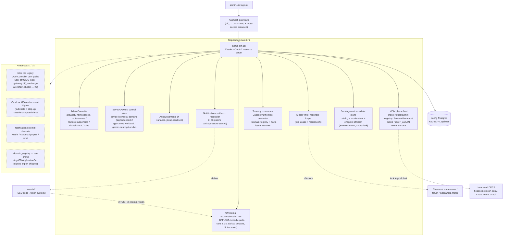

The **admin Backend-For-Frontend** of the HugMesh platform: a reactive Spring Boot
(WebFlux) service behind the admin UI and console. It sits in the **backend tier**
(`hugmesh-backend` namespace), behind the platform gateways, and is a **Casdoor OAuth2
resource server**. It owns the admin-side control plane:

- the Google/Discord, admin-invited **registration allowlist** and per-user
  **namespace grants**, with a best-effort **Casdoor** user/role write through the PKI
  gateway;
- the durable **account/session store** (`admin-bff-db`) that the SSO login flow reads
  and writes. The *login/session orchestration* itself is moving to **user-bff** (see
  [Current State](#current-state)); admin-bff stays the system of record and exposes it
  over the internal mTLS surface;
- brokering **real Matrix/Mastodon service tokens** server-side, so the UI never holds
  homeserver admin credentials;
- the **gateway access-control surfaces** — per-gateway role→URL `route-access`
  rules (the `gateway_route_access` Postgres table is the source of truth the
  gateways' `GatewayRouteAccessFilter` enforces; mirrored to Cassandra for the
  gateways) and the DB-driven gateway **route definitions** (`url_registry`);
- **access-role suspension** (ban, timed suspend) and **domain-lock** (force local-only,
  no federation) desired state, each driven by a single-writer reconcile loop;
- site **announcements** (multi-surface: home / public login / akkoma / forum);
- the **phpBB forum admin console** proxy, **ClickHouse usage analytics**, an
  ADMIN **cloud backup & recovery** flow, the **test-architecture reports** console,
  and **ISO artifact** download links.

In short: when an operator invites a user, bans an account, locks a domain down to
federate less, rolls out a new service or checks a mesh device from the admin console,
the request ends up here. [Related HugMesh repositories](#related-hugmesh-repositories)
shows where this service fits in the platform.

It also owns the **multi-tenancy** boundary (per-brand issuer-keyed domain scoping —
✅ shipped), the **device-license registry** + **domain registry** SUPERADMIN control
plane (✅ shipped), an **in-app notifications** outbox/reconciler (✅ shipped) with
external channel adapters wiring up (🚧 in-flight), **OIDC provider default roles**
+ **first-login role hook** (✅ shipped), the **superadmin service app-store** +
**games-services** + **workload console** + **egress-VPN** + **node-storage** +
**Anubis** surfaces (✅ shipped), and a **device-enrollment** liveness self-report
channel (✅ shipped).

> **State convention in this README:** **✅ shipped** = merged to `main`; **🚧 in-flight**
> = code on an open branch/PR, not yet merged; **🔭 planned** = design-complete, no code
> yet. The [Roadmap](#roadmap) collects the 🔭 and 🚧 items. The rest of this README
> describes `main`.

---

## Status

_Reflects `src/main/java` on `main` through PR #241 (the HugMesh rebrand in PR #236,
the fleet-owner/Azure-Intune MDM waves, and the managed-backing-services plane). The
last full test run recorded here (**2414 tests, 8 failures, 0 errors, 10 skipped**) is
out of date; see the test-suite callout right below the shipped/gaps lists._

**✅ Shipped & real** (code + tests on `main`, independent of whether the feature's
own runtime flag defaults on): the full `/bff/admin/**` + `/bff/superadmin/**` control
plane described under [Endpoints](#endpoints) below; multi-tenancy domain-scoping;
the device-license + domain registries with signed exports; the in-app notifications
outbox; OIDC default-roles + first-login hook; the superadmin app-store / workload
console / games-services / egress-VPN / node-storage / device-radios (Meshtastic LoRa
attachments, mesh-bridge track) / Anubis surfaces; the `/bff/internal` account/session
API + the (suspension-gated, see below) BFF-JWT-custody tail; desktop app governance,
cloud-backup v2 (Velero), the image-build pipeline, SSH key issuance and the
SSH-terminal-dial authorize step (**including** a real, host-key-pinned sshj dial
factory — ships dark, see below); the **MDM phone fleet control plane** (device
ingest, the SUPERADMIN fleet registry + management/lockout mutations, the public
per-owner `FLEET_ADMIN` surface with its fleet-entitlement gate, and the Headwind /
mesh-deny / Azure-Intune lock-enforcement legs — all ships dark, see
[Endpoints](#endpoints)); the **SUPERADMIN managed/self-hosted backing-services admin
plane** (catalog + mode-intent recording, ships dark); and the subsystems documented in
[`docs/SUBSYSTEMS.md`](docs/SUBSYSTEMS.md) — passwordless local login, the go-live
wizard, account-ban appeals, Mastodon appearance defaults, the character/sticker
moderation activation reconciler, the optional-services reconciler, node radio
attachments, and federation bearer-forwarding/custody-exchange. A large share of the
above **ships dark** behind a default-off config flag even though the code is real and
tested — see each section for its specific gate.

**Test-suite callout:** the 8 failures came from one Boot 4 `HttpStatus` rename
(`UNPROCESSABLE_ENTITY` became `UNPROCESSABLE_CONTENT`). Eight assertions compared the
old enum constant against a controller that correctly returns 422. **Fixed.** The tests
now assert the numeric code, and `HttpStatusAssertionStyleTest` fails the build if a
test compares `HttpStatus` enum identity again (commit `ffa370a`). `UNPROCESSABLE_ENTITY`
now appears in `src/test` only in that guard's own text. The 2414-test count was not
re-measured. `src/test` holds 3253 `@Test`/`@ParameterizedTest` methods in 389 test
classes (static count, 2026-10-15). The Postgres-backed classes start Postgres through
Testcontainers, so a full run needs a Docker daemon.

**2026-07 security hardening:** a cross-cutting native-login identity-fold review found
and fixed several real HIGH and MEDIUM authz bugs: Mastodon-localpart takeover by
collision, an MFA-freshness bypass on the `bff_` introspect path, identity-key
mismatches in suspension gateway-revoke and Casdoor-role-sync, a workload-console
superadmin-suspension bypass, and the `/bff/internal/session/exchange` suspension bypass
described in the [Internal](#internal-service-to-service-mtls-bounded) section below.
All are fixed on `main` (`#161`, `#209`/`#210`/`#218`, `#220`/`#221`/`#223`/`#224`).

**Known gaps** (real, not speculative — see [Roadmap](#roadmap) for the platform-scale
items and the "Edge-AI infra triage" section of [`docs/SUBSYSTEMS.md`](docs/SUBSYSTEMS.md)
for the narrower ones):
- Casdoor MFA and the SSO login/session relocation to user-bff are both **substrate
  shipped, enforcement/cutover still roadmap** (see [Roadmap](#roadmap)).
- Notification external channels: Matrix DM and Akkoma transports are written but gated
  off (see "Notifications" below), email only reaches recipients that are email addresses,
  phpBB has a private-message transport (dark behind `notify.forum.pm.wired`) but no
  forum-bff route to call; the superadmin app-store's ArgoCD provisioning effector is dark (the
  Kaniko in-cluster image builder is real code, but also off by default:
  `app.appstore.builder.enabled=false`).
- Device-license Layer-A headscale enforcement needs a live control node to confirm
  which reported key is canonical. That question is tracked, unresolved, in
  [`docs/CANONICAL-FP.md`](docs/CANONICAL-FP.md). The tailnet ACL policy has one writer
  (decision 101 = B, 2026-09-23): this BFF's `PUT /api/v1/policy`. The push still ships
  dark (`app.registry.headscale-acl.enabled=false`): the canonical key is unconfirmed and
  the generator-side switch has not landed. See the Layer-A item in the [Roadmap](#roadmap).
- The SSH-terminal dial's real, host-key-pinned `SshjDeviceSshChannelFactory` (sshj,
  no TOFU — refuses without an ACTIVE `device_ssh_dial` row and a matching pinned
  `host_key_fp`) **already exists and is tested** (merged 2026-06-18, #81). It ships
  dark behind its own second flag (`app.device-terminal.dial.enabled=false` by
  default, independent of `app.device-terminal.enabled`); the fail-closed
  `UnconfiguredDeviceSshChannelFactory` is only what's wired while that second flag
  stays off. What's genuinely roadmap is the security re-review the class's own
  Javadoc calls for before flipping it on.
- Edge-AI infra triage now has its in-repo caller (`AioTriageIngestController`,
  `POST /bff/internal/aio-triage/ingest`), but the node-level DaemonSet **collector**
  that would post to it lives outside this repo and is not built yet — so the endpoint
  has no production caller. See `docs/SUBSYSTEMS.md`.
- Node radio attachments (`RadioDeviceController` + the signed per-node export) are
  real and tested, but the companion meshbridge daemon (`hugmesh-generator` PR #374)
  reads a **separate, static, manually-edited devices ConfigMap** instead of this
  export — the on-node/cluster reconcile agent that would connect the two doesn't
  exist yet. See `docs/SUBSYSTEMS.md`.

---

## Current State

_This section describes the platform's SSO authentication model as of the 2026-06-25
auth reshape. [Status](#status) above covers everything that shipped since. The versions
below were refreshed on 2026-10-07, and the known gap this section once named in the
[Internal](#internal-service-to-service-mtls-bounded) section is fixed._

**Ecosystem baseline.** Spring **Boot 4.0.7** / Spring Cloud **2025.1.2** on
**Java 25 LTS**. Shared Maven artifacts:

- `net.hugmesh:hugmesh-parent:2.9.0-beta.1` — the metapom (child of
  `spring-boot-starter-parent:4.0.7`; manages testcontainers 2.0.5);
- `net.hugmesh:hugmesh-commons:2.2.0-beta.1` (managed by the parent BOM) — shared
  security/tenancy/web (`net.hugmesh.commons.*`);
- `net.hugmesh:hugmesh-auth-core:2.6.0-beta.1` (currently-pinned version — see
  `pom.xml`) — the shared account / session / MFA / Casdoor-admin infrastructure
  (the account/session/MFA/Casdoor-admin classes that used to live in this repo were
  extracted into it). It depends on `hugmesh-commons` and is
  consumed by **only** `user-bff` and this `admin-bff`. **2.1.0** added the
  BFF-JWT-custody seam (`bff_session` custody columns + `BffCustodyCipher` AES-256-GCM +
  `OidcExchangeClient`), bumped in lockstep with the band-180 custody migration and the
  `/bff/internal` custody/stamp & session/exchange endpoints below; **2.2.0** added the
  per-account live-session listing seam (`AccountStore.sessionsForAccount`); **2.3.0**
  drops the `UUID.randomUUID()` mints from the MFA enrollment / WebAuthn-challenge stores
  in favour of the DB-generated `(gen_random_uuid())::text` PKs (band-210 here, #134);
  **2.3.1**–**2.3.4** are identity-fold correctness fixes from the 2026-07-11/15 native-login
  authz review; **2.4.0** is a coordinate-only rename (legacy groupId → `net.hugmesh`
  groupId + package move, no behavior change, part of the HugMesh rebrand, #236);
  **2.4.2** syncs the shared `ReservedNames` to reserved-prefixes revision 9 (82
  labels; 2.4.1, which pom.xml names as the first carrier, was never published);
  **2.5.0** adds the domain-scoped registration gate; **2.5.1** adds a username gate that
  stays off here; **2.6.0-beta.1**, the pin, is the first beta of the release chain and adds
  the `bff_` session bridge — see
  the version-by-version changelog under
  [Shared libraries](#shared-libraries-hugmesh-parent--hugmesh-commons--hugmesh-auth-core)
  below for the full detail.

**The SSO auth model.** Casdoor is the SSO IdP, and the platform login flow has moved
off a custom BFF login:

- **login-ui** POSTs a **native username/password (+MFA)** form to `/bff/login`;
  **user-bff** runs **PKCE (S256) + state server-side**, POSTs the credentials to the
  **internal-only Casdoor `/api/login`** (never browser-reachable), then exchanges the
  returned code. Casdoor is never browser-exposed — there is **no** hosted-login
  redirect and **no** browser-visible Casdoor URL.
- **user-bff** does the server-side **code→token exchange** and holds per-session
  JWT custody + refresh. The browser only ever holds an **opaque `bff_`-prefixed
  session** (localStorage or httpOnly cookie) — a user **never** sees their own
  Casdoor JWT.
- the **gateway** is a pure Casdoor-JWT OAuth2 resource server: a pre-security
  exchange filter swaps `bff_` → the internal custody JWT, so the gateway's JWT
  validation and role gate run unchanged. Authorization is **data-driven**: the
  `gateway_route_access` Postgres table (this service's source-of-truth surface) feeds
  `GatewayRouteAccessFilter`. **ADMIN / GAME-MASTER** bypass within their own domain,
  **SUPERADMIN** across domains. **Cloudflare** fronts prod.

**What that means for admin-bff specifically:**

- admin-bff stays a **Casdoor OAuth2 resource server**. It validates the Casdoor JWT
  presented at the backend tier (after the gateway's `bff_` swap). Its three-layer
  defence in depth (gateway route-access → filter chain → `@PreAuthorize`) is
  unchanged.
- **Login / session / account *orchestration* is being RELOCATED from admin-bff to
  user-bff**, and the shared core for it has been **extracted into `hugmesh-auth-core`**
  (#111 — the `AccountStore` / Casdoor-admin client / MFA subsystem / session + internal
  filters now live in the library, no longer in this repo). The **account / session DATA
  stays in `admin-bff-db`**: user-bff reaches it via this service's **`/bff/internal`**
  account/session API (`InternalAccountController`, #113) over **mTLS + an
  `X-Internal-Token`** header, with the **BFF-JWT-custody tail** (`/bff/internal/custody/stamp`
  & `/session/exchange`, band-180, auth-core 2.1.0 — #114) **dark by default here, lit
  in-cluster**: user-bff's OIDC login (`SsoAuthController`) is routed at the gateway
  (`/bff/login` → user-bff ahead of the `/bff/**` catch-all, generator@912524b8), the gateway's
  `bff_`→JWT exchange is on (generator@c85a1283, hugmesh/hugmesh-generator#177), and this service's Deployment sets
  `APP_BFF_OIDC_ENABLED` + `APP_BFF_CUSTODY_KEY` (generator@50021c55) — see #2. The legacy user-facing
  `AuthController` paths (`/bff/login`, `/bff/register/**`, `/bff/me`, `/bff/provision/**`)
  described under [User flow](#user-flow-base-bff) are the contract being moved — treat
  their *ownership* as in-transition (see [Roadmap](#roadmap)); the durable allowlist /
  namespace / entitlement data and the token broker remain admin-bff responsibilities.
- **SCG-5 awareness.** Spring Cloud Gateway 5.0 moved route config from
  `spring.cloud.gateway.routes` to `spring.cloud.gateway.server.webflux.routes`; the
  legacy prefix silently binds nothing. admin-bff is **not** a gateway, but it writes
  the DB-driven route **definitions** (`url_registry`) and **route-access** rules that
  the gateways and the generator route templates consume. The gateways and generator
  templates were corrected to the new namespace, so the rules this service emits bind.

**Shipped & stable on `main`:** the full `/bff/admin/**` + `/bff/superadmin/**`
control plane (allowlist / namespaces / route-access / routes / suspension /
domain-lock / standalone roles / announcements / forum / backups / test-reports /
ISOs), multi-tenancy domain-scoping, the device-license + domain registries (now with
the SUPERADMIN signed domain-registry `/export` + provisioning-status `/status` —
#118), the in-app notifications outbox MVP (now emitting `@system` backup/restore-started
rows — #117), OIDC default-roles + first-login hook, the service-store /
workload-console / games / egress-VPN / node-storage / Anubis superadmin surfaces, the
`/bff/internal` account/session API + the BFF-JWT-custody surface (#113/#114; dark at defaults), and
the dark MFA substrate (factor/challenge tables + `gateway_route_access.mfa_required` +
the image-gen / SSH-issue / terminal-dial step-up satisfiers — #115/#116).

---

## Architecture at a glance



---

## Where it sits

| | |
|---|---|
| **Tier / namespace** | backend (`hugmesh-backend`) |
| **Framework** | Spring Boot **4.0.7** (reactive **WebFlux**), Spring Cloud **2025.1.2**, **Java 25 LTS** |
| **AuthN** | Casdoor OAuth2 **resource server** — validates the Casdoor JWT presented at the backend tier (the gateway swaps the browser's opaque `bff_` session → the internal custody JWT before it reaches here) |
| **Shared libs** | `hugmesh-parent:2.9.0-beta.1` (metapom) → `hugmesh-commons:2.2.0-beta.1` (security/tenancy/web) + `hugmesh-auth-core:2.6.0-beta.1` (shared account/session/MFA/Casdoor-admin + the BFF-JWT-custody seam; consumed by user-bff + admin-bff only) |
| **Persistence** | config Postgres over **R2DBC** (runtime, non-blocking); **Liquibase** owns schema (JDBC, migrations only) |
| **Other stores** | **ClickHouse** (usage analytics, best-effort), **Kafka** (usage-event bus, optional), **Cassandra** (best-effort route-access mirror the gateways poll) |
| **Image / CI** | multi-stage Dockerfile (temurin 25), `:8080`; built + pushed to the in-cluster GitLab registry by `.gitlab-ci.yml`, which also runs the platform OWASP pen-test stages (SCA + DAST + nuclei) — see [CI & pen-test stages](#ci--pen-test-stages). **CI is GitLab**; one GitHub Actions workflow (`.github/workflows/release.yml`) also pushes to GHCR (`:main` on every push to main, `:<version>` + `:beta` on a `v<version>` tag). Images carry **no** KEYS material |
| **App id** | `net.hugmesh.adminbff` (`AdminBffApplication`) |

It is the production Spring port of the verified reference contract in
`hugmesh-generator/tests/stack/mock-bff.mjs`; JSON shapes mirror that mock so the
admin-ui / login-ui typed clients work unchanged.

---

## Security — defence in depth

`SecurityConfig` is a reactive Casdoor OAuth2 resource server (`issuer-uri` from
`CASDOOR_ISSUER_URI`). `@EnableReactiveMethodSecurity` turns on the
`@PreAuthorize("hasRole('ADMIN')")` method gates. Every admin path passes **three**
independent layers, and no layer trusts the network:

1. the gateway denies `/bff/admin/**` to non-admins, using the Postgres
   `gateway_route_access` rules this service manages (the gateway's
   `GatewayRouteAccessFilter` enforces them, after the pre-security `bff_` → JWT swap);
2. the resource-server filter chain applies the path rule again;
3. `@PreAuthorize` checks again at the controller method.

### JWT → authority mapping (✅ on `main`)

The `commons.security.CasdoorAuthorities` converter serves both `SecurityConfig`
(single-issuer) and the opt-in multi-issuer decoder path
(`commons.config.TenancyResourceServerConfig`). It mirrors the hugmesh-gateway and
hugmesh-actions converter and emits:

- a `ROLE_USER` floor on every authenticated principal;
- `ROLE_<UPPER>` for each `roles` claim entry (string or `{name}` object), plus
  `ROLE_ADMIN` from the legacy `isAdmin` boolean;
- a verbatim authority for each `permissions` entry, **except** an entry with a reserved
  `ROLE_` or `DOMAIN_` prefix (`RESERVED_PREFIXES = {"ROLE_","DOMAIN_"}`). Those are
  **dropped** as an **authority-injection defence**: a user-settable `permissions` claim
  can never forge a `ROLE_SUPERADMIN` or a `DOMAIN_<brand>` tenant scope;
- **exactly one** issuer-derived `DOMAIN_<x>` authority, resolved through `DomainRegistry`
  from the cryptographically validated `iss`, never from a user-settable claim. An unknown
  issuer maps defensively to `DOMAIN_default`.

### Path matchers

| Path | Rule |
|---|---|
| `/actuator/health{,/**}`, `/actuator/info` | `permitAll` (probes) |
| `POST /bff/login`, `POST /bff/login/local`, `/bff/register/**` | `permitAll` — no JWT yet; the BFF enforces the **admin-invite gate itself** (login/register orchestration is being relocated to user-bff — see [Current State](#current-state)); the local login 401s unless `app.local-login.enabled` |
| `POST /bff/sessionOut` | `permitAll` — logout needs only the opaque `bff_` session; idempotent |
| `/bff/public/**` | `permitAll` — intentionally unauthenticated; serves both the anonymous login-page **announcements** feed and the public **appeal-contact** (`GET /bff/public/appeal-contact`) |
| `/bff/internal/**` | `hasRole('SERVICE')` — service-to-service only (user-bff account/session access, the gateway's session introspect/exchange, `POST /bff/internal/device-enrollment/self-report`, …). Satisfied by a Casdoor **client-credentials `ROLE_SERVICE` JWT** *or* by the in-cluster **`X-Internal-Token`**, which `SecurityConfig` promotes to a SERVICE principal — so every existing caller is unchanged. **Not** `permitAll`: this subtree mints `bff_` sessions for arbitrary accounts and it *is* reachable through the fe-gateway's `/bff/**` route (no `gateway_route_access` row covers it ⇒ NO_RULE ⇒ forward), and mTLS does not separate that traffic because the gateway presents its own cluster-CA client cert on the proxy leg. Human roles — **including SUPERADMIN** — get 403. Blank `app.internal.token` is dev/test-only parity with the old behaviour; `InternalSurfaceTokenBootGuard` refuses to boot a prod profile without it |
| `/bff/admin/phone-fleet/**` | `hasAnyRole('FLEET_ADMIN','ADMIN','SUPERADMIN')` — listed before the generic admin rule, because a pure `FLEET_ADMIN` has no ADMIN role |
| `/bff/admin/**` | `hasAnyRole('ADMIN','SUPERADMIN')` (each endpoint then re-applies its own `@PreAuthorize`; SUPERADMIN-only mutations 403 an ADMIN) |
| `/bff/superadmin/**` | `hasRole('SUPERADMIN')` |
| `/bff/games-services/**` | `hasAnyRole('GAMES_SERVICES','GAMES_SERVICES_ADMIN','GAMES_SERVICES_RUNNER')` |
| `/bff/announcements/**`, `/bff/mastodon/appearance-default`, `/bff/desktop/install-requests/**` | authenticated (validated JWT, no special role) |
| `/bff/desktop/registry/**` | `hasRole('DISCOVER')` |
| `/v3/api-docs/**`, `/swagger-ui/**` | `permitAll` under `dev`/`test` (so `gen:fetch` can curl the spec); `hasAnyRole('ADMIN','SUPERADMIN')` in prod |
| everything else | authenticated |

`/bff/provision/matrix` also requires `hasRole('MATRIX')` and `/bff/provision/mastodon`
requires `hasRole('MASTODON')`, so a user whose platform role a suspension stripped can no
longer mint a fresh token.

### mTLS (server side, config-only)

When the in-cluster keystore initContainer is mounted, the deployment sets
`SSL_ENABLED=true` and `SSL_CLIENT_AUTH=need` (TLSv1.3 floor). The handshake then
**requires** a client cert that chains to the cluster CA, so a caller not signed by the
platform Vault/ESO PKI cannot open a connection. The user-bff → `/bff/internal`
account/session traffic rides this transport (mTLS + `X-Internal-Token`). mTLS says who
may connect, not who the user is: the fe-gateway presents its own cluster-CA cert when it
proxies browser traffic, so that traffic passes the handshake too. That is why
`/bff/internal/**` also requires `ROLE_SERVICE`. The defaults keep local and CI runs
plaintext.

### Role cascade & SUPERADMIN (✅ on `main`)

The platform's least-privilege cascade is **superadmin → admin → mod → user**,
domain-scoped, enforced at the gateway and checked again here:

- **SUPERADMIN** is a real, code-enforced role and is **unscoped** (the infra control
  plane). It alone changes the **device-license registry**, the **domain registry**, the
  superadmin **service app-store** (curation, app-profiles, deployments, the
  **scaffold + federate** wizard), the **workload console** (cross-cluster manage, exec,
  log-stream), the **games-services catalog**, the **Anubis** PoW-shield console, and
  per-domain **system-account** and **egress-VPN** provisioning. These sit under
  `/bff/superadmin/**` or are `@PreAuthorize("hasRole('SUPERADMIN')")` endpoints under
  `/bff/admin/**`.
- **ADMIN** is domain-scoped. On SUPERADMIN-owned surfaces (device-licenses and the like)
  an ADMIN may **read**, and mutations 403. On its own surfaces (allowlist, namespaces,
  route-access, suspension, domain-lock, announcements, forum, test-reports) it has full
  CRUD within its domain. The route definitions (`/routes`) are SUPERADMIN-only.
- `ROLE_IMAGE_BUILDER` and the `GAMES_SERVICES{,_ADMIN,_RUNNER}` capabilities are
  recognised as separate, narrowly-scoped authorities.

### Service-Store scaffold + federate wizard (SUPERADMIN)

The "scaffold a new service, then federate it" surface of the app-store, all under
`/bff/superadmin/service-store/**` (`hasRole('SUPERADMIN')` on every method); the two
mutating verbs additionally require the `X-ServiceStore-StepUp` step-up token
(`ServiceStoreStepUpGate`, cloned from the go-live gate — a workload step-up token OR a
fresh Casdoor-MFA stamp):

| endpoint | operationId | what it does |
| --- | --- | --- |
| `GET  /scaffold/archetypes` | `serviceScaffoldArchetypes` | the embedded scaffold catalog (`spring-bff` / `angular-mfe` / `angular-host` / `remote-fragment`) |
| `POST /{domain}/scaffold` | `serviceScaffoldCreate` (201, **step-up**) | records a `service_scaffold` row (schema `320`) — INTENT only |
| `GET  /{domain}/scaffold/{id}/archive` | `serviceScaffoldArchive` | renders the starter codebase to `application/zip` (marks the row `archived`) |
| `POST /{domain}/deployments/{id}/federate` | `serviceDeploymentFederate` (**step-up**) | registers the deployment's UI as a federation module → `FederateOutcome {deployment, federationReal, gitopsDescriptorPending}` |
| `GET  /federation` | `serviceCatalogFederationStatus` | `{enabled, warnings}` for the federate leg |

- **The render needs no deployment.** A scaffold row is intent plus hints (`mount_at`,
  `requires_role`). The ZIP is rendered on demand from the **embedded example codebases**
  under `src/main/resources/scaffold/*`, which were vendored from the generator's
  `templates/archetypes/*` skeletons and have since drifted (provenance, drift and resync
  in `resources/scaffold/README.md`). `TokenRenderer` substitutes the `{{TOKEN}}` identity
  tokens (values follow the generator's `render-repo-tree.sh` derivations) and **hard-fails
  on any unrendered `{{UPPER_SNAKE}}`**, so a broken starter never ships. The spring-bff
  Java sources are relocated into the real `net.hugmesh.<slug>` package path.
- **Federate ships dark** behind `app.appstore.federation.enabled` (default false). The
  `FederationModuleClient` bean pair (noop / real, gated like `ArgoCdConfig`) means a
  federate call is *logged, not written* until the flag is on, and `FederateOutcome`
  reports `federationReal` honestly. The real `RestFederationModuleClient` upserts against
  federation-api's SUPERADMIN admin API (`/api/federation/admin/modules`); its
  `auth-token` must be a Casdoor JWT carrying `ROLE_SUPERADMIN`. `gitopsDescriptorPending`
  stays **true** until the GitOps descriptor automation exists.

### Multi-tenancy / domain-scoping (✅ on `main`)

Issuer-keyed **per-brand scoping** lets one deployment serve several brands (one Casdoor
per brand, so each has a distinct, cryptographically validated `iss`). It is **shipped on
`main`** (changelogs `010-domain-scope`, `061-announcement-domain`,
`011-device-license-registry`, `012-domain-registry`):

- The `commons.security.CasdoorAuthorities` converter stamps the issuer-derived
  `DOMAIN_<x>` authority and strips reserved-prefix `permissions` (see
  [JWT → authority mapping](#jwt--authority-mapping--on-main) above).
- `commons.security.DomainRegistry` maps issuer to domain. A single-issuer cluster maps to
  `DOMAIN_default`, byte-for-byte unchanged. Multi-issuer is opt-in through
  `app.tenancy.issuers` / `APP_TENANCY_ISSUERS` and **fails closed** on an unknown issuer.
  `commons.config.TenancyResourceServerConfig` contributes the per-issuer
  authentication-manager resolver only when real `issuer=domain` pairs are configured
  (`@ConditionalOnExpression` on the CSV containing a `=`).
- `commons.security.Roles` and `commons.security.PrincipalDomain` resolve the acting
  principal's tenant per request. The admin services apply a **per-query domain
  predicate** (`WHERE domain = :domain`) and stamp `domain` on every row they write.
  **SUPERADMIN is unscoped.**
- The per-row `domain` discriminator column (and an index) is on `access_suspension`,
  `domain_lock`, `gateway_route_access`, `announcement` and the registry tables.

> 🔭 **Roadmap — provisioning leg.** The `domain_registry` table and its SUPERADMIN CRUD
> are shipped. **Materialising** rows into a per-brand ArgoCD `ApplicationSet` (namespaces,
> CA, Casdoor org, gateway, BFF, UI) is a later PR. See [Roadmap](#roadmap).

### Shared libraries (`hugmesh-parent` + `hugmesh-commons` + `hugmesh-auth-core`)

The security, tenancy and web building blocks above come from the org's shared Maven
artifacts (`hugmesh-parent` on `2.9.0-beta.1`, `hugmesh-commons` on `2.2.0-beta.1`,
`hugmesh-auth-core` on `2.6.0-beta.1`), not from per-repo copies:

1. **Parent POM →** `net.hugmesh:hugmesh-parent:2.9.0-beta.1`, a child of
   `spring-boot-starter-parent:4.0.7`, so the Spring Boot dependency and plugin
   management comes with it. The parent holds the reactive-BFF `<dependencies>`
   (webflux, actuator, security, oauth2-resource-server, validation, R2DBC + Liquibase +
   JDBC, springdoc, the core test stack) and the `dependencyManagement` for
   `hugmesh-commons`, the AWS SDK BOM, resilience4j and springdoc. Only the
   **admin-bff-specific** dependencies stay in this POM: `spring-boot-starter-mail`,
   `jsoup`, `spring-cloud-kubernetes-fabric8-leader`, `spring-kafka` (+`-test`), the
   Cassandra `java-driver-core`, `sshj`, BouncyCastle, `webauthn4j-core`, and the (now
   version-managed) resilience4j artifacts.

2. **Shared security/tenancy/web →** `net.hugmesh:hugmesh-commons:2.2.0-beta.1`,
   version-managed by the parent BOM and not pinned in this POM (the `tests` classifier
   used by the test suite follows the same `${hugmesh-commons.version}` property). It replaced the local
   `security.{Roles,DomainRegistry,DomainScope}`, `config.{CasdoorAuthorities,
   TenancyResourceServerConfig}` and `web.ApiException`, which were **deleted**:
   - `commons.security.Roles` — its `Collection`/names overloads are
     `isSuperadminNames(...)` and `domainOfNames(...)`; the `isSuperadmin` and `domainOf`
     names take `Collection<? extends GrantedAuthority>`.
   - `commons.security.DomainRegistry` — the same `knownDomains` / `isKnownDomain` /
     `trustedIssuers` / `isMultiIssuer` API.
   - `commons.security.PrincipalDomain` — the replacement for the old instance-based
     `security.DomainScope`: `of(Authentication, registry)`, `superadminFor(String)`, and
     `domain()` / `superadmin()` / `scoped()` / `NO_DOMAIN` kept 1:1. The admin services
     and repositories thread it as before.
   - `commons.security.CasdoorAuthorities` (now `public`, methods `public static`;
     `MfaConfig` is a `public record`).
   - `commons.config.TenancyResourceServerConfig`.

3. **Shared account / session / MFA / Casdoor-admin →**
   `net.hugmesh:hugmesh-auth-core:2.6.0-beta.1` (currently pinned; **adopted** at #111). The
   stateful auth core that used to live in this BFF was extracted into it: the account,
   allowlist and `bff_session` store with `AccountStore`, the `CasdoorAdminClient`, the
   full MFA subsystem, the session-cookie and internal-token filters, the username gate,
   the login/MFA DTOs, and the OIDC token-custody seams (`OidcExchangeClient` /
   `BffCustodyCipher`). It depends on `hugmesh-commons`. Only `user-bff` and this
   `admin-bff` use it, as login/session orchestration moves to user-bff. The durable
   **account/session DATA still lives in `admin-bff-db`**: admin-bff wires `AccountStore`
   against it, and user-bff reaches the same data through this service's `/bff/internal`
   surface over mTLS + `X-Internal-Token`. The library is BFF-only and kept off the gateway
   classpath, so it is not in the parent BOM; this POM pins it explicitly. Versions:
   - **2.1.0** (#114): the BFF-JWT-custody seam — the `bff_session` custody columns
     (Liquibase **band-180**), `AccountStore.stampCustody/clearCustody/sessionRow`, the
     AES-256-GCM `BffCustodyCipher` and the `OidcExchangeClient` refresh leg.
   - **2.2.0** (#132): the per-account live-session listing seam
     (`AccountStore.sessionsForAccount`).
   - **2.3.0** (#134): drops the `UUID.randomUUID()` mints from `MfaEnrollmentService` and
     `WebAuthnChallengeStore`, so those tables' PKs come from the DB-side
     `(gen_random_uuid())::text` DEFAULT (band-210).
   - **2.3.1**–**2.3.4**: the 2026-07-11/15 native-login identity-fold correctness fixes
     (see [Status](#status) above).
   - **2.4.0**: a coordinate-only rename (legacy groupId → `net.hugmesh` groupId + package
     move, no behavior change, part of the HugMesh rebrand, #236).
   - **2.4.1** (never published) and **2.4.2**: sync `ReservedNames` to
     `reserved-prefixes.yaml` revision 9 (82 labels), so the invite, grant and provision
     username gates and the route-access reserved-prefix warning enforce `hmdm`, `attest`,
     `character-forge`, `games-character-forge` and `games-shadows-of-the-net`.
   - **2.5.0** (auth-core issue #1): adds `AccountStore.isEmailInvited(email, domain)` and
     `isDiscordInvited(handle, domain)` and deprecates the unscoped overloads. That is what
     makes the registration invite gate brand-scoped (see `POST /bff/register/*` below).
   - **2.5.1**: 2.5.0 was never published to GitHub Packages, so the release
     image build could not resolve it. 2.5.0 → 2.5.1 is source- and binary-compatible
     (the deprecated overloads stay). 2.5.1 also carries the Casdoor-platform username
     gate, which stays off here until `FEDERATION_USERNAME_GATE_ENABLED` is set with
     `APP_CASDOOR_PLATFORM_BASE_URL`, `_CLIENT_ID`, `_CLIENT_SECRET` and
     `HUGMESH_MTLS_CLIENT_ENABLED`.
   - **2.6.0-beta.1**: the pin, and the first beta of the release chain (build-config
     0.6.0-beta.1, parent 2.9.0-beta.1, commons 2.2.0-beta.1). 2.6.0 adds the `bff_`
     session bridge. 2.5.1 was never published either, so this is the first auth-core
     coordinate the chain is expected to publish.

   **Stays per-repo:** this repo's A2 cookie/CSRF `config.SecurityConfig` (route matchers
   plus CSRF/cookie/header policy), the per-repo `web.ApiExceptionHandler` and
   `web.ValidationExceptionHandler`, the DB-backed `domainregistry.*` feature (the
   SUPERADMIN domain-registry CRUD, distinct from the security `DomainRegistry`), and the
   test `config.SecuritySliceSupport`.

   **Two consumer-wiring steps** (the recipe for the fan-out):
   - `config.CommonsSecurityConfig` `@Import`s the commons `DomainRegistry` and
     `TenancyResourceServerConfig` beans, because the `@SpringBootApplication` component
     scan over `net.hugmesh.adminbff` does **not** cover the `net.hugmesh.commons.*`
     packages. (`@Import` keeps `TenancyResourceServerConfig`'s `@ConditionalOnExpression`
     gate.)
   - The security-slice tests reach the package-private commons
     `TenancyResourceServerConfig.tenantAuthManagerResolver()` `@Bean` through a
     same-package **test** accessor, `net.hugmesh.commons.config.TenancyResolvers`.

#### Resolving the private shared artifacts

`hugmesh-parent`, `hugmesh-commons`, `hugmesh-auth-core` (and `hugmesh-build-config`) are
**not** on Maven Central. They live in the org GitLab Maven Package Registry and, for the
GitHub release workflow, in GitHub Packages. Three resolution paths, **no secrets in
git**:

- **Local dev:** the shared artifacts are `mvn install`ed into `~/.m2`, so a plain
  `./mvnw test` resolves them locally and never touches the remote.
- **CI / Docker:** the committed [`settings.xml`](settings.xml) declares the `gitlab-maven`
  group registry, authenticated by the GitLab `CI_JOB_TOKEN` (`${env.CI_JOB_TOKEN}`,
  injected by GitLab, never committed). The [`Dockerfile`](Dockerfile) multi-stage build
  runs `./mvnw -s settings.xml package` with the token mounted as a **BuildKit secret**
  (`--mount=type=secret`, so it never lands in an image layer). `.gitlab-ci.yml` passes
  `--secret id=ci_job_token,env=CI_JOB_TOKEN` plus the `CI_API_V4_URL` / `GITLAB_GROUP_ID`
  build-args.
- **GitHub release workflow:** when the BuildKit secret `packages_read_token` is mounted,
  the `Dockerfile` builds with [`.github/maven-ci-settings.xml`](.github/maven-ci-settings.xml)
  against GitHub Packages instead (the `UPSTREAM_PACKAGES_ACTOR` build-arg names the
  login). `release.yml` supplies the secret from the `PACKAGES_READ_TOKEN` repository
  secret, a classic token with `read:packages`. A mounted but empty secret fails the build.

---

## Endpoints

### User flow (base `/bff`)

> **Relocation note.** `AuthController` first served two-stage, admin-invited,
> **Google/Discord-only** registration and login/session here. Under the SSO model the
> *login/session orchestration* is moving to **user-bff**: login-ui POSTs a native
> username/password (+MFA) form to `/bff/login`; user-bff runs PKCE (S256) and state
> server-side, POSTs the internal-only Casdoor `/api/login`, does the code→token exchange
> and holds JWT custody; the browser holds only the opaque `bff_` session and never sees a
> Casdoor URL. The **account/session DATA and the invite/entitlement logic stay here**;
> user-bff reaches them over `/bff/internal` (mTLS + `X-Internal-Token`). The endpoints
> below are the contract as it stands on `main` during the move.

`/bff/login` and `/bff/register/**` are `permitAll` (no JWT yet). The authenticated
endpoints accept the opaque BFF **session token** (`Authorization: Bearer <bffToken>`,
durable in Postgres) **or** the validated Casdoor JWT principal.

- `POST /bff/register/google` / `POST /bff/register/discord` — stage 1. 403 if an admin
  **of the requesting brand** did not invite the identity. Returns
  `{token,id,provider,roles,registrationComplete}`.
  - The invite gate is **domain-scoped** (auth-core issue #1, auth-core **2.5.0**). The
    `allowlist` row has carried the inviting admin's domain since changeset 220, but the
    gate READ asked "invited in ANY domain", so brand A's invite also admitted that
    identifier on brand B.
  - Registration is pre-authentication, so `RegistrationDomainResolver` takes the domain
    from **server-trusted inputs only**: the forwarded token's trusted issuer, else the
    `app.tenancy.registration-domain` per-deployment pin, else the deployment's only known
    brand (`default` on an untenanted install, which keeps single-tenant behaviour
    byte-identical), else **fail closed**. It is deliberately NOT a request-body field: a
    caller-chosen domain would reopen the hole.
- `POST /bff/login` — sign in to an existing account (401 if none).
- `POST /bff/register/complete` — stage 2; flips `registrationComplete` and releases the
  Matrix/Mastodon entitlement.
- `GET /bff/me` / `GET /bff/me/namespaces` — the caller's identity and granted namespaces
  (admins see all platform namespaces).
- `POST /bff/provision/matrix` (`ROLE_MATRIX`) / `POST /bff/provision/mastodon`
  (`ROLE_MASTODON`) — broker **real** tuwunel/Mastodon access tokens server-side, only
  after registration completes. The broker refuses a **suspended** or **reserved**
  localpart. The homeserver service password (`broker.svc-password`) is **mandatory**: the
  baked-in default (`hugmesh-svc-pw`) is **gone** (#136), so `SVC_PASSWORD` must be set or
  the app fails to start. A deployment can never silently mint tokens against a
  publicly-known credential.

### Admin flow (`hasRole('ADMIN')`, base `/bff/admin`)

**`AdminController`**

- `/allowlist` (GET/POST/DELETE) — the Gmail/Discord invite list. An invite writes the
  durable allowlist row **and** creates or enables the Casdoor user/role best-effort
  (`casdoor.admin.enabled`), so a Casdoor failure never loses the row. Each invited
  handle's **derived username** is first checked against the reserved list and the
  federation **confusable** engine (`UsernameGate`); a reserved or non-recoverable
  collision is a hard **422** before anything is written.
- `/namespace-access` (GET/POST/DELETE) — grant or revoke a user's access to a namespace
  (`hugmesh-pki`, `hugmesh-backend`, `hugmesh-frontend`, `hugmesh-games`,
  `observability`). Reserved usernames are refused.
- `/usage` (GET) — ClickHouse-backed usage analytics with an in-memory fallback.
- `/access-roles` (GET) + `/access-roles/{role}/{user}` (POST/DELETE) — **access-role
  suspension** desired state (`ROLE_MATRIX`, `ROLE_MASTODON`, `ROLE_MESH`, `PROFILE`).
  POST writes an active `access_suspension` row (optional TTL and reason); DELETE lifts
  it. The endpoints only write the table and trigger a reconcile tick. The single-writer
  reconcile loop is the only caller of the Casdoor role add/remove and homeserver suspend
  seam, so a clobbered change self-heals (the table is the source of truth).
  - `ROLE_MESH` is the gateway route-access floor for `/bff/mesh/**` (Liquibase
    **band-330** widened the `ck_access_suspension_role` CHECK). `MeshAccessSyncAction`
    enforces it with one leg, the **Casdoor role-membership drop**, on purpose and not as
    a stub. Mesh has no homeserver to deactivate and mints no bearer token, so removing
    the role makes every gateway allow-predicate on `/bff/mesh/**` false, which is
    *governed-but-ungranted* → **DENY**. That single leg is the whole ban.
  - The base class's `subject:<user>` revoke still runs (it denies the in-flight custody
    JWT that still carries `ROLE_MESH`), but no `hs:mesh:*` coarse key is written, because
    nothing could match it. Temp-bans auto-restore through the shared
    `SuspensionExpiryAction`, unchanged.
- `/domain-lock` (GET) + `/domain-lock/{role}/{user}` (POST/DELETE) — **domain-lock**
  (force local-only / no federation) desired state (`ROLE_MATRIX_DOMAINLOCKED`,
  `ROLE_MASTODON_DOMAINLOCKED`). It ADDS: the locked user **keeps** its platform role, and
  the active set is the force-local allowlist that the generator's akkoma-MRF and egress
  NetworkPolicy read. Ships dark (`homeserver.domainlock.enabled=false`) until that
  enforcement is deployed.
- `/route-access` (GET/POST/DELETE) — per-gateway role→URL external-access rules.
  **Postgres** (`gateway_route_access`) is the source of truth, enforced by the gateway's
  `GatewayRouteAccessFilter`. Each write is best-effort **mirrored to the Cassandra**
  table the gateways poll. A new route prefix outside the reserved set yields a
  `reservedWarning`. Each rule also carries an `mfaRequired` flag
  (`gateway_route_access.mfa_required`, threaded through the entity, repo and request DTO
  — #116) for the fail-closed step-up gate. It **ships dark**: the MFA enforcement that
  reads it is roadmap (see [Roadmap](#roadmap)).
- `/routes` (GET/POST), `/routes/{pathPrefix}` (DELETE) — the DB-driven gateway **route
  definitions** (`url_registry`). **SUPERADMIN-only** (`hasRole('SUPERADMIN')`, #137). The
  `url_registry` table is keyed only on `path_prefix` and has no `domain` column, so route
  DEFINITIONS are a CLUSTER-LEVEL resource shared by every brand gateway; a brand-scoped
  ADMIN editing them would be a cross-tenant BFLA. Brand admins use the domain-scoped
  route-ACCESS rules (`/route-access`). The encoded-slash-tolerant firewall lets an
  encoded path-prefix segment reach the `@PathVariable`. The gateways and generator read
  these under the SCG-5 `spring.cloud.gateway.server.webflux.routes` namespace.
- `/isos` (GET) — links to the latest ISO artifacts from the GitLab/ArgoCD CI pipeline
  (no KEYS material in the images).
- `/roles/{roleName}/{user}` (POST/DELETE) — **standalone Casdoor role grant/revoke**
  (FEAT-07): a direct, best-effort Casdoor add or remove for arbitrary roles. It differs
  from the reconcile-backed `/access-roles/{role}/{user}`, which writes the desired-state
  table that the single-writer loop applies. Use `/access-roles/**` for the
  suspension/homeserver-seam semantics, and `/roles/**` for a plain role change.

**`DeviceLicenseController`** — `/bff/admin/device-licenses`: the **device-license
registry**, the source of truth for which operator may SSH to which mesh node. `GET`
(`hasAnyRole('ADMIN','SUPERADMIN')`, read-only for ADMIN) lists devices and licenses;
`GET /pending` lists devices not yet admitted. Every mutation is `hasRole('SUPERADMIN')`:
`POST /register`, `DELETE /{deviceId}`, `POST /{deviceId}/grant`,
`POST /domains/{domain}/grant`, `DELETE /licenses/{licenseId}`, and `GET /export` (the
**signed, unscoped** export each node's sshd obeys). Changelog
`011-device-license-registry` (`device_registry` + `device_ssh_license`).

**`DomainRegistryController`** — `/bff/admin/domains` (all `hasRole('SUPERADMIN')`): the
runtime **domain registry**, the SUPERADMIN-managed twin of the generator's build-time
brands/domains config. `GET` list, `GET /{clusterDomain}`, `POST`, `PUT /{clusterDomain}`.
Each row stores a CA **reference** (`ca_ref`), never the key bytes, plus `brand`, `org`,
`ns_prefix`, `casdoor_org`, `mesh_tag` and `enabled`. Changelog `012-domain-registry`.
The **runtime add-domain bridge** (✅ on `main`, #118) adds, under changelog
`190-domain-registry-provisioning-status`:

- `GET /status` — the same domain rows plus the band-190 provisioning-status fields
  (`caProvisioned`, `appsetRegistered`, `lastReconciledGeneration`; they default to
  `false`/`false`/`0` until the later generator domain-reconcile effector flips them).
- `GET /export` — the **signed** `domain_registry` export that the (not yet built)
  generator domain-reconcile agent will consume. It completes the export set alongside the
  device-license, egress-VPN and node-storage exports. The body is canonical line-oriented
  bytes, a detached **Ed25519** signature and a monotonic generation. It carries every
  ENABLED domain (CA *reference* only; secrets stay off the export). An empty registry
  gives an empty signed body (fail-closed). SUPERADMIN-only, served over in-cluster mTLS.

**`AnnouncementAdminController`** — `/bff/admin/announcements` (POST / GET list /
GET `/{id}` / PUT `/{id}` / DELETE `/{id}`): CRUD and scheduling for site announcements.

**`BackupController`** — ADMIN cloud **backup & recovery**: `POST /backups`,
`GET /backups`, `GET /backups/{id}/events` (SSE progress for a backup **or** restore id),
`GET /usb-devices`, `POST /restores`. Creating a backup or restore emits a `@system`
**`backup-started` / `restore-started`** `notification_outbox` row in the **same reactive
transaction** as the effect (the lossless transactional-outbox idiom; it closed the prior
`BackupService` TODOs — #117). The row **ships dark**: nothing delivers it until an
external channel is enabled. The Job manifests and operator steps are in
`src/main/resources/jobs/README.md`.

**`ForumAdminController`** — `/bff/admin/forum/**`: the phpBB **forum admin console**. It
PROXIES the forum-bff (`PhpbbAdminClient`) for `stats` (live phpBB content counts) and
`usage` (ClickHouse), plus user ban/groups, categories, the moderation queue
(approve/reject), styles/extensions install and an audit feed. Gated `hasRole('ADMIN')`
end to end; every action is usage-recorded. The `PhpbbAdminClient` leg is **gated-real**
(#120): a real reactive `WebClient` call to the forum-bff when `external.forum.enabled=true`,
and a logged `stubbed()` no-op when off (the default).

**`TestReportsController`** — `/bff/admin/test-reports`: the **test-architecture**
console.

- `GET` — list runs (LEAN/HEAVY, pass/fail, tier, source).
- `GET /{id}` — one run's summary and per-`(suite,role)` matrix.
- `GET /{id}/download` — the stored bundle, streamed as a re-scrubbed `tar.gz`.
- `POST /run?tier=LEAN|HEAVY` — trigger a run. It launches the **real** test-runner k8s
  Job (fabric8) when `testreports.launch.enabled=true`, else a documented no-op seam.
- `GET /{id}/events` — SSE live progress.
- `POST /{id}/ingest` — the in-cluster runner's event path.

The Job, RBAC and storage are in `src/main/resources/jobs/README.md`.

**Other ADMIN-tier surfaces (✅ on `main`)**

- **`EgressVpnController`** — `/bff/admin/egress-vpn`: register a provider-issued
  WireGuard/OpenVPN `.conf` for **outgoing public egress** (split-tunnel keeps the tailnet
  direct), per domain and role-gated. `GET` (`hasAnyRole('ADMIN','SUPERADMIN')`) reads;
  mutations are `hasRole('SUPERADMIN')`. Secrets stay out of git (changelog
  `080-egress-vpn-configs`).
- **`TorAdminController`** / **`TorInternalController`** — the admin-bff half of the node
  Tor contract (#108; the node half is hugmesh-generator #583/#599).
  - A tor-selected node reports the onions it exports (`/var/lib/hugmesh/tor/hostname`
    and one `/var/lib/hugmesh/tor/<slug>.hostname` per Tor domain) to
    `POST /bff/internal/tor/onions`. That is the same `/bff/internal/**` SERVICE + mTLS
    channel as the device-enrollment self-report, and it is telemetry only.
  - `GET /bff/admin/tor/nodes` lists each node as `{primary, domains: {slug: onion}}`. A
    SUPERADMIN sees everything. A domain ADMIN sees only their own domain's onion (the
    primary only for `default`), with node identity and routing redacted.
  - `PUT /bff/admin/tor/nodes/{fp}/upstream` (SUPERADMIN) manages a node's
    `/etc/hugmesh/tor/upstream` (`null` = the agent's default `127.0.0.1:443`), validated
    against the agent's own `host:port` rule.
  - The per-domain list `/etc/hugmesh/tor/domains` is the `tor-onion` key of
    `/bff/admin/domain-capabilities` (unmanaged until a SUPERADMIN writes its `' global'`
    row).
  - Both files reach the node only through the signed per-node
    `GET /bff/admin/tor/export?node=` (canonical `v1-tor` bytes + detached Ed25519; an
    unknown fingerprint gets an empty body). The node-side consumer that fetches it and
    writes the files is not built yet (changelog `360-tor-node`).
- **`StoragePoolController`** — `/bff/admin/device-storage-pools`
  (`hasAnyRole('ADMIN','SUPERADMIN')`): attach and register extra storage on a specific
  node (node-pinned local PV / local-path pool, FDE), so capacity-aware scheduling can bind
  PVCs there (changelog `085-node-storage`).
- **`RadioDeviceController`** — `/bff/admin/device-radios`
  (`hasAnyRole('ADMIN','SUPERADMIN')`): attach a **Meshtastic LoRa radio** to a specific
  node for the meshbridge optional service (the mesh↔Matrix bridge). Transports: `serial`
  (a USB-serial device path on that node), `tcp` (a LoRa-WiFi radio over the Meshtastic
  TCP API, default port 4403) and `mqtt` (a WAN/LoRaWAN-gateway mesh through a Meshtastic
  MQTT broker: host, port, topic root, channel name, optional `!hex8` gateway node id).
  It copies the node-storage idioms: ADMIN-capable but ownership-gated in the service
  (own-domain ADMIN-owned nodes only; SUPERADMIN-owned → 403), domain stamped from the
  node's residency, CAS detach (never DELETE), and a SUPERADMIN-only signed per-node
  `GET /export?node=<machine_key_fp>` (detached Ed25519 + monotonic generation) for the
  future on-node meshbridge reconcile agent (changelog `300-node-radio-device`).
- **`AnubisController`** — `/bff/admin/anubis`: the Anubis proof-of-work shield status and
  metrics console for the fe-gateway. `GET /status` and the rest are `hasRole('SUPERADMIN')`.
- **`OidcProviderRolesController`** — `/bff/admin/oidc-providers` (`hasRole('ADMIN')`):
  per-domain **default role assignments** for OIDC identity providers. `GET /roles`,
  `PUT /{provider}/roles`, `DELETE /{provider}/roles` (changelog `081-oidc-provider-roles`).
  `OidcFirstLoginController` (✅ on `main`, #139) is the **first-login role-assignment
  hook** that applies them: `POST /bff/internal/oidc/first-login`, an mTLS-bounded
  internal endpoint that the SSO login flow calls when it first sees an OIDC user. It
  applies that provider's default-role map best-effort through the Casdoor admin client (a
  DRY-RUN no-op when `casdoor.admin` is disabled).
- **`DomainCapabilityAdminController`** — `/bff/admin/domain-capabilities`: the
  **per-domain capability gate**. The first consumer is `user-mesh-devices`: a user may
  register a mesh radio under their own name only if a SUPERADMIN has **granted** the
  capability to their domain AND the domain's ADMIN has **enabled** it (two independent
  boolean keys; `domain_capability`, changelog `303`). It copies the
  `workload_console_config` master-kill-switch idioms, generalised to (domain,
  capability). A GLOBAL `' global'` sentinel row (same leading-space idiom) has a `granted`
  flag that **is** the platform-wide kill. The gate is `GLOBAL.granted AND
  perDomain.granted AND perDomain.enabled`; an absent row or any error gives `false`
  (fail-closed).
  - `GET ""` (`hasAnyRole('ADMIN','SUPERADMIN')`) — a SUPERADMIN sees every domain's gate
    rows. A scoped ADMIN sees ONLY their own domain's rows, never the GLOBAL sentinel and
    never another brand. This backs the admin view's "granted / not yet granted" state
    without a second read endpoint.
  - `PUT /{domain}/{capability}` `{granted}` (`hasRole('SUPERADMIN')`; an ADMIN never
    reaches the method) — the SUPERADMIN key. `domain=' global'` is the documented
    platform-wide kill.
  - `PUT /{domain}/{capability}/enabled` `{enabled}` (`hasAnyRole('ADMIN','SUPERADMIN')`,
    own-domain-checked IN-BODY because both roles share the method) — the domain ADMIN's
    own key. An ADMIN gets 403 on another domain or on `' global'`; a SUPERADMIN may set it
    for any domain. Each PUT keeps the OTHER key's current value: a grant never silently
    flips `enabled`, and the reverse.

### SUPERADMIN flow (`hasRole('SUPERADMIN')`, base `/bff/superadmin`)

These surfaces are the unscoped infra control plane. An ADMIN never reaches them:
`/bff/superadmin/**` is gated at the filter chain, and each method checks again.

- **Service app-store** — `AdminServiceStoreController` (`/bff/admin/service-store`,
  `hasAnyRole('ADMIN','SUPERADMIN')`) reads the per-domain catalogue. The SUPERADMIN data
  plane is `ServiceCurationController` (`/bff/superadmin/service-store`),
  `AppProfileController` (`/bff/superadmin/app-profiles`) and `ServiceDeploymentController`
  (`/bff/superadmin/service-store/{domain}/deployments`, now in the `servicecatalog`
  package). Changelogs: `100-service-curation`, `101-app-profile`,
  `102-service-deployment`.
  > **`profileJson` is validated on save (#55).** `POST`/`PUT /bff/superadmin/app-profiles`
  > check the body against `src/main/resources/schema/app-profile.schema.json` before the
  > write. That file is a **byte-identical** copy of the Service Catalog console's
  > `schemas/app-profile.schema.json`, so a direct API call or a stale tab cannot store a
  > body the console would refuse.
  > - The schema has the sections `resources`, `roles`, `certs` and `exposure`; every
  >   object is closed. A refusal is the ordinary
  >   `{"error":"validation failed","fields":{path:message}}` 400, naming EVERY offending
  >   path in the console's own message vocabulary.
  > - It does not rewrite a body. It does not validate a READ: a row written before the
  >   schema existed is still returned in full, WARN-logged on the superadmin read, and
  >   fixed in the console. It does not RESOLVE the values; that effector is still open
  >   (catalog-ui#3).
  > - `AppProfileSchemaMirrorTest` guards the copy twice. A local sha256 pin makes an edit
  >   deliberate but proves nothing about the other repo: moving the schema and the literal
  >   together in one repo satisfies it, and when measured that left both suites green with
  >   the files diverged. A **mirror check that reads the console's file and compares
  >   bytes** is the one that enforces byte-identity. It SKIPS when the console checkout is
  >   absent, so CI clones the console and passes `-Dappprofile.schema.mirror.required=true`
  >   to turn the skip into a failure. Locally, a sibling checkout satisfies it
  >   (`-Dappprofile.schema.console.dir` overrides).
  > - Un-parked by operator decision 37 (hugmesh-generator#347, 2026-09-17): `ROLE_<UPPER>`
  >   roles, strict on unknown keys, `exposure.mfaRequired` kept. The wire shape is
  >   unchanged: `profileJson` is still a bounded string and `openapi.json` does not move.

  The deployment plane also exposes `POST …/deployments/{id}/provision` (#147). It drives
  the **`AddServiceEffector`** (AddService → ArgoCD `create/deleteApplication`) and returns
  a `ProvisionOutcome` with an `effectorReal` flag (false when the injected
  `NoopArgoCdClient` ran, i.e. dark mode). A `GET /bff/superadmin/service-store/effector`
  pre-flight (`ServiceCatalogEffectorController`) reports the same `real` mode, so the UI
  can warn before a provision. The ArgoCD leg **ships dark**: gated by
  `app.appstore.effector.enabled` (default **false** → `NoopArgoCdClient`). The Casdoor
  role leg is gated separately by `casdoor.admin.enabled`.
  > ✅ The **Kaniko in-cluster image builder** is shipped, dark by default
  > (`app.appstore.builder.enabled`, default `false`; when `true`, `KanikoBuildLauncher`
  > creates a Kaniko Job via Fabric8 — PR #152). Still in flight: the TAILNET-ONLY
  > superadmin-gateway and federation registration, and per-service Vault/ESO/cert. See
  > [Roadmap](#roadmap).
- **Workload console** — `WorkloadSuperadminController` (`/bff/superadmin/workloads`) is
  the podman/OpenShift-like pod-management plane: `GET /pods`, log `…/logs/stream` (SSE),
  `POST …/rollout-restart`, `DELETE …`, `POST /exec/{ns}/{pod}`, `POST /port-forward/…`,
  `POST /lifecycle/…/{verb}`, `POST /step-up`, and the **grant** plane `GET|POST /grants`,
  `DELETE /grants/{id}` and `GET|PUT /config…`. `WorkloadAdminController`
  (`/bff/admin/workloads`, `hasAnyRole('ADMIN','SUPERADMIN')`) is the **default-blind,
  read-only** admin view (capability, pods, logs, metrics, events, storage, network). An
  ADMIN sees it only once a SUPERADMIN issues a TTL-leased, log-opt-in
  `workload_console_grant` (changelog `110-workload-console-grants`, cloned from
  `device_ssh_license`: CAS active→revoked, monotonic generation, propagation_state,
  domain from the validated issuer).
- **Games-services** — `GamesCatalogSuperadminController` (`/bff/superadmin/games-services`,
  `hasRole('SUPERADMIN')`) gates the per-domain FOSS game-server catalogue.
  `GameInstanceController` (`/bff/games-services/instances`) is the domain-side instance
  lifecycle, gated on the `GAMES_SERVICES{,_ADMIN,_RUNNER}` capabilities (changelogs
  `090-games-server-catalog`, `091-game-instance`).
- **System accounts** — `SystemAccountController`
  (`POST /bff/admin/system-account/{domain}/provision`, `hasRole('SUPERADMIN')`)
  provisions the per-domain `@system` infra account that the notifications subsystem sends
  from.

### MDM phone fleet (✅ shipped, ✅ tested, enforcement ships dark)

The Mobile Device Management control plane (changelogs `302`–`307`): one `phone_device`
row per onboarded handset, a reversible lock/unlock, and a public per-owner surface for
non-superadmin fleet operators. The operator-side half (Headwind and `phone-wizard.sh`)
is in `docs/MDM.md` in `hugmesh-generator`.

- **Ingest (internal only)** — `PhoneIngestController`
  (`POST /bff/internal/device-registry/phone-ingest`). `phone-wizard.sh ingest` UPSERTs a
  `phone-ingest/v1` or `v2` record here at the end of onboarding. It lives under
  `/bff/internal/**` (mTLS + `X-Internal-Token`, **no JWT**) and writes **no** authorizing
  column (no owner, no license, no grant). An ingest record is reported by the device or
  operator and is trivially spoofable in-cluster, so it can never confer access.
- **SUPERADMIN fleet registry (read)** — `PhoneFleetSuperadminController`
  (`/bff/superadmin/phone-devices`, `hasRole('SUPERADMIN')`): `GET ""` and
  `GET /{deviceId}` over the whole fleet, across domains (a phone's `attachedDomain` is
  telemetry, not a tenancy wall). Read-only; no delete.
- **SUPERADMIN fleet registry (write)** — `PhoneManagementSuperadminController` (same base
  path, `hasRole('SUPERADMIN')` plus step-up `X-PhoneLock-StepUp` or a fresh Casdoor-MFA
  stamp):
  - `PUT /{deviceId}/management` — managed `mesh_owned` vs BYOD `unmanaged`.
  - `PUT /{deviceId}/owner` — assigns the `physical_owner` / `owner_domain` columns
    (changeset 305). These are the **sole** tenancy wall the public owner surface below
    relies on; a fleet-admin can never set its own owner.
  - `POST /{deviceId}/lock` (409 if BYOD) and `POST /{deviceId}/unlock`.
- **Fleet-owner surface (public gateway)** — `PhoneFleetOwnerController`
  (`/bff/admin/phone-fleet`, `hasAnyRole('FLEET_ADMIN','ADMIN','SUPERADMIN')`): the ONE
  phone controller a non-superadmin can reach through the public gateway.
  - Every read, lock and unlock is predicated `WHERE physical_owner = caller AND
    owner_domain = caller-domain`. A cross-owner or cross-domain device is a uniform 404,
    never a 403, to prevent enumeration.
  - A non-superadmin also needs an **active fleet entitlement** (403 otherwise), and
    step-up on the two mutations. A genuine `ROLE_SUPERADMIN` is unscoped and exempt from
    the entitlement.
  - Mark-managed and owner assignment stay SUPERADMIN-only: that is provisioning, not
    day-to-day fleet work.
  - **Step-up gotcha:** a pure `FLEET_ADMIN` cannot mint a workload step-up token (both
    mint endpoints require ADMIN+SUPERADMIN or SUPERADMIN, and an active
    `device_ssh_license`). Its ONLY step-up path is the Casdoor-MFA leg, so a fleet owner
    can lock or unlock only where `app.casdoor.mfa.enabled=true` (default `false`).
- **Fleet entitlements** — `FleetEntitlementSuperadminController`
  (`/bff/superadmin/fleet-entitlements`, `hasRole('SUPERADMIN')`, changeset 306):
  `GET ""`, `PUT /{subject}` (upsert `{active?, seats?, expiresAt?}`, step-up) and
  `DELETE /{subject}` (revoke, step-up). This is the subscription gate a non-superadmin
  `FLEET_ADMIN` needs to reach the owner surface above.
- **Lock enforcement legs (all ship dark, independent flags)** — `DefaultPhoneLockEnforcer`
  fans a lock or unlock out to whichever legs are enabled and reduces their outcomes: any
  hard-rejected leg ⇒ FAILED; any disabled or unreachable leg ⇒ DEGRADED with a documented
  fallback reason; all enabled and applied ⇒ APPLIED. A lock or unlock always records the
  authoritative DB state, whatever the legs report.
  - **Headwind** (`app.phone-lock.headwind.enabled=false` default) — device-owner DPC lock
    over the Headwind admin REST API.
  - **Mesh-deny** (`app.phone-lock.mesh-deny.enabled=false` default) — a headscale ACL
    phone-deny for the device's tailnet host.
  - **Azure Intune** (`app.phone-lock.azure-intune.enabled=false` default,
    `AzureIntuneLockClient`) — the co-equal cloud DPC leg over Microsoft Graph
    (`POST …/managedDevices/{intuneDeviceId}/remoteLock`) for a device whose reported
    provider is `azure-intune`. Enabling it trades sovereignty for convenience (a
    Microsoft SaaS dependency), which is why Headwind stays the default. Intune has no
    native "unlock" verb, so `unlock` is deliberately a control-plane-only no-op for this
    leg.

### Managed backing-services (`/bff/superadmin/backing-services`, ✅ shipped, ships dark)

`BackingServiceController` (`hasRole('SUPERADMIN')`, plus the `X-BackingServices-StepUp`
step-up on the mutating verb) is the admin web-UI half of the managed/self-hosted axis
(cloud-deploy DESIGN I8-DESIGN, Lane M3).

- `GET ""` returns the closed `BackingServiceCatalog` (Velero object store
  `velero-objectstore`, SMTP, Kafka, ClickHouse, federation bundles, the per-service
  Postgres set, Cassandra, Harbor, Vault-KV, Vault-PKI), each tagged
  trivial/easy/docs-only tier, joined with the service's current recorded mode.
- `PUT /{id}/mode` records a self-hosted or managed **mode intent**: a
  `backing_service_mode` row plus an outbox event in one transaction. Tier-3 (docs-only)
  ids are refused with 409.
- While `app.backing-services.enabled=false` (the default) the mutating verb answers 503
  with a `dark: true` descriptor and writes nothing. Reads and the SUPERADMIN + step-up
  check run for real either way.

**Intent only by default.** The live effector is merged
(`Fabric8BackingServiceEffector`, PR #70) but ships dark. At defaults
(`app.backing-services.effector.enabled=false`, env `APP_BACKING_SERVICES_EFFECTOR_ENABLED`)
the `NoopBackingServiceEffector` is wired (logs only, no cluster dialled) and a recorded
mode stays durable intent. With the flag `true`, the `BackingServiceModeReconciler` (its own
flag, `app.backing-services.reconcile.enabled`, default `false`) hands each recorded row to
the fabric8 effector. The effector merge-patches that service's two address keys into the
`backing-service-endpoints` ConfigMap in the service's own namespace and stamps the ledger
generation onto that service's consumer Deployments for a targeted rolling restart. It does
not prune the in-mesh workload (see its class Javadoc). See [Roadmap](#roadmap).

### Optional cluster services (`/bff/superadmin/optional-services`, ✅ shipped, actuation ships dark)

`OptionalServiceSuperadminController` (`hasRole('SUPERADMIN')` on the coarse path gate AND
on every method) is the runtime half of "an image ships with only the services it was
built with, **until a superadmin enables others**". The build half is the generator's
baked `apps/` tree; this is the lever after deploy.

- `GET ""` — the CATALOGUE: **every slug the platform knows**, joined with its live
  `OptionalService` CR state, plus `toggleable` and, when false, a NAMED
  `notToggleableReason`. A slug the reconciler cannot act on is reported as such, not
  listed as if it worked. Today `workloadConsole`, `headwind` and `attestation-server` are
  `NO_APPLICATIONSET_ELEMENT` (ConfigMap greying booleans with no Application to create or
  prune). The other reason, `NOT_IN_CRD_ENUM` (a 13a element but no CRD `spec.slug` enum
  value, so the API server rejects the CR outright), applies to no slug today.
- `PUT /{slug}` — set `enabled` with an audit `reason`, written to the CR's
  `spec.enabled`, `spec.reason` and `spec.requestedBy` (the SUPERADMIN's JWT subject). The
  Lease-gated `OptionalServiceReconciler` converges it onto the `apps/13a` ApplicationSet
  element and the `installed-services` greying boolean.

**Nothing here silently no-ops.**

- Unknown slug: 404.
- Known slug the reconciler cannot act on: 422 with the named reason, and **no write is
  attempted**.
- Reconciler wired to no cluster (`app.optional-services.reconcile.enabled=false`, the
  shipped default): 503 `dark: true` with no write. The catalogue stays readable and says
  `reconcilerEnabled: false`.
- API-server rejection: 422.
- A managed slug whose `/data/<slug>` pointer is missing from `apps/16`'s
  `ignoreDifferences` toggles for real on the ApplicationSet side, but ArgoCD `selfHeal`
  reverts its greying mirror. The `warnings` entry on the catalogue row and on the toggle
  response says so. No managed slug has that gap today: the generator's `apps/16` carries a
  pointer for all of them. `character-forge` raised the warning until #106 even though its
  pointer had already landed.

`character-forge` was a **silently inert toggle**. The CRD enum accepted it, a seed CR
shipped for it, and it had a 13a element and a ConfigMap key, but it was missing from
`OptionalServiceRegistry`. So the write was accepted, `kubectl` reported `enabled: true`,
and the reconciler logged "unknown slug — ignoring", wrote neither target and skipped the
CR's `/status`. It is now registered. `OptionalServiceRegistryParityTest` derives the
registry, the CRD enum, the seed CRs, the 13a elements, the ConfigMap booleans and the
`apps/16` pointers from vendored copies of the generator manifests and fails when any two
disagree. An empty derivation is a hard failure, not a free pass.

That test is only as current as its vendored copies, and #106 is what that costs.
`meshbridge` had the same silently inert shape: the generator's CRD enum and seed CRs
carried it, the registry refused it as `NOT_IN_CRD_ENUM`, the reconciler ignored its CR,
and the test stayed green because the copies predated the generator change. The
generator's slug-closure gate (`tests/scripts/test-optional-service-slug-closure.sh`),
which parses `OptionalServiceRegistry.java` against the live manifests, caught it.
`meshbridge` is now managed and the copies were refreshed. `OptionalServiceManifestDriftTest`
flags a stale copy only when a generator checkout is present, so this repo's own CI still
cannot catch one.

### Internal (service-to-service, mTLS-bounded)

- **user-bff account/session API** — `InternalAccountController` (`/bff/internal/**`,
  ✅ on `main`, #113). The SSO login flow in user-bff calls it to read and write the
  account/session DATA that stays in `admin-bff-db`. The two BFFs' databases are mutually
  denied at the NetworkPolicy layer, so user-bff never touches `admin-bff-db` directly.
  - `POST /accounts/ensure`. For provider=casdoor the server decodes the raw OIDC id_token
    and stores a short, stable subject (email > preferred_username > sub) as the handle,
    so `account.id` is bounded and stable across logins (changelog 181-casdoor-provider,
    #160). Other providers pass the handle through verbatim.
  - `GET /accounts/{id}`, `POST /accounts/{id}/complete`, `GET /accounts/{id}/namespaces`.
  - `POST /accounts/{id}/restart-onboarding` resets `registrationComplete` to false, the
    mirror of `/complete` (#84).
  - `GET /allowlist/{provider}/{handle}[?domain=…]` is the invite gate, and it is
    **domain-scoped**. The trusted in-cluster caller MAY name the brand, but only a brand
    this deployment serves: an unknown brand fails closed to `invited:false` (#47).
    Omitted, the brand falls back to the deployment's own.
  - `POST /sessions`, `DELETE /sessions/{token}`, and `GET /sessions/{accountId}` (the
    per-account live-session listing, auth-core 2.2.0, #132).
  - The gate is `hasRole('SERVICE')`, on top of mTLS (cluster CA): the in-cluster
    `X-Internal-Token`, promoted to a SERVICE principal, or a Casdoor client-credentials
    SERVICE JWT. A human role, SUPERADMIN included, gets 403.
  - **Gateway BFF session introspection** (✅ on `main`, #126). `GET /session/introspect`
    validates an opaque `bff_` Bearer, resolves the account from the `bff_session` table,
    checks live suspension and the per-session MFA-satisfied flag, and returns a body that
    matches the gateway's `BffSessionAuthFilter.MeResponse`, so the gateway can build a
    Spring `SecurityContext` for the BFF bridge. It fails closed: an unknown or expired
    session → 401, and a banned account that still holds a live session is denied. It
    replaced a design in which the gateway filter called `/bff/me`, which 401s an inert
    `bff_` Bearer at the JWT resource server.
  - **BFF-JWT-custody tail** (✅ on `main`, #114; **ships dark**). Two endpoints complete
    the SSO custody chain: the browser holds only the opaque `bff_`, and admin-bff holds
    the Casdoor JWT.
    - `POST /custody/stamp`: user-bff sends the access and refresh blobs already encrypted
      (its own `BffCustodyCipher`), and admin-bff stores them as they are, with no
      re-encryption, on the session row.
    - `POST /session/exchange`: the gateway sends a raw `bff_` token; admin-bff resolves
      the row, decrypts the held access JWT, refreshes it lazily near expiry, and returns
      the Bearer.
    - **Fail-closed:** 503 when no custody key is set, 404 for an unknown or expired
      session, 401 for undecryptable custody, and **403 when the account behind the session
      is suspended or banned** (PR #161, fixed the day the endpoint launched).
      `InternalAccountController.suspensionGate` asks `SuspensionService` *before* the
      custody row is read. This closed the bff-exchange-bypasses-ban gap; the history is in
      [`SECURITY.md`](SECURITY.md).
    - Backed by the `bff_session` custody columns (changelog **`180-bff-jwt-custody`**).
      **Dark at the application defaults**: `app.bff.custody-key` is unset (so
      `BffCustodyCipher.isAvailable()` is false and exchange 503s) and
      `app.bff.oidc.enabled=false` (so the `OidcExchangeClient` refresh bean is absent). The
      in-cluster Deployment lights it: the generator's `deployment.yaml` sets
      `APP_BFF_OIDC_ENABLED`, `APP_BFF_CUSTODY_KEY` and `APP_BFF_EXCHANGE_ENABLED`, and the
      gateway's `bff_`→JWT exchange is on (see [Current State](#current-state)). admin-bff's
      own `AuthController` still calls the in-process `AccountStore` directly.
- **`DeviceEnrollmentController`** — `POST /bff/internal/device-enrollment/self-report`:
  the **liveness-reconciliation** channel for the headscale-anchored `machine_key_fp`
  auto-capture flow. A node POSTs a cross-check ("node reports fp X; headscale reports
  fp Y; they agree"). It is **not** an authority: the trust gate stays headscale, and a
  superadmin still admits from the pending list (changelog `130-device-enrollment`). Same
  `/bff/internal/**` SERVICE gate, over mTLS; no human JWT.
- **`DomainCapabilityInternalController`** — `GET
  /bff/internal/domain-capabilities/{domain}/{capability}` → `{"active": <bool>}`: the
  service-to-service capability check. It is wired like `InternalAccountController`: no
  human JWT, and `/bff/internal/**` is `hasRole('SERVICE')` at the Spring layer (see the
  route table above), met by a Casdoor client-credentials SERVICE JWT or the in-cluster
  `X-Internal-Token`, with mTLS as defence in depth. It **ALWAYS returns 200**: an absent
  row, an ungranted domain or a lookup error all give `active:false`, never a
  404/403/5xx that a naive caller could read as "allowed".
  **Contract for the integrating caller** (user-bff's mesh-device registration/claim path,
  NOT wired by this change): resolve `domain` SERVER-SIDE from the caller's own validated
  `PrincipalDomain` (never from a request body field), call this endpoint with
  `capability=user-mesh-devices`, and gate the claim on `active===true`. This hop does no
  cross-tenant check. Account scoping is the caller's job, as with
  `InternalAccountController#sessionsForAccount`, because no untrusted principal reaches
  this surface.
- **`AioTriageIngestController`** — `POST /bff/internal/aio-triage/ingest`
  (`{domain, adminSubjects[], eventKey, signals}` → `{accepted, alerted}`): the in-cluster
  signal collector hands it a batch of Snort/Suricata, AIDE and k8s signals.
  `AioTriageService` triages the batch on the edge-AI node and emits one `infra-impacting`
  `@system` notification per admin. Same boundary as the other node ingests (no human JWT;
  `ROLE_SERVICE` over mTLS + `X-Internal-Token`), and the same "tenancy is the caller's
  concern" posture as the capability check above. **Ships dark with the feature**: at
  `inference.edge-ai.enabled=false` (the default) the batch is accepted, the triage
  returns the `disabled` sentinel, and nothing is emitted (`alerted:0`). The collector
  DaemonSet lives outside this repo and is not built yet; see the "Edge-AI infra triage"
  section of `docs/SUBSYSTEMS.md`.

### Desktop app governance, cloud-backup v2, image-build, SSH surfaces (✅ shipped, ships-dark)

These control-plane surfaces are on `main` and were once missing from the sections above:

- **Desktop app governance** (`net.hugmesh.adminbff.desktop`) — a curated-Discover and
  SSO-sudo console.
  - `DesktopCatalogAdminController` (`/bff/admin/desktop/catalog`,
    `hasAnyRole('ADMIN','SUPERADMIN')`) curates the installable app catalogue.
  - `DesktopInstallRequestAdminController` (`/bff/admin/desktop/install-requests`) approves
    or denies requests raised through `DesktopInstallRequestUserController`
    (`/bff/desktop/install-requests`, `isAuthenticated()`).
  - `DesktopRemoteInstallController` (`/bff/admin/desktop/remote-install`) drives the
    remote-install action.
  - `DesktopSudoAdminController` (`/bff/admin/desktop/sudo`) and
    `DesktopSudoEntitlementController` (`/bff/internal/desktop/sudo`, the
    `/bff/internal/**` service gate) manage per-(subject,device) sudo entitlement grants.
  - `DesktopStepUpController` (`/bff/admin/desktop/step-up`) and
    `DesktopSshTerminalController` (`/bff/admin/desktop/ssh-terminal`) gate the step-up and
    authorize the in-UI SSH terminal.
  - `DesktopRegistryController` (`/bff/desktop/registry`, `hasRole('DISCOVER')`) is the
    device-side registry read.
  - The live WebSocket transport behind the terminal authorize step
    (`/bff/admin/device-terminal/{deviceId}`) **ships dark behind two independent flags**:
    `app.device-terminal.enabled` (default false → `StubDeviceSshTransport`) and
    `app.device-terminal.dial.enabled` (default false → no real device is dialed even with
    the transport flag on; see `src/main/resources/application.yml:746-786`).
  - The remote-install exec client behind `DesktopRemoteInstallController` is a third flag
    on the same trust path: `app.desktop.remote-install.enabled` (env
    `DESKTOP_REMOTE_INSTALL_ENABLED`, default false → `NoopDesktopSshClient`). It now has an
    explicit `application.yml` entry; before, it was only a `matchIfMissing` bean condition,
    invisible to a reader and to a deployment manifest. It rides the same dial factory, so
    it dials nothing while `app.device-terminal.dial.enabled` is false. The env names of all
    three flags are `DEVICE_TERMINAL_ENABLED`, `DEVICE_TERMINAL_DIAL_ENABLED` and
    `DESKTOP_REMOTE_INSTALL_ENABLED`; the generator's cluster manifest and compose stack set
    them to false. `DesktopRemoteInstallYamlDefaultTest` pins the entries and their default.
    Go-live preconditions (security re-review, `device_ssh_dial` rows, per-device dial-key
    mount): hugmesh-generator `docs/CLIENT-IMAGES.md` section 7.
- **Cloud-backup v2 / Velero** (`net.hugmesh.adminbff.cloudbackup`) — a second,
  Velero-based backup plane, separate from the Job-templating `backup` package under
  [`BackupController`](#admin-flow-hasroleadmin-base-bffadmin) above:
  `BackupAdminController` (`/bff/admin/cloud-backups`) and `BackupSuperadminController` /
  `BackupSweepController` (both `/bff/superadmin/cloud-backups`, `hasRole('SUPERADMIN')`).
  The real `VeleroBackupEffector` (Velero CR + `kopia`/`restic` AES repo) **ships dark**
  (`app.backups.effector.enabled`, default false / `BACKUPS_EFFECTOR_ENABLED` →
  `NoopBackupEffector`); a created `backup_set` stays `pending` until the flag is on. The
  [Roadmap](#roadmap) once listed this as future work; the data plane and effector seam
  are already on `main`.
- **Image-build pipeline** (`net.hugmesh.adminbff.imagegen`) — `ImageBuildController`
  (`/bff/admin/image-builds`, `hasAnyRole('ADMIN','SUPERADMIN')`) triggers, lists,
  streams progress for and downloads a per-user OS image build plus an optional non-secret
  SSH-keys bundle; own-domain-walled and step-up gated. `ImageBuildIngestController`
  (`/bff/internal/image-builds`) is the in-cluster builder's event-ingest callback. Gated
  by `IMAGEGEN_LAUNCH_ENABLED` (default false). The Job manifests are in
  `src/main/resources/jobs/README.md`.
- **SSH key issuance** (`net.hugmesh.adminbff.sshissue`) — `AdminSshKeyIssuanceController`
  (`/bff/admin/ssh-issue`, `hasRole('SUPERADMIN')` for issue/download/revoke) mints a
  transient, single-use, 5-minute-TTL Ed25519 credential against a licensed device's
  `device_ssh_license` fingerprint set, and never persists the private key. **Ships dark**
  (`app.ssh-issue.enabled` / `APP_SSH_ISSUE_ENABLED`, default false): the verbs 503 while
  the role, step-up and own-domain checks still run for real.
- **SSH terminal dial** (`net.hugmesh.adminbff.sshterminal`) — `DesktopDialAdminController`
  (`/bff/superadmin/desktop/dials`, `hasRole('SUPERADMIN')`) manages the per-device dial-key
  grant that the device-terminal transport above requires.
- **`PlatformCapabilitiesController`** — `GET /bff/admin/platform-capabilities`
  (`hasAnyRole('ADMIN','SUPERADMIN')`): a read-only, fail-safe probe, cached for ~45 s
  (ArgoCD / Velero / build-node presence, images-generated count, and config flags for
  anubis/forum/test-launch/casdoor-admin/homeserver-admin). The admin UI uses it to degrade
  infra-dependent consoles instead of erroring.

### Notifications (in-app MVP, ✅ on `main`)

Account-status, infra and feature events leave from a per-domain `@system` infra account
(not from a personal mod or admin account). A **transactional outbox + reconciler** engine
delivers them in-app to user-bff:

- `NotificationOutbox` / `NotificationReconciler` / `NotificationOutboxRepository` +
  `AccountRestrictionPayload` + `UserBffNotificationClient`. Suspension and domain-lock
  writes **enqueue** outbox rows. Changelogs `062-notification-outbox` /
  `063-notification-delivery-skipped`.
- `FeatureNotificationController` (`/bff/admin/notifications`,
  `hasAnyRole('ADMIN','SUPERADMIN')`): `POST /feature-availability`,
  `POST /infra-impacting`.
- `AnnouncementSuppressionController` (`/bff/admin/announcements/suppression`,
  `hasRole('ADMIN')`): GET/PUT the user-silenceable suppression prefs.

> 🚧 **External channels: transports written, every flag still off.** The adapters live in
> `notification/channel/` behind the `ExternalChannelReconciler`; each channel has its own
> gate (a disabled channel contributes no work) and the two social channels a second gate
> that selects the real transport over the old stub:
>
> | Channel | Channel gate | Real-transport gate | State |
> |---|---|---|---|
> | Matrix DM | `notify.matrix.enabled` | `notify.matrix.dm.wired` | `MatrixSystemDmClient`: standard client-server API as `@system` (whoami, profile existence probe, `createRoom`, `m.direct`, `send` with a txn id from the outbox row). Contract-tested against a fake whose profile, `m.direct` and txn-id semantics were measured on tuwunel v1.7.0 (its forced 403/404/429/5xx replies were not), plus `MatrixSystemDmClientLiveTest` against a real homeserver. With `dm.wired=false` it stays on the stubbed admin seam. |
> | Akkoma | `notify.akkoma.enabled` | `notify.akkoma.notice.wired` | `AkkomaSystemNoticeClient`: `accounts/lookup` probe + a `direct` status as `@system`, `Idempotency-Key` from the outbox row. Contract-tested against a fake built from the API docs; **not run against a real Akkoma**. |
> | email | `notify.email.enabled` | none (SMTP is the transport) | `EmailChannel` is real. A recipient that already IS an email address is mailed as before; any other subject goes to an optional `RecipientEmailResolver` bean (empty result is `skipped`, a failed lookup is `failed` and retried, a result that is not address-shaped is `skipped`). **No resolver implementation exists**: the profile-email source needs an email getter that the auth-core `CasdoorAdminClient` (2.5.1) does not have, so with no bean a subject like `org/alice` is still `skipped`. Only an in-memory fake is used in the tests; no live SMTP send was observed. |
> | phpBB forum | `notify.forum.enabled` | `notify.forum.pm.wired` | `ForumSystemPmClient`: one `POST /bff/forum/system/private-messages` to the forum-bff as `@system`, `Idempotency-Key` from the outbox row; a 404 with body code `unknown_recipient` is `skipped`, any other non-2xx (a missing route included) is `failed` and retried. **No forum-bff or forum-api serves that route yet** (neither has a private-message verb), so the contract is a proposal encoded only by the test fake; it needs that forum-bff route and, behind it, a private-message verb in the `hugmesh/forum-api` phpBB extension. With `pm.wired=false` the channel stays the visible stub gated on `notify.forum.seam-wired`. |
>
> Flipping a flag needs the `@system` token for that channel
> (`notification.system-account.channel.<channel>.token`, Vault via ESO, empty default) and a
> `@system` account that exists on that homeserver; this change adds no code that creates the
> homeserver-side account (whether the Casdoor `@system` user from `SystemAccountProvisioner`
> yields one there was not established). A recipient with no account on the homeserver is recorded `skipped`, not `sent`.
> A DM is an invite plus a message: the recipient is invited to a private room and the text is
> in it once they accept (seen once in a manual run against a real homeserver; the live test
> `MatrixSystemDmClientLiveTest` is skipped unless `MATRIX_LIVE_URL` is set and was not re-run in the last rounds). Whether a given
> client surfaces a pending invite is not something this code controls or was checked for.

### Announcement surface feeds (`AnnouncementSurfaceController`)

An announcement (`announcement` table) can show on any mix of four surfaces, set by
per-surface flags: HOME banner, public LOGIN page, **akkoma** (a LOCAL-ONLY instance
announcement) and the FORUM main page. It is ACTIVE on a surface when `state='published'`,
now falls within `[starts_at, ends_at]`, and the matching `target_*` flag is set.

- `GET /bff/announcements/home` (authenticated) — the HOME top-banner feed.
- `GET /bff/announcements/forum` (authenticated) — the FORUM main-page banner feed (the
  phpBB forum-ui that consumes it is a separate, later repo).
- `GET /bff/public/announcements/login` (**unauthenticated**: `permitAll`, and PUBLIC at
  the gateway) — the anonymous LOGIN-page feed.

The `/bff/public/**` family also serves the **public appeal-contact** surface
(`AppealContactController`, `GET /bff/public/appeal-contact`, `permitAll`), so a suspended
or anonymous visitor can find how to appeal a restriction.

**Sanitisation.** `body_html` is admin HTML that users see, anonymous login visitors
included. The server sanitises it at create and update, before storage
(`AnnouncementSanitizer`, a jsoup `Safelist` allowlist: scripts, `on*` handlers,
`javascript:` URLs, iframes and forms are stripped). The UIs also render it inside a
sandboxed null-origin `srcdoc` iframe.

**akkoma propagation (gated stub-seam).** A published `target_akkoma` announcement is
mirrored as a LOCAL-ONLY akkoma server announcement (`AnnouncementMastodonClient`, gated
by `external.mastodon.enabled`, default `false`). A `@Scheduled` reconcile sweep removes
posts for expired or unpublished announcements. It never hard-fails.

*Live-stack probe (2026-07, mainline Mastodon 4.3.1 standing in for Akkoma):*

- The `POST`/`DELETE /api/v1/pleroma/admin/announcements` verbs this client issues are
  **Akkoma-only**. Mainline has no `/api/v1/pleroma/*` routes (route-level 404; its admin
  announcements are HTML-UI only), so the create and remove request shape stays
  unconfirmed until someone probes a real Akkoma.
- The Mastodon-family **read model is confirmed**: a created announcement is served by
  `GET /api/v1/announcements` as `{"id":"<string>","content":"<html>","all_day":false,…}`,
  which matches the string-id `akkoma_ref` + `content` naming this client uses.
- Against a target without pleroma routes, the create leg resolves `degraded:` and never
  returns a fake ref (pinned in `AnnouncementMastodonClientTest`). Do NOT flip the flag
  against a non-Akkoma target: the remove leg swallows a 404 on the assumption that the
  route exists.
- **Redirects are failures.** Mastodon's force-HTTPS plain-HTTP port answers the `DELETE`
  with a method-preserving **308**, which WebClient's default handlers pass through. That
  once resolved a false OK and cleared `akkoma_ref`, orphaning the live Akkoma post for
  good. Now both legs raise on every non-2xx (remove keeps only the 404 swallow) →
  `degraded:`, and `AnnouncementService` clears `akkoma_ref` only on a confirmed OK, so a
  degraded remove keeps the ref for the reconcile sweep to retry. Pinned in
  `AnnouncementMastodonClientTest` and `AnnouncementServiceTest`.

---

## Reconcile loops & single-writer guard

The `access_suspension` and `domain_lock` desired-state tables are applied by
**single-writer** `@Scheduled` reconcile and expiry loops. Multi-replica deployments elect
one writer through a k8s **Lease** (`spring-cloud-kubernetes` fabric8 leader election);
a single replica, dev and test use `AlwaysLeader`. Both loops share the Lease and differ
only in cadence. The suspend and force-local effectors (akkoma/tuwunel/Casdoor) sit
behind **resilience4j** circuit breakers. Every external leg (homeserver admin, Casdoor
admin, forum proxy, federation username gate) is a **gated, default-off stub-seam**, so
an environment without those services boots clean and an outage degrades instead of
failing.

The suspension loop runs one reconciler per access role: `MatrixAccessSyncAction`
(breaker `tuwunel`), `MastodonAccessSyncAction` (breaker `akkoma`) and
`MeshAccessSyncAction` (breaker `casdoor`, reused, because Casdoor is its only external
dependency). The `AccessSyncActions` facade fans out to all three alongside
`SuspensionExpiryAction`. The mesh reconciler keeps the desired-set diff, the fail-safe
ordering and the clobber self-heal. It overrides only the two homeserver legs, to an
unconditional OK (so a mesh row settles on `propagation_state='applied'` instead of
parking on `'pending'`), and the coarse-bearer revoke, to a no-op. The **expiry** path
needs no mesh special case: its homeserver and coarse-key switches already fall through
to no-ops for any role other than `ROLE_MATRIX` and `ROLE_MASTODON`, and the Casdoor role
re-add skips only `PROFILE`. Tests pin this, so a later edit cannot strand mesh temp-bans
as permanent.

---

## Configuration

Driven entirely by environment variables (defaults in
`src/main/resources/application.yml`). Highlights — every external integration is
**off by default**:

| Env | Purpose |
|---|---|
| `CASDOOR_ISSUER_URI` | OAuth2 issuer the resource server validates JWTs against |
| `SPRING_R2DBC_URL` / `SPRING_LIQUIBASE_URL` | runtime (R2DBC) + migration (JDBC) Postgres handles |
| `CLICKHOUSE_URL`, `APP_KAFKA_ENABLED` | usage-analytics store + usage-event bus |
| `CASDOOR_ADMIN_ENABLED`, `PKI_GATEWAY_BASE` | Casdoor admin write (best-effort) via the PKI gateway |
| `FEDERATION_USERNAME_GATE_ENABLED` | confusable/reserved username gate against the federation API |
| `HOMESERVER_ADMIN_ENABLED`, `HOMESERVER_DOMAINLOCK_ENABLED` | homeserver suspend + force-local seams |
| `SVC_PASSWORD` | **mandatory** homeserver service-token-broker password (`broker.svc-password`) — no baked default (#136); the app **fails to start** if unset |
| `EXTERNAL_MASTODON_ENABLED`, `EXTERNAL_FORUM_ENABLED` | akkoma announcement + forum-console proxy seams |
| `ROUTE_MIRROR_*` | best-effort Cassandra mirror of route-access for the gateways |
| `TESTREPORTS_LAUNCH_ENABLED`, `TESTREPORTS_STORAGE_DIR` | test-runner Job launch + report PVC |
| `ACCESS_SUSPENSION_LEASE_ENABLED`, `SPRING_CLOUD_KUBERNETES_*` | multi-replica single-writer Lease |
| `SSL_ENABLED`, `SSL_CLIENT_AUTH` | server-side mTLS (TLSv1.3, client cert required); the boundary for user-bff → `/bff/internal` |
| `app.bff.custody-key`, `app.bff.oidc.enabled` | the BFF-JWT-custody seam (#114) — **dark by default**: no custody key ⇒ `/bff/internal/session/exchange` 503s, OIDC off ⇒ the `OidcExchangeClient` refresh bean is absent |
| `APP_CASDOOR_MFA_ENABLED`, `APP_MFA_ENABLED` | the MFA step-up / enrollment substrate (#115/#116) — **off by default** (the `mfaFresh` step-up leg and `gateway_route_access.mfa_required` enforcement stay inert until flipped on) |
| `APP_TENANCY_ISSUERS` | per-brand multi-issuer map (`issuer=domain,…`); empty = single-issuer mode. When it contains a `=`, `TenancyResourceServerConfig` activates and unknown issuers fail closed (401) |
| `APP_TENANCY_REGISTRATION_DOMAIN` | the brand a PRE-AUTH `POST /bff/register/**` may satisfy its invite from (auth-core issue #1). Empty = derive it: forwarded trusted issuer → the deployment's only known brand → `default` on an untenanted install → fail closed on a multi-brand install. When SET it outranks a forwarded token, so a caller cannot pick the gate's domain by attaching one. **Upgrade note:** invite rows predating a brand carry `domain='default'` and stop admitting once this (or a named `APP_TENANCY_ISSUERS` brand) is in force — the `ADMIN_EMAILS` bootstrap admins are mirrored automatically by `RegistrationDomainAdminSeed`, but any other pre-existing invite must be re-issued via `POST /admin/allowlist` |
| `APP_AUTH_LEGACY_PATHS_ENABLED`, `APP_AUTH_LEGACY_PATHS_DISABLED` | ships-dark kill switch for the eleven legacy `AuthController` mappings (#86, from #2). Defaults (`true`, empty) change nothing. `false` switches the whole legacy surface off; `DISABLED` takes comma-separated `METHOD /bff/path` entries (e.g. `POST /bff/register/google,GET /bff/me/namespaces`) to switch single paths off. A switched-off path answers **404** with `X-Bff-Denied: legacy-path-disabled` and logs one WARN naming the path, socket peer, claimed `X-Forwarded-For` and `User-Agent`. An entry that is not one of the eleven fails the boot. **This is an observation step, not the retirement**: no mapping is removed and `LegacyUserPathRetirementGuardTest` still pins all eleven. Tests: `LegacyAuthPathsKillSwitchWebFilterTest`, `AuthControllerLegacyPaths*WebFluxTest` |

## API spec & docs

SpringDoc serves the OpenAPI spec at `/v3/api-docs` and Swagger UI at
`/swagger-ui.html` (scoped to `net.hugmesh.adminbff`). The platform's `ng-openapi-gen`
typed clients and the docs pipeline read the spec. It is `permitAll` under `dev`/`test`
and `hasAnyRole('ADMIN','SUPERADMIN')` in prod.

Longer documentation lives under [`docs/`](docs/README.md), which is this repo's wiki
(the platform does not use GitHub's built-in wiki). Start from its
[index](docs/README.md).

## Build & run

```bash
./mvnw test          # full suite; needs a reachable Docker daemon (Testcontainers postgres:16-alpine)
./mvnw package       # build the executable jar
docker build -t hugmesh-admin-bff-api .
```

The `docker build` needs a registry credential as a BuildKit secret (`ci_job_token`
or `packages_read_token`, see above). Without one, the private `net.hugmesh` parent
does not resolve. Locally, `./mvnw` resolves those artifacts from `~/.m2`.

This service implements the reference contract in
`hugmesh-generator/tests/stack/mock-bff.mjs` (exercised by the Playwright integration
suite). `SECURITY.md` has the threat model; `src/main/resources/jobs/` has the backup,
test-runner and image-gen Job manifests and RBAC.

### CI & pen-test stages

CI is GitLab, plus one manual GitHub Actions workflow (below). `.gitlab-ci.yml` runs on
push and mirror-sync (the GitHub repo is pull-mirrored into the in-cluster GitLab) on
the privileged x86 runner. Stages are **`test`, `security`, `pentest`, `build`**:

- **`test:mvn`** (test) — `./mvnw -B -s settings.xml clean test` in
  `maven:3.9-eclipse-temurin-25` with a `docker:27-dind` service for Testcontainers;
  default branch and merge requests. It clones the generator and the service-catalog
  console and passes their paths plus `-Dappprofile.schema.mirror.required=true`, so the
  catalog and app-profile drift guards read the other repo instead of skipping.
- **`build:image`** — multi-stage docker build and push to the in-cluster registry
  (immutable SHA/tag plus a moving branch tag); default branch and tags only. No KEYS
  material.
- **`pentest:sca`** (security) — OWASP **Dependency-Check** SCA, `allow_failure: true`.
- **`pentest:dast`** (pentest) — authenticated **ZAP** baseline, custom probes and
  **nuclei** against the running service, `allow_failure: true`.

`.github/workflows/release.yml` ("Release image") checks that the four private
libraries are readable, builds the same `Dockerfile`, and pushes
`ghcr.io/hugmesh/hugmesh-admin-bff-api`. The version is the `pom.xml` `<version>`
(beta scheme `MAJOR.MINOR.PATCH-beta.N`, today `0.3.0-beta.1`; never `-SNAPSHOT`).

| Event | Image tags pushed | GitHub Release |
|---|---|---|
| push to `main` | `:main`, `:sha-<12>` | none |
| push of tag `v<pom version>` | `:<version>`, `:beta`, `:sha-<12>` | prerelease, never "latest" |
| `workflow_dispatch` on a `v*` tag | the same as the tag push | created if missing |
| `workflow_dispatch` on `main` | the same as a push to main | none |

`:latest` is never pushed for a beta. A tag that does not equal `v<pom version>`, or a
run from any other ref, is refused by the first job. A release run refuses to overwrite
an existing `:<version>`: publish a fix as `-beta.<N+1>`. There is no `pull_request`
trigger. Every job runs on the runner named by the repository variable
`RUNS_ON_PUBLISH` (a JSON array such as `["self-hosted","Linux","X64"]`) only for main
and `v*` tags; otherwise, or when the variable is unset, it runs on hosted
`ubuntu-latest`. Deleting `RUNS_ON_PUBLISH` sends every job back to hosted runners.

The SCA and DAST job **bodies** are not defined here. They `extends:` the hidden
`.pentest-*` jobs that this repo `include`s from `hugmesh-generator`
(`/tests/pentest/ci/pentest-stage.gitlab-ci.yml`), so the org has one source of truth
for the continuous-OWASP pen-test standard (ZAP, Dependency-Check, nuclei and k6 as
advisory CI stages, not a deployed CronJob or UI trigger). `make pentest` runs the SCA
self-scan locally, and the DAST harness when `DAST_TARGET_URL` is set.

## Roadmap

Items below are not finished. Some have shipped parts, marked ✅; do not treat the rest
as shipped.

- 🚧 **SSO login/session relocation → user-bff.** Login is moving to Casdoor OIDC
  auth-code (PKCE) in login-ui, with user-bff doing the code→token exchange and holding
  custody, and the browser holding an opaque `bff_` session. The *orchestration* leaves
  this repo for user-bff (on the shared `hugmesh-auth-core`); admin-bff keeps the
  **account/session DATA** in `admin-bff-db`. ✅ Landed here, dark at defaults: the
  `/bff/internal` account/session API (#113) and the BFF-JWT-custody tail
  (`/bff/internal/custody/stamp` and `/session/exchange`, band-180, auth-core 2.1.0 —
  #114). Left to do: retire the legacy `AuthController` user-facing paths and finish the
  end-to-end SSO + e2e proof. The rest is lit in-cluster, as
  [Current State](#current-state) records: user-bff's OIDC login is routed at the
  gateway, the gateway `bff_`→JWT exchange is on, and this service's Deployment sets
  `APP_BFF_OIDC_ENABLED` and `APP_BFF_CUSTODY_KEY`.
- 🔭 **Casdoor MFA** (Liquibase 150-band, 9-PR plan). WebAuthn + TOTP + recovery;
  per-role defaults (superadmin/admin required, mod relaxable, user optional); enforced
  via `amr`/`acr` → `MFA_SATISFIED` + `gateway_route_access.mfa_required` (fail-closed) +
  step-up (sudo / SSH-via-UI / remote-install / superadmin ops). The custom login stays;
  a BFF-driven challenge stamps `mfa_satisfied` into the opaque `bff_session`. The shared
  MFA code lives in `hugmesh-auth-core`.
  - ✅ **Already on `main`.** The application default is still dark
    (`app.casdoor.mfa.enabled=false`, `src/main/resources/application.yml:447-448`).
    Shipped: the MFA factor and WebAuthn-challenge tables (bands 150–152); the
    `gateway_route_access.mfa_required` column, wired through the route-access
    entity/repo/DTO (#116); the co-equal MFA step-up satisfier (auth-core
    `MfaStepUpService`) in the **image-gen / SSH-key-issue / terminal-dial** step-up gates
    (#115); the enrollment/challenge leg (auth-core `MfaEnrollmentController`,
    `/bff/mfa/**` — TOTP + WebAuthn + recovery); and the **per-role policy consumer** the
    150 band deferred, `RoleMfaPolicyService` + `/bff/admin/mfa/role-policy` (#3). That
    consumer only reads and writes: it resolves the effective per-(domain, role)
    requirement and pins the non-relaxable superadmin/admin floor, but nothing in the
    request pipeline consults it yet.
  - Both deploy targets already override `APP_CASDOOR_MFA_ENABLED=true` (generator
    `specs/cluster/manifests/admin-bff-api/deployment.yaml:636`,
    `tests/stack/compose.local.yaml:861`), so only the application default is dark.
  - Left to do: (a) route-level enforcement — the shared gateway chart still ships
    `mfa.enabled: false` (`specs/cluster/charts/hugmesh-gateway/values.yaml:236`) and no
    Application overrides it, so the seeded `gateway_route_access.mfa_required` rows are
    inert; (b) wire `RoleMfaPolicyService.requiredForAny` into the login, session and
    introspect seams behind its own flag. Enroll every privileged operator FIRST
    (generator `docs/MFA-ROLLOUT.md` §2); flipping before enrollment locks the operator
    out.
- 🚧 **Notification external channels.** Matrix DM and Akkoma transports written and
  contract-tested (flags off, not yet run on a live mesh); phpBB transport
  written (dark behind `notify.forum.pm.wired`) against a proposed forum-bff route nothing
  serves yet, so it waits on that route and the `hugmesh/forum-api` phpBB extension; email
  needs a recipient-address lookup. On top of the shipped in-app outbox MVP: per-channel
  `enabled()` gates, a mod-bff `notify_channels` directive, minimal prefs tables,
  user-silenceable.
- 🚧 **Superadmin app-store infra effectors.** The data layer (curation / app-profile /
  service-deployment) is shipped. The **`AddServiceEffector` ArgoCD leg**
  (AddService → `create/deleteApplication`) with the `provision` action and `effector`
  pre-flight has landed **dark** (`app.appstore.effector.enabled=false` →
  `NoopArgoCdClient`; the Casdoor role step is gated by `casdoor.admin.enabled` — #147).
  ✅ The **Kaniko in-cluster image builder** is shipped, dark by default
  (`app.appstore.builder.enabled`, default `false`; when `true`, `KanikoBuildLauncher`
  creates a Kaniko Job via Fabric8 — PR #152). In flight: the TAILNET-ONLY
  superadmin-gateway and federation registration, and per-service Vault/ESO/cert.
- 🔭 **Multi-tenancy provisioning leg.** Materialise `domain_registry` rows into a
  per-brand ArgoCD `ApplicationSet` (namespaces / CA / Casdoor org / gateway / BFF / UI).
- 🔭 **Device-license enforcement Layer-A.** The registry and signed export are shipped,
  and the `device_enrollment` self-report channel exists. The live **headscale ACL push**
  and `machine_key` auto-capture admission need a live control node and are deferred. By
  decision 101 = B the push is the tailnet policy's only writer (headscale in
  `policy.mode: database`, headscale's own spelling; the BFF declares it in
  `app.registry.headscale-acl.policy-mode`, default `database`). The node-side
  `gen-headscale-policy.sh` agent, which the `hugmesh-policy-sync` cron runs every 60 s in
  file mode, is retired as a writer, but its removal and the control node's switch to
  database mode have yet to land in hugmesh-generator.
- 🔭 **MDM phone-lock real device push.** The control plane (ingest, fleet registry,
  management/lockout mutations, the fleet-entitlement gate) is shipped and tested. The
  three enforcement legs that `DefaultPhoneLockEnforcer` fans out to — Headwind
  device-owner DPC, headscale tailnet mesh-deny, Azure Intune Graph `remoteLock` — all
  ship **dark** (independent flags, default off). A lock or unlock therefore records
  authoritative DB state and reports DEGRADED with the documented Headwind-console
  fallback reason. What remains is a live-cluster smoke of each leg, not new code.
- ✅ **Backing-services live effector.** Shipped, dark: `Fabric8BackingServiceEffector`
  (PR #70, closes #9) does the per-namespace `backing-service-endpoints` ConfigMap fan-out
  plus a targeted rolling restart of that service's consumers, behind
  `app.backing-services.effector.enabled` (default `false` → `NoopBackingServiceEffector`)
  and the reconcile loop's own `app.backing-services.reconcile.enabled` (default `false`).
  Still open: the effector does not prune the in-mesh workload, and flipping the flag on a
  live cluster needs the generator-side ConfigMap, RBAC and consumer conversion described
  in `application.yml` and `BackingServiceEffectorConfig`.
- ✅🔭 **Platform roadmap (org-wide, depends on this BFF): two of three shipped, dark.**
  - ✅ **Egress VPN drop-in `.conf`.** Both halves shipped. This side: admin-bff PR #18
    (`be40e144`, on `main` as `d059af8`) added `VpnConfigSecretWriter` /
    `Fabric8VpnConfigSecretWriter` and `VpnEgressLabeler`. Node side: hugmesh-generator
    `a265cb89` (`specs/cluster/manifests/egress-vpn/secret-projector-daemonset.yaml`,
    `specs/usr/sbin/hugmesh-vpn-reconcile`, `specs/usr/sbin/hugmesh-egress-vpn`), made
    interoperable by `47f526de` (the shared `specs/cluster/egress-vpn-secret-contract.env`
    contract and its guard test). Both sides sit behind default-off flags: a stock
    deployment has this off, not absent.
  - ✅ **Per-node attached storage.** Shipped: hugmesh-generator `e8850c9c` + `ea059902`
    (`specs/cluster/apps/13b-node-storage.yaml`, the graceful-degrade leg,
    `docs/NODE-STORAGE.md`, `specs/usr/sbin/hugmesh-node-storage-reconcile` with an OpenRC
    service and cron timer, baked by every `build-*-stage4.sh` builder).
  - 🔭 **A/V — TURN has landed but is LAN-only by default.** hugmesh-generator `6ca52bc7`
    added the coturn TURN/STUN optional service (RFC-5766 REST-credential mode). It is
    **default-off**: a default build deploys no coturn and clients keep `iceServers: []`.
    `1ec3f8f6` added `specs/cluster/manifests/coturn-public`, a further opt-in overlay for
    public reachability, deferred to the operator. Off-LAN A/V is reachable by
    configuration, but a stock build is LAN-only. **SFU is still 🔭 roadmap**, with no
    work landed.

  These ride the surfaces above as they land.

  > **Note:** encrypted versioned backups (Velero + kopia/restic) and desktop app
  > governance (SSO sudo + curated Plasma Discover) are **not** roadmap. Both are on
  > `main` (`cloudbackup.*` / `desktop.*`), each dark behind its own default-off flag
  > (`app.backups.effector.enabled`, `app.device-terminal.enabled` +
  > `app.device-terminal.dial.enabled`, `app.desktop.remote-install.enabled`). See
  > [Desktop app governance, cloud-backup v2, image-build, SSH surfaces](#desktop-app-governance-cloud-backup-v2-image-build-ssh-surfaces--shipped-ships-dark)
  > above, including the host-key-pinned `SshjDeviceSshChannelFactory` SSH dial and the
  > security re-review it still needs before it can be enabled by default.

---

## Related HugMesh repositories

This service is one part of the wider HugMesh platform. Repos it talks to directly, or
that share code/contracts with it, include:

| Repo | Relationship |
|---|---|
| [`hugmesh/hugmesh-commons`](https://github.com/hugmesh/hugmesh-commons) | Shared security/tenancy/web building blocks (`CasdoorAuthorities`, `DomainRegistry`, `PrincipalDomain`, …) |
| [`hugmesh/hugmesh-auth-core`](https://github.com/hugmesh/hugmesh-auth-core) | Shared account/session/MFA/Casdoor-admin library consumed by this service and `user-bff` |
| [`hugmesh/hugmesh-user-bff-api`](https://github.com/hugmesh/hugmesh-user-bff-api) | `user-bff` — the SSO login/session orchestration this service's `/bff/internal` API backs |
| [`hugmesh/hugmesh-admin-ui`](https://github.com/hugmesh/hugmesh-admin-ui) | The admin console frontend this BFF serves |
| [`hugmesh/hugmesh-login-ui`](https://github.com/hugmesh/hugmesh-login-ui) | The login frontend that posts to `/bff/login` / `/bff/register/**` |
| [`hugmesh/hugmesh-gateway`](https://github.com/hugmesh/hugmesh-gateway) | The platform gateway(s) that enforce `gateway_route_access` and perform the `bff_` → JWT exchange |
| [`hugmesh/hugmesh-generator`](https://github.com/hugmesh/hugmesh-generator) | Cluster/image tooling: `docs/MDM.md` (Headwind + `phone-wizard.sh`), device provisioning scripts, the shared OWASP pen-test CI stage this repo's pipeline includes |
| [`hugmesh/hugmesh-forum-bff-api`](https://github.com/hugmesh/hugmesh-forum-bff-api) | The forum BFF that `ForumAdminController` proxies to through `PhpbbAdminClient` (`EXTERNAL_FORUM_BASE_URL`) |
| [`hugmesh/hugmesh-forum-api`](https://github.com/hugmesh/hugmesh-forum-api) | The phpBB API extension behind the forum BFF |
| [`hugmesh/hugmesh-mastodon-ui`](https://github.com/hugmesh/hugmesh-mastodon-ui) | Consumes the Mastodon-UI appearance defaults described in `docs/SUBSYSTEMS.md` |

See the [HugMesh](https://github.com/hugmesh) organization for the full set of
platform repositories.

## Contributing

Issues and pull requests are welcome. A few things that make a change easier to review:

- **Tests first.** `./mvnw test` runs the full suite against a real Postgres started by Testcontainers
  (`postgres:16-alpine`), so it needs a reachable Docker daemon — please keep it green and add coverage for new behavior.
- **New surfaces ship dark.** Follow the pattern used throughout this codebase: gate a
  new integration or mutation behind a default-off config flag until it's been
  reviewed, rather than defaulting it on.
- **Security-sensitive changes** (auth, tenancy, the `/bff/internal/**` boundary) should
  call out the threat model in the PR description — see [`SECURITY.md`](SECURITY.md).
- Small, focused PRs are easier to merge than large ones; if you're planning something
  substantial, opening an issue first to discuss the approach is appreciated.

The [Known gaps](#status) and [Roadmap](#roadmap) sections above list concrete,
scoped-out work if you're looking for something to pick up.

## License

Released under the [MIT License](LICENSE).
