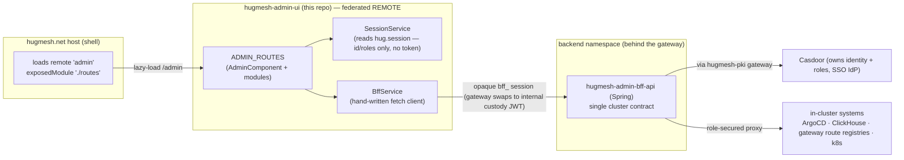
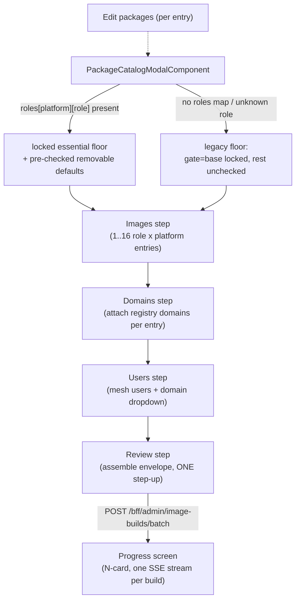
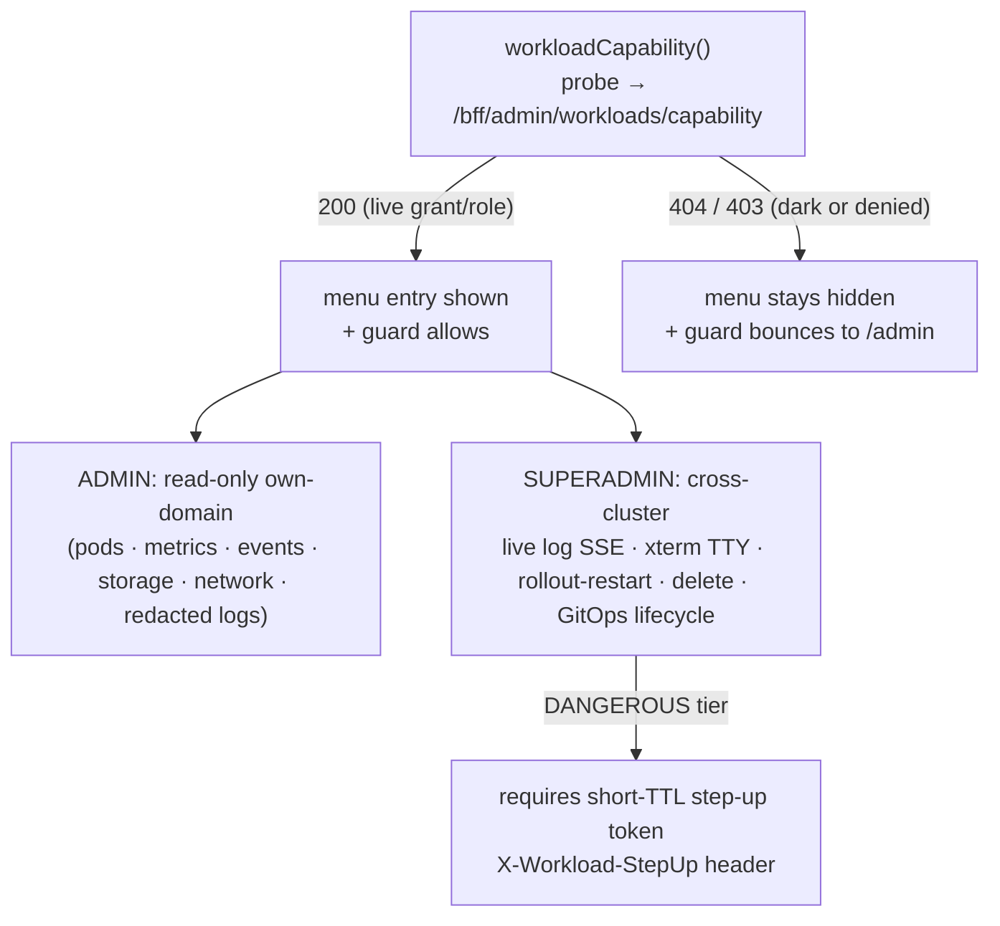
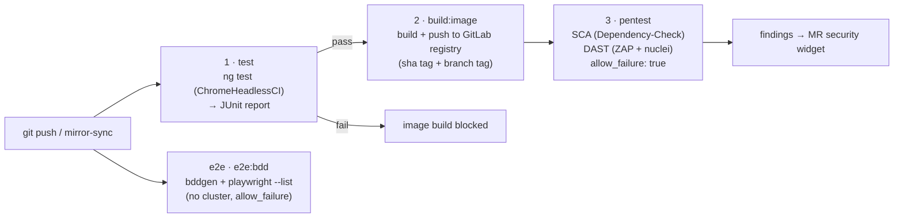

Admin console for the HugMesh platform. This repo is an **Angular 22
native-federation REMOTE** (remote name `admin`), split out of
hugmesh-social-ui. At runtime the **hugmesh.net host** loads its one exposed
module (`./routes`) and mounts `ADMIN_ROUTES` at **/admin**. The console is a
window onto the admin BFF and holds no authority of its own.

## Where it sits in the architecture

| Concern        | This repo                                                              |
| -------------- | --------------------------------------------------------------------- |
| Tier           | Frontend / micro-frontend (a federated **remote**, not a host)        |
| Namespace      | `hugmesh-frontend` — runs as its own nginx pod                         |
| Fronted by     | the **fe-gateway** at `/admin`                                         |
| Backed by      | **hugmesh-admin-bff-api** (Spring), in the backend namespace, behind the gateway |
| Auth model     | Casdoor **admin role** for most routes; **superadmin role** for the superadmin-only routes; the host route-guards `/admin` |
| Federation host| **hugmesh.net** (loads `remoteName: 'admin', exposedModule: './routes'`) |



> The diagram shows the **shipped** wiring. Casdoor **owns the roles**. This UI
> never mints or evaluates authority; it reflects the `hug.session` roles and
> lets the BFF and gateway enforce. The **Roadmap** section lists surfaces that
> are designed or in flight but not shipped here.

This is the admin surface of the multi-brand, multi-tenant platform, and it is
*presentation only*. The admin BFF brokers every privileged action; it is the
single cluster contract. The BFF reaches **Casdoor through the hugmesh-pki
gateway** for identity and role operations. It proxies in-cluster systems
(ArgoCD, ClickHouse, the gateway route registries), so their URLs and tokens
never leave the cluster.

> **Multi-tenancy note:** The platform runs a CA, gateway, BFF and UI per brand,
> with a least-privilege cascade (SUPERADMIN→ADMIN→MOD→USER). This console is the
> **per-brand ADMIN surface**. As shipped (✅), the base gate is the Casdoor
> `admin` role (`roles.includes('admin')`). A handful of routes also require
> `superadmin` (`superadminGuard`). One route uses the games-services derived
> roles. One route, `/admin/my-fleet`, uses the fleet-owner capability role
> (`fleetAdminGuard`). **The gateway and BFF enforce domain scoping**; the BFF
> stamps every call with the caller's domain. The client-side role flags are
> presentation only, and the BFF and gateway decide.

> State markers used below: **✅ shipped** = merged to `main`; **🚧 in-flight** =
> code on an open branch or PR; **🔭 planned** = designed, no code in this repo.
> Unmarked items are ✅ shipped.

## Current State

The route surface, role gate and BFF contract in this README are **✅ shipped on
`main`** (Angular 22 native-federation remote, exposed `./routes`). Every
auth, route, oidc and delegation branch has landed, or was a superseded draft
absorbed into `main`.

This UI **deliberately tracks a moving backend** in one place: the auth and
session bridge, recently unified across the platform.

- **Login is native, not a Casdoor redirect.** The old OIDC authorization-code
  (PKCE) redirect flow is gone platform-wide. Each service's own login-ui remote
  posts credentials to a login-style endpoint on that service's BFF, and
  **`hugmesh-user-bff` holds per-session JWT custody and refresh server-side.**
  **Casdoor is internal-only and never redirects the browser.** The browser holds
  only the opaque, HttpOnly **`bff_` cookie** (JS cannot read it) and the
  identity/roles `hug.session` localStorage payload. **The user never sees their
  own Casdoor JWT.**
- **The gateway is a pure Casdoor-JWT OAuth2 resource server.** A pre-security
  exchange filter swaps the opaque `bff_` session for the internal custody JWT,
  so the gateway's JWT validation and role gate run unchanged. Access is
  data-driven by the `gateway_route_access` table through
  `GatewayRouteAccessFilter` (admin-bff keeps the source of truth in Postgres and
  mirrors it to a Cassandra table that the gateways poll). ADMIN/GAME-MASTER
  bypass within their own domain; SUPERADMIN crosses domains. The SCG-5
  route-namespace move (`spring.cloud.gateway.routes` →
  `spring.cloud.gateway.server.webflux.routes`) is already applied across the
  gateways and the generator route templates. Cloudflare fronts prod.
- **Login, session and account logic is moving from admin-bff to user-bff.** The
  shared account, session, MFA and Casdoor-admin code now lives in the
  **`hugmesh-auth-core`** Maven artifact (2.5.1 on `main`; of the BFFs only
  user-bff and admin-bff consume it, both pinned to 2.5.1).
  **Account and session DATA still lives in admin-bff-db**; user-bff reaches it
  through admin-bff `/bff/internal` with `X-Internal-Token`, and over mTLS when
  `hugmesh.mtls.client.enabled=true`.
- Backend baseline (recently unified): **Spring Boot 4.0.7 / Spring Cloud
  2025.1.2 / Java 25 LTS**, on `hugmesh-parent` (metapom 2.8.0) +
  `hugmesh-commons` (2.1.0).

> For this UI: the opaque **`bff_` session lives in an HttpOnly cookie**, not in
> `hug.session`. The gateway swaps it for the JWT server-side. `BffService` sends
> it on every call with `credentials: 'include'`. The registration, login and
> service-token broker flow lives in the **login remote** (now backed by
> user-bff), not here.

## Routes (mounted by the host at `/admin`)

The remote exposes `ADMIN_ROUTES` (`src/app/admin.routes.ts`). The host mounts
them at `/admin`, so they resolve to the paths below. The **Guard** column is the
route-level `canActivate` in this remote. A dash means none: only the host
shell's admin-role guard on `/admin` gates the route client-side (see *Role gate
& session*). The **Menu** column says whether the `AdminComponent` nav links to
the route with a `routerLink`. All of these are ✅ shipped on `main`.

| Host path                 | View                                                | Component                   | Guard            | Menu |
| ------------------------- | --------------------------------------------------- | --------------------------- | ---------------- | ---- |
| `/admin`                  | Registration allowlist + admin menu                 | `AdminComponent`            | —                | (landing) |
| `/admin/usage`            | ClickHouse usage dashboard                          | `UsageComponent`            | —                | yes  |
| `/admin/namespaces`       | Namespace access grants                             | `NamespaceAccessComponent`  | —                | yes  |
| `/admin/delegation`       | Four tabs: access-role suspend/ban + lift, domain-lock add/remove, namespace grants, external-client role grants | `DelegationComponent`    | —                | yes  |
| `/admin/roles`            | Grant or revoke a role from the BFF's closed grantable list | `RolesComponent`    | —                | yes  |
| `/admin/route-access`     | Per-gateway role→URL access rules                   | `RouteAccessComponent`      | —                | yes  |
| `/admin/routes`           | Gateway route definitions                           | `RouteDefinitionsComponent` | —                | yes  |
| `/admin/isos`             | CI ISO download links                               | `IsoDownloadsComponent`     | —                | yes  |
| `/admin/argocd`           | ArgoCD applications dashboard                        | `ArgocdDashboardComponent`  | —                | yes  |
| `/admin/tasks`            | Guided admin-task wizard                             | `AdminTaskWizardComponent`  | —                | yes  |
| `/admin/backup`           | Start a cloud/USB backup                            | `BackupComponent`           | —                | yes  |
| `/admin/recovery`         | Restore a backup                                    | `RecoveryComponent`         | —                | yes  |
| `/admin/backups`          | Backup + restore history                            | `BackupHistoryComponent`    | —                | yes  |
| `/admin/cloud-backups`    | Cloud backups (per-domain + superadmin TOTAL, versioned, step-up restore) | `CloudBackupsComponent` | —          | yes  |
| `/admin/backing-services` | Managed backing-services console — self-hosted (default) vs managed-cloud mode per closed-catalog infra service | `BackingServicesComponent` | `superadminGuard` | no (route-only) |
| `/admin/announcements`    | Announcements (create + schedule + target)          | `AnnouncementListComponent` | —                | yes  |
| `/admin/themes`           | Per-domain theme editor (ramp, style, nav decoration) | `DomainThemesComponent` | —                | yes  |
| `/admin/test-reports`     | Test-architecture run history + on-demand run + download | `TestReportsComponent` | —                | yes  |
| `/admin/image-gen`        | Image-generation console: worklist BATCH wizard (up to 16 images/step-up, role-aware package tiers) + build history/detail + SSE progress + download, capability-gated | `ImageGenComponent` | —          | yes  |
| `/admin/forum`            | Forum (phpBB ACP) admin proxy                       | `ForumAdminComponent`       | —                | yes  |
| `/admin/appeals`          | Appeals-Decide console — CONTENT-moderation appeals (decide-proxy, domain-scoped) | `AppealsComponent`         | —                | yes  |
| `/admin/account-appeals`  | Account-ban appeal inbox — a curtailed user's own appeal against their `access_suspension` PROFILE ban; approve actually restores access (distinct from `/admin/appeals` above, which decides content-moderation rows) | `AccountAppealsComponent` | —          | yes  |
| `/admin/security`         | Self-service Security console: enroll/list/remove your OWN MFA factors (TOTP + WebAuthn passkey), regenerate recovery codes; also the inline `MfaStepUpDialogComponent` any privileged action reuses for the "requires step-up" 403 | `MfaSecurityComponent` | — | yes |
| `/admin/device-licenses`  | Device-ownership / SSH-operate-license registry      | `DeviceLicensesComponent`   | `superadminGuard` | superadmin-only |
| `/admin/device-pending`   | Pending headscale-node pick-list (assign into registry) | `DevicePendingComponent` | `superadminGuard` | superadmin-only |
| `/admin/phone-fleet`      | Sovereign MDM phone fleet registry — device management (managed/BYOD) + lock/unlock, device-reported Headwind or Azure Intune provider | `PhoneFleetComponent` | `superadminGuard` | superadmin-only |
| `/admin/my-fleet`         | Fleet-owner view over the caller's own phones only (lock/unlock, no mark-managed/owner-assignment) — the tenancy-walled twin of Phone fleet | `MyFleetComponent` | `fleetAdminGuard` | fleet-owner only |
| `/admin/fleet-entitlements` | Grant/update/revoke a subject's FLEET_ADMIN subscription (required to reach My fleet) | `FleetEntitlementsComponent` | `superadminGuard` | superadmin-only |
| `/admin/node-storage`     | Attach + register additional node-pinned storage     | `StoragePoolsComponent`     | —                | yes  |
| `/admin/device-radios`    | Attach a Meshtastic LoRa radio (USB serial, LoRa-WiFi TCP, or MQTT-broker WAN mesh) to a mesh node for the mesh↔Matrix bridge | `DeviceRadiosComponent` | — | yes  |
| `/admin/domain-capabilities` | Per-domain capability gate (first capability: `user-mesh-devices`) — superadmin grant + domain-admin enable, plus a platform-wide kill switch | `DomainCapabilitiesComponent` | — | yes  |
| `/admin/desktop`          | Desktop governance (Discover curation, sudo toggle, install inbox, remote-install + SSH terminal) | `DesktopGovernanceComponent` | —    | yes  |
| `/admin/egress-vpn`       | Import provider WireGuard/OpenVPN egress configs     | `EgressVpnComponent`        | `superadminGuard` | superadmin-only |
| `/admin/superadmin/domains` | Domain-registry (brand list) console + per-row provisioning-state chip | `SuperadminDomainsComponent`| `superadminGuard` | superadmin-only |
| `/admin/oidc-providers`   | Per-OIDC-provider default-role mappings              | `OidcProviderRolesComponent`| —                | no (route-only) |
| `/admin/games-services`   | Games app-store operator console                     | `GamesServicesComponent`    | `gamesServicesGuard` | no (route-only) |
| `/admin/superadmin/anubis`| Anubis PoW sidecar status + metrics (read-only)      | `AnubisAdminComponent`      | `superadminGuard` | no (route-only) |
| `/admin/workloads`        | Workload Console (HIDDEN tier — pod mgmt)            | `WorkloadConsoleComponent`  | `workloadConsoleGuard` | hidden (capability-probe) |
| `/admin/workloads/logs`   | Workload live-log view (SUPERADMIN)                  | `WorkloadLogsComponent`     | `workloadConsoleGuard` | hidden |
| `/admin/workloads/terminal` | Workload pod TTY (SUPERADMIN, xterm.js)            | `WorkloadTerminalComponent` | `workloadConsoleGuard` | hidden |

`AdminComponent` is the landing view (registration allowlist) and the admin
**menu**. The menu does **not** show every route:

- **Superadmin-only items** appear only when the session carries the `superadmin`
  role. The route guard (`superadminGuard`) enforces it a second time.
- **My fleet** appears only when the session carries the fleet capability
  (`fleet_admin` role, or the broader `admin`/`superadmin` roles; see
  `SessionService.isFleetAdmin()`). The route guard (`fleetAdminGuard`) enforces
  it a second time.
- The **Workload Console** is a **HIDDEN tier** entry. It appears only after a
  server-confirmed capability probe succeeds (`/bff/admin/workloads/capability`;
  `200` = live grant or role, `404` = dark or denied).
- A few routes (`/admin/backing-services`, `/admin/oidc-providers`,
  `/admin/games-services`, `/admin/superadmin/anubis`) have no menu entry. You
  reach them by direct navigation or from links in other views.

## Role gate & session

The host route-guards `/admin` behind the Casdoor **admin role**. This repo also
ships five `CanActivateFn` guards for finer routing inside the remote. One of
them, `adminGuard`, is attached to no route (see the note below the table). Every
client-side role check is **presentation only**; the BFF and gateway are the
authority:

| Guard                  | File                          | Allows when                                                                 | Guards |
| ---------------------- | ----------------------------- | --------------------------------------------------------------------------- | ------ |
| `adminGuard`           | `src/app/admin.guard.ts`      | `isAdmin()` (`roles` includes `admin`), else `/login`                        | **none today** — defined + unit-tested (`admin.guard.spec.ts`) but not wired into any `canActivate` in `ADMIN_ROUTES` |
| `superadminGuard`      | `src/app/superadmin.guard.ts` | `isSuperadmin()` (`roles` includes `superadmin`), else `/login`              | device-licenses, device-pending, phone-fleet, fleet-entitlements, egress-vpn, superadmin/domains, superadmin/anubis, backing-services |
| `fleetAdminGuard`      | `src/app/fleet.guard.ts`      | `isFleetAdmin()` (`roles` includes `fleet_admin`, or `admin`/`superadmin`), else `/login` | my-fleet |
| `gamesServicesGuard`   | `src/app/games-services.guard.ts` | `isGamesServicesAdmin()` **or** `isGamesServicesRunner()`, else `/login`  | games-services |
| `workloadConsoleGuard` | `src/app/workload-console.guard.ts` | `admin` or `superadmin` in the session (else `/login`) **and** a live server-confirmed `workloadCapability()` probe (200; otherwise bounced to `/admin`) | workloads + workloads/logs + workloads/terminal |

> **Why `adminGuard` is not wired (open decision).** The landing and the plain
> consoles (Guard "—" in the routes table, e.g. `/admin/node-storage`) have one
> client-side gate: the host shell's admin-role guard on its `/admin` parent
> route. Federation exposes only `./routes`, so the host cannot import this
> remote's function. The host check is a `canActivate`. It decides whether a
> console *activates*, but Angular runs a route's `loadChildren` before its
> `canActivate`, so the check does not stop the host from fetching this remote's
> `./routes` module. (Checked against a plain Angular 22 router in a throwaway
> Karma probe, not against the host itself.)
>
> Wiring this repo's `adminGuard` onto those routes was tried and backed out,
> because as written it is unsafe there. It reads only the `hug.session`
> localStorage mirror. The host's `SessionService` re-hydrates from
> `GET /bff/session` and deliberately never writes that mirror. After a
> mid-session role grant (a flow the host supports on purpose; see its
> `e2e/features/role-change-midsession.feature`), or with a cookie-only session
> that has no mirror, the host admits an admin to `/admin` and `adminGuard` then
> sends them to `/login`. The standalone dev shell has no `/login` route and
> nothing that writes `hug.session`, so `/` would stop rendering there. The
> owner must choose: **(a)** make this remote's `SessionService` hydrate from
> `/bff/session`, send a signed-in caller without the role to the host's
> `/home?denied=` page instead of `/login`, then wire it (never stacked onto the
> superadmin, fleet, games or workload routes, whose audiences it would narrow to
> `admin` holders); **(b)** wire it as is and accept both regressions; or **(c)**
> delete it. The details are in the `TODO(admin-guard)` on `adminGuard`. The four
> wired guards take their role check from the same mirror, so their routes
> already have the stale-mirror exposure; that predates this change and is
> unchanged. All of this is reasoned from the host-shell and admin-ui code, not
> reproduced on a live stack.

`SessionService` (`src/app/session.service.ts`) reads the shared **`hug.session`**
localStorage key written by the **login remote**. The key carries identity
(`id`, `label`, `provider`), `roles`, and `registrationComplete`. It **no longer
carries a bearer token or provider credentials**. The browser holds only the
opaque, HttpOnly `bff_` cookie (JS cannot read it). Every `/bff/*` call rides
that cookie (`credentials: 'include'`), and the gateway's
`BffCookieToBearerWebFilter` swaps it for the internal custody JWT server-side.
The login remote (now backed by `hugmesh-user-bff`, which holds the per-session
JWT custody) owns the flow that writes this key.

The service exposes role state as **computed signals**:

- `isAdmin` / `isSuperadmin`: derived from the `roles` array.
- `isFleetAdmin`: the fleet-owner capability that gates the My-fleet menu item
  and route. It is a dedicated `fleet_admin` role, or the broader
  `admin`/`superadmin` roles.
- `isGamesServicesAdmin` / `isGamesServicesRunner`: games-services derived roles,
  materialised in Casdoor and surfaced in `session.roles` with the `ROLE_` prefix
  stripped and lowercased.
- `fullyRegistered`: the registration-complete gate.

The host shell and every remote each hold their own `SessionService` instance
over the same localStorage key. All instances re-read on a same-document
broadcast (`hug-session-change`) and on cross-tab `storage` events. A session
change, such as registration completing in the login remote, shows up at once
with no page reload.

## BFF contract

`BffService` (`src/app/bff.service.ts`) is the hand-written typed client for
**hugmesh-admin-bff-api**. Every call sends `credentials: 'include'`, so the
opaque HttpOnly `bff_` cookie rides the request (the browser never holds a bearer
token). The gateway's `BffCookieToBearerWebFilter` swaps it for the internal
Casdoor custody JWT server-side. Calls target the admin-scoped endpoints and a
few superadmin-scoped ones. The registration, login and Matrix-Mastodon
service-token broker flow lives in the login remote (backed by user-bff).

The BFF base URL and the Uptrace URL come from runtime globals
(`__HUG_BFF_URL__`, `__HUG_UPTRACE_URL__`).

SSE streams (backup/restore progress, test-run progress, image-build progress,
live workload logs) use `fetch({ credentials: 'include' })` with a
`ReadableStream` reader, not raw `EventSource`. Every stream then shares the
cookie auth and error handling of the rest of `BffService`.

| Module                  | Endpoint(s)                                                | Notes |
| ----------------------- | ---------------------------------------------------------- | ----- |
| Registration allowlist  | `GET/POST /bff/admin/allowlist`                            | Invite by Gmail address or Discord username; the BFF invites the identity in Casdoor via the pki gateway. |
| Usage analytics         | `GET /bff/admin/usage` (+ Uptrace link)                    | Aggregated by the BFF from ClickHouse (events arrive via Kafka in prod). |
| Namespace access        | `GET/POST/DELETE /bff/admin/namespace-access`, `GET /bff/me/namespaces` | Grant users access to cluster namespaces (maps to Casdoor groups + k8s RBAC server-side); scopes what each user sees in observability. |
| Route **access**        | `GET/POST/DELETE /bff/admin/route-access`                 | Per-gateway role→URL allow/deny rules. Persisted in admin-bff Postgres (`gateway_route_access`, the source of truth) and mirrored to a Cassandra table the gateways poll; `GatewayRouteAccessFilter` in each gateway caches the rules and denies external access unless the caller's Casdoor roles match. Role-based locking of known services only — no arbitrary URLs. |
| Route **definitions**   | `GET/POST /bff/admin/routes`, `DELETE /bff/admin/routes/{pathPrefix}` | Admin-editable `url_registry` rows the gateway turns into live Spring Cloud Gateway routes (`path_prefix` → `downstream_uri`, under the SCG-5 `spring.cloud.gateway.server.webflux.routes` namespace). Distinct from route-access. |
| ISO downloads           | `GET /bff/admin/isos`                                      | Latest ISO artifacts from the GitLab/ArgoCD CI pipeline. Signed gateway-internal URLs; **KEYS material is never in these images**, so nothing secret is exposed. |
| ArgoCD dashboard        | `GET /bff/admin/argocd/applications[/{name}]`, `POST .../sync` | Role-secured proxy in the BFF (ArgoCD's own URL/token never leave the cluster). Live state; the sync mutation requires a typed `{confirm: name}` token. When ArgoCD is not wired the BFF returns `503` → an honest "ArgoCD not connected" notice. |
| Guided tasks            | `GET /bff/admin/tasks`, `POST .../steps/{stepId}/{validate\|preview\|apply}` | Data-driven step/task wizard over cluster-admin ops (gateway-route, RBAC/route-access, Casdoor user); a new server-side task appears with no UI change. Reuses the BFF's ReservedNames validation. |
| Backup & Recovery       | `POST /bff/admin/backups`, `POST /bff/admin/restores`, `GET /bff/admin/backups`, `GET /bff/admin/usb-devices`, SSE `GET /bff/admin/backups/{id}/events` | Cloud/USB targets with optional AES-256 encryption. The BFF orchestrates a k8s backup/restore worker Job and streams progress over SSE (read via `fetch` with `credentials: 'include'`, not `EventSource`, so the stream shares the cookie auth and error handling of every other call). The plaintext password is sent ONCE and never stored client-side; only the BFF stores a PBKDF2 verifier and the worker derives the key. |
| Cloud backups           | `GET/POST /bff/admin/cloud-backups`, `GET .../{id}/versions`, `GET .../{id}/artifacts`, `POST .../{id}/restore` (`X-Backup-StepUp`), `GET .../services`, `GET/PUT .../destinations`, `POST /bff/superadmin/cloud-backups/total` | Versioned per-domain backup sets (a run adds a version to the set); the TOTAL scope is superadmin-only. Destination is object store or node storage. Restore needs a step-up token. |
| Announcements           | `GET/POST/PUT/DELETE /bff/admin/announcements`             | See below. |
| Delegation / access-roles | `GET/POST/DELETE /bff/admin/access-roles/{role}/{user}`, `GET/POST/DELETE /bff/admin/domain-lock/{role}/{user}` | The narrow, AdminController-verified delegation surface: access-role suspend/ban (+ TTL or permanent) + lift, and domain-lock add/remove (force local-only, keeps the base role). Closed role vocabularies (`ROLE_MATRIX`/`ROLE_MASTODON`/`PROFILE`; `*_DOMAINLOCKED`). The same console also drives the namespace grants above and the external-client role grants (`ROLE_MATRIX_EXTERNAL_CLIENT`/`ROLE_MASTODON_EXTERNAL_CLIENT`, gated server-side on the `external-client-grant` domain capability). Direct role grant/revoke is the separate Roles surface below. |
| Roles (grant/revoke)    | `POST/DELETE /bff/admin/roles/{roleName}/{user}`           | Direct grant surface, distinct from access-roles: no timed-ban semantics, no reconcile loop. The vocabulary is closed server-side (`AdminController.GRANTABLE_ROLE_PATTERN`); `ROLE_SUPERADMIN` and the service roles are not grantable. Revoke is deliberately not capability-gated. Where the deployment reports `casdoorAdminEnabled: false`, the grant is recorded but does not reach Casdoor, and the console says so. |
| User search             | `GET /bff/admin/users/search?q=&limit=`                    | Typeahead behind every user picker. The BFF scopes the result to the caller's own brand and bounds `limit` to 1..25 (`UserDirectoryService.MAX_LIMIT`); a blank `q` returns `[]` without reading the directory; a failed search degrades to no suggestions. |
| Themes                  | `GET /bff/admin/themes`, `GET/PUT/DELETE /bff/admin/themes/{domain}` | Per-domain theme (ramp, style, decor), through the generated client (`DomainThemesStore`). The BFF decides which rows a caller sees. The editor cannot derive CSS, so saving a changed selection clears the stored stylesheet until the Studio re-renders it. |
| Appeals (decide-proxy)  | `POST /bff/admin/moderation/{id}/decide?approve=<bool>`    | Approve/deny a referred moderation request — **CONTENT**-moderation (posts/profiles). The admin-bff does NOT own the table — it **proxies** to hugmesh-federation-api, forwarding the caller's JWT so federation-api applies its own `@PreAuthorize(ADMIN\|SUPERADMIN)` + **per-domain scope** (a row in another brand is invisible/404). No list endpoint yet — the console drives the decide action by known id. |
| Account appeals         | `GET /bff/admin/account-appeals`, `POST .../{id}/decide?status=APPROVED\|DENIED` | The **ACCOUNT**-ban appeal inbox — distinct from Appeals above. Decides `account_appeal` rows a curtailed user files (via login-ui's `/login/appeal` → `POST /bff/me/appeal`) against their own `access_suspension` PROFILE ban. An `APPROVED` decide **clears the underlying suspension server-side first** (`SuspensionService.clear`) — the call fails outright if that restore fails, so a failed approve is surfaced as an error, never a false success. MOD is deliberately not gated in (MOD cannot ban/unban an account, so it cannot approve an appeal against one). |
| Forum admin             | `GET/POST/DELETE /bff/admin/forum/**`                      | Proxies the phpBB ACP capability (stats/usage/users/categories/moderation-queue/audit + ban/groups/categories/moderation approve-reject/styles/extensions). Every response is the `ForumOutcome` envelope with a `result` marker (`ok` / `stubbed` / `degraded:<reason>`). |
| Test reports            | `GET /bff/admin/test-reports[/{id}]`, `GET .../{id}/download`, `POST .../run`, SSE `GET .../{id}/events` | Durable test-architecture run history + on-demand trigger + credentialed (cookie) `tar.gz` download + live SSE progress. |
| Image generation        | `GET /bff/admin/image-builds`, `GET .../{id}`, `POST .../batch` (up to 16 entries, one step-up), SSE `GET .../{id}/events`, `GET .../{id}/image`, `GET .../{id}/keys` (`X-ImageGen-StepUp`), `GET .../catalog` | See *Image generation* below. |
| MFA (self-service + step-up) | `POST /bff/mfa/enroll/totp[/verify]`, `POST /bff/mfa/enroll/webauthn/options`, `POST /bff/mfa/enroll/webauthn/verify`, `POST /bff/mfa/assert/webauthn/options`, `GET /bff/mfa/factors`, `DELETE /bff/mfa/factors/{id}`, `POST /bff/mfa/recovery/regenerate`, `POST /bff/mfa/challenge` | Own hand-written client (`MfaService`, `src/app/mfa/mfa.service.ts` — NOT part of `BffService`, mirroring login-ui's `MfaService` against the same shared `hugmesh-auth-core` `MfaEnrollmentController`/`MfaChallengeController`). `/admin/security` (`MfaSecurityComponent`) is enroll/list/remove/regenerate; `MfaStepUpDialogComponent` is the reusable inline step-up challenge any privileged action shows on the platform's "requires step-up" 403 (see `isStepUpRequiredError`). Ships dark: every call 503s while `app.casdoor.mfa.enabled=false`. |
| Device licenses         | `GET /bff/admin/device-licenses`, `POST .../{id}/grant`, `POST .../domains/{domain}/grant`, `DELETE .../licenses/{id}` | **Superadmin**: the source of truth for device ownership / domain-residency / SSH operate-licenses. List is admin-readable (own-domain, BFF-scoped); every mutation is `hasRole('SUPERADMIN')`. Grants pin SSH key fingerprints; revoke is a CAS flip (never a delete). |
| SSH key issuance        | `GET /bff/admin/ssh-issue/devices/{deviceId}/issued-keys`, `POST /bff/admin/ssh-issue/issue?deviceId=` (`X-SshKeyIssue-StepUp`), `GET .../issued/{id}/private-key`, `DELETE .../issued/{id}` | **Superadmin**, folded into the Device Licenses console (per-device "Issued SSH keys" panel) — distinct from a license grant above: this MINTS a brand-new Ed25519 keypair (rather than pinning an operator-supplied fingerprint), registers it into the same license registry, and streams the private key back ONCE. List is admin-readable; issue/download/revoke require `hasRole('SUPERADMIN')` + a fresh step-up (`X-SshKeyIssue-StepUp` OR a fresh Casdoor-MFA stamp — the A5 unified step-up). A "requires step-up" 403 opens the shared `MfaStepUpDialogComponent` and blindly retries. Ships dark (`app.ssh-issue.enabled=false`): the list response's `enabled` field gates the Issue control and shows a notice rather than surfacing a raw 503. |
| Device pending pick-list| `GET /bff/admin/device-licenses/pending`, `POST .../register` | **Superadmin**: assign a headscale-enrolled node into the registry. `machineKeyFp` is an **opaque** token from headscale — never typed/edited; the BFF re-validates it against headscale at register. |
| Phone fleet (superadmin)| `GET /bff/superadmin/phone-devices[/{deviceId}]`, `PUT .../management`, `POST .../lock`, `POST .../unlock`, `PUT .../owner` (`X-PhoneLock-StepUp`) | **Superadmin**: the sovereign MDM phone registry — every Android phone that has self-reported (ingested) its provisioning snapshot. `management`/`lock`/`unlock` are step-up-gated, operator-set mutations (never device-claimed — `managementMode` is authoritative, distinct from the device-reported `mdmEnrolled` advisory hint); the device-reported `mdmProvider` field distinguishes the sovereign Headwind DPC from the co-equal Azure Intune (Graph) leg. `owner` assigns the fleet-tenancy wall (`physicalOwner` + `ownerDomain`) a fleet-owner needs to reach the surface below. |
| My fleet (fleet-owner)  | `GET /bff/admin/phone-fleet[/{deviceId}]`, `POST .../lock`, `POST .../unlock` (`X-PhoneLock-StepUp`) | The **PUBLIC**, tenancy-walled twin of Phone fleet above — a non-superadmin FLEET_ADMIN/ADMIN sees + locks/unlocks ONLY their own owned-and-managed devices (`physical_owner = caller AND owner_domain = caller-domain`, BFF-scoped); reads are fail-soft (a denied/un-entitled read shows an honest empty fleet). No mark-managed or owner-assignment here — those stay SUPERADMIN-only above. |
| Fleet entitlements      | `GET /bff/superadmin/fleet-entitlements`, `PUT/DELETE .../{subject}` (`X-PhoneLock-StepUp`) | **Superadmin**: grant/update/revoke the per-subject FLEET_ADMIN subscription (active flag + advisory seats + optional expiry) a non-superadmin needs to reach the "My fleet" owner surface above. |
| Node storage            | `GET /bff/admin/device-storage-pools`, `POST .../{deviceId}/pools`, `DELETE .../pools/{poolId}`, `POST .../pools/{poolId}/assignments`, `DELETE .../assignments/{id}` | **Admin-capable** (deliberate divergence from device-licenses) but **ownership-gated** downstream: an admin acts only on own-domain admin-owned nodes (403 on deny); superadmin-owned nodes are superadmin-only. Attach node-pinned storage + assign services (capacity-aware; over-subscription → 422). |
| Desktop governance       | `GET/POST /bff/admin/desktop/catalog`, `POST .../catalog/{id}/enable\|disable`, `DELETE .../catalog/{id}`, `GET /bff/admin/desktop/install-requests`, `POST .../{id}/decide?status=`, `GET/POST /bff/admin/desktop/sudo[/grant]`, `DELETE .../sudo/{grantId}`, `POST /bff/admin/desktop/step-up`, `POST /bff/admin/desktop/remote-install`, `POST /bff/admin/desktop/ssh-terminal/sessions?deviceId=`, superadmin `GET /bff/superadmin/desktop/dials[/{deviceId}]`, `POST .../{deviceId}/activate\|revoke` | Discover curation, install inbox, sudo grants, remote install and an SSH terminal. Remote install and the terminal need a token in `X-Device-Terminal-StepUp`; the step-up mint ships dark. The SSH-dials tab is superadmin-only and hidden when the dial leg answers dark. |
| Device radios            | `GET /bff/admin/device-radios`, `POST .../{deviceId}/radios`, `DELETE .../radios/{radioId}` | Attach a Meshtastic LoRa radio (USB serial, LoRa-WiFi TCP, or an MQTT-broker WAN mesh) to a mesh node so the meshbridge optional service can reach the LoRa mesh. **Admin-capable** like Node storage — ownership-gated downstream (own-domain admin-owned nodes only; superadmin unrestricted); each radio shows a propagation chip (pending/applied/failed/degraded). |
| Domain capabilities      | `GET /bff/admin/domain-capabilities`, `PUT .../{domain}/{capability}`, `PUT .../{domain}/{capability}/enabled` | Per-domain capability gate — first (and so far only) capability `user-mesh-devices`. Two independent keys (SUPERADMIN grants a domain, that domain's ADMIN enables it) plus a platform-wide kill switch; one route, server-scoped by the list endpoint into a superadmin cross-domain table vs. an admin own-domain toggle. |
| Egress VPN              | `GET /bff/admin/egress-vpn`, `POST .../configs`, `DELETE .../configs/{id}`, `POST .../configs/{id}/assign/{node\|domain}/{id}`, `DELETE .../assignments/{id}` | **Superadmin** mutations: import provider WireGuard/OpenVPN configs that nodes use for **outgoing** public egress. The `.conf` text is sent for parse-validation only — the BFF stores a `secret_ref` + metadata, never the private key (secrets off-DB / off-git). |
| Backing services         | `GET /bff/superadmin/backing-services`, `PUT .../{id}/mode` (`X-BackingServices-StepUp`) | **Superadmin**: the managed-vs-self-hosted axis (cloud-deploy Lane M3) over a closed catalog of infra services (object storage, SMTP, Kafka, analytics, Postgres, Cassandra, registry, secrets, PKI). Self-hosted is the byte-identical default; recording a managed mode (hosted endpoint + a creds *reference*, never key bytes) is **intent only** — the generator/effector leg converges it. Tier-3 (docs-only) services render read-only. |
| Domains (registry)      | `GET /bff/admin/domains[/{clusterDomain}]`, `POST /bff/admin/domains`, `PUT /bff/admin/domains/{clusterDomain}` | **Superadmin** (every endpoint): the runtime brand/domain registry (multi-tenancy PR9), the managed twin of the build-time `domains.conf`. No hard delete — soft-disable via `PUT enabled:false`; duplicate `cluster_domain` → 409. `caRef` is a CA *reference*, never key bytes. Each list row carries three `DomainResponse` provisioning-status fields (`caProvisioned` / `appsetRegistered` / `lastReconciledGeneration`, admin-bff #118) the console renders as a per-row chip: `isProvisioned()` = `caProvisioned && appsetRegistered` ⇒ a subtle "Provisioned" state, else a greyed/degraded "Registered — not yet provisioned" chip + helptext. The fields ship dark (default false until the generator domain-reconcile effector flips them), so at rest every freshly-registered domain reads not-yet-provisioned — the honest current state. Pure presentational (no new BFF call); colour is never the only signal (visible text + `.sr` prefix + `aria-label` + `aria-describedby`, `aria-disabled` on the degraded variant). |
| OIDC provider roles     | `GET /bff/admin/oidc-providers/roles`, `PUT/DELETE /bff/admin/oidc-providers/{provider}/roles` | Configure which roles new users auto-receive when first registering via a given OIDC identity provider. Domain-scoped for admins, all-domains for superadmin (BFF-enforced). |
| Games app-store         | `GET /bff/games-services/catalog`, `GET/POST /bff/games-services/instances`, `POST .../instances/{id}/{suspend\|resume\|terminate}` | Games-services control plane: browse the offered+enabled catalog and create/run/stop dockerized FOSS game-server instances. Authz is the games-services derived roles + domain scope at the BFF; the console greys out create for a runner. |
| Anubis (read-only)      | `GET /bff/admin/anubis/status`, `GET /bff/admin/anubis/metrics`            | **Superadmin** read-only: Anubis PoW challenge-sidecar status + configured settings + proxied Prometheus metrics. Settings are from the BFF's own config (changing them needs an ArgoCD deployment update), not from the Anubis runtime. |
| Workload Console        | `GET /bff/admin/workloads/capability`, `GET /bff/admin/workloads/**` (read, admin own-domain), `GET/POST/DELETE/PUT /bff/superadmin/workloads/**` (superadmin) | HIDDEN-tier. The whole surface 404s when dark (generator gate off / DB master flag off / no active grant). Admins get read-only own-domain (grant-gated); superadmin gets cross-cluster view + log stream + TTY + rollout-restart / delete / GitOps lifecycle intents (DANGEROUS tier requires a short-TTL step-up token in `X-Workload-StepUp`) + grant/config control plane. See below. |

## Announcements

`/admin/announcements` creates, schedules and targets announcements through the
admin BFF (`/bff/admin/announcements`, ROLE_ADMIN). Each announcement carries:

- `body_html`: a WYSIWYG HTML body shown to end users.
- `state`: `draft` | `published` | `archived`.
- `starts_at` / `ends_at` / `timezone`: an optional display schedule.
- `priority` and a `dismissible` flag.
- **Four per-surface target flags.** One announcement can appear on any mix of:
  the logged-in **Home** top banner, the public **Login** page (anonymous
  visitors included), **Mastodon/akkoma** (a local-only admin announcement the
  BFF propagates on publish), and the **Forum** main page.

The BFF owns the per-surface read endpoints (`/bff/announcements/home`,
`/bff/public/announcements/login`, `/bff/announcements/forum`) and applies the
authoritative ACTIVE rule. The UI computes an "active now" badge client-side, for
display only.

**HTML safety:** `body_html` reaches end users, anonymous visitors included, so
the BFF (the authority) **sanitises it server-side**, and the editor **never uses
raw `innerHTML`**. The live preview renders the sanitised body in a **sandboxed
null-origin `srcdoc` iframe** (`sandbox=""`: no `allow-scripts`, no
`allow-same-origin`), the same two-wall model as the hugmesh-user-ui card
builder.

`AnnouncementsStore` is the signal-backed typed client. Note (✅):
`ng-openapi-gen` **is** wired and the generated client **is committed** to
`src/app/api/` (see *OpenAPI client generation* below). `AnnouncementsStore` is
the **first module migrated onto the generated client** (`DomainThemesStore` is
the second). It calls the generated `AnnouncementAdminControllerService` and
reuses the generated `Announcement` / `AnnouncementRequest` models. The
catch-all `BffService` is still hand-written against the shared API contract,
pending its own migration.

## Image generation ✅

`/admin/image-gen` (`ImageGenComponent`, ADMIN/SUPERADMIN) is a device-image build
console over the admin-bff `ImageBuildController` (`/bff/admin/image-builds`).
Builds start from the **worklist BATCH wizard**
(`ImageGenWorklistWizardComponent`): up to **16** role×platform image entries,
authorised by **one** step-up, in four steps.

1. **Images**: per-entry branding, tailnet-SSO and Home-encryption sub-forms,
   shown according to the catalog's desktop-or-node image class.
2. **Domains**: attach registry domains per entry.
3. **Users**: mesh users, with a registry-domain dropdown.
4. **Review**: assemble the frozen worklist v1 envelope and submit.

The envelope carries only per-image content axes. It never carries a brand, org,
superdomain or per-build domain; the server always derives those, and re-enforces
the own-domain wall. The wizard also gates cross-tenant options (tailnet/SSO on
branded desktops, cross-brand composition) to SUPERADMIN, as a UX affordance
only. The BFF is the authority.

After submit, `ImageGenStore` opens **one SSE reader per build** in the batch (a
`Map<buildId, BuildStream>`, each with its own `AbortController`). The progress
screen shows one live card per image, and one broken stream never disturbs its
siblings.

**Package selection (role-aware tiers, ✅ shipped PR #77):** each entry's "Edit
packages" opens `PackageCatalogModalComponent`, which shows the BFF's gate-grouped
package catalog as a tree. If the catalog has a generator-emitted
`roles[platform][role]` tier map, the modal locks that role's `essential` atoms as
a checked, disabled floor; pre-checks `removable` atoms as the toggleable default
set; and folds the atoms of any enabled adhoc add-on into the locked floor. The
role's real package baseline drives the tree, not a flat gate list. **Legacy
fallback:** a catalog without `roles` maps (or with an unknown or uncovered role)
behaves as before. The gate-`base` atoms are the locked essential floor, every
other atom starts unchecked, and the wire output is byte-identical to the
pre-tiers behaviour.

**Capability gate; ships dark:** the console needs an x86 build node, so it is
gated on the `buildNode` platform capability (`CapabilityGateComponent`). When the
capability is absent, an honest notice replaces the wizard and the history table;
the console is never broken. The backend also ships dark
(`imagegen.launch.enabled=false`) and shows a stub notice.

**Keys download** (`GET /bff/admin/image-builds/{id}/keys`) needs a step-up. A
"requires step-up" 403 opens the inline `MfaStepUpDialogComponent`, and the same
download retries once when the dialog reports success. The client never shows or
stores a private key; the backend guarantees the streamed bundle is non-secret.



## Workload Console (HIDDEN tier) ✅

`/admin/workloads` is a pod-management module, the podman/OpenShift equivalent. It
is **registered but never auto-surfaced**. The menu entry and the
`workloadConsoleGuard` both rest on one server-confirmed fact: the
`workloadCapability()` probe. The probe returns `200` with a capability body when
the caller has a live grant or role, and `404` on deny. A `403` would reveal that
the feature exists, so it is not used. When the feature is dark (generator gate
off, DB master flag off, or no active grant), the whole surface answers `404`.



Tiering mirrors the BFF:

- **Admins** call `/bff/admin/workloads/**`: read-only, own-domain, grant-gated.
- **Superadmins** call `/bff/superadmin/workloads/**`: the mutating and dangerous
  surfaces (rollout-restart, delete, GitOps lifecycle). Dangerous-tier mutations
  need a short-TTL step-up token in the `X-Workload-StepUp` header.
  For ordinary names, rollout-restart and pod delete fall in the BFF's separate
  RUNTIME_MUTATE tier. That tier does **not** validate step-up, and the
  `dangerous_tier_enabled` kill does not cover it. But the BFF picks the tier by
  substring match on the raw path, and it checks the dangerous markers first. So a
  namespace, workload or pod whose name **begins with** `exec`, `lifecycle` or
  `port-forward` (or namespace `logs` with a name beginning `stream`) is
  classified DANGEROUS. For those names the kill applies, and the call succeeds
  only with a valid step-up token; otherwise it is a body-less `HTTP 403`. This
  looks like a BFF classifier bug (read in `WorkloadPathClassifier.tierOf` on
  admin-bff `81edc7c`, `origin/main` on 2026-10-07; not run against a live
  cluster). The console forwards its minted token on both calls, which makes those
  names work once a token is minted. For every other name the token is forwarded
  for parity only and is not the gate.

The live log stream uses SSE through a cookie-authenticated `fetch`. The pod TTY
uses `@xterm/xterm`.

## OpenAPI client generation ✅ (wired + committed)

`ng-openapi-gen` is a devDependency and **is wired**. `npm run gen:spec` copies
the admin BFF's committed OpenAPI spec to `openapi.json`. `npm run gen`
regenerates a typed client into `src/app/api/` (config in `ng-openapi-gen.json`).
The generated output **is committed** there (per-controller services and models).
`AnnouncementsStore` (`AnnouncementAdminControllerService` and generated models)
was the first consumer; `DomainThemesStore` (`DomainThemeAdminControllerService`)
is the second. The catch-all `BffService` stays hand-written against the shared
API contract until it migrates too.

`gen:spec` defaults to the committed spec of the sibling checkout,
`../hugmesh-admin-bff-api/src/main/resources/openapi/openapi.json`. Set
`ADMIN_BFF_SPEC` to point elsewhere.

## Accessibility

Every module follows the platform a11y baseline:

- Inline validation errors surfaced in `role=alert` live regions.
- Async progress announced via `role=status` / `aria-live`.
- Status conveyed with text, not colour alone.
- `<label for>` on every field.
- Confirm-before-destructive guards (e.g. the ArgoCD sync confirm is a
  focus-managed `role=dialog aria-modal`).
- All controls are keyboard-operable.

The standalone dev shell also provides a skip link and a `<main id="main">` landmark.

## Federation

`federation.config.js` (composed through `federation-base.js`, the shared HugMesh
federation base) exposes one module:

```
./routes  →  src/app/admin.routes.ts  (exports ADMIN_ROUTES)
```

The remote name `admin` and the exposed module key `./routes` **must stay
unchanged**. The host references these exact strings, and renaming either breaks
the admin console in production.

The build emits `dist/admin/browser/remoteEntry.json`. The host fetches its
`exposes` entry to lazy-load the routes at runtime.

## Develop

```bash
npm install
npm start            # ng serve admin → http://localhost:4204 (standalone dev shell)
```

The standalone dev shell (`AppComponent`, selector `hug-admin-root`) mounts
`ADMIN_ROUTES` at `/`, so the remote is browsable alone. In production the host
loads the `./routes` module directly and the dev shell is unused.

## Build

```bash
npm run build        # ng build admin
```

The Angular application builder nests its output under **`dist/admin/browser/`**
(`remoteEntry.json` included).

## Test

```bash
npm test             # ng test admin --watch=false --browsers=ChromeHeadlessCI
```

In CI this is the `test` stage (a `node:24-alpine` + Chromium container, JUnit
through `karma-junit-reporter`). It **gates** the image build; see *Deploy*.

## Deploy

`Dockerfile` builds the remote and serves `dist/admin/browser` through nginx.
nginx sends `Access-Control-Allow-Origin "*"` (so the host can fetch
`remoteEntry.json` and chunks cross-origin), falls back to `/index.html` for the
SPA, and answers `GET /healthz` with `200`. It also sets the baseline security
headers on every response (`always`): `X-Content-Type-Options: nosniff`,
`X-Frame-Options: DENY`, `Referrer-Policy: strict-origin-when-cross-origin` and
`Strict-Transport-Security` (HSTS, 1y + `includeSubDomains`). A **strong
nonce-based `Content-Security-Policy`** goes with them: no `unsafe-inline` or
`unsafe-hashes` in `script-src`, and a per-request `$request_id` nonce that
`sub_filter` injects into every `<script>` tag of `index.html` (`nginx.conf` has
the full policy and the rationale). COEP/CORP and Permissions-Policy stay
deferred until per-UI tuning and live-cluster browser validation. The image
builds with `--base-href=/admin/`. At container start the hook
`docker-entrypoint.d/50-hug-theme.sh` writes the brand stylesheet from
`HUG_THEME_CSS` (or the legacy `SNAP_THEME_CSS`) to `/tmp/hug-theme.css` and its
twin `/tmp/snap-theme.css`; nginx serves them at `/hug-theme.css` and
`/snap-theme.css` with `Cache-Control: no-store`. With both variables unset, the
file is empty and the shipped default brand shows.

> ✅ **CSP smoke-verified (2026-07, container from this Dockerfile).** After
> `docker build` and `docker run`, `curl` showed: the CSP header on `/` **and** on
> SPA-fallback deep links; the header nonce matching the `nonce="…"` injected into
> all three `index.html` `<script>` tags of the same response; a fresh nonce per
> request (two `GET /` give two nonces); JS bundles served untouched (`sub_filter`
> rewrites HTML only; `Content-Type: application/javascript`, no nonce strings in
> JS); and `/healthz` still `200` with the security headers. The smoke does NOT
> cover real-browser execution of the native-federation module graph under the
> nonce CSP (es-module-shims nonce propagation). That stays on the live-cluster
> browser validation list.

The container runs as its own pod in the **hugmesh-frontend** namespace, behind
the **fe-gateway** at `/admin`. The canonical namespaces and gateway names are
`hugmesh-frontend`/`hugmesh-backend` and
`hugmesh-pki-gateway`/`hugmesh-be-gateway`/`hugmesh-fe-gateway`. A `Dockerfile`
comment names the frontend namespace; the workload-console components default to
`hugmesh-backend`; `route-access.component.ts` lists the three gateways.

CI (`.gitlab-ci.yml`) has **four stages**. It runs on push and mirror-sync, and
each job has its own `rules:` (default branch, merge requests, tags; listed per
job below). CI is **GitLab** across the platform. The one GitHub Actions workflow
is `.github/workflows/release.yml`, which publishes the image to GHCR (see
*Releases* below).

1. **`test`** (default branch, merge requests, tags): `ng test` in a
   `node:24-alpine` + Chromium container, with JUnit reports from
   `karma-junit-reporter`.
2. **`e2e`** (default branch, merge requests): `e2e:bdd` (`needs: []`, parallel
   with `test`) installs the `e2e/` Playwright + playwright-bdd harness in a
   `node:24` container. It proves the Gherkin features compile (`bddgen`) and
   every scenario is discoverable (`playwright test --list`), with **no live
   cluster**. Ships dark; see `e2e/README.md`. `allow_failure: true`, so it does
   **not** gate the image build.
3. **`build`** (default branch, tags): `build:image` (`needs: [test]`) builds the
   Docker image and pushes it to the in-cluster GitLab registry, tagged with the
   release tag or git SHA plus a moving branch tag. It starts only after `test`
   passes. `e2e:bdd` is not in its `needs`, so it cannot block the build.
4. **`pentest`** (default branch, merge requests): includes the central OWASP
   harness from `hugmesh-generator`. `pentest:sca` runs Dependency-Check;
   `pentest:dast` runs an authenticated ZAP baseline scan plus custom probes and
   nuclei templates. Both use `allow_failure: true`, so findings show in the MR
   security widget without blocking the build.

The `Makefile` mirrors the `pentest` stage for local use. `make pentest-sca`
(`npm audit` plus an optional dockerized OWASP Dependency-Check) needs no setup.
`make pentest-dast DAST_TARGET_URL=https://host` hands off to the same generator
`run-pentest.sh` harness that CI uses (ZAP + nuclei). If the generator's
`tests/pentest` harness is not checked out as a sibling repo, it shallow-clones
it.



**Images carry no KEYS material** — keys are supplied from the USB at first boot.

## Releases

The version lives in `package.json` (and the root entries of
`package-lock.json`, which must match). The current version is a beta,
`0.3.0-beta.1`: the console is in the default mesh and has had live checks,
but nothing is final yet. A fix during the beta raises the last number
(`-beta.2`, `-beta.3`, ...).

`.github/workflows/release.yml` publishes `ghcr.io/hugmesh/hugmesh-admin-ui`:

| Trigger | Image tags | Also |
|---|---|---|
| push to `main` | `main`, `sha-<12 hex>` | |
| push of tag `v<version>` | `<version>`, `beta` (beta versions only), `sha-<12 hex>` | GitHub Release, marked prerelease and never "latest" |
| manual run on `main` | same as a push to `main` | |
| manual run on a `v<version>` tag | re-runs that release; an existing version tag is never rebuilt or overwritten | creates the GitHub Release only if it is missing |

Every run first checks the version (a tag must be exactly `v` + the
`package.json` version), then runs the unit suite, and only then builds and
pushes. `latest` is never pushed. To cut a release: bump the version in
`package.json` and `package-lock.json` in a PR, merge it, then tag the merge
commit `v<version>` and push the tag.

The jobs run on the self-hosted runner named by the repo variable
`RUNS_ON_PUBLISH` (a JSON array such as `["self-hosted","Linux","X64"]`) only
for `main` and `v*` tags; otherwise, and whenever that variable is unset, they
run on hosted `ubuntu-latest`. The workflow has no pull-request trigger, so it
never runs code from a fork.

## Roadmap (not shipped in this repo)

These items are design-complete or in-flight elsewhere in the platform and are
expected to add new surfaces to this remote. **None of the items listed here is shipped
here today.** Do not read the Routes or BFF contract tables above as covering any of them.

- **🚧 Desktop app governance maturity** — UI shipped (above); fleet-side backend effectors (Discover curation sync, remote-install via device-ssh-license, admin-bff effector wiring) continue alongside the generator.
- **🚧 Notifications EXTERNAL channels** (in-flight). Matrix DM / Akkoma feed / phpBB /
  email adapters atop the shipped in-app notifications MVP. Any admin-side channel /
  preferences configuration UI will land as a future surface.
- **🔭 Managed backing-services effector maturity.** The console (above) is ✅ shipped
  and records intent; the generator/effector leg that actually converges a service to
  its managed-cloud target continues alongside the platform's cloud-deploy work.

**Moved out of this list — already on `main`.** These used to be listed above as open; the
consoles and their client calls ship in this remote, so they are covered by the Routes and BFF
contract tables, not by the Roadmap:

- **✅ Workload Console grant-issuance / master-config control plane.** `WorkloadConsoleComponent`
  issues and revokes grants (`POST` / `DELETE /bff/superadmin/workloads/grants`) and toggles the
  per-domain kill switch (`PUT /bff/superadmin/workloads/config/{domain}`); the step-up token is
  forwarded on rollout-restart and pod delete (PR #13).
- **✅ Encrypted versioned backups.** The Backup, Backup history and Cloud backups consoles
  (`/admin/backup`, `/admin/backups`, `/admin/cloud-backups`) ship here, including the
  Encryption fieldset and the Encrypted column (`src/app/backup/`, `src/app/cloud-backups/`).
  The Velero/kopia leg is a platform-side deployment posture, not UI work: the admin-bff
  `VeleroBackupEffector` ships dark behind `app.backups.effector.enabled` (a created backup set
  stays `pending` until the operator flips it), and the generator marks it shipped
  (`hugmesh-generator` `docs/ARCHITECTURE.md`, `docs/CLOUD-BACKUPS.md`).
- **✅ Per-node attached storage, egress VPN and device-license registry.** All three consoles
  ship here (`/admin/node-storage`, `/admin/egress-vpn`, `/admin/device-licenses`) and the
  generator marks egress-VPN and per-node storage shipped (`hugmesh-generator`
  `docs/ARCHITECTURE.md`). The same correction was made in `hugmesh-admin-bff-api` issue #97.

The **Superadmin Service Catalog** UI is **not** part of this remote — it lives in its own
federated remote (`hugmesh-superadmin-service-catalog-ui`); its data layer is on the
admin-bff `main`, and so are its AddService effector (ArgoCD create/delete; dark
unless `app.appstore.effector.enabled`) and ✅ Kaniko in-cluster builder
(`KanikoBuildLauncher`, admin-bff PR #152; gated by `app.appstore.builder.enabled`).
Its tailnet superadmin-gateway and federation-registration legs are 🚧 in-flight.
Readers should not expect those screens here.
